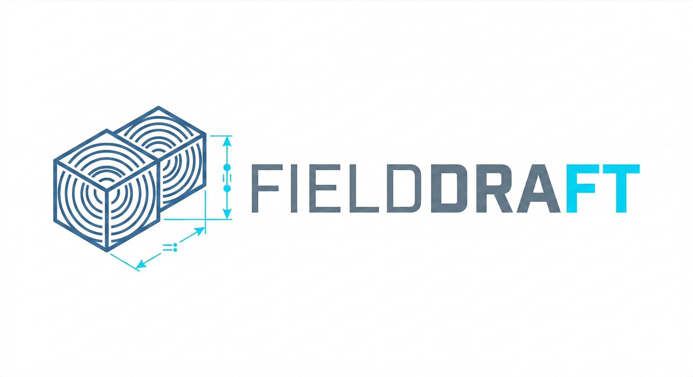

# FieldDraft — Projektbeschreibung



> © 2026 Sebastian Leonardo Baltes, Deutschland. Alle Rechte vorbehalten.
> Dieses Dokument einschließlich aller Inhalte, Konzepte und technischen Beschreibungen ist urheberrechtlich geschützt.
> Jede Vervielfältigung, Verbreitung, öffentliche Zugänglichmachung oder sonstige Verwertung – ganz oder teilweise – bedarf
> der vorherigen schriftlichen Zustimmung des Rechteinhabers. Vertraulich – nicht zur Weitergabe bestimmt.

## 1. Kurzfassung

**FieldDraft** ist ein browserbasierter, parametrischer 3D‑Modeller, der sich in Bedienung und Funktionsumfang an **Onshape** orientiert, technisch aber einen radikal anderen Weg geht: Statt eines klassischen B‑Rep/NURBS‑Kernels (OpenCASCADE, Parasolid, ACIS) setzt FieldDraft auf einen **SDF‑basierten Geometriekern** (Signed Distance Fields / Implicit Modeling).

Zielanwendung ist der **FDM/SLA‑3D‑Druck** in einem Bauraum von typischerweise bis zu 300 × 300 × 300 mm mit praxisrelevanter Präzision von ca. 0,1 mm.

FieldDraft ist bewusst **kein** vollständiger Onshape‑Ersatz für zerspanenden Maschinenbau, sondern ein **vereinfachter Onshape‑Clone** für den Maker‑ und Hardware‑Startup‑Workflow: genug Parametrik und Constraint‑Sketching, um Prototypen, Gehäuse, Halterungen und Mechanik‑Teile sauber zu konstruieren — ohne die Altlasten der CNC‑Welt mitzuschleppen.

Der Name **FieldDraft** beschreibt das Produkt wörtlich: ein **Draft**‑Tool (technisches Zeichnen / Konstruieren), das im **Field** (Distanzfeld) rechnet.

## 2. Motivation

Die zugrundeliegende Recherche (siehe `README.md`) hat gezeigt, dass es unter Linux für ein Hardware‑Startup mit Patent‑Ambitionen und schmalem Budget de facto kein ideales CAD gibt:

- **Onshape Free** — IP‑Vorveröffentlichung, damit patent­rechtlich toxisch.
- **Onshape Standard/Professional** — zu teuer in der Pre‑Seed‑Phase (~1.500 € / Nutzer / Jahr).
- **SolidWorks, Fusion, Alibre, Solid Edge** — kein nativer Linux‑Client.
- **Plasticity** — kein Light Mode / kein UI‑Scaling, keine Parametrik, keine 2D‑Ableitung.
- **FreeCAD / Ondsel** — UX‑Schwächen
- **BricsCAD Mechanical** — teurer Einmalkauf, eher klassisches CAD.

Gleichzeitig zeigt die Analyse der benötigten Funktionen, dass für den **3D‑Druck‑Use‑Case** die Schwächen klassischer B‑Rep‑Kernel (TNP, co‑planare Booleans, Fillet‑Edge‑Cases, Single‑Thread‑Performance) **strukturell vermieden** werden können, wenn man auf einen SDF‑Kern umschwenkt:

- Boolesche Operationen sind in SDFs trivial und mathematisch robust (`min`, `max`, `−`) — sie kennen die topologischen Grenzfälle von B‑Rep‑Solvern (co‑planare Flächen, Zero‑Thickness‑Berührungen, TNP) strukturell nicht.
- Offsets sind eine einfache Konstanten‑Subtraktion `f(x) − d`, ohne Self‑Intersection‑Probleme.
- Garantierte Wasserdichtigkeit: Aus einem SDF‑Graphen lässt sich per Dual Contouring ein Mesh ableiten, das mathematisch garantiert keine Löcher oder Self‑Intersections enthält — der Slicer bekommt immer ein druckbares STL.
- Bei 0,1 mm Mesh‑Auflösung ist der „Potato‑Meshing”‑Effekt der klassischen Marching‑Cubes‑Variante für FDM‑Druck praktisch irrelevant, da eine 0,4‑mm‑Düse ohnehin keine perfekt scharfen Kanten druckt; Dual Contouring statt Marching Cubes erhält scharfe mechanische Kanten zusätzlich.

FieldDraft zielt damit auf die Lücke: **Onshape‑artige UX, Plasticity‑artige Geschwindigkeit, FreeCAD‑artige Datenhoheit — nativ im Browser, offline‑fähig, unter Linux.**

## 3. Zielgruppe und Anwendungsfälle

**Primär:**
- Hardware‑Startups in der Prototyping‑Phase unter Linux.
- Maker, 3D‑Druck‑Enthusiasten, Robotik‑Hobbyisten.
- Konstrukteure, die Gehäuse, Halterungen, Gimbal‑Arme, Mounts und einfache Mechanik drucken wollen.

**Typische Aufgaben:**
- Hüllgeometrien von Zukaufteilen (Motoren, Platinen, Sensoren) manuell modellieren oder als STL/OBJ‑Referenz laden (STEP‑Import ist Ausblick, siehe §7).
- Booleans gegen importierte Referenzgeometrien, um passgenaue Kavitäten und Bohrungen zu erzeugen.
- Parametrische 2D‑Sketches mit Constraint‑Solver für exakte Maße.
- Export als STL/GLB (später ggf. 3MF) für den Slicer (Bambu Studio, PrusaSlicer, Cura, OrcaSlicer).

**Explizit außerhalb des Scopes (für das MVP):**
- Normgerechte 2D‑Zeichnungsableitung für Zerspaner.
- Spritzguss‑DFM (Entformungsschrägen, Schwindungsanalyse).
- Blechabwicklung.
- Vollwertige Assemblies mit kinematischen Gelenken (Mates) — Kinematik wird extern (z. B. in einer Three.js‑basierten Engine) gelöst.
- FEM‑Simulation.
- Class‑A‑Surfacing.

## 4. Technische Architektur

FieldDraft besteht zunächst aus zwei Schichten: einem **Rust/WASM‑Geometriekern** im Browser und einem **React‑Three‑Fiber/WebGPU‑Frontend**. Die Verbindung zwischen Kernel und Frontend läuft über eine **Zero‑Copy‑Memory‑Brücke**. Ein **Go‑Backend‑Server** für Authentifizierung, Projektverwaltung und Synchronisation ist als spätere Phase vorgesehen — im MVP läuft alles rein clientseitig, der Projektzustand wird nach **`localStorage`** persistiert.

### 4.1 Rust/WASM‑Kernel (Backend im Browser)

Verantwortlich für alles, was Mathematik und Zustand ist — läuft ohne DOM‑Zugriff im Linear Memory von WebAssembly. Der Kernel ist kein reiner SDF‑Evaluator, sondern ein **hybrider Kern** aus drei eng gekoppelten Schichten: ein **CSG‑Graph mit Provenance‑Tracking** (mathematische Wahrheit), ein **Dual‑Contouring‑Mesher** (skalierbare Anzeigegeometrie) und ein daraus abgeleiteter **B‑Rep‑Proxy** (topologische Selektions‑ und Snapping‑Schicht). Diese Drei‑Schichten‑Architektur ist zwingend, weil reines Raymarching auf CSG‑Bäumen über mehrere Bodies und komplexe Sketches nicht skaliert (Instruction‑Cache‑Kollaps der GPU, siehe §11) und ein klassischer B‑Rep‑Kernel im WASM‑Payload zu groß und an Booleschen Grenzfällen zu fragil wäre.

- **Feature‑Tree als sequentielles Programm (Feature‑as‑Function):** Der Kernel speichert den parametrischen Baum nicht als passiven annotierten DAG, sondern als **geordnete Liste von Funktionsaufrufen** — jedes Feature ist eine Funktion mit der kanonischen Signatur `execute(ctx: &mut Context, id: &FeatureId, def: &Definition) -> Result<()>`. Regeneration heißt: den Vektor der `FeatureCall`s von oben nach unten durchlaufen und jeden Call auf dem mutierenden `Context` ausführen. Damit übernimmt FieldDraft das Onshape‑FeatureScript‑Modell wörtlich (Feature Type = Funktion, Feature im Tree = Funktionsaufruf, Parameter = Funktionsargumente, Part Studio = Build‑Funktion, Regeneration = Ausführung der Build‑Funktion, Rollback Bar = Return‑Statement). Die Details der Infrastruktur — Feature Registry, Schema‑Reflexion, JS‑API, Query‑System, Regeneration Worker, Determinismus‑Prinzip — sind in §4.6 beschrieben; dieser Bullet legt nur das Datenmodell fest.

  Jede Feature‑Instanz trägt eine **hierarchische, getypte `FeatureId`** (Pfad‑Struktur `FeatureId { parent: Option<Box<FeatureId>>, local: SmolStr }`, Debug‑Darstellung `extrude_3.op`, `fillet_7.mask_0`). Sub‑Operationen eines Features erzeugen Kind‑IDs unter dem Parent — wenn K10 drei Spatial Masks für ein Fillet anlegt, bekommen sie deterministisch `fillet_7.mask_0`, `fillet_7.mask_1`, `fillet_7.mask_2` und bleiben damit klar dem Parent‑Feature zugeordnet. Die CSG‑Leaves und inneren Operatoren (`Union`, `Difference`, `Intersection`, `Transform`, `Pattern`, Spatial Mask, Mesh‑to‑SDF, …) leben weiterhin im niedrigeren `CsgNode`‑AST, sind aber nicht mehr vom Frontend direkt adressierbar — Mutationen laufen ausschließlich über `Feature::execute`, das den CSG‑Context fortschreibt. Geometrische Referenzen zwischen Features werden über **Queries** (§4.6) ausgedrückt, die das Provenance‑System als lazy Such‑Sprache nutzen; damit ist das Topological Naming Problem strukturell gelöst, weil Referenzen nie auf flache IDs festnageln, sondern auf Suchkriterien („das Face, das von Extrude 1 an Position 0 erzeugt wurde") — bei Re‑Evaluation wandert die Referenz automatisch mit.

- **Multi‑Body‑Isolation:** Jeder eigenständige Körper im Part Studio besitzt seinen **eigenen** CSG‑Graphen, eigenen BVH und eigenen Mesh‑Cache. Es gibt keine globale „Monster‑Gleichung", die alle Bodies verknüpft. Zwei Bodies werden mathematisch nur dann gekoppelt, wenn der User explizit eine Boolean‑Operation zwischen ihnen ausführt. Ohne diese Isolation würde die SDF‑Auswertung bei mehreren Bodies an der Instruction‑Cache‑Grenze der GPU und am asymptotischen O(N) der naiven Punkt‑Auswertung kollabieren.

- **SDF‑Auswertung mit Provenance:** Jede Punkt‑Auswertung `f(p)` liefert nicht nur den Distanzwert, sondern zusätzlich die Liste der **Contributors** — die Leaf‑IDs, deren Distanzfeld am Punkt `p` aktiv den Wert dominiert (innerhalb eines Epsilons ε). Die Auswertung von `min(f_A, f_B)` propagiert beide IDs, sobald `|f_A − f_B| < ε`; sonst nur die ID des dominanten Terms. Aus dieser Contributor‑Menge entsteht der B‑Rep‑Proxy. Boolesche Operationen bleiben mathematisch trivial: Union = `min`, Intersection = `max`, Difference = `max(f_A, −f_B)` — alle hart.

- **Fillets und Chamfers via räumlicher Maskierung:** Kanten‑Operationen (Fillet, Chamfer, organischer Smooth‑Blend) werden **nie global** auf den CSG‑Baum angewandt, sondern lokal über eine **Spatial Mask** — eine unsichtbare Zylinder‑ oder Kapsel‑SDF, die der Kernel entlang der selektierten B‑Rep‑Edge (aus dem Proxy, siehe weiter unten) legt. Innerhalb der Maske ersetzt der Operator das harte `min`/`max` durch den weichen Gegenpart: Fillet als Quadrat‑Summe der Distanzen `r − √(max(r−f_A, 0)² + max(r−f_B, 0)²)`, Chamfer als lineare Mittelung `min(min(f_A, f_B), (f_A + f_B − c)·0.5^½)`, organischer Blend als `smin`. Außerhalb der Maske bleibt das Feld bit‑identisch zum harten Baum, der Operator fällt transparent auf den harten Unteroperator zurück. Der Mechanismus ist für emergente Kanten (CSG‑Schnitte zweier Körper) und intrinsische Kanten (z. B. die vertikale Kante eines extrudierten Quaders) **einheitlich** — es gibt genau einen Code‑Pfad. 2D‑Verrundungen im Sketcher laufen nicht über diesen Pfad, sondern werden vom Solver als explizite Linien‑/Kreisbogen‑Segmente geführt (siehe §4.4), was den 3D‑Baum sauber hält.

- **Ghost Topology (zweigeteilter Evaluator):** Smooth Blends und Fillet‑Masken zerstören die Provenance in der Übergangszone — auf der verrundeten Oberfläche ist weder `f_A = 0` noch `f_B = 0`, die Kante zwischen beiden Contributors existiert mathematisch nicht mehr, und der B‑Rep‑Proxy liefert dort keine Face/Edge/Vertex‑Zerlegung. Damit Picking und Snapping trotzdem funktionieren, fährt der Kernel den CSG‑Baum in **zwei Modi**: Der **visual path** (für Mesher und Render‑Buffer) wertet alle `smin`‑Operatoren und Spatial Masks voll aus und erzeugt die weichen Übergänge. Der **logical path** (für Picking, Snapping und die B‑Rep‑Proxy‑Konstruktion) degradiert `smin → min` und überspringt alle Fillet‑/Chamfer‑Masken — für die Sensorik besteht das Bauteil ausschließlich aus harten Grundkörpern und scharfen Original‑Kanten. Das ist kein zweiter Baum und kein zweites Mesh, sondern ein Flag am CSG‑Walker; die Implementierung kostet einen zusätzlichen Codepfad pro verrundendem Operator, keine doppelte Datenstruktur. Jede verrundete Kante behält damit ihre ursprüngliche Contributor‑Identität, und der User snappt beim Skizzieren auf die virtuelle scharfe Original‑Ecke — funktional äquivalent zu den „Virtual Sharps" klassischer B‑Rep‑Systeme, nur als Nebeneffekt der Dual‑Path‑Evaluation statt als separat gepflegtes Datenmodell.

- **History‑Rollback bei Skizzen auf Ghost‑Edges:** Klickt der User auf eine virtuelle scharfe Kante, die durch ein nachgelagertes Fillet/Chamfer erzeugt wurde, darf das neue Feature (Skizze, Bohrung, Extrude) nicht hinter dem Fillet in die Historie gehängt werden — sonst läge sein Verankerungspunkt auf einer Kante, die im visual path nicht existiert. Stattdessen zieht der Feature‑Tree den Einfüge‑Zeitpunkt automatisch **vor** den ältesten Fillet/Chamfer‑Knoten, dessen Spatial Mask die Contributor‑IDs der geklickten Ghost‑Edge berührt, fügt das neue Feature dort ein und rechnet die Historie bis zum Ende neu. Die Bohrung wird dadurch vom nachgelagerten Fillet automatisch mit‑verrundet, so wie der User es erwartet. Dieser Rollback ist die logische Konsequenz der Ghost Topology und wird vom Feature‑Tree als stiller Schritt ausgeführt — kein Modal, keine User‑Bestätigung.

- **BVH als Pflicht‑Basistechnologie, nicht Optimierung:** Jeder CSG‑Knoten trägt eine axis‑aligned Bounding Box (AABB), die bei jeder Parameter‑Änderung des Sub‑Baums neu berechnet wird. Mesher und Picking traversieren den Graphen ausschließlich über diese BVH; ganze Subtrees werden weggeschnitten, sobald `f_AABB(p) > Schrittweite`. Komplexität sinkt damit von O(N) auf O(log N). Ein Bauteil mit 500 Bohrungen evaluiert pro Sample‑Punkt nur die zwei oder drei tatsächlich relevanten Loch‑Knoten, nicht alle 500. Ohne BVH ist das System bei realistischen Bauteilen nicht nutzbar — sie ist deshalb von Anfang an Pflicht‑Bestandteil des Kernels, nicht eine spätere Optimierung.

- **2D‑Kernel mit 2D‑BVH (immer, ohne Ausnahme):** Skizzen sind ihre eigene 2D‑SDF‑Welt: Linien, Kreisbögen, Polygone und Offset‑Regionen werden als 2D‑SDF‑Bäume gespeichert, mit identischer CSG‑Semantik (`min`/`max` über 2D‑Primitive) und einem dedizierten 2D‑BVH. **Jede** Skizze bekommt diesen BVH, auch triviale — keine Sonderfälle, keine adaptive Wahl. Alternative Strategien wie 2D‑SDF‑Baking in Float32‑Texturen oder Domain Repetition via Modulo werden bewusst **nicht** verwendet: Texturen kosten VRAM, blockieren parametrische Updates und verlieren bei jeder Maßänderung ihren Cache; Domain Repetition funktioniert nur für regelmäßige Muster und passt nicht in das parametrische CAD‑Modell. Die Extrude‑ und Revolve‑Knoten heben das fertige 2D‑Feld in den 3D‑Raum.

- **Splines als Polylinien (im 3D‑Kernel):** Splines (B‑Splines, Bézier) und Kreisbögen werden im 2D‑Solver (siehe §4.4) weiterhin exakt als Kurven gehalten — der Constraint‑Solver braucht die mathematische Form, und auch die Sketch‑Visualisierung im 2D‑Editor zeigt sie exakt. Für die SDF‑Auswertung im 3D‑Kernel werden sie aber in **Polylinien‑Approximationen** mit konfigurierbarer Sehnenfehler‑Toleranz (Default 0,05 mm — feiner als die FDM‑Druckauflösung) zerlegt. Das hält den 2D‑SDF‑AST geschlossen über wenigen einfachen Primitiv‑Typen (Linie, Kreisbogen) und erspart dem Mesher exotische Spline‑SDFs mit transzendenten Distanzformeln, die sich gegen analytisches Provenance‑Tracking nur schwer verteidigen lassen.

- **Dual Contouring als Pflicht‑Renderpfad (nicht Export‑only):** Der Kernel meshet jeden Body kontinuierlich in einem Web Worker und hält das aktuelle Mesh im VRAM gecacht. Bei jeder Parameter‑Änderung im CSG‑Sub‑Baum eines Body wird **nur dieser Body** neu gemesht; alle anderen Bodies bleiben unangetastet. Dual Contouring (statt Marching Cubes) ist Pflicht, weil es scharfe mechanische Kanten erhält und Hermite‑Daten aus den SDF‑Gradienten direkt nutzt. Inaktive Bodies bleiben als statische Meshes im Kontext; aktive Bodies (gerade in Bearbeitung) werden inkrementell re‑meshed. Manifold‑Verletzungen sind ein bekannter DC‑Edge‑Case und werden in einem Post‑Processing‑Pass repariert, siehe §11.

- **B‑Rep‑Proxy aus Provenance:** Aus der Contributor‑Analyse über das gemeshte Volumen entsteht ein dünner topologischer Layer: **Faces** sind zusammenhängende Mesh‑Regionen mit identischem dominanten Contributor; **Edges** sind die Punktmengen, an denen exakt zwei Contributors simultan den Distanz‑Nullwert bestimmen (Schnittkurven zwischen zwei Leaf‑Feldern); **Vertices** sind Punkte mit ≥3 gleichzeitig aktiven Contributors. Edge‑Sample‑Punkte werden zu Polylinien geclustert und auf die mathematisch exakte Schnittkurve der beteiligten Sub‑SDFs zurückprojiziert (Newton‑Iteration entlang `f_A = f_B = 0`), damit die finalen Snap‑Koordinaten nicht auf den ungenauen Mesh‑Vertices liegen. Dieser Proxy ist das einzige Zielobjekt jeder Selektion und jedes Snappings im Frontend. Faces, Edges und Vertices werden über ihre Provenance‑Rezepte gespeichert (z. B. `Edge = Intersection(Node_12, Node_15)`), nicht über Koordinaten — bei Re‑Evaluation des Baums wandern die Bezüge automatisch mit.

- **Export:** STL (Ascii/Binary) und GLB (glTF 2.0) werden direkt aus dem ohnehin vorhandenen Body‑Mesh‑Cache erzeugt — kein separater Export‑Meshing‑Lauf nötig. Später STEP via dediziertem B‑Rep‑Exporter (M14+).

- **Konstanten‑Cache und Undo/Redo:** Da der CSG‑Graph die Ground Truth ist, kommt Undo/Redo praktisch geschenkt — man spult den Baum einen Schritt zurück, der BVH wird inkrementell invalidiert, und nur die betroffenen Bodies werden neu gemesht.

### 4.2 React‑Three‑Fiber‑Frontend (TypeScript)

Verantwortlich für Darstellung, Interaktion und Gizmos. Das UI wird komplett in **React** gebaut; die 3D‑Szene über **React Three Fiber** (`@react-three/fiber`) mit Unterstützung durch **`@react-three/drei`** für Helper (Kamera, Gizmos, Ansichts‑Würfel, Controls). R3F wickelt Three.js deklarativ in den React‑Komponentenbaum ein, sodass Viewport‑State, Outliner, Panels und Feature‑Tree dieselbe State‑Management‑Welt teilen.

- **Rendering:** **Klassische Rasterisierung** der vom Kernel gelieferten Body‑Meshes über die WebGPU‑Pipeline (kein WebGL‑Fallback). **Kein globales Raymarching im Viewport.** Begründung: Sphere Tracing eines verschachtelten CSG‑AST mit mehreren Bodies sprengt den Instruction‑Cache der GPU und führt zu Register Spilling — ein Bauteil mit 50 Features rendert auf der vorhandenen Hardware nicht mehr in Echtzeit. Stattdessen streamt der Kernel nach jeder Parameter‑Änderung neue Vertex/Index‑Buffer pro betroffenem Body an die GPU, und Three.js zeichnet sie wie jedes andere statische Mesh.
- **Kamera‑Steuerung:** Orbit/Pan/Zoom, Ansichts‑Würfel oben rechts zum Ausrichten auf Standardansichten.
- **Picking via Raymarching‑Sensor:** Raymarching wird nicht eliminiert, sondern auf eine spezifische Aufgabe reduziert: **ein einzelner Strahl pro Mausklick**. Die Kamera schießt den Strahl in den Kernel‑CSG‑Graphen, BVH‑beschleunigtes Sphere Tracing findet den ersten Treffpunkt, und der Kernel liefert die Contributor‑Liste an diesem Punkt zurück. Aus den Contributors wird der zugehörige Face/Edge/Vertex des B‑Rep‑Proxys (siehe §4.1) ermittelt. Bei einer komplexen Szene bleibt das selbst mit tausenden Features im Sub‑Millisekunden‑Bereich, weil pro Klick eben nur ein Strahl gerechnet wird, nicht acht Millionen. Mesh‑basiertes Picking gegen die Dreiecke wird **nicht** verwendet — das Mesh ist nur Anzeigelayer und liegt nicht auf den mathematisch exakten Oberflächen. Der Picking‑Ray läuft dabei auf dem **logical path** des Evaluators (§4.1, Ghost Topology): smooth Blends werden zu harten Booleans degradiert und Fillet‑/Chamfer‑Masken übersprungen. Der Strahl trifft damit die virtuelle scharfe Original‑Kante an der Stelle, an der der User visuell eine verrundete Fläche sieht — und der Cursor snappt zuverlässig auf die Contributor‑IDs, die der harte CSG‑Baum an diesem Punkt hinterlassen hat.
- **Gizmos:** Translate, Rotate, Scale und Mirror‑Achse für ganze Feature‑Tree‑Knoten. **Keine** Push/Pull‑Gizmos auf einzelnen Faces — der Workflow ist strikt parametrisch, geändert wird ausschließlich über Skizzen, Maße und die Parameter‑Tabelle (siehe §6.3).
- **Snapping:** Snaps fangen ausschließlich gegen den B‑Rep‑Proxy aus §4.1 — Faces, Edges, Edge‑Mittelpunkte, Vertices, Achsen, Mate‑Connectors. Niemals gegen die Dreiecke des gerenderten Meshes (das Mesh ist eine ungenaue Hülle). Die Snap‑Punkte werden bei Bedarf aus den Contributor‑Rezepten des Proxys analytisch nachberechnet, sodass sie exakt auf den mathematischen Oberflächen liegen, nicht auf den Mesh‑Vertices. Da der Proxy über den logical path der Ghost Topology konstruiert wird, liefert Snapping auch auf verrundeten Bauteilen die scharfen Original‑Edges — die aus klassischem CAD bekannten „Virtual Sharps" fallen in dieser Architektur als Nebeneffekt an, ohne ein zweites Datenmodell zu benötigen.
- **Generischer `FeatureDialog` aus JSON‑Schema:** Es gibt **keine** handgeschriebenen Feature‑Dialoge. Stattdessen liest ein einziger generischer `FeatureDialog`‑React‑Component das JSON‑Schema eines Features (vom Kernel via `wasm-bindgen` exportiert, siehe §4.6) und rendert daraus automatisch das Panel — Length‑Input mit Einheiten‑Dropdown und Formel‑Support für `Length`‑Felder, Winkel‑Input für `Angle`, Klick‑in‑den‑Viewport‑Picker für `Query`, Select für `Enum`, Checkbox oder Flip‑Button für `Bool`, Tabs für gruppierte Unter‑Parameter, Listen für wiederholte Sub‑Einträge. Das Widget‑Kit wird ohnehin für die UI gebraucht; der Gewinn ist, dass neue Features **null Feature‑spezifischen React‑Code** erfordern — der Kernel liefert Schema plus `execute`, die Dialog‑Generierung ist Pflicht‑Infrastruktur, kein Pro‑Feature‑Aufwand. Bedingt sichtbare Felder (`visible_when`), Editing‑Logic‑Callbacks (Parameter‑Änderungen triggern andere Parameter‑Updates) und Manipulator‑Gizmos im Viewport werden alle deklarativ aus demselben Schema getrieben, siehe §4.6.

- **Auto‑Save im Browser:** Jede Änderung am Feature‑Tree erzeugt einen Dirty‑Marker; nach einer kurzen Debounce‑Phase (ca. 500 ms) wird der aktuelle Projektzustand als JSON in `localStorage` persistiert. Beim Seiten‑Reload wird der letzte lokale Stand automatisch wiederhergestellt. Ein späterer Sync an einen Backend‑Server ist vorgesehen, aber nicht Teil des MVPs — die `localStorage`‑Schicht ist zunächst die einzige Persistenz.

### 4.3 Memory‑Brücke

Keine JSON‑Serialisierung zwischen Rust und JS auf dem Geometrie‑Pfad. Der Rust‑Mesher legt Vertices, Normals und Indices **pro Body** als fortlaufende Blöcke im WASM Linear Memory ab; JavaScript erzeugt `Float32Array`‑ und `Uint32Array`‑Views direkt auf diese Speicherbereiche und bindet sie an `THREE.BufferGeometry`‑Instanzen. Damit landet jedes Mesh ohne Kopiervorgang auf der GPU.

Die Brücke ist außerdem **inkrementell**: Bei jeder Parameter‑Änderung, die einen Body invalidiert, streamt der Kernel ausschließlich für diesen Body neue Buffer ans Frontend (über einen Web‑Worker‑Channel), und das Frontend tauscht die `BufferGeometry` dieses Bodies atomar aus. Alle anderen Bodies bleiben unberührt — keine Re‑Allocation, kein GPU‑Upload für inaktiven Kontext. Alte Buffer werden verworfen, sobald der nächste Render‑Frame durch ist; die Lebenszeit‑Verwaltung läuft über Reference‑Counts im Rust‑Kernel und kontrollierte `free()`‑Calls aus dem JS‑Wrapper.

### 4.4 2D‑Constraint‑Solver (Drei‑Schichten‑Architektur)

Der Solver ist das **verbindende Herzstück** beider Projekte (FieldDraft und BeamDraft). Er ist bewusst in drei Schichten zerlegt, weil die Unterscheidung zwischen „FreeCAD‑Feeling" und „Onshape‑Feeling" nicht im Solver‑Kern, sondern in der **Adapter‑Schicht** darüber liegt. Die frühere Planung mit `libslvs` (SolveSpace) ist verworfen: libslvs hat keinen exponierten Drag‑Stabilitäts‑Mechanismus (das Lösungs‑Sprung‑Problem ist in den SolveSpace‑Foren dokumentiert), liefert nur eine unsortierte Liste möglicher Entferne‑Kandidaten statt unterscheidender Diagnostik (konflikt vs. redundant), und bietet weniger Geometrietypen. PlaneGCS deckt all das ab, und ein fertiger, gewarteter WASM‑Build existiert bereits.

**Solver‑Kern: PlaneGCS (FreeCADs Geometric Constraint Solver).** Numerischer Optimizer mit mehreren Algorithmen (DogLeg, Levenberg‑Marquardt, BFGS, SQP), reifer Diagnostik (`getConflicting`, `getRedundant`, `getPartiallyRedundant`, `getMalformedConstraints`) und nativer Unterstützung für Linien, Kreise, Bögen, Ellipsen, Hyperbeln, Parabeln und B‑Splines. Bei Provenance geht keine Präzision verloren: der Solver ist eine Black Box, die Constraint‑Parameter rein bekommt und Koordinaten heraus gibt; numerische Konvergenz auf ~1e‑10 liegt sieben Größenordnungen unter der Druckauflösung und ist für den SDF‑Kernel irrelevant. Parametrik lebt im Feature‑Tree und im Constraint‑Graphen, nicht im Solver‑Algorithmus.

- **Integrationsform (K5‑Entscheidung).** Zwei Pfade sind gangbar, beide erprobt. (1) **Separater WASM‑Build** via `@salusoft89/planegcs` — existiert auf npm, wird aktiv gewartet, wiegt ca. 881 kB gepackt, JSON‑basierte Primitiv‑API mit TypeScript‑Annotationen. Vorteil: PlaneGCS‑Updates unabhängig vom Rust‑Kernel einspielbar, kein C++‑Toolchain‑Zwang im Kernel‑Build. Nachteil: Zwei WASM‑Instanzen im selben Worker, Glue‑Code für Modul‑zu‑Modul‑Aufrufe. (2) **Statisches Linken via `cc`‑Crate** in das Rust‑Kernel‑Modul. Vorteil: Ein Binary, synchrone Solve‑Aufrufe im gemeinsamen Adressraum. Nachteil: Kernel‑Build wird C++‑abhängig, Lizenz‑Grauzone (siehe unten). Die Entscheidung fällt in K5a nach einer Messung der Aufruf‑Frequenz: wenn der Solver synchron vor jedem Dual‑Contouring‑Pass aufgerufen werden muss (weil ein Parameter‑Rebuild die Sketch‑Koordinaten ändert und der Mesher sie sofort braucht), spricht viel für den gemeinsamen Build; wenn er nur asynchron auf User‑Input läuft (Dragging, Dimension‑Edit, Constraint‑Hinzufügen), ist der separate WASM‑Pfad ausreichend und bequemer.

- **Lizenz‑Randbedingung (LGPL‑2.1).** PlaneGCS ist unter LGPL‑2.1+ lizenziert (FreeCAD‑Erbe). Dynamisches Linken ist unter LGPL unkritisch, aber in der WASM‑Welt existiert klassisches dynamisches Linken nicht — alles wird zu einem Modul kompiliert. Die gängige Interpretation (u. a. von Mozilla und etablierten Emscripten‑Projekten gelebt): Bleibt PlaneGCS ein **separates WASM‑Modul**, das zur Laufzeit geladen wird, ist der LGPL‑Geist erfüllt und der Rest des Kernels kann unter einer freien, nicht‑copyleft‑vererbenden Lizenz stehen (Apache‑2.0 oder MIT). Wird PlaneGCS dagegen per `cc`‑Crate **statisch** in den Rust‑Kernel gelinkt, muss entweder der gesamte Kernel LGPL‑kompatibel lizenziert werden (z. B. LGPL oder AGPL, beide sind mit LGPL vereinbar), oder dem User müssen Object‑Files bereitgestellt werden, damit er die PlaneGCS‑Komponente gegen eine eigene Version austauschen kann. Der konkrete Lizenzpfad für FieldDraft fällt in §8 — und die Integrationsform aus dem vorigen Absatz hängt mit dran.

**Adapter‑Schicht (Rust, `crates/solver`).** Sitzt zwischen dem Solver‑FFI und dem Feature‑Tree. Sie ist der eigentliche Hebel für die Onshape‑artige Sketch‑UX und wird als erste‑Klasse‑Komponente behandelt, nicht als Durchreichung. Vier Sub‑Komponenten:

- **InferenceEngine** — Bei jeder Mausbewegung im aktiven Sketch prüft die Engine, ob der Cursor in die Nähe interessanter Snap‑Kandidaten kommt (Endpunkt, Mittelpunkt, Origin, Kreiszentrum) oder ob die entstehende Geometrie eine mögliche Beziehung zu existierenden Entities hat (Coincident, Horizontal, Vertical, Parallel, Tangent, Perpendicular, Concentric). Sie liefert eine priorisiert sortierte Kandidatenliste an die UI, die daraus den visuellen Indikator (gestrichelte Linie, Constraint‑Icon am Cursor) zeichnet. Beim Klick wird der top‑priorisierte Constraint automatisch eingefügt. Shift unterdrückt das Auto‑Inferencing — essentiell, weil aggressives Inferencing bei komplexen Sketches ungewollte Constraints erzeugt und in den Onshape‑Foren einer der häufigsten Beschwerdepunkte ist. Prioritätenreihenfolge: Coincident‑auf‑Endpunkt > Coincident‑auf‑Mittelpunkt > Horizontal/Vertical > Parallel > Tangent > Perpendicular > Concentric.
- **DragController** — Beim Drag‑Start fügt die Adapter‑Schicht einen temporären Point‑on‑Point‑Constraint zwischen dem gezogenen Punkt und einem virtuellen „Cursor‑Punkt" ein und markiert ihn mit PlaneGCS' `temporary`‑Flag. Bei jeder Mausbewegung aktualisiert sie die Cursor‑Koordinaten und ruft `solve()` auf; PlaneGCS wählt automatisch den SQP‑Algorithmus, der temporäre Constraints als weiche Prioritäten behandelt und die nächstliegende Lösung relativ zum aktuellen Zustand sucht — damit bleibt der Sketch in derselben topologischen Konfiguration, das SolveSpace‑„Lösung kippt plötzlich"‑Problem tritt nicht auf. Beim Loslassen entfernt der Controller den temporären Constraint.
- **DoF‑Preflight / Driving vs. Driven Dimensions** — Bevor eine neue Dimension dem Solver hinzugefügt wird, prüft die Adapter‑Schicht über die Jacobi‑Matrix, ob sie die Degree‑of‑Freedom‑Zahl unter Null drücken würde. Wenn ja, wird die Dimension automatisch als **Driven** (grau, Nur‑Anzeige, Wert wird vom Solver berechnet) eingefügt statt einen Fehler zu werfen. Der User kann sie jederzeit auf **Driving** (schwarz, bearbeitbar, wirkt als Constraint) umschalten; dann muss eine andere Dimension Driven werden oder der Sketch wird rot. Das ist der Mechanismus, mit dem Onshape über‑constrainte Sketches im normalen Arbeitsfluss praktisch unsichtbar macht.
- **Diagnostics‑Pipeline** — Übersetzt die PlaneGCS‑Rohdaten in Entity‑ und Constraint‑Zustände für das UI: Drei‑Farben‑Codierung (blau = unter‑constrained, schwarz = voll constrained, rot = über‑constrained oder im Konflikt), Hervorhebung der beteiligten Constraints pro Fehler, und Rohdaten‑Feed für das Constraint‑Manager‑Panel.

**UX‑Schicht (TypeScript/React).** Projekt‑spezifisch, nicht geteilt. Zeichnet die Drei‑Farben‑Codierung, rendert Constraint‑Icons auf dem Canvas, verwaltet das Constraint‑Manager‑Panel, handhabt Shift‑zum‑Unterdrücken des Inferencing und die Dimension‑Eingabe mit Formel‑Support aus §4.5. Für Touch‑/Projektions‑Eingabe in **BeamDraft** werden an dieser Stelle größere Snap‑Radien gewählt, ein 30‑Hz‑Debounce statt 60‑Hz‑Solver‑Takt aktiviert und das Auto‑Inferencing aggressiver eingestellt — der User steht an der Wand und kann nicht präzise klicken.

**Shared‑Architektur FieldDraft ↔ BeamDraft.** Solver‑Kern (PlaneGCS) und Adapter‑Schicht (Rust) sind geteilt; die UX‑Schicht ist projektspezifisch. Das ersetzt die frühere, unscharfe Formulierung („derselbe Solver wird auch in BeamDraft eingesetzt") durch eine klare Schichten‑Trennung: *welche* Komponenten geteilt werden (Solver + Adapter als `crates/solver`) und *wo* die Divergenz sitzt (alles über dem Adapter‑FFI — Rendering, Touch‑Behandlung, Panel‑Layout, Tastaturbindings). Beide Projekte konsumieren dasselbe Workspace‑Crate.

### 4.5 Variablen und Formel‑Engine

Variablen sind **keine** bloßen Zahlwerte, sondern vollwertige **Formeln** — in UX und Mächtigkeit am Onshape‑Variablen­system (FeatureScript‑artige Expressions) orientiert. Jede Variable, jede Bemaßung und jeder numerische Parameter im Feature‑Tree kann durch einen Ausdruck statt einer Konstante definiert werden.

- **Expression‑Sprache:** Arithmetik (`+ − × ÷ ^`), Vergleichs‑ und Logikoperatoren, Funktionsbibliothek (`sin`, `cos`, `tan`, `asin`, `acos`, `atan`, `atan2`, `sqrt`, `abs`, `floor`, `ceil`, `round`, `min`, `max`, `mod`, `if`/ternär, `pi`, `e`). Referenzen auf andere Variablen per Name (`radius = diameter / 2`). Keine Schleifen, keine Seiteneffekte — rein funktional, damit die Re‑Evaluation deterministisch und zyklensicher bleibt.
- **Einheiten‑System (unit‑safe):** Werte tragen Einheiten (`mm`, `cm`, `m`, `in`, `ft`, `deg`, `rad`, dimensionslos). Der Parser prüft Dimensionskonsistenz zur Compile‑Zeit des Ausdrucks: `width + 30°` wird abgelehnt, `width + 5 mm` akzeptiert. Winkel‑Funktionen nehmen `deg`/`rad` korrekt entgegen. Das Ergebnis eines Ausdrucks ist immer eine typisierte Quantity, nicht nur ein Float.
- **Parser & Interpreter im Rust‑Kernel:** Die Expression wird im Kernel geparst (handgeschriebener Recursive‑Descent oder `pest`/`chumsky`), in einen typ‑ und einheitsgeprüften AST überführt und bei jedem Re‑Evaluate des Feature‑Trees ausgewertet. Keine JavaScript‑Eval‑Fallgrube. Fehler (Syntax, unbekannter Identifier, Zirkelreferenz, Einheiten‑Mismatch, Division durch Null) werden als strukturierte Diagnostics zurückgegeben und im UI am Ort der fehlerhaften Variable hervorgehoben.
- **Abhängigkeitsgraph:** Variablen bilden einen DAG; der Kernel topologisch‑sortiert vor jedem Rebuild und erkennt Zyklen (`a = b + 1`, `b = a * 2`) sofort. Änderungen propagieren nur durch die betroffenen Downstream‑Knoten, nicht durch den gesamten Baum.
- **UX‑Äquivalenz zu Onshape:** Variablen‑Panel mit Liste aller Variablen, Live‑Validierung beim Tippen, Inline‑Fehleranzeige, Autovervollständigung anderer Variablen­namen, Einheiten‑Anzeige rechts vom Wert. Direkt in Maßfeldern im Sketch‑Editor sind Formeln erlaubt: `=width/2 + 5 mm` statt nur `15`. Das ist das zentrale Werkzeug, um aus einem Einzelteil eine ganze Bauteil‑Familie zu machen (Schrankhöhe variieren, Motor‑Lochbild skalieren, Linsenradius an Fassung koppeln).
- **Serialisierung:** Im JSON‑Dokument stehen Variablen als `{ name, expression, unit? }`. Der evaluierte Wert wird **nicht** mitgespeichert — er entsteht beim Laden durch erneute Auswertung, was die Dokumente sauber diffbar hält.
- **Tests:** Expression‑Parser bekommt eine umfangreiche `proptest`‑Suite für Roundtrip (`parse→print→parse`), Einheiten‑Arithmetik, Fehler­fälle und Zyklenerkennung. Goldfiles für kanonische Formeln aus dem Onshape‑Vokabular.

### 4.6 Feature‑as‑Function: Registry, Schema‑Reflexion, JS‑API

Der Feature‑Tree aus §4.1 ist ein sequentielles Programm aus Funktionsaufrufen. Dieser Abschnitt beschreibt die Infrastruktur, die dieses Modell trägt — Feature Registry, Schema‑Reflexion, Regeneration Worker mit nativer JS‑Execution, Query‑System und die zwei API‑Shells (Inner API im Worker, Outer API im Main‑Thread). Die Architektur orientiert sich explizit an Onshape‑FeatureScript und übernimmt daraus die fundamentalen Patterns (Context + Id + Definition, Schema aus Precondition, Queries als lazy Entity‑Referenzen, Determinismus als harte Invariante) — aber nicht die komplette Programmiersprache: FeatureScript als eigenes Typsystem mit Standard‑Library baut FieldDraft nicht nach. User‑Feature‑Bodies sind **plain JavaScript** (dazu unten mehr), nicht eine eigene DSL.

**Execution‑Modell (Context + Id + Definition).** Jedes Feature in FieldDraft — egal ob Rust‑nativ oder JavaScript‑backed — hat dieselbe Drei‑Argument‑Signatur:

- **`Context`** ist der mutierbare Weltzustand: der CSG‑Graph, die Body‑Liste, die Variablen‑Umgebung, die Provenance‑Tabelle. Jedes Feature bekommt eine `&mut Context`‑Referenz und darf sie fortschreiben.
- **`FeatureId`** ist die hierarchische, getypte Identität des aktuellen Feature‑Aufrufs (siehe §4.1). Sub‑Operationen innerhalb des Feature‑Bodies erzeugen Kind‑IDs unter der übergebenen Parent‑ID — damit bleibt jeder Leaf‑Knoten im CSG‑Graphen eindeutig und deterministisch einem bestimmten Feature‑Call zugeordnet.
- **`Definition`** ist die getypte Parameter‑Map, die der User im Dialog eingegeben hat (oder die ein Test/JS‑Aufruf direkt liefert). Parameter sind `Length`, `Angle`, `Query`, `Enum`, `Bool`, `String`, `Formel` (aus §4.5) — jeder Parameter trägt sowohl den Runtime‑Wert als auch die Schema‑Metadaten.

Regeneration heißt: Der Kernel walked den `Vec<FeatureCall>` des Feature‑Trees, für jeden Call wird das zugehörige Feature aus der Registry gesucht, die Definition gegen das Schema validiert, und die `execute`‑Funktion mit frischem Context aufgerufen. Fehler werden pro Feature isoliert — ein gescheitertes Feature bricht die Regeneration ab und markiert den betroffenen Knoten rot, nachfolgende Features laufen nicht (Rollback‑Semantik).

**Feature Registry (Dual‑Backend).** Eine zentrale `FeatureRegistry` im Kernel hält zwei Arten von Feature‑Definitionen, die **nach außen ununterscheidbar** sind:

- **Rust‑native Features** werden über ein `derive(FeatureSchema)`‑Proc‑Macro auf einem Rust‑Struct definiert. Der Macro generiert zur Compile‑Zeit das JSON‑Schema und registriert eine `execute`‑Rust‑Funktion. Attribute auf den Struct‑Feldern (`#[param(name, bounds, default, visible_when, filter, ui_hint)]`) steuern sowohl die Validierung zur Laufzeit als auch die UI‑Generierung. Das ist der Standard‑Pfad für alle eingebauten Features (Extrude, Revolve, Fillet, Chamfer, Thread, Gyroid, …).
- **JS‑backed Features** werden zur Laufzeit registriert: Ein JSON‑Schema wird als Objekt an die Registry übergeben, zusammen mit einer JavaScript‑Funktion, die als `execute`‑Body dient. Der Body darf alles, was JavaScript kann — Schleifen, Bedingungen, Lambdas, Closures, async **nicht** (determinismus‑ und sync‑getrieben). Die Funktion bekommt `ctx`, `id`, `def` als Argumente und ruft die Inner‑API (`fd.sketch`, `fd.extrude`, `fd.query.createdBy`, …) synchron auf, um den Context zu mutieren.

Beide Pfade produzieren am Ende einen `FeatureCall`‑Eintrag im Feature‑Tree, der identisch serialisiert, identisch regeneriert, identisch über Queries referenzierbar ist. Der Dialog‑Generator im Frontend unterscheidet sie nicht — er bekommt in beiden Fällen ein JSON‑Schema und rendert den Dialog (§4.2). **Das `derive`‑Macro ist Convenience, JSON ist die universelle Schnittstelle.**

**JS‑Features sind MVP‑Pflicht, nicht Phase 2+.** Der JS‑Backend‑Pfad steht von Tag eins, weil er das primäre Test‑Instrument ist: Integrationstests definieren Feature‑Bodies als JS‑Strings, registrieren sie über eine Test‑API, lassen sie durch den regulären Regeneration‑Pfad laufen und vergleichen das Ergebnis gegen Goldfiles. Playwright‑E2E‑Tests können ebenfalls JS‑Features registrieren, um Szenarien zu bauen, die nicht mühsam über Mausklicks simuliert werden müssen. **User‑sichtbares** Feature‑Authoring (Custom‑Feature‑Editor, CRUD, Feature‑Studio‑Äquivalent) ist dagegen explizit **Phase 2+** — der Runtime ist da, die UI‑Schicht darüber nicht.

**Regeneration Worker mit nativer JS‑Execution.** JS‑Feature‑Bodies laufen **im selben Web Worker**, der den Rust‑Kernel hostet. Dieser Worker (der „Regeneration Worker", der in K3 ohnehin für asynchrones Meshing eingeführt wird) hat als Standard‑Web‑Worker seinen eigenen vollwertigen JavaScript‑Runtime (V8 in Chromium, JavaScriptCore in Safari, SpiderMonkey in Firefox). Das Kernel‑WASM ist in diesem Worker als Instanz geladen, und die JS‑Feature‑Bodies greifen über die Inner API **synchron** und im selben Adressraum auf die WASM‑Bindings zu. Kein `postMessage` pro Sub‑Operation, kein Cross‑Worker‑Overhead, keine async‑Kontamination innerhalb der Regeneration — ein Feature‑Body, der hundert `fd.extrude`‑Aufrufe macht, hat hundert synchrone WASM‑Calls und nicht hundert Message‑Passing‑Runden. Ein eingebetteter JS‑Interpreter (QuickJS, Boa) wird bewusst **nicht** benötigt, weil der Browser‑Worker schon alles mitbringt, was gebraucht wird.

**Dispatch‑Mechanismus: Rust‑Feature vs. JS‑Feature.** Der Regeneration‑Walker im Rust‑Kernel läuft über die `Vec<FeatureCall>`‑Liste und schaut für jeden Call den Feature‑Typ in der Registry nach. Der Registry‑Eintrag enthält einen `FeatureBackend`‑Enum mit zwei Varianten:

- **`FeatureBackend::Rust(Box<dyn Feature>)`** — der Walker ruft direkt die `execute`‑Methode des Trait‑Objekts auf. Synchron, im WASM‑Adressraum, keine Serialisierung.
- **`FeatureBackend::Js { schema: JsonSchema, callback_id: JsCallbackId }`** — der Walker ruft eine `wasm-bindgen`‑importierte Funktion auf (`invoke_js_feature(callback_id, ctx_handle, id_json, def_json)`), die im Worker‑Scope als JavaScript‑Funktion definiert ist und die beim Registrieren des Features gespeichert wurde. Diese Import‑Funktion holt die passende JS‑Callback‑Closure aus einem Worker‑lokalen Registry‑Objekt (`globalThis.__fd_callbacks[callback_id]`) und ruft sie mit den Argumenten auf. Der `ctx_handle` ist ein opaker Handle auf den WASM‑Context, den die JS‑Inner‑API in jeden ihrer `fd.*`‑Aufrufe einschleust, damit die Mutationen am richtigen Context landen.

Aus Sicht des Walkers ist der Unterschied **ein einziger Branch im Code‑Pfad**, aus Sicht des Frontend und der Serialisierung **gar kein Unterschied** — beide produzieren einen `FeatureCall`‑Eintrag, der identisch persistiert und identisch regeneriert wird. Der `wasm-bindgen`‑Import‑Callback ist der einzige Punkt, an dem die WASM‑Grenze zum Worker‑JS‑Scope überschritten wird, und er ist synchron — das Kernel‑WASM ruft in den Worker‑Scope hinauf, der Worker‑Scope läuft den JS‑Body, der Body ruft wieder synchron in die Kernel‑WASM‑Bindings hinunter. Rekursive Aufrufe (ein JS‑Feature, das intern ein anderes JS‑Feature über `fd.callFeature(...)` triggert) sind über denselben Mechanismus unterstützt.

**Zwei API‑Shells über einer Registry.** Die JS‑API zum Kernel existiert in zwei Formen mit identischer Semantik, aber unterschiedlicher Execution‑Umgebung:

- **Inner API (synchron, im Worker).** Wird beim Start des Regeneration Workers in dessen globalen Scope injiziert (`globalThis.fd = { sketch, extrude, fillet, query, … }`). JS‑Feature‑Bodies rufen diese API direkt auf; jeder Call landet als synchrone WASM‑Binding‑Invocation im Kernel. Rückgabewerte (neue `FeatureId`s, Query‑Handles) kommen ohne Wrapping zurück.
- **Outer API (async, im Main‑Thread).** Wird vom React‑Frontend und von Playwright‑Tests benutzt. Jeder Aufruf (`await fd.extrude(...)`) serialisiert den Call als JSON, schickt ihn per `postMessage` an den Regeneration Worker, der Worker validiert gegen das Schema und führt das Feature über die Inner API aus. Die Antwort geht als JSON zurück. Dieselbe Semantik wie die Inner API, aber asynchron und batch‑fähig.

Beide Shells sind **dünne Wrapper über dieselbe Feature Registry**. Die Semantik eines `extrude`‑Aufrufs ist an genau einer Stelle definiert — der Rust‑`execute` (oder der JS‑Body, bei JS‑Features) — und beide Shells erreichen sie. Tests sind dadurch doppelt lauffähig: dieselbe Test‑Szenario‑Datei kann im Main‑Thread über die Outer API laufen (E2E, nah an der User‑Erfahrung) und im Worker über die Inner API (schneller, näher am Kernel).

**Query‑System (lazy Entity‑Referenzen).** Referenzen zwischen Features werden nie als direkte Entity‑IDs persistiert, sondern als **Queries** — Suchbeschreibungen, die bei jeder Regeneration neu evaluiert werden:

- `qCreatedBy(feature_id, entity_type)` — „alle Entities, deren dominanter Contributor das Feature mit dieser ID enthält", z. B. alle Faces, die von `extrude_1` erzeugt wurden.
- `qFaceOf(feature_id)` — „das Face, das von diesem Feature dominiert wird"; für Sketches‑auf‑Face der Standard‑Pfad.
- `qSketchRegion(sketch_id)` — „die geschlossenen 2D‑Regionen dieser Skizze", abgeleitet nach der Sketch‑Bestätigung aus dem 2D‑SDF‑Baum (siehe §4.1 „2D‑Kernel"). Regionen sind ein eigener Entity‑Typ auf der Skizzen‑Ebene, nicht auf dem 3D‑Proxy — und sind der Input, den `fd.extrude` und `fd.revolve` fast immer konsumieren. In Onshape ist das implizit in der Profil‑Auswahl des Extrude‑Dialogs, wo der User geschlossene Region‑Flächen einer Skizze anklickt. `qSketchRegion` macht diesen Schritt explizit in der Query‑Sprache und erlaubt Verweise wie „die Region, die dieses Rechteck enthält" ohne harte Koordinaten.
- `qEdgeBetween(feature_a, feature_b)` — „die Edge, an der sich die Distanzfelder dieser beiden Features treffen"; liefert emergente Schnittkanten aus CSG‑Operationen, baut direkt auf dem Provenance‑System aus K2 auf.
- `qAdjacent(query, adjacency_type)` — „alle Vertices an der Kante, die diese Query liefert" (oder Edges am Face, etc.).
- `qEverything(entity_type)` — „alle Entities des Typs im Part Studio".
- Set‑Operationen `qUnion`, `qIntersection`, `qDifference` über Query‑Resultaten für Kompositionen.

Queries werden im JSON‑Dokument als strukturierte Objekte serialisiert (`{ "type": "qCreatedBy", "feature_id": "extrude_1", "entity_type": "face" }`). Die **Evaluation läuft lazy im Kernel** und ist transparent gecacht: Der Kernel hält pro Query einen Cache‑Eintrag, der an die Context‑Version gekoppelt ist; wird der Context durch ein Feature mutiert, invalidiert der Cache automatisch. Frontend und JS‑Features sehen nur das Ergebnis einer Query (eine Entity‑Liste), nicht den Evaluations‑Mechanismus dahinter. Im FeatureDialog erscheint eine Query als **Query‑Picker‑Widget**: Ein Klick im Viewport erzeugt eine Query, die auf das geklickte Element zeigt — mit automatischem Fallback auf die beste verfügbare Beschreibungsform (vorzugsweise `qFaceOf`/`qEdgeBetween` über Contributor‑IDs, notfalls `qCreatedBy` mit Index).

**Editing Logic und Manipulators (prozedural plus deklarativ).** Zwei optionale Callbacks pro Feature heben die Dialog‑UX auf Onshape‑Niveau:

- **Editing Logic Function** — eine Rust‑ oder JS‑Funktion, die vom FeatureDialog aufgerufen wird, sobald ein Parameter sich ändert, und die andere Parameter im Zustand des Dialogs automatisch anpasst. Beispiel: Beim Umschalten des Extrude‑Operation‑Type von „New" auf „Add" wird das `targets`‑Feld automatisch mit dem nächsten Body unter dem Cursor vorgefüllt. Editing Logic ist **prozedural, nicht deklarativ** — sie lässt sich nicht aus dem Schema ableiten, sondern ist zusätzlicher Code pro Feature. Die Deklaration hängt vom Backend ab: Bei **Rust‑nativen Features** ist es eine optionale Trait‑Methode `fn editing_logic(&self, changed_param: &str, def: &mut Definition, ctx: &Context) -> Result<()>` neben `execute`; der Default ist ein No‑Op. Bei **JS‑backed Features** ist es ein optionales `editingLogic`‑Feld im Registrierungs‑Objekt: `fd.registerFeature({ type, params, execute, editingLogic: (changedParam, def, ctx) => { ... } })`. Das Schema markiert via `#[param(affects_editing_logic)]`, welche Parameter den Callback auslösen, damit der FeatureDialog nur bei relevanten Änderungen zurückrufen muss.
- **Manipulators (Gizmos im Viewport)** — deklarative Attribute auf Feature‑Feldern, die das Frontend in Gizmo‑Handles übersetzt. Beispiel: `#[manipulator(param = "depth", axis = "extrude_direction", style = "linear_arrow")]` erzeugt einen Pfeil im Viewport, der beim Ziehen direkt den `depth`‑Parameter der Live‑Definition schreibt. Auch hier: null handgeschriebener Gizmo‑Code pro Feature — ein generischer Manipulator‑Renderer liest das Schema und wickelt Three.js‑Gizmos daraus ab.

**Determinismus als explizites Architektur‑Prinzip.** Dieselbe `FeatureCall`‑Liste plus dieselbe Variablen‑Umgebung müssen **bit‑identische** CSG‑Graphen, Meshes und Proxies erzeugen — egal in welchem Browser, egal zu welcher Zeit, egal wie oft wiederholt. Konkrete Konsequenzen:

- Kein `Math.random()`, kein `Date.now()`, kein `fetch`, kein `setTimeout` in JS‑Feature‑Bodies. Der Regeneration Worker friert diese Globals beim Start ein — `Math.random` wird durch einen seeded PRNG ersetzt, dessen Seed aus dem Hash des Projekt‑Dokuments abgeleitet ist (damit derselbe Dokument‑Zustand auch denselben Zufall liefert), `Date.now` liefert 0, Netzwerk‑APIs werden entfernt. Das ist kein harter Sandbox (ein ausreichend motivierter Angreifer könnte ihn umgehen), aber für den CAD‑Determinismus‑Zweck vollständig.
- Keine Seiteneffekte außerhalb des `Context`. Ein Feature darf nicht in `localStorage` schreiben, keine Kernel‑Globals anfassen, keine anderen Features direkt aufrufen — nur die Inner API.
- Property‑Tests prüfen die Invariante systematisch: zufällig generierte Feature‑Tree‑Sequenzen werden zweimal regeneriert, die Mesh‑Hashes müssen übereinstimmen.

**Caveat: Custom‑Features können den Kernel crashen oder die Performance ruinieren.** Ein JS‑Feature‑Body ist beliebiger User‑Code: Eine Endlos‑Schleife hängt den Regeneration Worker auf, eine rekursive Funktion ohne Abbruch‑Bedingung sprengt den Stack, ein `fd.extrude`‑Aufruf mit absurden Parametern produziert Millionen Dreiecke und füllt den WASM‑RAM. Im MVP ist das **akzeptiert und undokumentiert gegenüber dem User** — JS‑Features sind in Phase 1 ein Entwickler‑ und Test‑Werkzeug, nicht ein User‑Feature, und die einzige Möglichkeit, ein Custom‑Feature zu registrieren, führt über eine Test‑API, die nicht im produktiven UI exponiert ist. Die Härtung (Execution‑Budget, Iteration‑Limits, Watchdog‑Timer auf dem Worker, Memory‑Quotas, Sandbox‑Verschärfung, Abbruch‑fähiger Regeneration‑Loop) wird in **Phase 2+** adressiert, parallel zur Einführung des User‑sichtbaren Feature‑Editors — siehe Roadmap‑Eintrag „Feature Studio" in M14+ und §11 Risiko 6 (Custom‑Feature‑Robustheit). Wer vor Phase 2+ JS‑Features registriert, tut das auf eigene Verantwortung und muss wissen, was er tut.

**Konkretes Beispiel (Rust‑Seite, Extrude).** Der Macro generiert aus dem Struct das JSON‑Schema und registriert die `execute`‑Funktion:

```rust
#[derive(FeatureSchema, Serialize, Deserialize)]
pub struct ExtrudeDef {
    #[param(name = "Profiles", filter = "sketch_region")]
    pub profiles: Query,

    #[param(name = "Depth", bounds = "0.01 mm .. 10000 mm", default = "10 mm")]
    pub depth: Length,

    #[param(name = "Operation", default = "add")]
    pub operation: BooleanOp,

    #[param(name = "Second direction")]
    pub second_direction: bool,

    #[param(name = "Depth 2", bounds = "0.01 mm .. 10000 mm",
            visible_when = "second_direction == true")]
    pub depth2: Option<Length>,
}

impl Feature for ExtrudeDef {
    fn execute(&self, ctx: &mut Context, id: &FeatureId) -> Result<()> { /* ... */ }
}
```

Dieselbe Operation als JS‑Test‑Feature (registriert aus einer Playwright‑Testdatei):

```js
fd.registerFeature({
  type: "test_extrude_chain",
  params: [
    { key: "count", type: "int", bounds: [1, 50], default: 5 },
    { key: "spacing", type: "length", default: "20 mm" },
  ],
  execute: (ctx, id, def) => {
    for (let i = 0; i < def.count; i++) {
      const childId = id.child(`step_${i}`);
      const sketch = fd.sketch(fd.query.faceOf("origin", "xy"));
      sketch.rectangle([0, 0], [10, 10]);
      sketch.confirm();
      fd.extrude(sketch, { depth: `${(i + 1) * 5} mm`, operation: "add" }, childId);
    }
  },
});
```

Beide Features erzeugen identische Einträge im Feature‑Tree, werden vom FeatureDialog identisch visualisiert (sobald ein Schema‑Export vorliegt), und sind über Queries identisch referenzierbar.

**Architektur‑abgeleitete Mehrwerte.** Die Feature‑as‑Function‑Infrastruktur trägt zwei Zusatz‑Features als natürliche Konsequenz, ohne dass dafür separate Subsysteme gebaut werden müssen. Beide sind im MVP **ausdrücklich nicht enthalten** — sie werden hier nur benannt, damit der Agent beim Implementieren von §4.6 weiß, welche späteren Use‑Cases die Infrastruktur bereits mittragen muss. Die strategische Einordnung (Zielgruppen, Positionierung, Roadmap‑Reihenfolge für die Kommerzialisierung) ist in `BUSINESS.md` dokumentiert.

- **Quick Mode (Einsteiger‑UX) als alternative Schema‑Präsentation.** Die Feature‑Registry erlaubt, dass ein Feature wie ein „QuickCube" einfach ein Schema mit drei Parametern (`size_x`, `size_y`, `size_z`, `position`) hat und intern per `execute` einen regulären Sketch‑plus‑Extrude‑Baum komponiert. Ein Mini‑Schema rendert im FeatureDialog drei Schieberegler; ein Wechsel in den Pro Mode zeigt denselben Feature‑Tree mit dem vollen Extrude‑Dialog und den Sub‑Features. Es gibt keine zwei Codebases, nur zwei Schema‑Präsentationen über derselben Registry. Das ist der Mechanismus — die Priorisierung und Umsetzung kommt später und benötigt keine Änderungen an §4.6.

- **KI‑Integration als LLM → Feature‑Call‑Pfad.** Die JS‑API aus diesem Abschnitt ist eine skriptbare Schnittstelle über einer deterministischen Feature‑Registry. Ein LLM kann `fd.sketch()`, `fd.extrude()`, `fd.pattern()`, `fd.fillet()`‑Sequenzen direkt als JS‑Feature‑Body generieren und über die reguläre Feature‑Registrierungs‑API in den Tree einhängen. Das Ergebnis ist ein parametrischer Feature‑Tree, der wie jedes handgebaute Modell editierbar bleibt — keine Sonderbehandlung im Kernel nötig, weil das LLM‑Output denselben Pfad durchläuft wie ein Test‑JS‑Feature. Der Agent muss in §4.6 **nichts ergänzen**, damit dieser Use‑Case später funktioniert; die Infrastruktur trägt ihn bereits.

### 4.7 Backend‑Server (spätere Phase, nicht im MVP)

> **Hinweis:** Das MVP läuft komplett clientseitig, persistiert wird ausschließlich in `localStorage`. Ein Backend‑Server wird erst nach Abschluss der Kernel‑Phase (siehe Roadmap, nach K9) eingeführt. Der folgende Abschnitt beschreibt die geplante Architektur dieser späteren Phase — inklusive MariaDB, Auth und Projekt‑CRUD.

Der Server wird bewusst schlank gehalten und hat nur wenige Aufgaben:

- **Tech‑Stack:** Go mit `chi` als HTTP‑Router (alternativ `net/http` direkt), `sqlc` für Compile‑Time‑geprüfte SQL‑Queries, `go-sql-driver/mysql` als Datenbank‑Treiber, `golang-migrate` für Schema‑Migrationen. **MariaDB in allen Umgebungen** — lokal für Dev in einem Docker‑Container (via `docker-compose up db`), in Production als Managed‑MariaDB/MySQL oder ebenfalls containerisiert. Dev/Prod‑Parität ohne DB‑Sonderfall.
- **Warum Go (und nicht Rust):** Der Server berechnet keine Geometrie, macht kein Meshing, kein WASM — die Rust‑Stärken werden hier nicht gebraucht. Go bietet dagegen deutlich schnellere Build‑ und Test‑Zyklen, ein pflegeleichteres Standard‑Ökosystem für HTTP/Auth/Sessions, eingebautes `pprof`‑Profiling und ein statisches Single‑Binary‑Deployment. Der Wire‑Contract zum Kernel läuft über ein JSON‑Schema, das aus dem Rust‑`protocol`‑Crate generiert wird — so können beide Seiten dieselbe Struktur typ‑scharf lesen, und der Server kann das Projektdokument für Migrationen, Suche und Thumbnails bei Bedarf sogar interpretieren.
- **Authentifizierung:** Klassisches E‑Mail + Passwort mit `argon2id`‑Hashing (`golang.org/x/crypto/argon2`). Session‑Cookies (HttpOnly, Secure, SameSite=Lax) anstelle von JWT, um CSRF/Replay‑Probleme zu minimieren. Optional OAuth (GitHub, Google) in einer späteren Phase.
- **User‑Modell:** `users(id, email, password_hash, display_name, created_at, last_seen_at)`.
- **Projekt‑CRUD (pro User):** `projects(id, owner_id, name, slug, visibility, document_blob, updated_at, created_at, size_bytes)`. Endpunkte: `POST/GET/PATCH/DELETE /api/projects`, `POST /api/projects/:id/snapshot` für Auto‑Save‑Synchronisation.
- **Sichtbarkeit:** Jedes Projekt hat einen Schalter `visibility ∈ {private, public}`. Private Projekte sind nur für den Owner sichtbar und werden nie öffentlich indiziert. Öffentliche Projekte erscheinen in einer durchsuchbaren Galerie und sind read‑only für Nicht‑Owner. Der Wechsel ist jederzeit umkehrbar.
- **Storage:** Das Projektdokument ist **JSON** (UTF‑8). Im Kernel via `serde_json` serialisiert, im Server als `JSON`‑Spalte in MariaDB gespeichert (intern LONGTEXT mit Validierung). Vorteile: menschenlesbar und direkt diffbar (auch in `git`), debuggbar ohne Spezial‑Tools, indizierbare Metadaten via **Generated Columns** + regulären Indizes (z. B. `name`, Feature‑Count, verwendete Node‑Typen aus dem Dokument extrahiert), saubere Schema‑Migrationen per Versionsfeld. Kompression passiert — falls nötig — transparent auf HTTP‑Ebene via `Content-Encoding: gzip`, nicht im Speicherformat. Kein Filesystem‑Zugriff, alles in der DB — vereinfacht Backups und Self‑Hosting drastisch.
- **Rate‑Limits:** Per IP und per User, um Auto‑Save‑Loops nicht zum Denial‑of‑Service werden zu lassen.
- **Quotas:** Pro User ein weiches Limit (z. B. 100 Projekte, 50 MB pro Projekt) — später über Rollen konfigurierbar.

## 5. User‑ und Projektverwaltung (spätere Phase)

> **Hinweis:** User‑Accounts, ein serverseitiges Dashboard und öffentliche Galerien sind ebenfalls erst Teil der Backend‑Phase (nach K9). Im MVP gibt es genau einen impliziten „lokalen Workspace" im Browser, dessen gesamter Zustand in `localStorage` liegt. Die folgende Spezifikation beschreibt den Zielzustand, nicht den MVP‑Stand.

### 5.1 Accounts

- **Registrierung:** E‑Mail + Passwort, optional Verifikations‑E‑Mail in Phase 2.
- **Login / Logout:** Session‑basiert, Cookies.
- **Passwort‑Reset:** via E‑Mail‑Token (Phase 2).
- **Gast‑Modus:** Ohne Login nutzbar — das Projekt existiert dann nur lokal in `localStorage`. Beim ersten Login‑Vorgang wird optional angeboten, das lokale Projekt in den Account zu übernehmen. (Im MVP ist der Gast‑Modus faktisch der einzige Modus, da kein Server existiert.)

### 5.2 Projekt‑Dashboard

Nach dem Login landet der User auf einem Dashboard mit:

- Liste aller eigenen Projekte (Thumbnail, Name, letzte Änderung, Sichtbarkeit).
- Button „Neues Projekt“.
- Umbenennen, Duplizieren, Löschen.
- Suche und Filter (privat/öffentlich, zuletzt geändert).
- Galerie öffentlicher Projekte anderer User (nur Leserechte).

### 5.3 Sichtbarkeit und IP‑Schutz

Weil jedes Projekt standardmäßig **privat** angelegt wird, ist FieldDraft im Gegensatz zu Onshape Free patentrechtlich unkritisch — der User muss aktiv auf „öffentlich“ umschalten, um etwas zu publizieren. Private Projekte liegen verschlüsselt auf dem Server (At‑Rest‑Encryption auf DB‑Ebene); eine optionale Ende‑zu‑Ende‑Verschlüsselung mit user‑gehaltetem Schlüssel ist als Phase‑3‑Feature eingeplant.

## 6. Funktionsumfang (Feature‑Parität zu Onshape)

Die UI‑Referenz orientiert sich eng an den Onshape‑Screenshots (`assets/onshape-part-editor.png`, `assets/onshape-sketch-editor.png`).

### 6.1 Part‑Editor (3D)

| Funktion | MVP | Later |
|---|---|---|
| Feature‑Tree | ✅ | |
| Part‑List / Outliner | ✅ | |
| Multiselect | ✅ | |
| Maßband / Measure | ✅ | |
| Kamera‑ und Render‑Optionen | ✅ | |
| Ansichts‑Würfel | ✅ | |
| Undo / Redo (über Feature‑Tree) | ✅ | |
| Sketch (Einstieg in 2D) | ✅ | |
| Extrude (Add, Subtract, Intersect, New) | ✅ | |
| Revolve | ✅ | |
| Boolean (Union, Difference, Intersect) | ✅ | |
| Linear Pattern | ✅ | |
| Circular Pattern | ✅ | |
| Mirror | ✅ | |
| Transform (Move/Rotate/Scale) | ✅ | |
| Delete | ✅ | |
| Plane (Referenzebenen) | ✅ | |
| Variable / Expressions | ✅ | |
| Mate Connector (als Ankerpunkt, nicht Kinematik) | ✅ | |
| Fillet (via Spatial Mask + Ghost Topology) | ✅ | |
| Chamfer (via Spatial Mask + Ghost Topology) | ✅ | |
| Thread (analytisches Gewinde‑Primitiv) | ✅ | |
| Gyroid / TPMS‑Infill | ✅ | |
| Procedural Noise / Displacement (Terminal Feature) | ✅ | |
| Domain Deformation (Bend / Twist, Lipschitz‑korrigiert) | ✅ | |
| Morph (Lerp zwischen SDFs) | ✅ | |
| Sweep (via Mesh‑to‑SDF, gemeinsamer Pfad mit Mesh‑Import) | ✅ | |
| Loft | ❌ | M14+ |
| Curved Pattern | ❌ | M14+ |

### 6.2 Sketch‑Editor (2D)

| Funktion | MVP |
|---|---|
| Multiselect | ✅ |
| Line, Rectangle, Circle, Ellipse, Polygon, Spline, Point | ✅ |
| Project / Intersect mit Part oder Linie | ✅ |
| Toggle Construction (Hilfslinien) | ✅ |
| Trim, Split, Offset | ✅ |
| Mirror | ✅ |
| Linear / Circular Pattern | ✅ |
| Transform | ✅ |
| Import / Export: DXF, SVG, PNG, JPG | ✅ |
| Auto‑Inferencing beim Zeichnen (mit Shift‑Unterdrückung) | ✅ |
| Driving vs. Driven Dimensions (Auto‑Konversion bei Über‑Constraint) | ✅ |
| Constraint Manager Panel (Liste, Filter, Hover‑Highlight) | ✅ |
| **Constraints:** | |
| Dimension (Länge, Winkel, treibend oder getrieben) | ✅ |
| Coincident | ✅ |
| Concentric | ✅ |
| Parallel | ✅ |
| Tangent | ✅ |
| Horizontal / Vertical | ✅ |
| Orthogonal | ✅ |
| Equal | ✅ |
| Midpoint | ✅ |
| Symmetric | ✅ |
| Constraint Removal | ✅ |
| Drei‑Farben‑Status (blau = unter‑, schwarz = voll, rot = über‑constrained) | ✅ |

### 6.3 UX‑Vereinfachungen gegenüber Onshape

- **Strikt parametrischer Workflow.** Änderungen laufen **ausschließlich** über Skizzen, Bemaßungen und Variablen — bewusst kein Direct‑Manipulation‑Modus im MVP. Der B‑Rep‑Proxy aus §4.1 liefert zwar Faces, Edges und Vertices als selektierbare Objekte, aber ein Push/Pull‑Gizmo auf einer Face bräuchte einen konsistenten Rückweg von der gezogenen Distanz in das richtige numerische Feld eines Upstream‑Sketch‑ oder Extrude‑Knotens. Diese Abbildung ist im allgemeinen Fall mehrdeutig (welcher Parameter soll wachsen?) und in Multi‑Body‑Szenen instabil. Das Onshape‑Modell ist sauberer: Skizze → Extrusion → Maß ändern → Baum rechnet neu. Ein Direct‑Mode kann später nachgeliefert werden (M14+), sobald ein robustes Heuristik‑Modell für die Push/Pull‑zu‑Parameter‑Auflösung existiert.
- **Onshape‑Parität beim Sketchen.** Die Sketch‑UX orientiert sich explizit an Onshape, nicht an FreeCAD oder SolveSpace. Vier Verhaltensweisen bilden den Kern (technische Umsetzung in §4.4, Adapter‑Schicht): (a) **Auto‑Inferencing** — beim Zeichnen schlägt die InferenceEngine passende Constraints proaktiv vor (Coincident, Horizontal/Vertical, Parallel, Tangent, …) und fügt sie beim Klick automatisch ein; Shift unterdrückt den Vorschlag. (b) **Driving vs. Driven Dimensions** — eine Dimension, die den Sketch über‑constrainen würde, wird automatisch als Driven (grau, Nur‑Anzeige) eingefügt statt einen Fehler zu werfen; ein Klick schaltet sie auf Driving. (c) **Drag‑Stabilität ohne Topologie‑Kippen** — beim Ziehen eines Punkts bleibt der Sketch in derselben topologischen Konfiguration, ein Rechteck invertiert sich nicht, ein Dreieck klappt nicht um. (d) **Drei‑Farben‑Status** — Entities und Constraints sind blau (unter‑constrained), schwarz (voll constrained) oder rot (im Konflikt); das Constraint‑Manager‑Panel listet alle Constraints, filtert nach Status und highlightet beim Hover die betroffenen Entities im Viewport. Diese vier zusammen sind der Unterschied zwischen „FreeCAD‑Feeling" und „Onshape‑Feeling" — und sie sind explizit als MVP‑Anforderung formuliert, nicht als Nice‑to‑Have.

## 7. Daten und Dateiformate

- **Nativ:** **JSON‑Dokument** mit dem kompletten Feature‑Tree, den Sketches, Variablen und Metadaten. Enthält ein `schemaVersion`‑Feld für zukünftige Migrationen. Wird im MVP ausschließlich in `localStorage` gehalten; sobald das Backend existiert, wird dasselbe Dokument byte‑identisch an den Server gesynct. Menschenlesbar, git‑diffbar, ohne Spezial‑Tools inspizierbar — ein bewusst wichtiger Vorteil gegenüber Binärformaten anderer CAD‑Tools.
- **Persistenz‑Schichten:**
   - **`localStorage`** — einzige Persistenz im MVP. Auto‑Save nach jedem Edit, Wiederherstellung beim Reload. Achtung: `localStorage` ist auf typischerweise 5–10 MB pro Origin limitiert; bei Überschreitung warnt das UI und bietet den Export als `.fdraft`‑Datei an. Ein Umstieg auf IndexedDB ist später nahtlos möglich, falls die Größenbudgets nicht mehr reichen.
   - **Dateisystem** — Download/Upload als `.fdraft`‑Datei für Export, Backup und manuellen Transfer.
   - **Backend‑DB** (spätere Phase) — kanonischer Stand nach Sync, plus History‑Snapshots.
- **Export:**
   - **STL** (Ascii/Binary) — primäres Druckformat.
   - **GLB** (glTF 2.0) — für Web‑Engines, Renderer, Three.js‑Integrationen wie BeamDraft.
   - **SVG/DXF** — Zwei Export‑Pfade. (1) **Einzelne Skizze:** Rechtsklick auf einen Sketch‑Knoten im Feature‑Tree → „Als DXF exportieren". Die Skizze liegt im 2D‑Constraint‑Solver ohnehin als exakte Linien, Kreisbögen und Splines vor, der Export ist deshalb verlustfrei und sofort verfügbar — damit sind Lasercutter, Wasserstrahlschneider und Plattenmaterial‑CNC aus dem Stand abgedeckt (der „Easy Win" im Export‑Stack). (2) 2D‑Schnitte und Projektionen aus dem 3D‑Modell für Fertigungs‑Zeichnungen, grob, nicht normgerecht (siehe §12).
   - **3MF** — Phase 2, mit Mehrkörper‑Support und Farben.
   - **STEP (Mechanical Core Export, via OCCT‑Batch)** — Späterer Milestone (siehe Roadmap M14+). Das Pattern heißt bewusst *Mechanical Core*, nicht „volles Modell": Exportiert wird nicht das sichtbare SDF‑Bauteil, sondern der **harte Teil des Feature‑Trees** — analytische Primitive (Box, Sphere, Cylinder, Cone), Extrusionen und Revolves von Sketches, Transforms, harte Booleans. Technisch serialisiert der Kernel diesen Sub‑Baum in eine Befehlskette und übergibt sie an einen **OpenCASCADE‑Web‑Worker**, der das Modell als echte NURBS‑B‑Rep‑Repräsentation nachbaut und als lupenreine STEP‑Datei schreibt. OCCT läuft nicht im Echtzeit‑Render‑Pfad — es ist ein reiner Batch‑Prozessor, der nur beim Klick auf „Export STEP" aktiv wird, Sekunden bis Minuten rechnet und ein Artefakt liefert. Der Kernel bleibt schlank; der OCCT‑Payload (20–30 MB WASM) wird ausschließlich in den Worker geladen, nie in das Haupt‑Bundle. Vor dem Export schaltet der Viewport kurz auf den *logical path* (Ghost Topology) um und zeigt das exakte Modell, das in der Datei landen wird, samt Warnhinweis zu den weggefallenen Features. **Was im Mechanical Core fehlt:** organische `smin`‑Blends, Fillets/Chamfers aus Spatial Masks (degradieren zu scharfen harten Kanten, wie im logical path), Gyroid/TPMS‑Infill, Procedural Noise/Displacement, Domain Deformation (Bend/Twist), Morph, und alle Mesh‑to‑SDF‑Knoten (also sowohl importierte Solids aus §7 Import als auch Sweeps aus K13). Der so erzeugte STEP ist das „mechanische Skelett" des Bauteils — genug für CNC‑Fräsen, Bohrungs‑Mittelpunkt‑Messen, Normteil‑Referenzen und die Übergabe an klassische CAM‑Pipelines, aber nicht bitgenau dasselbe wie das gedruckte Bauteil. Die Dualität zwischen *Export for Manufacturing* (Mesh, WYSIWYG) und *Export Mechanical Core* (STEP) ist als zwei strikt getrennte Menüpunkte im UI umgesetzt.
- **Import:**
   - **STL, GLB, OBJ** als **visuelle Referenzgeometrie** für COTS‑Teile (Motoren, Platinen, Sensoren). Import‑Verhalten in drei Stufen:
     1. **Import & Darstellung:** Standardmäßig wird das Mesh roh an Three.js übergeben und auf die GPU geschoben — null Rechenaufwand, keine SDF‑Konvertierung, funktioniert auch mit kaputten Meshes. Ziel: Der User sieht das Teil, ohne dass das System crashen kann.
     2. **Messen & Snapping:** Obwohl das Mesh nicht Teil des SDF‑Kernels ist, kennt der Three.js‑Raycaster jedes Dreieck, jede Kante, jeden Vertex. Maßband‑Tool und Sketch‑Snapping greifen darauf zu und schicken die getroffenen Koordinaten als feste Vektoren an den Rust‑Kernel. Für den User fühlt sich das Referenzmesh normal an.
     3. **Boolean (Opt‑in, „Convert to Solid"):** Nur auf expliziten Wunsch wird das Mesh via Mesh‑to‑SDF (BVH‑basiert, Winding‑Number/Pseudo‑Normal‑Innentest) in ein Distanzfeld überführt und damit ein echter Feature‑Tree‑Knoten, der in Booleans teilnehmen kann. Vorher läuft ein Wasserdichtigkeits‑Check (Manifold‑Prüfung); bei kaputten COTS‑Meshes warnt das UI, bevor Artefakte entstehen. Rationale: COTS‑Downloads von Thingiverse/GrabCAD haben oft Self‑Intersections, Zero‑Thickness‑Flächen und umgedrehte Normalen — ein pauschales Mesh‑to‑SDF bei jedem Import würde den WASM‑Speicher mit fehlerhaften Feldern fluten. Außerdem zieht man in der Praxis fast nie eine ganze COTS‑Platine als „Stempel" ab, sondern baut einfache Aussparungen drumherum. **Derselbe Mesh‑to‑SDF‑Knoten trägt auch das Sweep‑Feature aus §6.1:** Ein Sweep entlang eines 3D‑Pfades mit Twist wird vom Kernel zunächst mit klassischen Polygon‑Algorithmen als wasserdichtes Dreiecks‑Mesh erzeugt (das ist ein gelöstes Problem der Computergrafik) und dann über exakt diesen Mesh‑to‑SDF‑Pfad in den CSG‑Baum eingehängt. Import und Sweep teilen sich damit Code, BVH und Test‑Suite — die Investition in einen robusten Mesh‑to‑SDF‑Knoten bringt beide Features gleichzeitig und erspart dem Kernel einen dedizierten analytischen Sweep‑Operator, der für verdrehte 3D‑Pfade die Lipschitz‑Bedingung ohnehin verletzen würde.
   - **DXF, SVG** in den Sketch‑Editor.
   - **STEP (Ausblick, nicht im MVP):** Ein echter STEP‑Import würde B‑Rep‑Daten in ein SDF umwandeln (Mesh‑to‑SDF), was wasserdichte Eingangs‑Meshes voraussetzt — in der Praxis sind COTS‑STEP‑Dateien oft fehlerhaft. Außerdem bedeutet OpenCASCADE im WASM‑Payload 20–30 MB zusätzlich. Der Weg wird erst angegangen, wenn das MVP steht. Bis dahin lautet der Workaround: STEP extern (z. B. in FreeCAD) zu STL/OBJ konvertieren und als Referenz laden.

## 8. Datenhoheit, Deployment und Lizenz

- **Client‑Only im MVP:** Alle Berechnungen (CSG‑Auswertung, Mesher, Solver, Picking‑Raymarch) laufen im Browser, Persistenz nach `localStorage`. Es gibt keinen Server — das Tool kann vollständig als statisches Bundle ausgeliefert werden (GitHub Pages, Netlify, beliebiger Webserver). Ein Backend wird erst in einer späteren Phase ergänzt (siehe §4.7 und Roadmap).
- **Tauri als Escape Hatch:** Falls der Browser‑Kontext an harte Grenzen stößt — 2–4 GB WASM‑RAM, eingeschränktes Multithreading über Web Worker, WebGPU‑Reifegrad in Firefox — ist ein Port nach Tauri vorgesehen. Das React/R3F‑Frontend bleibt bitgenau erhalten, und der Rust‑Kernel zieht aus WASM in den nativen Rust‑Prozess um: voller Prozess‑RAM statt 2–4 GB, echtes Multithreading via `rayon` für paralleles Meshing mehrerer Bodies, direkter `wgpu`‑Zugriff auf Vulkan/Metal/DirectX. Tauri statt Electron, weil es den nativen Webview des Betriebssystems nutzt (App‑Größe ca. 5–10 MB statt 150 MB) und Rust‑Backend und Webview‑Frontend über einen nativen Message‑Bus koppelt, ohne N‑API‑Brücken oder Shared‑Memory‑Tricks. Der Umstieg kostet Code‑Duplizierung nur an der Persistenz‑Schicht (`localStorage` vs. Dateisystem); der Kernel, der Solver, der Feature‑Tree und die gesamte UI bleiben unverändert. Das MVP wird aber zuerst im Browser gebaut — Tauri ist eine Trumpfkarte für später, kein aktueller Entwicklungsstrang.
- **Client‑Heavy, Server‑Light (spätere Phase):** Sobald der Server existiert, übernimmt er nur Auth, Projekt‑CRUD und Sync — keine Geometrie‑Dienste, damit die Cloud‑Kosten minimal bleiben und Self‑Hosting trivial wird.
- **Self‑Hostable (spätere Phase):** Ein einzelnes statisches Go‑Binary + MariaDB‑Container reicht. `docker-compose.yml` im Repo startet dann Server, DB und Web‑Frontend mit einem Befehl.
- **IP‑Schutz:** Projekte sind standardmäßig privat; der Sichtbarkeits‑Schalter muss explizit umgelegt werden, um etwas zu publizieren. Damit ist FieldDraft — anders als Onshape Free — für Hardware‑Startups mit Patent‑Ambitionen unbedenklich.
- **OSS‑Readiness als Architektur‑Disziplin.** Unabhängig davon, wann und in welcher Form FieldDraft unter einer freien Lizenz veröffentlicht wird, wird der Kernel von Anfang an so gebaut, dass er **OSS‑fähig bleibt**: Keine proprietären Abhängigkeiten außer PlaneGCS (LGPL‑2.1+, siehe §4.4), keine Secrets oder API‑Keys im Repository, jede Drittbibliothek sauber attributiert, keine Telemetrie ohne Opt‑in. Damit ist der Wechsel auf Open Source zu jedem Zeitpunkt eine **Entscheidung**, kein Umbau. Der Agent achtet beim Ziehen neuer Crates auf die Lizenz und dokumentiert sie in einem zentralen `THIRD_PARTY.md` oder `Cargo.toml`‑Kommentar.
- **Lizenz: offen.** Das Lizenzmodell, die Preisstrategie, die Zielgruppen‑Positionierung und alles andere mit kommerziellem Bezug sind bewusst nicht Gegenstand dieses technischen Dokuments und sind in `BUSINESS.md` dokumentiert. Die einzige lizenz‑relevante Randbedingung für den Kernel‑Bau ist die PlaneGCS‑LGPL‑Verträglichkeit aus §4.4 und die OSS‑Readiness‑Disziplin aus dem vorigen Punkt.

### 8.1 IP‑Hygiene (agent‑relevante Regeln)

Dieser Unterabschnitt enthält die IP‑Regeln, die **beim Implementieren zwingend einzuhalten sind**. Die weiteren Aspekte der IP‑Position (Patent‑Recherche vor kommerziellem Release, anwaltliche Prüfung, Marken‑Anmeldung) sind in `BUSINESS.md` dokumentiert.

- **Keine Onshape‑Markenbegriffe in Produkt‑ oder API‑Namen.** „FeatureScript" ist eine Marke von PTC/Onshape. Die JS‑API aus §4.6 heißt deshalb bewusst `fd.*`, nicht `featureScript.*` — und das ist keine stilistische Frage, sondern eine Markenrechts‑Grenze. Vergleichbare Markenbegriffe aus Onshape (Part Studio, Feature Studio, Mate Connector als Term) werden in produktsichtbarer UI und in der API vermieden oder durch generische Begriffe ersetzt. Intern in Dokumentation ist der Verweis auf Onshape‑Patterns als Referenz (siehe `onshape-ux.md`) erlaubt und hilfreich — aber die User‑sichtbaren Namen sind eigenständig. **Der Agent darf diese Regel nicht aus Versehen aufweichen**, z. B. wenn er JS‑API‑Funktionen neu benennt oder UI‑Labels übersetzt.
- **Kein Quellcode aus Onshape, FreeCAD, SolveSpace, OpenCASCADE.** PlaneGCS wird als externes Modul geladen und bleibt über die LGPL‑Regeln in §4.4 klar abgegrenzt. OpenCASCADE wird — wenn es in M14+ für STEP‑Import/Export kommt — ebenfalls als externes Modul im Web Worker betrieben, nicht als Code‑Kopie. Neue Drittbibliotheken werden beim Einziehen mit Lizenz in `THIRD_PARTY.md` (oder als `Cargo.toml`‑Kommentar) dokumentiert.
- **Konzepte sind Stand der Technik, nicht Onshape‑Erfindungen.** Feature‑Trees gibt es seit Pro/ENGINEER (1987), parametrische Sketcher mit Constraint‑Solvern seit den 1990ern, Schema‑getriebene Dialoge sind ein Standard‑Softwareengineering‑Pattern, Queries als lazy Entity‑Referenzen sind in jeder B‑Rep‑Engine der letzten zwei Jahrzehnte verbaut. Die Architektur‑Konzepte aus §4.6 übernehmen die **UX‑Philosophie** bewährter CAD‑Tools, nicht deren Code. FreeCAD, SolidWorks, Fusion, Shapr3D nutzen ähnliche Patterns ohne sich gegenseitig zu verklagen — das ist Wettbewerb, nicht IP‑Verletzung.
- **Originäre FieldDraft‑Architektur.** Der SDF‑Kernel mit Provenance‑Tracking, die Ghost Topology, die Spatial Masks für Fillets/Chamfers, die Dual‑Path‑Evaluation (visual vs. logical), das Mesh‑to‑SDF‑Pattern für Sweep und Import in einem Knoten — das alles kommt in keinem existierenden CAD‑Produkt so vor. Diese Teile sind originäre Architektur und gehören FieldDraft.

## 9. Teststrategie

Tests werden **von Anfang an** mitentwickelt, nicht nachgezogen. Die Pyramide sieht so aus:

- **Rust‑Unit‑Tests** (`cargo test`) für den Geometriekern: SDF‑Primitive (3D und 2D), harte Booleans, CSG‑Graph mit Provenance‑Auswertung (Contributor‑Mengen für Single‑Face/Edge/Vertex‑Punkte), 3D‑BVH‑Korrektheit (BVH‑Cull‑Ergebnis identisch zur naiven O(N)‑Referenz für zufällige CSG‑Bäume), 2D‑BVH‑Korrektheit, Dual‑Contouring‑Goldfiles (Mesh‑Hash gegen Referenz für kanonische Bauteile), Manifold‑Check des DC‑Outputs auf kritischen Topologien, Multi‑Body‑Isolation (eine Body‑Änderung darf andere Body‑Meshes nicht invalidieren), B‑Rep‑Proxy‑Ableitung aus Provenance, Polyline‑Approximation von Splines mit Sehnenfehler‑Toleranz, Serde‑Roundtrips des Projektformats. Numerische Vergleiche mit Referenztabellen.
- **Go‑Tests** (spätere Backend‑Phase, `go test ./...`): Auth‑Flows, Projekt‑CRUD, Sichtbarkeits‑Transitionen, Quotas, Rate‑Limits, Sync‑Endpoints gegen eine echte MariaDB‑Instanz. `httptest.Server` für die HTTP‑Schicht, `testify` für Assertions, Table‑Driven Tests als Standard. Im MVP noch nicht aktiv, da kein Backend existiert.
- **Solver‑Property‑Tests** (`proptest`): Zufallsgenerierte Sketches werden gegen invariante Eigenschaften geprüft (z. B. „nach Setzen eines Parallel‑Constraints liegen die Liniensteigungen innerhalb ε identisch“).
- **TypeScript‑Unit‑Tests** (`vitest`) für Frontend‑Logik: Projekt‑Store, Auto‑Save‑Debouncing, `localStorage`‑Wrapper, UI‑Reducer, Command‑Dispatcher. Komponententests für R3F‑Szenen via `@react-three/test-renderer`.
- **WASM‑Contract‑Tests:** TypeScript testet die WASM‑Bindings gegen dokumentierte Verträge (Pointer‑Typen, Memory‑Layouts), damit ABI‑Drift früh auffällt.
- **Playwright‑E2E‑Tests:** End‑to‑End‑Szenarien im echten Browser (Chromium mit WebGPU‑Flag):
   - Registrierung, Login, Logout, Passwort falsch.
   - Projekt anlegen, umbenennen, duplizieren, löschen.
   - Sichtbarkeit umschalten und in der öffentlichen Galerie verifizieren.
   - Auto‑Save: Änderung machen, Tab neu laden, Zustand prüfen.
   - Offline/Online‑Sync: Netzwerk mocken, Edits machen, wieder online gehen, Server‑Stand prüfen.
   - Sketch‑Constraint‑Workflow: Rechteck zeichnen, bemaßen, Maß ändern, Viewport‑Snapshot.
   - Extrude und STL‑Export: Download‑Artefakt byteweise gegen Goldfile prüfen.
- **Visual‑Regression** via Playwright‑Screenshots für kritische Viewport‑States (frisch gemeshtes Bauteil, Hover‑Highlight auf Face/Edge/Vertex, Sketch‑Editor‑Snapshot).
- **Lokaler Testlauf:** Ein einzelner Befehl `just test` führt `cargo test` (Kernel), Vitest und Playwright nacheinander aus. Pro Commit grün oder nicht gemerged. Eine CI‑Pipeline (GitHub Actions o. ä.) wird bewusst erst aufgesetzt, sobald das Projekt auf GitHub landet.
- **Test‑Fixtures:** Ein Satz kanonischer Beispielprojekte (`fixtures/`) als Goldfiles für Regression und Bootstrapping neuer Tests.

## 10. Roadmap

Die Roadmap ist darauf ausgelegt, dass ich als Pair‑Programming‑Agent die Umsetzung in kleinen, testbaren Vertical Slices vorantreiben kann. Jeder Meilenstein endet mit grünen Tests, einem lauffähigen Artefakt und einem nachvollziehbaren Commit‑Verlauf. Keine „Big Bang”‑Phasen.

**Erledigt vor Architektur‑Wechsel (M0–M2) sowie K1, K2, K3 (Teile 1–5), K4, K4.5.1, K4.5.2, K4.5.3, K4.5.4a, K4.5.4b, K4.5.4c, K4.5.4d, K4.5.4e, K4.5.4f, K4.5.5, K4.5.6, K4.5.7:**

- **M0:** Repo‑Scaffold, Build‑Tooling (`just`, `wasm-pack`, `npm`), Test‑Harnesses (`cargo test`, Vitest, Playwright), CI‑freier lokaler Workflow, `crates/kernel`, `crates/protocol`, `web/`.
- **M1:** Erste WebGPU‑Viewport‑Iteration mit TSL‑Raymarcher und festen Primitiven, Zero‑Copy‑Memory‑Brücke, debounced Auto‑Save in `localStorage`.
- **M2:** Feature‑Tree, Boolean‑Knoten, Transform‑Knoten, Undo/Redo, Outliner, Range‑Select, Light‑Mode‑CSS.
- **K1:** CSG‑AST in Rust (`crates/kernel/src/csg.rs`) mit Box/Sphere/Cylinder‑Leaves und Union/Difference/Intersection/Transform‑Inner‑Nodes; naives uniformes Dual Contouring (`crates/kernel/src/dc.rs`) inklusive Goldfile‑Test „Quader mit zwei Bohrungen”; Zero‑Copy‑Bridge für Positionen/Normalen/Indices via `meshPositionsPtr`/`meshIndicesPtr`; `Viewport.tsx` rendert jetzt eine `BufferGeometry` aus den Kernel‑Puffern, der TSL‑Raymarcher (`raymarch.ts`) bleibt als Referenz im Repo, ist aber nicht mehr in den Render‑Pfad eingebunden.
- **K2:** Provenance‑getragene `CsgNode::evaluate(p, eps) → (distance, Contributors)` mit stabilen `NodeId`s auf jedem Leaf (übernommen aus `FeatureId`), inline `Contributors`‑Set (Kapazität 4) und `ProxyElement`‑Klassifikation (Face / Edge / Vertex). Sphere‑Tracing‑Raycaster in `crates/kernel/src/raycast.rs` plus `Kernel::pick(origin, dir)` wasm‑bindgen‑Export mit JSON‑Antwort. Der DC‑Mesher taggt jeden Vertex mit Klassifikationsbyte + flachem Contributor‑Array (`MAX_CONTRIBUTORS` Slots, `u32::MAX`‑Sentinel); Zero‑Copy via `meshClassificationsPtr`/`meshContributorsPtr`. Im Frontend treibt `PickProbe` einen `THREE.Raycaster` über die Pointer‑Bewegung, ruft `kernel.pick()` auf, zeigt das Ergebnis in einem `PickHud`‑Overlay (Farbkodierung face/edge/vertex) und setzt einen kleinen Debug‑Marker an den Trefferpunkt. Tests: Contributor‑Klassifikation auf Face/Edge/Vertex‑Punkten, Difference‑Randkurve, Raycast‑Miss/Face‑Hits, Mesh‑Klassifikation auf Union(Quader, Zylinder).

**Zu K2 offen (bewusst verschoben):** Clusterung der Edge‑Vertices zu Polylinien und Newton‑Projektion auf die exakte Schnittkurve `f_A = f_B = 0` sind in K2 noch nicht umgesetzt. Die Sample‑basierte Klassifikation pro Mesh‑Vertex liefert den groben Proxy, der für Hover‑Debug‑Anzeigen reicht; präzises Snapping braucht diese beiden Nachbesserungen und wandert mit K6 (Sketch‑Editor) bzw. dediziertem K2.1‑Slice zurück in den Kernel.

- **K3 (Teil 1, BVH‑Pfad):** Dual‑Path‑Evaluator‑Infrastruktur über ein neues `EvalMode::{Visual, Logical}`‑Enum, das durch alle SDF‑ und Contributor‑Call‑Sites gefädelt ist — Mesher bekommt `Visual`, Raycaster/Picking bekommen `Logical`, beide Pfade sind bis K10 bit‑identisch. Parallel dazu ein `BoundedCsg`‑Wrapper (`crates/kernel/src/bvh.rs`), der die logische `CsgNode`‑Form einmal pro Mutation in eine query‑optimierte Baumform überführt: jeder Knoten trägt seine Welt‑AABB gecached, `CsgNode::Transform`‑Ketten werden beim Build in den `world_transform` jedes Leaves gefaltet (via neuer `compose_transforms` und `quat_multiply` in `lib.rs`), und die hot‑path‑Methoden `sdf(p, mode)` und `evaluate(p, eps, mode)` prunen Sub‑Bäume, deren AABB‑Lower‑Bound den aktuellen Akkumulator bereits dominiert (Union + Difference; Intersection bleibt naiv, weil die AABB dort keinen Upper Bound liefert). `rebuild_mesh_internal` und `Kernel::pick` bauen die `BoundedCsg` einmal und reichen sie an `dual_contour` bzw. `raycast`. Tests: Leaf‑Transform‑Flattening, Union/Difference‑AABB‑Semantik, Äquivalenz `BoundedCsg::sdf == CsgNode::sdf` auf gemischten Szenen, Pruning‑Korrektheit bei weit auseinander liegenden Bodies, `distance_point_to_aabb` innen/außen.

- **K3 (Teil 2, Multi‑Body‑Kernel):** Partitionierung des linearen Feature‑Spines in disjunkte Bodies über räumliche AABB‑Überlappung (`crates/kernel/src/body.rs`). Regeln: jede `Union` ohne Überlappung startet einen neuen Body, `Union`‑Features mit Überlappung fügen sich an (und verschmelzen ggf. mehrere Bodies zu einem, wenn sie brücken), `Difference`/`Intersection` hängen sich an den ersten überlappenden Body; orphane Diff/Inter werden stillschweigend verworfen. Body‑IDs sind stabil (`= min(feature_id)` pro Group), sodass die Frontend‑Seite Body‑Instanzen über Mutationen hinweg wiedererkennen kann. Der Kernel hält `Vec<Body>` mit per‑Body‑`Mesh` + `payload_hash` + `version`: nach jeder Mutation rebuildet `rebuild_mesh_internal` nur die Bodies, deren Hash sich tatsächlich geändert hat, und bumpt die per‑Body‑Version. Bodies, deren Seed aus dem Dokument verschwindet, werden verworfen. Die alte aggregierte `meshPositionsPtr`‑API bleibt funktional (Konkatenation mit Index‑Offsets pro Body), damit der Viewport unverändert weiterläuft; parallel ist eine neue per‑Body‑Oberfläche (`bodyCount`, `bodyId(i)`, `bodyVersion(i)`, `bodyPositionsPtr(i)`, `bodyNormalsPtr(i)`, `bodyIndicesPtr(i)`, `bodyClassificationsPtr(i)`, `bodyContributorsPtr(i)`) für den kommenden Frontend‑Split bereit. Tests: Partition‑Korrektheit (Single‑Body, zwei disjunkte Unions, überlappende Union, Difference‑Anbindung, orphane Diff, brückende Union, Feature‑Order‑Erhaltung, stabile Body‑ID), Payload‑Hash‑Stabilität, und die Schlüssel‑Assertion: eine Mutation an Body B bumpt nur Body B's Version, Body A bleibt unberührt.

- **K3 (Teil 3, Multi‑Body‑Frontend):** Die Aggregat‑Mesh‑Krücke aus Teil 2 ist weg. Der Kernel hat kein `mesh: Mesh`‑Feld mehr und keine aggregierten Pointer‑Accessoren; `meshVertexCount`/`meshIndexCount`/`meshTriangleCount` bleiben als billige Summen über alle Bodies erhalten (für Statusleisten und die Rust‑Tests). Der Viewport‑`KernelMesh`‑Component iteriert jetzt pro Frame über `kernel.bodyCount()`, hält eine `Map<body_id, { geometry, version }>` als React‑Ref und legt **pro Body genau eine `THREE.BufferGeometry`** an. Neue Bodies werden per `body*View(i)`‑Zero‑Copy gelesen, gesliced und als Attribute gebunden. Bestehende Bodies deren `bodyVersion(i)` sich nicht geändert hat, werden übersprungen — weder CPU‑ noch GPU‑Traffic. Geometrien von Bodies, die aus dem Kernel verschwinden (Seed gelöscht oder in einen Nachbarn gemergt), werden `dispose()`'d. React rendert nur dann ein neues `<mesh>`‑Array, wenn sich die Menge der Body‑IDs ändert; reine Versions‑Bumps mutieren nur die `BufferGeometry`, die R3F beim nächsten Paint automatisch aufpickt. Die `kernel.ts`‑Wrapper‑Klasse bekommt passend dazu `bodyCount`/`bodyId(i)`/`bodyVersion(i)`/`bodyVertexCount(i)`/`bodyIndexCount(i)`/`bodyTriangleCount(i)` sowie fünf `body*View(i)`‑Methoden. Damit ist die Multi‑Body‑Isolation jetzt **durchgängig** — CPU‑Partition, Per‑Body‑Cache, GPU‑Upload‑Skipping — ohne dass ein Body, der nicht angefasst wurde, in irgendeinem Pass der Pipeline auftaucht.

- **K3 (Teil 4, Active‑vs‑Context‑LOD):** Jeder `Body` trägt jetzt seine eigene `mesh_resolution`, und der `Kernel` hält drei neue Felder: `active_mesh_resolution` (Default 48, identisch zum bisherigen Wert), `context_mesh_resolution` (Default 24, halbe Kantendichte → ≈ 8× weniger Voxel) und `active_body_id: Option<u32>`. `rebuild_mesh_internal` berechnet pro Body das Ziel‑Grid aus der Regel „`active_body_id == None` → alle aktiv; sonst nur der Match aktiv, alles andere Kontext” und vergleicht im Cache‑Reuse‑Check jetzt **sowohl** den Payload‑Hash **als auch** die Mesh‑Resolution — ein LOD‑Wechsel invalidiert deshalb nur die zwei Bodies, deren LOD sich tatsächlich geändert hat. Neue wasm‑bindgen‑Methoden: `contextMeshResolution` / `setContextMeshResolution`, `activeBodyId` (Sentinel `0` = kein aktiver Body), `setActiveBodyId`, `clearActiveBodyId`, `setActiveBodyByFeature(feature_id)` (sucht intern den besitzenden Body und promotet ihn). Auf der Frontend‑Seite ruft `KernelStore.syncActiveBody()` nach jeder Mutation und nach jeder Selection‑Änderung `kernel.setActiveBodyByFeature(selectionAnchor)` bzw. `clearActiveBodyId()` — LOD schaltet automatisch um, sobald der User ein anderes Feature anwählt. Tests: Default‑Verhalten ohne aktiven Body liefert alle Bodies in Aktiv‑Auflösung, Setzen eines aktiven Bodies drückt die Vertex‑Zahl der Kontext‑Bodies um mehr als das 4‑fache, Wechsel des aktiven Bodies re‑mesht genau die zwei betroffenen Bodies und lässt unbeteiligte Bodies völlig unangetastet, `setActiveBodyByFeature` findet den besitzenden Body korrekt.

- **K3 (Teil 5, Web‑Worker‑Mesher):** Der `Kernel` bekommt ein `sync_meshing: bool`‑Flag (Default `true`, damit die gesamte Rust‑Testsuite unverändert grün bleibt). Ist es aus, partitioniert `rebuild_mesh_internal` weiterhin die Feature‑Liste in Bodies, überspringt aber den Dual‑Contouring‑Pass vollständig und hinterlässt pro Body einen leeren `Mesh::default()`. Die main‑thread `Kernel::pick` funktioniert trotzdem, weil sie über `CsgNode::from_features(&document.features)` direkt auf dem Feature‑Spine läuft, nicht auf den Body‑Meshes. Neu: `web/src/mesher.worker.ts` — ein Vite‑ES‑Modul‑Worker, der eine zweite, eigenständige WASM‑Kernel‑Instanz hält und über `{ type: 'rebuild', requestId, documentJson, activeMeshResolution, contextMeshResolution, activeBodyId }`‑Nachrichten angesprochen wird. Der Worker ruft intern `loadJson` (was im Worker‑Kernel den echten DC‑Pass auslöst), schnappt die Per‑Body‑Buffer aus dem WASM‑Linear‑Memory via `.slice()` in JS‑owned `TypedArray`s, und postet eine `{ type: 'bodies', requestId, bodies: [...] }`‑Antwort mit allen fünf Buffern (`positions`, `normals`, `indices`, `classifications`, `contributors`) als Transferables — Ownership wechselt in O(1) auf den Main‑Thread. Der `KernelStore` spawnt den Worker im Konstruktor (mit `try/catch`‑Fallback auf Main‑Thread‑Sync‑Meshing, falls Vite die Worker‑Chunk nicht emittiert hat), schaltet dann `kernel.setSyncMeshing(false)` und hält einen `meshedBodies`‑Cache, der über die `StoreState` an die React‑Subscriber fließt. Rapid‑fire Mutationen koaleszieren: während eine Rebuild‑Anfrage in Flight ist, werden folgende Mutationen nur als `workerRebuildQueued = true` markiert; beim Response wird genau ein neuer Rebuild mit dem aktuellsten Dokument gepostet, nie ein Backlog. Stale Responses (requestId < latest) werden stillschweigend verworfen. Der `Viewport`‑`KernelMesh`‑Component liest jetzt aus `state.meshedBodies` statt aus den Kernel‑Pointer‑Accessoren; die Buffer sind bereits Main‑Thread‑owned, kein `.slice()` im Viewport nötig. Vite bundelt die Worker‑Chunk sauber als eigenes `mesher.worker-*.js`‑Asset (8.6 kB), das WASM‑Binary wird zwischen Main‑Thread und Worker geteilt (191 kB). Tests: `sync_meshing_off_keeps_bodies_partitioned_but_meshes_empty` verifiziert, dass der Main‑Thread‑Kernel im Worker‑Modus die Body‑Liste behält, alle Mesh‑Buffer leer sind, `pick()` trotzdem korrekt funktioniert, und ein Flip zurück auf `true` die Bodies bit‑identisch wieder füllt.

**Zu K3 offen (für eine spätere Session, optional):** Die Playwright‑Performance‑Assertion „≥50 Bodies, Re‑Meshing blockiert UI nicht“ als Frame‑Rate‑Test. Frame‑Rate‑Asserts in Headless‑Browsern sind notorisch flaky, deshalb ausdrücklich verschoben — die Worker‑Architektur ist der qualitativ wichtigere Teil und steht.

- **K4 (2D‑Kernel, 2D‑BVH, Extrude, Revolve):** Neues Modul `crates/kernel/src/sketch2d.rs` mit einem eigenständigen 2D‑SDF‑Universum: `Aabb2`, `Sketch2dPrimitive::{Circle, Rectangle, Polygon}` (Polygon via Inigo Quilez' Even‑Odd‑Ray‑Cast für beliebige simple Polygone), `Sketch2d::{Empty, Prim, Union, Difference, Intersection, Offset}`, plus eine BVH‑Parallelform `BoundedSketch2d` mit gecachten `Aabb2`s pro Knoten und derselben Pruning‑Logik wie der 3D‑`BoundedCsg` (Union visitiert den näheren Child zuerst und prunt den anderen, sobald dessen AABB‑Distance die erste exakte SDF übersteigt; Difference prunt den rechten Operand wenn `d_left >= -dist_right`; Intersection bleibt naiv). `CsgNode` bekommt die Varianten `Extrude { id, sketch, half_height }` und `Revolve { id, sketch }`, die eine 2D‑Skizze in den 3D‑Raum heben — Extrude über Inigo Quilez' `opExtrusion`‑Formel (neuer Helper `sdf_extrude` in `csg.rs`, der `(d_2d, |z| − h)` als 2D‑Box‑SDF behandelt und damit an den Kanten echte Euklidische Distanzen liefert), Revolve über `f_2d(√(x² + z²), y)`. `BoundedCsg` bekommt passende Varianten, die den `BoundedSketch2d` beim `from_csg`‑Build materialisieren und wie `Leaf` eine akkumulierte `world_transform`‑Komposition mitführen. Beide CSG‑Varianten geben in `evaluate` **einen einzigen Contributor** zurück (die Extrude/Revolve‑ID) — feinere Sub‑Primitiv‑Provenance innerhalb der Skizze kommt mit K5/K6, wenn der Solver den Sketch‑Primitiven eigene IDs gibt. Das Feature‑/Dokumenten‑Interface (`fielddraft_protocol::Primitive`, Serde‑Roundtrip, wasm‑bindgen‑`addExtrude`) ist in K4 **nicht** erweitert — Skizzen werden bewusst rein programmatisch in Rust‑Tests aufgebaut, so wie es die Roadmap vorgibt. Tests (+20): 10× 2D‑Primitive/Composition/BVH (inklusive 100‑Loch‑Szene als Abgleich `Sketch2d::sdf` vs `BoundedSketch2d::sdf` über 200 Sample‑Punkte), 6× Extrude/Revolve auf `CsgNode` (Rechteck‑Extrude matched `Primitive::Box` exakt, Revolve eines offset Rechtecks produziert eine Hohlzylinder‑Geometrie mit rotationssymmetrischen Samples, Differenz‑von‑Kreisen extrudiert zum Washer, AABB‑Semantik für beide Varianten), 4× Extrude/Revolve durch den BVH (Äquivalenz `BoundedCsg` vs raw `CsgNode`, Contributor‑Rückgabe, Revolve‑AABB, und **DC‑Mesher‑Integration**: ein extrudiertes Ring‑Sketch wird komplett durch den Dual‑Contouring‑Pass geschickt und produziert ein non‑triviales Mesh, dessen Vertices alle innerhalb weniger Voxel auf dem SDF‑Null‑Level‑Set liegen).

- **K4.5.1 (Typed FeatureId, Call‑Site‑Migration, wasm‑bindgen‑Shim):** Erster Schritt des K4.5‑Feature‑as‑Function‑Refactors (§4.6) — ausschließlich Struktur‑Umbau ohne Verhaltens‑Break, alle K1/K2/K3/K4‑Goldfiles laufen unverändert grün. Im `crates/protocol` ersetzt ein neuer `FeatureId { parent: Option<Box<FeatureId>>, local: SmolStr }`‑Struct den alten `type FeatureId = u32`. `SmolStr` hält flache Namen wie `"1"`, `"42"`, `"box_3"` inline (bis 22 Zeichen), ohne Heap‑Allocation. `Display` und `FromStr` emittieren / parsen Pfade mit Punkt‑Trenner (`"extrude_3.op.mask_0"`). Custom‑Serde serialisiert flache numerische IDs weiterhin als bare JSON‑Integer (`"id": 3`), hierarchische als String — damit **alle** K1‑era‑Dokumente in `localStorage` und in den bestehenden Goldfiles byte‑identisch round‑trippen. Deserializer akzeptiert beide Formen. Helper: `FeatureId::root(local)`, `FeatureId::child(&self, local)`, `FeatureId::from_u32(n)`, `FeatureId::as_u32_if_flat() -> Option<u32>`, `FeatureId::is_flat_numeric()`. `Document::allocate_id` emittiert jetzt einen `FeatureId::from_u32(counter)` statt einer bare `u32`. Die neue Struct wurde durch alle Rust‑Call‑Sites gezogen: `Contributors::ids: [NodeId; 4]` (jetzt `Clone`‑only statt `Copy`, weil `FeatureId` heap‑Anteile trägt), `CsgNode::Leaf/Extrude/Revolve::id`, `BoundedCsg`‑Varianten, `Body::id`, `BodyPartition::seed_id`, `body_containing_feature`, `active_body_id: Option<FeatureId>`. Die wasm‑bindgen‑Oberfläche bleibt **bit‑kompatibel mit dem Frontend**: jeder `addPrimitive`/`body_id`/`active_body_id`/`nudge_feature`/`remove_feature`/`set_feature_op`/`reorder_feature`/`set_active_body_by_feature`‑Call tauscht intern via `FeatureId::from_u32(u)` und `id.as_u32_if_flat().expect(...)` — K4.5.1 emittiert ausschließlich flach‑numerische IDs, die `expect`‑Pfade sind für den MVP‑Scope unerreichbar. Der Mesh‑Contributor‑Zero‑Copy‑Puffer (`Mesh::contributors: Vec<u32>`) bleibt unverändert auf `u32`, mit derselben `as_u32_if_flat()`‑Konvertierung beim Schreiben. 4 neue Protocol‑Tests (Display/FromStr‑Round‑Trip, Flat‑Numeric‑Serde, Hierarchische Serde, Deserializer‑Kompatibilität); alle 98 K1‑K4‑Kernel‑Tests, 12 Protocol‑Tests (8 alt + 4 neu), 7 Vitest‑Tests unverändert grün.

- **K4.5.2 (`FeatureKind`‑Trait + Registry, K1‑Primitives als Referenz‑Features):** Zweiter Schritt des K4.5‑Refactors. Neues Modul `crates/kernel/src/features.rs` mit der dualen Laufzeit‑Infrastruktur aus §4.6: `Context<'a>` (aktuell dünner Wrapper um `&mut Document` — das Minimum, das ein Feature mutieren muss; spätere Slices erweitern ihn um Body‑Cache, Provenance‑Tabellen und Query‑Resultate), der `FeatureKind`‑Trait mit `fn type_name(&self) -> &'static str` und `fn execute(&self, ctx, id, def) -> Result<(), FeatureError>`, die serialisierbare `FeatureCall { type: String, id: FeatureId, params: serde_json::Value }`‑Struktur mit `#[serde(rename = "type")]` als kanonischer Wire‑Form, und die `FeatureRegistry` als `HashMap<String, Box<dyn FeatureKind>>` mit `register`/`get`/`regenerate`. **Fail‑Stop‑Semantik** pro Briefing: `regenerate` walked die Call‑Liste in Reihenfolge, bricht beim ersten Fehler ab, die bis dahin mutierten Einträge bleiben im Context, nachfolgende Calls laufen nicht. **Naming‑Detail:** Der Trait heißt `FeatureKind` (nicht `Feature`), um die Kollision mit `fielddraft_protocol::Feature` zu vermeiden — das Protocol‑Struct wird in Schritt 4 zu `FeatureCall` umbenannt, dann kann der Trait den sauberen `Feature`‑Namen übernehmen. **Drei eingebaute Feature‑Kinds** als Referenz‑Implementierung: `BoxPrimitive`, `SpherePrimitive`, `CylinderPrimitive`. Jedes parsed seine Params aus dem JSON (required `half_extents`/`radius`/`half_height`, optional `center`/`translate`/`op`/`name`), validiert Shape und Constraints (3‑Element‑Arrays, positive Radien), baut einen protocol‑`Feature`‑Eintrag und pushed ihn auf `ctx.document.features`. `FeatureRegistry::with_builtins()` ist die Factory für die drei. **Der Kernel‑Struct ist in diesem Schritt unangetastet**: der `Kernel::add_primitive`‑Pfad bleibt der produktive Mutator, die Registry wird ausschließlich in den neuen `features`‑Tests exerziert. Die Feature‑Execution ist damit ein reiner **Additiv‑Layer** *über* der existierenden Document → CsgNode → BoundedCsg → DC‑Mesher‑Pipeline, nicht ein Ersatz. 12 neue Tests: Registry‑Grundoperationen (`with_builtins` liefert drei Kinds, Last‑Wins‑Overrides), Basis‑Execute für alle drei Primitives, Error‑Pfade (unknown type, missing parameter, invalid vec3 shape, negative radius), Fail‑Stop‑Semantik (good‑bad‑good‑Sequenz: nur der erste Call landet im Context), JSON‑Round‑Trip für `FeatureCall`, `"type"`‑vs‑`"type_name"`‑Field‑Assertion, und als **zentrale Äquivalenz‑Assertion** `feature_tree_matches_legacy_add_primitive_path`: dieselbe Szene zweimal aufgebaut (einmal via `Document::allocate_id` + direktes `features.push`, einmal via `FeatureRegistry::with_builtins().regenerate(...)`) produziert **strukturell identische** Feature‑Listen, was den Kern‑Vertrag des K4.5‑Refactors formalisiert: *die neue Execution‑Schicht ist ein getreuer Proxy für den alten Pfad*.

- **K4.5.3 (`FeatureSchema`‑Derive‑Proc‑Macro):** Dritter Schritt des K4.5‑Refactors. Neues Workspace‑Mitglied `crates/features-macros` (proc‑macro‑Crate mit `syn` v2, `quote`, `proc‑macro2`) exportiert ein einziges Derive: `#[derive(FeatureSchema)]` auf einem Struct mit Named Fields, plus einem struct‑level `#[schema(type = "my_feature")]`‑Attribut für den Type‑Name. Der Attribut‑Name ist bewusst `schema` und **nicht** `feature` — letzterer kollidiert mit Rusts eingebautem nightly‑Gate‑Attribut und würde einen "ambiguous attribute name"‑Fehler auslösen. Unterstützte Feld‑Typen in diesem Slice: `f32`, `[f32; 3]`, `bool`, `String`. Alle Felder sind implizit required (keine Defaults, keine Bounds, keine `visible_when`/`filter`/`ui_hint`‑Attribute noch — das kommt alles in K4.5.4+ mit dem vollen `#[param(...)]`‑Attribut sobald echte Feature‑Typen wie `Length`, `Angle`, `Query` im Kernel landen). Der Key in der Definition‑JSON ist der snake_case Rust‑Feldname, der Display‑Name ist der prettifizierte snake_case (`half_extents` → `Half extents`). Das Derive generiert vier Inherent‑Methoden auf dem Struct: `const TYPE_NAME: &'static str`, `fn type_name() -> &'static str`, `fn schema_json() -> serde_json::Value` (liefert die FieldDraft‑Schema‑Form `{"type": …, "params": [{"key", "name", "type", "required"}, …]}`, die K6a's Dialog‑Generator konsumieren wird), und `fn parse(def: &serde_json::Value) -> Result<Self, FeatureError>` (validiert JSON‑Shape und Feldtypen, liefert typisierte Feldwerte oder `MissingParameter`/`InvalidParameter`). Das Derive generiert **keine** `impl FeatureKind` — `FeatureKind` bleibt hand‑geschrieben, verwendet aber die generierten Helpers (`let def = MyDef::parse(def)?;` statt direktem JSON‑Rumgereiche). `crates/kernel` hat jetzt `fielddraft-features-macros` als Dependency und re‑exportiert das Derive über `features::FeatureSchema`, damit Call‑Sites innerhalb des Kernels `use crate::features::FeatureSchema;` schreiben können statt den externen Crate‑Pfad. 9 neue Tests in `features.rs` exerzieren das Derive gegen eine `FixtureDef`‑Struct mit allen vier Feldtypen: generiert `TYPE_NAME`‑Konstante + Methode korrekt, emittiert das erwartete Schema für alle Felder, prettifiziert Multi‑Word‑Identifier, parsed well‑formed JSON in den typisierten Struct, meldet fehlende Felder als `MissingParameter`, meldet falsche Typen als `InvalidParameter` (String statt Number, falsche Vec3‑Länge, String statt Number in einem Vec3‑Element), und meldet spezifisch ein fehlendes `f32`‑Feld. `BoxPrimitive`/`SpherePrimitive`/`CylinderPrimitive` aus K4.5.2 sind in diesem Schritt bewusst **noch nicht** auf das Derive umgezogen — die Macro‑Infrastruktur landet zuerst separat, die Konvertierung der K1‑Primitives wird in K4.5.4 zusammen mit dem `#[param(...)]`‑Attribut und Default‑Werten gemacht (die K4.5.2‑Implementierungen brauchen optionale Parameter wie `center`, `translate`, `op` mit Defaults, die das aktuelle Minimal‑Derive noch nicht kennt).

- **K4.5.4a (`#[param]`‑Attribut + `BoolOp`‑Feldtyp + K1‑Primitives aufs Derive umgezogen):** Erster Teil‑Schritt zu K4.5‑Schritt 4. Das `FeatureSchema`‑Derive aus K4.5.3 wächst um das field‑level `#[param(name = "…", default = <expr>)]`‑Attribut: `name` überschreibt den prettifizierten Display‑Namen, `default` markiert das Feld als optional und quotet eine beliebige Rust‑rvalue als Fallback (wirksam bei fehlendem Key oder `null`). Der `#[param(default = …)]`‑Ausdruck wird verbatim in den generierten Parse‑Code eingesetzt, damit alles von `0.0` über `[0.0, 0.0, 0.0]` bis `::fielddraft_protocol::BoolOp::Union` funktioniert. Fünfter Feldtyp: `BoolOp` — der Derive erkennt ihn am Pfad‑Ende und generiert Parsing aus `"union"`/`"difference"`/`"intersect"`‑Strings (jedes andere String‑Value löst `FeatureError::InvalidOp` aus, jeder non‑string‑Wert `InvalidParameter`). Die generierte `parse`‑Funktion unterscheidet zwei Parse‑Pfade pro Feld: required‑Felder (kein `default`) benutzen `ok_or(MissingParameter)` vor dem Slot‑Parser, optionale Felder wrappen den Slot‑Parser in einem `match def.get(key)`‑Arm mit `None | Some(Null) => <default_expr>`. Schema‑Emission setzt `"required": false` sobald ein Default vorhanden ist, damit K6a's Dialog‑Generator optionale Felder korrekt zeichnet. Mit dem erweiterten Derive werden die drei K1‑Primitives aus K4.5.2 auf `BoxDef`/`SphereDef`/`CylinderDef`‑Structs umgezogen, die jeweils ihre required `half_extents`/`radius`/`half_height`‑Felder und optionale `center`/`translate`/`op`‑Felder mit Defaults deklarieren. Die zugehörigen `FeatureKind`‑Impls schrumpfen auf eine zwei‑Zeilen‑Routine: `let d = BoxDef::parse(def)?;`, dann eine `SpineFeature`‑Konstruktion aus `d.half_extents`/`d.center`/`d.translate`/`d.op` und push auf `ctx.document.features`. Zwei Dinge bleiben hand‑geschrieben, weil der Derive sie nicht ausdrücken kann: (1) der optionale `name`‑String, dessen Fallback `format!("Box {id}")` die `FeatureId` zur Laufzeit referenziert — ein Derive‑Default quotet nur statische rvalues und sieht die `id` nicht; der kleine `optional_display_name`‑Helper bleibt als Execute‑Body‑Zeile. (2) Der Guard gegen `radius <= 0` und `half_height <= 0` — der Derive prüft nur "ist es eine Zahl", nicht Domain‑Constraints; der `positive_f32`‑Helper re‑checked das nach dem Parse. 9 neue Tests für das `#[param]`‑Attribut gegen eine `ParamFixture`‑Struct: `#[param(name)]` überschreibt den Display‑Namen, `#[param(default)]` markiert das Schema als `required: false`, Default‑Fallback bei fehlenden Keys und bei `null`, Default‑Fields validieren trotzdem falsche Typen, alle drei BoolOp‑Strings werden akzeptiert, unbekannte Op‑Strings liefern `InvalidOp`, und eine Regression‑Assertion dass `BoxDef::schema_json()` das exakte K1‑Parameter‑Surface liefert (vier Parameter, nur `half_extents` required). Die K4.5.2‑Tests für `BoxPrimitive`/`SpherePrimitive`/`CylinderPrimitive` laufen **unverändert** grün nach der Konvertierung — die Verhaltens‑Surface ist bit‑identisch, nur die Innereien sind kürzer.

- **K4.5.4b (`FeatureCall` als Protocol‑Level‑Typ):** Struktureller Cross‑Crate‑Move: der `FeatureCall`‑Struct wandert aus `kernel::features` in den `fielddraft_protocol`‑Crate, reift damit zum First‑Class‑Wire‑Type und wird prinzipiell verfügbar für zukünftige Document‑Integration (K4.5.4c+: `Document.feature_calls: Vec<FeatureCall>`). Die Struct‑Definition bleibt unverändert — `{ type_name: String (serde rename "type"), id: FeatureId, params: serde_json::Value (serde default) }` — einschließlich des `FeatureCall::new`‑Konstruktors. `crates/kernel/src/features.rs` re‑exportiert jetzt `pub use fielddraft_protocol::FeatureCall;`, damit jeder existierende `crate::features::FeatureCall`‑Import aus K4.5.2+ unverändert weiter funktioniert. Die Protocol‑Tests wachsen um 4 FeatureCall‑spezifische Cases: Konstruktor‑Shape, Serde‑Wire‑Form (`"type"` nicht `"type_name"`, `id` als bare Integer für flach‑numerische IDs, `params` als Objekt), Round‑Trip mit hierarchischer ID, und `"params"`‑Feld default‑fallback auf `null` bei fehlendem Schlüssel. Die 12 K4.5.2+‑Kernel‑Tests, die FeatureCall verwenden (`feature_call_round_trips_through_json`, `feature_call_json_uses_type_not_type_name_field`, `box_primitive_appends_one_spine_feature` usw.) laufen **unverändert** grün — der Move ist rein strukturell, kein Verhaltens‑Drift. `Document`, `Kernel`, der wasm‑bindgen‑Surface und das Frontend bleiben in diesem Slice unberührt; die eigentliche Document‑Integration und die Dual‑Write‑Semantik (K4.5.4c: `Document.feature_calls` als zusätzliches Feld; K4.5.4d: als authoritatives Feld mit `features` als abgeleiteter Cache) sind eigene Folge‑Slices mit ihren eigenen Pipeline‑Entscheidungen.

- **K4.5.4c (`Document.feature_calls`‑Dual‑Write):** `Document` bekommt ein zweites Feld `feature_calls: Vec<FeatureCall>` mit `#[serde(default)]`, damit K1‑Dokumente ohne das Feld weiterhin sauber deserialisieren. Der neue `FeatureCall::from_spine_feature(&Feature)`‑Helper in `fielddraft_protocol` konvertiert einen baked‑in `Feature`‑Eintrag (K1‑Spine‑Form) in die K4.5‑Wire‑Form **verlustfrei**: die `params`‑JSON enthält jedes Feld des ursprünglichen `Feature` — `half_extents`/`radius`/`half_height`, `center`, `translate`, `rotation`, `scale`, `op` (als wire‑string via `bool_op_wire_name`), und `name` —, nicht nur die Teilmenge, die das K4.5.4a‑Derive der K1‑Primitives modelliert. So kann Step 4d später auf authoritative Form flippen, ohne Transform‑Rotation/‑Scale oder den Display‑Namen auf dem Weg zu verlieren. `Document::sync_feature_calls()` rebuildet `feature_calls` komplett aus `features` (O(features)‑Call, allokiert ein kleines JSON‑Objekt pro Feature). Im Kernel hängt `rebuild_packed` einen einzelnen Aufruf dieser Methode direkt nach dem `pack_features`‑Build ein — da jeder public Mutations‑Pfad (`add_primitive`, `remove_feature`, `nudge_feature`, `set_feature_translate`, `set_feature_transform`, `set_feature_op`, `reorder_feature`, `undo`, `redo`, `load_json`) durch `rebuild_packed` läuft, hält das eine Zeile die Invariante "`features` und `feature_calls` sind nach jeder Mutation synchron" über die gesamte API. Für `undo`/`redo` trägt der Document‑Snapshot beide Felder mit, deshalb braucht es dort keine Sonder‑Behandlung. `features` bleibt weiterhin die authoritative Working‑Storage — der Mesher liest unverändert daraus. Step 4d wird den Flip machen. 6 neue Protocol‑Tests (`default_document_has_empty_feature_calls`, `sync_feature_calls_derives_one_entry_per_feature`, `from_spine_feature_encodes_every_box_field_in_params`, `from_spine_feature_encodes_sphere_and_cylinder`, `document_round_trips_feature_calls_through_json`, `legacy_k1_document_without_feature_calls_loads_with_empty_list`) plus 4 neue Kernel‑Tests (`add_primitive_populates_feature_calls`, `every_mutation_keeps_feature_calls_in_sync` — walked alle sechs Mutations‑Arten einmal durch und checked nach jedem Schritt die Invariante, `undo_and_redo_restore_feature_calls_in_sync`, `load_json_rebuilds_feature_calls_from_features`). Zentrale Test‑Infrastruktur: der `assert_feature_calls_match_spine(k)`‑Helper vergleicht jeden `feature_calls[i]` gegen `FeatureCall::from_spine_feature(&features[i])` und ist der Single‑Point‑of‑Truth für die Invariante in allen vier Tests. Die 130 K1‑K4.5.4a‑Kernel‑Tests laufen **unverändert** grün nach dem Hook — Dual‑Write ist nicht destruktiv.

- **K4.5.4d (Bootstrap `features` aus `feature_calls`):** Die fehlende Rück‑Richtung der Dual‑Direction aus K4.5.4c. Der `Kernel::load_json`‑Pfad erkennt jetzt Dokumente in der K4.5‑Wire‑Form — Heuristik: `features` ist leer, `feature_calls` ist nicht leer — und regeneriert die `features`‑Spine via `FeatureRegistry::with_builtins().regenerate(...)` durch den neuen privaten Helper `Kernel::bootstrap_features_from_calls`. Damit ist ein Round‑Trip *in beide Richtungen* möglich: `features → feature_calls` via `sync_feature_calls` (K4.5.4c), `feature_calls → features` via Bootstrap (K4.5.4d). Das ist der pragmatisch geskopte authoritative Flip: `features` bleibt in‑Memory die authoritative Working‑Storage — alle Mutations‑Pfade, die Mesher‑Pipeline und die wasm‑bindgen‑Surface ändern sich nicht — aber der Kernel kann jederzeit aus der kanonischen Wire‑Form rehydrieren. Der volle JSON‑Wire‑Flip (Feld `features` aus der Serialisierung ganz entfernen) ist ein separater Folge‑Slice 4e. **Round‑Trip‑Fidelity‑Fix:** `BoxPrimitive`/`SpherePrimitive`/`CylinderPrimitive::execute` haben bisher `rotation` und `scale` der Transform hartcodiert auf Identity (`[0,0,0,1]` bzw. `1.0`) — für den K1‑`add_primitive`‑Pfad ist das korrekt (dort kommen Rotation/Scale später via `set_feature_transform`), aber für den Bootstrap‑Pfad wäre es ein Verlust: ein Dokument mit einer rotierten Box würde nach Save/Load plötzlich achsenparallel sein. Zwei neue Helper `optional_rotation`/`optional_scale` in `features.rs` lesen die Werte aus `def` (Defaults `[0,0,0,1]`/`1.0`), und die drei Execute‑Impls benutzen sie statt der Literale. Das ist kompatibel mit dem K1‑Pfad (`FeatureCall::from_spine_feature` emittiert ohnehin die aktuellen Werte) und macht den Bootstrap verlustfrei. 3 neue Kernel‑Tests: `load_json_bootstraps_features_from_feature_calls` (Zwei‑Kernel‑Szene: erster baut eine Box‑Szene und serialisiert, zweiter parsed einen manipulierten JSON mit leerem `features`‑Array und verifiziert dass nach `load_json` die Features korrekt rehydriert sind und die Invariante `assert_feature_calls_match_spine` hält), `bootstrap_preserves_rotation_and_scale_for_box` (setzt via `set_feature_transform` eine 90°‑Z‑Rotation und `scale = 2.0`, clearet `features`, prüft nach Bootstrap dass genau diese Werte zurückkommen), `bootstrap_preserves_mixed_scene_across_primitive_types` (Box + Sphere + Cylinder mit unterschiedlichen Ops, Round‑Trip‑Check aller Parameter). 135 Kernel‑Tests + 22 Protocol‑Tests + 7 Vitest‑Tests grün; `just test` und `just build` clean.

- **K4.5.4e (Voller JSON‑Wire‑Flip — `feature_calls` als einzige kanonische Form):** Der abschließende Schritt der K4.5‑Schritt‑4‑Serie. `Document.features` trägt jetzt `#[serde(skip_serializing, default)]` — auf Save‑Seite verschwindet das `features`‑Feld komplett aus der JSON‑Wire‑Form, auf Load‑Seite fällt es per `default` zurück auf einen leeren Vec, und der K4.5.4d‑Bootstrap in `Kernel::load_json` regeneriert die Spine aus `feature_calls` via `FeatureRegistry`. **Dual Read‑Path, gekreuzt durch die Bootstrap‑Heuristik:** (1) Aktuelle K4.5.4e‑Dokumente — `feature_calls` populated, `features` fehlt / leer — triggern den Bootstrap und landen voll rehydriert im Kernel. (2) Legacy‑K1‑Dokumente — `features` populated, `feature_calls` fehlt via `#[serde(default)]` — überspringen den Bootstrap (Heuristik greift nicht weil `features` nicht leer ist), laufen durch `rebuild_packed`, und `sync_feature_calls` populated den Mirror nachträglich. Beide Pfade landen im selben In‑Memory‑Zustand. **`features` bleibt die authoritative Working‑Storage** — der Mesher, alle Mutations‑Pfade (`add_primitive`, `nudge_feature`, `set_feature_transform`, `set_feature_op`, `remove_feature`, `reorder_feature`, `undo`/`redo`) und die wasm‑bindgen‑Surface ändern sich **null**. Die Änderung lebt ausschließlich auf der Serde‑Grenze. Die `Document::sync_feature_calls`‑Hook in `rebuild_packed` ist jetzt doppelt load‑bearing: (a) sie hält den Wire‑Mirror für den nächsten Save aktuell, und (b) sie ist der Einzige‑Weg, wie Legacy‑K1‑Dokumente nach dem Load ihr `feature_calls` bekommen. 2 neue Kernel‑Tests: `to_json_does_not_emit_features_field` (Box + Sphere, Serialize, JSON‑Value‑Parse, Assertion dass `features`‑Key fehlt und `feature_calls` zwei Einträge hat), `kernel_save_load_roundtrips_via_feature_calls_only` (Box mit 45°‑Z‑Rotation und Scale 1.75 plus Cylinder mit Difference‑Op, Save/Load über zwei Kernels, Feld‑für‑Feld‑Vergleich der rehydrierten Spine, `assert_feature_calls_match_spine`, plus `mesh_vertex_count() > 0` als End‑to‑End‑Check dass die Meshing‑Pipeline nach dem Load wirklich gelaufen ist). 1 neuer Protocol‑Test `document_json_wire_form_omits_features_field`. Die zwei bestehenden Protocol‑Round‑Trip‑Tests wurden an die neue Semantik angepasst — sie vergleichen jetzt die Wire‑Felder (`schema_version`, `name`, `next_feature_id`, `feature_calls`) und assertieren explizit dass `parsed.features.is_empty()`, weil die volle Spine‑Rehydration am Protocol‑Level nicht verfügbar ist (die Registry lebt im Kernel). 137 Kernel‑Tests + 23 Protocol‑Tests + 7 Vitest‑Tests grün; `just test` und `just build` clean. Damit ist die K4.5‑Schritt‑4‑Serie (4a‑4e) vollständig abgeschlossen: Feature‑as‑Function‑Wire‑Form ist kanonisch, der Bootstrap läuft in beide Richtungen verlustfrei, und der Pfad nach K4.5.4f (Runtime‑Typen `Length`/`Angle`/`Query`/`Enum`) ist frei.

- **K4.5.4f (Runtime‑Typen `Length`/`Angle`/`Query` + generischer Enum‑Fallback im Derive):** Das `FeatureSchema`‑Derive wächst von der K4.5.4a‑Vokabular‑Basis (`f32`, `[f32; 3]`, `bool`, `String`, `BoolOp`) um die drei typisierten Runtime‑Parameter aus §4.6 sowie einen allgemeinen Fallback für beliebige `Serialize`‑/`Deserialize`‑Typen — damit steht der vierte Slot der §4.6‑Parameter‑Vokabular‑Taxonomie ("Enum") de‑facto zur Verfügung, ohne dass das Derive‑Crate je eine einzelne Enum kennen muss. **Drei neue Protocol‑Typen** in `fielddraft_protocol`: `Length { value: f32, unit: LengthUnit }` mit `LengthUnit { Mm, Cm, M, In }` und `to_mm()` (model‑unit ist Millimeter, der Kernel‑native Distanz‑Maßstab), `Angle { value: f32, unit: AngleUnit }` mit `AngleUnit { Deg, Rad }` und `to_rad()` (model‑unit ist Radiant), und `Query { expr: String }` (transparenter String‑Wrapper, wire‑form ist ein barer String, der in K4.5.7 gegen das Contributor‑Graph‑Evaluations‑Modell ausgewertet wird — Schritt 4f landet ausschließlich den Typ, nicht die Laufzeit‑Semantik). Alle drei mit `#[derive(Serialize, Deserialize)]`; Length/Angle haben eine strukturierte `{"value": N, "unit": "mm"}`‑Wire‑Form, Query ist `#[serde(transparent)]` und wire‑serialisiert als bloßer String. **Derive‑Erweiterung** in `crates/features-macros`: `ParamType` wächst um `Length`, `Angle`, `Query` und eine `Generic(Box<Type>)`‑Variante. Die spezialisierten Typen werden über Trailing‑Identifier‑Match erkannt (`Length`, `Angle`, `Query` — passend zu Short‑ und Fully‑Qualified‑Schreibweise am Call‑Site), die Parse‑Arme dispatchen zu `serde_json::from_value::<T>(...)` und mappen den Deserialize‑Fehler auf `FeatureError::InvalidParameter` mit menschlich lesbarer Message. Die neue `Generic`‑Variante ist der Catch‑All für *jeden* anderen benannten Type‑Pfad: statt einen Compile‑Fehler "unsupported type" zu werfen, emittiert das Derive jetzt `serde_json::from_value::<#ty>(slot.clone())`, was für jeden `Deserialize`‑Typ out of the box funktioniert. Das macht benutzerdefinierte Enums (der "Enum"‑Slot aus §4.6) zum Zero‑Touch‑Feature im Derive — ein Feature‑Author schreibt `#[derive(Serialize, Deserialize)] enum Finish { Anodised, Polished, Brushed }` und kann `finish: Finish` direkt als Feld im Definition‑Struct verwenden. Schema‑Emission markiert den Typ als `"generic"`, bis eine spätere Slice benannte Enum‑Schema‑Hints nachliefert. `ParamType` ist nicht mehr `Copy` (die `Generic`‑Variante trägt den geboxten `syn::Type`), dadurch wurden `emit_rust_type`/`emit_slot_parser`/`json_type_name` auf `&self` umgestellt — triviale mechanische Umstellung. **Tests:** 6 neue Protocol‑Tests (`length_wire_form_is_value_plus_unit`, `length_to_mm_converts_every_unit`, `length_rejects_unknown_unit`, `angle_wire_form_is_value_plus_unit`, `angle_to_rad_converts_both_units`, `query_wire_form_is_bare_string`) plus 8 neue Kernel‑Tests gegen zwei Fixture‑Structs: `RuntimeFixture` (Length + Angle + Query + eine `Finish`‑User‑Enum über den Generic‑Pfad) mit Schema‑Type‑Namen‑Check, Round‑Trip aller vier Typen, und vier Error‑Cases (Length ohne `unit`‑Feld, Angle mit unbekannter Unit, Query als Non‑String, Enum‑Variant unbekannt); und `RuntimeDefaults` (zeigt dass `#[param(default = Length::mm(5.0))]` sauber mit dem K4.5.4a‑Default‑Mechanismus zusammenarbeitet, plus Schema‑Optionalität). Die K4.5.2/4a‑Primitives (`BoxPrimitive`/`SpherePrimitive`/`CylinderPrimitive`) werden in diesem Slice **nicht** migriert — sie benutzen weiterhin bare `f32`‑Dimensionen und Translate‑Vec3s, weil die existierende K1‑Wire‑Form das so erwartet. Der neue Typ‑Vokabular‑Satz ist ab sofort verfügbar für die nächsten echten Rust‑native Features (Extrude, Revolve, Hole‑Patterns, …), die in K4.5.8 als Referenz‑Implementierung landen. 145 Kernel‑Tests + 29 Protocol‑Tests + 7 Vitest‑Tests grün; `just test` und `just build` clean.

- **K4.5.5 (Regeneration‑Worker‑Sandbox: Global‑Freeze, seeded PRNG, Inner‑API‑Stub):** Der K3‑Mesher‑Worker wird in seine volle §4.6‑Rolle als **Regeneration Worker** gehoben: seine globale JS‑Umgebung ist jetzt die deterministische Sandbox, in der künftige JS‑Feature‑Bodies laufen. Neues Modul `web/src/workerSandbox.ts` mit vier reinen Funktionen als Primitiven: `freezeGlobals(scope)` löscht `fetch`/`setTimeout`/`setInterval`/`clearTimeout`/`clearInterval` via `delete` (so dass `typeof fetch === "undefined"` und nicht ein irreführendes `"fetch is not a function"`), und überschreibt `Date.now` mit einem Zero‑Stub (wall‑clock‑Reads liefern immer `0`; der `Date`‑Konstruktor selbst bleibt intakt, damit String‑Formatierung weiter funktioniert). `reseedRandom(scope, seed)` installiert ein frisches mulberry32‑PRNG als `Math.random` — zwei gleich geseedete Instanzen liefern bit‑identische Sequenzen; Wiederholter Aufruf leakt keinen State aus der vorherigen Runde. `hashDocumentJson(json)` ist ein FNV‑1a‑32‑bit‑Hash über das Dokument‑JSON, der den PRNG‑Seed aus dem Dokument‑Zustand ableitet — damit ist der Zufall pro Dokument stabil. `installInnerApi(scope)` setzt `globalThis.fd = { version, log, logs }` — K4.5.5 liefert nur den Injection‑Hook und einen deterministischen Log‑Sink als Marker; die echten `sketch`/`extrude`/`query`‑Methoden hängen sich ab K4.5.6 an genau dieses `fd`‑Objekt, wenn der Dispatch‑Pfad landet. **Verdrahtung** im `mesher.worker.ts`: `freezeGlobals` und `installInnerApi` laufen in `ensureKernel` **nach** `initWasm()` — wasm‑bindgen's Loader braucht `fetch` für das WASM‑Binary, der Freeze darf also erst danach scharfschalten; `reseedRandom(hashDocumentJson(documentJson))` läuft als erste Zeile in `handleRebuild`, damit jede Regeneration mit einem PRNG‑Zustand startet, der einzig durch das aktuelle Dokument bestimmt ist. Die Sandbox‑Funktionen sind als pure Funktionen über einen `SandboxScope`‑Interface‑Argument geschrieben — das macht sie trivial unit‑testbar in Vitest gegen ein Mock‑Scope‑Objekt, ohne echten Worker‑Runtime. **18 neue Vitest‑Tests** in `workerSandbox.test.ts` gegen die vier Primitive: `freezeGlobals` entfernt jeden Global‑Eintrag, clamped `Date.now`, ist idempotent; `reseedRandom` ist deterministisch, liefert pro Seed eigene Sequenzen, bleibt in `[0, 1)`, und kann beliebig reseedet werden ohne State‑Leak; `mulberry32` schrittet korrekt und schöpft nach 10k Draws die Range aus; `hashDocumentJson` ist deterministisch, unterscheidet verschiedene Dokumente, handhabt leere und lange Strings innerhalb des 32‑bit‑unsigned‑Ranges; `installInnerApi` setzt `fd.version`, akkumuliert `log`‑Calls in der `logs`‑Sequenz, und ein zweiter Install wiped den Log‑Buffer; plus ein Integrations‑Test der alle vier Primitiven als Worker‑Boot‑Sequenz durchläuft und den voll‑gelockten Scope verifiziert. Die Vite‑Worker‑Chunk wächst von 8.6 kB auf 9.19 kB — der neue Sandbox‑Code landet sauber im Worker‑Bundle, nicht im Main‑Thread. **Bewusst nicht in diesem Slice:** das Austauschen der Pick‑Pfad‑Nutzung von `Math.random`/`Date.now` (der Main‑Thread‑Kernel ist nicht die Sandbox — er läuft weiter mit vollen Globals), und jegliche echte `fd.*`‑Dispatch‑Implementierung (K4.5.6's Dual‑API‑Shells sind der nächste Slice). Das Ziel von K4.5.5 ist ausschließlich: die Sandbox‑Infrastruktur steht, ist getestet, und läuft im echten Worker ohne K3‑Mesher‑Regression. 145 Kernel‑Tests + 29 Protocol‑Tests + 25 Vitest‑Tests (7 persistence + 18 sandbox) grün; `just test` und `just build` clean.

- **K4.5.6 (Dual‑API‑Shells: Inner sync im Worker, Outer async via `postMessage`):** Der zweite Hebel aus §4.6 landet als reines Plumbing‑Slice — das Shell‑Protokoll steht, ist getestet, und wartet nur noch auf echte Feature‑Methoden (K4.5.8). **Neues Modul `web/src/workerRpc.ts`** mit der Wire‑Protokoll‑Definition: `FdCallRequest { type: "fd_call", requestId, method, args }` als Main‑→Worker‑Nachricht, `FdCallResponse { type: "fd_result", requestId, ok, value | error }` als Worker‑→Main‑Antwort, plus zwei reine Funktionen: `dispatchFdCall(api, method, args)` routet einen Call auf den Inner‑API‑Slot (Function → aufrufen, Non‑Function‑Property → als Zero‑Arg‑Getter behandeln, Unknown‑Method → `Error`), und `handleFdCallRequest(api, req)` wrapped das in eine try/catch‑Hülle die jeden thrown Error in eine `ok: false`‑Response mit stringified Message umwandelt. Stack‑Traces und Error‑Klassen‑Identity werden bewusst **nicht** über die Wire‑Grenze transportiert — `structuredClone` gibt dafür keine Garantien und Error‑Stacks würden Worker‑interne Symbol‑Namen an den Main‑Thread leaken. **Neues Modul `web/src/outerApi.ts`** mit der Klasse `OuterApiClient`, die einen `WorkerLike`‑Handle wrapped und die Async‑Fassade anbietet. Internes Request‑ID‑Counter + `pending: Map<number, {resolve, reject}>` korreliert In‑Flight‑Calls; mehrere parallele `fd.ping`/`fd.echo`‑Aufrufe landen in beliebiger Reihenfolge zurück und werden über ihre `requestId` dem richtigen Promise zugeordnet. `dispose()` entfernt den Message‑Listener und reject't alle outstanding Calls mit einer expliziten Cancellation‑Error — damit können Store‑Tests und Playwright‑Scenarios ihre Worker sauber tearen ohne leaked Promises. **Inner‑API‑Erweiterung** in `workerSandbox.ts`: die `FdInnerApi`‑Interface wächst um zwei Round‑Trip‑Probe‑Methoden — `ping(msg) → "pong: <msg>"` und `echo<T>(value) → value` —, die **ausschließlich** existieren, um den Dual‑API‑Shell‑Pfad testbar zu machen, ohne auf K4.5.8's echte Feature‑Dispatch zu warten. Jede zukünftige Methode, die auf `globalThis.fd` gehängt wird, ist über den gleichen `dispatchFdCall`‑Pfad sofort Wire‑erreichbar — der Dispatcher ist namensbasiert, nicht interface‑spezifisch. **Verdrahtung** im `mesher.worker.ts`: der Message‑Listener discriminiert jetzt über `isFdCallRequest(msg)` und routet zu einem neuen `handleFdCall`‑Async‑Handler, der `ensureKernel()` awaited (damit die Inner API auch dann bereitsteht, wenn der erste Worker‑Message ein `fd_call` statt ein `rebuild` ist — der Boot‑Ordering‑Pfad ist robust gegen beide Ankunfts‑Reihenfolgen) und dann `handleFdCallRequest(innerApi, msg)` synchron aufruft. Die Rebuild‑Pfad‑Discriminierung bleibt unverändert; die beiden Nachrichtentypen leben Seite an Seite im selben Worker, teilen sich die WASM‑Kernel‑Instanz, und konkurrieren nicht um Ressourcen — jede `fd_call`‑Dispatch ist eine O(1)‑Function‑Call‑Lookup, keine zusätzliche WASM‑Invokation. **Mock‑Worker‑Test‑Infrastruktur** in `outerApi.test.ts`: die `LoopbackWorker`‑Klasse implementiert das `WorkerLike`‑Interface und loopbackt `fd_call`‑Requests **durch den echten `handleFdCallRequest`‑Dispatcher** gegen eine eigene Inner‑API‑Instanz — Tests fahren also das exakte Protokoll der Produktion, nicht einen Mock des Protokolls. Responses werden via `queueMicrotask` zugestellt, damit `await` zwischen `call()` und `resolve` sauber yielded. 8 Outer‑API‑Tests (Ping‑Round‑Trip, Echo mit nested Object, Version‑Marker über Protokoll, 3 parallele Calls mit korrekter ID‑Correlation, Worker‑Error → Promise‑Rejection, monoton steigende Request‑IDs, `dispose()` reject't In‑Flight‑Calls, stale Response ohne Pending Match wird stillschweigend verworfen), 13 RPC‑Dispatcher‑Tests (`isFdCallRequest`‑Shape‑Validation für well‑formed / unrelated / malformed Messages, `dispatchFdCall`‑Function‑Invocation + Non‑Function‑Getter‑Pfad + Error‑Propagation + `this`‑Receiver‑Bindung, `handleFdCallRequest`‑Wrap für Success/Error/Non‑Error‑Throwables und Request‑ID‑Preservation), plus 2 neue Tests in `workerSandbox.test.ts` die `ping`/`echo` direkt am installierten Stub verifizieren. Vite‑Worker‑Chunk wächst von 9.19 kB auf 10.02 kB (+830 B für den RPC‑Dispatcher), Main‑Bundle unverändert. 145 Kernel‑Tests + 29 Protocol‑Tests + 48 Vitest‑Tests (7 persistence + 20 sandbox + 13 rpc + 8 outerApi) grün; `just test` und `just build` clean. **Bewusst nicht in diesem Slice:** jede echte Feature‑Dispatch (Extrude/Revolve/Sketch wartet auf K4.5.8), die Integration des `OuterApiClient` in den `KernelStore` (die existierenden React‑Komponenten rufen weiterhin direkt auf den Main‑Thread‑Kernel, der Store‑Umbau ist ein K4.5.9‑oder‑später‑Slice), und jegliche Batch‑API oder Transferables‑Optimierung (`postMessage` transportiert im MVP schlicht die strukturgeklonte Payload).

- **K4.5.7 (Query‑Minimum: `qCreatedBy`/`qFaceOf`/`qEdgeBetween` mit Version‑Cache):** Die erste arbeitende Slice der §4.6‑Query‑Infrastruktur. Features referenzieren Geometrie nicht als rohe Entity‑IDs, sondern als **Queries** — lazy Suchbeschreibungen, die bei jeder Regeneration neu gegen das aktuelle Dokument evaluiert werden; wenn ein Upstream‑Box sich bewegt, findet die Downstream‑Fillet ihre Kante trotzdem wieder, weil die Query `qEdgeBetween(box_1, box_2)` die beiden Contributors beim Namen nennt statt einen Mesh‑Index festzuhalten. **Neues Modul `crates/kernel/src/queries.rs`** mit dem kompletten K4.5.7‑Scope. `QueryExpr` ist ein drei‑varianter AST — `CreatedBy(FeatureId)`, `FaceOf(FeatureId)`, `EdgeBetween(FeatureId, FeatureId)` — mit `Display`, der jeden Zweig wieder in die kanonische `q…(…)`‑Form rendert (Round‑Trip‑getestet gegen Parser). `parse_query` ist ein kleiner Hand‑geschriebener Recursive‑Descent‑Parser: matched den Query‑Namen gegen die drei bekannten Formen, spalted die Argument‑Liste am Komma auf, ruft `FeatureId::from_str` auf jeden Args‑Slot — dadurch akzeptiert der Parser ohne Extra‑Arbeit sowohl flat‑numerische IDs (`1`, `42`) als auch hierarchische Pfad‑Formen (`extrude_3.op.mask_0`), weil die ID‑Shape‑Logik vollständig in `FeatureId`'s `FromStr`‑Impl lebt. Typisierte Fehler: `QueryParseError::UnknownQuery(name)` für unbekannte Call‑Namen, `MalformedArguments(msg)` für fehlende/falsche Parens oder Arity‑Fehler, `InvalidFeatureId(raw)` für syntaktisch kaputte ID‑Argumente. `evaluate_query` ist eine reine Funktion `(&Document, &QueryExpr) -> QueryResult`: checkt für jede referenzierte `FeatureId` ob ein Feature mit diesem Key in `document.features` existiert, liefert die Contributor‑Sets der Matches, und hängt an den `QueryResult` einen `QueryElementKind`‑Klassifikations‑Hint (`Set`/`Face`/`Edge`), damit eine spätere Mesh‑Level‑Slice die Kandidaten nach Proxy‑Klasse narrow‑en kann ohne die Query neu zu parsen. **`QueryCache`** ist der Versionskontext‑basierte Memoisations‑Layer: trägt ein `version: u64` und einen `HashMap<String, QueryResult>`‑Eintrag‑Table; `set_version(new)` wipet die gesamte Tabelle in einem Schritt wenn `new != version` (das ist die "Kontext‑Version hat sich gebumpt → alle Results sind stale"‑Invariante aus §4.6), ist No‑Op bei gleicher Version. `get_or_evaluate(document, expr_str)` parst, evaluiert und memoisiert on‑miss; Parse‑Errors propagieren **ohne** den Table zu vergiften, damit ein korrigierter Call nicht von einem vorherigen Fail gebremst wird. 21 Kernel‑Tests decken jeden Baustein ab: 10 Parser‑Tests (jede Query‑Form mit flat‑numeric und whitespace‑toleranter Parsing, Display‑Round‑Trip für alle drei Varianten, 5 Error‑Pfade — unknown name, missing open paren, missing close paren, falsche Arity für Created‑By, falsche Arity für Edge‑Between), 5 Evaluator‑Tests (`CreatedBy` findet existierende Feature und liefert Set‑Kind, `CreatedBy` gibt leere Match‑Liste bei fehlendem Feature mit korrektem Kind‑Hint, `FaceOf` trägt `Face`‑Kind, `EdgeBetween` liefert beide IDs bei Match, `EdgeBetween` leer wenn ein Feature fehlt), und 6 Cache‑Tests (Hit liefert identisches Result, Version‑Bump invalidiert komplett, gleiche Version ist No‑Op, Parse‑Errors landen nicht im Cache, mehrere Einträge koexistieren bei einer Version, `version()`‑Getter reflektiert Set‑Calls). **Bewusst nicht in diesem Slice:** Integration in `features::Context` (der Execute‑Pfad bleibt in K4.5.7 unverändert — die Queries‑Modul ist eine freistehende Bibliothek die Kernel und Outer API unabhängig voneinander konsumieren können, sobald sie sie brauchen), Mesh‑Level‑Entity‑Resolution (ein `QueryResult` trägt heute Contributor‑ID‑Sets, keine Mesh‑Vertex‑Indices oder Proxy‑Element‑Handles — das wächst später rein wenn die Picker‑UI sie braucht), und jegliche Änderung an der Kernel‑Mutations‑API (keine Dual‑Write, keine Mutation‑Counter‑Plumbing). K4.5.7 landet die Primitiven; K4.5.8's `ExtrudeDef` wird der erste echte Konsument sein. 166 Kernel‑Tests (145 aus K4.5.6 + 21 neu) + 29 Protocol‑Tests + 48 Vitest‑Tests grün; `just test` und `just build` clean.

**Zu K4.5 offen (in eigenen Sessions):** Schritt 8 — `ExtrudeDef` als Rust‑native Referenz‑Implementierung mit vollem Schema + JS‑Test‑Body `test_extrude_chain` aus dem §4.6‑Beispiel. Jeder Schritt hält als Abnahme‑Gate: die K1/K2/K3/K4/K4.5.*‑Goldfiles müssen bit‑identisch grün bleiben.

**Hinweis zum Architektur‑Wechsel:** Mit dem Übergang in die Kernel‑Phase wird der TSL‑Raymarcher‑Renderpfad aus M1 stillgelegt und durch einen Mesh‑basierten Renderpfad ersetzt. Begründung in §4.1, §4.2 und §11 — kurz: globales Raymarching skaliert nicht über mehrere Bodies und komplexe Sketches hinaus, und ohne einen B‑Rep‑Proxy aus Provenance lassen sich Faces/Edges/Vertices nicht zuverlässig selektieren. Die übrigen Artefakte aus M0–M2 (Repo, Tooling, Tests, Auto‑Save, Feature‑Tree, Outliner, Undo/Redo, CSS) bleiben unverändert in Verwendung.

---

### Kernel‑Phase (K1–K10): Hybrider SDF/Provenance/B‑Rep‑Kernel

Diese Phase ersetzt die alten Meilensteine M3–M8 vollständig. Sie baut den hybriden Kernel aus §4.1 in sieben aufeinander aufbauenden Slices auf, dann folgen drei nachgelagerte Feature‑Slices (K8–K10).

**K1 — Kernel‑Skelett und statisches Mesh‑Rendering**
- CSG‑AST in Rust (enum mit Box/Sphere/Cylinder als Leafs, Union/Difference/Intersection/Transform als Inner Nodes).
- Punkt‑Auswertung `f(p) → distance` ohne Provenance, ohne BVH (naiv O(N) — bewusst, um die Render‑Pipeline isoliert verifizieren zu können).
- Naives Dual Contouring auf einem uniformen Voxel‑Grid (grobe Auflösung, single‑threaded, kein Manifold‑Pass).
- Mesh‑Brücke nach Three.js: Vertex/Index‑Buffer als `Float32Array`/`Uint32Array`‑Views auf WASM Linear Memory.
- WebGPU‑Viewport rendert das Mesh wie jedes andere statische Geometrie‑Objekt; Kamera‑Controls bleiben aus M1 erhalten.
- TSL‑Raymarcher‑Renderpfad wird stillgelegt (Code bleibt vorerst für Referenz‑Tests im Repo, ist aber nicht mehr aktiv).
- Test: hartkodierte CSG‑Szene (Quader mit zwei Bohrungen) wird als Mesh gerendert; Snapshot‑Vergleich gegen Goldfile.

**K2 — Provenance, Picking, B‑Rep‑Proxy**
- Punkt‑Auswertung erweitert auf `(distance, contributors[])`: jeder Leaf‑Knoten hat eine `node_id`, `min`/`max`/`difference` propagieren die ID des dominanten Operanden bzw. beide IDs bei Gleichstand innerhalb ε.
- Picking‑Pfad: Mausklick → Kamera‑Strahl → Sphere‑Trace (vorerst ohne BVH) → Trefferpunkt → Contributor‑Auswertung.
- B‑Rep‑Proxy‑Konstruktion aus dem ohnehin gemeshten Volumen: Sample‑Pass über die Mesh‑Vertices, Klassifikation in Face (1 Contributor), Edge (2 Contributors), Vertex (≥3 Contributors), Clusterung benachbarter Edge‑Punkte zu Polylinien, Newton‑Projektion auf die exakte Schnittkurve `f_A = f_B = 0`.
- Frontend: Hover im Viewport hebt das getroffene Face/Edge/Vertex visuell hervor.
- Test: hartkodierte Union(Quader, Zylinder) — Klick auf die emergente Schnittkante liefert die korrekten zwei Leaf‑IDs und das richtige Edge‑Element des Proxys.

**K3 — BVH, Multi‑Body, asynchrones Meshing**
- 3D‑AABB pro CSG‑Knoten; BVH‑Konstruktion bei jeder Tree‑Mutation, BVH‑beschleunigte Punkt‑Auswertung sowohl für Mesher als auch für Picking.
- Multi‑Body: jeder eigenständige Körper bekommt einen eigenen CSG‑Graphen, eigenen BVH und eigenen Mesh‑Cache. Body‑übergreifende Booleans nur auf expliziten User‑Wunsch.
- Meshing wandert in einen Web Worker; Body‑Updates streamen über einen Channel ins Frontend, das die `BufferGeometry` dieses Bodies atomar austauscht (siehe §4.3).
- Active‑Body vs. Context‑Body‑LOD: aktive Bodies werden bei Parameter‑Änderung sofort neu gemesht, Context‑Bodies bleiben statisch im VRAM.
- Test: 50+ Primitive‑Bodies in einer Szene, Re‑Meshing eines einzelnen Bodies blockiert das UI nicht (Playwright‑Frame‑Rate‑Assertion), Picking liefert in <5 ms das korrekte Body/Face‑Paar.

**K4 — 2D‑Kernel, 2D‑BVH, Extrude, Revolve**
- 2D‑SDF‑AST: Linie, Kreisbogen, Polygon, Offset‑Region; Composing über `min`/`max` analog zu 3D.
- 2D‑BVH als Pflicht‑Pfad für **jede** Skizze, ohne adaptive Sonderfälle (kein Baking, kein Modulo).
- Splines werden im Solver (kommt in K5a) exakt geführt; für die SDF‑Auswertung im 3D‑Kernel werden sie in Polylinien mit konfigurierbarer Sehnenfehler‑Toleranz (Default 0,05 mm) zerlegt. In K4 reicht ein Stub für die Polyline‑Approximation, da der Solver noch fehlt.
- Extrude‑ und Revolve‑Knoten heben das 2D‑Feld in den 3D‑Raum (`max(f_2D(x,y), |z| − h/2)` bzw. `f_2D(√(x²+z²), y)`).
- Skizzen werden in dieser Phase noch programmatisch in Rust‑Tests aufgebaut, keine UI.
- Test: extrudiertes 200‑Loch‑Polygon rendert; Picking trifft korrekt einzelne Loch‑Wände; 2D‑BVH‑Cull beschleunigt die Punkt‑Auswertung gegen die naive O(N)‑Referenz um ≥ 50× bei 200 Löchern.

**K4.5 — Feature‑as‑Function Refactor: Registry, Schema, hierarchische IDs, Regeneration Worker**

Dieser Slice ist ein **Strukturumbau ohne Verhaltens‑Break**: Das bisherige K1/K2/K4‑Verhalten bleibt bit‑identisch erhalten, die Art und Weise, wie Features und Entities im Kernel definiert und adressiert werden, wird umgestellt. Siehe §4.1 (Datenmodell), §4.6 (Infrastruktur) und §11 Risiko 4 (Refactor‑Tiefe). **Die K1/K2/K4‑Goldfiles sind das Abnahme‑Kriterium** — sie müssen nach dem Refactor unverändert grün laufen.

- **Hierarchische, getypte `FeatureId`.** Flache `FeatureId`s aus K1/K2 werden durch `FeatureId { parent: Option<Box<FeatureId>>, local: SmolStr }` ersetzt. Pfad‑Debug‑Darstellung `extrude_3.op`, `fillet_7.mask_0`. `Display`/`FromStr` werden implementiert, damit Serialisierung und Debug‑Logs lesbar bleiben. Jeder bestehende Call‑Site bekommt die neue ID‑Struktur — Signatur‑Break, aber mechanisch geradlinig.
- **`Feature` trait und `FeatureRegistry`.** Neues Crate `crates/features` (oder Modul im bestehenden `crates/kernel`) definiert das `Feature` trait mit der Signatur `fn execute(&self, ctx: &mut Context, id: &FeatureId) -> Result<()>`. Die Registry hält eine Map `HashMap<String, Box<dyn Feature>>` und erlaubt Lookup per Type‑Name. Die existierenden K1‑Primitives (Box, Sphere, Cylinder) und K1‑Operatoren (Union, Difference, Intersection, Transform) plus K4‑Extrude/Revolve werden als Features registriert, ihre Execute‑Funktionen wrappen die bestehenden `CsgNode`‑Mutationen — der tief liegende AST bleibt unverändert, nur die Fassade ist neu.
- **`FeatureSchema`‑Derive‑Proc‑Macro.** Generiert aus einem Rust‑Struct mit `#[param(...)]`‑Attributen ein JSON‑Schema zur Compile‑Zeit und einen `impl Feature` mit Definition‑Validierung. Der Macro ist Convenience — JSON‑Schema ist die kanonische Runtime‑Form (§4.6). Ein `schema_json()`‑Export via `wasm-bindgen` liefert das komplette Registry‑Schema als JSON‑Blob ans Frontend.
- **Feature‑Tree als `Vec<FeatureCall>`.** Der bisherige Baum wird zur kanonischen JSON‑Serialisierungsform `[{ type: "extrude", id: "extrude_3", params: { ... } }, ...]`. Regeneration walked die Liste, Lookup in die Registry, Definition‑Validierung gegen das Schema, `execute` auf dem Context. Fehler werden pro Feature isoliert und als rot markiert, nachfolgende Features laufen nicht (Rollback‑Semantik).
- **Regeneration Worker mit nativer JS‑Execution.** Der aus K3 geplante Meshing‑Worker wird hier initial angelegt und um JS‑Feature‑Execution erweitert (K3 erbt die Struktur). Beim Start des Workers wird der globale Scope eingefroren (`fetch`, `setTimeout`, `setInterval`, `Date.now` entfernt; `Math.random` → seeded PRNG aus Dokument‑Hash) und die Inner API als `globalThis.fd = { sketch, extrude, query, ... }` injiziert.
- **Dual‑API‑Shells.** Inner API synchron im Worker (direkte WASM‑Bindings), Outer API asynchron im Main‑Thread (`postMessage`‑Wrapper). Beide Shells leben in `crates/protocol` (für den Contract) und `web/src/api/` (für den Main‑Thread‑Wrapper).
- **Query‑System, minimaler Einstieg.** `qCreatedBy(feature_id, entity_type)`, `qFaceOf(feature_id)`, `qSketchRegion(sketch_id)`, `qEdgeBetween(feature_a, feature_b)` werden im Kernel implementiert und über die Inner API exponiert. `qSketchRegion` ist Pflicht‑Minimum für das K4‑Extrude/Revolve‑Pattern, in dem die geschlossenen 2D‑Regionen einer Skizze als Profil‑Input an Extrude gereicht werden. Die Cache‑Schicht (Context‑Version‑basierte Invalidation) lebt im Kernel, transparent für Frontend und JS‑Features. Vollere Query‑Sprache (`qAdjacent`, `qUnion`, Set‑Operationen, `qEverything`) kann inkrementell in späteren Slices nachgezogen werden — hier reicht das Minimum, damit K5b und K6a bauen können.
- **Referenz‑Implementierung: `extrude` in beiden Pfaden.** `ExtrudeDef` wird als Rust‑native Feature mit vollständigem Schema registriert. Parallel dazu liefert der Test‑Harness eine JS‑Test‑Implementation (`test_extrude_chain` aus dem §4.6‑Beispiel), die denselben semantischen Operationsraum aus JS heraus abdeckt. Beide laufen durch denselben Regeneration‑Pfad, produzieren vergleichbare `FeatureCall`‑Einträge, werden über dieselben Queries referenziert.
- **Tests:** (a) K1/K2/K4‑Goldfiles laufen unverändert grün (Regression‑Gate). (b) Round‑Trip‑Serialisierung des Feature‑Trees als JSON (`parse → regenerate → hash` ist deterministisch). (c) Hierarchische Provenance: Klick auf eine Spatial‑Mask‑Edge einer (simulierten) Multi‑Mask‑Struktur liefert die korrekte `fillet_7.mask_0`‑Sub‑ID. (d) JS‑Feature‑Body‑Execution: ein `test_extrude_chain(count=5)` läuft durch und erzeugt fünf Extrude‑Features mit korrekten Child‑IDs. (e) Determinismus‑Property‑Test: zufällig generierte Feature‑Tree‑Sequenzen liefern bei doppelter Regeneration bit‑identische Mesh‑Hashes. (f) Global‑Freeze‑Regression: ein JS‑Feature, das `Date.now()` ruft, bekommt deterministisch `0` zurück; `Math.random()` liefert für denselben Dokument‑Hash dieselbe Sequenz.
- **Explizit nicht enthalten:** FeatureDialog‑UI (kommt in K6a), volle Query‑Sprache mit Set‑Operationen (inkrementell später), Editing‑Logic‑Callbacks und Manipulators (optional, wenn Zeit bleibt — sonst ebenfalls K6a/K7), User‑sichtbares Feature‑Editor‑UI (Phase 2+, nicht MVP).

**K5a — PlaneGCS‑Integration und Basis‑Constraints (Solver‑Kern, headless)**
- Integration des PlaneGCS‑Solvers in den Kernel‑Workspace als eigenes Crate `crates/solver` (§4.4). Die Entscheidung zwischen separatem WASM‑Build (`@salusoft89/planegcs`, ca. 881 kB) und statischem `cc`‑Crate‑Link fällt in diesem Slice, basierend auf einer Messung der Solve‑Aufruf‑Frequenz im DC‑Rebuild‑Zyklus und dem Lizenzpfad aus §8 (LGPL‑2.1‑Randbedingung).
- FFI‑Layer zwischen Rust‑Adapter und PlaneGCS: schmaler `extern "C"`‑Satz für `add_point`, `add_line`, `add_circle`, `add_arc`, `add_constraint`, `solve`, `get_dof`, `get_conflicting`, `get_redundant`, `get_partially_redundant`, `get_malformed`.
- Pflicht‑Constraints mappen auf PlaneGCS‑Primitives: Coincident, Parallel, Horizontal/Vertical, Perpendicular, Dimension (Länge, Winkel), Tangent, Concentric, Equal, Midpoint, Symmetric.
- Headless‑Smoke‑Test: programmatisch aufgebaute Sketches werden gelöst, ohne dass UI existiert.
- `proptest`‑Suite für invariante Eigenschaften (nach Setzen eines Parallel‑Constraints liegen die Steigungen identisch innerhalb ε, nach einem Dimension‑Wechsel konvergiert der Solver auf denselben Gleichgewichtszustand). Goldfiles laufen gegen PlaneGCS‑Referenz‑Lösungen, nicht mehr gegen SolveSpace.
- Das MIT‑Kursmaterial „CAD in 1 Hour" (im `planegcs`‑Repo verlinkt) dient als zusätzliche Referenz für Solver‑Architektur und Test‑Szenarien.

**K5b — Sketch‑Adapter‑Schicht (UX‑Hebel)**
- **InferenceEngine** (§4.4): Proximity‑basierte Auto‑Constraint‑Vorschläge beim Zeichnen, nach Priorität sortiert, mit Shift‑Unterdrückung. API liefert pro Mausmove eine Kandidatenliste an die UI‑Schicht — noch ohne eigene UI in diesem Slice, Tests laufen headless gegen synthetische Mausmove‑Sequenzen.
- **DragController** (§4.4): Verwaltet temporäre Point‑on‑Point‑Constraints mit PlaneGCS' `temporary`‑Flag, schaltet den Solver implizit auf SQP für Drag‑Stabilität, entfernt den Constraint beim Loslassen. Tests prüfen, dass beim Dragging eines Rechteck‑Eckpunkts die topologische Konfiguration (vier rechte Winkel, alle Kanten parallel) erhalten bleibt und nicht ins Invertierte kippt.
- **DoF‑Preflight**: Vor jedem Dimension‑Einfüge‑Versuch DoF‑Check über die Jacobi‑Matrix; Auto‑Konversion zu Driven bei drohendem Über‑Constraint. Test: ein voll constrainter Sketch bekommt eine weitere Dimension — muss als Driven landen, nicht als Fehler.
- **Diagnostics‑Pipeline**: Rohdaten aus `getConflicting`/`getRedundant`/`getPartiallyRedundant` werden zu Entity‑ und Constraint‑Zuständen für das Drei‑Farben‑UI‑Modell (blau/schwarz/rot) aggregiert. Rohdaten‑API für das Constraint‑Manager‑Panel.
- Integrations‑Tests: Headless‑Szenarien aus dem Onshape‑User‑Guide (Rechteck‑zentrieren + Parallel‑Inferencing, Dragging ohne Topologie‑Kippen, Über‑Constraint‑automatisch‑Driven). Die Adapter‑Schicht hat eine eigene Test‑Suite unabhängig von UI — der Unterschied zwischen „FreeCAD‑Feeling" und „Onshape‑Feeling" wird hier festgeschrieben und durch Tests gegen Regression geschützt.

**K6a — Generischer FeatureDialog, Outer JS‑API, Widget‑Kit**

Dieser Slice ist die Frontend‑Seite der Feature‑as‑Function‑Architektur aus K4.5. Er liefert die Infrastruktur, auf der K6b (Sketch‑Tools) und K7 (Feature‑Tree‑UI) aufsetzen — noch ohne konkrete Sketch‑ oder Feature‑Tree‑Tools, aber mit dem generischen Dialog‑Generator und der vollständigen Outer‑API.

- **Outer JS‑API (`web/src/api/`, TypeScript).** Dünner Wrapper über den `postMessage`‑Channel zum Regeneration Worker aus K4.5. Jeder Aufruf serialisiert einen `FeatureCall`, schickt ihn an den Worker, erhält das Ergebnis als JSON zurück. `await fd.extrude(sketch, { depth: "10 mm" })`, `await fd.query.faceOf("extrude_1")`, `await fd.schema("extrude")`. Batch‑fähig für mehrere Calls in einer Regenerations‑Runde.
- **FeatureDialog‑React‑Component (generisch).** Ein einziger Component, der ein JSON‑Schema entgegennimmt und daraus das Panel rendert. Widget‑Kit: `LengthInput` mit Einheiten‑Dropdown und Formel‑Support (integriert mit der Expression‑Engine aus §4.5), `AngleInput`, `QueryPicker` (Klick‑in‑den‑Viewport, schreibt eine Query als Parameter‑Wert), `EnumSelect`, `BoolCheckbox`/`FlipButton`, `TabGroup` für gruppierte Parameter, `ListInput` für wiederholte Sub‑Einträge. Bedingte Sichtbarkeit (`visible_when`) wird aus dem Schema evaluiert.
- **Query‑Picker‑Widget im Detail.** Beim Aktivieren schaltet das Widget den Viewport in Select‑Mode, wartet auf einen Klick, ruft `kernel.pick()` auf und wandelt das Ergebnis in die beste verfügbare Query‑Form (vorzugsweise `qFaceOf`/`qEdgeBetween` über Contributor‑IDs, notfalls `qCreatedBy` mit Index). Die Query wird als JSON im Parameter‑Feld gespeichert und bei jeder Regeneration vom Kernel neu evaluiert.
- **Editing‑Logic‑Callbacks und Manipulators (wenn nicht schon in K4.5 erledigt).** Der Dialog ruft pro Parameter‑Änderung die optionale `editing_logic`‑Funktion des Features auf (Rust oder JS) und aktualisiert andere Parameter im Dialog‑State. Manipulators werden deklarativ aus dem Schema gelesen und als Three.js‑Gizmos im Viewport gerendert — ein generischer Manipulator‑Renderer, kein Pro‑Feature‑Code.
- **Das Feature‑Tree‑Panel‑Grundgerüst (noch ohne Features außer K1‑Primitives).** Outliner‑Anbindung an den Feature‑Tree aus K4.5, Klick auf einen Feature‑Knoten öffnet den generischen Dialog mit dem zugehörigen Schema.
- **Tests:** (a) Widget‑Tests mit `@react-three/test-renderer` und Vitest: jedes Widget rendert korrekt aus einem Minimal‑Schema. (b) FeatureDialog‑Integrationstest: ein vollständiges ExtrudeDef‑Schema erzeugt den erwarteten Dialog‑Tree. (c) Outer‑API‑Round‑Trip: `await fd.extrude(...)` landet im Worker, mutiert den Kernel‑State, liefert die neue `FeatureId` zurück. (d) Query‑Picker‑E2E: Klick im Viewport erzeugt einen Query‑Eintrag im Parameter‑Feld, Regeneration nutzt ihn korrekt.

**K6b — Sketch‑Editor‑UI auf der neuen Infrastruktur**

- lies zum Beginn dieses Meilensteins onshape-ux.md
- Sketch‑Ebene via Klick auf Face: Picking‑Pfad aus K2 + Auto‑Lock an das Face des B‑Rep‑Proxys (siehe §6.3). Der Auto‑Lock wird als Query ausgedrückt, nicht als direkte Koordinate.
- Werkzeuge: Line, Rectangle, Circle, Arc, Point, Trim, Mirror, Offset — jedes Werkzeug ist ein Feature mit Schema, gerendert über den generischen FeatureDialog aus K6a. Kein handgeschriebener Sketch‑Tool‑Dialog.
- Vektor‑basiertes Snapping ausschließlich gegen den B‑Rep‑Proxy (Faces, Edges, Edge‑Mittelpunkte, Vertices) und gegen Sketch‑interne Punkte.
- Live‑Einbindung des Solvers aus K5a und der Adapter‑Schicht aus K5b: Bemaßungen und Constraints wirken direkt beim Zeichnen (via InferenceEngine) und beim Dragging (via DragController mit temporären Constraints, ohne Topologie‑Kippen).
- Drei‑Farben‑Status (blau/schwarz/rot), Constraint‑Manager‑Panel, Driving/Driven‑Auto‑Konversion — alles aus der Adapter‑Schicht, visualisiert in der UX‑Schicht.
- Playwright‑Tests für Zeichenwerkzeuge (Canvas‑Koordinaten‑Assertions) und für die Onshape‑Paritäts‑Szenarien aus §6.3 (Rechteck zentrieren + Parallel‑Inferencing, Dragging ohne Topologie‑Kippen, Über‑Constraint‑automatisch‑Driven).

**K7 — Feature‑Tree‑UI, Booleans, Export**
- Outliner und Feature‑Tree‑Panel im Frontend (baut auf der M2‑Implementierung auf).
- Boolean‑Knoten (Union/Difference/Intersection — **nur hart**, kein `smin`), Transform‑Knoten, Pattern‑Stub.
- Undo/Redo über Tree‑Navigation, integriert mit dem inkrementellen BVH‑Update aus K3.
- Vollständiger E2E‑Workflow: Sketch → Extrude → Boolean → Export.
- STL‑Ascii‑/Binary‑Export und GLB‑Export direkt aus den Body‑Mesh‑Caches (kein separater Export‑Mesher); Goldfile‑Tests gegen kanonische Bauteile.

**K8 — Patterns, Mirror, Variablen, Formel‑Engine**
- Linear/Circular Pattern, Mirror als Feature‑Tree‑Knoten — Patterns werden als wiederholte CSG‑Sub‑Bäume mit Transform‑Wrappern realisiert (keine Modulo‑Tricks im SDF, siehe §4.1).
- Vollwertige Formel‑Engine im Kernel (siehe §4.5): Expression‑Parser mit AST, Einheiten‑System (`mm`, `deg`, …), Funktionsbibliothek (`sin`, `sqrt`, `min`, …), Referenzen auf andere Variablen, Zyklen‑Erkennung, strukturierte Fehler‑Diagnostics. Maßfelder im Sketch‑Editor akzeptieren Formeln direkt (`=width/2 + 5 mm`).
- `proptest`‑Suite für Parser‑Roundtrip, Einheiten‑Arithmetik und Zyklen; Goldfiles für kanonische Onshape‑ähnliche Ausdrücke.
- Abhängigkeitsgraph‑basierte Re‑Evaluation des Baumes bei Variablen‑Änderung (nur betroffene Downstream‑Knoten).
- E2E‑Test: parametrisches Schrankelement aus den Assets.

**K9 — Referenz‑Import, Measure, Mate Connector**
- **STL/OBJ‑Import als visuelle Referenzgeometrie** (keine SDF‑Konvertierung, keine Booleans gegen das Referenzmesh).
- GLB‑Import für Demo‑ und Galerie‑Zwecke.
- Maßband‑Tool über den B‑Rep‑Proxy.
- Mate‑Connector als anheftbares lokales Koordinatensystem an Faces/Edges/Vertices des Proxys.
- Visual‑Regression‑Suite für den gesamten Part‑Editor.

**K10 — Fillets, Chamfers, Spatial Masks, Ghost Topology**
- Spatial‑Mask‑Operator im CSG‑AST: Zylinder‑/Kapsel‑SDF entlang einer selektierten Proxy‑Edge, weicher Auslauf an den Kapsel‑Enden. Innerhalb der Maske ersetzt der Operator das harte `min`/`max` durch die Fillet‑Formel (Quadrat‑Summe) oder die Chamfer‑Formel (lineare Mittelung); außerhalb fällt er transparent auf den harten Unteroperator zurück.
- **Hierarchische Sub‑IDs für Masken (aus K4.5).** Jedes Fillet/Chamfer‑Feature ist ein Parent im Feature‑Tree; die Spatial Masks, die es intern erzeugt, werden als Kind‑IDs unter dem Parent angelegt (z. B. `fillet_7.mask_0`, `fillet_7.mask_1`, `fillet_7.mask_2`). Damit bleibt jede einzelne Maske im Provenance‑System eindeutig adressierbar, gleichzeitig ist der Zusammenhang mit dem Parent‑Feature klar. Bei einem Klick auf eine Ghost‑Edge (siehe §4.1) liefert der B‑Rep‑Proxy die Parent‑ID und den Masken‑Sub‑Pfad zurück; der History‑Rollback nutzt den ältesten matchenden Parent, um den Einfüge‑Zeitpunkt zu bestimmen.
- Masken‑AABB wird als eigener Knoten im 3D‑BVH registriert, damit die Punkt‑Auswertung außerhalb der Masken‑Hülle den Mix‑Operator komplett überspringt und die Rechenlast logarithmisch mit der Masken‑Dichte skaliert (siehe §11 Risiko 9).
- Ghost Topology: Dual‑Path‑Flag am CSG‑Walker. Der *visual path* wertet `smin` und alle Spatial Masks voll aus und erzeugt die weichen Übergänge für Mesher und Render‑Buffer. Der *logical path* degradiert `smin → min` und überspringt alle Masken — Picking, Snapping und B‑Rep‑Proxy‑Konstruktion laufen ausschließlich auf diesem Pfad und sehen harte Original‑Kanten (siehe §4.1, §4.2).
- History‑Rollback beim Klick auf Ghost‑Edges: Der Feature‑Tree fügt neue Features automatisch **vor** den ältesten Fillet/Chamfer‑Knoten ein, dessen Maske die Contributor‑IDs der geklickten Edge berührt, und rechnet die Historie neu. Eine Bohrung auf einer verrundeten Kante wird damit vom nachgelagerten Fillet mit‑verrundet, ohne dass der User den Zeitstempel manuell verschieben muss.
- UI: Fillet‑ und Chamfer‑Tool in der Part‑Editor‑Toolbar, Einzelsegment‑Selektion auf dem Proxy, Radius‑/Distanz‑Eingabe mit Live‑Preview. Edge‑Chaining entlang tangentialer Nachbarn bleibt zunächst manuell über Mehrfach‑Selektion (siehe §11 Risiko 11).
- Tests: Goldfiles für Einzelkanten‑Fillets auf Würfel und Zylinder, Zimmerecken‑Regression als Baseline für den weichen Auslauf, Overlap‑Detection zwischen benachbarten Masken (Warnung bei Interferenz, siehe §11 Risiko 10), Ghost‑Topology‑Picking auf einem zweifach verrundeten Bauteil (Klick muss die scharfe Original‑Edge treffen, nicht die verrundete Oberfläche), History‑Rollback‑Test (Bohrung auf Ghost‑Edge wird vom Fillet automatisch mit‑verrundet).

**K11 — Native SDF‑Superkräfte**
- Gyroid / TPMS‑Infill als Leaf‑Knoten mit der Standardgleichung `sin(p.x)·cos(p.y) + sin(p.y)·cos(p.z) + sin(p.z)·cos(p.x)`, per Boolean mit dem Host‑Körper verschnitten. Parameter: Zellengröße, Wandstärke, optionale Clipping‑Domain. Kosten im Speicher: null Bytes — die gesamte Gitterstruktur lebt ausschließlich als Formel.
- Procedural Noise / Displacement als Terminal‑Operator: `f_result(p) = f_body(p) − noise(uv(p)) · tiefe`, mit Triplanar‑Projektion als UV‑loses Default‑Mapping und zylindrischer Projektion als Option für Handgriffe und Knöpfe. Der Operator ist im *logical path* als Terminal markiert und wird übersprungen — der B‑Rep‑Proxy sieht weiterhin die glatte Grundform, und das Snapping fängt auf der Ur‑Oberfläche.
- Domain Deformation (Bend, Twist) als Transform‑Knoten mit Lipschitz‑Korrektur: Der Raum wird vor der Auswertung verbogen, der zurückgegebene Distanzwert um den Verzerrungsfaktor skaliert, damit Raymarcher und Mesher nicht an falschen Metriken hängen bleiben.
- Morph (Lerp zwischen zwei SDFs): `f_morph = (1−t)·f_A + t·f_B` mit animierbarem `t`. Für `t ∈ {0, 1}` greift Ghost Topology ungebrochen; für Zwischenwerte ist der Knoten Terminal, weil beide Contributor‑Mengen in der Übergangszone verschmelzen.
- Tests: Gyroid‑Wasserdichtigkeit nach Dual Contouring, Displacement‑Terminal‑Verhalten (Snapping liefert glatte Ur‑Fläche auf gerändeltem Knopf), Twist‑Zahnrad‑Goldfile gegen Referenz, Morph‑Animation über 10 Zwischenschritte.

**K12 — Analytisches Gewinde‑Tool**
- Thread‑Primitiv als Leaf‑Knoten mit direkter mathematischer Gewinde‑Formel (metrisch M3–M64, Trapez, Zoll). Kosten: O(1) pro Sample‑Punkt. Kein Sweep entlang einer Helix‑Kurve — dieser Weg scheitert im SDF an der Metrik‑Verzerrung der Raum‑Rotation.
- Der B‑Rep‑Proxy behandelt das Thread‑Feature im *logical path* als glatten Referenzzylinder mit Kerndurchmesser. Snapping fängt auf Mittelachse, Stirnfläche und Steigungs‑Parameter, nicht auf den spiraligen Gewindeflanken des *visual path*.
- UI: Thread‑Tool auf Zylinder‑Face angewandt, Gewinde‑Dropdown (M3, M4, …), Richtung (innen/außen), Länge. Schraube und Mutter teilen sich dieselbe Formel mit umgekehrtem Vorzeichen.
- Tests: Wasserdichtigkeits‑Check, Schraube‑in‑Mutter‑Goldfile mit definierter Spielpassung, Stirnflächen‑Snap‑Test, Thread‑Boolean‑Kombination mit gefastem Zylinder.

**K13 — Mesh‑to‑SDF: Convert‑to‑Solid und Sweep**
- Mesh‑to‑SDF‑Knoten: BVH gegen Dreiecke, kürzeste Distanz plus Winding‑Number oder Pseudo‑Normal‑Check für Innen/Außen. Ein einziger Knotentyp, der sowohl den Import‑Convert‑to‑Solid‑Pfad aus §7 als auch das neue Sweep‑Feature trägt.
- Wasserdichtigkeits‑Check und optionaler Manifold‑Repair‑Pass vor der SDF‑Konvertierung; UI‑Warnung bei kaputten COTS‑Meshes.
- Sweep‑Feature: Der Kernel erzeugt unsichtbar im Hintergrund ein geschlossenes Dreiecks‑Mesh des Sweeps (Profil entlang Pfad, inklusive Twist) mit klassischen Polygon‑Algorithmen und hängt das Resultat als Mesh‑to‑SDF‑Knoten in den Baum. Pfad und Profil behalten ihre IDs im Feature‑Tree und bleiben nach‑bearbeitbar — der Sweep wird bei Änderung neu gebacken.
- Ghost Topology für Mesh‑to‑SDF‑Knoten: Da der Knoten keine „harte Alternative" hat, liefert der *logical path* für Picking die Dreiecke des zugrundeliegenden Input‑Meshes selbst zurück (sie sind mathematisch exakt zum Profil und Pfad verankert, im Gegensatz zum Dual‑Contouring‑Output der SDF‑Konvertierung).
- Tests: STL‑Import‑Rundlauf (Import → Boolean → Export, Goldfile), Sweep‑Goldfile entlang Kreisbogen und 3D‑Spline mit Twist, Performance‑Test gegen 100k‑Dreieck‑Input‑Mesh, Manifold‑Repair auf kaputtem COTS‑Download als Regressions‑Fixture.

---

*Ab hier beginnt die Backend‑Phase. Der clientseitige Modeller ist nach K9 funktional komplett; die folgenden drei Meilensteine ergänzen Server, Accounts und Sync, bevor M13 den Hardening‑Pass durchführt.*

**M11 — Backend‑Grundgerüst: Auth, User, leeres Projekt**
- `server/`‑Ordner mit Go + `chi` + `sqlc` + `golang-migrate` anlegen.
- `docker-compose.yml` mit MariaDB (Dev‑DB, persistiertes Volume), Server und Web. `just dev` startet jetzt den kompletten Stack.
- `users`‑Tabelle, Argon2id‑Hashing, Session‑Cookies.
- Endpunkte: `POST /api/auth/register`, `/login`, `/logout`, `GET /api/me`.
- Frontend: Registrierungs‑, Login‑, Logout‑Views (React‑Komponenten).
- `go test ./...` gegen echte MariaDB im CI; Integration‑Tests für Auth‑Flows, E2E‑Tests für die UI‑Pfade.

**M12 — Projekt‑CRUD, Sichtbarkeit, Sync**
- `projects`‑Tabelle, Endpunkte für Create/List/Read/Update/Delete.
- Dashboard: Projektliste, Neu, Umbenennen, Löschen, Sichtbarkeits‑Toggle.
- Öffentliche Galerie (read‑only View ohne Login).
- Sync‑State‑Machine (Clean, Dirty, Syncing, Error) im Frontend‑Store.
- `POST /api/projects/:id/snapshot` mit JSON‑Body (`Content-Encoding: gzip` optional auf HTTP‑Ebene).
- Gast‑Modus: der bisherige `localStorage`‑Stand wird beim ersten Login optional in den Account übernommen.
- Migration von reiner `localStorage`‑Persistenz auf Hybrid‑Modus: `localStorage` bleibt Offline‑Cache, Server wird kanonisch.
- E2E‑Tests für CRUD, Sichtbarkeits‑Transitionen, Reload‑Persistenz und Offline→Online‑Sync.

**M13 — Hardening und öffentliche Beta**
- Passwort‑Reset via E‑Mail.
- Quotas, Rate‑Limits‑Tuning.
- Performance‑Pass: WASM‑Profiling, Mesher‑Compute‑Paths, BVH‑Update‑Inkremente.
- Öffentliche Projektgalerie mit Thumbnails.
- Dokumentation, Self‑Host‑Anleitung.

---

### Phase 3 — Interaktions‑Export, Simulation, Physik

Diese Phase hebt FieldDraft vom reinen Konstruktionswerkzeug zur Entwicklungs‑Plattform für interaktive 3D‑Applikationen. Sie nutzt Fähigkeiten, die aus der SDF‑Architektur „gratis" abfallen — Kollisionsabfragen in O(1), netzfreie FEM, direkte Toolpath‑Generierung — und verpackt sie in User‑sichtbare Features. Die Reihenfolge ist grob priorisiert, aber weniger zwingend verkettet als K1–K13.

**P1 — Assemblies und Scene Graph**
- Paradigmenwechsel vom CSG‑Baum zum Scene Graph auf der Assembly‑Ebene: Jedes Einzelteil bleibt ein isolierter Part Studio mit eigenem CSG‑Baum, eigenem BVH und eigenem Mesh‑Cache. Die Assembly verknüpft diese Parts über Transformations‑Hierarchien und mechanische Freiheitsgrade (Mates, Joints).
- Mate‑Typen: Fixed, Revolute (1 Rotationsfreiheitsgrad), Prismatic (1 Translationsfreiheitsgrad), Cylindrical, Ball. Jeder Mate bindet zwei Mate‑Connectors aus den Part‑Studios, die in K9 eingeführt wurden.
- Hierarchische Bewegung: Dreht sich die Roboter‑Schulter, wandern Ellenbogen und Greifer als Kinder mit. Der Scene Graph ist parametrisch und debounced persistiert wie der Feature‑Tree.
- Tests: Goldfile‑Szenen für Roboterarm, Linearachse und Scherenmechanik; Mate‑Constraint‑Solver‑Test gegen Referenz‑Positionen.

**P2 — Kinematik: FK und IK**
- Forward Kinematics: Slider in der UI bewegen einzelne Joint‑Winkel, der Scene Graph rechnet die Transformations‑Kette.
- Inverse Kinematics: Der User gibt eine Zielkoordinate im Raum an, ein IK‑Solver im Rust‑Kernel berechnet die Joint‑Winkel. Joint‑Limits aus P1 werden als Constraints mitgegeben.
- Selbstkollisions‑Prüfung während der Bewegung: Die SDFs der beteiligten Parts liefern den Abstand zwischen beliebigen Punkten in O(1) — der IK‑Solver kann Pfade verwerfen, bei denen ein Part durch ein anderes hindurchschwingt.
- Tests: 6‑DoF‑Roboterarm greift eine Zielkiste, Kollision mit dem eigenen Sockel wird automatisch vermieden.

**P2.5 — Shareable 3D-Viewer und IFrame-Embeds**
- **Publishing-Workflow:** Nutzer erstellen einen persistenten JSON-Snapshot (in MariaDB) und erhalten eine URL (z. B. fielddraft.io/v/123) oder ein fertiges `<iframe src="...">`-Snippet.
- **Leichtbau-Viewer:** Die Viewport-Komponente wird in einem „Read-Only“-Modus (R3F) gerendert. Da kein schwerer Geometrie-Kernel im Web-Worker laufen muss, bleiben die Ladezeiten für den Endnutzer minimal.
- **Interaktive Dokumentation:** Perfekt für Hardware-Startups (Pitch-Decks, Online-Montageanleitungen), da Betrachter das 3D-Modell im Browser drehen, wenden und (dank FieldScript) Gelenke direkt im IFrame zusammen mit Explosionszeichnungen interaktiv bewegen können.

**P2.8 — FieldScript (fd) für Assembly-Kinematik**
- **Integration:** Ein `fd`-Skript im Assembly-Kontext fungiert als Controller, der direkt auf Mates und Joints zugreift, um Modelle funktional interagierbar zu machen.
- **UI-Generierung:** Das Skript deklariert Parameter im Header (z. B. angle, speed, color). Daraus rendert das generische Dialog-System (aus K6a) im Viewer automatisch Steuer-Elemente wie Slider und Buttons.
- **Runtime:** Nutzt die deterministische JS-Runtime im Web Worker. Für Entwickler bietet FieldScript Standard-JavaScript-Syntax, optional ergänzt um eine Standard-Library für Mechanik-Animationen (Sinus-Oszillation, Schrittketten).

**P3 — Code‑First‑Export: React Three Fiber**
- Export‑Button erzeugt nicht nur ein STL, sondern ein Paket aus: optimierten Meshes (GLTF/DRACO), einer generierten `.tsx`‑Datei mit dem Scene Graph als R3F‑Komponentenbaum, Props für jeden Joint‑Winkel, und optional einem kleinen `leva`‑basierten Slider‑Panel.
- Beispiel‑Output: Ein `<RobotArm shoulderAngle={…} elbowAngle={…}/>`‑Root‑Element mit verschachtelten `<group rotation={…}>`‑Knoten, die die Kinematik aus P1/P2 nachbilden. Der Developer kann den Code direkt in eine eigene React‑App einbauen, ohne GLTF manuell animieren zu müssen.
- USP‑Formulierung: *FieldDraft exportiert Interaktion, nicht nur Geometrie.* Das ist der architektonische Hebel, der die Brücke vom CAD‑Werkzeug zum Web‑Native‑Entwicklungs‑Tool schlägt.
- Tests: Snapshot‑Test des generierten TSX‑Codes gegen Goldfiles, Laufzeit‑Test des exportierten Bundles in einer Dummy‑React‑App (Playwright).

**P4 — Physikalische Abfragen: Masse, Kollision, Toolpaths**
- Volumen und Massenschwerpunkt: Klassisch via Divergenztheorem auf dem gemesheten Anzeige‑Mesh berechnet — das SDF liefert kein exaktes Volumen ohne Monte‑Carlo‑Integration, aber das DC‑Mesh ist für Maker‑Präzision mehr als ausreichend. Dichte pro Material konfigurierbar, Ausgabe im Measure‑Panel.
- Kollisionserkennung als generisches O(1)‑Primitiv: Die SDF jedes Körpers beantwortet die Frage „liegt Punkt P im Inneren und wie tief?" direkt. Wird dem Assembly‑Modul als API freigegeben und ist die Grundlage für die IK‑Selbstkollisions‑Prüfung aus P2.
- SDF‑direkte CNC‑/Slicer‑Toolpaths: Werkzeugpfade als Iso‑Fläche `f(p) = werkzeugradius` — der Fräskopf fährt entlang dieser Iso‑Fläche, ohne Umweg über STEP oder G‑Code‑Nachbearbeitung. Im MVP als experimentelles CAM‑Modul für simple 2.5D‑Fräsvorgänge; aufwändige 5‑Achs‑Strategien bleiben explizit out of scope.
- Tests: Massenschwerpunkt‑Goldfile gegen analytisch berechnete Referenzkörper, Kollisions‑API‑Fuzz‑Test, Toolpath‑Visualisierung als Linien‑Overlay im Viewport.

**P5 — Netzfreie FEM via Finite Cell Method**
- Netzfreie Finite‑Element‑Simulation direkt auf einem regelmäßigen Voxel‑Gitter über dem SDF: Jede Zelle bekommt vom SDF einen Füllgrad (0 % bis 100 %), und die Belastungs‑Gleichungen werden auf diesem Gitter gelöst. Damit entfällt der fehleranfällige Tetraeder‑Mesher klassischer FEM‑Tools — komplexe Gyroid‑ und TPMS‑Strukturen aus K11 werden erst dadurch simulierbar.
- Lasten und Randbedingungen werden auf den B‑Rep‑Proxy gelegt (fixierte Face, aufgebrachte Kraft auf Face), damit sie parametrisch an den Modell‑IDs hängen und eine Parameter‑Änderung die Simulation‑Setups nicht invalidiert.
- Das Feature ist groß und steht bewusst am Ende der Phase. Realistisches Ziel: statische Linear‑Elastizität für einfache Leichtbau‑Parts, nicht Crash‑Simulation.
- Tests: Goldfile gegen analytische Referenzen (Biegebalken, Zugstab), Vergleich gegen eine CalculiX‑Rechnung für einen nicht‑trivialen Referenz‑Part.

---

**Spätere Meilensteine (M14+)**
- Loft, Curved Patterns, 3MF‑Export.
- **STEP‑Import und Mechanical‑Core‑Export via OpenCASCADE (Batch‑Worker).** Beide Richtungen laufen über denselben OCCT‑Web‑Worker, der nur auf explizite User‑Aktion („Import STEP" / „Export STEP") aktiviert wird und nie im Render‑Pfad liegt. **Import:** STEP → OCCT liest B‑Rep → Tessellation zu Mesh → Mesh‑to‑SDF‑Knoten (K13) mit Wasserdichtigkeits‑Check gegen kaputte COTS‑Dateien. **Export:** Der Kernel serialisiert den harten Teil des Feature‑Trees (Primitive, Extrusionen/Revolves, Transforms, harte Booleans) in eine OCCT‑Befehlskette; OCCT baut das Modell als echtes NURBS‑B‑Rep nach und schreibt eine lupenreine STEP‑Datei. Alles Weiche am Modell — `smin`‑Blends, Spatial‑Mask‑Fillets/Chamfers, Gyroid/TPMS, Noise/Displacement, Domain Deformation, Morph, Mesh‑to‑SDF‑Knoten (Sweeps und importierte Solids) — wird beim Export **nicht** übernommen und dem User vor dem Export transparent gemeldet (Preview auf den logical path + Warnhinweis, siehe §7). WASM‑Payload‑Kosten: 20–30 MB zusätzlich, ausschließlich im Worker geladen; das Haupt‑Bundle bleibt schlank. Bewusst weit hinten in der Roadmap — erst wenn das MVP steht und es echte User‑Nachfrage nach CNC‑/Klassik‑Workflow‑Kompatibilität gibt. `truck` als reiner Rust‑Alternativ‑Kernel bleibt als Beobachtungs‑Kandidat, falls die OCCT‑Altlasten (Code aus den 1990ern, tiefe C++‑Vererbungshierarchien, WASM‑Gewicht) das Feature unpraktikabel machen.
- **Direct‑Manipulation‑Modus** (Push/Pull auf B‑Rep‑Proxy‑Faces), sobald ein robustes Heuristik‑Modell für die Push/Pull‑zu‑Parameter‑Auflösung existiert.
- Kollaborative Sessions via CRDT (Yjs o. ä.).
- Optionale Ende‑zu‑Ende‑Verschlüsselung privater Projekte.
- OAuth‑Login.

## 11. Offene Risiken

1. **Meshing‑Qualität an scharfen Kanten und Manifold‑Verletzungen:** Dual Contouring ist bekannt anspruchsvoll und erzeugt an Drei‑ und Vier‑Flächen‑Schnitten artefakt­anfällige Übergänge. Manifold‑Verletzungen (zwei Faces, die sich an einer einzigen Kante berühren) können beim STL‑Export Slicer‑Probleme erzeugen. Gegenmaßnahme: Manifold‑Variante des DC‑Algorithmus implementieren oder einen Post‑Processing‑Pass, der nicht‑manifolde Kanten entdeckt und durch Vertex‑Splitting auflöst. Goldfile‑Tests gegen kanonische Bauteile (z. B. drei orthogonal verschnittene Quader) erkennen Regressions früh.

2. **Provenance‑Epsilon‑Stabilität:** Die Klassifikation eines Punkts als „auf einer Edge" beruht auf `|f_A − f_B| < ε`. Ein zu großes ε liefert Falsch‑Positive (Faces werden fälschlich als Edges markiert), ein zu kleines verfehlt echte Edges in numerisch verrauschten Regionen. Gegenmaßnahme: ε proportional zur lokalen Mesh‑Auflösung wählen, nicht absolut; Property‑Tests, die für zufällige CSG‑Bäume die Konsistenz der Klassifikation gegen Referenz‑Berechnungen prüfen.

3. **Adapter‑Layer‑Komplexität und PlaneGCS‑Integration:** Mit der Solver‑Wahl auf PlaneGCS (§4.4) entfällt das alte Risiko einer C++→Rust‑Portierung. An seine Stelle treten zwei neue Risiken. (a) **Adapter‑Layer als UX‑Engpass:** Die Onshape‑artige Sketch‑UX lebt in der Adapter‑Schicht, nicht im Solver — InferenceEngine, DragController, DoF‑Preflight und Diagnostics‑Pipeline müssen jede für sich ausgereift sein, sonst fühlt sich der Sketcher trotz gutem Solver „billig" an. Gegenmaßnahme: Headless‑Integrationstests gegen Referenz‑Szenarien aus dem Onshape‑User‑Guide (Rechteck zentrieren, Parallel‑Inferencing beim Zeichnen, Dragging ohne Topologie‑Kippen, Über‑Constraint‑automatisch‑Driven), plus Playwright‑E2E‑Tests, die echte Mausbewegungen gegen erwartete Constraint‑Zustände prüfen. (b) **PlaneGCS‑WASM‑Payload und Lizenz:** Der `@salusoft89/planegcs`‑Build wiegt ca. 881 kB gepackt — vertretbar, aber er muss **lazy** geladen werden (erst beim Öffnen eines Sketchers, nicht im initialen Bundle), um die Time‑to‑Interactive des Viewports nicht zu belasten. LGPL‑2.1 erfordert außerdem, dass die Integrationsform (separates WASM‑Modul vs. statisches `cc`‑Crate‑Link) mit dem Lizenzpfad des Gesamtsystems (§8) verträglich ist; die Entscheidung fällt in K5a.

4. **Feature‑Registry‑Refactor‑Tiefe:** Die Feature‑as‑Function‑Architektur aus §4.6 wird als K4.5‑Slice **nach** K4 und **vor** K5 eingezogen — sie berührt jeden existierenden CSG‑Leaf aus K1, jede Provenance‑Call‑Site aus K2 und jeden neuen 2D‑/Extrude‑/Revolve‑Knoten aus K4. Konkret: flache `FeatureId` wird durch hierarchische getypte `FeatureId { parent, local }` ersetzt (Signatur‑Break an jeder Call‑Site), `CsgNode`‑Mutationen wandern hinter eine `Feature::execute(ctx, id, def)`‑Fassade, und der Regeneration‑Pfad bekommt die Dual‑Shell‑API (synchron im Worker, asynchron aus dem Main‑Thread). Gegenmaßnahme: K4.5 läuft als eigener Slice mit grünen K1/K2/K4‑Goldfile‑Regression‑Tests als Abnahme‑Kriterium — kein Verhaltens‑Break, nur Strukturumbau. Die Refactor‑Arbeit ist jetzt am billigsten, weil K3 (BVH, Multi‑Body) und K5 (PlaneGCS) noch nicht gebaut sind und die neuen Strukturen von Anfang an mitdenken können. Verzögert man den Refactor auf später, wird BVH‑Code parallel zum alten Modell gebaut und muss anschließend umgezogen werden — ein paralleler Umbau kostet ein Vielfaches.

5. **Determinismus‑Disziplin bei JS‑Feature‑Bodies:** JS‑Features sind von Tag eins im Runtime (§4.6), und der Regeneration Worker hat vollen JavaScript‑Zugriff. Die Determinismus‑Invariante („zweimal Regeneration desselben Feature‑Trees liefert bit‑identische Meshes") ist damit nicht mehr rein architektonisch, sondern hängt an der Disziplin der Feature‑Autoren. Ein `Date.now()`‑Aufruf, ein nicht‑seedbarer Zufallsgenerator, ein vergessener `Math.random()` im Feature‑Body bricht die Wiederherstellbarkeit von Projekten über Zeit und Browser hinweg. Gegenmaßnahme: Der Regeneration Worker friert beim Start die globalen Scope‑Einträge ein (`fetch`, `setTimeout`, `setInterval`, `Date.now`, `Math.random` entfernt oder durch deterministische Varianten ersetzt — `Math.random` wird zu einem seeded PRNG, dessen Seed aus dem Hash des Projekt‑Dokuments abgeleitet ist). Property‑Tests prüfen die Invariante systematisch: zufällig generierte Feature‑Tree‑Sequenzen werden zweimal regeneriert, die Mesh‑Hashes müssen übereinstimmen. Das ist kein harter Sandbox — ein motivierter Angreifer könnte ihn umgehen — aber für den CAD‑Zweck reicht die Global‑Freeze‑Disziplin vollständig.

6. **Custom‑Features können Kernel crashen oder Performance ruinieren (Phase 2+ Hardening):** Ein JS‑Feature‑Body ist beliebiger User‑Code. Eine Endlos‑Schleife hängt den Regeneration Worker auf, eine rekursive Funktion ohne Abbruch‑Bedingung sprengt den Stack, ein `fd.extrude`‑Aufruf mit absurden Parametern produziert Millionen Dreiecke und füllt den WASM‑RAM bis zum Out‑of‑Memory‑Absturz. Im MVP ist das **akzeptiert und nicht adressiert**, weil die einzige Möglichkeit, ein Custom‑Feature zu registrieren, über eine Test‑API läuft, die nicht im produktiven UI exponiert ist — JS‑Features sind in Phase 1 ein Entwickler‑ und Test‑Werkzeug, kein User‑Feature. Die Härtung wird in **Phase 2+** angegangen, parallel zur Einführung des User‑sichtbaren Feature‑Editors („Feature Studio", siehe M14+):
   - **AST-Validator per Acorn:** Eingehender KI-generierter oder User-Code wird vor Ausführung als Abstract Syntax Tree geparst und gegen eine strikte Blockliste validiert (Verbot von `ImportExpression`, dynamischem Module-Import, globalen Objekten wie `window`, Manipulation via Computed Properties, Object/Array-Patterns gegen Destructuring-Escapes).
   - **Strict Mode Enforcement:** Die Ausführung via `new Function('fd', 'ctx', 'id', 'def', '"use strict";\n' + userCode)` schließt das this-Binding auf das globale Objekt auf Engine-Ebene aus.
   - **DoS-Protection (AST-Rewriting):** Loop-Knoten (While, For) erhalten einen injizierten Timestamp-Check, der bei Endlosschleifen einen Timeout-Error wirft (z. B. >1000ms Laufzeit).
   - Ergänzend greifen Watchdog‑Timer, Execution‑Budgets und Memory‑Quotas (via WASM‑Linear‑Memory‑Accounting). Wer vor Phase 2+ JS‑Features registriert, tut das auf eigene Verantwortung und muss wissen, was er tut.

7. **BVH‑Invalidierung und Re‑Meshing‑Kaskaden:** Eine Parameter‑Änderung an einem hoch referenzierten Variablen‑Knoten kann viele Bodies invalidieren. Auch wenn jeder Body‑Re‑Mesh asynchron im Web Worker läuft, summieren sich die Latenzen bei großen Baugruppen zu sichtbaren Wartezeiten, ähnlich dem Onshape‑„Regenerating"‑Spinner. Gegenmaßnahme: inkrementelles BVH‑Update statt Komplett‑Rebuild, Sub‑Tree‑Hashing zum Erkennen, ob ein Body wirklich invalidiert wurde, Priorisierung des aktiven Bodies vor Context‑Bodies. Akzeptanz: ≥1 s Wartezeit bei 100‑Body‑Szenen ist im MVP OK.

8. **Vertex Blending / Setbacks (Zimmerecke):** Eine Spatial Mask muss am Kantenende irgendwo aufhören. Hartes Abschneiden der Maske am Boden einer Zimmerecke verletzt die Lipschitz‑Bedingung — der Mesher erzeugt Löcher, Zacken oder doppelte Normalen. Weicher Auslauf hält das Feld stetig, lässt die Fase/Rundung aber organisch in die angrenzenden Flächen ausschmelzen, statt in einem messerscharfen Dreieck zu enden. FieldDraft wählt den weichen Auslauf als Default; scharfe Kanten‑Enden im Stil klassischer B‑Rep‑Kernel sind in dieser Architektur nicht erreichbar, und automatisch generierte CSG‑Schnittkörper als Ersatz sind bewusst verworfen (sie funktionieren nur für triviale, gerade Kanten und wären für den allgemeinen Fall kryptisch). User, die exakt geometrische Enden brauchen, müssen den Fasen‑/Stufenkörper manuell im Sketcher modellieren und per harter Boolean abziehen — das ist ein bewusster Workaround, keine System‑Automatik. Goldfile‑Tests fixieren den Auslauf‑Look als Regression‑Baseline.

9. **Masken‑Stacking‑Performance:** Jedes Fillet und jeder Chamfer fügt dem CSG‑Baum einen Masken‑Test plus Interpolations‑Operator hinzu. Bei 50 Verrundungen an einem Gehäuse läuft die Punkt‑Auswertung naiv linear mit der Anzahl der Masken. Gegenmaßnahme: Jede Masken‑SDF erhält eine eigene AABB im BVH — außerhalb der Masken‑Hülle wird der Mix‑Operator nicht ausgewertet, der Punkt fällt transparent auf den harten Unteroperator zurück. Die Rechenlast skaliert damit wieder logarithmisch mit der Anzahl räumlich nahe beieinanderliegender Masken, nicht mit der Gesamtanzahl im Baum.

10. **Masken‑Kollision benachbarter Fillets:** Überlappen zwei Fillet‑Masken räumlich (z. B. zwei parallele Kanten im Abstand von 3 mm mit Radius 2 mm), interferieren ihre Mix‑Operatoren unvorhersehbar an der Schnittstelle — mal gewinnt A, mal B, und in der Übergangszone entstehen Artefakte. Gegenmaßnahme: Overlap‑Detection beim Anlegen einer neuen Maske mit UI‑Warnung und Vorschlag zur Radius‑Reduktion; deterministische Interferenz‑Regel („innerer Operator gewinnt") als Fallback, wenn der User die Warnung ignoriert; Property‑Tests mit zufälligen Masken‑Paarungen gegen Referenz‑Auswertungen.

11. **Edge Chaining tangentialer Kanten (MVP deferred):** In Onshape wählt der User eine Kante, und das System findet automatisch alle tangential angrenzenden Kanten und zieht das Fillet als geschlossene Schleife herum. Im SDF‑Modell müsste die Spatial Mask einer durch mehrere CSG‑Schnitte erzeugten, gekrümmten 3D‑Kurve folgen — analytisch schwer, weil der exakte Kurvenverlauf nicht ohne eine aufwendige Edge‑Propagation entlang tangentialer Proxy‑Nachbarn vorliegt. MVP‑Ausweg: Fillet/Chamfer wirken nur auf einzelne selektierte Edge‑Segmente des Proxys; tangentiales Chaining wird durch Mehrfach‑Selektion simuliert. Automatisches Chaining ist ein Later‑Feature und wird erst angegangen, sobald die Proxy‑Edge‑Propagation robust steht.

12. **Sketch‑Ebenen auf gekrümmten Faces (deferred):** Klickt der User in der Zukunft auf eine gekrümmte Face (z. B. eine Revolve‑Außenseite), gibt es keine kanonische planare Ebene, an die sich die neue Skizze auto‑locken ließe. Die geplante Lösung über „unconstrained planes" mit harten Maßen zum 3D‑Origin ist in K6 noch nicht enthalten und wird erst implementiert, wenn der MVP steht und konkrete Anwendungsfälle es erzwingen.

13. **STEP‑Import als B‑Rep‑Mauer:** Mesh‑to‑SDF‑Konvertierung von STEP‑Daten setzt wasserdichte Meshes voraus — COTS‑STEP‑Dateien aus Fernost sind es oft nicht. OpenCASCADE in WASM kostet 20–30 MB Payload. Deshalb ist STEP‑Import bewusst aus K9 herausgeschoben (siehe M14+). Im MVP reicht STL/OBJ‑Referenz, bei Bedarf extern konvertiert.

14. **WebAssembly‑Speicherlimits:** 2–4 GB Linear Memory pro WASM‑Instanz reicht für Maker‑Bauteile sehr gut, könnte aber bei sehr großen Baugruppen mit hochaufgelösten Body‑Meshes ein Thema werden. Sparse‑Grids (z. B. OpenVDB‑Ansatz) im Mesher und Mesh‑Decimation für Context‑Bodies sind die Plan‑B‑Pfade. Konkrete Schätzung: ein typisches Maker‑Bauteil mit 100 k–300 k Dreiecken belegt unter 5 % des verfügbaren WASM‑RAMs.

15. **WebGPU‑Browser‑Support:** WebGPU ist in Chromium und Safari stabil, in Firefox teilweise. Da FieldDraft bewusst kein WebGL‑Fallback pflegt, ist die Browser‑Matrix enger. Gegenmaßnahme: klare System‑Requirements‑Seite und eine Feature‑Detection beim Ladezeitpunkt.

16. **Auto‑Save‑Konflikte:** Wenn derselbe User zwei Tabs parallel öffnet, können lokale Stände divergieren. Gegenmaßnahme: Last‑Writer‑Wins mit Warnung plus versionierte Snapshots im Backend, damit nichts verloren geht.

## 12. Harte Architektur‑Grenzen (permanente Scope‑Ausschlüsse)

Die folgenden drei Limitierungen sind keine Risiken im Sinne von §11, sondern **permanente, bewusst akzeptierte Architektur‑Grenzen**. Sie ergeben sich aus der Entscheidung für einen SDF‑basierten Kern und sind in diesem Kern nicht auflösbar, ohne einen vollständigen B‑Rep/NURBS‑Zweitkernel danebenzustellen — was den USP des Systems zerstören würde. Wer diese Features braucht, braucht nicht FieldDraft.

1. **Auto‑Surfacing des organischen SDF‑Outputs nach NURBS.** Die globale Fertigungskette (Spritzguss, CNC‑Fräserei in klassischen CAM‑Systemen, Blechbearbeitung, Toleranz‑Management in Mastercam/Edgecam) spricht STEP mit exakten NURBS‑Oberflächen. Ein Algorithmus, der aus einem Dual‑Contouring‑Mesh (oder direkt aus dem SDF) wieder tangentenstetige NURBS‑Patches rekonstruiert, ist eines der schwersten ungelösten Probleme der Computergrafik — die existierenden Lösungen liefern fragmentierte „Patchworks", die Industriedesigner in Sekunden als ungeeignet erkennen. FieldDraft versucht **diesen** Weg bewusst nicht. Stattdessen existieren zwei strikt getrennte Export‑Pfade (§7): *WYSIWYG‑Mesh* (STL/3MF/GLB — enthält alles Sichtbare, inklusive Gyroid, Noise, smooth Blends) und *Mechanical Core STEP* (via OCCT‑Batch‑Worker auf dem harten Teil des Feature‑Trees — exportiert nur Primitive, Extrusionen/Revolves und harte Booleans und verliert dabei alle `smin`‑Blends, Spatial‑Mask‑Fillets, Gyroid/Noise/Displacement, Domain Deformation, Morph und Mesh‑to‑SDF‑Sweeps). Der Mechanical‑Core‑Export ist ein geplanter späterer Milestone (M14+), kein permanenter Ausschluss — er gibt dem Fräser genau das, was er braucht: exakte Bohrmittelpunkte, harte Kanten zum Einmessen, saubere Primitive in einem Format, das jedes CAM‑System liest. Die strategische Positionierung bleibt **Direct Digital Manufacturing** — additive Fertigung (FDM, SLA, SLS), SDF‑direktes CAM (Phase 3, P4), Maker‑Workflows ohne B‑Rep‑Zwischenformat. Der STEP‑Brückenkopf öffnet die Tür zur klassischen Welt, ohne das System in einen schlechten Parasolid‑Klon zu verwandeln.

2. **Normgerechte technische Zeichnungsableitung.** Verträge, Qualitätskontrolle und Werkstatt‑Kommunikation in klassischen Branchen laufen zu 90 % über 2D‑Zeichnungen nach DIN ISO 128: Silhouetten‑Projektionen, Schnittansichten, Bemaßungen mit Passungen, Oberflächenangaben. Eine saubere 2D‑Ableitung setzt voraus, dass der Kernel Silhouetten als analytische Vektor‑Kurven aus dem CSG‑Baum extrahieren kann (Raytracing der Flächen‑Gradienten, nicht der Mesh‑Dreiecke) — theoretisch machbar, aber bei verrundeten `smin`‑Übergängen und Ghost‑Topology‑Edges in der Praxis kaum in saubere DIN‑konforme Vektor‑Konturen zu übersetzen, weil der Unterschied zwischen visual path und logical path genau hier aufeinanderprallt. Grobe 2D‑Schnitte und Projektionen für Lasercutter sind weiterhin möglich (§7 DXF/SVG‑Export), normgerechte Fertigungs‑Zeichnungen nicht.

3. **ISO‑Toleranzen, Passungen, Metrologie.** In SolidWorks oder Onshape definiert man eine Welle nicht als `10 mm`, sondern als `10.000 mm h7` — eine Passungstoleranz, die in der Qualitätskontrolle gegen eine exakte theoretisch‑mathematische Referenzfläche mit einer eindeutigen, persistenten ID gemessen wird. Unsere Ghost Topology hält Original‑Kanten identifizierbar, aber die Toleranz‑/Metrologie‑Welt verlangt mehr: referenzierbare Flächen mit GD&T‑Annotationen (Form‑, Lage‑, Richtungs‑Toleranzen), die über den gesamten Produktlebenszyklus bis zur Laserscanner‑Messung bestehen bleiben. Dieses Datenmodell ist nicht mit dem Provenance‑basierten Proxy vereinbar und wird in FieldDraft nicht nachgebaut. Für Maker‑, Prototyping‑ und 3D‑Druck‑Toleranzen reicht die numerische Präzision des Kernels vollkommen; für Serienfertigung mit SPC‑Qualitätskontrolle ist das Tool nicht gedacht.

**Positionierung:** Diese drei Ausschlüsse sind keine Mängel, sondern die Kehrseite der Architektur‑Stärken (unkaputtbare Booleans, native TPMS/Gyroid/Displacement, SDF‑direktes CAM, R3F‑Code‑Export). Marketing und Doku sollten FieldDraft konsequent als **„CAD für Direct Digital Manufacturing"** positionieren — Maker, Hardware‑Startups, Robotik‑Entwickler, Industriedesigner, 3D‑Druck‑Pioniere — und die klassische Maschinenbau‑Welt (Motorenblöcke, Spritzgussformen, Dreh‑/Frästeile mit ISO‑Passungen) explizit **nicht** als Zielgruppe.

## 13. Verwandtes / Inspiration

- **Onshape** — UX‑Referenz, Feature‑Tree‑Vorbild.
- **Shapr3D** — Vorbild für „Direkt auf Fläche skizzieren" ohne expliziten Sketch‑Button.
- **Plasticity** — Geschwindigkeit des Direct Modeling, Negativbeispiel für UI‑Zwang.
- **PlaneGCS (FreeCAD)** — 2D‑Constraint‑Solver‑Basis (siehe §4.4). Numerischer Optimizer mit mehreren Algorithmen, reicher Diagnostik und nativem Drag‑Stabilitäts‑Mechanismus via `temporary`‑Flag.
- **SolveSpace / libslvs** — UX‑Gegenbeispiel und verworfene Solver‑Wahl: Der algebraische Kern ist solide, aber das dokumentierte Lösungs‑Sprung‑Problem und die eng verzahnte UI machen ihn für eine Onshape‑artige Ziel‑UX ungeeignet (siehe §4.4). Bleibt als historische Referenz für Standard‑2D‑Constraint‑Semantik interessant.
- **Manifold** — moderne, robuste Mesh‑Booleans; als potenzielle Ergänzung zum SDF‑Pfad.
- **nTopology / nTop** — kommerzielles SDF/Implicit‑CAD der Luft‑ und Raumfahrt, Beleg dafür, dass der Ansatz industrietauglich ist.
- **MagicaCSG, Dreams (PS)** — kreative SDF‑Modeller als UX‑Inspiration.
- **Fornjot, Truck** — Rust‑native B‑Rep‑Kernel, als Fallback oder Ergänzung interessant.

## 14. Namensgebung und Schwesterprojekt

- **FieldDraft** — Distanz‑**Field**‑basiertes CAD‑**Draft**‑Tool.
- **BeamDraft** — eigenständiges Laser‑Projektor‑Projekt, das denselben 2D‑Constraint‑Solver als Kern nutzt. Durch die gemeinsame geometrische Engine entsteht ein strategischer Hebel: Ein investierter Entwicklungs‑Euro dient zwei Produkten.

## 15. Domains

Die TLDs .eu, .de und .xyz sind frei.
FieldDraft.com ist bereits registriert („for sale“ bei GoDaddy). 
Markenrechtlich gibt es keine Eintragungen.
Keine Github- oder NPM-Projekte mit diesem Namen.

## 16. Literatur und Referenzen für Implementierungs‑Agenten

Diese Sektion ist Pflichtlektüre für jeden Pair‑Programming‑Agent, der an der Kernel‑Phase (K1–K10) arbeitet. Die folgenden Quellen sind kuratiert und decken die zentralen Datenstrukturen und Algorithmen ab. Wer einen K‑Slice anfasst, ohne die zugehörigen Abschnitte gelesen zu haben, baut zwangsläufig in die falsche Richtung.

### 16.1 Dual Contouring

- [Ju, Losasso, Schaefer, Warren — „Dual Contouring of Hermite Data" (SIGGRAPH 2002, PDF)](https://www.cs.rice.edu/~jwarren/papers/dualcontour.pdf) — Originalarbeit, definiert das Verfahren, das im FieldDraft‑Kernel zur Mesh‑Extraktion aus dem SDF‑Feld eingesetzt wird. Pflichtlektüre für alle, die am Vernetzer arbeiten.
- [Schaefer, Ju, Warren — „Manifold Dual Contouring" (TVCG 2007, PDF)](https://people.engr.tamu.edu/schaefer/research/dualsimp_tvcg.pdf) — Erweiterung mit Garantie für mannigfaltige Meshes auch unter adaptiver Vereinfachung; relevant, sobald wir Octree‑Adaption brauchen.
- [swiftcoder/isosurface (Rust crate)](https://github.com/swiftcoder/isosurface) — Wartungsaktive, dependency‑freie Rust‑Implementierung von Marching Cubes und Dual Contouring; gute Referenz für Datenstrukturen und Octree‑Layout.
- [nickgildea/fast_dual_contouring](https://github.com/nickgildea/fast_dual_contouring) — Praxiserprobte Variante ohne Octree, demonstriert eine flache Datenstruktur, die sich gut auf WASM portieren lässt.

### 16.2 Quadratic Error Function (QEF) Solver

- [BorisTheBrave — „Dual Contouring Tutorial"](https://www.boristhebrave.com/2018/04/15/dual-contouring-tutorial/) und [zugehöriger QEF‑Code](https://github.com/BorisTheBrave/mc-dc/blob/master/qef.py) — Die kanonische didaktische Quelle. Erklärt QEF‑Aufbau, SVD‑Lösung und Bias‑Term, jeweils mit lauffähigem Python.
- [Lindstrom — „Out‑of‑Core Simplification of Large Polygonal Models" (SIGGRAPH 2000, PDF)](http://evasion.imag.fr/Membres/Franck.Hetroy/Teaching/Geo3D/Articles/lindstrom2000.pdf) — Begründet die SVD‑basierte robuste QEF‑Minimierung, die bis heute Stand der Technik ist.
- [Matt Keeter — „QEF Explainer"](https://www.mattkeeter.com/projects/qef/) und [nickgildea/qef (SVD‑Implementierungen)](https://github.com/nickgildea/qef) — Kompakte numerische Erklärung plus C/GLSL/OpenCL‑Solver, an denen sich eine numerisch stabile Rust‑Variante gut spiegeln lässt.

### 16.3 SDF‑Primitive (3D)

- [Inigo Quilez — „3D Signed Distance Functions"](https://iquilezles.org/articles/distfunctions/) — De‑facto‑Referenz für exakte 3D‑SDF‑Formeln (Box, Zylinder, Kegel, Torus, Kapsel, …). Quelle der Wahrheit für alle Primitive im FieldDraft‑Kernel.
- [Inigo Quilez — „Raymarching Distance Fields"](https://iquilezles.org/articles/raymarchingdf/) — Hintergrund zu Distanzeigenschaften (Lipschitz‑Bound, exakte vs. begrenzende SDFs); wichtig, weil unser BVH und der Picking‑Raymarcher nur mit echten SDFs korrekt funktionieren.
- [Inigo Quilez — „SDF Bounding Volumes"](https://iquilezles.org/articles/sdfbounding/) — Beschreibt das Sketch‑Extrude‑ und Revolve‑Pattern (2D‑Profil → 3D‑Volumen) inklusive Bounding‑Box‑Ableitung, das genau dem FieldDraft‑Feature‑Tree entspricht.

### 16.4 SDF‑Primitive (2D) und Komposition

- [Inigo Quilez — „2D Distance Functions"](https://iquilezles.org/articles/distfunctions2d/) — Vollständige Sammlung exakter 2D‑SDFs (Linie, Kreis, Bogen, Ellipse, Polygon) mit Shadertoy‑Demos. Direkte Vorlage für den 2D‑Sketch‑Solver.
- [Inigo Quilez — „Distance + Gradient 2D SDF"](https://iquilezles.org/articles/distgradfunctions2d/) — Liefert analytische Gradienten zusammen mit der Distanz; entscheidend, damit Hermite‑Daten für Dual Contouring direkt aus dem 2D‑Profil propagiert werden können.

### 16.5 BVH‑Beschleunigung für SDF‑/CSG‑Trees

- [Inigo Quilez — „SDF Bounding Volumes"](https://iquilezles.org/articles/sdfbounding/) — Erklärt, wie man Subtrees mit AABBs ummantelt und Punktanfragen früh abbricht. Direkt anwendbar auf unseren CSG‑Tree.
- [PBR Book — Bounding Volume Hierarchies (3rd ed.)](https://pbr-book.org/3ed-2018/Primitives_and_Intersection_Acceleration/Bounding_Volume_Hierarchies) — Goldstandard für BVH‑Konstruktion (SAH, Traversal). Auch wenn das Buch ray‑zentriert ist, sind Aufbau und Speicher‑Layout 1:1 für Punktanfragen verwertbar.
- [Liktor et al. — „Synchronized‑Tracing of Implicit Surfaces" (arXiv 2304.09673)](https://arxiv.org/pdf/2304.09673) — Modernes Paper über räumliche Pruning‑Strukturen für CSG‑/Blobtree‑Auswertung; gute Referenz für Pruned‑Tree‑Auswertung pro Region.

### 16.6 CSG‑Provenance und Feature‑Labeling

- [Rossignac, Voelcker — „Active Zones in CSG" (ACM TOG 1989)](https://dl.acm.org/doi/abs/10.1145/49155.51123) — Klassiker; definiert „active zones" als räumliche Regionen, in denen ein Primitiv die Boolean‑Auswertung dominiert. Theoretisches Fundament für unser Contributor‑Tracking.
- [Hoffmann — „How Solid Is Solid Modeling?" (PDF)](https://www.cs.purdue.edu/cgvlab/www/resources/papers/Hoffmann-Workshop_on_App_Comp_geo-1996-How_SolidIs_Solid_Modeling.pdf) — Hoffmanns Übersicht zu Boundary Evaluation, Feature‑Persistenz und numerischer Robustheit. Kontextpapier für alle persistenten ID‑Schemata.
- [Matt Keeter — „Massively Parallel Rendering of Complex Closed‑Form Implicit Surfaces" (libfive Kernel‑Paper, PDF)](https://www.mattkeeter.com/research/kernels.pdf) und [libfive Repository](https://github.com/libfive/libfive) — Modernste implizite CAD‑Kernel‑Architektur in der Praxis; libfive trackt Sub‑Expression‑Dominanz pro Region und ist die beste lebende Referenz für FieldDraft.

### 16.7 PlaneGCS (FreeCADs Geometric Constraint Solver)

- [FreeCAD/src/Mod/Sketcher/App/planegcs (GitHub)](https://github.com/FreeCAD/FreeCAD/tree/main/src/Mod/Sketcher/App/planegcs) — Original‑C++‑Quellcode des Solvers als Teil von FreeCAD. Pflichtlektüre für die FFI‑Definition in K5a und für das Verständnis der Constraint‑Primitives, auf die die Adapter‑Schicht mappt (siehe §4.4).
- [@salusoft89/planegcs (npm)](https://www.npmjs.com/package/@salusoft89/planegcs) und [salusoft89/planegcs (GitHub)](https://github.com/salusoft89/planegcs) — Emscripten‑WASM‑Build von PlaneGCS mit TypeScript‑Bindings und JSON‑basierter Primitiv‑API. Der Build wiegt ca. 881 kB gepackt und ist der Referenz‑Integrationspfad für die separate‑WASM‑Variante aus §4.4. Das Repo enthält auch die begleitende Thesis zur WASM‑Portierung mit Details zu den Solver‑Algorithmen (DogLeg, Levenberg‑Marquardt, BFGS, SQP), zum `temporary`‑Flag‑Mechanismus für Drag‑Stabilität und zur Diagnostik‑API — Pflichtlektüre vor dem Anfassen von K5a.
- **MIT „CAD in 1 Hour"** (im `salusoft89/planegcs`‑Repo verlinkt) — Kompakte Einführung in Sketch‑Solver‑Architektur und Adapter‑Layer‑Patterns; dient als zusätzliche Referenz für die Test‑Szenarien in K5b.
- [solvespace/solvespace (GitHub)](https://github.com/solvespace/solvespace) und [SolveSpace Reference (Westhues)](https://solvespace.com/ref.pl) — Die frühere Solver‑Wahl, aus UX‑Gründen verworfen (siehe §4.4 und §13). Bleibt als historische Referenz und als Quelle für die Standard‑2D‑Constraint‑Semantik interessant.

### 16.8 wgpu (Rust‑WebGPU‑Bindings)

- [wgpu.rs (offizielle Projektseite)](https://wgpu.rs/) und [docs.rs/wgpu](https://docs.rs/wgpu/) — Maßgebliche API‑Dokumentation für den Rust‑WebGPU‑Stack, den der FieldDraft‑Viewport nutzt.
- [sotrh — „Learn Wgpu"](https://sotrh.github.io/learn-wgpu/) — Das De‑facto‑Lehrbuch zur Bibliothek; deckt Pipelines, Bind Groups, Compute‑Shader und WASM‑Targeting ab.
- [W3C WebGPU Specification](https://www.w3.org/TR/webgpu/) und [W3C WGSL Specification](https://www.w3.org/TR/WGSL/) — Normative Quelle für Semantik von Buffers, Bind Groups und Shadern; bei jeder Unklarheit gilt die Spec, nicht der Wrapper.

### 16.9 wasm‑bindgen Zero‑Copy‑Patterns

- [The wasm‑bindgen Guide](https://rustwasm.github.io/docs/wasm-bindgen/) — Offizielle Dokumentation; insbesondere die Abschnitte über `js_sys::Float32Array::view` zeigen, wie man ohne Kopie auf den linearen WASM‑Speicher mappt.
- [rustwasm/wasm‑bindgen Issue #2456 — „need example of sharing memory"](https://github.com/rustwasm/wasm-bindgen/issues/2456) — Konkrete Beispiele zur Lebensdauer‑Verwaltung von Views (Achtung: kein `alloc` während ein View existiert), exakt das Pattern, das FieldDraft für Mesh‑Buffer braucht.

### 16.10 React Three Fiber + BufferGeometry

- [React Three Fiber — „Objects, Properties and Constructor Arguments"](https://r3f.docs.pmnd.rs/api/objects) — Offizielle R3F‑Doku zum `attach="attributes-position"`‑Pattern, mit dem externe Float32Arrays an `<bufferGeometry>` angebunden werden.
- [three.js — BufferGeometry (offizielle Doku)](https://threejs.org/docs/#api/en/core/BufferGeometry) und [Custom BufferGeometry Manual](https://threejs.org/manual/en/custom-buffergeometry.html) — Maßgebliche Beschreibung von Attributen, Indices, Bounding‑Spheres und Update‑Flags. Pflicht, bevor jemand `setAttribute` aufruft.

### 16.11 Sharp‑Feature‑Preservation in Dual Contouring

- [Ju et al. — „Dual Contouring of Hermite Data" (siehe §16.1)](https://www.cs.rice.edu/~jwarren/papers/dualcontour.pdf) — Originaldarstellung der scharfen Kanten über QEF‑Minimierung mit Edge‑Normalen.
- [Schaefer, Warren — „Dual Contouring: The Secret Sauce" (PDF)](https://people.eecs.berkeley.edu/~jrs/meshpapers/SchaeferWarren2.pdf) — Zusatzpapier mit Implementierungsdetails (Bias‑Term, Constraint Box, Feature‑Klassifikation), die im Originalpaper fehlen.
- [Ho et al. — „Cubical Marching Squares" (PDF)](https://www.csie.ntu.edu.tw/~cyy/publications/papers/Ho2005CMS.pdf) — Alternative Sicht auf adaptive Feature‑Erhaltung; nützlich für Heuristiken bei mehreren Kanten in einer Zelle.

### 16.12 Polyline‑Approximation von Splines

- [Cao, Wang — „Approximate Computation of Curves on B‑Spline Surfaces" (PDF)](https://www.cs.cornell.edu/~caosong/index_files/surface_cad08.pdf) — Beschreibt adaptive Subdivision unter Hausdorff‑Toleranz; Grundlage für chord‑error‑getriebenes Sampling.
- [Liutaio Mottola — „Calculating Arc Parameters" (Sagitta‑Formeln)](https://liutaiomottola.com/formulae/sag.htm) — Praktische Formelsammlung zu Sagitta/Versine; direkt verwendbar für Bogen‑zu‑Polyline‑Konvertierung im Sketch‑Modul.
- [Lee Mac — „Bulge Conversion Functions"](https://www.lee-mac.com/bulgeconversion.html) — Klassische Notizen zur Bulge/Sagitta‑Beziehung; nützlich, weil DXF‑Importe Bögen genau in dieser Form transportieren.

