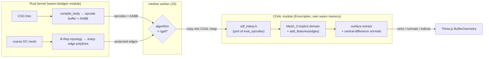

# CGAL mesher (WebAssembly)

A high-quality replacement for the MDC mesher, built on CGAL `Mesh_3`
(Restricted Delaunay refinement with angle/sliver guarantees and optional
1D sharp-feature protection). It is selectable in the app as the **CGAL**
mesh algorithm alongside MDC and RFTA.

## Why

MDC (Manifold Dual Contouring) produces low-quality, warped facets — flat
faces come out bumpy and sharp edges get rounded. CGAL `Mesh_3` produces a
Delaunay-refined surface with bounded facet angles, so flat faces are flat
and (when fed protected polylines) sharp edges stay sharp.

## Data-shipping model (no per-sample FFI)

The Rust kernel already compiles each body's CSG tree to a flat `f32`
opcode buffer (`crates/kernel/src/sdf_compiler.rs`). Instead of letting
CGAL call back into Rust for every SDF sample (an FFI bottleneck), we ship
that opcode buffer as a block to the C++ module, which evaluates the SDF
**autonomously** via a 1:1 port of the Rust interpreter.



The mesh is consumed by Three.js (JS), so the one cross-module buffer copy
is irrelevant — the FFI-per-sample bottleneck is what mattered, and it is
gone because C++ interprets the shipped opcode AST itself.

## The interpreter-sync invariant

`src/sdf_interp.h` is a **1:1 port** of the Rust `eval_opcodes`
(`sdf_compiler.rs`). They must stay bit-for-bit equivalent. Any change to
the Rust opcode format or evaluation MUST be mirrored here. This is guarded
by a cross-language regression test:

```sh
cargo run -p fielddraft-kernel --example gen_golden > /tmp/fd_golden.txt
c++ -std=c++17 -O2 -I src test/check_interp.cpp -o /tmp/check_interp
/tmp/check_interp /tmp/fd_golden.txt    # 0 failures expected
```

`test/node_smoke.mjs` additionally meshes representative scenes and checks
the output geometry (bbox containment, unit normals, valid indices).

## Build

CGAL and Boost are header-only here — no CMake, GMP or MPFR. Three SDKs,
overridable via env vars (defaults point at a throwaway spike dir):

- `EMSDK_DIR` — Emscripten SDK (`em++`)
- `CGAL_DIR`  — CGAL 6 headers (`CGAL-6.x/include`)
- `BOOST_DIR` — Boost 1.8x headers

```sh
./build.sh Oz   # → ../web/src/wasm/cgal/cgal_mesher.js (~790 KiB, single-file)
```

Critical defines (see `build.sh` for the why of each): `-fwasm-exceptions`,
`-DCGAL_ALWAYS_ROUND_TO_NEAREST` (Wasm can't set FPU rounding — omitting it
causes random freezes), `-DCGAL_DISABLE_GMP -DCGAL_USE_BOOST_MP` (header-only
exact arithmetic), `-DCGAL_HAS_NO_THREADS`, `-sSINGLE_FILE=1` (wasm embedded
in the JS — no `fetch` at instantiation, which matters because the mesher
worker freezes `fetch` after boot). The built `.js` is committed so the web
build needs no Emscripten.

## Meshing criteria

Only the boundary surface is wanted, but `Mesh_3` always builds a full
tetrahedral volume. Surface quality is set by the `facet_*` criteria;
`cell_size` only bounds interior tet size. We use `cell_size = cell_mult ×
facet_size` (default `cell_mult = 3`): large enough that tet count scales
with surface area, not volume (so a 100³ box doesn't explode to ~50k
exact-arithmetic tets and stall the worker), but small enough that facet
refinement near protected sharp edges still completes.

## Integration points

- Rust exports (already present): `bodySdfOpcodesPtr/Len`, `bodySdfAabb`,
  `bodyEdgeCount`/`bodyEdgePointCount`/`bodyEdgePointsPtr`.
- Worker: `web/src/mesher.worker.ts` — `ensureCgal()` (preloaded before the
  sandbox freeze) and `snapshotBodiesCgal()`.
- UI: `MeshAlgorithm` union + dropdown option in `SettingsMenu.tsx` / `App.tsx`.
- The Rust kernel stays on MDC internally when "cgal" is selected (its cheap
  DC pass supplies the opcode buffer + B-Rep edges); CGAL replaces only the
  rendered geometry.

## Known limitations

- **Gyroid / very thin shells**: a sheet thinner than a cell is missed by
  Mesh_3's seed sampling at low resolution (empty mesh). Needs higher
  resolution; not representative of normal solids.
- **Picking / provenance**: CGAL bodies carry synthetic classifications
  (all "face") and sentinel contributors (like an imported mesh), so
  per-feature selection is not yet wired for them.
- **Baked volumes** (`ImportedMesh`/`OP_PRIM_TEX3D`): not yet shipped to the
  C++ side; the opcode advances correctly and returns the empty-volume
  fallback.
