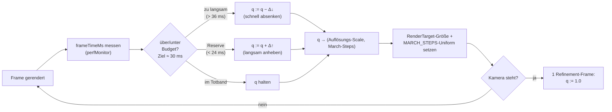

# Rendering-Performance — adaptive Qualität & Hybrid-Renderer

Stand: 2026-06-13. Konzept (noch nicht implementiert), um die Renderlast des
SDF-Raymarchers an die Hardware anzupassen und FieldDraft die 30-fps-Schwelle
auf deutlich mehr Client-Hardware erreichen zu lassen — ohne Renderer-Rewrite,
ohne WebGL-Fallback. **Zwei komplementäre Achsen:** (1) adaptive Qualität
(Auflösung/March-Steps) auf der bestehenden Pipeline; (2) ein **Hybrid-Renderer**,
der exakte analytische B-Rep-Flächen **rastert** und nur die implizite Restmenge
raymarcht. Achse 2 ist für typische CAD-Szenen oft der größere Hebel. Gegen den
echten Code (`sdfVmRenderer.ts`, `sdfDeferredRenderer.ts`, `bvh.rs`
`classify_for_hybrid`, `kernel.ts` `bodyBrepFaces`, `faceFill.ts`,
`perfMonitor.tsx`, `telemetry.ts`) verifiziert.

## Motivation

Der Raymarcher kostet heute **fix** und maximal, unabhängig von der Hardware:

- `MARCH_STEPS = 512` pro Pixel (`sdfVmRenderer.ts:48`,
  `DEFERRED_MARCH_STEPS = 512` in `sdfDeferredRenderer.ts:72`).
- Voll-Auflösung: die Render-Targets werden exakt auf Canvas-Größe gezogen
  (`resizeDeferredPipeline`, `sdfDeferredRenderer.ts:285`); der `sdf-vm`-Pass
  rendert auf ein Vollbild-Quad in physischer Auflösung. **Kein** Downsampling.
- Pro March-Step läuft die Bytecode-VM (`sdfVmInterpreter.ts`, bis zu 512
  Opcodes; im `sdf-vm`-Modus über bis zu 8 Körper je Pixel).
- **Keine** adaptive Auflösung, **kein** dynamisches Step-Budget, **keine**
  Qualitätsskalierung. Der einzige Schalter ist der Frameloop (demand/always).

Folge: Performance ist „ganz oder gar nicht" und skaliert linear mit der
Pixelzahl. Eine schwache GPU (z. B. Intel UHD 630) rendert dieselbe Last wie
eine RTX, nur 10–20× langsamer — und fällt unter 30 fps, obwohl ein
halb-aufgelöster Pass mit kürzerem Step-Budget für die interaktive Vorschau
völlig ausreichte. Die unterstützte Hardware-Basis ist damit **enger als
nötig**.

Ziel: Die Renderlast **an die gemessene Frame-Zeit koppeln** — interaktiv
gröber, im Stillstand voll. Das verschiebt die 30-fps-Grenze um 1–2
Hardware-Tiers nach unten (siehe Tiers in der Telemetrie, `telemetry.ts`).

## Leitprinzip: „interactive low, static high"

Der entscheidende UX-Hebel: **Qualität nur während Kamerabewegung senken.**
Beim Orbit/Pan zählt Flüssigkeit, nicht Schärfe — das Auge toleriert eine
gröbere Vorschau, solange sie ruckelfrei ist. Sobald die Kamera steht, rendert
ein **voll aufgelöster, voll gemarchter** Frame nach („Refinement"). Der Nutzer
sieht also immer ein scharfes Standbild und eine flüssige Bewegung; die
Reduktion ist nur in der Transienten sichtbar, wo sie kaum auffällt.

Das deckt sich mit der bestehenden Demand-Frameloop-Architektur: Bewegung →
kontinuierliche Frames (adaptiv gröber), Stillstand → ein letzter
Invalidate → ein Refinement-Frame in voller Qualität.

## Stellhebel

Drei orthogonale Hebel, von größtem zu kleinstem Effekt:

### A. Auflösungsskalierung (größter Hebel)

Den Raymarch-Pass in eine **reduzierte interne Auflösung** rendern
(`scale ∈ {1.0, 0.75, 0.5, 0.33, 0.25}`) und auf die Canvas-Größe hochskalieren.
Kosten skalieren quadratisch mit `scale` — `scale = 0.5` viertelt die
Fragment-Last. Das ist der mit Abstand wirksamste Hebel, weil die March-Last
**pro Pixel** anfällt.

- `sdf-vm`: das Vollbild-Quad in ein `RenderTarget` der Größe
  `round(w·scale) × round(h·scale)` rendern, dann als Blit/Upscale auf den
  Screen.
- `sdf-deferred`: die **Raster-Pässe** (opaque/transparent Hülle) bleiben
  voll aufgelöst (billig, scharfe Silhouetten); nur der **Unified-Shade-Pass**
  (Pass 3, der sphere-traced) läuft skaliert und wird hochskaliert. So bleiben
  die Kanten knackig, nur die Volumen-/Schattierungsabtastung wird gröber.

### B. Dynamisches March-Step-Budget

`MARCH_STEPS` von einer Konstante in ein **Uniform** wandeln und zwischen z. B.
`128` (interaktiv) und `512` (statisch/Refinement) regeln. Ein kleineres Budget
spart linear, kann aber bei grazing rays Löcher/„peter-panning" erzeugen (Ray
bricht vor der Oberfläche ab). Daher zweitrangig und nur moderat reduzieren
(nie unter ~96), bzw. mit größerem `SURFACE_EPS` koppeln.

### C. DPR-Cap (statischer Schutz)

Auf HiDPI-Displays die physische Render-Auflösung bei `min(devicePixelRatio,
1.5)` deckeln. Ein 4K-Laptop mit DPR 2 rendert sonst 4× Fragmente für kaum
sichtbaren Gewinn. Reiner Schutz-Default, kein Regelkreis. (Heute liest der
Probe `gl.getPixelRatio()`, gesetzt wird der Cap einmalig beim Renderer-Setup.)

### D. Default-Modus

`sdf-deferred` als Default statt `sdf-vm` (Letzteres ist die schwere Baseline).
Bereits architektonisch günstiger; orthogonal zur Adaptivität, aber Teil der
„breitere Basis"-Strategie.

## Regelkreis

Ein einfacher, geschlossener Regler steuert einen **Quality-Scalar** `q ∈ [0,1]`
auf ein Frame-Zeit-Ziel. `q` mappt monoton auf (Auflösung, Step-Budget).

Reglereigenschaften:

- **Asymmetrisch**: schnell heruntersteuern (Ruckler sofort abfangen), langsam
  hoch (kein Pumpen). Klassische „fast down, slow up"-Heuristik aus Spiele-
  Engines (dynamic resolution scaling).
- **Totband / Hysterese**: Zielbudget z. B. 30 ms (33 fps), Totband 24–36 ms.
  Außerhalb regeln, innerhalb halten — verhindert Oszillation zwischen zwei
  Stufen.
- **Quantisierte Stufen** statt kontinuierlich (`scale ∈ {1, 0.75, 0.5, …}`):
  weniger sichtbares Springen, stabiler.
- **Refinement on idle**: sobald `OrbitControls` „end"/kein Invalidate mehr
  liefert, ein einzelner `q = 1.0`-Frame. Nutzt den bestehenden Demand-Loop.
- **Messquelle**: `perfMonitor` liefert bereits `frameTimeMs`/p95 pro Frame —
  der Regler liest dieselbe Ringpuffer-Statistik (kein neuer Messpfad).

## Telemetrie-Kopplung

Die in `telemetry.ts` erfasste **GPU-Tier** (aus gemessener Sustained-FPS)
liefert einen **Startwert** für `q`, damit der erste Orbit nicht erst durch ein
Ruckel-Tal regeln muss:

- `high` → Start `q = 1.0` (Regler greift selten ein).
- `mid` → Start `q ≈ 0.75`.
- `low`/`unplayable` → Start `q ≈ 0.5` bzw. `0.33` + reduziertes Step-Budget.
- `isFallback` (Software-Adapter) → niedrigste Stufe, ggf. Warnhinweis.

Umgekehrt sollte die Telemetrie den **effektiv genutzten `q`** mitloggen
(Feld `effectiveScale`), damit wir sehen, welcher Anteil der Clients dauerhaft
unter `q = 1` läuft — die direkte Messung „wie eng ist die Hardware-Basis
wirklich".

## Integration im Code

| Hebel | Heute | Änderung |
|---|---|---|
| Auflösung | RT = Canvas-Größe (`sdfDeferredRenderer.ts:285`) | RT-Größe `· q`; Upscale-Blit-Pass an den Screen |
| March-Steps | `const MARCH_STEPS = 512` (`:48/:72`) | Uniform; Regler setzt 128…512 |
| Mess-Feedback | `perfMonitor` read-only (`perfMonitor.tsx`) | Regler-Hook liest p95, schreibt `q` |
| Startwert | — | `getGpuInfo()`/Tier aus `telemetry.ts` |
| DPR | `gl.getPixelRatio()` | Cap auf 1.5 beim Setup |

Ort des Reglers: ein kleiner `useFrame`-Hook (analog `PerfProbe`), der `q`
hält, pro Frame justiert und über einen Bridge-Store an die beiden
SDF-Renderer (RT-Resize + Step-Uniform) weitergibt. Bewusst **außerhalb** der
Renderer-Module, damit beide Modi denselben Regler teilen.

## Qualitäts-/UX-Risiken & Mitigation

- **Upscale-Unschärfe / Aliasing an Kanten.** Bei `sdf-deferred` bleiben die
  Silhouetten scharf (Raster-Pass voll aufgelöst); nur die Schattierung ist
  weicher → akzeptabel. Bei `sdf-vm` hilft bilinearer Upscale + leichtes
  Schärfen; Kanten sind in Bewegung ohnehin unkritisch.
- **Step-Budget-Löcher / peter-panning.** Untergrenze ~96–128 Steps; `SURFACE_EPS`
  bei kleinem Budget leicht erhöhen; B nur moderat einsetzen, A bevorzugen.
- **Oszillation / Pumpen.** Totband + quantisierte Stufen + asymmetrische
  Raten; Hochstufen nur nach N stabilen Frames.
- **Refinement-Flackern.** Der Übergang grob→scharf im Stillstand kann
  „aufploppen". Mitigation: kurzes Crossfade oder progressives Refinement
  (erst `q=0.75`, dann `1.0`).
- **Compile-Frames herausfiltern.** Shader-Kompilation ist asynchron und
  modellunabhängig (die VM ist ein fixer Shader; Opcodes sind Daten,
  Recompile nur bei geänderter Volume-Textur-Anzahl) und läuft hinter dem
  „Compiling shader…"-Gate, bevor gerendert wird. Sollten dennoch einzelne
  Pipeline-JIT-Ausreißer auftreten (z. B. Overlay-/Gizmo-Materialien beim
  ersten Draw), darf der Regler sie **nicht** als „zu langsam" werten
  (p95 statt max, oder Frames direkt nach einem Pipeline-Build überspringen).

## Achse 2: Hybrid-Renderer (exakte B-Rep-Flächen rastern, nur Implizites raymarchen)

Orthogonal zur Qualitätsskalierung steht ein zweiter, oft größerer Hebel: nicht
*wie fein* raymarchen, sondern *was überhaupt*. Die meisten CAD-Szenen sind
überwiegend analytisch (Primitive + Booleans + konstante Fillets); deren exakte
Oberfläche ist eine **analytische B-Rep**, die sich billig und scharf **rastern**
lässt. Der Raymarcher wird dann nur noch für die echte implizite Restmenge
bemüht (Gyroid/TPMS, Twist/Bend/Displace, variable Fillets/Blends,
Weaver-Fallback). Für typische Szenen sinkt der raymarchte Pixelanteil gegen
null → reines Raster, exakt und schnell, weitgehend unabhängig von der
Szenengröße.

### Die Klassifikation existiert schon

Der Kernel liefert die Trennung bereits — auf zwei Ebenen:

- **Körper-Ebene**: `classify_for_hybrid()` → `HybridInfo` (`bvh.rs`) mit
  `needs_full_sdf`, `is_union_only`, `leaves` (parametrische Primitive) und
  `sdf_regions` (Boolean-Overlap-/Blend-Zonen). Der Deferred-Renderer nutzt das
  schon: Union-only-Körper bekommen Hüllmeshes (`createPrimitiveGeometry`,
  box→BoxGeometry …); `needs_full_sdf`-Features (Twist/Bend/Displace/Shell/
  Offset/Morph/Helix/Gyroid) gehen voll in den Raymarch.
- **Flächen-Ebene (genauer)**: `bodyBrepFaces()` liefert pro Fläche
  `surfaceKind ∈ {plane, cylinder, sphere, cone, torus, revolved_profile,
  tessellated}` — **inklusive der durch Booleans getrimmten Ränder** (Kanten
  `BRepEdge.faces[]` binden je zwei Flächen). Das ist die eigentliche
  Entscheidungsgröße: `surfaceKind ≠ "tessellated"` → **analytisch → rastern**;
  `"tessellated"` → **raymarchen**.

Wichtig gegen zwei naheliegende Irrtümer:

- Ein `box − cylinder` (Bohrung) ist **kein** „nicht-parametrischer" Körper —
  der Weaver erzeugt dafür eine exakte analytische B-Rep (Ebenen + eine
  getrimmte Zylinderfläche).
- Ein **konstanter Kantenfillet** ist ein Torus-/Zylinder-Patch und kommt als
  `surfaceKind: torus/cylinder` zurück. „Fillet" pauschal dem Raymarcher
  zuzuschlagen wäre falsch — nur Fillets/Blends, die der Weaver *nicht*
  analytisch fassen kann, fallen auf `tessellated`. Die Klassifikation per
  `surfaceKind` entscheidet das automatisch und korrekt.

### Was neu gebaut werden muss

Heute rastert der Deferred-Pfad nur **Box exakt** (flache Faces); gekrümmte
Primitive (Sphere/Cylinder/Torus) laufen über eine inflationierte Hülle
(`HULL_INFLATE`, „opaque + transparent") in den **Raymarch**, um exakt zu
bleiben. `triangulatePlanarFace` (`faceFill.ts`) trianguliert zudem heute **nur
planare** Faces. Der Hybrid-Renderer braucht:

1. **Getrimmte Tessellation gekrümmter analytischer Faces.** Pro `surfaceKind`
   die Fläche analytisch in (u,v) parametrisieren und innerhalb ihrer
   Kanten-Loops (aus `BRepEdge.points`/`controlPoints`) bis zu einer Toleranz
   vernetzen — cylinder/sphere/cone/torus/revolved_profile. **Exakte Normalen
   direkt aus der analytischen Fläche** (scharfe Schattierung, keine
   Mesh-Speckles). Erweitert `faceFill.ts` über den planaren Fall hinaus.
2. **Raster-Shading-Pfad** für analytische Faces im Deferred-Renderer: ihren
   G-Buffer (worldPos + exakte Normale) nicht mehr nur als Raymarch-Seed nutzen,
   sondern **direkt schattieren** — kein Sphere-Trace für analytische Pixel.
3. **Residual-Raymarch nur** für `tessellated`-Faces, `needs_full_sdf`-Körper
   und `sdf_regions`, komponiert über denselben Tiefen-/worldPos-RT wie heute
   (die 3-Pass-Pipeline bleibt). Die Naht analytisch↔implizit liegt **auf einer
   gemeinsamen B-Rep-Kante** (sie begrenzt beide Faces) → geometrisch
   konsistent, keine Risse, wenn beide Seiten zur selben Kantenpolylinie
   vernetzen bzw. marchen.

### Abgrenzung zum `mesh`-Modus

Der bestehende `mesh`-Modus ist eine **verlustbehaftete** globale DC/MDC-Abtastung
der SDF (Marching-artig, „Mesh-Speckles", gerundete Kanten). Der Hybrid-Renderer
ist das Gegenteil: **exakte** Tessellation der analytischen Faces mit **scharfen
Kanten** (den B-Rep-Kanten), plus Raymarch nur fürs Implizite. Er ist damit ein
**eigener, vierter Modus** (`brep` / `hybrid`) — schneller als die Raymarch-Modi
und schärfer als `mesh`.

### Komposition mit der Qualitätsskalierung

Beide Achsen multiplizieren sich: Der Hybrid-Renderer **verkleinert die
raymarchte Fläche** (nur Implizites), die adaptive Skalierung **verbilligt den
verbleibenden Raymarch**. Analytische Szene → reiner Raster (60 fps auch auf
schwacher GPU); Gyroid-Szene → kleiner Raymarch-Anteil, der zusätzlich adaptiv
skaliert. Die Telemetrie-Tier steuert weiterhin den Startwert.

### Risiken & offene Fragen (Hybrid)

- **Getrimmte gekrümmte Tessellation** ist die eigentliche Arbeit: Robustheit
  bei engen Trims, mehreren Kanten-Loops (Löcher), tangentialen Übergängen;
  torus/revolved_profile an Naht-Kanten sauber schließen.
- **Tessellations-Toleranz vs. Zoom (LOD):** feste Sehnen-Toleranz zeigt beim
  Hineinzoomen Facetten → bildschirmraum-adaptive Toleranz oder Re-Tessellation
  bei großem Zoomwechsel (analog der Kanten-Dezimierung in `polylineToSegments`).
- **Shading-Parität** zwischen Raster-Face und Raymarch-Residual: gleiche
  Material-/Normalen-Konvention, sonst sichtbare Naht trotz Geometrie-Konsistenz.
- **Weaver-Abhängigkeit:** ohne saubere B-Rep (Klassifikationslücken, vgl.
  brep_classification) muss der Körper sicher auf Voll-Raymarch zurückfallen —
  `surfaceKind: tessellated` ist genau dieses Signal.
- **`tessellated`-Faces (Gyroid)** brauchen weiter ihren AABB-/Region-Raymarch;
  der Hybrid spart sie nicht ein, sondern isoliert sie sauber.

### Phasenplan (Hybrid)

1. **Planar-only zuerst:** Körper, deren Faces alle `plane` (oder Box) sind, voll
   rastern (kein Raymarch) — kleiner, sicherer Schritt auf bestehendem
   `triangulatePlanarFace` + `surfaceKind`-Gate.
2. **Gekrümmte Face-Tessellation** getrimmt: cylinder/sphere/cone, danach
   torus/revolved_profile.
3. **Deferred-Shading-Pfad** für analytische Faces (direkt schattieren statt
   seed); Residual-Raymarch nur für `tessellated`/`needs_full_sdf`/`sdf_regions`.
4. **Modus `brep`** in `SettingsMenu` + Default-Strategie; Komposition mit der
   adaptiven Skalierung auf dem Residual.
5. **LOD/Toleranz** bildschirmraum-adaptiv; Telemetrie loggt den raymarchten
   Pixelanteil (Wirksamkeitsmaß).

## Achse 3: WebGL-Pfad + Screenspace-CSG (Experiment, für schwache Rechner)

Ziel: ein Renderpfad, der **ganz ohne WebGPU** auskommt (Intel-iGPUs, kein
Vulkan/Adapter, ältere Browser). Begründung: praktisch alle Körper sind 2D-
Sketch → Extrude/Revolve/Helix/Twist + Booleans; das lässt sich mit parametri-
schen Meshes + einem allgemeinen Boolean-Compositor in WebGL rastern. Nur der
echte implizite Rest (Gyroid, weiche Fillets) braucht ein SDF-Meshing-Verfahren.

### Drei Render-Strategien, komplementär (nicht „entweder/oder")

| Strategie | Wofür | Eigenschaften |
|---|---|---|
| **B-Rep-Tessellation** (Achse 2) | analytische Körper, **statisch** | exakt, scharf, billig; braucht eine B-Rep |
| **Screenspace-CSG** | **allgemeine Booleans**, Drag-Preview | view-abhängig, kein Geometrie-Output, funktioniert OHNE B-Rep (auch `gyroid − cylinder`) |
| **CPU-DC/MDC-Mesh** (`mesh`-Modus) | impliziter Rest, statisch | verlustbehaftet (Speckles), CPU, WebGL-fähig |

Wichtig (korrigiert ggü. erster Einschätzung):

- **Screenspace-CSG ist NICHT redundant zur B-Rep-Tessellation.** Es ist das
  WebGL-Äquivalent der SDF-Raymarch-CSG: ein allgemeiner Boolean-Compositor auf
  gerenderten Tiefenflächen, der **keine** B-Rep des Ergebnisses braucht. Genau
  dort wertvoll, wo die B-Rep fehlt (Subtraktion aus einem Gyroid, Blends) und
  für **Drag-Preview** (teurer B-Rep-Weave aus → Hüllmeshes + Screenspace-CSG
  liefern sofortiges Boolean-Feedback, bevor neu gewebt wird).
- **Parametrische Helix/Twist-Meshes braucht der SDF-Deferred ohnehin**: er
  bound `needs_full_sdf`-Körper heute mit einer losen AABB; eine enge
  parametrische Hülle (Helix-Sweep, getwistetes Extrude-Mesh) verkleinert das
  Raymarch-Volumen → schneller auch in der WebGPU-Welt. Also kein WebGL-
  Sonderaufwand.

### Was es konkret braucht

1. **WebGL-Render-Pfad** (Fundament, unabhängig von Screenspace-CSG nützlich):
   `THREE.WebGLRenderer` statt WebGPU; rendert die vorhandenen parametrischen
   Hüllmeshes (`createPrimitiveGeometry`: box/sphere/cylinder/cone/torus/
   capsule/**extrude**/**revolve**) + die B-Rep-Tessellation (Achse 2) +
   DC-Meshes (impliziter Rest). **Hauptaufwand = Material-/Linien-Parität**: die
   node-basierten WebGPU-Materialien (SDF-Pässe, fat lines `Line2NodeMaterial`,
   Label-Sprites `SpriteNodeMaterial`) laufen in WebGL nicht → klassische
   Äquivalente (`MeshStandardMaterial`, `LineSegments2`-WebGL-Variante, HTML-
   oder Sprite-Labels). Dieser Pfad bedient zugleich die „kein WebGPU-Adapter"-
   Maschinen (vgl. WebGPU-Gate) und umgeht das WebGPU-Capture-Problem der
   Browser-Automation.
2. **Parametrische Helix/Twist-Meshes** (`createPrimitiveGeometry` erweitern):
   Helix = Profil-Sweep entlang Helixpfad; Twist = getwistetes Extrude (CPU-Warp
   oder Vertex-Shader). Nutzt Deferred + WebGL.
3. **Screenspace-CSG (das Experiment):** als Boolean-Compositor in einem
   WebGL2-Fragmentshader.

### Screenspace-CSG — Technik & ehrliche Hürden

Klassische Verfahren (OpenCSG-Stil): Tiefenflächen rendern, per Pixel die
CSG-Klassifikation gegen die Tiefenintervalle auswerten.

- **Experiment-Stufe 1 (klein, vergleichbar):** **einstufige Subtraktion `A − B`**
  ohne Depth-Peeling: Minuend-Oberfläche rendern; Subtrahend Front-/Back-Tiefe in
  Texturen (MRT/WebGL2); liegt der Minuend-Pixel im `[front,back]`-Intervall des
  Subtrahenden, ersetze ihn durch die Subtrahend-Backface (die Schnittfläche).
  Deckt `box − cylinder`, `gyroid − cylinder` (Gyroid als DC-Mesh/Tiefenfläche)
  ab — der Vergleichsfall gegen B-Rep-Tessellation und SDF-Raymarch.
- **Stufe 2 (später):** allgemeiner CSG-Baum via Depth-Peeling (k Layer),
  Goldfeather/SCS.
- **Harte Punkte:** Tiefenkomplexität (poröser Gyroid → viele Layer → teuer);
  koinzidente Flächen / Z-Fighting an Schnitträndern (dieselben Naht-Probleme wie
  im Kernel); nicht-konvexe Extrudes brauchen ggf. Konvex-Zerlegung für Stufe 2;
  WebGL2 hat keine Storage Buffers → MRT + Ping-Pong statt Fragment-Listen. Der
  Deferred-Renderer nutzt bewusst Raymarch statt Mesh-CSG, *weil* Letzteres für
  beliebige Booleans fragiler ist — das ist beim Experiment einzukalkulieren.

### Vergleichsmetriken (das Experiment soll messen)

- FPS auf einer schwachen iGPU (Intel UHD 630) vs. SDF-Deferred (WebGPU) und
  B-Rep-Tessellation.
- Korrektheit der Schnittflächen ggü. B-Rep-Referenz (Z-Fighting, fehlende
  Schnittkanten).
- Drag-Preview-Latenz (B-Rep aus) ggü. „erst weben, dann tessellieren".
- Läuft es überhaupt ohne WebGPU-Adapter? (Hauptziel.)

### Phasenplan (WebGL / Screenspace-CSG)

1. **WebGL-Baseline**: `WebGLRenderer`-Pfad, der die parametrischen Hüllmeshes +
   B-Rep-Tessellation + DC-Meshes mit klassischen Materialien rastert (noch ohne
   Booleans-Compositing — Körper einzeln). Material-/Linien-Parität. Schon hier
   messbar: „läuft ohne WebGPU", FPS auf iGPU.
2. **Helix/Twist parametrisch** (`createPrimitiveGeometry`).
3. **Screenspace-CSG Stufe 1** (einstufige `A − B`) als Experiment + Vergleich.
4. **Stufe 2** (Depth-Peeling, allgemeiner CSG-Baum) nur bei positivem Vergleich.

## Phasenplan (adaptive Qualität)

1. **Mess- & Regelgerüst**: Quality-Scalar-Bridge + Regler-Hook auf
   `perfMonitor`-p95; vorerst nur Logging (kein visueller Effekt), gegen die
   Telemetrie validieren.
2. **Hebel A (Auflösung)** für `sdf-deferred`: skalierter Shade-Pass +
   Upscale-Blit; „interactive low, static high" über Idle-Refinement.
3. **Hebel A** für `sdf-vm` (skaliertes Vollbild-RT).
4. **Hebel B (March-Steps)** als Uniform, moderat geregelt.
5. **DPR-Cap** + `sdf-deferred` als Default.
6. **Telemetrie-Kopplung**: Tier → Startwert; `effectiveScale` loggen.

## Offene Fragen / Messpunkte

- Reales Kosten-Profil: Was dominiert — Fragmentzahl (→ A wirkt stark) oder
  VM-Interpretationsoverhead pro Step (→ B/Opcode-Reduktion wichtiger)? Vor
  Phase 2 mit `window.__fdBenchmark` eine Kurve FPS vs. Auflösung vs.
  Step-Budget vs. Körperzahl aufnehmen.
- Ziel-Budget: 30 ms (33 fps) oder konservativer 28 ms? Pro Tier unterschiedlich?
- Upscale-Filter: bilinear vs. leichtes FSR-artiges Schärfen — lohnt der
  Mehraufwand bei einer CAD-Vorschau?
- Interagiert die Auflösungsskalierung mit dem Overlay-Compositing
  (`OVERLAY_LAYER`, Kanten/Labels)? Overlays müssen **voll aufgelöst** bleiben
  und über den hochskalierten Raymarch-Buffer komponiert werden.
