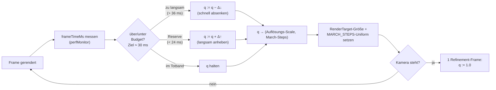

# Adaptive Rendering — Auflösungsskalierung & dynamisches March-Step-Budget

Stand: 2026-06-13. Konzept (noch nicht implementiert) für eine adaptive
Qualitätssteuerung des SDF-Raymarchers, damit FieldDraft die 30-fps-Schwelle
auf deutlich mehr Client-Hardware erreicht — ohne Renderer-Rewrite, ohne
WebGL-Fallback. Gegen den echten Code (`sdfVmRenderer.ts`,
`sdfDeferredRenderer.ts`, `perfMonitor.tsx`, `telemetry.ts`) verifiziert.

## Motivation

Der Raymarcher kostet heute **fix** und maximal, unabhängig von der Hardware:

- `MARCH_STEPS = 512` pro Pixel (`sdfVmRenderer.ts:48`,
  `DEFERRED_MARCH_STEPS = 512` in `sdfDeferredRenderer.ts:72`).
- Voll-Auflösung: die Render-Targets werden exakt auf Canvas-Größe gezogen
  (`resizeDeferredPipeline`, `sdfDeferredRenderer.ts:285`); der `sdf-vm`-Pass
  rendert auf ein Vollbild-Quad in physischer Auflösung. **Kein** Downsampling.
- Pro March-Step läuft die Bytecode-VM (`sdfVmInterpreter.ts`, bis zu 512
  Opcodes; im `sdf-vm`-Modus über bis zu 8 Körper je Pixel).
- **Keine** adaptive Auflösung, **kein** dynamisches Step-Budget, **keine**
  Qualitätsskalierung. Der einzige Schalter ist der Frameloop (demand/always).

Folge: Performance ist „ganz oder gar nicht" und skaliert linear mit der
Pixelzahl. Eine schwache GPU (z. B. Intel UHD 630) rendert dieselbe Last wie
eine RTX, nur 10–20× langsamer — und fällt unter 30 fps, obwohl ein
halb-aufgelöster Pass mit kürzerem Step-Budget für die interaktive Vorschau
völlig ausreichte. Die unterstützte Hardware-Basis ist damit **enger als
nötig**.

Ziel: Die Renderlast **an die gemessene Frame-Zeit koppeln** — interaktiv
gröber, im Stillstand voll. Das verschiebt die 30-fps-Grenze um 1–2
Hardware-Tiers nach unten (siehe Tiers in der Telemetrie, `telemetry.ts`).

## Leitprinzip: „interactive low, static high"

Der entscheidende UX-Hebel: **Qualität nur während Kamerabewegung senken.**
Beim Orbit/Pan zählt Flüssigkeit, nicht Schärfe — das Auge toleriert eine
gröbere Vorschau, solange sie ruckelfrei ist. Sobald die Kamera steht, rendert
ein **voll aufgelöster, voll gemarchter** Frame nach („Refinement"). Der Nutzer
sieht also immer ein scharfes Standbild und eine flüssige Bewegung; die
Reduktion ist nur in der Transienten sichtbar, wo sie kaum auffällt.

Das deckt sich mit der bestehenden Demand-Frameloop-Architektur: Bewegung →
kontinuierliche Frames (adaptiv gröber), Stillstand → ein letzter
Invalidate → ein Refinement-Frame in voller Qualität.

## Stellhebel

Drei orthogonale Hebel, von größtem zu kleinstem Effekt:

### A. Auflösungsskalierung (größter Hebel)

Den Raymarch-Pass in eine **reduzierte interne Auflösung** rendern
(`scale ∈ {1.0, 0.75, 0.5, 0.33, 0.25}`) und auf die Canvas-Größe hochskalieren.
Kosten skalieren quadratisch mit `scale` — `scale = 0.5` viertelt die
Fragment-Last. Das ist der mit Abstand wirksamste Hebel, weil die March-Last
**pro Pixel** anfällt.

- `sdf-vm`: das Vollbild-Quad in ein `RenderTarget` der Größe
  `round(w·scale) × round(h·scale)` rendern, dann als Blit/Upscale auf den
  Screen.
- `sdf-deferred`: die **Raster-Pässe** (opaque/transparent Hülle) bleiben
  voll aufgelöst (billig, scharfe Silhouetten); nur der **Unified-Shade-Pass**
  (Pass 3, der sphere-traced) läuft skaliert und wird hochskaliert. So bleiben
  die Kanten knackig, nur die Volumen-/Schattierungsabtastung wird gröber.

### B. Dynamisches March-Step-Budget

`MARCH_STEPS` von einer Konstante in ein **Uniform** wandeln und zwischen z. B.
`128` (interaktiv) und `512` (statisch/Refinement) regeln. Ein kleineres Budget
spart linear, kann aber bei grazing rays Löcher/„peter-panning" erzeugen (Ray
bricht vor der Oberfläche ab). Daher zweitrangig und nur moderat reduzieren
(nie unter ~96), bzw. mit größerem `SURFACE_EPS` koppeln.

### C. DPR-Cap (statischer Schutz)

Auf HiDPI-Displays die physische Render-Auflösung bei `min(devicePixelRatio,
1.5)` deckeln. Ein 4K-Laptop mit DPR 2 rendert sonst 4× Fragmente für kaum
sichtbaren Gewinn. Reiner Schutz-Default, kein Regelkreis. (Heute liest der
Probe `gl.getPixelRatio()`, gesetzt wird der Cap einmalig beim Renderer-Setup.)

### D. Default-Modus

`sdf-deferred` als Default statt `sdf-vm` (Letzteres ist die schwere Baseline).
Bereits architektonisch günstiger; orthogonal zur Adaptivität, aber Teil der
„breitere Basis"-Strategie.

## Regelkreis

Ein einfacher, geschlossener Regler steuert einen **Quality-Scalar** `q ∈ [0,1]`
auf ein Frame-Zeit-Ziel. `q` mappt monoton auf (Auflösung, Step-Budget).

Reglereigenschaften:

- **Asymmetrisch**: schnell heruntersteuern (Ruckler sofort abfangen), langsam
  hoch (kein Pumpen). Klassische „fast down, slow up"-Heuristik aus Spiele-
  Engines (dynamic resolution scaling).
- **Totband / Hysterese**: Zielbudget z. B. 30 ms (33 fps), Totband 24–36 ms.
  Außerhalb regeln, innerhalb halten — verhindert Oszillation zwischen zwei
  Stufen.
- **Quantisierte Stufen** statt kontinuierlich (`scale ∈ {1, 0.75, 0.5, …}`):
  weniger sichtbares Springen, stabiler.
- **Refinement on idle**: sobald `OrbitControls` „end"/kein Invalidate mehr
  liefert, ein einzelner `q = 1.0`-Frame. Nutzt den bestehenden Demand-Loop.
- **Messquelle**: `perfMonitor` liefert bereits `frameTimeMs`/p95 pro Frame —
  der Regler liest dieselbe Ringpuffer-Statistik (kein neuer Messpfad).

## Telemetrie-Kopplung

Die in `telemetry.ts` erfasste **GPU-Tier** (aus gemessener Sustained-FPS)
liefert einen **Startwert** für `q`, damit der erste Orbit nicht erst durch ein
Ruckel-Tal regeln muss:

- `high` → Start `q = 1.0` (Regler greift selten ein).
- `mid` → Start `q ≈ 0.75`.
- `low`/`unplayable` → Start `q ≈ 0.5` bzw. `0.33` + reduziertes Step-Budget.
- `isFallback` (Software-Adapter) → niedrigste Stufe, ggf. Warnhinweis.

Umgekehrt sollte die Telemetrie den **effektiv genutzten `q`** mitloggen
(Feld `effectiveScale`), damit wir sehen, welcher Anteil der Clients dauerhaft
unter `q = 1` läuft — die direkte Messung „wie eng ist die Hardware-Basis
wirklich".

## Integration im Code

| Hebel | Heute | Änderung |
|---|---|---|
| Auflösung | RT = Canvas-Größe (`sdfDeferredRenderer.ts:285`) | RT-Größe `· q`; Upscale-Blit-Pass an den Screen |
| March-Steps | `const MARCH_STEPS = 512` (`:48/:72`) | Uniform; Regler setzt 128…512 |
| Mess-Feedback | `perfMonitor` read-only (`perfMonitor.tsx`) | Regler-Hook liest p95, schreibt `q` |
| Startwert | — | `getGpuInfo()`/Tier aus `telemetry.ts` |
| DPR | `gl.getPixelRatio()` | Cap auf 1.5 beim Setup |

Ort des Reglers: ein kleiner `useFrame`-Hook (analog `PerfProbe`), der `q`
hält, pro Frame justiert und über einen Bridge-Store an die beiden
SDF-Renderer (RT-Resize + Step-Uniform) weitergibt. Bewusst **außerhalb** der
Renderer-Module, damit beide Modi denselben Regler teilen.

## Qualitäts-/UX-Risiken & Mitigation

- **Upscale-Unschärfe / Aliasing an Kanten.** Bei `sdf-deferred` bleiben die
  Silhouetten scharf (Raster-Pass voll aufgelöst); nur die Schattierung ist
  weicher → akzeptabel. Bei `sdf-vm` hilft bilinearer Upscale + leichtes
  Schärfen; Kanten sind in Bewegung ohnehin unkritisch.
- **Step-Budget-Löcher / peter-panning.** Untergrenze ~96–128 Steps; `SURFACE_EPS`
  bei kleinem Budget leicht erhöhen; B nur moderat einsetzen, A bevorzugen.
- **Oszillation / Pumpen.** Totband + quantisierte Stufen + asymmetrische
  Raten; Hochstufen nur nach N stabilen Frames.
- **Refinement-Flackern.** Der Übergang grob→scharf im Stillstand kann
  „aufploppen". Mitigation: kurzes Crossfade oder progressives Refinement
  (erst `q=0.75`, dann `1.0`).
- **Erster-Frame-Compile-Stall.** Orthogonales, bekanntes Problem
  (Pipeline-JIT, „Compiling shader…"); der Regler darf Compile-Frames **nicht**
  als „zu langsam" werten (Ausreißer per p95 statt max filtern, oder Frames
  unmittelbar nach einem Pipeline-Build überspringen).

## Phasenplan

1. **Mess- & Regelgerüst**: Quality-Scalar-Bridge + Regler-Hook auf
   `perfMonitor`-p95; vorerst nur Logging (kein visueller Effekt), gegen die
   Telemetrie validieren.
2. **Hebel A (Auflösung)** für `sdf-deferred`: skalierter Shade-Pass +
   Upscale-Blit; „interactive low, static high" über Idle-Refinement.
3. **Hebel A** für `sdf-vm` (skaliertes Vollbild-RT).
4. **Hebel B (March-Steps)** als Uniform, moderat geregelt.
5. **DPR-Cap** + `sdf-deferred` als Default.
6. **Telemetrie-Kopplung**: Tier → Startwert; `effectiveScale` loggen.

## Offene Fragen / Messpunkte

- Reales Kosten-Profil: Was dominiert — Fragmentzahl (→ A wirkt stark) oder
  VM-Interpretationsoverhead pro Step (→ B/Opcode-Reduktion wichtiger)? Vor
  Phase 2 mit `window.__fdBenchmark` eine Kurve FPS vs. Auflösung vs.
  Step-Budget vs. Körperzahl aufnehmen.
- Ziel-Budget: 30 ms (33 fps) oder konservativer 28 ms? Pro Tier unterschiedlich?
- Upscale-Filter: bilinear vs. leichtes FSR-artiges Schärfen — lohnt der
  Mehraufwand bei einer CAD-Vorschau?
- Interagiert die Auflösungsskalierung mit dem Overlay-Compositing
  (`OVERLAY_LAYER`, Kanten/Labels)? Overlays müssen **voll aufgelöst** bleiben
  und über den hochskalierten Raymarch-Buffer komponiert werden.
