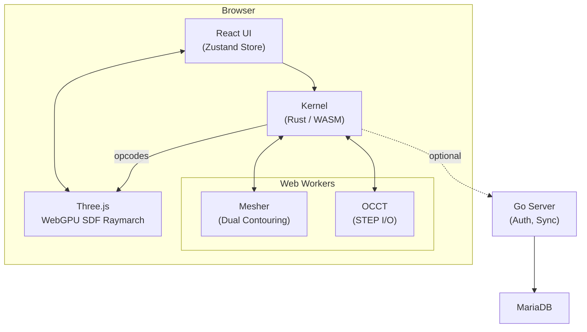
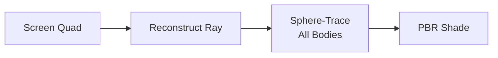
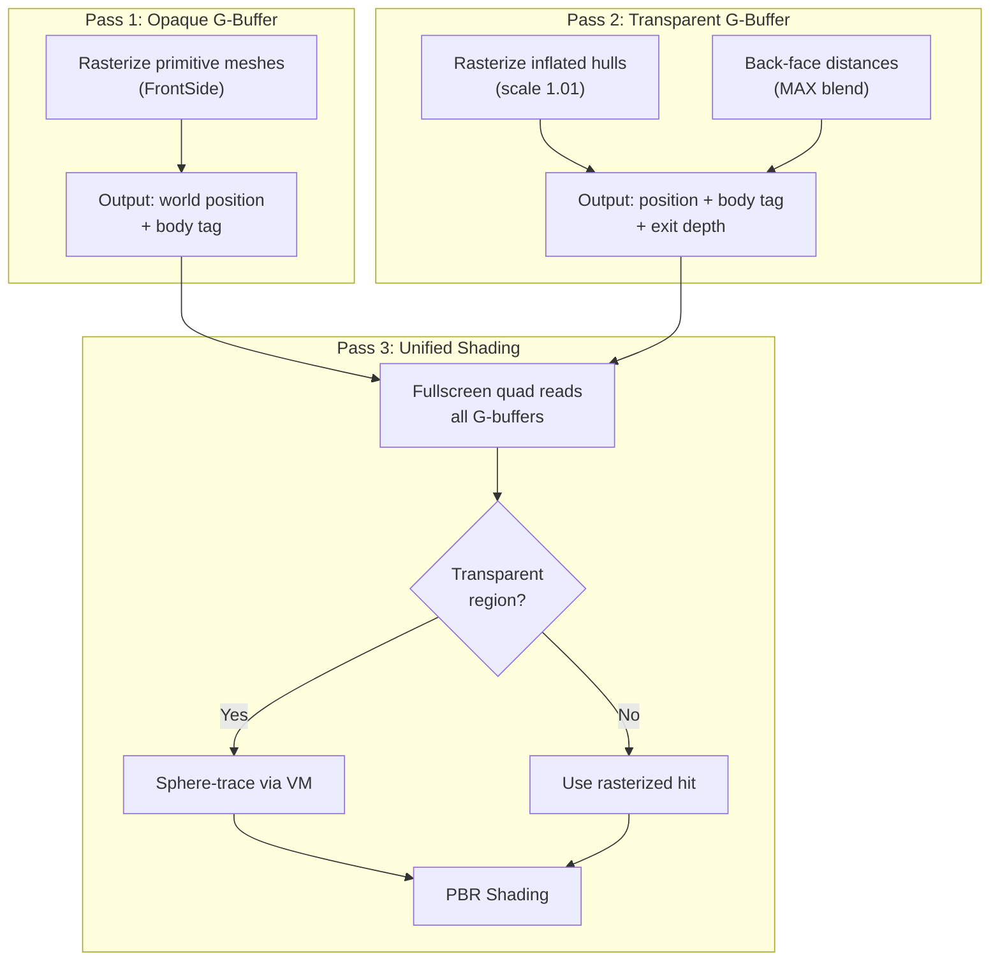
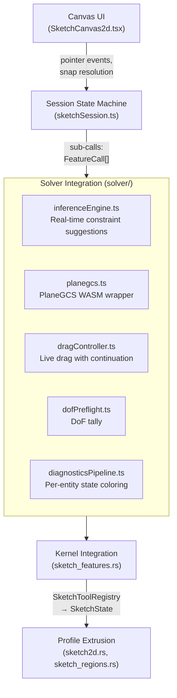
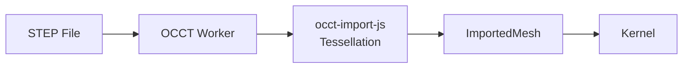
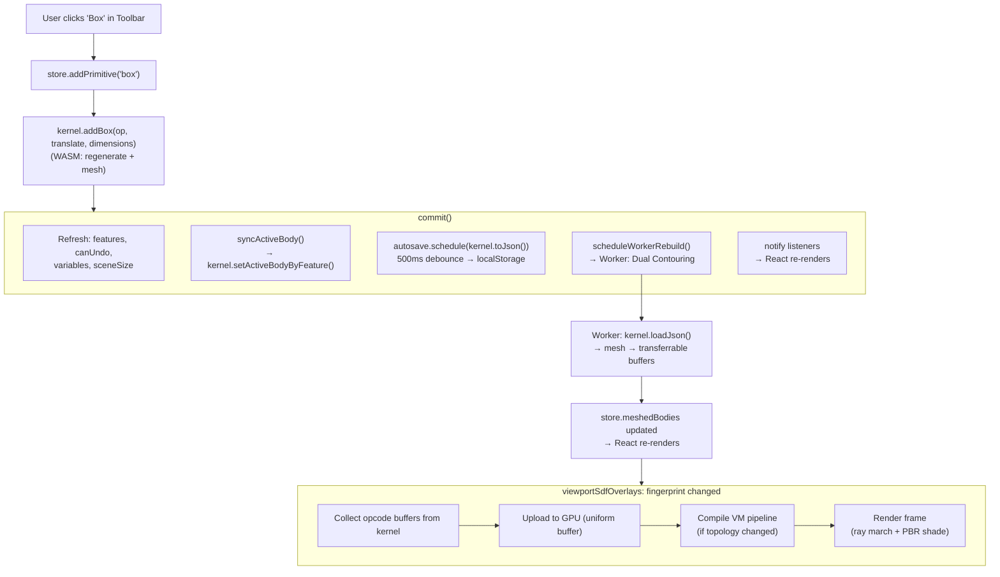
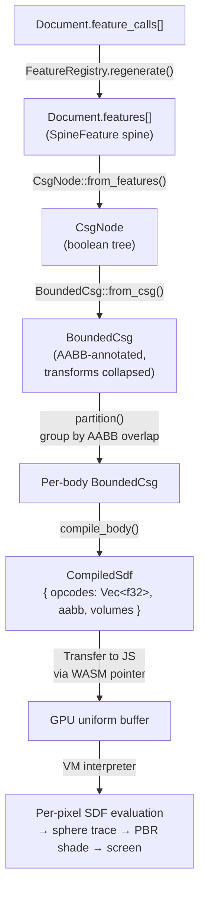
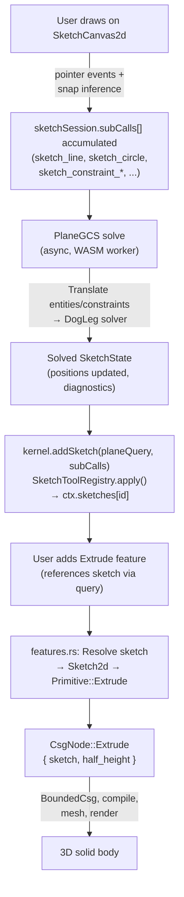

# FieldDraft Architecture

FieldDraft is a browser-based, parametric 3D modeler for FDM/SLA 3D printing. It uses a **Signed Distance Field (SDF)** geometry kernel instead of traditional B-Rep/NURBS, compiled from Rust to WebAssembly and rendered via WebGPU ray marching.



---

## Table of Contents

1. [Technology Stack](#1-technology-stack)
2. [Repository Layout](#2-repository-layout)
3. [Rust Kernel](#3-rust-kernel)
   - [Protocol Crate](#31-protocol-crate)
   - [Solver Crate](#32-solver-crate)
   - [Features-Macros Crate](#33-features-macros-crate)
   - [Kernel Crate](#34-kernel-crate)
4. [Web Frontend](#4-web-frontend)
   - [State Management](#41-state-management)
   - [WASM Bridge](#42-wasm-bridge)
   - [Rendering Pipeline](#43-rendering-pipeline)
   - [B-Rep Element Selection & Picking](#44-b-rep-element-selection--picking)
   - [Sketch System](#45-sketch-system)
   - [Import/Export](#46-importexport)
   - [CSS Architecture](#47-css-architecture)
5. [Go Server](#5-go-server)
6. [Build System & Deployment](#6-build-system--deployment)
7. [Testing Strategy](#7-testing-strategy)
8. [Key Data Flows](#8-key-data-flows)

---

## 1. Technology Stack

| Layer | Technology | Purpose |
|-------|-----------|---------|
| Geometry Kernel | Rust → WebAssembly (wasm-pack) | SDF evaluation, CSG tree, Dual Contouring mesh |
| Frontend | React 19, TypeScript 6, Vite 8 | UI components, state management |
| 3D Rendering | Three.js 0.183 + @react-three/fiber 9 | WebGPU ray marching, mesh display |
| Constraint Solver | @salusoft89/planegcs (WASM) | 2D sketch geometric constraint solving |
| CAD Import | opencascade.js 2.0, occt-import-js | STEP/IGES file import via B-Rep tessellation |
| Backend (optional) | Go 1.26, MariaDB 11 | Authentication, project sync, snapshots |
| Testing | cargo test, Vitest, Playwright | Unit (Rust/TS), integration, E2E with real WebGPU |

**Key design choice:** No hand-written shaders. All GPU code is generated dynamically via Three.js TSL (Texture Shading Language) node graphs.

---

## 2. Repository Layout

```
fielddraft/
├── crates/
│   ├── protocol/          # Wire types & document schema (Rust)
│   ├── solver/            # Constraint solver data model (Rust)
│   ├── features-macros/   # Proc-macro code generation (Rust)
│   └── kernel/            # SDF kernel, CSG, meshing, WASM bindings (Rust)
├── web/
│   ├── src/
│   │   ├── wasm/          # Auto-generated WASM output (wasm-pack)
│   │   ├── solver/        # PlaneGCS integration (TypeScript)
│   │   ├── widgets/       # Feature dialog, schema parser
│   │   ├── styles/        # CSS architecture (tokens → components)
│   │   ├── api/           # Backend API client
│   │   └── *.ts/tsx       # Application modules (~50 files)
│   ├── tests/             # Playwright E2E tests
│   └── package.json       # v0.3.55
├── server/
│   └── main.go            # Optional Go backend
├── Cargo.toml             # Workspace: 4 crates, AGPL-3.0
├── justfile               # Developer command surface
├── docker-compose.yml     # MariaDB + Go + Vite
└── DEPLOY.md              # Production deployment guide
```

---

## 3. Rust Kernel

The kernel is a Cargo workspace with four crates. The compilation target is `wasm32-unknown-unknown` via wasm-pack, with release profile: `opt-level = 3`, fat LTO, single codegen unit.

### 3.1 Protocol Crate

**`crates/protocol`** — Shared wire types between kernel and frontend.

Defines the document schema:

```
Document
├── feature_calls: Vec<FeatureCall>    # Authoritative serialization format
│   └── FeatureCall { type_name, id: FeatureId, params: Value }
├── features: Vec<SpineFeature>        # In-memory spine (skip-serialized)
├── next_feature_id: u32
└── variables: HashMap<String, f64>    # Formula engine variable table
```

**FeatureId** supports flat (`"42"`) and hierarchical (`"3.op.mask_0"`) identifiers.

**Primitive enum** — 13 geometric shape types:

| Primitive | Description |
|-----------|-------------|
| `Box`, `Sphere`, `Cylinder`, `Torus`, `Cone`, `Capsule`, `HexPrism`, `Ellipsoid` | Direct SDF evaluation |
| `Extrude` | 2D sketch profile swept along Z |
| `Revolve` | 2D sketch profile revolved around Y |
| `Gyroid` | TPMS lattice (`\|f\| - thickness`) |
| `Thread` | Metric helix |
| `ImportedMesh` | CSG-participating triangle mesh (passthrough storage) |

**Typed parameters** (K4.5.4f): `Length` (mm/cm/m/in → mm), `Angle` (deg/rad), `Query`, `MultiQuery`, `BoolOp` (`add`/`new`/`remove`/`intersect`, Onshape result-body vocabulary).

**Additional types:** `Sketch2d`, `Sketch2dPrimitive`, `MeshSdf`, `BakedVolume`, `Transform` (translate + quaternion + per-axis scale).

### 3.2 Solver Crate

**`crates/solver`** — Data model for 2D constraint sketching. This crate is **data-only** — it defines wire types but contains no solver logic. The actual constraint solving happens in TypeScript via PlaneGCS WASM.

```
SketchState
├── entities: Vec<Entity>           # Point, Line, Circle, Arc, Origin
├── constraints: Vec<Constraint>    # 12 types (see below)
├── next_entity_id: u32
└── next_constraint_id: u32

SketchDiagnostics
├── converged: bool
├── dof: i32                        # +ve = under, 0 = full, -ve = over
├── conflicting: Vec<ConstraintId>
├── redundant: Vec<ConstraintId>
├── partially_redundant: Vec<ConstraintId>
└── malformed: Vec<ConstraintId>
```

**Constraint types:** Coincident, Parallel, Horizontal, Vertical, Perpendicular, Distance, Angle, Tangent, Concentric, Equal, Midpoint, Symmetric.

### 3.3 Features-Macros Crate

**`crates/features-macros`** — Procedural macro `#[derive(FeatureSchema)]`.

Generates from annotated structs:
1. `const TYPE_NAME: &'static str` — registry key
2. `fn type_name() → &'static str`
3. `fn schema_json() → Value` — JSON schema with types, defaults, UI hints
4. `fn parse(def: &Value) → Result<Self, FeatureError>` — validated parameter extraction

Field annotations: `#[param(name = "...", default = expr, ui_hint = "slider"|"opposite_direction"|"horizontal_enum", unit = "m"|"°")]`.

### 3.4 Kernel Crate

**`crates/kernel`** — The core geometry engine. Compiled as `cdylib` (WASM) + `rlib` (Rust tests).

#### Feature System (`features.rs`)

Central dispatch for the parametric modeling timeline:

```rust
trait FeatureKind: Send + Sync {
    fn type_name(&self) -> &'static str;
    fn schema_json(&self) -> Value;
    fn execute(&self, ctx: &mut Context, id: &FeatureId, def: &Value) -> Result<(), FeatureError>;
}
```

`FeatureRegistry::with_builtins()` registers ~24 feature kinds: primitives, patterns (linear/circular/mirror), transforms (translate/rotate/scale), sketch, extrude, revolve, sweep, boolean, fillet, shell, material. `regenerate()` walks feature calls in document order, resolves formula variables, and dispatches to each feature's `execute()`. Regeneration is **error-tolerant** (Onshape semantics, ticket sx5a): a failing feature is recorded in the returned `RegenErrors` and skipped — it contributes no geometry while the rest of the document regenerates normally. The kernel keeps the messages in `feature_errors`, `listFeatures` exports them per feature (`error`), and the UI paints the row/dialog title red with the message as the tooltip. Mutations therefore never get rejected because a feature can't execute — creating an extrude with an empty or non-coplanar profile succeeds and the feature reports its error until the params are fixed.

`Context` holds the mutable document reference, solved sketch data (`HashMap<FeatureId, SketchData>`), and collected edge fillets.

#### CSG Tree (`csg.rs`)

The `CsgNode` enum (16 variants) represents the constructive solid geometry tree:

- **Leaf:** `Leaf { id, primitive }` — terminal SDF evaluation
- **Binary ops:** `Union`, `Difference`, `Intersection`, `SmoothUnion`, `SmoothDifference`
- **Domain warps:** `Twist` (rotate XZ by rate*y), `Bend` (rotate XY by rate*x), `Displace` (sine-product bump)
- **Modifiers:** `Shell` (inward wall `max(d, −(d_ret + t))`; opened faces are removed from the *retained-boundary* field `d_ret` — the leaf re-evaluates with the opened sub-faces' distance contributions dropped, so the wall keeps constant thickness right up to each opening and ends in a crisp annular rim), `Morph` (lerp between SDFs)
- **Profile-based:** `Extrude { sketch, half_height }`, `Revolve { sketch }`
- **Masked blend:** Capsule-masked smooth transition between two SDFs

`CsgNode::from_features()` folds the spine linearly: each feature becomes a leaf, wrapped in its transform and domain warps, then folded into the accumulator via the feature's boolean operation.

**Contributors:** Each CSG evaluation tracks up to 4 `NodeId`s (leaves dominating the SDF within epsilon), classified as `ProxyElement`: Face (1 contributor), Edge (2), Vertex (3+). This provides approximate B-Rep-like topology from a pure SDF representation — accuracy depends on mesh resolution and breaks down at sharp feature transitions.

#### BVH & Bounded CSG (`bvh.rs`)

`BoundedCsg` mirrors `CsgNode` but adds precomputed world-space AABBs at every node and collapses transform chains at leaves. This eliminates intermediate transform nodes from the hot evaluation path and enables spatial culling.

#### SDF Compiler (`sdf_compiler.rs`)

Compiles the `BoundedCsg` tree into a flat opcode buffer for GPU consumption:

```
compile_body(node: &BoundedCsg) → CompiledSdf { opcodes: Vec<f32>, aabb, volumes }
```

**Opcode set** (35 opcodes, postfix encoding):

| Category | Opcodes |
|----------|---------|
| 3D Primitives | BOX, SPHERE, CYLINDER, TORUS, CONE, CAPSULE, HEX_PRISM, ELLIPSOID, CONST, GYROID, THREAD, TEX3D |
| 2D Primitives | CIRCLE, RECT, POLY, SECTOR |
| Binary Ops | UNION, DIFFERENCE, INTERSECT, SMOOTH_UNION, SMOOTH_DIFF |
| Modifiers | SHELL, MORPH, DISPLACE_VAL, EXTRUDE, REVOLVE_SCALE, OFFSET_2D |
| Domain Warps | WARP_PUSH, WARP_POP, WARP_TWIST, WARP_BEND, WARP_TRANSFORM, WARP_REVOLVE |
| Masked Blend | MASKED_BLEND |
| Control | END |

Leaf primitives encode: opcode tag + transform (3 translate + 4 quaternion + 3 scale) + shape parameters. This flat buffer is uploaded to the GPU as a storage buffer and interpreted by the VM shader at runtime. Typical per-body sizes: single primitive = 14–18 floats, 5 primitives + operators = ~100 floats, complex 20-primitive body = ~400 floats.

#### Multi-Body Partitioning (`body.rs`)

Features carry an Onshape-style result-body op (`BoolOp`: `add` / `new` /
`remove` / `intersect`, protocol crate) that drives the partition:

- **New:** always seeds a fresh body — spatial overlap alone never merges
- **Add:** geometric union that merges into every body it touches (AABB
  overlap), bridging several into one Part; explicit `target_ids` narrow
  the candidates. A contact-free Add falls back to seeding its own body
- **Remove/Intersect:** attach via `target_ids` (preferred) or first AABB
  overlap; dropped if nothing matches
- Feature order within a body always matches document order (deterministic)

Defaults: primitives (box, sphere, …) and imported meshes seed `new`
bodies; extrude/revolve/sweep/thicken default to `add` so e.g. a face
extrude grows its source body instead of stacking a second Part onto it.
Coincident geometry (a flush `add`, stacked coplanar extrudes, coaxial
equal-radius cylinders) weaves manifold on the production seed route:
the coincidence registry (`brep/coincidence.rs`, plan Phase 1) decides
carrier identity symbolically, gates SSI seeding, and the
canonicalisation pass in `finish_weave` (`brep/weaving/canonicalize.rs`,
plan Phases 2+3) welds seam vertices, merges duplicate seam edges per
class, culls membrane faces and drops fins (ticket o2j9, closed). The
invariant gate (`brep/classification_gate.rs`) pins Euler-Poincaré and
manifold orientation on the scenario matrix. The SSI core (`brep/ssi.rs`)
covers revolved spline walls (`HalfSpace::RevolvedProfile`) both coaxially
(2D profile-curve roots → exact circles) and non-coaxially (the general
2D-parameter scan: the profile carrier is a signed implicit under any
parametrised partner, and parametrises itself over (θ, profile pieces)
against another revolved wall) — so cutaway booleans against revolve
bodies stay on the seed route. Face materialisation is per CONNECTED
BOUNDARY REGION (finding F0-1, resolved): a branch whose kept surface
splits into disjoint regions (the transversal plus) yields one face per
region — planar rings nest by even-odd containment (majority vote over
boundary samples, robust against concentric rings), holes attach to
their immediate container, and the naming layer's `spatial_index`
disambiguates the identical signatures. Curved-carrier multi-region
remains a documented limitation (single face, periodic uv domain has no
global containment order). Honestly open (documented red in the gate,
plan): the pure octree fallback still degenerates on rotated coincident
walls (plan Phase 4), and coplanar ON-same walls joined by seam edges
(the equal-height plus, Phase-3-Kombi gate) stay red. Tolerances of the topic live centrally
in `brep/tol.rs` (one scale-relative policy, frozen-absolute legacy
constants carry a conversion mandate). The remaining geometric-kernel
debt list is in `docs/ARCHITECTURE-ROADMAP.md` (tangential contact,
provenance-based naming, kissing-contact policy, C⁰ gradient caveats).

Query resolution (`body.rs::weave_all`, the base of `qFace`/`qEdge`
handle lookup and the face-extrude profile) is cached ACROSS
regenerations: the kernel owns a content-hash-keyed `BrepCache`
(`regen_brep_cache`) that it installs into every regenerate `Context`
and takes back afterwards, so a mid-loop element query (shell's
`qFace` open faces) only pays the octree weave when the upstream
features actually changed — not on every regen or document load.
Mechanically it rides the parametric
branch-seed weave with octree fallback — the same route as the renderer
(tickets oa9h/vyee: the pure octree route collapses on stacked coplanar
extrudes at ≳100 mm scale; `id_hash`es are toggle-invariant, so handles
resolve identically on both routes). The face-extrude profile builder
(`brep/face_profile.rs::face_region_2d`) does NOT trust the weave's
loop order around coplanar seams: projected edge chains are
coverage-deduplicated (a chain lying entirely on already-kept chains is
a duplicate seam trace, however it was split), assembled into rings by
nearest-endpoint proximity, and filtered — non-closing rings (orphaned
duplicate leftovers), micro-rings below 1e-4 of the profile extent and
"holes" touching the outer boundary (corner squiggles from the seam
tracer) are dropped; coincident rings deduplicate by area + extent +
centroid. Largest surviving ring = outer profile, the rest subtract as
holes. (This armor — duplicated in `faceFill.ts` on the web side — is a
downstream mitigation of the missing classification stage above; once
`BREP-CLASSIFICATION-PLAN.md` lands, both copies should become
removable.)

Each `Body` caches: compiled SDF opcodes, mesh, topology, payload hash (for incremental meshing), and a version counter for GPU buffer reuse.

#### Meshing (`dc.rs`, `mdc.rs`)

**Dual Contouring** (`dc.rs`) generates triangle meshes from the SDF:
- Voxelizes the body's AABB at configurable resolution
- Narrow-band optimization: only processes voxels near the surface
- Per-vertex classification (face/edge/vertex) from contributor analysis

**Marching Cubes** variant (`mdc.rs`) available as alternative mesher.

#### Additional Modules

| Module | Purpose |
|--------|---------|
| `sketch2d.rs` | BVH-wrapped 2D sketch profiles for SDF evaluation |
| `sketch_features.rs` | Sketch feature execution, `SketchToolRegistry` with ~20 sketch tools |
| `sketch_regions.rs` | Flood-fill region detection for extrude profile selection |
| `expr.rs` | Formula expression evaluator for parametric variables |
| `export.rs` | STL export (ASCII + binary) |
| `export_3mf.rs` | 3MF export with per-body colors |
| `queries.rs` | Geometry reference queries (`qCreatedBy`, `qFaceOf`) |
| `raycast.rs` | Ray-mesh intersection for viewport picking |
| `topology.rs` | B-Rep-like edge/face tracking derived from SDF contributors |
| `mesh_sdf.rs` | Triangle mesh as SDF primitive (imported geometry) |
| `edge_detect.rs` | Sharp edge detection / silhouette extraction |
| `step_classifier.rs` | Step-by-step feature classification for STEP export |

#### WASM API (`lib.rs`)

The `Kernel` struct is the main entry point exported to JavaScript via `wasm-bindgen`:

- **Document I/O:** `load_json`, `to_json`
- **Feature mutations:** `add_primitive`, `add_boolean`, `duplicate_feature`, `remove_feature`, `reorder_feature`, `nudge_feature`, `set_feature_op`, `set_feature_rotation`, `set_feature_scale`
- **Variables:** `set_variable`, `remove_variable`, `list_variables`
- **Multi-body access:** `body_count`, per-body position/normal/index/classification buffer pointers
- **SDF access:** `body_sdf_opcodes_ptr` (flat opcode buffer), `body_sdf_aabb` (world bounds)
- **Mesh control:** `set_mesh_resolution`, `set_context_mesh_resolution`, `set_active_body_id`
- **Undo/redo:** `can_undo`, `can_redo`, `undo()`, `redo()` (kernel holds document snapshots)
- **Introspection:** `list_feature_types`, `schema_for_type`, `list_features`, `get_feature_call_params`

Mesh data is exposed as **zero-copy typed array views** into WASM linear memory (pointers must be re-acquired after any mutating call due to potential memory reallocation).

---

## 4. Web Frontend

### 4.1 State Management

**`store.ts`** — Central state via a custom pub-sub store (consumed by React's `useSyncExternalStore`).

**Key state slices:**

| Slice | Type | Purpose |
|-------|------|---------|
| `features` | `FeatureSummary[]` | Feature spine mirror from kernel |
| `selection` | `Set<number>` | Selected feature IDs |
| `meshedBodies` | `MeshedBody[]` | Per-body mesh cache (from worker) |
| `canUndo/canRedo` | `boolean` | Undo/redo availability |
| `sketchSession` | `SketchSessionState` | Active sketch draft |
| `variables` | `{name, value}[]` | Document-level scalar variables |
| `assembly` | `AssemblyState` | Multi-body assembly data |
| `rollbackIndex` | `number` | Feature timeline position |
| `syncState` | `string` | Server sync state (clean/dirty/syncing/error/offline) |

**Undo/redo** is implemented in the WASM kernel (document snapshots, 64-deep stack). The store only caches availability flags and calls `kernel.undo()` / `kernel.redo()`.

**Mutation flow:**
1. Store method calls kernel mutation (e.g., `kernel.addBox()`)
2. `commit()` refreshes all derived state (features, undo flags, variables, scene bounds)
3. `syncActiveBody()` updates LOD hint for the selected body
4. `autosave.schedule()` debounces localStorage write (500ms)
5. `scheduleWorkerRebuild()` triggers mesh regeneration in worker
6. Listeners notified → React re-renders

**Persistence** (`persistence.ts`): Auto-save to `localStorage["fielddraft.project.v1"]` with 500ms debounce. UI state (folders, visible sketches, hidden datums, outliner width) persisted separately in individual keys.

### 4.2 WASM Bridge

**`kernel.ts`** — TypeScript wrapper around the Rust WASM kernel.

**Worker architecture** (`mesher.worker.ts`, `weaver.worker.ts`):
- Main thread kernel: document state + undo history + picking (sync meshing disabled — the worker is brought up BEFORE the initial document load, so booting a persisted project never runs the DC pass or the mesh face-tagging weave on the main thread)
- Worker kernel: independent copy with Dual Contouring enabled, and B-Rep weaving permanently suppressed (`setBrepSuppressed(true)`): the worker only ships render meshes, so the eager face-tagging weave would build a B-Rep nobody reads. Regen-internal weaves (element queries during regenerate) are unaffected.
- **Weaver worker** (`weaver.worker.ts`): a third kernel instance (sync meshing off) that runs the analytic B-Rep weave OFF the main thread. While it's up, the main kernel's B-Rep exports stay PERMANENTLY suppressed (cache-or-empty — no synchronous overlay weave on first frame, ever). After every commit the store polls `bodyBrepStaleIds()` and posts `{type:"weave", documentJson, bodyIds}`; the worker weaves each body (`weaveBodyBrep`) and ships MessagePack `(placement-invariant key, BRep)` buffers back (the B-Rep arenas are serde-complete; msgpack named mode because `SurfaceGeometry` is an internally-tagged enum). `importBodyBrep` validates the key against the CURRENT document — a result that raced a newer edit misses and the coalesced re-schedule covers it — then installs the cache, bumps the body version and notifies, so overlays refetch the now-cheap exports. Requests coalesce latest-wins like mesh rebuilds; during a suppressed gizmo drag nothing is scheduled and `endGizmoDrag` runs the catch-up off-thread (the legacy synchronous un-suppress weave only remains as fallback when the weaver worker failed to start). Regen-internal element-query weaves still run synchronously on the main thread (correctness requires them in-regen).
- **Drag B-Rep suppression**: while a transform gizmo drags (setting "B-Rep rebuild while dragging", default off), the main-thread kernel is also put in `setBrepSuppressed(true)` — the throttled drag commits only re-mesh; B-Rep exports (`bodyBrepEdges`/`Faces`/`Vertices`/`Counts`) serve a still-current cache (pure moves keep their placement-invariant weave) or empty payloads. On release the kernel un-suppresses, weaves each stale body exactly once and bumps its version so the overlays refetch (`store.beginGizmoDrag()`/`endGizmoDrag()`). The drag additionally sets `state.gizmoDragSuppressed`, on which the Viewport unmounts ALL B-Rep overlays (edge wireframe, element selection, body highlight, debug overlays) for the drag's duration — even cached (pure-move) edges only refresh at the 50ms commit cadence and would visibly trail the live mesh.
- **Live extrude drag** (setting "Live extrude drag", default ON): the extrude depth gizmo commits the depth throttled (50ms) WHILE the pointer is down instead of once on release — the renderer shows the real body live, no approximate preview prism. It reuses `beginGizmoDrag`/`endGizmoDrag` (B-Rep suppression + overlay hiding as above) and freezes its anchor at drag start (the suppressed B-Rep can't be re-resolved mid-drag). Undo stays ONE step per drag: the first commit snapshots normally, every further one passes `coalesce=true` to `replaceFeatureCallParams`, which skips the snapshot (mirroring `apply_gizmo_feature`'s last-call merge) and restores the previous params in place if a coalesced regen fails. A PENDING extrude ghost always uses the old local-preview path — its suppressed feature contributes no kernel geometry to render live.
- Communication: `{type: "rebuild", documentJson, resolutions, activeBodyId}` → `{type: "bodies", bodies: [{id, positions, normals, indices, ...}]}`
- TypedArrays transferred (zero-copy) via structured clone
- Progressive refinement: initial coarse pass (half-res), then auto-refine to full resolution
- Coalescing: `workerInflight` flag prevents backlog of stale mesh requests

### 4.3 Rendering Pipeline

FieldDraft implements **two active SDF rendering modes**, both built on Three.js TSL and WebGPU. There are no hand-written shader files — all GPU code is generated dynamically.

#### SDF-VM Mode (`sdfVmRenderer.ts`)

Single-pass fullscreen ray marching:



- Fullscreen `PlaneGeometry(2, 2)` with orthographic camera
- GPU bytecode VM interprets opcode stream at shader invocation time
- Per-body SDF evaluation, closest hit wins — **brute-force: every body evaluated at every pixel**
- **Hard limits: max 8 bodies, 16384 opcodes total (storage buffer), 512 march steps, 512 opcodes/body (VM loop).** These are architectural constraints of the brute-force per-pixel approach, not tuning parameters.

#### SDF-Deferred Mode (`sdfDeferredRenderer.ts`)

Three-pass hybrid rasterization + deferred ray marching:



Simple primitives (box, sphere, cylinder, torus, cone, capsule) get rasterized opaque meshes for speed. Complex geometry (gyroid, boolean regions) is ray-marched through transparent hull volumes. **Hard limits: max 256 bodies (buffer allocation), 16384 opcodes total (storage buffer), 2 transparent bodies/pixel.** Per-pixel cost is O(present), independent of total body count.

#### Opcode Interpretation

**Runtime VM** (`sdfVmInterpreter.ts`): TSL function interprets opcodes at runtime from a storage buffer. 8-slot value stack + 4-slot position stack. Single shader handles any opcode sequence up to 512 opcodes/body (~35 primitives). Used by both VM and Deferred modes. `sdfRenderer.ts` provides the shared opcode constants and WGSL primitive functions.

#### Material System

Per-body PBR materials stored in a GPU storage buffer (12 floats/body stride):

```
[colorR, colorG, colorB, roughness, metalness, emissiveR, emissiveG, emissiveB,
 opacity, wireframe, displaceDepth, displaceFreq]
```

**PBR shading** (`pbrShading.ts`): Cook-Torrance BRDF with metallic workflow. 3 directional lights, GGX distribution, Schlick-Beckmann visibility, Fresnel. Normals computed via central differences on the SDF.

**Material resolution** (`materialBridge.ts`): CAD "Material" features target bodies via query selectors (`qCreatedBy(featureId)`). Resolved each frame, written to the GPU material buffer.

#### Synchronization (`viewportSdfOverlays.tsx`)

Per-frame fingerprinting drives the rebuild/update cycle with three fingerprints:

- `volumeFp` (total volume texture count) → shader rebuild (VM mode only — volume textures are baked into shader)
- `structFp` (topology hash: body count, IDs, opcode lengths, volume counts) → full mesh rebuild (deferred) or data update (VM)
- `dataFp` (data hash: body versions) → opcode/volume buffer upload only
- Material application runs every frame regardless

Adding/removing bodies or changing opcodes triggers only a fast buffer update, not a shader recompile (unless volume texture count changes).

#### Rendering Parameters

| Parameter | Value |
|-----------|-------|
| Max march steps | 512 (VM/Deferred) |
| Surface epsilon | 0.002 mm |
| Normal epsilon | 0.01 mm |
| Max ray distance | 1200–3000 mm |
| Hull inflate factor | 1.01 (deferred) |
| Build volume | 600 mm cubic |

### THREE.js Patches

The WebGPU spec allows `GPUBufferBindingType.Storage` (read_write) in fragment shaders, but Three.js r183 blocks this. Two patches in `web/patches/three+0.183.2.patch` (applied via `patch-package` postinstall):

- **`WGSLNodeBuilder.getNodeAccess()`** — Removes the warning that rejects atomics in non-compute stages, allowing `READ_WRITE` access in fragment shaders
- **`WebGPUBindingUtils`** — Respects `binding.access` for all shader stages, not just compute. Without this, storage buffers in fragment shaders are always downgraded to `ReadOnlyStorage`.

Both patches are required for the deferred renderer's per-pixel atomic body-tag buffer. Upstream PR: `mrdoob/three.js#33626` — once merged into a Three.js release, the patch file and `patch-package` dependency can be removed.

### 4.4 B-Rep Element Selection & Picking

Tool-free viewport selection of B-Rep elements (faces, edges, vertices, bodies), independent of the render mode (ticket evq2):

- **Hover resolution** runs per frame in two overlays and publishes to the `brepPickBridge` singleton: `BRepEdgeOverlay` snaps the cursor to analytic edge polylines in screen space; `BRepSelectionOverlay` resolves faces and vertices. Faces resolve via the triangle pick mesh where this kernel instance holds one (mesh render mode), and via the kernel's analytic `pick()` raycast everywhere else — SDF modes keep main-thread meshes empty, the hit's packed branch ids map onto `BRepFace.branchId`. Vertices come from `bodyBrepVertices` (analytic, mesh-free) with a screen-space snap radius and an occlusion gate against the face-hit distance, so back-side corners don't steal the click.
- **Merge priority** in `getHoveredElement` is vertex > edge > face — the most specific element under the cursor wins (the face is hit almost everywhere and would otherwise shadow both).
- **Click semantics** (`resolveElementClick` in `elementQuery.ts`): plain click selects the hovered element; an additive click (the controls preset's multi-select modifier) toggles it in the multi-select set; a second plain click on the already-selected face escalates to the whole body (`highlightedBodyIndex` in the store, shared with the Parts list) — presets can disable this idiom.
- **Highlight rendering** is mesh-free where it must be: face hover draws the face's boundary outline (every analytic edge whose signature contains the face's branch id) in addition to the triangle tint where a mesh exists. A SELECTED planar face additionally fills mesh-free (ticket por8): `faceFill.ts` triangulates the boundary edges in the face plane — chains are coverage-deduplicated, assembled into rings by endpoint proximity and filtered (a TS port of the kernel's `face_profile.rs` robustness against coplanar-seam duplicates), then `ShapeUtils.triangulateShape` fills outer − holes; curved faces keep the outline. The selected body renders all of its B-Rep edges as 2 px fat lines (`BodyHighlightOverlay`); a body with NO analytic edges (a bare sphere/torus) tints its hybrid leaf primitives — the same hull shapes the deferred renderer rasterises — instead of an AABB wireframe (ticket por8), with the AABB box only as last resort for non-analytic bodies.
- **Controls presets** (`controlsPreset.ts`, setting `fielddraft.controlsPreset`): one registry object per supported CAD package (FieldDraft, Three.js editor, Onshape, FreeCAD, Fusion 360, TinkerCAD) bundles the OrbitControls `mouseButtons` mapping + speeds (consumed by `CameraRig` in `viewportCamera.tsx`, incl. Fusion's Shift+MMB orbit swap), the selection idiom (multi-select modifiers, body escalation, object-only mode) consumed by `Viewport.tsx`, and bare-key view shortcuts consumed by `App.tsx`. Design rationale and open items: `docs/UX-PRESETS.md`.

### 4.5 Sketch System

Three-layer architecture for 2D parametric constraint sketching:



**Data flow:**

1. **User draws** on 2D canvas overlay → pointer events emitted
2. **Snap inference** (`inferenceEngine.ts`): Checks proximity to endpoints, midpoints, origin; detects horizontal/vertical/parallel alignment. Priority-sorted candidates.
3. **Sub-calls accumulated** in `sketchSession.subCalls` (geometry + constraints as `FeatureCall[]`)
4. **Solver replay** (`planegcs.ts`): Translates entities/constraints to PlaneGCS format, runs DogLeg solver, reads back solved positions + diagnostics
5. **Drag controller** (`dragController.ts`): On each pointer frame it moves the grabbed grip to the cursor and re-solves, feeding the dragged geometry as the solver's initial guess. PlaneGCS' numerical continuation keeps hard constraints satisfied *during* the drag (not just at drop). Solves are coalesced — only the latest cursor is solved — so the gesture stays responsive on large sketches; drop runs one authoritative final solve.
6. **Diagnostics pipeline**: Maps solver output to per-entity visual states (blue = underconstrained, black = fully constrained, red = overconstrained)
7. **Commit**: `kernel.addSketch(planeQuery, subCalls)` stores solved state in `Context::sketches`
8. **Extrude/Revolve** features reference sketch via query, evaluate 2D SDF profile from `Sketch2d`

**Select-mode editing (P0.1–P0.3):** With a sketch open and no drawing tool active, the overlay is in *select mode*. Left-clicks hit-test committed geometry (`sketchHitTest.ts`) and toggle it in `sketchSession.selection`. The toolbar palette offers the constraints/dimensions applicable to the current pick (`sketchConstraints.ts`): geometric constraints (P0.1) and dimensions seeded from the current measurement (P0.2, editable in the constraint manager). Supported geometric picks include horizontal/vertical (one line), parallel/perpendicular (two lines), coincident (two points), equal (two curves), tangent (line + curve), **midpoint** (a point + a line — pins the point at the line's centre) and **symmetric** (two points + an axis line — mirrors them across it). Midpoint and symmetric have no single PlaneGCS primitive matching FieldDraft's entity shapes, so `planegcs.ts` maps them onto `p2p_symmetric_ppp` (line endpoints symmetric about the point ⇒ point is their midpoint) and `p2p_symmetric_ppl` respectively. A single circle or arc also takes a **radius** or **diameter** dimension (seeded from the current measurement, editable like distance/angle); these map to PlaneGCS' `circle_radius`/`arc_radius` and `circle_diameter`/`arc_diameter`, dispatched by entity kind. Diameter stores the diameter value so the annotation round-trips while the solver pins `2·radius`. Selected entities expose draggable grip handles (`sketchGrips.ts`, P0.3): line endpoints, free points, a circle's centre + radius rim, rectangle corners (axis-aligned resize against the fixed diagonal corner), polygon vertices and an arc's centre + radius. Dragging a grip re-solves the sketch *every pointer frame* (`dragController.ts`, continuation model), so constraints stay satisfied visually throughout the drag rather than snapping back only at drop; the geometry the user sees is already solved. Solves are coalesced to the latest cursor and drop runs one authoritative final solve. All edits route through the same solve-and-replace pipeline as drawing.

**Extrude depth gizmo (tickets jn3t + qqgo):** While a single extrude feature is selected, `ExtrudeGizmo.tsx` shows an Onshape-style black-and-white arrow (white fill, BackSide outline shell) on the extrude's *tip face* pointing along its outward normal, plus a translucent prism over the extruded slab; the generic translate gizmo is suppressed for extrudes (`NO_GIZMO_KINDS`). Dragging the arrow adjusts the `depth` param strictly along the normal, but commits NOTHING while the drag runs — the arrow position (a ref read in `useFrame`) and local preview bands follow the pointer every frame, and the depth is committed once on pointerup, so the kernel recompute can never stall the gizmo. The preview bands (`previewBandRanges`/`prismBandTriangles` in `extrudeGizmo.ts`) show the would-be prism plus delta slices: blue = material added, red = material removed; since the body stays frozen at its drag-start shape, the grown region is genuinely see-through. The tip face is the planar face owned by the extrude (`BRepFace.featureId`) with the most perpendicular owned siblings — the original base face is consumed by the boolean, so the tip anchors both create and re-select; the drag solves the classic line–line closest-point param between pointer ray and gizmo axis, frozen at drag start. Pointer handling is an imperative capture-phase listener on the WebGPU canvas (the SDF pipeline bypasses R3F event raycasting); the synthetic `click` after a drag is swallowed so the viewport click handler can't replace the extrude selection. New extrudes default to 25 mm depth.

**Pending face-extrude — ghost until confirmed (ticket x7af):** A face-extrude is created as a **suppressed** feature call in one undo step (`addExtrudeFaces(..., suppressed=true)` → `push_feature_call_with`); the store tracks it as `pendingFeature`. While pending, the body keeps its pre-extrude shape — the ONLY rendering the extrude gets is the gizmo's translucent prism (drawn at the stronger delta opacity), so the result never reads as "already committed". Because the ghost contributes no B-Rep faces, the gizmo anchor resolves through `resolvePendingExtrudeAnchor`: the PROFILE faces named by the `faces` qFace queries still exist unchanged on the original body, and that body is the depth's true reference (a depth drag measures from the original face, never from a previously committed partial extrude). Confirmation = unsuppress: the dialog's OK, any selection moving away (a viewport click, another feature's creation — funnelled through `commit()` and the selection mutators), all call `confirmPendingFeature()`; the dialog's Cancel calls `cancelPendingFeature()`, which removes the feature without it ever having contributed geometry. Blind extrudes also accept a **negative depth** (kernel: the prism spans the sorted interval over `{−depth_back, +depth}`): the gizmo works with the positive axial extent along the tip-out normal plus a `sign` that maps back to the wire param, so a drag may cross the base plane and grow the body in the −normal direction (Onshape semantics); only the degenerate zero extent is skipped. Sketch-based extrudes keep the immediate-commit flow for now.

**Region shading (ticket 7x4v):** Closed sketch contours render with a translucent gray fill (Onshape-style) so the user sees which loops will extrude. `sketchRegions.ts` is a pure module: intrinsically closed primitives (circle, ellipse, rectangle, polygon, slot, closed spline/path) are sampled directly into polygons; open curves (lines, arcs, open splines) are welded into a planar graph by their endpoints (1e-3 mm tolerance, spatial hash) and the bounded faces are extracted via DCEL face traversal (outgoing half-edges sorted CCW per vertex, `next = clockwise-most turn after the twin`; the unbounded face traces with negative area and is dropped). Construction geometry never contributes. `drawOverlay` fills all region polygons (normalized CCW) as ONE canvas path with the nonzero rule — overlapping loops shade uniformly instead of double-darkening or punching holes, matching the kernel's union-of-primitives extrude semantics. Results are memoized per sub-call array identity (`closedRegionsCached`).

**Sketch in 3D (tickets yx6a + bxoo):** A sketch session is no longer a separate top-down 2D view — the normal 3D scene and camera stay live (pan/zoom/rotate, face/edge/vertex picking). The sketch is anchored to an invisible plane resolved from the session's **Sketch plane** query (an ordinary feature property: a datum `qCreatedBy(origin_plane_*)` or a body face `qFace(hash)`, editable in the session panel and in a committed sketch's detail view via the QueryWidget face picker). `sketchPlaneFrame.ts` resolves the query to a world frame web-side, mirroring the kernel's `datum_plane_frame`/`face_plane_frame` **basis convention exactly** (seed = world axis least aligned with the normal, crossed twice — extrude profiles use the same; never invent a new one). `SketchCanvas2d` survives as a thin *projection layer* rather than a 2D viewport: `sketchCameraBridge.sketchToScreen` lifts (u,v) through the frame and projects with the real camera (`pickCameraBridge`), `screenToSketch` maps input back via camera-ray ∩ sketch-plane (unclamped t, so the mapping stays total). All ~20 sketch tools, snapping, grips, marquee and HUD run unchanged on those two functions; `cam.zoom` is the effective px/mm at the frame origin (tolerance/grid approximation under perspective). The grid is drawn as projected sketch-space segments (it visibly tilts with the plane); circles/ellipses sample sketch-space polylines instead of `ctx.arc` (on screen they are ellipses under tilt). Starting a sketch never enters a pick mode: the Sketch button opens the session immediately on a pre-selected face (`qFace`) or the XY datum, and re-anchoring the plane mid-session keeps the (u,v) sub-calls, re-projected onto the new plane.

**Camera gestures under the overlay:** The 2D overlay sits on top of the WebGPU canvas with `pointer-events: auto`, so it would otherwise swallow every camera gesture. Mouse zoom (wheel) and pan/rotate (right/middle drag) are *forwarded*: the overlay re-dispatches the event onto the WebGPU `<canvas>` so OrbitControls keeps driving the normal camera underneath (projection state flows back to the overlay via `sketchCameraBridge.ts`). Wheel zoom and right/middle-drag forward in *both* overlay modes — select mode and active drawing tool (tickets bouv, bxoo) — so the user can zoom and orbit mid-tool like in Onshape. While a query picker holds the viewport click focus (e.g. the session's Sketch-plane field), the overlay drops to `pointer-events: none` so the pick reaches the 3D faces. Touch is handled the same way for the two-finger pinch: `SketchCanvas2d` tracks live touch pointers and, once a second finger lands, aborts any in-progress single-finger draft and holds a lockout until every finger lifts, synthesising wheel events at the pinch midpoint to reuse that same dolly path. Single-finger touch (select/draw/grip-drag) and the entire mouse path are untouched — the pinch branches are gated on `pointerType === "touch"` plus two active fingers. Two-finger pan is a deliberate follow-up.

**Entity types:** Point, Line, Circle, Arc, Origin (fixed at 0,0).

**Drawing tools:** `sketch_point`, `sketch_line`, `sketch_rectangle`, `sketch_circle`, `sketch_polygon`, `sketch_arc`.

**Profile-operation tools:** `sketch_mirror` and `sketch_offset` act on the whole accumulated profile rather than drawing a new entity. They are applied through the tool dialog (axis for mirror, distance for offset) plus an Apply button, or by clicking the canvas while the tool is active — the click appends the operation sub-call with the dialog's current parameters. The actual geometry transform happens at commit time in `build_sketch2d_from_sub_calls` (`sketch_features.rs`): mirror unions the accumulated `Sketch2d` tree with a reflected copy (`mirror_sketch2d`); offset wraps the tree in a `Sketch2d::Offset` node whose `distance` inflates (positive) or insets (negative) the SDF in evaluation and SDF compilation. Because these ops carry no solver entity, they do not appear in the live 2D overlay — only the committed 3D body reflects them.

**Trim:** unlike the others, trim is *not* a kernel tool. It is an interactive editing mode: with the Trim button active, a canvas click cuts the curve under the cursor at its nearest intersections with the rest of the sketch and drops the picked piece — a line clicked on an overhang shortens to the crossing, a line clicked between two crossings splits into two, a full circle becomes the complementary arc, an arc shortens or splits like a line. The geometry is a pure, DOM-free module, `sketchTrim.ts`: `edgesOfSubCall` (the trimmable edges a sub-call contributes — one for a line/circle/arc, four for a rectangle, N for a polygon), `intersectCurves` (line/circle/arc pairwise), `nearestTrimTarget` (which sub-call was clicked) and `trimCurveAt` (the param-space cut), composed by `computeTrim`. It reads solved coordinates straight from the sub-call params and emits ordinary `sketch_line` / `sketch_arc` sub-calls — the kernel needs no trim primitive. `store.trimSketchAt` splices the replacement pieces in via `replaceSketchSubCallAt` (the general form of the delete reducer, which rewrites or drops downstream constraint refs around the changed entity-id range) and re-solves. Constraints that referenced the trimmed entity are dropped, since the curve they pinned no longer exists. Composite primitives (rectangle, polygon) are trimmable too: every edge acts as a cutter, and trimming one edge *decomposes the whole composite into individual `sketch_line` sub-calls* — the clicked edge cut, the siblings carried over verbatim — because a rectangle stops being a closed region the moment one edge is cut.

**Arc gesture:** `sketch_arc` is a three-click *centre → start → end* gesture. The first click sets the centre, the second fixes radius and start angle, the third sweeps the arc; a live preview tracks the cursor between clicks. The pure geometry lives in `sketchArc.ts` (`buildArcSubCall`, `unwrapSweep`, `sampleArc`) so it is unit-testable in isolation. All angles are sketch-space (CCW from +x, Y-up) to match `sketchGrips.ts` and the kernel `SketchArcDef`; `unwrapSweep` keeps the sweep continuous across the ±180° seam so the gesture can wind toward a full turn. Rendering samples the arc into a polyline via `sampleArc` rather than `ctx.arc`, which would mirror the arc on the Y-down canvas.

**Construction geometry:** Any drawing sub-call may carry a `construction: true` param (toggled per element from its sub-spine row). Construction geometry is reference-only: `buildDraftSketchState` still builds a full solver entity for it (so constraints can reference it), but the kernel's `build_sketch2d_from_sub_calls` skips any construction-flagged call up front, so it never contributes to the extrudable region. The 2D overlay renders it muted and dashed (`COLOR_CONSTRUCTION` / `--color-construction`). The flag is a plain param — it round-trips through the solve writeback untouched and costs nothing in the tool schemas.

**Critical invariant:** Entity ID allocation order in TypeScript must exactly match kernel allocation. `buildDraftSketchState()` replicates this deterministically. Any mismatch silently corrupts constraint references.

### 4.6 Import/Export

#### STEP Export


The OCCT worker (`occt.worker.ts`) loads opencascade.js (~25 MB WASM) and executes CSG operations (box, sphere, cylinder, cone, torus, hexprism, extrude, revolve, union/difference/intersect, transform) as B-Rep geometry via OCCT's `BRepAlgoAPI`. Only root shapes (not consumed operands) are written to STEP via `STEPControl_Writer`.

#### STEP Import



Configurable deflection (0.02 mm linear, 0.1 rad angular). AP242 fallback extracts `COMPLEX_TRIANGULATED_FACE` entities via regex parser for convergent geometry.

#### STL/OBJ

- **Rust kernel** (`export.rs`): STL ASCII + binary export, normals via cross product
- **TypeScript** (`meshIO.ts`): STL binary import (parser), OBJ import/export

#### 3MF

- **Rust kernel** (`export_3mf.rs`): Multi-body 3MF with per-body color palette (8 colors)
- **TypeScript** (`threemf.ts`): 3MF roundtrip preserving slicer metadata (Bambu, Prusa, Cura, OrcaSlicer)

### 4.7 CSS Architecture

Hierarchical, token-driven CSS with native nesting:

```
styles/
├── tokens.css         # Design tokens: colors, spacing, typography, radii, shadows
├── base.css           # Browser resets, html/body defaults
├── index.css          # Master entry point (@import all modules)
├── layout/
│   └── shell.css      # App shell container
└── components/
    ├── toolbar.css    # .fd-toolbar { ... }
    ├── outliner.css   # .fd-outliner { ... }
    ├── settings-menu.css
    ├── feature-dialog.css
    ├── viewport.css
    └── ...            # One file per component
```

- No BEM, no CSS-in-JS — native CSS nesting
- Each component has one top-level class with `fd-` prefix (`.fd-toolbar`, `.fd-outliner`, ...)
- Child selectors are short and unprefixed, scoped by nesting
- Custom properties from `tokens.css` used extensively
- Light mode only
- Minimum font size: 1rem

**Responsive layout.** Below the 768px phone breakpoint the docked Outliner
becomes an off-canvas drawer (absolutely positioned in `.main`, parked at
`translateX(100%)`), slid in by a 44px hamburger in the topbar and dismissed
via a scrim; the viewport then owns the full width. The `useMediaQuery` hook
(`useMediaQuery.ts`, kept in sync with the `768px` CSS literal via the
`MOBILE_QUERY` constant) lets `Outliner` drop its splitter-driven inline width
on mobile so the CSS drawer width wins. Two gotchas, both load-bearing: a
`box-shadow: var(--x, <fallback with commas>)` declaration placed before
nested rules makes lightningcss silently swallow those nested rules, so the
drawer states use explicit selectors and a plain shadow; and a CSS `transform`
*transition* freezes off-canvas under the always-mounted WebGPU render loop's
per-frame style recalc, so the drawer toggles instantly with no transition.

The same 768px breakpoint also up-sizes interactive controls to a comfortable
touch target. The `--touch-target` token (≈44px) raises the toolbar `.tool`
buttons (lifting their desktop `max-height` cap) and the bottom-tab strip's
add button, tabs, labels and carets — all otherwise ~32–40px. These rules live
in plain `@media (max-width: 768px)` blocks at the foot of `toolbar.css` and
`bottom-tabs.css` and stay scoped to mobile (a desktop E2E guards that the
toolbar keeps its compact height).

---

## 5. Go Server

**`server/main.go`** — Optional backend for multi-user project sync.

The application runs purely in the browser with localStorage persistence. The Go server adds:

- **Authentication:** Argon2id password hashing (t=1, m=64MB, p=4), HttpOnly session cookies (7-day TTL, SameSite=Lax)
- **Project CRUD:** Create, read, update, delete projects (50 MB document limit, 100 project quota/user)
- **Visibility:** Private or public projects; public gallery endpoint
- **Snapshots:** Frozen read-only copies for sharing (`/api/v/{id}`)
- **Thumbnails:** Per-project PNG upload/serve (2 MB limit)
- **Rate limiting:** Per-IP token bucket (60 burst, 1 req/sec refill)
- **Password reset:** 1-hour token, CLI-logged (SMTP integration TBD)

**API endpoints** (16 routes): `/api/auth/*` (register/login/logout/reset), `/api/me`, `/api/projects/*` (CRUD + publish + thumbnail), `/api/gallery`, `/api/v/{id}`.

Currently uses in-memory store; MariaDB integration planned.

---

## 6. Build System & Deployment

### Justfile (Developer Commands)

| Command | Description |
|---------|-------------|
| `just install` | npm install web dependencies |
| `just build-wasm` | Compile Rust kernel to WASM (`wasm-pack build --target web`) |
| `just dev` | Build WASM + start Vite dev server (:5173) |
| `just build` | Full production bundle (WASM + Vite) |
| `just test` | Rust unit tests + Vitest |
| `just test-rust` | `cargo test --workspace` |
| `just test-web` | Build WASM + Vitest |
| `just test-e2e` | Playwright E2E (headed Chromium + real WebGPU) |
| `just fmt` | cargo fmt + prettier |
| `just clean` | Remove all build artifacts |

### Docker Deployment

```yaml
services:
  db:     MariaDB 11 (port 3306)
  server: Go server (Dockerfile, port 8080)
  web:    Vite dev server (port 5173)
```

Server Dockerfile: Multi-stage `golang:1.26-alpine` build + `alpine:3` runtime. CGO disabled, static binary.

Environment: `DB_DSN` (MariaDB connection), `PORT` (default 8080), `SESSION_TTL` (default 168h).

---

## 7. Testing Strategy

### Unit Tests

- **Rust:** `cargo test --workspace` — kernel logic, CSG operations, SDF evaluation, meshing, export
- **TypeScript:** Vitest — solver integration, inference engine, drag controller, diagnostics pipeline, persistence, worker RPC, 3MF roundtrip, tooltips, settings

### E2E Tests (Playwright)

Runs headed Chromium with real WebGPU (no headless — requires GPU):

| Test Suite | Coverage |
|------------|----------|
| `smoke.spec.ts` | Full feature stack: add/undo/redo/delete, boolean ops, patterns, sketches, revolve, rename, reorder, suppress, duplicate, variables, formulas, fillet, STL/STEP/3MF export, STEP import, persistence |
| `renderer.spec.ts` | SDF renderer mode switching (VM ↔ Deferred), shader compilation, body count preservation, multi-primitive rendering |
| `visual.spec.ts` | Screenshot regression at 3 viewports (600/900/1440px), 2% pixel diff tolerance |

Configuration: 1 worker (serial), 30s timeout, trace on failure, Vite dev server auto-started.

---

## 8. Key Data Flows

### Feature Creation (Add a Box)



### Document → GPU Pipeline



### Sketch → Extrude


