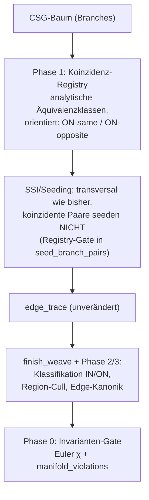

# BRep-Klassifikation & Koinzidente Geometrie — Plan

Stand: 2026-06-11. Single Source of Truth für die fehlende
**Boundary-Klassifikationsstufe** der Weave-Pipeline: Behandlung koinzidenter
Geometrie (koplanare Flächen, gleichradig-koaxiale Zylinder, bündig gestapelte
Extrudes). Auslöser: Ticket o2j9 (Box+Box flush-Union → Euler −16,
nicht-mannigfaltige BRep); verwandt oa9h/vyee (Octree-Route kollabiert auf
gestapelten koplanaren Extrudes ≳100 mm). Entstanden aus dem
Architektur-Review vom 2026-06-11, gegen den echten Code verifiziert.

## Befund

Die Weave-Pipeline trägt eine stille Annahme: **generische Lage** — alle
Flächenpaare schneiden sich transversal in 1D-Kurven. Es gibt keine Stufe, die
Flächenstücke gegen das Ergebnis-Solid klassifiziert (IN / OUT / ON). Jeder
Boolean-Kernel braucht diese Stufe; sie wurde hier nie gebaut.

Verifizierte Code-Faktenlage:

- **`ssi::plane_plane` (ssi.rs:215)**: parallele/koplanare Ebenen →
  `Components(vec![])` — koinzidente Flächenpaare erzeugen **null** Seeds,
  keine Naht-Kante. Koinzidenz ist heute schlicht „kein Schnitt".
- **`finish_weave` (weaving.rs:1140)** materialisiert pro Branch, der in
  irgendeiner Edge-Signatur auftaucht, bedingungslos **genau eine Face**
  (weaving.rs:1185–1266). Kein Interior-Cull, kein Koinzidenz-Merge, keine
  Klassifikation. Beide Routen — Octree (`weaving.rs:1110`) und Branch-Seed
  (`seed_weaver.rs:46`) — münden in dieses `finish_weave`.
- **`validate()` (mod.rs:467)** prüft nur Referenz-Integrität.
  `manifold_violations()` (mod.rs:564) und `euler_characteristic()`
  (mod.rs:624) existieren, werden aber von keinem Test als Gate erzwungen.
  Es gibt keinen Box+Box-flush-Test.
- Die Folgeschäden sind bereits in **zwei Downstream-Schichten geleakt**:
  `face_profile.rs::face_region_2d` (Kernel) und `faceFill.ts` (Web) panzern
  sich beide einzeln gegen „coplanar seam duplicates" (Coverage-Dedup,
  Ring-Assembly, Mikro-Ring-Filter). Jeder weitere BRep-Konsument zahlt die
  Schuld erneut.

### Symptom-Anatomie (Box [0,1] ∪ Box [1,2], bündig)

1. Die Membran-Branches (box1.+X, box2.−X auf derselben Ebene x=1) sind
   vollständig im Inneren der Union — sie gehören nicht zur Ergebnis-Grenze.
2. Die Rim-Ringe beider Boxen bei x=1 liegen auf der echten Außenfläche und
   werden gefunden (transversale Paare wie box1.+X ∩ box1.+Y schneiden sich
   regulär). Ihre Signaturen referenzieren die Membran-Branches.
3. `finish_weave` macht aus jedem signierten Branch eine Face → **zwei
   Geister-Membranen** plus **zwei geometrisch koinzidente, topologisch
   getrennte Rim-Ringe** plus koplanare Seitenwände als getrennte Faces ohne
   gemeinsame Naht-Kante → nicht-mannigfaltig, Euler −16.

## Fundamentalanalyse: Sampling vs. Symbolik

Wichtigste Korrektur gegenüber der ersten Einschätzung („der Octree-Fallback
ist für diese Fehlerklasse prinzipiell blind"): **Das Sampling ist nicht das
Problem — die Branch→Face-Attribution ist es.**

- Vorzeichen-Sampling berechnet die Grenze der **Punktmenge** — und genau die
  soll die BRep darstellen. Die Membran (f=0 ohne Vorzeichenwechsel,
  maßnull, beidseitig innen) ist für Sampling unsichtbar, aber sie gehört
  auch **nicht** zur Ergebnis-Grenze: ∂(A∪B) enthält sie nicht. Die
  „Blindheit" des Octrees ist semantisch korrekt. Die Geisterflächen stammen
  nicht aus dem Sampling, sondern werden in `finish_weave` aus den
  Edge-Signaturen **hergestellt**.
- Das Branch→Face-Modell setzt zweierlei voraus: die Abbildung
  Branch → Grenz-Region ist **injektiv** (keine zwei Branches teilen sich
  eine Region — verletzt durch koplanare Wände) und **total** (jeder Branch
  mit Edges liegt vollständig auf der Grenze — verletzt durch ganz/teilweise
  überdeckte Flächen). Koinzidenz bricht beide Annahmen. Da beide Routen
  durch dasselbe `finish_weave` laufen, scheitern beide — und **eine**
  Klassifikationsstufe repariert beide.
- Das Einzige, was Sampling **prinzipiell** nicht leisten kann, ist die
  diskrete Tatsache „diese zwei Branches sind dieselbe Fläche": ein
  Epsilon-Vergleich nahe-null-wertiger Samples ist fundamental schlecht
  konditioniert (das ist die konkrete Mechanik hinter oa9h/vyee — entlang
  einer koinzidenten Wand sehen die Kontributor-Sets überall ≥2 Branches
  innerhalb ε, Edge-Zellen schmieren über eine 2D-Region, verstärkt durch
  absolute Toleranzen bei ≳100 mm). Koinzidenz ist eine symbolische
  Eigenschaft der Branch-Daten und muss dort entschieden werden — exakt,
  analytisch, einmal.

**Leitregel (verbindlich): Koinzidenz wird auf Branch-Ebene analytisch
entschieden, niemals durch Sampling-Epsilons erschlagen.** Jede neue
Epsilon-Stellschraube im SSI-/Octree-Pfad, die einen Koinzidenz-Fall
„abfangen" soll, ist ein Plan-Verstoß.

## Zielbild

Klassifikations-Lattice pro Flächen-Region gegen das Ergebnis-Solid:

- **OUT** — kommt im Weave-Output nicht vor (Branches sind getrimmt).
- **IN** (Membran, beidseitig Material) — cullen.
- **ON-same** (zwei Branches, gleiche Fläche, gleiche Orientierung — z. B.
  koplanare Außenwände gestapelter Extrudes) — beide behalten, durch
  Naht-Kante getrennt.
- **ON-opposite** (gleiche Fläche, entgegengesetzte Orientierung — die
  Flush-Membran bei `add`; bei `remove` die Null-Dicke-Wand) — cullen bzw.
  per Op-Semantik behandeln.

**Bewusste Design-Entscheidung: kein Face-Merging.** Zwei koplanare Faces,
die sich eine Naht-Kante teilen (Diederwinkel 180°), sind valide, mannigfaltige
BRep-Topologie (STEP erlaubt das; klassische Kernel halten same-surface-
Nachbarfaces ebenfalls). Das erspart die härteste Teilfrage — deterministische
Namensgebung einer verschmolzenen Face — vollständig: jede Face behält ihren
Branch, `face_id(branch, spatial_index)` bleibt stabil. Merging ist Kosmetik
und kann später kommen (oder nie).

## Phasen

### Phase 0 — Invarianten-Gate (zuerst, vor jedem Kern-Eingriff) — UMGESETZT

Implementiert in `crates/kernel/src/brep/classification_gate.rs`: Testmatrix
mit harten Assertions auf `manifold_violations().is_empty()` und die
**verallgemeinerte Euler-Poincaré-Charakteristik**
`(V + geschlossene Kanten) − E + (F − Inner-Loops) == 2 − 2·Genus` —
das naive `V − E + F == 2` aus der ursprünglichen Planfassung zählt
geschlossene Rim-Kanten (Kreis = 1-Zelle plus implizite 0-Zelle) und
Ring-Faces (Annulus: χ = 0) falsch und wäre für die Soll-Topologie mehrerer
Matrix-Szenarien unerfüllbar. Empirisch verifiziert: Box 2, Zylinder 2,
Box-mit-Durchgangsloch (Genus 1) 0.

- Box ∪ Box: bündig gleicher Querschnitt, bündig kleinerer auf größerem
  (partielle Überdeckung), überlappend, kreuzend, kantenberührend (Policy-Test,
  s. Nicht-Ziele).
- Extrude-Stapel: 2–3 koplanar gestapelte Extrudes (das o2j9-Szenario),
  in kleiner UND großer Skala (≳100 mm, gegen oa9h/vyee-Regression).
- Zylinder ∪ Zylinder koaxial gleichradig, bündig gestapelt (der
  Zylinder-Zwilling des Box-Falls — Alltagsgeometrie: Welle, Boss).
- `remove` bündig: Subtraktion, die exakt eine Wand auf Null-Dicke bringt.

Erwartung: Diese Tests sind anfangs **rot** (bis auf die generischen Fälle).
Sie definieren „fertig" für Phase 2/3 und schützen die bestehende
826-Test-Suite messbar vor Regressionen. Toggle-Invarianz (`id_hash` Seed ↔
Octree) bleibt Teil des Gates. Stand der Umsetzung: 3 grüne Guards (Box,
überlappende Boxen, Kissing-Contact-Policy), 10 dokumentiert-rote Szenarien
als `#[ignore]` mit Begründung — un-ignorieren ist das Fertig-Kriterium der
jeweiligen Phase.

**Befunde aus dem Gate-Bau** (beide neu, beide Routen identisch betroffen):

- **F0-1 — Multi-Region-Branches, ganz ohne Koinzidenz.** Ein voll
  transversales Plus (zwei kreuzende Boxen *unterschiedlicher* Höhe) ist
  heute non-manifold (Euler 0 statt 2): die höhere Box zerschneidet die
  Seitenwände der flacheren in **zwei getrennte Rechtecke** und wird selbst
  zu Annulus-Wänden durchstoßen — „eine Face pro Branch" kann beides nicht
  darstellen. Das ist die Totalitäts-/Injektivitätsverletzung der
  Branch→Face-Attribution in ihrer koinzidenzfreien Form und bestätigt den
  Fix-Ort: Die Face-Materialisierung in Phase 3 muss **pro
  zusammenhängender Region** eine Face erzeugen (Ring-Faces inklusive),
  nicht pro Branch.
- **F0-2 — Loop-Orientierung auf gekrümmten Flächen war nie konsistent
  (BEHOBEN).** Schon der nackte Zylinder verletzte die
  fwd/rev-Manifold-Konvention: `order_loops` schob geschlossene Rim-Kreise
  für *jeden* Konsumenten mit festem `reversed = false` in die Ringe und
  ließ die Windung gekrümmter Flächen „as ordered"; zusätzlich wickelten
  Tool-Faces von Differences planar nach der **Primitiv**-Normale (das
  Komplement fehlte). Fix (Commit nach Phase 0, rein symbolisch — keine
  Sampling-Epsilons): (a) `complemented_features` — Komplement-Parität pro
  Feature aus dem CSG-Baum (Difference-rechts toggelt; Shell-Innenwand
  flippt per `INNER_WALL_FLAG`), (b) gesampelte Ring-Flächen
  (`ring_sample_points` + `sampled_area_plane`), womit Rim-Kreise erstmals
  ein Windungs-Vorzeichen haben, (c) uv-Windungsmetriken
  (`ring_uv_metrics`): alle `(u = atan2(z,x), v)`-Parametrisierungen sind
  linkshändig zur Primitiv-Normale; gebundene Loops werden per
  uv-Shoelace gewickelt (Outer `−s`, Löcher `+s`), Voll-Rims nach
  **Flächenseite** (Fläche bei kleinerem v → `du·s > 0`) — die Outer/Inner-
  Rolle ist für Rims das falsche Kriterium (Annulus). Deklarierte
  Restlücke: einsame Voll-Rims ohne Referenz-Ring (Kugelkappen-Schnitt)
  behalten ihre Walk-Ordnung. Gate-Guards: `gate_plain_cylinder`,
  `gate_remove_through_hole_genus1` (beide grün, inkl. Parität).

### Phase 1 — Koinzidenz-Registry (analytisch, exakt)

Über alle Branch-Halfspaces eines Bodies (`branch_halfspace_map`) orientierte
Äquivalenzklassen bilden:

- Plane ≡ Plane: gleiche Trägerebene (Normale ∥, gleicher Offset);
  Orientierung gleich → ON-same, entgegengesetzt → ON-opposite.
- Cylinder ≡ Cylinder: gleiche Achse, gleicher Radius. Sphere ≡ Sphere:
  gleiches Zentrum, gleicher Radius. (Generisch über Flächentyp designen,
  nicht plane-only — gestapelte Kreis-Extrudes sind so häufig wie Box-Stapel.)
- Vergleich auf den **analytischen Parametern** der Branches. Wo Parameter
  konstruktionsbedingt identisch sind (Face-Extrude auf Body-Fläche, Sketch
  auf Body-Fläche), greift exakter f64-Vergleich. Für den allgemeinen Fall
  (numerisch durchgereichte Transforms) gilt **eine** zentrale, dokumentierte
  Toleranz an genau dieser einen Stelle — das ist der gesamte erlaubte
  Toleranz-Fußabdruck des Themas Koinzidenz.

Output: pro Body eine Map Branch → (Klassen-ID, Orientierung). Konsumenten:
SSI (Phase 3), finish_weave (Phase 2/3), später Octree-Kontributor-Logik
(Phase 4).

Design-Direktive (aus `ARCHITECTURE-ROADMAP.md`, Punkt 2): die Registry
modelliert Kontakt als **Ordnung** (0 transversal, 1 tangential,
∞ koinzident), nicht als Bool. Phase 1 implementiert nur Ordnung ∞; das
Interface lässt tangentialen Kontakt später ohne Redesign andocken.

### Phasen 2 + 3 (Kern) — UMGESETZT als Koinzidenz-Kanonikalisierung in `finish_weave`

Stand der Umsetzung (Schritt „(1b)" in `finish_weave`, gated auf nicht-leere
Registry — transversale Körper nehmen den unveränderten Fast-Path):

1. **Punkt-Kontakt-Filter** (`drop_point_contact_edges`): An bündigen Nähten
   traced der Weaver auch Kreuz-Paare (box1-Wand ∩ box2-Nachbarwand), deren
   Aktivitäts-Überlappung ein einzelner Punkt ist — Null-Längen-Kanten, die
   die Ring-Ordnung vergiften. Werden verworfen.
2. **Vertex-Weld** (`weld_seam_vertices`): Jede Naht-Seite traced eigene
   Eckpunkt-Kopien (identische Position, getrennte Arena-Einträge) — ohne
   Weld verbinden Ringe nicht über die Naht.
3. **Edge-Kanonikalisierung** (`merge_coincident_edges`): Kanten mit gleicher
   kanonischer Signatur (kleinste Branch-IDs der Klasse) und identischem
   Kurvensegment verschmelzen zu EINER topologischen Kante mit der
   **Vereinigung beider Face-Mitgliedschaften**. Identität ist billig, weil
   der Carrier-Paar-Schnitt eine eindeutige Kurve ist: geschlossene Loops
   gleicher Klasse sind dieselbe Kurve (Centroid-Sanity-Check), offene
   Kanten vergleichen nur die Newton-verfeinerten Endpunkte.
4. **Membran-Cull** (`cull_membrane_branches`, der geplante Pass A — jetzt
   VOR der Face-Materialisierung): Kandidaten sind exakt die Branches mit
   Opposite-Partner in der Registry; ±ε-Seitigkeits-Probe an Centroid + bis
   zu 8 nach innen gezogenen Randpunkten. Beidseitig innen (Membran) ODER
   beidseitig außen (Null-Dicke-remove) → Branch materialisiert keine Face.
5. **Fin-Drop** (`drop_fin_edges`): Kanten, deren Mitgliedschaft durch den
   Cull unter zwei Faces fällt, lagen auf einem maßnull-f=0-Blatt (z. B.
   die Geisterwand des bündigen remove) und werden verworfen — bewusst NUR
   bei Cull-Verlust, ehrlich offene Topologie anderswo bleibt sichtbar.

Face-Gruppierung läuft seither über Mitgliedschaften statt roher
Signaturen; Ring-Faces bei partieller Überdeckung entstehen automatisch
(die Naht-Kanten landen via Mitgliedschaft im Edge-Set der großen Face,
`order_loops`/DL-58 klassifiziert sie als Inner-Loop).

**Gate-Stand danach:** bündige Boxen (gleich + kleiner-auf-größer),
Extrude-Stapel klein und ≳100 mm, bündiges remove, Zylinder-Stack
(Seed-Route) — alle grün, beide Routen (Boxen/Extrudes) inkl.
Toggle-Invarianz. Noch rot (ignoriert): die Plus-Familie (F0-1
Multi-Region — braucht Face-pro-Region, s. u.) und die Octree-Route des
Zylinder-Stacks (Kontributor-Schmiere am gekrümmten Saum → Phase 4;
Plane-Säume rettet der DL-75-Fastpath).

**Nachschärfungen aus der o2j9-Ticket-Validierung** (reale Dokumente,
verkettete Face-Extrudes):

- **Anker-Drift getilgt:** `face_plane_frame` ankerte Face-Extrudes auf dem
  sample-abgeleiteten Fingerprint-Centroid (~0,5 µm neben dem Carrier bei
  100 mm) — jede Stapelstufe driftete neu, und im
  Beinahe-Koinzidenz-Regime ist der Tracer hypersensitiv (52 vs. 22 Kanten
  aus 6e-5 Unterschied; die „watertight"-Baseline dieses Bodys hatte Euler
  −18). Der Centroid wird jetzt auf die **exakte analytische Ebene**
  projiziert — gestapelte Face-Extrudes sind exakt koinzident
  (Leitregel: Drift an der Quelle töten statt Toleranzen jagen).
- **Toleranz-Dimensionierung:** `COINCIDENCE_REL_TOL = 1e-5` (vorher 1e-6),
  dimensioniert am bindenden Fall mesh-abgeleiteter Profile (~5e-6 relativ)
  mit 2× Headroom; Begründung am Konstanten-Kommentar.
- **Merge pro Klassen-Branch** statt pro Signatur-Paar: die Wand-Partner
  zweier Naht-Kopien dürfen außerhalb der Registry-Toleranz liegen — der
  gemeinsame Carrier plus Endpunkt-Identität genügt.
- **Closed-Loop-Identität:** Centroid UND Extent, loop-proportional
  toleriert — Centroid allein hätte konzentrische Loops verschmolzen.
- **Fin-Drop nur mit Beweis:** 0 Survivor → weg; 1 Survivor → ±ε-Probe im
  Survivor-Carrier, gedroppt nur wenn beidseitig klar abseits der
  Körpergrenze. Ambiges bleibt ehrlich offen, damit `is_watertight` nie aus
  einer unvollständigen Wireframe „hergestellt" wird.

### Phase 3 (voll) — UMGESETZT: der `CoincidentSurface`-Fall ohne 2D-Arrangement

Das Ticket-Szenario (Zwei-Flächen-Extrusion auf tiefem Stapel) ist
geschlossen — `ticket_o2j9…` läuft, plus drei Gate-Guards auf der byte-exakt
decodierten Ticket-Geometrie (`gate_ticket_o2j9_*`). Die Diagnose am realen
Dokument ergab DREI Wurzeln, keine davon brauchte das ursprünglich geplante
2D-Arrangement:

1. **Koinzidente Paare nie als transversal seeden** (der eigentliche
   `CoincidentSurface`-Fall, implementiert als Registry-Gate in
   `seed_branch_pairs` statt als `SsiResult`-Variante — dort existieren
   Flächen UND Body-Kontext, also genau EINE Toleranzquelle): Profile aus
   `face_profile` tragen µm-In-Plane-Drift (die Ebene ist seit dem
   Anker-Fix exakt, die Profilkoordinaten sind mesh-abgeleitet). Zwei
   gestapelte Wände präsentieren sich SSI dadurch als Ebenen mit
   µrad-Winkel: `plane_plane` fabriziert aus reinem Drift-Rauschen eine
   „Schnittlinie", auf der die ganze gemeinsame Wand aktiv ist → der Marsch
   stallt → die GANZE Seed-Route bailt → Octree-Fallback → der gemeldete
   E=0/F=24-Geisterflächen-Kollaps. Paare mit `registry.relative(a,b)`
   liefern jetzt keine Seeds; die Naht-Kanten eines gemeinsamen Carriers
   entstehen aus den transversalen Paaren mit den **berandenden** Flächen,
   die Kanonikalisierung (1b) verheiratet die Seiten.
2. **On-Boundary-Gate in `both_branches_active`:** Die Contributor-Menge
   allein ist notwendig, nicht hinreichend — weit außerhalb des Körpers, auf
   der Verlängerung einer konkaven Eckenlinie, melden Extrude-Leaves am
   2D-Profil-Eckpunkt BEIDE angrenzenden Wandgruppen als nächste Features
   (Box-Leaves rettet zufällig die max-Zerlegung). Ein Naht-Marsch lief so
   950 mm am Körper vorbei bis `max_arc`. Jetzt gilt zusätzlich
   `|f| ≤ eps` (das Logical-Feld lag als ignorierter Rückgabewert ohnehin
   vor); Membran-Blätter (f = 0) bleiben absichtlich aktiv — die gehören
   der Kanonikalisierung.
3. **Interior-Fin-Beweis in `drop_fin_edges`:** Das Union-Profil einer
   Mehr-Flächen-Extrusion stößt seine Teilprofile an einer gemeinsamen
   Sketch-Kante aneinander → interne Null-Dicke-Wandpaare (ON-opposite,
   werden gecullt), deren Cap-Rims als 1-Survivor-Kanten MITTEN über die
   verschmolzene Cap-Fläche streifen. Neuer Beweis-Zweig: beidseitig
   on-boundary UND der Survivor-Branch beidseitig im Contributor-Set →
   Interior-Kante der eigenen Face → trennt in einer 2-Mannigfaltigkeit
   nichts → weg. Ein echter Naht-Rim wird nicht erfasst (jenseits eines
   echten Rims läuft der Carrier ins Material, f < 0).

Das **2D-Arrangement aus dem ursprünglichen Phase-3-Text war nicht nötig**:
die Naht-Kanten auf gemeinsamen Carriern kommen vollständig aus den
transversalen Paaren mit den berandenden Flächen — ein Arrangement würde
erst für Fälle gebraucht, in denen koinzidente Regionen NICHT durch
transversale Dritt-Flächen berandet sind. Sollte so ein Fall auftauchen,
ist der ursprüngliche Text unten die Referenz.

Bekannte Restlücken: F0-1 (Face-pro-Region, Plus-Familie), Phase 4
(Octree-Route auf den Ticket-Bodies degeneriert weiter an rotierten/
gekrümmten koinzidenten Wänden — Produktion nimmt die Seed-Route),
nichtdeterministische qFace-Auflösung auf degenerierten Zwischenständen ist
mit der jetzt sauberen Seed-Route mit-behoben.

### Ursprünglicher Phasen-Text (Referenz)

#### Phase 2 — Pass A: Interior-Cull in `finish_weave`

Ankerpunkt: nach der Face-Materialisierung (weaving.rs:1265), vor der
Shell-Assembly (weaving.rs:1294). Pro Face: repräsentativen Flächenpunkt
(Centroid des Outer-Loops, auf die analytische Fläche projiziert) um ±ε
entlang der Flächennormale verschieben, `body.evaluate`-Vorzeichen testen.
Beidseitig innen → Membran → Face verwerfen (samt jetzt unreferenzierter
Edges).

Robustheit: Der Test entscheidet **Seitigkeit**, nicht Koinzidenz — in
Abstand ε von einer bekannten analytischen Fläche ist das Vorzeichen
wohlkonditioniert (ε relativ zur Modell-Diagonale, deutlich über
Flächen-Toleranz). Das verletzt die Leitregel nicht.

Ehrliche Deklaration: Pass A beseitigt Geisterflächen (Picking, Highlight,
STEP profitieren sofort), hinterlässt aber an der Naht **offene Topologie**
(die Rim-Duplikate bleiben; das Phase-0-Gate bleibt teilweise rot).
Zwischenzustand, kein Endzustand.

#### Phase 3 — Koinzidenz-Naht: SSI-Fall `CoincidentSurface`

Der eigentliche Fix (schließt o2j9):

1. `ssi` erkennt via Registry koinzidente Paare und liefert statt
   `Components(vec![])` einen expliziten `CoincidentSurface`-Fall.
2. Behandlung im gemeinsamen 2D-Parameterraum der Trägerfläche (Ebene: die
   Ebene selbst; Zylinder: abgerollt). Dort ist es ein **2D-Arrangement
   analytischer Kurven** (Linien/Kreisbögen — die Schnitte der übrigen
   Branches mit der Trägerfläche): Regionen klassifizieren
   (IN/ON-same/ON-opposite), Naht-Kanten dort erzeugen, wo
   behaltene Regionen verschiedener Branches aneinanderstoßen.
3. Edge-Kanonikalisierung über Klassen: geometrisch koinzidente Rim-Kanten
   (z. B. small.−Z ∩ small.wall vs. big.+Z ∩ small.wall) auf **eine**
   topologische Kante zusammenführen, Signatur deterministisch (kleinste
   Branch-IDs der Klasse).
4. Partiell überdeckte Faces (kleiner Block auf großem): behaltene Region als
   Face mit Inner-Loop (Naht-Ring) — Mechanik existiert (`order_loops`,
   DL-58). Allgemeiner (Befund F0-1): Die Face-Materialisierung erzeugt eine
   Face **pro zusammenhängender Grenzregion** eines Branches, nicht pro
   Branch — das deckt getrennte Regionen (transversales Plus) und
   Annulus-Wände gleich mit ab; `spatial_index` disambiguiert wie gehabt.

Scope-Begrenzung: Trägerflächen Plane, Cylinder, Sphere; Arrangement-Kurven
Linie + Kreisbogen. Koinzidenz auf NURBS-Trägerflächen ist deklarierte
Limitation — ausdrücklich **ohne** Octree-Fallback-Versprechen, denn der
Octree löst Koinzidenz ebenfalls nicht (s. Fundamentalanalyse).

### Phase 4 (nachgelagert) — Koinzidenz-bewusste Octree-Route

Kontributor-/Aktivitätslogik (`both_branches_active`, Zell-Klassifikation)
auf Klassen statt Branches umstellen: eine koinzidente Wand hat **eine**
Klasse → Face-Zelle statt geschmierter Edge-Zellen. Behebt die
oa9h/vyee-Mechanik an der Wurzel. Nachgelagert, weil die Seed-Route nach
Phase 3 den Normalfall trägt und die Octree-Route über das gemeinsame
`finish_weave` bereits von Phase 1–3 profitiert.

### Phase 5 — Refactoring & Aufräumen (Code und Konzepte konsolidieren) — UMGESETZT

Die Phasen 0–3 sind in sechs schnellen Feature-Commits entstanden; der Code
funktioniert, aber Struktur und Konzepte hinken der Implementierung
hinterher. Phase 5 zahlt diese Schuld ab, **ohne Verhaltensänderung als
Ziel** — das Phase-0-Gate plus die volle Suite sind die Wächter, jede
Teilstufe wird einzeln grün committet.

**5a — Eine Toleranz-Policy statt Streu-Epsilons.** Der Survey-Befund: neben
der einen deklarierten Registry-Toleranz (`COINCIDENCE_REL_TOL`) leben 15+
Inline-Literale im Modul, teils absolut (`ssi.rs PARALLEL_EPS/BOX_SLACK/
ON_SURF`, `branch_pairs.rs OVERLAP_EPS`, `edge_walker.rs VERTEX_REFINE_TOL`),
teils ad-hoc skalenrelativ (`diag * 1e-4` u. ä.), dazu duplizierte
`ADAPT_*`-Konstanten in `edge_walker.rs`/`seed_weaver.rs`. Neues Modul
`brep::tol`: jede Toleranz bekommt einen Namen, eine dokumentierte
Begründung (wovor schützt sie, warum dieser Wert) und eine Klasse —
*längen-skalenrelativ* (Standard, × AABB-Diagonale), *dimensionslos*
(Winkel, Faktoren) oder *begründet absolut* (nur wo f32-Maschinenepsilon
o. ä. der echte Anker ist). Wertänderungen nur dort, wo die Gate-Familie
(inkl. ≳100-mm-Szenarien) sie deckt; riskante Kandidaten werden migriert,
benannt und mit dem Ist-Wert eingefroren, die Umstellung auf skalenrelativ
als Kommentar-Auftrag im Modul dokumentiert. Damit ist Punkt 3 der
Architektur-Problemliste (Skalen-Fragilität) strukturell adressiert.

**5b — `weaving.rs` entflechten.** 4964 Zeilen, davon ~2500 Tests; das
Modul ist vom Weber zum Küchenspülbecken gewachsen (Halfspace-Registry,
Sketch-Lifting, Flächengeometrie, Loop-Ordnung, Kanonikalisierung,
Fast-Path-Wireframes, Weave-Kern). Split in ein Verzeichnismodul mit klaren
Schichten, als **reiner Move** (keine Logikänderung im selben Commit):

- `weaving/surface_registry.rs` — `branch_halfspace_map`,
  `complemented_features`, Paritäts-Walk (die symbolische Quelle, von der
  Registry und SSI leben)
- `weaving/sketch_surfaces.rs` — Sketch-Wall-Collection, Extrude-/
  Revolve-Lift (DL-50)
- `weaving/surface_queries.rs` — `surface_normal_at`, `surface_uv`,
  Tangenten-/Winkelhelfer
- `weaving/loop_ordering.rs` — `order_loops`, `order_one_ring`,
  Ring-Metriken
- `weaving/canonicalize.rs` — die Phase-2/3-Kanonikalisierung
  (merge/weld/cull/fin/compact)
- `weaving/wireframes.rs` — Box-/Zylinder-Fast-Paths, `weave_parametric`
- `weaving/mod.rs` — `weave`, `weave_pure_octree`, `finish_weave`,
  Re-Exports (öffentliche API bleibt unverändert)

**5c — Konzepte benennen.** `finish_weave` (249 Zeilen) wird zur lesbaren
Pipeline aus benannten Phasen-Funktionen (NURBS-Anker → Kanonikalisierung →
Face-Materialisierung → Edgeless-Faces → Shell-Assembly); `order_loops`
(195 Zeilen) trennt sich in planare und gekrümmte Ring-Klassifikation.
Implizite Konzepte bekommen Typen: `Ring` statt `Vec<(EdgeId, bool)>`,
`RingUvMetrics` statt `(f64, f64, f64)`, `BranchSurface` statt
`HashMap<u32, (HalfSpace, Transform)>`-Tupelzugriff. Bool-Parameter mit
Bedeutungsgewicht (`complemented`) behalten ihren Namen aus der Registry —
keine Enum-Kosmetik ohne Mehrwert.

**5d — Hygiene & Doku.** Debug-`eprintln!` in `octree.rs` entfernen;
unbegründete Magie dokumentieren (0.2-Centroid-Pull der Membran-Erkennung,
24 Newton-Iterationen, 64 SSI-Seeds pro Kurve); Glossar der eingeführten
Begriffe (Carrier, Membran, Fin, Seam, Rim, Kanonikalisierung) in
`brep/mod.rs`; `docs/ARCHITECTURE.md` auf die neue Modulstruktur
nachziehen.

**Reihenfolge:** 5a → 5b → 5c → 5d. Die Toleranz-Policy zuerst (kleinste
Oberfläche, größter konzeptioneller Hebel), der Datei-Split davor wäre
doppelte Bewegung. Jede Stufe einzeln: Tests grün → Commit → Push.

**Umsetzung** (v0.6.71–0.6.74, je Stufe ein Commit, 851 Tests grün,
Warning-frei): 5a `brep::tol` mit drei Klassen (skalenrelativ /
dimensionslos / eingefroren-absolut mit Konvertierungsauftrag); die
Kanonikalisierung läuft über `tol::on_boundary`/`loop_centroid`,
`ADAPT_*` ist dedupliziert, `BOX_SLACK`/`OVERLAP_EPS` zu
`AABB_TOUCH_SLACK` vereinheitlicht — reine Migration ohne Wertänderung.
5b `weaving/` als Verzeichnismodul (surface_registry / sketch_surfaces /
surface_queries / loop_ordering / canonicalize / wireframes / tests),
öffentliche API unverändert. 5c `finish_weave` als benannte Pipeline
(upgrade_hermite_edges → canonicalize_coincident → materialize_faces →
assemble_solid), `order_loops` = assemble_rings +
classify_rings_planar/curved; Typen `BranchSurfaceMap`, `Ring`,
`RingUvMetrics`; `ring_signed_area` ist als Test-Orakel `#[cfg(test)]`.
5d Glossar in `brep/mod.rs`, Heuristik-Begründungen (Membran-Probe-Pull
0.2, `VERTEX_REFINE_MAX_ITER`), ARCHITECTURE.md §3.4 auf den Ist-Stand;
das vermutete Debug-`eprintln!` in `octree.rs` lag in Testcode — kein
Produktions-Logging im Modul außer dem bewussten
Degenerate-Topology-Warnpfad.

## Nicht-Ziele / deklarierte Limitationen

- **Tangentialer Kontakt** (Kontaktordnung 1): SSI-Kurve degeneriert,
  ∇f_a × ∇f_b → 0 entlang der ganzen Kante, der Tracer hat keine
  Marschrichtung. Betrifft nicht nur Fillets, sondern jeden G1-Stoß
  (Revolves/Extrudes mit tangentengleichen Profilen). Per User-Entscheidung
  2026-06-11 **zurückgestellt**; Lösungsrichtung (konstruktive Provenienz:
  Tangenz-Fakt aus Sketch-Constraints/Profildaten, Kante symbolisch aus der
  Konstruktion, nie aus SSI) und Auslöser stehen in
  `docs/ARCHITECTURE-ROADMAP.md`, Punkt 2. Die Registry (Phase 1) hält per
  Kontaktordnungs-Feld die Andockstelle offen.
- **Kissing Contact** (Berührung in Punkt oder Kante, z. B. zwei Boxen teilen
  genau eine Kante): die Union ist **inhärent nicht-mannigfaltig** — das ist
  keine Pipeline-Schwäche, sondern Topologie. Policy: Weave liefert das
  Ergebnis ohne Naht (wie zwei getrennte Shells eines Solids),
  `manifold_violations` darf das benennen, Phase-0-Test dokumentiert das
  Verhalten. Kein Heuristik-Versuch, den Fall „glattzubügeln".
- **Face-Merging** koplanarer Nachbarfaces: Kosmetik, explizit out of scope
  (s. Zielbild).

## Risiken

- **Naming-Drift bei partieller Überdeckung**: Wird eine Face zur Ring-Face
  beschnitten, bleibt der Branch (Face-ID stabil), aber `spatial_index` /
  Fingerprints können sich verschieben → Stufe-2-Healing beobachten.
  Phase-0-Gate um Handle-Resolve-Tests auf den Matrix-Szenarien ergänzen.
- **`is_watertight`-Semantik**: Naht-Kanten mit 180°-Diederwinkel müssen von
  Degenerate-Edge-Filtern (kollineare Dezimierung, mcvp) unbehelligt bleiben.
- **Toleranz der Registry**: die eine erlaubte Toleranz (Phase 1) muss
  skalenrelativ sein — nicht den oa9h-Fehler (absolute Epsilons) wiederholen.

## Verwandt

- `docs/PARAMETRIC-WEAVING-PLAN.md` — Phasen 1+2 (Branch-Paar-Seeding) sind
  die Basis, auf der dieser Plan aufsetzt; Phase 0a dort (Manifold-Invariante)
  wird hier durch das Phase-0-Gate eingelöst.
- Ticket `tickets/open/o2j9` (Auslöser), Tickets oa9h/vyee (Octree-Symptome),
  `docs/ARCHITECTURE.md` §3.4 Multi-Body Partitioning (Ist-Stand-Absatz).
