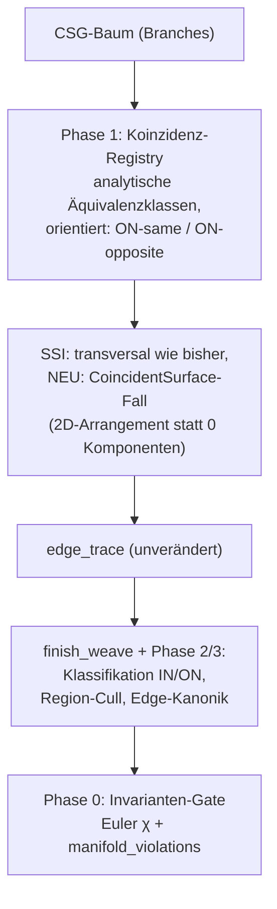

# BRep-Klassifikation & Koinzidente Geometrie — Plan

Stand: 2026-06-11. Single Source of Truth für die fehlende
**Boundary-Klassifikationsstufe** der Weave-Pipeline: Behandlung koinzidenter
Geometrie (koplanare Flächen, gleichradig-koaxiale Zylinder, bündig gestapelte
Extrudes). Auslöser: Ticket o2j9 (Box+Box flush-Union → Euler −16,
nicht-mannigfaltige BRep); verwandt oa9h/vyee (Octree-Route kollabiert auf
gestapelten koplanaren Extrudes ≳100 mm). Entstanden aus dem
Architektur-Review vom 2026-06-11, gegen den echten Code verifiziert.

## Befund

Die Weave-Pipeline trägt eine stille Annahme: **generische Lage** — alle
Flächenpaare schneiden sich transversal in 1D-Kurven. Es gibt keine Stufe, die
Flächenstücke gegen das Ergebnis-Solid klassifiziert (IN / OUT / ON). Jeder
Boolean-Kernel braucht diese Stufe; sie wurde hier nie gebaut.

Verifizierte Code-Faktenlage:

- **`ssi::plane_plane` (ssi.rs:215)**: parallele/koplanare Ebenen →
  `Components(vec![])` — koinzidente Flächenpaare erzeugen **null** Seeds,
  keine Naht-Kante. Koinzidenz ist heute schlicht „kein Schnitt".
- **`finish_weave` (weaving.rs:1140)** materialisiert pro Branch, der in
  irgendeiner Edge-Signatur auftaucht, bedingungslos **genau eine Face**
  (weaving.rs:1185–1266). Kein Interior-Cull, kein Koinzidenz-Merge, keine
  Klassifikation. Beide Routen — Octree (`weaving.rs:1110`) und Branch-Seed
  (`seed_weaver.rs:46`) — münden in dieses `finish_weave`.
- **`validate()` (mod.rs:467)** prüft nur Referenz-Integrität.
  `manifold_violations()` (mod.rs:564) und `euler_characteristic()`
  (mod.rs:624) existieren, werden aber von keinem Test als Gate erzwungen.
  Es gibt keinen Box+Box-flush-Test.
- Die Folgeschäden sind bereits in **zwei Downstream-Schichten geleakt**:
  `face_profile.rs::face_region_2d` (Kernel) und `faceFill.ts` (Web) panzern
  sich beide einzeln gegen „coplanar seam duplicates" (Coverage-Dedup,
  Ring-Assembly, Mikro-Ring-Filter). Jeder weitere BRep-Konsument zahlt die
  Schuld erneut.

### Symptom-Anatomie (Box [0,1] ∪ Box [1,2], bündig)

1. Die Membran-Branches (box1.+X, box2.−X auf derselben Ebene x=1) sind
   vollständig im Inneren der Union — sie gehören nicht zur Ergebnis-Grenze.
2. Die Rim-Ringe beider Boxen bei x=1 liegen auf der echten Außenfläche und
   werden gefunden (transversale Paare wie box1.+X ∩ box1.+Y schneiden sich
   regulär). Ihre Signaturen referenzieren die Membran-Branches.
3. `finish_weave` macht aus jedem signierten Branch eine Face → **zwei
   Geister-Membranen** plus **zwei geometrisch koinzidente, topologisch
   getrennte Rim-Ringe** plus koplanare Seitenwände als getrennte Faces ohne
   gemeinsame Naht-Kante → nicht-mannigfaltig, Euler −16.

## Fundamentalanalyse: Sampling vs. Symbolik

Wichtigste Korrektur gegenüber der ersten Einschätzung („der Octree-Fallback
ist für diese Fehlerklasse prinzipiell blind"): **Das Sampling ist nicht das
Problem — die Branch→Face-Attribution ist es.**

- Vorzeichen-Sampling berechnet die Grenze der **Punktmenge** — und genau die
  soll die BRep darstellen. Die Membran (f=0 ohne Vorzeichenwechsel,
  maßnull, beidseitig innen) ist für Sampling unsichtbar, aber sie gehört
  auch **nicht** zur Ergebnis-Grenze: ∂(A∪B) enthält sie nicht. Die
  „Blindheit" des Octrees ist semantisch korrekt. Die Geisterflächen stammen
  nicht aus dem Sampling, sondern werden in `finish_weave` aus den
  Edge-Signaturen **hergestellt**.
- Das Branch→Face-Modell setzt zweierlei voraus: die Abbildung
  Branch → Grenz-Region ist **injektiv** (keine zwei Branches teilen sich
  eine Region — verletzt durch koplanare Wände) und **total** (jeder Branch
  mit Edges liegt vollständig auf der Grenze — verletzt durch ganz/teilweise
  überdeckte Flächen). Koinzidenz bricht beide Annahmen. Da beide Routen
  durch dasselbe `finish_weave` laufen, scheitern beide — und **eine**
  Klassifikationsstufe repariert beide.
- Das Einzige, was Sampling **prinzipiell** nicht leisten kann, ist die
  diskrete Tatsache „diese zwei Branches sind dieselbe Fläche": ein
  Epsilon-Vergleich nahe-null-wertiger Samples ist fundamental schlecht
  konditioniert (das ist die konkrete Mechanik hinter oa9h/vyee — entlang
  einer koinzidenten Wand sehen die Kontributor-Sets überall ≥2 Branches
  innerhalb ε, Edge-Zellen schmieren über eine 2D-Region, verstärkt durch
  absolute Toleranzen bei ≳100 mm). Koinzidenz ist eine symbolische
  Eigenschaft der Branch-Daten und muss dort entschieden werden — exakt,
  analytisch, einmal.

**Leitregel (verbindlich): Koinzidenz wird auf Branch-Ebene analytisch
entschieden, niemals durch Sampling-Epsilons erschlagen.** Jede neue
Epsilon-Stellschraube im SSI-/Octree-Pfad, die einen Koinzidenz-Fall
„abfangen" soll, ist ein Plan-Verstoß.

## Zielbild

Klassifikations-Lattice pro Flächen-Region gegen das Ergebnis-Solid:

- **OUT** — kommt im Weave-Output nicht vor (Branches sind getrimmt).
- **IN** (Membran, beidseitig Material) — cullen.
- **ON-same** (zwei Branches, gleiche Fläche, gleiche Orientierung — z. B.
  koplanare Außenwände gestapelter Extrudes) — beide behalten, durch
  Naht-Kante getrennt.
- **ON-opposite** (gleiche Fläche, entgegengesetzte Orientierung — die
  Flush-Membran bei `add`; bei `remove` die Null-Dicke-Wand) — cullen bzw.
  per Op-Semantik behandeln.

**Bewusste Design-Entscheidung: kein Face-Merging.** Zwei koplanare Faces,
die sich eine Naht-Kante teilen (Diederwinkel 180°), sind valide, mannigfaltige
BRep-Topologie (STEP erlaubt das; klassische Kernel halten same-surface-
Nachbarfaces ebenfalls). Das erspart die härteste Teilfrage — deterministische
Namensgebung einer verschmolzenen Face — vollständig: jede Face behält ihren
Branch, `face_id(branch, spatial_index)` bleibt stabil. Merging ist Kosmetik
und kann später kommen (oder nie).

## Phasen

### Phase 0 — Invarianten-Gate (zuerst, vor jedem Kern-Eingriff)

Testmatrix mit harten Assertions auf `euler_characteristic() == 2` (Genus 0)
und `manifold_violations().is_empty()`:

- Box ∪ Box: bündig gleicher Querschnitt, bündig kleinerer auf größerem
  (partielle Überdeckung), überlappend, kreuzend, kantenberührend (Policy-Test,
  s. Nicht-Ziele).
- Extrude-Stapel: 2–3 koplanar gestapelte Extrudes (das o2j9-Szenario),
  in kleiner UND großer Skala (≳100 mm, gegen oa9h/vyee-Regression).
- Zylinder ∪ Zylinder koaxial gleichradig, bündig gestapelt (der
  Zylinder-Zwilling des Box-Falls — Alltagsgeometrie: Welle, Boss).
- `remove` bündig: Subtraktion, die exakt eine Wand auf Null-Dicke bringt.

Erwartung: Diese Tests sind anfangs **rot** (bis auf die generischen Fälle).
Sie definieren „fertig" für Phase 2/3 und schützen die bestehende
826-Test-Suite messbar vor Regressionen. Toggle-Invarianz (`id_hash` Seed ↔
Octree) bleibt Teil des Gates.

### Phase 1 — Koinzidenz-Registry (analytisch, exakt)

Über alle Branch-Halfspaces eines Bodies (`branch_halfspace_map`) orientierte
Äquivalenzklassen bilden:

- Plane ≡ Plane: gleiche Trägerebene (Normale ∥, gleicher Offset);
  Orientierung gleich → ON-same, entgegengesetzt → ON-opposite.
- Cylinder ≡ Cylinder: gleiche Achse, gleicher Radius. Sphere ≡ Sphere:
  gleiches Zentrum, gleicher Radius. (Generisch über Flächentyp designen,
  nicht plane-only — gestapelte Kreis-Extrudes sind so häufig wie Box-Stapel.)
- Vergleich auf den **analytischen Parametern** der Branches. Wo Parameter
  konstruktionsbedingt identisch sind (Face-Extrude auf Body-Fläche, Sketch
  auf Body-Fläche), greift exakter f64-Vergleich. Für den allgemeinen Fall
  (numerisch durchgereichte Transforms) gilt **eine** zentrale, dokumentierte
  Toleranz an genau dieser einen Stelle — das ist der gesamte erlaubte
  Toleranz-Fußabdruck des Themas Koinzidenz.

Output: pro Body eine Map Branch → (Klassen-ID, Orientierung). Konsumenten:
SSI (Phase 3), finish_weave (Phase 2/3), später Octree-Kontributor-Logik
(Phase 4).

### Phase 2 — Pass A: Interior-Cull in `finish_weave`

Ankerpunkt: nach der Face-Materialisierung (weaving.rs:1265), vor der
Shell-Assembly (weaving.rs:1294). Pro Face: repräsentativen Flächenpunkt
(Centroid des Outer-Loops, auf die analytische Fläche projiziert) um ±ε
entlang der Flächennormale verschieben, `body.evaluate`-Vorzeichen testen.
Beidseitig innen → Membran → Face verwerfen (samt jetzt unreferenzierter
Edges).

Robustheit: Der Test entscheidet **Seitigkeit**, nicht Koinzidenz — in
Abstand ε von einer bekannten analytischen Fläche ist das Vorzeichen
wohlkonditioniert (ε relativ zur Modell-Diagonale, deutlich über
Flächen-Toleranz). Das verletzt die Leitregel nicht.

Ehrliche Deklaration: Pass A beseitigt Geisterflächen (Picking, Highlight,
STEP profitieren sofort), hinterlässt aber an der Naht **offene Topologie**
(die Rim-Duplikate bleiben; das Phase-0-Gate bleibt teilweise rot).
Zwischenzustand, kein Endzustand.

### Phase 3 — Koinzidenz-Naht: SSI-Fall `CoincidentSurface`

Der eigentliche Fix (schließt o2j9):

1. `ssi` erkennt via Registry koinzidente Paare und liefert statt
   `Components(vec![])` einen expliziten `CoincidentSurface`-Fall.
2. Behandlung im gemeinsamen 2D-Parameterraum der Trägerfläche (Ebene: die
   Ebene selbst; Zylinder: abgerollt). Dort ist es ein **2D-Arrangement
   analytischer Kurven** (Linien/Kreisbögen — die Schnitte der übrigen
   Branches mit der Trägerfläche): Regionen klassifizieren
   (IN/ON-same/ON-opposite), Naht-Kanten dort erzeugen, wo
   behaltene Regionen verschiedener Branches aneinanderstoßen.
3. Edge-Kanonikalisierung über Klassen: geometrisch koinzidente Rim-Kanten
   (z. B. small.−Z ∩ small.wall vs. big.+Z ∩ small.wall) auf **eine**
   topologische Kante zusammenführen, Signatur deterministisch (kleinste
   Branch-IDs der Klasse).
4. Partiell überdeckte Faces (kleiner Block auf großem): behaltene Region als
   Face mit Inner-Loop (Naht-Ring) — Mechanik existiert (`order_loops`,
   DL-58).

Scope-Begrenzung: Trägerflächen Plane, Cylinder, Sphere; Arrangement-Kurven
Linie + Kreisbogen. Koinzidenz auf NURBS-Trägerflächen ist deklarierte
Limitation — ausdrücklich **ohne** Octree-Fallback-Versprechen, denn der
Octree löst Koinzidenz ebenfalls nicht (s. Fundamentalanalyse).

### Phase 4 (nachgelagert) — Koinzidenz-bewusste Octree-Route

Kontributor-/Aktivitätslogik (`both_branches_active`, Zell-Klassifikation)
auf Klassen statt Branches umstellen: eine koinzidente Wand hat **eine**
Klasse → Face-Zelle statt geschmierter Edge-Zellen. Behebt die
oa9h/vyee-Mechanik an der Wurzel. Nachgelagert, weil die Seed-Route nach
Phase 3 den Normalfall trägt und die Octree-Route über das gemeinsame
`finish_weave` bereits von Phase 1–3 profitiert.

## Nicht-Ziele / deklarierte Limitationen

- **Tangentiale Quadriken** (Zylinder tangential an Ebene, ungleichradige
  Berührung): SSI-Kurve degeneriert, ∇f_a × ∇f_b → 0, der Tracer hat keine
  Marschrichtung. Selten in Praxis-Geometrie — **aber**: Fillets/Blends sind
  per Konstruktion überall tangential; sobald BREP-FEATURE-VISION Fillets
  angeht, braucht das eine eigene Lösung (tangentiale Kanten symbolisch aus
  der Feature-Konstruktion, nicht aus SSI). Bis dahin: known limitation.
- **Kissing Contact** (Berührung in Punkt oder Kante, z. B. zwei Boxen teilen
  genau eine Kante): die Union ist **inhärent nicht-mannigfaltig** — das ist
  keine Pipeline-Schwäche, sondern Topologie. Policy: Weave liefert das
  Ergebnis ohne Naht (wie zwei getrennte Shells eines Solids),
  `manifold_violations` darf das benennen, Phase-0-Test dokumentiert das
  Verhalten. Kein Heuristik-Versuch, den Fall „glattzubügeln".
- **Face-Merging** koplanarer Nachbarfaces: Kosmetik, explizit out of scope
  (s. Zielbild).

## Risiken

- **Naming-Drift bei partieller Überdeckung**: Wird eine Face zur Ring-Face
  beschnitten, bleibt der Branch (Face-ID stabil), aber `spatial_index` /
  Fingerprints können sich verschieben → Stufe-2-Healing beobachten.
  Phase-0-Gate um Handle-Resolve-Tests auf den Matrix-Szenarien ergänzen.
- **`is_watertight`-Semantik**: Naht-Kanten mit 180°-Diederwinkel müssen von
  Degenerate-Edge-Filtern (kollineare Dezimierung, mcvp) unbehelligt bleiben.
- **Toleranz der Registry**: die eine erlaubte Toleranz (Phase 1) muss
  skalenrelativ sein — nicht den oa9h-Fehler (absolute Epsilons) wiederholen.

## Verwandt

- `docs/PARAMETRIC-WEAVING-PLAN.md` — Phasen 1+2 (Branch-Paar-Seeding) sind
  die Basis, auf der dieser Plan aufsetzt; Phase 0a dort (Manifold-Invariante)
  wird hier durch das Phase-0-Gate eingelöst.
- Ticket `tickets/open/o2j9` (Auslöser), Tickets oa9h/vyee (Octree-Symptome),
  `docs/ARCHITECTURE.md` §3.4 Multi-Body Partitioning (Ist-Stand-Absatz).
