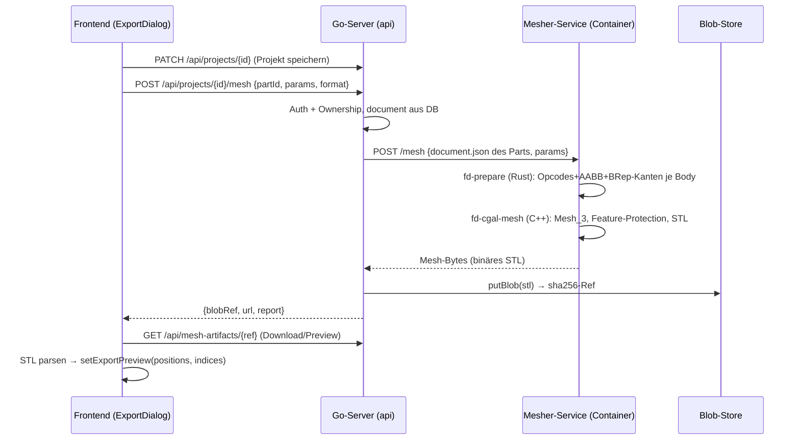

# Serverseitiges CGAL-Meshing (Plan-SSOT)

Richtungsschwenk (2026-07-07): Export-Meshing höchster Qualität läuft künftig
**serverseitig** über CGAL `Mesh_3`. Die clientseitige CGAL-Integration
(Wasm/Emscripten, Branch `feat/cgal-mesher`) wird **verworfen** — ihre
Kern-Assets (`mesher.cpp`, `sdf_interp.h`, Golden-Test) werden aber als
native Bausteine übernommen. Der Hybrid-PASM-Debug-Mesher
(`docs/HYBRID-PASM-MESHING-PLAN.md`) bleibt pausiert und unberührt.

Ziel: **wasserdichtes, manifoldes, ecken-/kanten-treues Mesh hoher
Qualität** aus (1) dem analytischen SDF (Opcode-Programm) als impliziter
Domain und (2) den B-Rep-Kanten/-Ecken als geschützten 1D-Features.

## 1. Ablauf (End-to-End)

Erster Wurf **synchron**: der POST hält die Verbindung, bis das Mesh fertig
ist (Timeout großzügig, z.B. 10 min); Job-Queue/Polling ist eine spätere
Ausbaustufe (Muster analog `WorkOrder` existiert im Server).

## 2. Komponenten & Phasen

### P1 — `cgal-mesher/` nativ auf main (C++-CLI `fd-cgal-mesh`)

Vom Branch `feat/cgal-mesher` übernehmen: `src/mesher.cpp` (C-API
`fd_reset/fd_add_edge/fd_mesh` + Ausgabe-Getter), `src/sdf_interp.h`
(1:1-Port von Rust `eval_opcodes` — **Sync-Invariante bleibt**, Golden-Test
`check_interp.cpp` + `gen_golden` wird nativer CI-Test), `test/`.

Umbau Wasm → nativ:

- **CMake statt em++/build.sh**; echtes **GMP/MPFR** statt
  `CGAL_DISABLE_GMP/Boost.MP` (nativ verfügbar, schneller/robuster);
  `-DCGAL_ALWAYS_ROUND_TO_NEAREST` und `CGAL_HAS_NO_THREADS` entfallen.
  Optional **TBB** (`Parallel_tag` in `Mesh_triangulation_3`) — erst wenn
  die serielle Version steht.
- **CLI-Hülle** um die bestehende C-API: liest EIN Input-File (Format §3),
  schreibt **binäres STL** nach stdout/Datei, Exit-Code + Report
  (Dreiecke, Dauer, Kriterien) als JSON auf stderr/Seitendatei.
- **CGAL-Setup** (aus der Doku, Kapitel 3D Mesh Generation):
  - Domain: `Labeled_mesh_domain_3` über dem Opcode-SDF (Vorzeichen als
    Label), gewrappt in **`Mesh_domain_with_polyline_features_3`**;
    B-Rep-Kanten-Polylines via `add_features()` → Schutzkugeln, Ecken
    entstehen an Polyline-Enden.
  - Kriterien: `edge_size` (Kanten-Sampling), `facet_angle` (≤30),
    `facet_size` (locker), `facet_distance` (der Qualitätstreiber — die
    curvature-getriebene Erkenntnis aus dem Spike: flache Flächen bleiben
    grob), `cell_*` locker (Volumen interessiert nicht),
    **`manifold()`**-Kriterium für garantiert manifolde Oberfläche.
  - Optimierer: Default (Perturber+Exuder) an, Lloyd/ODT erst mal aus.
  - Oberfläche via `facets_in_complex_3_to_triangle_mesh()`.

### P2 — Rust-Vorstufe `fd-prepare` (natives Kernel-Binary)

Neues `[[bin]]` (oder `examples/`→`src/bin/`) im Kernel-Crate, Blaupause
`examples/gen_golden.rs` (Branch): liest `document.json` (den Part-Payload,
NICHT den ZIP-Container — der Server hält das Document als JSON), fährt den
bestehenden nativen Pfad `document → bootstrap_features_from_calls →
rebuild_packed`, dann je Body:

- `sdf_compiler::compile_body` → Opcode-`Vec<f32>` + AABB,
- `ensure_brep(deep)` + Kanten-Sampling wie `bodyBrepEdges` (world-space
  Polylines, Placement gefaltet),

und schreibt das Interchange-File (§3). Multi-Part: `fd-prepare` bekommt
das Part-Document; die Part-Auswahl (Tab-Extraktion aus dem
Projekt-Document) macht der Go-Server oder das Frontend schickt die partId
und der Go-Server extrahiert den Tab aus dem gespeicherten Projekt-JSON.

Offene Kernel-Punkte: Bodies mit `needs_full_sdf`/Baked-Volumes
(OP_PRIM_TEX3D) waren im Spike nicht ans C++ verschifft — Phase 1 lehnt
solche Bodies mit klarer Fehlermeldung ab, Ausbaustufe später.

### P3 — Mesher-Service-Container

Ein Container, drei Teile: `fd-prepare` (Rust), `fd-cgal-mesh` (C++), ein
**minimaler HTTP-Wrapper** (Go, ~150 Zeilen): `POST /mesh` mit
`{document, params}` → temp-Dateien → beide CLIs → STL zurückstreamen.
Kein Auth im Wrapper (nur internes Compose-Netz, nicht exponiert),
Concurrency-Limit (z.B. 2 parallele Jobs), Prozess-Timeout, Größenlimits.

Dockerfile mehrstufig: Rust-Builder (kernel-bin) + C++-Builder
(CGAL/GMP/MPFR aus Debian-Paketen — `libcgal-dev` reicht, CGAL ist
header-only) → schlankes Runtime-Image.

### P4 — Go-Server-Route

- `POST /api/projects/{id}/mesh` `{partId, cellSizeMm, format, …}`:
  `requireAuth` + Ownership → Part-Document aus `Project.Document`
  extrahieren → Mesher-Service (interne URL via Env `MESHER_URL`) →
  `putBlob(stl)` → Antwort `{ref, url, report}`.
- `GET /api/mesh-artifacts/{ref}`: Serving analog `handleGetArtifact`
  (Content-Type `model/stl`, Download-Header), auth-pflichtig.
- Rate-Limit: bestehender Token-Bucket greift; zusätzlich 1 laufender
  Mesh-Job pro User (In-Memory-Guard) gegen Missbrauch.

### P5 — Frontend-Integration

- `MeshMethod`-Enum (`web/src/exportTypes.ts`) + Select-Option **„CGAL
  (Server)"** im ExportDialog (`web/src/ExportDialog.tsx`).
- Bei Auswahl „cgal": statt Worker-Roundtrip → (1) `syncToServer()`
  (Projekt speichern; falls Projekt noch nie gespeichert/kein Server-Login:
  Option ausgegraut mit Tooltip), (2) `POST …/mesh`, Progress als
  Unbestimmt-Anzeige („Server mesht…"), (3) Antwort: STL von `url` laden,
  binäres STL parsen (klein, ~50 Zeilen; non-indexed → Vertex-Dedup oder
  triviale 0..n-Indizes) → `setExportPreview({positions, indices})` —
  identisch zur bestehenden Preview —, Download-Button aufs Artefakt.
- Format-Select: Phase 1 nur STL für „cgal" (3MF-Konvertierung später
  server- oder clientseitig).

### P6 — Deployment

- Neuer Service `mesher` in `docker-compose.yml` (dev) und
  `docker-compose.prod.yml` (prod, `restart: unless-stopped`, NICHT hinter
  Caddy exponiert — nur internes Netz zum `server`).
- Release-Workflow: drittes GHCR-Image `fielddraft/mesher:<tag>`; Ansible-
  Deploy um den Service ergänzen.
- `server` bekommt `MESHER_URL` (Env, default leer → Feature aus, Route
  antwortet 503 „mesher not configured"; hält Dev ohne C++-Container
  lauffähig).

## 3. Interchange-Format (fd-prepare → fd-cgal-mesh)

Erweiterung des bewährten `gen_golden`-Textformats (bit-exakt via f32-Hex,
bereits von `check_interp.cpp` geparst) — ein File pro Auftrag:

    PARAMS <json: cellSizeMm, facetAngle, facetDistMult, edgeSizeMult, …>
    BODY <i>
    AABB <6× hex-f32>
    NOPS <n> / OP <hex-f32> …          (Opcode-Programm)
    NEDGES <k>
    EDGE <npts> <hex-f32 xyz…>          (B-Rep-Kanten-Polyline, world-space)
    …

Bit-Exaktheit der Opcodes ist Pflicht (Interpreter-Sync-Invariante); der
Golden-Test läuft in CI gegen beide Seiten.

## 4. Risiken & bekannte Gotchas (aus Spike + Doku)

- **Interpreter-Drift Rust↔C++**: `sdf_interp.h` muss bit-gleich zu
  `eval_opcodes` bleiben → Golden-Test als Pflicht-CI-Schritt im
  Mesher-Image-Build.
- **Gyroid/TPMS meshed zu 0 Verts** (Spike-Befund): CGALs implizites
  Initial-Seeding verfehlt periodische Mehrblatt-Flächen →
  `initial_points_generator`/mehr Initialpunkte nötig; Phase 1 dokumentiert
  die Lücke, Fix als eigener Schritt.
- **Kanten-Protection-Kosten**: Schutzkugeln verlangen `edge_size` passend
  zur Kantengeometrie; zu kleine Werte explodieren die Laufzeit. Ableitung
  aus `cellSizeMm` mit Clamps; Report ans Frontend.
- **Laufzeit/DoS**: Prozess-Timeout im Wrapper, Concurrency-Limit,
  50-MB-Dokument-Limit existiert bereits; Mesh-Blob-Größenlimit ergänzen.
- **needs_full_sdf/Baked Volumes**: Phase 1 ablehnen (klare Meldung),
  später OP_PRIM_TEX3D-Transport ins Interchange-Format.
- **Preview-Speicher**: große STLs (10⁶+ Tris) → Preview ggf. dezimiert
  oder ab Schwellwert nur Download ohne Szene-Anzeige.

## 5. Reihenfolge & Meilensteine

1. **M1 (Kern beweisbar):** P1+P2 lokal — `fd-prepare doc.json | fd-cgal-mesh`
   erzeugt für Box/Zylinder/Vase ein STL; Prüfskript: wasserdicht/manifold
   (Kanten-2×-Zählung) + Kanten-Treue (Hausdorff der B-Rep-Polylines gegen
   Mesh-Kanten). Golden-Test grün.
2. **M2 (Service):** P3 — Container baut, HTTP-Wrapper, Compose dev.
3. **M3 (Backend):** P4 — Route + Blob + Serving, Integrationstest.
4. **M4 (Frontend):** P5 — Select-Option, Save-then-Mesh-Roundtrip,
   Preview in der Szene, Download.
5. **M5 (Prod):** P6 — Prod-Compose, GHCR, Ansible, Doku (`DEPLOY.md`).

## 6. Offene Fragen (vor M1 zu klären)

1. **Service-Schnitt bestätigt?** Eigener `mesher`-Container mit interner
   HTTP-API (Empfehlung) vs. CLI-Aufruf im `server`-Image (mischt Go- und
   C++-Buildketten, verworfen?).
2. **Synchroner Roundtrip** für Phase 1 okay (Request wartet, Timeout
   ~10 min), Job-Queue später?
3. **Format-Scope Phase 1**: nur binäres STL (3MF als Follow-up)?
4. **Branch-Hygiene**: `feat/cgal-mesher` bleibt unmerged liegen; nur
   `mesher.cpp`/`sdf_interp.h`/Tests/gen_golden werden (nativ umgebaut)
   nach main übernommen, die Wasm-Artefakte (`web/src/wasm/cgal/*`) kommen
   NICHT mit. Einverstanden?
5. **Prod-Host-Ressourcen**: CGAL-Meshing ist CPU/RAM-hungrig (exakte
   Prädikate, Tet-Volumen) — gibt es Grenzen auf dem Zielserver, die die
   Default-Kriterien berücksichtigen müssen?
