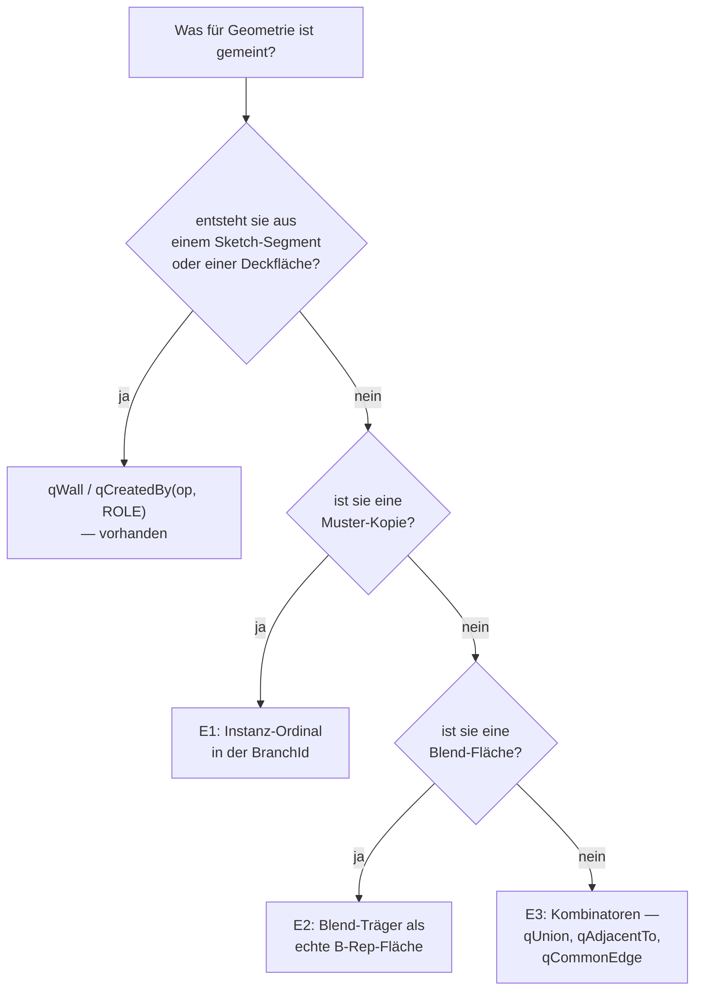

# Namen für abgeleitete Geometrie — Entwurf (#424 / #429)

**Frage:** Wie bekommt Geometrie, die erst durch eine Operation entsteht — die
Kante nach einer Boolean, die Fläche einer Muster-Kopie, der Rand einer
Verrundung, das Bruchstück einer geteilten Fläche — einen **stabilen Namen**?

Heute kann FieldDraft nur benennen, was sich auf eine **Sketch-Entity** oder
eine **Deckfläche** zurückführen lässt. Alles andere lehnt der Onshape-Übersetzer
mit Klartext-Meldung ab (und das ist richtig so — siehe §1).

SSOT der Lückenklassen: `docs/ONSHAPE-IMPORT-GAP-MATRIX.md`.
Bestehende Naming-Infrastruktur: `crates/kernel/src/brep/naming.rs`,
`crates/kernel/src/queries.rs`, `crates/kernel/src/csg.rs` (`BranchId`).

---

## 1. Warum nicht raten

Vor #425 hat der Kanten-Dekoder eine Muster-Kopie ignoriert und die
entsprechende Kante des **Originals** verrundet. In #414 trugen `Fillet 1` und
`Fillet 2` dadurch die identische aufgelöste Query: zwei Verrundungen auf
derselben Kante, eine davon frei erfunden. Eine Kante ohne Entsprechung wird
deshalb **abgelehnt**, nicht auf eine ähnlich aussehende gelegt. Jeder Vorschlag
unten muss diese Eigenschaft erhalten.

---

## 2. Wo FieldDraft steht — gemessen, nicht vermutet

FieldDrafts Namensschema ist **generativ**: ein Name ist kein vergebener
Bezeichner, sondern die Signatur der beteiligten Halbräume.

| Entität | Name |
| --- | --- |
| Fläche | `hash(branch_id, spatial_index)` |
| Kante | `hash(sort(branch_a, branch_b), spatial_index)` |
| Ecke | `hash(sort(branches…), spatial_index)` |

`BranchId` = 20 Bit Feature-Id + 12 Bit Sub-Id. Die Sub-Id ist bei einer
Sketch-Wand die **Sketch-Entity-Id** der erzeugenden Kurve (Schema v2), bei
einer Deckfläche eine reservierte Konstante, beim Shell-Innenraum ein Flag-Bit.

Das ist strukturell eine starke Position: für eine reine Parameteränderung sind
die Signaturen byteweise identisch, ganz ohne Heuristik. Der Preis: **wer keine
Branch hat, hat keinen Namen.**

### 2.1 Was heute schon benennbar ist (gemessen 2026-07-27)

Zwei Quader, per Boolean vereinigt (`crates/kernel/src/lib_tests.rs`-Sonde):

    b0 E12 sig=[1:4 2:0] hash=14516246793604892097
    qCommonEdge(qCreatedBy(1), qCreatedBy(2)) -> 4 Kanten
    qEdgeBetween(1, 2)                        -> dieselben 4 Kanten

**Die Verschmelzungskante hat bereits einen stabilen Namen.** Onshapes `MERGE`
ist damit keine Kernel-Lücke, sondern eine Übersetzer-Lücke — der Dekoder muss
die zwei Flächen benennen, deren Schnitt gemeint ist.

### 2.2 Was heute keinen Namen hat

**Muster-Kopien — der härteste Befund.** *(Behoben in v0.39.2, #431 — siehe
Schritt 1 unten. Der Befund bleibt als Messprotokoll stehen.)* Ein Quader,
`linear_pattern` mit Anzahl 3:

    b0 f3 feat=1 sub=0 branch=4096 hash=6025886176426920981
    b1 f3 feat=1 sub=0 branch=4096 hash=6025886176426920981
    b2 f3 feat=1 sub=0 branch=4096 hash=6025886176426920981
    qCreatedBy(1) -> 18 Elemente, davon 6 verschiedene id_hash
    qCreatedBy(2) -> 0   (das Muster-Feature selbst besitzt nichts)

Die drei Kopien tragen **identische Branch-Ids und identische id_hashes**. Der
Grund steht in `BranchId::from_feature`: es ruft `FeatureId::as_u32_or_root()`,
und das faltet die hierarchische Klon-Id `P.«src»_i` auf ihren
**Wurzel-Vorfahren** zurück. Die Instanz-Nummer `i` fällt weg. `spatial_index`
rettet hier nichts: er wird **pro B-Rep** vergeben, und jede Kopie ist ein
eigener Körper — also überall 0.

Das ist nicht nur eine fehlende Fähigkeit, sondern eine **Verletzung der
Eindeutigkeitszusage von `qFace(hash)`**: derselbe Hash bezeichnet drei
verschiedene Flächen. Genau das hat in #414 die erfundene Verrundung erzeugt.

Nachgemessen wurde außerdem, **warum** die Kopien nicht auseinanderzuhalten
waren: das B-Rep eines Körpers wird **body-LOKAL** gewoben (`Body::ensure_brep`
teilt die `placement` heraus, damit ein reiner Move den Weave-Cache nicht
invalidiert). Die drei Kopien sind damit byteweise identisch — auch ihre
Fingerprint-Schwerpunkte (alle drei meldeten `[-10, 0, 0]` für dieselbe Wand).
Nur die `placement` unterscheidet sie. Jede Disambiguierung muss also durch die
Weltlage gehen; die Geometrie im B-Rep gibt nichts her.

**Verrundungsflächen.** `BlendProvenance.branch` ist als „Fillet-Feature-Id,
Sub 0" definiert, `FaceRole::Blend` existiert, `qCreatedBy(f, BLEND)` ist
parsebar. Gemessen an einem Absatz mit Verrundung auf einer Nahtkante entsteht
im gewobenen B-Rep aber **gar keine Blend-Fläche** — `qCreatedBy(fillet, BLEND)`
liefert 0. Der Name ist entworfen, die Fläche fehlt.

**Koplanare Verschmelzung.** Zwei bündig aneinanderstoßende Körper behalten in
FieldDraft **zwei** Flächen (`feat=1 sub=4` und `feat=2 sub=0`); Onshape faltet
sie zu **einer**, die es `MERGE(a, b)` nennt. Eine Onshape-Fläche entspricht
hier also einer *Menge* von FieldDraft-Flächen.

**Geteilte Flächen.** Zerlegt eine Boolean eine Wand in mehrere Stücke, tragen
alle dieselbe Branch; unterschieden werden sie nur durch `spatial_index` —
eine **Sortierung nach Schwerpunkt**, die sich verschiebt, sobald sich die
Geometrie verschiebt.

### 2.3 Zahlen

`#419`-Kanten-Angaben nach Onshapes Wurzel-`queryType` (aus #425, unverändert):

| Form | Anzahl | FieldDraft heute |
| --- | ---: | --- |
| `INTERSECT` mit unbenannter Fläche | 61 | eine der Flächen hat keinen Namen |
| `COPY` | 22 | **kein Name** — Kopien kollabieren |
| `MERGE` | 20 | Kernel **kann** es (`qCommonEdge`), Übersetzer nicht |
| `BLEND_EDGE` / `BLEND_FACE` | 14 | Name entworfen, Fläche fehlt |
| `SPLIT` | 4 | nur `spatial_index` — positionell |

---

## 3. Was andere Kernel tun

Die Literatur trennt zwei Familien; die Übersicht von Farjana & Han (2018)
sortiert sie so:

- **Historie + Namensabgleich** (Kripac 1997; Chen/Hoffmann „generic naming",
  1995/96; Marcheix). Jede Entität bekommt einen Namen aus dem erzeugenden
  Feature, und ein **Protokoll von Split-/Merge-Ereignissen** schreibt fort,
  was aus ihr geworden ist. Beim Regenerieren wird der alte Name gegen das neue
  Modell gematcht, Mehrdeutigkeit über die **Nachbarschaft** aufgelöst.
  Raghothama & Shapiro haben formal gezeigt, dass das im Allgemeinen nicht
  lösbar ist — die Verfahren sind Heuristiken mit gutem Erwartungswert.
- **Zellmodell** (Bidarra & Bronsvoort). Eine Boolean **löscht nichts**: das
  Modell bleibt eine nicht-mannigfaltige Zellzerlegung, in der jede Fläche
  jedes Features als Zellwand erhalten bleibt und nur als „innen/außen"
  umklassifiziert wird. Der Name eines Features überlebt damit jede spätere
  Operation, weil die Zelle überlebt.

FieldDraft steht **näher am Zellmodell als an der Historie**: der
CSG-/Halbraum-Baum ist die Zellzerlegung, und `BranchId` ist der Zellname. Das
ist der Grund, warum die Verschmelzungskante schon heute benennbar ist (§2.1) —
und die Richtschnur für alles Folgende: **Namen werden nicht protokolliert,
sie werden aus der Erzeugung abgeleitet.** Ein Split-/Merge-Log wäre ein
Fremdkörper.

---

## 4. Entwurf

Drei Ergänzungen, alle innerhalb der bestehenden generativen Regel. Keine
Heuristik, kein Historien-Log, keine Geometrie-Ähnlichkeit.

### E1 — Muster-Instanzen bekommen ein Ordinal in der Branch

`BranchId` ist 20 Bit Feature + 12 Bit Sub. Eine Muster-Kopie ist **dieselbe
Sub-Struktur an einer anderen Stelle der Feature-Hierarchie** — also gehört das
Instanz-Ordinal in den **Feature-Teil**, nicht in den Sub-Teil (der Sub-Teil
trägt die Sketch-Entity und muss das behalten).

Vorschlag: `BranchId` wird von `u32` auf `u64` verbreitert —
`feature (20) | instance (12) | sub (12) | reserve (20)`. `instance = 0` ist das
Original; die *i*-te Kopie eines Musters trägt `instance = i`. Die Zuweisung ist
deterministisch aus der Klon-Id (`FeatureId::child("«src»_i")`), also aus dem
Modell und nicht aus der Geometrie.

Query-Form: `qInstance(pattern_id, i, <sub-query>)` — „dasselbe wie
`<sub-query>`, aber an der *i*-ten Kopie von `pattern_id`". Onshapes `COPY`
trägt genau diese beiden Angaben.

Das ist ein **Breaking Change am Wire-Format** (`branchId` in
`bodyBrepFaces`, alle persistierten `qFace(hash)`). Das ist erwünscht: es
repariert eine Eindeutigkeitszusage, die heute nachweislich verletzt ist (§2.2).

**Vorleistung, unabhängig davon nützlich — erledigt in v0.39.2 (#431):**
`spatial_index` **körperübergreifend** vergeben statt pro B-Rep. Dann
kollidieren die Kopien nicht mehr still — sie werden nach Schwerpunkt
durchnumeriert und `qFace(hash)` ist wieder eindeutig. Das ist aber ein
*positioneller* Name; er überlebt keine Umsortierung der Kopien (Richtung
umdrehen, Abstand negieren). Als Übergang tauglich, als Ziel nicht — das Ziel
bleibt E1.

### E2 — Der Blend-Träger wird eine echte B-Rep-Fläche

`BlendProvenance` trägt bereits alles Nötige: `branch` (Fillet-Feature, Sub 0),
`wall_a`, `wall_b`. Zu klären ist, warum `register_blend_carrier` beim
gewobenen Absatz keine Fläche liefert (Verdacht: das Nachschlagen von
`wall_a`/`wall_b` in der `BranchSurfaceMap` scheitert; **nicht gemessen**).
Ist die Fläche da, folgt der Rest ohne neues Vokabular:

- `qCreatedBy(fillet, BLEND)` — die Verrundungsfläche selbst (Onshape:
  `BLEND_FACE`).
- `qCommonEdge(qCreatedBy(fillet, BLEND), <nachbar>)` — ihr Rand (Onshape:
  `BLEND_EDGE`).

### E3 — Kombinatoren statt neuer Basisnamen

Für `MERGE` und `SPLIT` braucht es **keinen** neuen Grundnamen, sondern die
Fähigkeit, mehrere vorhandene zu kombinieren:

- **`MERGE` (Fläche):** Onshapes verschmolzene Fläche ist die Vereinigung
  zweier FieldDraft-Flächen. Das Query-Vokabular hat `qIntersection`, aber
  **keine Vereinigung** — `qUnion(a, b)` fehlt und ist der ganze Bedarf.
- **`MERGE` (Kante):** ist `qCommonEdge(a, b)` und funktioniert bereits.
- **`SPLIT`:** `qAdjacentTo(a, b)` ist genau dafür dokumentiert („nach einem
  Boolean-Split das richtige Bruchstück über die Nachbarschaft wählen") und
  vorhanden. Was fehlt, ist der Übersetzer-Zweig, der Onshapes
  `SPLIT`-Disambiguierung darauf abbildet.
- **`INTERSECT` mit unbenannter Fläche (61×):** löst sich zum großen Teil von
  selbst auf, sobald E1/E2 stehen — die „unbenannte" Fläche ist in der Regel
  eine Muster-Kopie oder eine Blend-Fläche.

### Was ausdrücklich NICHT vorgeschlagen wird

- **Kein Split-/Merge-Protokoll.** Es wäre ein zweiter, konkurrierender
  Wahrheitsträger neben dem CSG-Baum — genau die Doppelbuchführung, an der die
  Historien-Verfahren scheitern.
- **Keine geometrische Ähnlichkeitssuche als *Erstauflösung*.** Der
  Fingerprint in `TopoRef` bleibt, was er ist: Heilung, wenn ein Hash nach
  einer Änderung nicht mehr trifft — nicht das Mittel, um überhaupt erst einen
  Namen zu erfinden.
- **Kein Aufweichen der Ablehnungen.** Was nicht abbildbar ist, wird benannt
  abgelehnt (§1).

---

## 5. Reihenfolge

| Schritt | Inhalt | Voraussetzung |
| --- | --- | --- |
| 0 | **Erledigt (v0.39.1):** Mehrfach-Region-Profile bekommen die Kontur ihrer Vereinigung; geschlossene Konturen starten am G1-Knick | — |
| 1 | **Erledigt (v0.39.2, #431):** `spatial_index` körperübergreifend — `qFace(hash)` wieder eindeutig | — |
| 2 | Messen, warum der Blend-Träger keine Fläche wird | — |
| 3 | E2: Blend-Fläche + Übersetzer-Zweig `BLEND_FACE` / `BLEND_EDGE` | 2 |
| 4 | `qUnion(a, b)` + Übersetzer-Zweig `MERGE` (Fläche) | — |
| 5 | Übersetzer-Zweig `SPLIT` auf `qAdjacentTo` | — |
| 6 | E1: `BranchId` auf u64, Instanz-Ordinal, `qInstance(...)` | 1 |

Schritte 1–5 sind je für sich abgeschlossen und messbar. Schritt 6 ist der
Breaking Change und sollte erst laufen, wenn 1–5 gezeigt haben, wie viel ohne
ihn schon zusammenkommt.

### Schritt 1 — wie er ausgeführt wurde (v0.39.2, #431)

`spatial_index` ist jetzt **gestempelter Zustand** des B-Reps
(`BRep::spatial`, drei zu den Arenen parallele `Vec<u32>`) statt einer
Größe, die jeder Leser für sich neu ausrechnet. Genau **ein** Schreiber:
`brep::naming::stamp_scope`. Gestempelt wird an drei Stellen —
`weaving::finish_weave` (Einzelkörper, der Trichter aller Weave-Routen),
`BrepCache::ensure` (der zusammengesetzte Prefix ist der Scope) und
`Kernel::ensure_named_breps` (der Dokument-Scope, den `bodyBrepFaces` /
`bodyBrepEdges` / `bodyBrepVertices` / `resolveQuery` / der Query-Healer
benutzen). Nebeneffekt: `TopoRef::from_face` rechnete die Indextabelle bisher
bei **jedem** Aufruf neu — in einer Schleife über alle Flächen also O(F²)
inklusive Polylinien-Kopien. Jetzt ist der Lesezugriff O(1).

Die Nummerierung ist **zweistufig**, damit der Schritt keinen Namen bewegt,
der schon eindeutig war:

1. **Zwischen Körpern** — die an einer Signaturgruppe beteiligten Körper
   werden nach dem mittleren **Welt**-Schwerpunkt ihrer eigenen Mitglieder
   sortiert (X → Y → Z, Körperindex als Tie-Break).
2. **Innerhalb eines Körpers** — wie bisher nach dem **körperlokalen**
   Schwerpunkt. Das hält den Stempel invariant gegen Verschieben *und Drehen*
   eines Körpers und lässt jedes Dokument, dessen Körper keine Branch-Signatur
   teilen, byteweise gleich benannt.

**Gemessen (`lib_tests.rs`, Quader + `linear_pattern` Anzahl 3):**

| | vorher | nachher |
| --- | ---: | ---: |
| Flächen gesamt | 18 | 18 |
| verschiedene `id_hash` | **6** | **18** |
| `qFace(hash)` je Hash | 1 von 3 Kandidaten | genau 1 |

Der Körper an `x = 0` behält seine alten Hashes; nur die Kopien werden neu
nummeriert. Alle sechs Onshape-E2E-Suiten blieben unverändert grün
(`#419`: `bodyCount() == 12`, 107 `KNOWN_GAPS`; `#409`: 19 `KNOWN_GAPS`) —
im Korpus teilt kein Körperpaar eine Branch-Signatur.

**Was Schritt 1 ausdrücklich NICHT leistet:** der Name ist positionell. Er
ist reproduzierbar (gleicher Aufbau → gleiche Hashes) und unempfindlich gegen
unbeteiligte Körper (beides als Test gepinnt), aber er wandert, sobald die
Kopien ihre Reihenfolge tauschen — Musterrichtung umdrehen, Abstand negieren,
Kopie in der Mitte einfügen. Dafür ist E1 da.

---

## 6. Woran gemessen wird

Jeder Schritt wird gegen die sechs Onshape-E2E-Suiten gemessen
(`web/src/onshape/*.slow.test.ts`), und die Pins werden mitgezogen — die
Namenslisten `KNOWN_GAPS` und `expect(kernel.raw.bodyCount())` sind Assertions
in **beide** Richtungen. Zusätzlich gilt für alles, was Blends betrifft:

> **Keine zwei Blends dürfen dieselbe aufgelöste Kanten-Query tragen.**

So sah die erfundene Verrundung aus (#414), und der #419-E2E prüft es seit
v0.39.1 explizit.

---

## Quellen

- Kripac, J.: *A mechanism for persistently naming topological entities in
  history-based parametric solid models*, CAD 29(2), 1997.
- Chen, X.; Hoffmann, C. M.: *On editability of feature-based design*, CAD 27(12),
  1995 — „generic naming".
- Capoyleas, V.; Chen, X.; Hoffmann, C. M.: *Generic naming in generative,
  constraint-based design*, CAD 28(1), 1996.
- Bidarra, R.; Bronsvoort, W. F.: *A feature-based solution to the persistent
  naming problem*, Computer-Aided Design & Applications 2(1–4), 2005 —
  Zellmodell.
- Raghothama, S.; Shapiro, V.: *Topological framework for part families*, 2002 —
  Formalisierung und Unlösbarkeitsargument.
- Farjana, S. H.; Han, S.: *Mechanisms of persistent identification of
  topological entities in CAD systems: A review*, Alexandria Eng. J., 2018.
- In-Repo-Vorarbeit: `docs/Gemini-GPT-Diskussion-Topological-Naming-Problem.md`,
  `docs/BREP-CLASSIFICATION-PLAN.md`.
