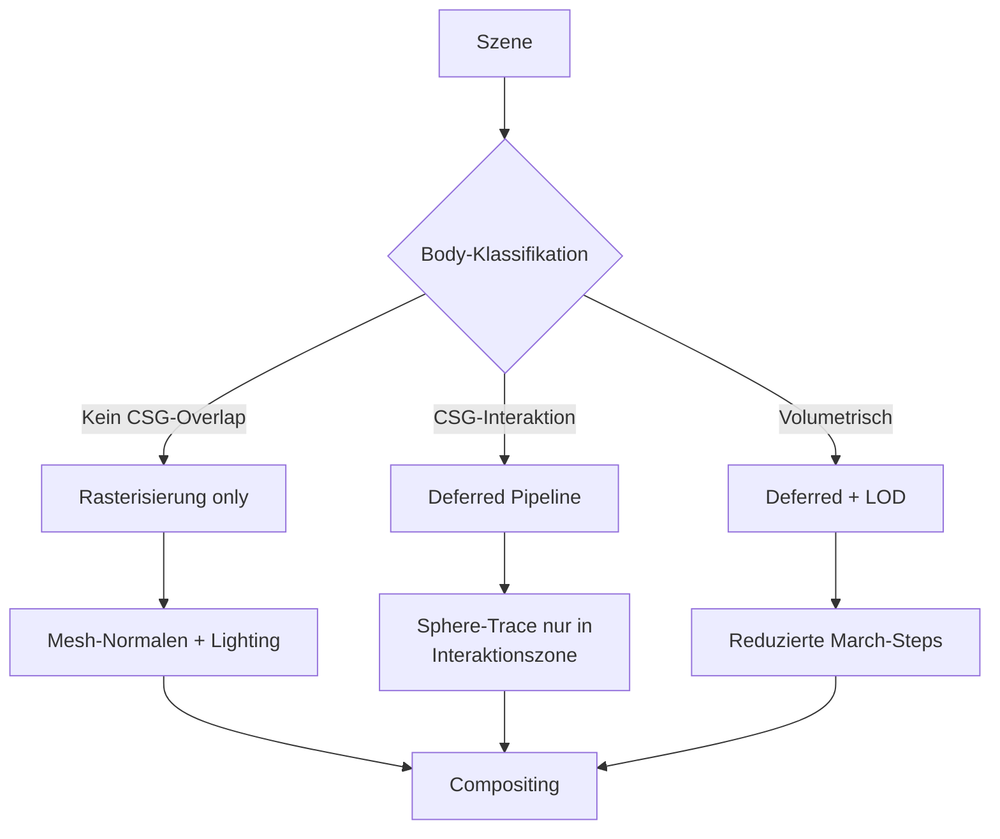

# Fast Renderer — Konzept für einen performance-optimierten Rendering-Modus

## Motivation

FieldDraft nutzt aktuell zwei Renderer: `sdf-vm` (reines Fullscreen-Raymarching) und `sdf-deferred` (Rasterisierung + selektives Raymarching). Beide zielen auf mathematisch exakte SDF-Oberflächen — jeder Pixel wird durch Sphere-Tracing auf die analytische Fläche gebracht.

In der Praxis stammt die Mehrzahl der Körper jedoch aus **extrudierten, revolvten oder gesweepten Sketches**. Die Sketch-Konturen bestehen aus Splines und Bézier-Kurven, die für die SDF-Auswertung als **Liniensegmente approximiert** werden. Die resultierende SDF ist also bereits eine Approximation — die tessellierte Polygon-Oberfläche und die SDF-Oberfläche liegen in derselben Größenordnung der Abweichung.

Das relativiert die Notwendigkeit von pixel-perfektem SDF-Rendering und eröffnet signifikante Performance-Optimierungen.

> **Anmerkung**: In Zukunft können analytische SDF-Approximationen von Bézier-Kurven (exakt lösbare Gleichungen statt Liniensegmente) die Quellgenauigkeit verbessern. Diese Optimierung ist orthogonal zum Fast Renderer und würde beide Ansätze aufwerten.

## Kernidee

Ein dritter Render-Modus (`sdf-fast`), der die Rasterisierung als primäre Rendering-Methode nutzt und den Raymarcher nur für die wenigen Bereiche aktiviert, in denen die Mesh-Oberfläche nicht ausreicht:

| Bereich | Aktueller Deferred Renderer | Fast Renderer |
|---|---|---|
| Opake Körper | SDF am Mesh-Z auswerten (6 Evals Normale) | Mesh-Normale direkt nutzen, kein SDF |
| Silhouetten-Kanten | Transparente inflated Hulls + Sphere-Trace | Mesh-Kante direkt (kein Inflate nötig) |
| Fillets / Smooth Unions | Sphere-Trace durch transparente Region | Sphere-Trace (unverändert) |
| Boolean-Übergänge | Sphere-Trace durch transparente Region | Sphere-Trace (unverändert) |
| Gyroid / volumetrisch | Sphere-Trace durch AABB | Vereinfachtes Marching oder LOD |

## Konkrete Optimierungen

### 1. Opake Körper: Rasterisierung statt SDF-Shading

Im Deferred Renderer wird auch für opake Pixel die SDF ausgewertet (6 Evaluationen für die Finite-Difference-Normale). Im Fast Renderer übernimmt die Rasterisierung das komplett:

- **Mesh-Normalen** statt SDF-Normalen: Die Vertex-Normalen des Hüll-Meshes werden direkt für Lighting genutzt.
- **Kein SDF-Lookup**: Für opak-only Pixel entfällt die SDF-Auswertung vollständig.
- **Kosten**: 0 SDF-Evaluationen pro opakem Pixel (vs. 6 im Deferred Renderer).

### 2. Keine aufgeblasenen Hüll-Meshes

Der Deferred Renderer bläst Hüll-Meshes um `HULL_INFLATE = 0.1%` auf, damit die tessellierte Oberfläche die SDF-Fläche überdeckt und der Sphere-Tracer die mathematisch exakte Kontur liefern kann. Da die SDF selbst nur eine Liniensegment-Approximation ist, bringt diese Exaktheit keinen sichtbaren Gewinn bei Sketch-basierten Körpern.

Ohne Inflate:
- **Kein transparenter Ring** um jeden Körper → weniger Pixel im Sphere-Trace-Pfad
- **Simplere Pipeline**: Viele Körper brauchen kein transparentes Mesh mehr
- **Nur Fillets und Booleans** erzeugen noch transparente Regionen

### 3. Reduzierter Transparenz-Aufwand

Transparente Regionen (Fillets, Booleans) bleiben beim Sphere-Trace, aber:
- **Weniger transparente Pixel**: Ohne Inflate-Halo schrumpft die transparente Region auf den tatsächlichen Interaktionsbereich (Fillet-Radius, Boolean-Schnittfläche).
- **Gyroid-LOD**: Volumetrische Bodies wie Gyroids könnten mit reduzierter Schrittanzahl oder einem LOD-Ansatz gerendert werden, da ihre hochfrequente Struktur bei normaler Betrachtung ohnehin nicht pixelgenau aufgelöst werden muss.

### 4. Fallback auf Mesh-Rendering

Für Bodies ohne Fillets oder Booleans (reine Extrusions, Revolves) kann der Sphere-Trace komplett entfallen — die Rasterisierung liefert das finale Bild. Nur wo CSG-Interaktionen zwischen Bodies stattfinden, wird der Raymarcher aktiviert.

## Klassifikation: Wann wird der Raymarcher gebraucht?

| Situation | SDF-Raymarching nötig? |
|---|---|
| Einfacher Körper (Box, Extrude, …) ohne CSG-Interaktion | Nein — reines Mesh-Rendering |
| Körper mit Fillet zu Nachbar-Body | Ja — im Fillet-Bereich (screen-space-schmal) |
| Boolean-Schnitt zwischen Bodies | Ja — an der Schnittfläche |
| Gyroid / volumetrische Patterns | Ja — aber mit LOD/reduzierter Präzision möglich |
| Domain Warps (Twist, Bend) | Ja — Mesh kann die Verformung nicht darstellen |

## Architektur-Skizze

## Erwarteter Performance-Gewinn

In typischen CAD-Szenen sind 80–95% aller Pixel opak-only (keine CSG-Interaktion). Im Fast Renderer:

- **80–95% der Pixel**: 0 SDF-Evaluationen (Mesh-Rendering)
- **5–15% der Pixel**: Sphere-Trace wie bisher (Fillets, Booleans)
- **< 5% der Pixel**: Volumetrische Bodies (Gyroid) mit optionalem LOD

Der Gesamtaufwand sinkt dramatisch verglichen mit dem Deferred Renderer, der auch für opake Pixel 6 SDF-Evaluationen benötigt.

## Abgrenzung zum Deferred Renderer

Der Fast Renderer ersetzt den Deferred Renderer nicht, sondern ergänzt ihn als dritter Modus:

- **`sdf-deferred`**: Maximale Rendering-Qualität. Pixel-perfekte SDF-Oberflächen, exakte Silhouetten. Für finale Renderings und wenn Genauigkeit Priorität hat.
- **`sdf-fast`**: Performance-Priorität. Mesh-basiertes Rendering mit selektivem Raymarching nur wo nötig. Für interaktives Arbeiten mit großen Szenen.
- **`sdf-vm`**: Legacy Fullscreen-Raymarching. Für Debugging und Vergleich.

## Offene Fragen

- **Nahtübergang**: Wie wird der Übergang zwischen Mesh-gerenderten und SDF-gerenderten Bereichen nahtlos? Mögliche Ansätze: weicher Blend am Rand der transparenten Region, oder Depth-basiertes Compositing.
- **Normale-Diskontinuitäten**: Mesh-Normalen und SDF-Normalen können an der Grenze leicht abweichen. Sichtbar?
- **Sketch-SDF-Verbesserung**: Analytische Bézier-SDF-Approximationen könnten die Lücke zwischen Mesh und SDF schließen und den Fast Renderer in Zukunft überflüssig machen — oder aber den Deferred Renderer so schnell machen, dass ein separater Fast-Modus unnötig wird.
