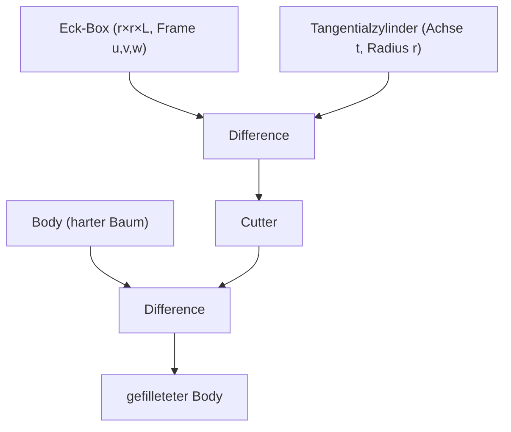

# Fillet als harter Cutter — Plan (#383, #406)

Stand 2026-07-23. SSOT für den Umbau des Kanten-Fillets vom feld-basierten
`smin`-Blend (MaskedBlend) auf **analytische harte Cutter** (boolesche
Subtraktion eines exakten Körpers). P1 ist implementiert; P2+ ist skizziert.

## 1. Warum überhaupt

Zwei Tickets, eine Ursache:

- **#406** — „Fillet funktioniert nicht fürs Abrunden von Kanten." Reproduziert
  (Kernel-Test `repro_406_single_cube_edge_fillet_does_nothing`): eine Kante
  eines EINZELNEN Primitivs (Würfelkante) hat die B-Rep-Signatur
  `(feature 1, feature 1)` — beide angrenzenden Flächen gehören demselben
  Feature. Der alte Mechanismus `apply_edge_fillets` ersetzt einen
  `Union`/`Difference`-Knoten durch einen `MaskedBlend`, indem er über
  `find_matching_fillet` einen Boolean-Knoten sucht, dessen linker Teilbaum
  `feature_a` und dessen rechter `feature_b` enthält. Bei `feature_a ==
  feature_b` und einem einzelnen `Leaf` gibt es keinen solchen Split → **0
  MaskedBlends, das Feld bleibt unverändert, der Fillet ist wirkungslos.**
- **#383** — der bestehende `smin`-Fillet verschleift zusätzlich die ECKEN
  (kugelig), weil die Kapsel-Maske um die Kante herum auch an den Enden smootht.
  Onshape rundet ausschließlich ENTLANG der Kante (zylindrisch); Ecken bleiben
  scharf, solange man nicht explizit „Smooth fillet corners" wählt.

Beide verschwinden mit demselben Umbau: statt eines lokal maskierten `smin`
subtrahiert der Fillet einen **analytisch exakten Schnittkörper** — genau die
Onshape-Semantik (Rolling-Ball, konstanter Radius, kreisförmiger Querschnitt).

## 2. Onshape-Referenzverhalten (aus der Doku)

- **Edge-Fillet, konstanter Radius (Distance/Circular):** kreisförmiger
  Querschnitt mit dem eingegebenen Radius („rolling ball"). Zusätzlich Conic
  (Rho) und Curvature als Querschnitts-Varianten.
- **Konvex vs. konkav:** an einer konvexen Kante wird Material ENTFERNT
  (Subtraktion), an einer konkaven Kante HINZUGEFÜGT (additiver Füllkörper).
- **Tangent Propagation:** der Fillet läuft automatisch über tangential
  anschließende Kanten weiter (Kette). Standardmäßig an.
- **Ecken:** standardmäßig bleiben Ecken scharf, wo zwei gefillete Kanten sich
  treffen. „Smooth fillet corners" erzeugt OPTIONAL einen gerundeten Vertex
  (Setback-Corner-Blend).
- **Variabler Radius:** über Vertices/Zwischenpunkte je Kante.
- Weitere Modi: Full-Round, Face-Blend (rolling-ball oder swept), Edge-Overflow.

Quelle: <https://cad.onshape.com/help/Content/fillet.htm>

## 3. Das Cutter-Konzept (gerade konvexe Kante)

Für eine gerade, konvexe Kante zwischen zwei PLANAREN Flächen A und B (äußere
Normalen `n_a`, `n_b`; Kante = Schnittgerade, Richtung `t = e1 − e0`):

1. **Tangentialzylinder** — Achse parallel `t`, Radius `r`, tangential an beide
   Flächen. Sein Zentrum liegt bei `C = mid − r/(1+c)·(n_a + n_b)` mit
   `c = n_a·n_b` (für orthogonale Würfelkanten `c=0`: `C = mid − r·(n_a+n_b)`).
2. **Eck-Prisma** — der Materialkeil, der bis auf den Zylinder weg soll:
   die r-dicke Ecke längs der Kante. Bei ORTHOGONALER Dieder-Kante (Würfel)
   ist das exakt eine ORIENTIERTE BOX (Frame `u=n_a`, `v=n_b`, `w=t`), zentriert
   auf der Kante, Half-Extents `(r, r, L/2)`.
3. **Cutter** = `Difference(Eck-Box, Tangentialzylinder)` — die scharfe Ecke
   MINUS der Rundung. Längs auf die Kante begrenzt (Box-Half-Extent `L/2`), der
   Zylinder ragt geringfügig über (Half-Height `L/2 + r`) und wird von der Box
   geклippt → saubere, scharfe Kantenenden.
4. **Ergebnis** = `Difference(Body, Cutter)`. Innerhalb des Körpers entfernt
   das die scharfe Ecke und lässt die Viertel-Zylinder-Rundung stehen; außerhalb
   ist der Cutter leer (harmlos). Kantenenden/Ecken bleiben hart (#383).

### Warum das metrisch sauber ist

Die SDF-Metricity-Forschung (`docs/research/sdf-metricity/SYNTHESIS.md`) zeigt:
harte Booleans sind seitenselektiv EXAKT — `max` (Differenz/Intersection) ist im
Innenraum exakt und überall 1-Lipschitz. Der Cutter besteht nur aus `Box` und
`Cylinder` (beide exakte, 1-Lipschitz-SDFs) und harten `Difference`-Knoten; das
Ergebnisfeld ist damit ≤1-Lipschitz und im relevanten Innenband distanztreu —
ohne die `smin`-Normfehler (√m-Aufblähung) und ohne die
`MASKED_BLEND_MARCH_RELAX`-Dämpfung, die die „graue Wand" (#386) verursachen
kann. Es entstehen KEINE neuen Opcodes: der Cutter läuft durch ALLE Evaluatoren
(sdf_eval, sdf_compiler/WGSL, web sdfVmInterpreter, CGAL) automatisch, weil er
nur aus bestehenden `Leaf`/`Transform`/`Difference`-Bausteinen komponiert ist.

## 4. Konvexitäts- & Eignungstest

Ein Fillet wird zum Cutter, wenn:

- beide angrenzenden Flächen PLANAR sind (`HalfSpace::Plane`),
- die Kante GERADE ist (Polyline kollinear / 2 Punkte),
- die Dieder-Kante ORTHOGONAL ist (`|n_a·n_b| < ε`) — P1-Grenze, s. u.,
- die Kante KONVEX ist: der Rolling-Ball-Mittelpunkt `C` liegt tief im
  Material (`body.sdf(C) < −0.5·r`).

Die Normalen-Vorzeichen werden zur Anwendungszeit am Feld korrigiert (jede
Normale so gedreht, dass sie nach AUSSEN zeigt: `f(mid+εn) > f(mid−εn)`), damit
der Test unabhängig von der Weber-Konvention robust ist. Erfüllt eine Kante die
Bedingungen NICHT, fällt sie auf den bestehenden `smin`-MaskedBlend-Pfad zurück
(konkave Rinnen, gekrümmte Kanten) bzw. bleibt (bei einer nicht-orthogonalen
Selbst-Kante ohne Junction) vorerst wirkungslos — beides ist P2.

## 5. Phasenplan

- **P1 (dieser Stand):** gerade, konvexe, ORTHOGONALE Kanten zwischen planaren
  Flächen → harter Box−Zylinder-Cutter, boolesch subtrahiert. Fixt #406
  (Würfelkante) und #383 (scharfe Ecken). Bestehender UI-Flow (Kante picken →
  Radius) erzeugt jetzt den Cutter. Nicht-eignende Kanten: smin-Fallback.
- **P2 — nicht-orthogonale gerade Kanten:** das Eck-Prisma ist dann ein schiefes
  Parallelepiped (drei Slab-Boxen mit Normalen `n_a, n_b, t`) statt einer
  orthonormalen Box; Cutter-Mechanik identisch. Betrifft z. B.
  Hex-Prismen-Kanten (120°).
- **P3 — konkave Kanten:** additiver Füllkörper (`Union` statt `Difference`) —
  Zylinder als Material HINZUFÜGEN, begrenzt aufs Eck-Prisma.
- **P4 — Ecken-/Vertex-Blends:** wo mehrere gefillete Kanten sich treffen,
  optional gerundeter Vertex („Smooth fillet corners", Setback). Default hart.
- **P5 — gekrümmte Kanten & Tangent-Propagation:** Zylinder → gekrümmter Sweep
  entlang der Kanten-Polyline; automatische Fortsetzung über G1-Kanten.
- **P6 — variable Radien, Conic/Curvature-Querschnitt, Full-Round, Face-Blend:**
  vollständiger Onshape-Dialog.

## 6. Chamfer — derselbe Cutter, anderes Profil (#414)

Der Kanten-**Chamfer** ist der strukturell einfachere Bruder des Fillets und
läuft seit #414 über exakt dieselbe Mechanik: gerade, konvexe, orthogonale
Kante → analytischer Cutter → boolesche Subtraktion am Body. Unterschied ist
allein das **Querschnittsprofil**:

| | Fillet | Chamfer |
| --- | --- | --- |
| Profil | Viertelkreis (Rolling Ball) | Gerade (Fase) |
| Cutter | `Difference(Eck-Box, Tangentialzylinder)` | EINE orientierte Box |
| Parameter | `blend_radius` | `distance` (EQUAL_OFFSETS) |
| Fallback | `smin`-Maske | KEINER — ehrlicher Feature-Fehler |

Bei EQUAL_OFFSETS schneidet die Fasenebene beidseits `d` von der Kante zurück,
geht also durch `mid − d·n_b` und `mid − d·n_a`; ihre Außennormale ist die
Winkelhalbierende `m = normalize(n_a + n_b)` (an orthogonalen Kanten der
45°-Schnitt). Im lokalen Rahmen `(u, v)` der beiden Flächennormalen ist das
Material `{u ≤ 0, v ≤ 0}` und der wegzuschneidende Keil `{u + v ≥ −d}`. Dafür
genügt **eine einzige orientierte Box** im Rahmen `(m, s = w × m, w)`: entlang
`m` von der Fasenebene (`−d/√2`) mit Rand `d` nach außen, entlang `s` `±d`
(beweisbar nicht bindend, denn auf dem Keil gilt `u, v ∈ [−d, 0]` ⟹
`|u − v| ≤ d < d·√2`), entlang `w` exakt die Kantenlänge — die Enden bleiben
scharf (#383). Keine Verschneidung mit einer Eck-Box, kein neuer Opcode.

**Kein `smin`-Fallback.** Eine Kante, die das Gate nicht besteht, dürfte NICHT
still verrundet werden — das wäre genau die Geometrie, die der Nutzer nicht
wollte. Das `chamfer_edge`-Feature fährt dasselbe Gate schon zur Execute-Zeit
gegen das harte Feld und meldet den Grund als Feature-Fehler; `apply_edge_chamfers`
überspringt anschließend nur noch, was das Body-Feld erneut ablehnt.

### Konvexitätstest korrigiert

Der P1-Test aus §4 (`body.sdf(C) < −0.5·r` am Rolling-Ball-Mittelpunkt) kann
konvex und konkav **nicht** unterscheiden: bei `u = v = −r` ist das Material an
einer konvexen Kante (`u ≤ 0 UND v ≤ 0`) genauso vorhanden wie an einer
konkaven (`u ≤ 0 ODER v ≤ 0`). Er hat also reflexe Kanten durchgelassen und
hätte aus einer Innenecke Material herausgeschnitten. Entscheidend sind die
beiden **gemischten Quadranten** (`u > 0, v < 0` und `u < 0, v > 0`): an einer
konvexen Kante sind beide leer, an einer konkaven beide massiv. Der Test liegt
jetzt in `csg::edge_cutter_frame` und gilt für Fillet UND Chamfer.

### Dokumentierte Lücken (Chamfer P1)

- **`OPPOSITE_OFFSETS`** (zwei verschiedene Abstände) und **`ANGLE`**
  (Abstand + Winkel) aus Onshape fehlen; es gibt nur `distance`. Beide sind
  dieselbe Box mit anderer Ebenenlage/-neigung — additive Arbeit, kein Umbau.
- **Nicht-orthogonale Dieder** (P2 oben): die Winkelhalbierende stimmt weiter,
  aber die EQUAL_OFFSETS-Rückschnittrichtungen sind dann nicht mehr `−n_a`/`−n_b`,
  sondern die in-Fläche-Richtungen — die Ebene ist nicht mehr ⟂ zu `n_a + n_b`.
- **Konkave Kanten** (P3 oben): additiver Füllkörper statt Subtraktion.
- **Gekrümmte Kanten / Tangent-Propagation** (P5 oben).
- Der B-Rep-Weave webt weiterhin den harten Baum, die Fasenfläche ist also
  (wie die Fillet-Fläche) noch keine eigene selektierbare Fläche; der
  parametrische Export-Pfad lehnt Dokumente mit Chamfern deshalb ab.

## 7. B-Rep-Weave / Selektierbarkeit

P1 wirkt in Mesh + SDF-Render + Pick-Baum (alle drei rufen
`apply_edge_fillets`). Die Fillet-FLÄCHE als eigene selektierbare
B-Rep-Fläche (analog zum `Blend`-Carrier des smin-Pfads) ist P2 — der
lokale Weave-Baupfad webt weiterhin den harten Baum.
