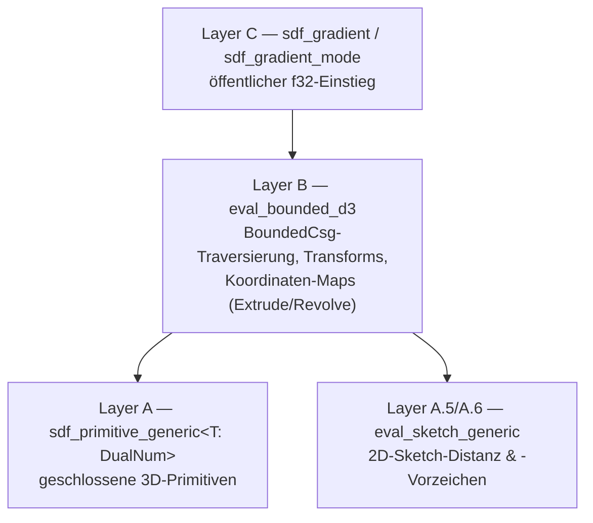
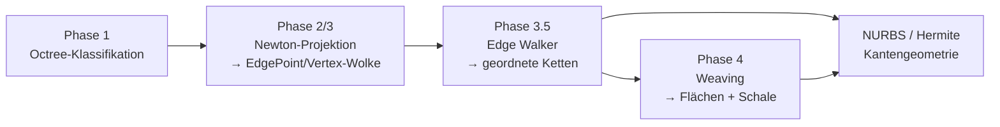
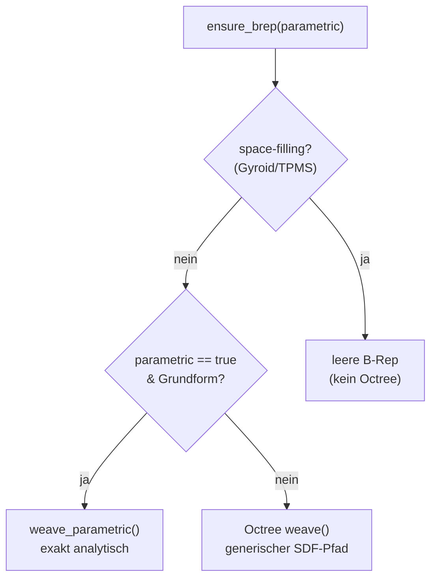

# FieldDraft Geometrie-Kernel-Konzept

> **Stand: 2026-06-08.** Dieses Dokument beschreibt den **Ist-Zustand** des Geometrie-Kernels
> (`crates/kernel`). Es ist die tiefe Referenz zur Kapitel-3-Übersicht in
> [`ARCHITECTURE.md`](./ARCHITECTURE.md); für das Gesamtsystem (Web, Rendering, Server)
> dort nachschlagen. Das *Warum* der B-Rep-Ableitung steht in
> [`BREP-FEATURE-VISION.md`](./BREP-FEATURE-VISION.md). Der frühere Design-Log
> (DL-1…45) und die verworfene Half-Space-only-Leaf-Architektur liegen archiviert in
> `docs.bak/GEOMETRY-KERNEL-CONCEPT.md`.

FieldDraft ist ein hybrider CAD-Kernel: Ein **Signed Distance Field (SDF)** bildet die
Auswertungsbasis, daraus wird auf Bedarf eine **Boundary Representation (B-Rep)** mit
exakten Kanten, Flächen und einer wasserdichten Schale abgeleitet. Der Kernel ist in Rust
geschrieben und nach WebAssembly kompiliert.

---

## 1. Rolle von SDF und B-Rep

**SDF** ist die primäre Geometrierepräsentation. Sie wird benötigt für:

* Rendering der Körper (WebGPU-Raymarching, siehe ARCHITECTURE.md §4.3)
* Operationen auf Körpern: Boolean, Smooth-Min, Transform, Sweep/Extrude/Revolve, Domain-Warps
* Mesh-Export für den 3D-Druck (Dual Contouring, §8)

**B-Rep** wird *aus* dem SDF abgeleitet (lazy, pro Körper gecacht) und wird benötigt für:

* Konstruktion: Flächen selektieren und extrudieren, Kanten selektieren und mit Fillets abrunden
* Visuelle und selektierbare Darstellung von Kanten und Flächen
* Projektion von Körperkanten in Sketch-Ebenen
* Ableitung des Schnittumrisses von Körpern mit Ebenen
* STEP-Export (analytische Flächen als NURBS; Gyroids/TPMS als tessellierte Näherung)

**STEP-Import** ist von der B-Rep unabhängig: Importierte Dateien werden tesselliert und
als `ImportedMesh` (CSG-fähige Mesh-SDF) oder reines Render-Mesh eingehängt.

**Designprinzip — analytische Exaktheit innerhalb der Octree-Auflösung.** Sketch-Kurven
fließen nicht als vorab linearisierte Polygone in den Körper, sondern werden als
analytische SDF-Primitiven mit exaktem Abstand *und* exaktem Gradienten ausgewertet. Die
abgeleiteten Kanten sind damit so genau, wie es die SDF-Abtastung des Octrees zulässt.

---

## 2. SDF-Auswertung

### 2.1 Die Drei-Schicht-Architektur der Dualen Zahlen

Der Kernel wertet Geometrie mit **Dualen Zahlen 1. Ordnung** aus (Crate `num-dual`,
Typ `DualSVec64<3>`, im Code als `D3` abgekürzt). Jeder ausgewertete Punkt liefert
simultan die Distanz `f(p)` (Realteil) und den exakten Gradienten `∇f(p)` (Dualteil) —
also den Oberflächennormalenvektor. Eine zweite Ableitung (Hesse) wird nirgends benötigt.

Die Auswertung ist in `sdf_dual.rs` klar geschichtet:

* **Layer A — `sdf_primitive_generic<T: DualNum<f64>>`:** Geschlossene 3D-Primitiven
  (Box, Sphere, Cylinder, Torus, Cone, Capsule, HexPrism, Ellipsoid, Gyroid, Thread) als
  generische Closed-Form-Arithmetik. Liefert **exakte duale Gradienten** durch
  vollständige Chain-Rule-Propagation.
* **Layer A.5/A.6 — `eval_sketch_generic`:** 2D-Sketch-Distanzfeld (Abschnitt 2.3).
* **Layer B — `eval_bounded_d3`:** Traversiert den `BoundedCsg`-Baum, wendet
  World→Local-Transforms an und führt die Koordinaten-Maps für Extrude/Revolve aus
  (Abschnitt 2.4). Hier — nicht auf der nackten Primitiv-Ebene — bekommen Extrude und
  Revolve ihre exakten Gradienten.
* **Layer C — `sdf_gradient` / `sdf_gradient_mode`:** Öffentlicher f32-Einstieg.

**Fallbacks (Randfälle):**

* Extrude/Revolve/ImportedMesh haben auf der **nackten Layer-A-Primitiv-Ebene** nur eine
  Null-Ableitungs-Konstante. Dieser Pfad wird in der Praxis nie betreten — reale Körper
  erreichen den Kernel als `BoundedCsg::{Extrude, Revolve}` und werden über Layer B exakt
  ausgewertet.
* **`ImportedMesh`** nutzt zentrale Finite Differenzen (`fd_fallback_3d`).
* Liefert eine duale Auswertung ausnahmsweise NaN/Inf, fällt Layer C auf
  f64-Finite-Differenzen (ε = 1e-4) zurück.

### 2.2 Der Frozen-Closest-Point-Trick (Envelope-Theorem)

Für die Distanz eines Punktes `P` zu einem Sketch-Segment `B(t)` gilt: Am nächstgelegenen
Punkt `t*` ist `d/dt · |P − B(t)|² = 0`. Daher darf `t*` bei der Gradientenbildung
*eingefroren* werden — der nächste Punkt wird auf den Realteilen bestimmt
(`seg.closest_point`), und nur der Differenzvektor `P − B(t*)` läuft dual weiter. Das
Ergebnis ist fast überall (a.e.) der exakte Gradient, ohne `t*` selbst differenzieren zu
müssen (`sketch_segment_distance_generic`).

Analog ist das **Vorzeichen** (innen/außen) stückweise konstant und springt nur auf der
SDF-Unstetigkeit selbst. Polygon-, Sektor- und Path-Primitiven bestimmen daher das
Vorzeichen per Even-Odd-Test auf den Realteilen und multiplizieren es auf die dual
ausgewertete unsigned Distance.

### 2.3 2D-Sketch-SDF

Ein Sketch-Profil wird als `Sketch2d`-Baum modelliert und für die Auswertung in
`BoundedSketch2d` (`sketch2d.rs`) gespiegelt — mit vorberechneten 2D-AABBs, die in
`eval_sketch_generic` Boolean-Zweige über den Realteil-Abstand zur AABB abschneiden.

* **Unsigned Distance:** Minimum der Abstände zu allen Segmenten.
* **Vorzeichen:** Even-Odd-Rule (Winding/Raycasting) — ungerade Kreuzungszahl = innen
  (negativ). Löcher werden so automatisch korrekt behandelt (zwei Kreuzungen = außen).
* **Segmenttypen:** `Line`, `Arc`, `QuadBezier` (quadratische Bézier, gelöst über die
  depressed-cubic-Nullstelle). Splines/Ellipsen werden vorab in diese Segmente überführt.
* **G1-Gruppen:** Tangentenstetige Segmente (cos-Schwelle ≈ 2,5°) werden zu einer
  Branch-Gruppe zusammengefasst — das ist später die Einheit der B-Rep-Kantenzuordnung.

### 2.4 Extrude und Revolve

Layer B führt das 2D-Profil über eine Koordinatenabbildung ins 3D:

* **Extrude:** `d = max(|f_2D(x, y)|, |z| − halbe_höhe)`. Profilkoordinaten sind die
  lokalen `(x, y)`, die Höhe klemmt in `z`.
* **Revolve (um die Y-Achse):** `f_3D(x, y, z) = f_2D(√(x² + z²), y)`. Eine vertikale
  Profillinie wird zum Zylinder, eine horizontale zur Ebene, eine schräge zum Kegel, ein
  Kreis zum Torus.

Beide Pfade propagieren den dualen Gradienten exakt durch die Koordinatenabbildung; der
Skalierungsfaktor des World-Transforms wird abschließend aufmultipliziert.

---

## 3. CSG-Baum und Branch-Tracking

### 3.1 CsgNode und BoundedCsg

`CsgNode` (`csg.rs`) ist der Boolean-Baum: `Leaf` (terminale Primitiv-Auswertung), binäre
Ops (`Union`, `Difference`, `Intersection`, `SmoothUnion`, `SmoothDifference`),
Domain-Warps (`Twist`, `Bend`, `Displace`), Modifier (`Shell`, `Morph`), die
profilbasierten `Extrude`/`Revolve` und `MaskedBlend`. Die Leaf-Nodes sind **geschlossene
`Primitive`** (Box, Sphere, …) — nicht in Halbräume zerlegte Teilbäume.

`BoundedCsg` (`bvh.rs`) spiegelt `CsgNode`, ergänzt aber an jedem Knoten eine
world-space-AABB und kollabiert Transform-Ketten an den Blättern. Das eliminiert
Zwischen-Transform-Knoten aus dem heißen Auswertungspfad und ermöglicht räumliches Culling.

### 3.2 BranchId — deterministische Flächennamen

Jede atomare Teilfläche eines Primitivs bekommt eine `BranchId` (`csg.rs`), gepackt als
`feature (20) | instance (12) | occurrence (5) | sub (14)` — 51 signifikante Bits, damit
das Wort als exakte JavaScript-Zahl über die WASM-Grenze passt. Eine Box expandiert in
6 Ebenen-Halbräume (sub 0…5), ein Zylinder in Mantel + zwei Deckel usw.

Das `sub`-Feld hat eine eigene, tragende Ordnung: JEDE Wand liegt UNTER den reservierten
Kappen-IDs (die Verwebung sortiert Branch-Wörter und handelt nach der Reihenfolge). Von
unten nach oben: Skizzen-Entity-Ordinale (< 0x1000), dann das `POSITIONAL_WALL_FLAG`-Band
(0x1000, #445 — eine Wand, deren Sub eine Positionsnummer statt eines Namens ist, damit
`qWall` sie nicht finden KANN), dann die reservierten IDs (Cutter-Aux 0x1FE0/0x1FE8/0x1FF0,
`BLEND_SUB` 0x1FFD, `EXTRUDE_CAP_BOTTOM/TOP_SUB` 0x1FFE/0x1FFF), darüber das
`INNER_WALL_FLAG` (0x2000) für die Innenwand einer Schale (DL-75).

Die BranchId ist *deterministisch aus Feature-ID + Rolle* — die Grundlage des
persistenten Namings (Abschnitt 6).

### 3.3 Contributors (render-zeitliche Näherungstopologie)

Bei jeder `min`/`max`-Auswertung reicht der Kernel nicht nur den Wert, sondern auch die
**dominierenden Blätter** weiter: bis zu `MAX_CONTRIBUTORS = 8` `BranchId`s, deren Distanz
innerhalb von ε an der Oberfläche liegt. `Contributors::element()` klassifiziert daraus
ein `ProxyElement`: 1 Contributor → Face, 2 → Edge, ≥3 → Vertex.

Das ist eine **schnelle, approximative** Topologie für die Mesh-Einfärbung
(`feature_collapsed()` reduziert auf Feature-Granularität für den Mesh-Klassifikator).
Die *exakte* Topologie kommt aus der Octree-Extraktion (Abschnitt 4–5), nicht von hier.

### 3.4 EvalMode: Logical vs. Visual

`evaluate()` kennt zwei Modi. **`Logical`** ist hartes CSG mit wohldefinierten
Contributor-Mengen (Smooth-Ops/Masken als harte Boolesche behandelt) — die Grundlage der
exakten Kantenklassifikation. **`Visual`** entspricht dem gerenderten Feld (mit weichen
Blends). Aktuell liefern beide dasselbe Feld; die Klassifikation nutzt bewusst `Logical`.

**Ausnahme — der Fillet-Blend-Träger (`MaskedBlend` mit `BlendProvenance`):**
Ein kantenselektiver Fillet ist die *reale* Oberfläche des Körpers, keine bloße
Render-Kosmetik. Trägt der `MaskedBlend`-Knoten eine Provenienz (das Fillet-Feature +
die zwei Wand-Branches), so ist er **modus-unabhängig**: auch `Logical` liefert die
gerundete Fläche, und in der Abweichzone (`|f_a − f_b| < r`) gehört die Fläche dem
**Fillet-Branch** — eine eigene, wohldefinierte Contributor-Identität. Damit webt das
abgeleitete B-Rep die echte Rundung statt der scharfen Phantomkante, und die Blend-Fläche
wird auswähl- und benennbar (§ 10, Blend-Carrier). Der symbolische Träger ist
`HalfSpace::Blend { a, b, radius, … }`: Identität rein symbolisch (die zwei Wand-Träger +
Radius), Auswertung = `blend_min` der beiden eingebetteten Wandfelder.

Die tangentialen Skirt-Nähte (Blend↔Wand, ein G1-Kontakt) kann der numerische
Octree-Tracer nicht sampeln (parallele Gradienten entlang der ganzen Kurve — dieselbe
Transversalitäts-Grenze wie beim Tangentialkontakt), aber sie sind symbolisch: die Naht
ist `Wand_A = 0 ∧ Wand_B = r`, der transversale Schnitt von Wand_A mit dem r-Offset von
Wand_B. `materialize_blend_seams` (c-M2, `weaving/canonicalize.rs`) materialisiert die
**geschlossenen (zirkulären) Nähte** exakt: ein Fillet zwischen Zylinder und
achsnormaler Ebene (dank der exakt-zirkulären smin-Form ein exakter Torus-Ring) hat zwei
koaxiale Kreis-Nähte (Blend↔Zylinder in Höhe r, Blend↔Ebene bei Radius R±r); sie werden
als exakte NURBS-Kreise eingesetzt, die degenerierten Octree-Fragmente + der scharfe
Wand-Stummel fallen, das Loop-Ordering fügt Torus-Ring + Ebenen-Loch zusammen (χ = 2, null
Verletzungen). Offen bleiben die NICHT-geschlossenen Nähte (planare Geradkanten →
geclippte Geraden mit Runout-Caps) und die Verdrahtung ins Produktions-Weben.

---

## 4. Octree-Klassifikation (Extraktions-Phase 1)

Die B-Rep wird abgeleitet, indem ein **adaptiver Octree** (`brep/octree.rs`) das SDF
abtastet und jede Blattzelle klassifiziert. Entscheidend: Die Klasse ergibt sich **rein
aus der Anzahl distinkter Branches** in den Ecken-Contributor-Mengen (im `Logical`-Modus),
**nicht** aus dem Gradienten.

| Klasse | Bedingung | Bedeutung |
|--------|-----------|-----------|
| **Empty** | weit von der Oberfläche (`f_min > diag`) bzw. innen | wird verworfen |
| **Face** | Vorzeichenwechsel ∧ ≤ 1 Branch | glatte Fläche zieht durch |
| **Edge** | **genau 2** distinkte Branches | zwei Flächen kollidieren |
| **Vertex** | **≥ 3** distinkte Branches | drei+ Flächen kollidieren |
| *Uncertain* | nah an der Oberfläche, aber unentschieden | weiter verfeinern |

„Distinkte Branches" = die Vereinigung aller `BranchId`s über die Contributor-Mengen aller
Zellecken. Ein Würfel-Eck-Voxel sieht drei Ebenen-Branches → Vertex; ein Voxel an einer
Würfelkante sieht zwei → Edge; eine Voxel mitten auf einer Seite sieht einen → Face.

Ein Lipschitz-/Nyquist-Guard (`f_min ≤ diag`) verhindert, dass tief im Inneren liegende
Mehrfach-Branch-Zellen (Medial-Axis-Artefakte) fälschlich als Kanten gewertet werden.

---

## 5. Von der Octree-Zelle zur wasserdichten B-Rep

### 5.1 Phase 2/3 — Newton-Projektion (`brep/extraction.rs`)

Pro Edge-Zelle entsteht ein `EdgePoint`, pro Vertex-Zelle ein `Vertex`:

* **Edge-Punkt:** Schnitt der beiden Branch-Tangentialebenen; Tangente `t = n_a × n_b`;
  Signatur = kanonisches `(BranchId, BranchId)`-Paar.
* **Vertex:** Least-Squares-Schnitt von ≥ 3 Branch-Tangentialebenen (SVD-faktorisierte
  3×3-Normalengleichungen).

`project_branch()` sucht einen sauberen Startpunkt in der Voronoi-Region des jeweiligen
Branches und projiziert per Newton (mit dualem Gradienten) auf die Oberfläche. Eine
**Cross-Sheet-Guard** prüft nach der Projektion erneut, ob der Branch dort noch aktiver
Contributor ist. Bei gekrümmten („warped") Flächen verankert eine äußere
Refinement-Schleife die Tangentialebenen nahe der aktuellen Schätzung neu.

**Phantom-Filter:** Ein Punkt wird nur akzeptiert, wenn `|f(p)|` klein genug ist
(zellrelative Toleranz) *und* **beide** Signatur-Branches am reevaluierten Punkt aktiv
sind (`both_branches_active`, universell seit DL-65). So fallen Schein-Kanten weg, die nur
aus der Tangentialebenen-Algebra, nicht aus echter Branch-Kollision stammen.

### 5.2 Phase 3.5 — Edge Walker (`brep/edge_walker.rs`)

Die unsortierte Punktwolke wird zu geordneter Topologie verwoben:

1. **Vertex-Dedup:** nach Branch-Menge gruppieren, räumlich per Single-Linkage clustern,
   Centroid je Cluster.
2. **Gruppierung nach Signatur:** EdgePoints werden je `(BranchId, BranchId)` gesammelt
   (deterministisch sortiert).
3. **Globaler Primitiv-Fit pro Gruppe:**
   * **Linie** via Total-Least-Squares (PCA-Eigenvektor), akzeptiert, wenn der maximale
     Querresiduum klein ist.
   * **Kreis/Bogen** via PCA-Ebene + algebraischem Kåsa-Fit, robust gegen axiale
     Kontamination; akzeptiert bei genügend Inliern, Radius-Konsistenz und einem
     zusammenhängenden Winkellauf.
   * **Fallback:** greedy Nearest-Neighbour-Chaining mit Split an großen Lücken
     (> 3× Median-Abstand).
4. **Ketten an Vertices binden:** Endpunkte snappen an Vertices, deren Branch-Menge
   `{a, b}` enthält; schließt sich der Lauf, entsteht eine geschlossene Schleife.

### 5.3 Phase 4 — Weaving (`brep/weaving.rs`)

`finish_weave()` baut aus Ketten und Vertices die finale B-Rep:

1. **Hermite→NURBS:** Jede Kante wird als kubische Bézier/NURBS realisiert (Tangenten auf
   Sehnenlänge skaliert, geklemmte Knotenvektoren), Endpunkte an die aufgelösten Vertices
   verankert.
2. **Flächengruppierung:** Kanten werden je Branch zu genau einer Fläche gruppiert.
3. **Flächen-Tagging:** Über `branch_halfspace_map()` wird die analytische Fläche des
   Branches gesucht. Treffer → `SurfaceGeometry::Analytic` (Plane / InfiniteCylinder /
   Sphere / Cone / Torus mit Transform); sonst → `SurfaceGeometry::Tessellated`
   (Sketch-Sweeps, frei gekrümmte Flächen).
4. **Loop-Ordering:** reflex-bewusster Turning-Angle-Walk, der die Kantentangenten in die
   Tangentialebene der Fläche projiziert und die jeweils stärkste CCW-Drehung wählt.
5. **Kantenlose Flächen:** eine einzelne geschlossene Fläche ohne Kanten (Sphere, Torus)
   bekommt eine leere äußere Schleife.
6. **Schale + Solid:** Die B-Rep ist genau dann wasserdicht, wenn jede Kante von genau
   zwei Flächenschleifen genutzt wird (Manifold-Check, DL-24).

`branch_halfspace_map()` durchläuft den `BoundedCsg`-Baum und sammelt für jeden
Flächen-Branch ein `(HalfSpace, Transform)`-Paar — inklusive der Extrude/Revolve-Wände
(2D-Boundary-Gruppen ins 3D gehoben: Plane/InfiniteCylinder/Cone) und der nach innen
versetzten Schalen-Innenwände (DL-75).

---

## 6. Generischer vs. parametrischer Weave-Pfad

Es gibt zwei Routen zur B-Rep, gewählt in `body.rs::ensure_brep(features, parametric)`:

* **`parametric_weave` ist ein Flag (Default `false`)**, umschaltbar über
  `setParametricWeave` (`lib.rs`). Der **Query-/Default-Pfad ruft `ensure_brep(..., false)`** —
  produktiv läuft also der **generische Octree-Pfad**.
* **`weave_parametric()`** versucht der Reihe nach `build_box_wireframe`,
  `build_cylinder_wireframe` und `build_edgeless_wireframe` (Sphere/Torus). Greift keine
  Grundform, gibt es `None` zurück und der Octree-Pfad übernimmt. Beide Routen münden in
  dasselbe `finish_weave()` und erzeugen identische `id_hash`-Handles, sodass Selektionen
  über den Umschalter hinweg stabil bleiben.
* Das gerenderte Mesh ist auf beiden Routen identisch; nur die *gewobene* B-Rep
  unterscheidet sich (exakt-analytisch vs. octree-abgetastet).

**Offene Architekturbaustelle (DL-75).** Die analytische Schnellprojektion für
geschalte Körper (`project_branch_analytic`, gegated durch `body_contains_shell`) läuft
derzeit *unabhängig vom `parametric_weave`-Flag* auch im generischen Pfad. Ziel ist es, den
generischen Octree-Pfad ohne analytische Annahmen wasserdicht zu bekommen; das Gating
dieser Schnellprojektion ans Flag ist eine bewusst offene Entscheidung.

---

## 7. Persistentes Topological Naming (`brep/naming.rs`)

Damit Referenzen (eine selektierte Kante, eine bemaßte Fläche) Rebuilds überleben, bekommt
jedes B-Rep-Element einen stabilen Hash:

* **`fnv1a_64`** — fixer FNV-1a-64-Hash (kein SipHash, damit reproduzierbar).
* **`face_id` / `edge_id` / `vertex_id`** — Hash über die sortierte, kanonisierte
  Branch-Signatur (Face: ein Branch-Wort; Edge: sortiertes Paar; Vertex: sortiertes Array).
* **Räumliche Disambiguierung:** Teilen sich mehrere Elemente dieselbe semantische
  Signatur, werden sie nach Centroid lexikografisch entlang X→Y→Z geordnet und über einen
  `spatial_index` getrennt.

**Implementierungsstand:**

* **Stufe 1 (semantischer Hash) — fertig.**
* **Stufe 2 (geometrischer Fingerprint + Matching) — fertig.** `Fingerprint` (Centroid,
  Größe, Tangente) und `TopoRef` (kind + id_hash + Fingerprint, serialisierbar) sind
  implementiert; `resolve()` matcht einen alten `TopoRef` gegen eine neue B-Rep mit
  Confidence-Scoring (Hash-Treffer → 0.9 + 0.1·Fingerprint-Ähnlichkeit) und stuft in
  Resolved / Healed / Ambiguous / Missing ein. Panikt nie.
* **Stufen 3–5 (Ambiguitäts-UX, Auswahl-Reparatur im UI) — offen.**

Die Query-Schicht (`queries.rs`) setzt darauf auf: `qCreatedBy(id)` / `qFaceOf(id)` /
`qEdgeBetween(a, b)` lösen auf Feature-Ebene auf; `resolve_query_topo()` läuft über die
B-Rep-Arenen und liefert deterministisch nach `id_hash` sortierte `TopoRef`s.

---

## 8. Meshing (`dc.rs`, `mdc.rs`)

Das Render-/Export-Mesh entsteht über **Dual Contouring**:

* **`mdc.rs` (Manifold DC)** ist der Kern: Marching-Cubes-Triangle-Table → Union-Find zur
  Zyklenerkennung pro Zelle → ein QEF-Vertex (SVD/Jacobi) je Zyklus, auf die Zellgrenzen
  geklemmt. Garantiert mannigfaltige Meshes (jede Kante von genau zwei Dreiecken geteilt).
* **`dc.rs`** ruft `manifold_dc()` und veredelt das Ergebnis:
  * **Phase A:** Newton-Projektion der Face-Vertices auf die SDF-Nullmenge.
  * **Phase B:** planare Vereinfachung (gleicher Contributor + ausgerichtete Normalen →
    Ear-Clipping zu minimalen Polygonen).
  * **Phase C:** developable Vereinfachung (Zylinder-/Kegelmäntel nach (θ, h) abgerollt).
  * **Feature-Normalen-Fix:** Edge/Vertex-Vertices bekommen winkelgewichtete geometrische
    Normalen, da der SDF-Gradient an CSG-Grenzen unstetig ist.

Eine Narrow-Band-Optimierung (`DC_MARGIN_CELLS = 2`) verarbeitet nur Voxel nahe der
Oberfläche. Jeder Vertex trägt seine `classification` (none/face/edge/vertex) und seine
`contributors` ins `Mesh`; `face_index` verknüpft Dreiecke nachträglich mit der
B-Rep-Flächen-Arena.

---

## 9. STEP-Export (`brep/step_export.rs`)

Aus der gewobenen B-Rep wird ein AP242-STEP geschrieben
(`export_step` / `…_placed` / `…_scene` / `…_scene_placed`):

* **Analytische Flächen** → `PLANE`, `CYLINDRICAL_SURFACE`, `SPHERICAL_SURFACE`,
  `CONICAL_SURFACE`, `TOROIDAL_SURFACE`, jeweils als `AXIS2_PLACEMENT_3D` im Body-lokalen
  Ursprung, am Export mit der Body-Platzierung komponiert (DL-50).
* **Kanten** → `B_SPLINE_CURVE_WITH_KNOTS` (bzw. rationale Variante) aus der
  NURBS-Geometrie; Polylinien als Grad-1-Splines.
* **Tessellierte/Gyroid-Flächen** haben keine geschlossene STEP-Fläche → Best-Effort-Ebene
  (Newell-Normale + Centroid), damit der Entitätsgraph strukturell aufgeht.
* Punkte/Richtungen werden auf 1e-9 m quantisiert und dedupliziert; `validate_step()` prüft
  Referenz-Geschlossenheit und Pflicht-Entitäten.

---

## 10. Invarianten und Designprinzipien

* **SDF ist die Wahrheit, B-Rep ist abgeleitet.** Die B-Rep wird lazy pro Körper erzeugt
  und gecacht; ihr Cache-Key ist platzierungs-invariant (reines Verschieben rebuilded nicht).
* **Kanten = Branch-Kollision.** Jede Kante — Sweep-Fase, Extrusionskante,
  Gyroid-Verschneidung — entsteht gleichberechtigt aus dem Zusammentreffen zweier Branches.
  Es gibt keine zwei Kantenklassen (nativ vs. generiert), also kein Stitching-Problem.
* **Klassifikation per Branch-Zählung, Geometrie per dualem Gradienten.** Die *Topologie*
  (Face/Edge/Vertex) kommt aus der Contributor-Zählung im `Logical`-Modus; die *exakte
  Lage* aus der Newton-Projektion mit exaktem Gradienten.
* **Deterministische Entity-IDs.** BranchId und FNV-Naming sind reproduzierbar; reine
  Parameteränderungen brauchen kein nachträgliches Remapping.
* **Generischer Pfad zuerst.** Der analytische `weave_parametric`-Pfad ist Opt-in für reine
  Grundformen; der robuste Standard ist der generische Octree-Pfad (siehe Abschnitt 6).

* **Extrude ist planar, Thicken ist der gekrümmte Wachstums-Operator**
  (Entscheidung 2026-07-07, Deferred-Tail). Eine gekrümmte B-Rep-Fläche als
  Extrude-*Profil* hat keine kanonische Semantik (Schatten-Prisma? gerichteter
  Flächen-Sweep? Normal-Offset?) — Mainstream-CAD (Onshape, Fusion) lehnt sie
  ebenfalls ab. Die wohldefinierte Bedeutung von „gekrümmte Fläche wachsen
  lassen" ist der Normal-Offset, und genau das ist Thicken (analytisch für
  Sphere/Cylinder/Torus/Cone inkl. partieller Wände via Sektor-Trim, generisch
  via Offset-Band). `resolve_extrude_faces` weist gekrümmte Picks deshalb früh
  und mit Handlungsanweisung ab, statt spät mit einem generischen Fehler.
  Ein gerichteter Flächen-Sweep (SolidWorks „Extrude Surface") bliebe als
  eigenes Feature denkbar — er bräuchte einen neuen unären CSG-Operator
  (Minkowski-Segment über dem Carrier-Feld) und ist bewusst nicht Teil von
  Extrude.
