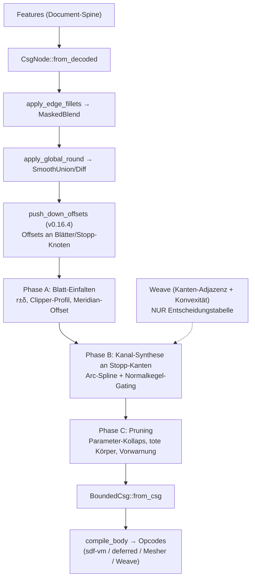

# offset_tree — Offset/Shell als Baum-Transformation (Produktfeature-Plan)

Stand 2026-07-18. Übersetzt die #384-Forschung in umsetzbare Phasen:
Doktrin und Bausteine aus `docs/research/sdf-metricity/SYNTHESIS.md` §9
(Commit 17d17b01), Spike-Validierung aus
`docs/research/sdf-metricity/iter3-offset-tree/LOG.md` (Commit bd1e9adb),
aufsetzend auf dem seit v0.16.4 produktiven Offset-Pushdown
(`crates/kernel/src/csg.rs::push_down_offsets`, Commit 24d67979).

Theoretische Grundlage: Rossignac & Requicha, „Offsetting operations in
solid modelling", CAGD 3 (1986) — Boolean-Identitäten (§2.4), Kanal-Flächen
als Rand-Superset (§2.6), Arc-Spline/PCC-Repräsentation (§3.1).

## 1. Ziel

Offset (±δ) und Shell (Wandstärke t) als **exakte Baum-Transformationen zur
Regenerationszeit**: Das Feature speichert nur δ bzw. t; ein Compiler-Pass
expandiert es je Regen zu einem nativen CSG-Baum (Makro-Expansion), der wie
jeder Körper kompiliert, rendert, boolt und fillet. Der Weave wird dabei nur
als **Entscheidungstabelle** gelesen (Kanten-Adjazenz + Konvexität), nie als
Geometrieträger behalten. Ground Truth bleibt die Feature-Historie.

Doktrin (SYNTHESIS §9): Das Feld ist Renderer und Innen/Außen-Klassifikator,
kein Messgerät. Betrag-konsumierende Operationen fragen nie das Feld, sondern
werden strukturell wegkompiliert, bevor das Feld entsteht.

Zielgenauigkeit: Nullstellenmenge des Offsets auf Kurventoleranz
(0.001-mm-Klasse erreichbar, gemessen im Spike), Außenfeld march-sicher.

## 2. Nicht-Ziele

* **Kein B-Rep-Offsetting / Parasolid-Nachbau.** Kein wasserdichtes
  Vernähen, kein tolerantes Modellieren, keine NURBS-SSI — das Ergebnis
  bleibt implizit, die Booleans löst das Feld gratis auf. Übernommen wird
  nur der leichte R&R-Teil: Kanten aufzählen/klassifizieren,
  Korrekturkörper einsetzen.
* **Twist/Bend sind ausgeschlossen.** Keine Isometrie — ein exakter Offset
  existiert dort prinzipiell nicht (auch nicht in Parasolid). Der Pushdown
  stoppt heute schon oberhalb dieser Knoten; das bleibt so und wird im UI
  als Einschränkung kommuniziert.
* **Rendering-/March-Sicherheit ist NICHT Teil dieses Plans.** Sie ist durch
  Stufe 1 (Circular-CD-smin, v0.16.2) und Stufe 2 (Compile-Zeit-
  Lipschitz-Netz, v0.16.3) bereits gelöst (SYNTHESIS §6).
* **Keine Innen-Betragsgarantie.** Die Keil-Subtraktion der Kanal-Korrektur
  degradiert den Innen-Betrag lokal (gemessen max 3.25 mm bei δ=2 im
  Kanal-Band, Nullmenge und Vorzeichen exakt). Wandstärke-Messung bleibt
  Sache der Orakel-Werkzeuge (Ball-Extremum, Hopf–Lax), nicht des Feldes.

## 3. Ausgangslage (produktiv, nicht neu erforschen)

* `push_down_offsets` (v0.16.4) schiebt Offsets durch die **exakten**
  Boolean-Fälle: +δ durch Union, −δ durch Intersection und durch Difference
  mit Vorzeichen-Flip am Subtrahenden; starre Transforms werden traversiert,
  gestapelte Offsets summiert. Feld-punktweise identisch (min/max sind
  translationsäquivariant). An allen anderen Knoten (duale Boolean-Fälle,
  smin/MaskedBlend/Morph, Twist/Bend, Shell, Blätter) **stoppt** der Pass
  und lässt `f − δ` stehen. Verdrahtet in
  `body.rs::build_bounded_for_body_rounded` und
  `build_bounded_with_primitives_rounded`, als letzter Schritt NACH
  Edge-Fillets und Global-Round, damit der Pass die finalen Knotenformen
  sieht. Ergebnis: Offsets sitzen jetzt an Blättern und Stopp-Knoten — der
  Einstiegspunkt für alles Folgende.
* Spike-Verdikte (iter3-offset-tree/LOG.md): (A) Extrude eines
  Path-Profils und achsenfernes Revolve sind heute exakte SDFs
  (≤ 2.7e-4 mm, `a_summary.csv`); nicht exakt sind nur 2D-Booleans im
  Profil, `Sketch2d::Offset` (f−δ) und achsberührendes Revolve
  (Phantom-Nullmenge auf der Achse, Ticket #390). (B) Kanal-Korrekturkörper
  konvergieren NUR mit Normalkegel-Gating am nächsten Kurvenpunkt (Variante
  C2); das wörtliche §9-Keil-Rezept (C1) konvergiert nicht (Restfehler
  ~0.27·δ, N-unabhängig). C2 erreicht 0.001 mm mit 128 Bögen gesamt bei
  ~720 ns/Eval (`b_zeroset.csv`, `b_costs.csv`); Arc-Splines brauchen ~8×
  weniger Elemente als Polylinien (`b_curve_approx.csv`). (C) Die
  R&R-Zerlegung ist als Mengen-Identität für jedes δ exakt —
  Topologiewechsel sind automatisch korrekt, tote Korrekturkörper kosten
  nur Evals und Provenance, nie Korrektheit.

## 4. Pass-Pipeline

Regen-Pfad nach vollem Ausbau (heute produktiv KOMPLETT, Phasen A–D,
v0.17.3; geschlossene Shells laufen seit D2 zusätzlich durch
`expand_shells` unmittelbar vor `push_down_offsets`):

## 5. Phase A — Analytisches Blatt-Einfalten

**Status: umgesetzt in v0.16.6** (`crates/kernel/src/offset_fold.rs`,
`CsgNode::fold_offset_leaves`), mit dem per Audit
(docs/OFFSET-TREE-AUDIT.md) eingeschränkten Scope: NUR Erosions-Folds
(δ<0) in-family, Dilation bleibt `f − δ`, kein neuer Primitive-Variant;
QuadBezier-Profile und achsberührende Revolves verweigern. Join-Bögen
(neue Verrundungswände aus dem 2D-Offset) bekommen deterministische
Sub-Ids aus einem reservierten Band (0x700+), weil sie eigene Carrier
tragen. Messwerte: `iter3-offset-tree/a2_fold_check.csv`.

Ziel: `Offset(Leaf, δ)` durch ein **neues Blatt mit offsetteten Parametern**
ersetzen, wo die Trägerklasse offset-abgeschlossen ist. Motivation: `f − δ`
auf einem exakten Blatt ist zwar für Dilation ein exaktes SDF, für Erosion
aber nur nullmengen-exakt; das eingefaltete Blatt ist in beiden Richtungen
wieder ein exaktes SDF — die Voraussetzung dafür, dass Phase B seine
Flächen-Sweeps als exakte Terme benutzen kann.

Regeln:

* **Analytische Primitive:** Kugel/Zylinder/Torus(-Rohrradius) → r±δ,
  Ebene → Ebene, Kegel → Spitzenverschiebung. Box wird bei +δ zur
  Rounded-Box (exakt), bei −δ zur geschrumpften Box (exakt).
* **Extrude:** Profil-Booleans (`Sketch2d::Union/Difference/…`) und
  `Sketch2d::Offset` werden VOR dem Offsetten **geometrisch aufgelöst**
  (Clipper-Klasse, s. u.) — sonst liften die gemessenen 2D-Fehlerklassen
  nach 3D (Fan bis 5.8 mm außen, f−δ-Ridge bis 1.53 mm innen,
  `a_summary.csv`). Danach gilt vorzeichenabhängig: bei **δ<0** (Erosion)
  exakt `Extrude(profil↓|δ|, half_height−|δ|)` (Erosion distribuiert über
  die Prisma-Intersektion); bei **δ>0** ist `f−δ` am exakten Extrude-Blatt
  bereits das exakte Dilations-SDF (die Deckelkanten-Rundung liefert die
  iq-Kompositionsformel gratis) — hier wird nur das Profil bereinigt, kein
  Parameter-Umbau nötig.
* **Revolve:** Offset kommutiert mit Revolve (nächster Punkt liegt in der
  Meridian-Halbebene) → 2D-Offset des Meridian-Profils in (u,v). **Gate:**
  Das (dilatierte) Profil darf die Achse nicht berühren — achsberührendes
  Revolve hat eine Phantom-Nullmenge auf der Achse (**#390 ist
  Vorbedingung**; bis dahin: Einfalten verweigern und `f−δ` stehen lassen,
  plus Feature-Fehler bei δ ≥ Achsabstand).
* **2D-Offsetting per Bibliothek** (Prefer-Libraries-Direktive): Kandidaten
  `cavalier_contours` (Pure Rust, Polylinien MIT Bogensegmenten — passt zum
  Arc-Path-Modell von `sketch2d.rs`) oder Clipper2-Bindings (nur Polygone,
  Bögen müssten geflattet werden). Auswahl-Spike mit Kriterium: exakte
  Bogen-Erhaltung, wasm-tauglich, Topologiewechsel (Insel verschwindet,
  Loop spaltet) korrekt.

**Konsumenten-Audit (Pflichtteil, vom Pushdown angemahnt):** Das Einfalten
ändert die **Leaf-Primitive-Identität** (FeatureId → Primitive), die heute
von Feature-Snap- und B-Rep-Carrier-Pfaden konsumiert wird (Doc-Kommentar an
`push_down_offsets`). Konsumenten der Primitive-Map bzw. der Blatt-Carrier:
`kernel_core.rs` (Regen→Mesher), `export_mesh.rs` (Feature-Snap
Kanten/Ecken), `dc.rs`, `native_prepare.rs`, `api/voxel.rs`,
`api/lichen.rs`, `brep/seed_weaver.rs`, `brep/face_offset.rs`,
`step_classifier.rs`. Je Konsument klären: Soll er die OFFSETTETE Fläche
sehen (Feature-Snap: ja — die gerenderte Kante ist die offsettete) oder die
Original-Definition (Feature-UI/Provenance)? Deliverable ist eine
Audit-Tabelle im PR plus Tests, bevor der erste Parameter umgeschrieben wird.

**Tests:** metricity-lab-Vergleich eingefaltetes Blatt vs. Ground Truth
(Wiederverwendung `iter3_offset_tree.rs`-Harness) für beide Vorzeichen;
Kernel-Unit-Tests je Regel in `csg_tests.rs`; Golden-Check des
CGAL-Server-Meshers (Opcode-Änderungen); Feature-Snap-E2E an einer
offsetteten Kante.

## 6. Phase B — Kanal-Korrekturkörper an den dualen Fällen

**Status: umgesetzt in v0.16.7** (`crates/kernel/src/offset_channel.rs`,
`BoundedCsg::ArcChannel`, Opcode `OP_ARC_CHANNEL` 0x41 in allen fünf
Evaluatoren: Baum-Eval, CPU-Interpreter, sdf-vm/deferred-TSL,
fidget-Bridge, CGAL-C++). Gewählte Verfügbarkeits-Architektur:
**synchron, einstufig** — die Kantenliste kommt nicht aus dem
asynchronen Produktions-Weave, sondern aus dessen Seed-Maschinerie
(Branch-Enumeration + SSI-Seeds) plus krümmungs-adaptivem Feld-Tracer
auf den Member-Feldern des Stopps, direkt in
`build_bounded_*_rounded`; Weave-Baupfad und Pick-Baum bleiben naiv
(Weave-Refresh = Phase C). Gegenüber dem Spike trägt der Keil zwei
zusätzliche Nichtkonvexitäts-Wächter-Terme (Trust-Radius `K − de`,
Naiv-Gate `±d + c·δ`), die die Nullmenge beweisbar nicht ändern, aber
Kegel-Leckage über Luftspalte strukturell abschalten. Messwerte
(Steinmetz, `offset_channel_tests.rs`): Zero-Set-Fehler 0.0022 mm bei
54 Bögen (Render-Klasse, Ziel ≤ 0.01) bzw. 0.00046 mm bei 127 Bögen
(Export-Klasse, Ziel ≤ 0.001 mit 128); notch_union-Sliver (α=90°/60°,
δ=2) geschlossen auf < 0.02 mm; Tape-Parität < 2e-5; CGAL-Golden grün.
Die Phase-B-Restlücken (Ecken-Kugeln, Pick-Baum, Weave-Refresh) und
drei latente Phase-B-Fehler (Achsparallelen-Blindheit der Naht-Newton,
Gate-Weite c·δ statt (c−1)·δ, Klemm-/Gate-Vermischung der konkaven
Formel) sind in Phase C geschlossen — Details in §7. Offen bleibt nur:
Kanal-Provenance hängt bis zum echten Offset/Shell-Feature am kleineren
Eltern-Feature (0x700+-Band steht).

Ziel: An den Stopp-Knoten der dualen Fälle (Intersection/Difference bei +δ,
Union bei −δ) das verbleibende `f − δ` durch die exakte R&R-Zerlegung
ersetzen: offsettete Kinder ∪/∩ **Kanal-Korrekturkörper** entlang der
Schnittkanten, je Konvexität addiert (konkave Naht bei −δ über Union:
fehlendes Material) oder abgezogen (konvexe Kante bei +δ über Schnitt:
Überschuss-Keil, gemessen bis 0.414·δ naiv).

Bausteine (alle im Spike validiert):

* **Kantenliste + Konvexität aus dem Weave** — reine Entscheidungstabelle:
  welche Blatt-Paare teilen eine Kante, konvex oder konkav. Der Weave
  liefert außerdem die Kanten-Polylinien als Fit-Eingabe; behalten wird
  davon nichts.
* **Arc-Spline-Fit (PCC)** der Schnittkurve auf Zieltoleranz: O(N⁻³)-
  Konvergenz, ~8× weniger Elemente als Polylinien; 0.001 mm ≈ 32–64 Bögen
  je Loop. Je Stützstelle leben Position + die zwei analytischen
  Flächennormalen n_A, n_B AUF der Kurve (1D-Ökonomie).
* **Normalkegel-Gating (Variante C2):** Keil um den nächsten Kurvenpunkt
  q\*, getrimmt über die dualen Kegelvektoren m_A ∝ n_A − (n_A·n_B)·n_B
  (symmetrisch m_B): Keil = {⟨x−q\*, m̂_A⟩>0 ∧ ⟨x−q\*, m̂_B⟩>0 ∧ |x−q\*|>δ}.
  Das wörtliche §9-Rezept (Gating über die Originalkörper) ist bewiesen
  falsch — nicht wieder versuchen (LOG.md Gotcha 1).
* **Kernel-Seite:** neuer Opcode (z. B. OP_ARC_CHANNEL) mit closed-form
  Bogen-Distanz + Gating-Daten im Opcode-Strom, gespiegelt in allen vier
  Evaluatoren (CPU eval_opcodes, fidget-Bridge, sdf-vm-WGSL, deferred) —
  plus Chunk-Bounding-Spheres/AABB-Gating, damit der Term im Fernfeld auf
  einen Lower-Bound-Test zurückfällt. Lipschitz-Netz (Stufe 2): Kanal-Term
  ist Distanz-zu-Kurve minus Konstante, 1-Lipschitz, komponiert neutral.

Abgrenzung: Der C2-Exaktheitsbeweis gilt für konvexe Körper; nichtkonvex
bleibt C2 lokal korrekt, Überlappungen verschiedener Normalkegel (großes δ,
enge Features) werden in Phase C per Witness geprüft.

**Tests:** Steinmetz-Szene aus dem Spike als Regressionstest (Ziele:
≤ 0.01 mm mit 32 Bögen, ≤ 0.001 mm mit 128 Bögen gesamt); Außenfeld-
Überschätzung ≤ Kurventoleranz (March-Sicherheit); Tape-Parität CPU/GPU
< 1e-6-Klasse wie bei allen Opcodes; der konkave Fall (Union bei −δ /
Shell-Innennaht) ist seit der B0-Messreihe quantifiziert
(`iter3-offset-tree/B0-CONCAVE-SEAM.md`): echter Nullmengenfehler
(fehlendes Material) NUR am −δ-Union-Stopp, Sliver-Tiefe
δ·(1/sin(α/2) − 1) auf 1–4 % bestätigt (α=90°: 0.41·δ); alle anderen
konkaven Erosionsnähte (Difference, Intersection, Folds, Shell) sind
nullmengen-exakt und brauchen keinen Korrekturkörper.

## 7. Phase C — Topologie, Pruning, Weave-Refresh

**Status: umgesetzt in v0.16.8** (plus die zwei Phase-B-Restlücken
Ecken-Kugeln und Pick-Baum). Gelandet ist:

1. **C1 — Blatt-Parameter-Kollaps** (`offset_fold::FoldOutcome::Collapsed`):
   r−|δ| ≤ 0, half_height ≤ 0 (Slab-Kollaps distribuiert exakt über die
   Prisma-Intersektion), 2D-Profil verschwindet (cavalier topologisch
   exakt) → `CsgNode::Empty` statt `f − δ`. Rein parametrisch; der
   Feature-Fehler-Pfad kommt mit dem echten Offset/Shell-Feature (Phase D,
   das δ gegen die Zielgeometrie prüfen kann).
2. **C2 — Toleranz-Staffel + Dead-Channel-Pruning:**
   `CHANNEL_TOL_RENDER = 0.01` (Viewport-Mesh, GPU-SDF, Pick, Weave) /
   `CHANNEL_TOL_EXPORT = 0.001` (STL/3MF, CGAL-Server) als expliziter
   Builder-Parameter (`body::build_bounded_*`); das B0-Toleranz-Pruning
   (δ·(c−1) < tol) läuft damit je Baupfad. `prune_dead_channels` entfernt
   Kanäle, deren Wirk-Schlauch von einem **Union-Nachbarterm** beweisbar
   tief überdeckt ist — Intervall-Vorstufe (AABB-Containment) + zertifiziertes
   Lipschitz-Cover über die Bogen-Bounding-Sphären statt Sampling-Witness:
   im Band |f| ≤ `PRUNE_BAND` bit-identisch, nirgends ein Vorzeichenwechsel
   (Beweisskizze am Funktions-Doc; das Ball-Extremum-Orakel war dafür nicht
   nötig, weil das Komposit den berechneten Nachbar-min selbst enthält).
3. **C3 — Weave-Refresh + Vorwarnsignal:** `build_bounded_for_body_local`
   expandiert jetzt auch (Kanäle + Vertex-Kugeln); Bodies mit Kanälen nimmt
   `ensure_brep` zwingend auf die Octree-Route (parametrische Weaver kennen
   keine Kanal-Branches und wöben die naiven Kanten). Vorwarnsignal
   `channels_interference` (Kurve-Kurve-Distanz < δ_a+δ_b bzw.
   Selbstannäherung, Bounding-Sphären + Punkt-Sampling) via
   `Kernel::offsetChannelDiagnostics`.
4. **C4 — Ecken-Kugeln an Triple-Junctions** (`VertexSphere`,
   `OP_VERTEX_SPHERE` 0x42 in allen fünf Spiegeln + Golden-Szene
   `vertex_sphere_corner`): Detektion aus den am Composite-Gate
   **blockierten Trace-Enden** (dritter Member bekannt), 3-Feld-Newton auf
   den Triple-Punkt, Kegel-Facetten-Gates ĝ_ij ∝ ν_i×ν_j, c_v analytisch
   (äquilibrierte Richtung + Kanten-Bisektoren). Kanal-Spines werden per
   Segment **bis in die Vertices verlängert** (R&R: Kanten enden in Ecken)
   — erst damit ist die Endpunkt-Ball-Kappe die auf den Naht-Fächer
   beschränkte Vertex-Kugel. > 3 Flächen an einer Ecke / degenerierte
   Kegel → Verweigerung (f−δ bleibt konservativ).
5. **C5 — Pick-Baum:** `Kernel::pick` fährt dieselbe Offset-Normalisierung
   (Pushdown → Fold → Kanäle → Pruning, Render-Toleranz), gecacht in
   `Kernel::pick_tree` (invalidiert je Remesh) — Kanal-Flächen sind pickbar
   (0x700+-Band-Provenance), Ray-Tiefe deckt sich mit dem Render-Feld.

Die C4-Arbeit hat drei latente **Phase-B-Fehler** aufgedeckt und behoben
(alle fünf Evaluator-Spiegel nachgezogen, Golden 29 Szenen grün):

* **Achsparallelen-Blindheit:** `project_to_seam` landete bei
  achsparallelen Ebenen-Carriern bit-exakt auf der Naht (sqrt(0)-NaN der
  Dual-Gradienten) — die gesamte Kanal-Synthese fiel für achsparallele
  Unions still aus; die rotierten Notch-/Steinmetz-Fixtures hatten das
  maskiert. Fix: Konvergenz-Check vor dem Schritt + 0.995-Dämpfung.
  Dazu ein Exponierungs-Witness (Carrier-Normalen-FD), der die dadurch
  neu erreichbaren SCHEIN-Nähte an tangentialen Kanten-Kontakten
  (koplanare Deckel) explizit verweigert.
* **Gate-Weite:** Phase B setzte `G = c·δ` — ein δ über dem Maximalbedarf
  `(c−1)·δ`; an trunkierten Kurven-Enden leckte die Endpunkt-Kappe bis
  ~δ Material über das Ende hinaus. Jetzt `G = (c−1)·δ + 4·tol`.
* **Klemme vs. Gate:** die konkave Formel `min(d, −w)` klemmte auch bei
  w ≤ 0 (Gate negativ) — das verfälschte d, öffnete das naive Gate des
  NÄCHSTEN Kanals und kippte an Ecken Vorzeichen. Jetzt Rollen-Trennung:
  `w_geo` (Geometrie) trägt Addition (w > 0) UND march-sichere
  Luft-Distanzschranke (w_geo ≤ 0), das Gate kappt nur die Addition.

**Tests** (alle in `offset_channel_tests.rs` / `csg_tests.rs`): Shell mit
t > lokale Wandstärke (Kavität kollabiert, Feld ≡ Solid); Union-Profil
Erosion bis zum Verschwinden (exakter Vanish-Punkt statt verfrühtem
f−δ-Löschen); Fillet auf offsetteter Kante nach Weave-Refresh; Box-Ecke
konkav unter Erosion: Ecken-Nullmengenfehler naiv 1.38 mm →
Kanäle-allein 0.72 mm → mit Vertex-Kugel ≤ 0.03 mm (δ=2, α=90°),
Außen-Überschätzung ≤ 0.03 mm; Pruning-Feld-Diff bit-identisch im Band;
Tape-/Dual-/fidget-Parität für OP_VERTEX_SPHERE; Steinmetz-/notch-
Regressionen unverändert grün.

## 8. Phase D — UI/Feature-Ebene

**Status: KOMPLETT umgesetzt.** D1 — das **Offset-Feature** (±δ, scoped)
ist produktiv in v0.17.0 (`crates/kernel/src/features/offset.rs`,
Sentinel `Offset(Empty, δ)` → `csg::wrap_offset` in `from_decoded`,
wasm-Export `addOffset`, Toolbar-Button, schema-getriebener Dialog).
D4 — **Twist/Bend im Offset-Scope → Feature-Fehler** statt stillem f−δ —
ist produktiv in v0.17.1 (`CsgNode::contains_warp`, Guard in
`OffsetFeature::execute` über die Partition des Zielkörpers).
D5 — Real-WebGPU-Sichttest — bestanden in v0.17.2 (deckte den
`static_kind_name`-Bug des Offset-Features auf, dort mitgefixt).
D2 — **Shell via Komplement-Dualität** — produktiv in v0.17.3
(`CsgNode::expand_shells` vor `push_down_offsets` in allen drei
Baupfaden): GESCHLOSSENE Shells expandieren zu
`Difference(S, InnerWall(Offset(S, −t)))`; nach `fold_offset_leaves`
ist die Innenwand metrisch exakt. `CsgNode::InnerWall` ist im Feld
transparent und remappt nur die Contributors der Höhle via
`mapped_inner()` ins DL-75-Inner-Wall-Band (kein neuer Distanz-Opcode,
GPU-TSL/CGAL unberührt). OFFENE Shells behalten bewusst den Feld-Pfad
(`OFFSET_2D` + `DIFFERENCE`-Lowering) — der per-Teilfläche maskierte
`d_ret`-Anteil ist nicht sauber dualisierbar; das ist die dokumentierte
Ausnahme, KEIN stiller Fallback. Twist/Bend-Guard gilt seit D2 auch
für Shell.

* **Feature „Offset"** (±δ, ein Wert) und **Feature „Shell"**
  (Wandstärke t, optional offene Faces — ersetzt langfristig den heutigen
  feldbasierten `CsgNode::Shell`-Modifier `max(d, −(d+t))` durch
  Expansion via Komplement-Dualität: S↓t über die Erosionsregeln).
* **Expliziter Scope ist Pflicht** (Direktive „Features brauchen expliziten
  Scope", analog Remove/Intersect): Ziel-Body/Bodies als Query, Warnung
  ohne Scope. Kein impliziter Merge.
* Das Feature persistiert NUR δ/t + Scope; Korrekturkörper und eingefaltete
  Blätter entstehen je Regen (Makro-Expansion) und landen nie im Dokument.
* Twist/Bend im Scope → Feature-Fehler mit klarer Meldung (kein stiller
  f−δ-Fallback im Produkt-Feature).
* Numerik-Eingaben via NumberInput, Formeln/Variablen wie überall.

## 9. Risiken und offene Fragen

* **Eval-Kosten bei vielen Kanten.** ~720 ns/Eval je Kanal der
  0.001-mm-Klasse (f64-Forschungscode, im Band); ein Gehäuse-Shell hat
  Dutzende Kanten. Gegenmittel: Fernfeld-Gating (gemessen ist der
  Worst-Case IM Band), Toleranz-Staffelung (Render 0.01 mm / Export
  0.001 mm), Opcode-Budget (`SDF_MAX_OPCODES`) beobachten. Offene Frage:
  f32-GPU-Verhalten der Bogen-Distanz + Gating (Spike war f64).
* **Provenance/Picking — ENTSCHIEDEN (vor Phase B, 2026-07-18).**
  Dreiteilige Regel, konsistent mit der A2-Konvention für Join-Bögen:
  (1) **FeatureId des Kanal-Terms = das Offset/Shell-Feature selbst** —
  das Feature, das den Körper synthetisiert hat, ist der Contributor
  (Feature-UI, Suppression, tote Flächen hängen damit am richtigen
  Eintrag). (2) **Sub-Face-Ids aus dem reservierten Band 0x700+**,
  deterministisch aus dem geordneten Provenance-Paar der beiden
  Kanten-Eltern abgeleitet (stabil über Regens, solange die Kante stabil
  ist; Kollisionswächter gegen echte Feature-Subs wie in A2). (3)
  **Picking/Hover löst zweistufig auf:** primär das Offset/Shell-Feature,
  sekundär die beiden Eltern-Flächen-Provenances als Mess-/Snap-Referenz
  (der Kanal „erbt" die Eltern also für Bemaßung, nicht für Identität).
* **Interaktion mit Edge-Fillets/MaskedBlend- und smin-Stopps.** Der
  Pushdown stoppt an Blend-Knoten — dort gibt es keinen exakten Offset
  (Blendflächen sind keine Offset-abgeschlossene Klasse). Offset über
  einem gefilleteten Körper bleibt also teilweise f−δ. Offene Frage, ob
  die Feature-Reihenfolge „erst Offset/Shell, dann Fillet" (die Fillets
  laufen dann auf dem expandierten Baum) im UI empfohlen/erzwungen wird.
* **#390 als Vorbedingung** für Revolve-Offsets (achsberührend): ohne Fix
  bleibt die Phantom-Nullmenge; Phase A gated solange.
* **Kaskadierte Offsets** (Offset auf Offset, Shell auf Offset):
  Baumwachstum plus Kanal-auf-Kanal-Kanten, deren Spines schon
  Approximationen sind — R&R nennen genau das als Grund ihrer
  PCC-Entscheidung. V1-Politik: zulassen, aber Toleranzen addieren und ab
  Kaskadentiefe 2 warnen.
* **Konkaver Kanal — GEMESSEN (B0, 2026-07-19).** Messreihe
  `iter3-offset-tree/B0-CONCAVE-SEAM.md` (+ `b0_concave_seam.csv`,
  Bin `b0_concave_seam`): der konkave Additionsfall existiert als
  echter Nullmengenfehler ausschließlich am dualen Stopp −δ an Union
  (Sliver δ·(1/sin(α/2) − 1), fehlendes Material, reiner
  Fußpunktfehler ‖∇f‖=1); L-Extrude-Fold, Box-minus-Box, Dieder per
  Intersection und beide Shell-Bauarten sind nullmengen-exakt (nur
  march-sichere Metrik-Unterschätzung ≤ (1−sin(α/2))·r). Ab α ≥ 150°
  liegt der Sliver unter 0.07·δ → Pruning-Kriterium für Phase C.
  Bonus-Befund: die Phase-D-Expansion S ∖ Offset(S, −t) ist an der
  Box-Shell auch METRISCH exakt, während der heutige
  `CsgNode::Shell`-Modifier an den Innenkanten ~0.29·r Fehler trägt.
* **Nichtkonvexe Normalkegel-Überlappung** bei großem δ: Restrisiko per
  Witness + Ball-Extremum prüfen (Phase C), keine Exaktheitsgarantie im
  Überlappungsgebiet.

## 10. Verweise

* SYNTHESIS.md: §1 (Fehler-Taxonomie), §5 (2×2-Pushdown-Messung,
  Ball-Extremum), §6 (Stufen 1–3), §9 (Doktrin, offset_tree,
  Spike-Nachtrag).
* iter3-offset-tree: `LOG.md`, `a_summary.csv` (Blatt-Exaktheit),
  `a_2d_profile_errors.csv`, `a5_axis_scan.csv` (#390),
  `b_curve_approx.csv` (Arc vs. Polyline), `b_zeroset.csv` (C1/C2),
  `b_costs.csv` (ns/Eval), `b_validation.csv` (GT ~1e-9);
  Prototyp `crates/metricity-lab/src/bin/iter3_offset_tree.rs`.
* Commits: 17d17b01 (SYNTHESIS §9), bd1e9adb (Iteration-3-Spike),
  24d67979 (push_down_offsets produktiv, v0.16.4).
* Ticket #390 (achsberührendes Revolve, Phantom-Nullmenge).
* Kernel: `crates/kernel/src/csg.rs::push_down_offsets`,
  `crates/kernel/src/body.rs::build_bounded_for_body_rounded` /
  `build_bounded_with_primitives_rounded`.
