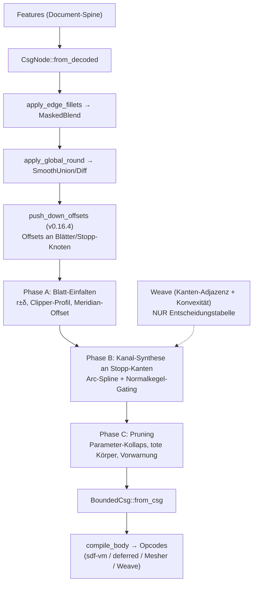

# offset_tree — Offset/Shell als Baum-Transformation (Produktfeature-Plan)

Stand 2026-07-18. Übersetzt die #384-Forschung in umsetzbare Phasen:
Doktrin und Bausteine aus `docs/research/sdf-metricity/SYNTHESIS.md` §9
(Commit 17d17b01), Spike-Validierung aus
`docs/research/sdf-metricity/iter3-offset-tree/LOG.md` (Commit bd1e9adb),
aufsetzend auf dem seit v0.16.4 produktiven Offset-Pushdown
(`crates/kernel/src/csg.rs::push_down_offsets`, Commit 24d67979).

Theoretische Grundlage: Rossignac & Requicha, „Offsetting operations in
solid modelling", CAGD 3 (1986) — Boolean-Identitäten (§2.4), Kanal-Flächen
als Rand-Superset (§2.6), Arc-Spline/PCC-Repräsentation (§3.1).

## 1. Ziel

Offset (±δ) und Shell (Wandstärke t) als **exakte Baum-Transformationen zur
Regenerationszeit**: Das Feature speichert nur δ bzw. t; ein Compiler-Pass
expandiert es je Regen zu einem nativen CSG-Baum (Makro-Expansion), der wie
jeder Körper kompiliert, rendert, boolt und fillet. Der Weave wird dabei nur
als **Entscheidungstabelle** gelesen (Kanten-Adjazenz + Konvexität), nie als
Geometrieträger behalten. Ground Truth bleibt die Feature-Historie.

Doktrin (SYNTHESIS §9): Das Feld ist Renderer und Innen/Außen-Klassifikator,
kein Messgerät. Betrag-konsumierende Operationen fragen nie das Feld, sondern
werden strukturell wegkompiliert, bevor das Feld entsteht.

Zielgenauigkeit: Nullstellenmenge des Offsets auf Kurventoleranz
(0.001-mm-Klasse erreichbar, gemessen im Spike), Außenfeld march-sicher.

## 2. Nicht-Ziele

* **Kein B-Rep-Offsetting / Parasolid-Nachbau.** Kein wasserdichtes
  Vernähen, kein tolerantes Modellieren, keine NURBS-SSI — das Ergebnis
  bleibt implizit, die Booleans löst das Feld gratis auf. Übernommen wird
  nur der leichte R&R-Teil: Kanten aufzählen/klassifizieren,
  Korrekturkörper einsetzen.
* **Twist/Bend sind ausgeschlossen.** Keine Isometrie — ein exakter Offset
  existiert dort prinzipiell nicht (auch nicht in Parasolid). Der Pushdown
  stoppt heute schon oberhalb dieser Knoten; das bleibt so und wird im UI
  als Einschränkung kommuniziert.
* **Rendering-/March-Sicherheit ist NICHT Teil dieses Plans.** Sie ist durch
  Stufe 1 (Circular-CD-smin, v0.16.2) und Stufe 2 (Compile-Zeit-
  Lipschitz-Netz, v0.16.3) bereits gelöst (SYNTHESIS §6).
* **Keine Innen-Betragsgarantie.** Die Keil-Subtraktion der Kanal-Korrektur
  degradiert den Innen-Betrag lokal (gemessen max 3.25 mm bei δ=2 im
  Kanal-Band, Nullmenge und Vorzeichen exakt). Wandstärke-Messung bleibt
  Sache der Orakel-Werkzeuge (Ball-Extremum, Hopf–Lax), nicht des Feldes.

## 3. Ausgangslage (produktiv, nicht neu erforschen)

* `push_down_offsets` (v0.16.4) schiebt Offsets durch die **exakten**
  Boolean-Fälle: +δ durch Union, −δ durch Intersection und durch Difference
  mit Vorzeichen-Flip am Subtrahenden; starre Transforms werden traversiert,
  gestapelte Offsets summiert. Feld-punktweise identisch (min/max sind
  translationsäquivariant). An allen anderen Knoten (duale Boolean-Fälle,
  smin/MaskedBlend/Morph, Twist/Bend, Shell, Blätter) **stoppt** der Pass
  und lässt `f − δ` stehen. Verdrahtet in
  `body.rs::build_bounded_for_body_rounded` und
  `build_bounded_with_primitives_rounded`, als letzter Schritt NACH
  Edge-Fillets und Global-Round, damit der Pass die finalen Knotenformen
  sieht. Ergebnis: Offsets sitzen jetzt an Blättern und Stopp-Knoten — der
  Einstiegspunkt für alles Folgende.
* Spike-Verdikte (iter3-offset-tree/LOG.md): (A) Extrude eines
  Path-Profils und achsenfernes Revolve sind heute exakte SDFs
  (≤ 2.7e-4 mm, `a_summary.csv`); nicht exakt sind nur 2D-Booleans im
  Profil, `Sketch2d::Offset` (f−δ) und achsberührendes Revolve
  (Phantom-Nullmenge auf der Achse, Ticket #390). (B) Kanal-Korrekturkörper
  konvergieren NUR mit Normalkegel-Gating am nächsten Kurvenpunkt (Variante
  C2); das wörtliche §9-Keil-Rezept (C1) konvergiert nicht (Restfehler
  ~0.27·δ, N-unabhängig). C2 erreicht 0.001 mm mit 128 Bögen gesamt bei
  ~720 ns/Eval (`b_zeroset.csv`, `b_costs.csv`); Arc-Splines brauchen ~8×
  weniger Elemente als Polylinien (`b_curve_approx.csv`). (C) Die
  R&R-Zerlegung ist als Mengen-Identität für jedes δ exakt —
  Topologiewechsel sind automatisch korrekt, tote Korrekturkörper kosten
  nur Evals und Provenance, nie Korrektheit.

## 4. Pass-Pipeline

Regen-Pfad nach vollem Ausbau (heute produktiv KOMPLETT, Phasen A–D,
v0.17.3; geschlossene Shells laufen seit D2 zusätzlich durch
`expand_shells` unmittelbar vor `push_down_offsets`):

### 4.1 Pipeline-Invarianten (geprüfter Vertrag)

Die Pass-Reihenfolge ist ein **Vertrag**, kein zufälliger Aufrufstapel. Sie
lautet in jedem Baupfad (`body::build_bounded_for_body_reported`,
`build_bounded_for_body_local` (Weave) und `build_bounded_with_primitives_rounded`)
fest: erst `expand_shells`, dann `push_down_offsets`, dann `fold_offset_leaves`
(danach `collect_offset_capability`, Kanal-Synthese und Pruning). Der
Primitive-Map-Pfad ruft `expand_shells` bewusst NICHT — er extrahiert nur die
gefalteten Blatt-Parameter —, fährt aber dieselben zwei folgenden Pässe.

Jede Stufe hat eine formale Nachbedingung. Sie sind als pure, read-only
Funktionen `check_*` in `crates/kernel/src/offset_invariants.rs` festgeschrieben
und werden über die `assert_after_*`-Helfer per `debug_assert`-Semantik
unmittelbar nach jedem Pass in ALLEN Baupfaden abgenommen. In Release-Builds
(Produktions-WASM) faltet `cfg!(debug_assertions)` den ganzen Block weg — null
Laufzeitkosten, keine Rückwirkung auf die Feld-Auswertung.

Die vier Invarianten:

1. **Nach `expand_shells`:** Es steht kein GESCHLOSSENER Shell-Node mehr im
   Baum. Jeder verbliebene `CsgNode::Shell` trägt offene Flächen (nicht-leerer
   `Vec<OpenSurface>` — der dokumentierte Feld-Pfad für offene Shells); ein
   geschlossener (leerer Vektor) hätte zu
   `Difference(body, InnerWall(Offset(body, −t)))` expandiert werden müssen.
2. **Nach `push_down_offsets`:** Kein Offset-Node steht mehr über einem Knoten,
   durch den der Pass ihn hätte schieben können — also weder pushbare Union bei
   δ>0, noch pushbare Intersection/Difference bei δ<0, noch rigide Transform,
   noch ein weiterer (stapelbarer) Offset, noch ein δ=0. Der Checker nutzt
   dieselbe Entscheidungsfunktion `offset_can_push_through`, die
   `push_down_offset` selbst gatet — es gibt keine zweite, driftfähige Kopie
   der Regel.
3. **Nach `fold_offset_leaves`:** Jedes verbliebene
   `Offset(Leaf|Extrude|Revolve, δ)` mit Erosion (δ<0) ist eine ECHTE,
   dokumentierte Verweigerung. Der Checker negiert `fold_would_accept` — den
   Wrapper um genau denselben `try_fold_erosion`, den der Fold-Pass ausführt.
   Würde der Fold den Rest akzeptieren (einfalten oder zu `Empty`
   kollabieren), ist das ein Fehler. Dilation (δ>0) bleibt bewusst als „f − δ"
   stehen und ist keine Verletzung.
4. **InnerWall-Positionsinvariante (durchgehend ab `expand_shells`):**
   `CsgNode::InnerWall` kommt im gesamten Baum AUSSCHLIESSLICH als rechtes Kind
   einer `Difference` vor. `collect_parity` (csg.rs) und die Surface-Registry
   setzen das hart voraus; die Invariante gilt in jeder späteren Pipelinestufe.

Nicht-Drift ist hier das Entwurfsprinzip: die beiden Entscheidungsträger der
Pässe (`offset_can_push_through` für den Pushdown, `try_fold_erosion` für den
Fold) sind die einzige Quelle der Wahrheit — Pass UND Checker rufen dieselbe
Funktion. Ein Checker kann so nie eine andere Meinung als der Pass haben, den
er absichert.

## 5. Phase A — Analytisches Blatt-Einfalten

**Status: umgesetzt in v0.16.6** (`crates/kernel/src/offset_fold.rs`,
`CsgNode::fold_offset_leaves`), mit dem per Audit
(docs/OFFSET-TREE-AUDIT.md) eingeschränkten Scope: NUR Erosions-Folds
(δ<0) in-family, Dilation bleibt `f − δ`, kein neuer Primitive-Variant;
QuadBezier-Profile und achsberührende Revolves verweigern. Join-Bögen
(neue Verrundungswände aus dem 2D-Offset) bekommen deterministische
Sub-Ids aus einem reservierten Band (0x700+), weil sie eigene Carrier
tragen. Messwerte: `iter3-offset-tree/a2_fold_check.csv`.

Ziel: `Offset(Leaf, δ)` durch ein **neues Blatt mit offsetteten Parametern**
ersetzen, wo die Trägerklasse offset-abgeschlossen ist. Motivation: `f − δ`
auf einem exakten Blatt ist zwar für Dilation ein exaktes SDF, für Erosion
aber nur nullmengen-exakt; das eingefaltete Blatt ist in beiden Richtungen
wieder ein exaktes SDF — die Voraussetzung dafür, dass Phase B seine
Flächen-Sweeps als exakte Terme benutzen kann.

Regeln:

* **Analytische Primitive:** Kugel/Zylinder/Torus(-Rohrradius) → r±δ,
  Ebene → Ebene, Kegel → Spitzenverschiebung. Box wird bei +δ zur
  Rounded-Box (exakt), bei −δ zur geschrumpften Box (exakt).
* **Extrude:** Profil-Booleans (`Sketch2d::Union/Difference/…`) und
  `Sketch2d::Offset` werden VOR dem Offsetten **geometrisch aufgelöst**
  (Clipper-Klasse, s. u.) — sonst liften die gemessenen 2D-Fehlerklassen
  nach 3D (Fan bis 5.8 mm außen, f−δ-Ridge bis 1.53 mm innen,
  `a_summary.csv`). Danach gilt vorzeichenabhängig: bei **δ<0** (Erosion)
  exakt `Extrude(profil↓|δ|, half_height−|δ|)` (Erosion distribuiert über
  die Prisma-Intersektion); bei **δ>0** ist `f−δ` am exakten Extrude-Blatt
  bereits das exakte Dilations-SDF (die Deckelkanten-Rundung liefert die
  iq-Kompositionsformel gratis) — hier wird nur das Profil bereinigt, kein
  Parameter-Umbau nötig.
* **Revolve:** Offset kommutiert mit Revolve (nächster Punkt liegt in der
  Meridian-Halbebene) → 2D-Offset des Meridian-Profils in (u,v). **Gate:**
  Das (dilatierte) Profil darf die Achse nicht berühren — achsberührendes
  Revolve hat eine Phantom-Nullmenge auf der Achse (**#390 ist
  Vorbedingung**; bis dahin: Einfalten verweigern und `f−δ` stehen lassen,
  plus Feature-Fehler bei δ ≥ Achsabstand).
* **2D-Offsetting per Bibliothek** (Prefer-Libraries-Direktive): Kandidaten
  `cavalier_contours` (Pure Rust, Polylinien MIT Bogensegmenten — passt zum
  Arc-Path-Modell von `sketch2d.rs`) oder Clipper2-Bindings (nur Polygone,
  Bögen müssten geflattet werden). Auswahl-Spike mit Kriterium: exakte
  Bogen-Erhaltung, wasm-tauglich, Topologiewechsel (Insel verschwindet,
  Loop spaltet) korrekt.

**Konsumenten-Audit (Pflichtteil, vom Pushdown angemahnt):** Das Einfalten
ändert die **Leaf-Primitive-Identität** (FeatureId → Primitive), die heute
von Feature-Snap- und B-Rep-Carrier-Pfaden konsumiert wird (Doc-Kommentar an
`push_down_offsets`). Konsumenten der Primitive-Map bzw. der Blatt-Carrier:
`kernel_core.rs` (Regen→Mesher), `export_mesh.rs` (Feature-Snap
Kanten/Ecken), `dc.rs`, `native_prepare.rs`, `api/voxel.rs`,
`api/lichen.rs`, `brep/seed_weaver.rs`, `brep/face_offset.rs`,
`step_classifier.rs`. Je Konsument klären: Soll er die OFFSETTETE Fläche
sehen (Feature-Snap: ja — die gerenderte Kante ist die offsettete) oder die
Original-Definition (Feature-UI/Provenance)? Deliverable ist eine
Audit-Tabelle im PR plus Tests, bevor der erste Parameter umgeschrieben wird.

**Tests:** metricity-lab-Vergleich eingefaltetes Blatt vs. Ground Truth
(Wiederverwendung `iter3_offset_tree.rs`-Harness) für beide Vorzeichen;
Kernel-Unit-Tests je Regel in `csg_tests.rs`; Golden-Check des
CGAL-Server-Meshers (Opcode-Änderungen); Feature-Snap-E2E an einer
offsetteten Kante.

## 6. Phase B — Kanal-Korrekturkörper an den dualen Fällen

**Status: umgesetzt in v0.16.7** (`crates/kernel/src/offset_channel.rs`,
`BoundedCsg::ArcChannel`, Opcode `OP_ARC_CHANNEL` 0x41 in allen fünf
Evaluatoren: Baum-Eval, CPU-Interpreter, sdf-vm/deferred-TSL,
fidget-Bridge, CGAL-C++). Gewählte Verfügbarkeits-Architektur:
**synchron, einstufig** — die Kantenliste kommt nicht aus dem
asynchronen Produktions-Weave, sondern aus dessen Seed-Maschinerie
(Branch-Enumeration + SSI-Seeds) plus krümmungs-adaptivem Feld-Tracer
auf den Member-Feldern des Stopps, direkt in
`build_bounded_*_rounded`; Weave-Baupfad und Pick-Baum bleiben naiv
(Weave-Refresh = Phase C). Gegenüber dem Spike trägt der Keil zwei
zusätzliche Nichtkonvexitäts-Wächter-Terme (Trust-Radius `K − de`,
Naiv-Gate `±d + c·δ`), die die Nullmenge beweisbar nicht ändern, aber
Kegel-Leckage über Luftspalte strukturell abschalten. Messwerte
(Steinmetz, `offset_channel_tests.rs`): Zero-Set-Fehler 0.0022 mm bei
54 Bögen (Render-Klasse, Ziel ≤ 0.01) bzw. 0.00046 mm bei 127 Bögen
(Export-Klasse, Ziel ≤ 0.001 mit 128); notch_union-Sliver (α=90°/60°,
δ=2) geschlossen auf < 0.02 mm; Tape-Parität < 2e-5; CGAL-Golden grün.
Die Phase-B-Restlücken (Ecken-Kugeln, Pick-Baum, Weave-Refresh) und
drei latente Phase-B-Fehler (Achsparallelen-Blindheit der Naht-Newton,
Gate-Weite c·δ statt (c−1)·δ, Klemm-/Gate-Vermischung der konkaven
Formel) sind in Phase C geschlossen — Details in §7. Offen bleibt nur:
Kanal-Provenance hängt bis zum echten Offset/Shell-Feature am kleineren
Eltern-Feature (0x700+-Band steht).

Ziel: An den Stopp-Knoten der dualen Fälle (Intersection/Difference bei +δ,
Union bei −δ) das verbleibende `f − δ` durch die exakte R&R-Zerlegung
ersetzen: offsettete Kinder ∪/∩ **Kanal-Korrekturkörper** entlang der
Schnittkanten, je Konvexität addiert (konkave Naht bei −δ über Union:
fehlendes Material) oder abgezogen (konvexe Kante bei +δ über Schnitt:
Überschuss-Keil, gemessen bis 0.414·δ naiv).

Bausteine (alle im Spike validiert):

* **Kantenliste + Konvexität aus dem Weave** — reine Entscheidungstabelle:
  welche Blatt-Paare teilen eine Kante, konvex oder konkav. Der Weave
  liefert außerdem die Kanten-Polylinien als Fit-Eingabe; behalten wird
  davon nichts.
* **Arc-Spline-Fit (PCC)** der Schnittkurve auf Zieltoleranz: O(N⁻³)-
  Konvergenz, ~8× weniger Elemente als Polylinien; 0.001 mm ≈ 32–64 Bögen
  je Loop. Je Stützstelle leben Position + die zwei analytischen
  Flächennormalen n_A, n_B AUF der Kurve (1D-Ökonomie).
* **Normalkegel-Gating (Variante C2):** Keil um den nächsten Kurvenpunkt
  q\*, getrimmt über die dualen Kegelvektoren m_A ∝ n_A − (n_A·n_B)·n_B
  (symmetrisch m_B): Keil = {⟨x−q\*, m̂_A⟩>0 ∧ ⟨x−q\*, m̂_B⟩>0 ∧ |x−q\*|>δ}.
  Das wörtliche §9-Rezept (Gating über die Originalkörper) ist bewiesen
  falsch — nicht wieder versuchen (LOG.md Gotcha 1).
* **Kernel-Seite:** neuer Opcode (z. B. OP_ARC_CHANNEL) mit closed-form
  Bogen-Distanz + Gating-Daten im Opcode-Strom, gespiegelt in allen vier
  Evaluatoren (CPU eval_opcodes, fidget-Bridge, sdf-vm-WGSL, deferred) —
  plus Chunk-Bounding-Spheres/AABB-Gating, damit der Term im Fernfeld auf
  einen Lower-Bound-Test zurückfällt. Lipschitz-Netz (Stufe 2): Kanal-Term
  ist Distanz-zu-Kurve minus Konstante, 1-Lipschitz, komponiert neutral.

Abgrenzung: Der C2-Exaktheitsbeweis gilt für konvexe Körper; nichtkonvex
bleibt C2 lokal korrekt, Überlappungen verschiedener Normalkegel (großes δ,
enge Features) werden in Phase C per Witness geprüft.

**Tests:** Steinmetz-Szene aus dem Spike als Regressionstest (Ziele:
≤ 0.01 mm mit 32 Bögen, ≤ 0.001 mm mit 128 Bögen gesamt); Außenfeld-
Überschätzung ≤ Kurventoleranz (March-Sicherheit); Tape-Parität CPU/GPU
< 1e-6-Klasse wie bei allen Opcodes; der konkave Fall (Union bei −δ /
Shell-Innennaht) ist seit der B0-Messreihe quantifiziert
(`iter3-offset-tree/B0-CONCAVE-SEAM.md`): echter Nullmengenfehler
(fehlendes Material) NUR am −δ-Union-Stopp, Sliver-Tiefe
δ·(1/sin(α/2) − 1) auf 1–4 % bestätigt (α=90°: 0.41·δ); alle anderen
konkaven Erosionsnähte (Difference, Intersection, Folds, Shell) sind
nullmengen-exakt und brauchen keinen Korrekturkörper.

## 7. Phase C — Topologie, Pruning, Weave-Refresh

**Status: umgesetzt in v0.16.8** (plus die zwei Phase-B-Restlücken
Ecken-Kugeln und Pick-Baum). Gelandet ist:

1. **C1 — Blatt-Parameter-Kollaps** (`offset_fold::FoldOutcome::Collapsed`):
   r−|δ| ≤ 0, half_height ≤ 0 (Slab-Kollaps distribuiert exakt über die
   Prisma-Intersektion), 2D-Profil verschwindet (cavalier topologisch
   exakt) → `CsgNode::Empty` statt `f − δ`. Rein parametrisch; der
   Feature-Fehler-Pfad kommt mit dem echten Offset/Shell-Feature (Phase D,
   das δ gegen die Zielgeometrie prüfen kann).
2. **C2 — Toleranz-Staffel + Dead-Channel-Pruning:**
   `CHANNEL_TOL_RENDER = 0.01` (Viewport-Mesh, GPU-SDF, Pick, Weave) /
   `CHANNEL_TOL_EXPORT = 0.001` (STL/3MF, CGAL-Server) als expliziter
   Builder-Parameter (`body::build_bounded_*`); das B0-Toleranz-Pruning
   (δ·(c−1) < tol) läuft damit je Baupfad. `prune_dead_channels` entfernt
   Kanäle, deren Wirk-Schlauch von einem **Union-Nachbarterm** beweisbar
   tief überdeckt ist — Intervall-Vorstufe (AABB-Containment) + zertifiziertes
   Lipschitz-Cover über die Bogen-Bounding-Sphären statt Sampling-Witness:
   im Band |f| ≤ `PRUNE_BAND` bit-identisch, nirgends ein Vorzeichenwechsel
   (Beweisskizze am Funktions-Doc; das Ball-Extremum-Orakel war dafür nicht
   nötig, weil das Komposit den berechneten Nachbar-min selbst enthält).
3. **C3 — Weave-Refresh + Vorwarnsignal:** `build_bounded_for_body_local`
   expandiert jetzt auch (Kanäle + Vertex-Kugeln); Bodies mit Kanälen nimmt
   `ensure_brep` zwingend auf die Octree-Route (parametrische Weaver kennen
   keine Kanal-Branches und wöben die naiven Kanten). Vorwarnsignal
   `channels_interference` (Kurve-Kurve-Distanz < δ_a+δ_b bzw.
   Selbstannäherung, Bounding-Sphären + Punkt-Sampling) via
   `Kernel::offsetChannelDiagnostics`.
4. **C4 — Ecken-Kugeln an Triple-Junctions** (`VertexSphere`,
   `OP_VERTEX_SPHERE` 0x42 in allen fünf Spiegeln + Golden-Szene
   `vertex_sphere_corner`): Detektion aus den am Composite-Gate
   **blockierten Trace-Enden** (dritter Member bekannt), 3-Feld-Newton auf
   den Triple-Punkt, Kegel-Facetten-Gates ĝ_ij ∝ ν_i×ν_j, c_v analytisch
   (äquilibrierte Richtung + Kanten-Bisektoren). Kanal-Spines werden per
   Segment **bis in die Vertices verlängert** (R&R: Kanten enden in Ecken)
   — erst damit ist die Endpunkt-Ball-Kappe die auf den Naht-Fächer
   beschränkte Vertex-Kugel. > 3 Flächen an einer Ecke / degenerierte
   Kegel → Verweigerung (f−δ bleibt konservativ).
5. **C5 — Pick-Baum:** `Kernel::pick` fährt dieselbe Offset-Normalisierung
   (Pushdown → Fold → Kanäle → Pruning, Render-Toleranz), gecacht in
   `Kernel::pick_tree` (invalidiert je Remesh) — Kanal-Flächen sind pickbar
   (0x700+-Band-Provenance), Ray-Tiefe deckt sich mit dem Render-Feld.

Die C4-Arbeit hat drei latente **Phase-B-Fehler** aufgedeckt und behoben
(alle fünf Evaluator-Spiegel nachgezogen, Golden 29 Szenen grün):

* **Achsparallelen-Blindheit:** `project_to_seam` landete bei
  achsparallelen Ebenen-Carriern bit-exakt auf der Naht (sqrt(0)-NaN der
  Dual-Gradienten) — die gesamte Kanal-Synthese fiel für achsparallele
  Unions still aus; die rotierten Notch-/Steinmetz-Fixtures hatten das
  maskiert. Fix: Konvergenz-Check vor dem Schritt + 0.995-Dämpfung.
  Dazu ein Exponierungs-Witness (Carrier-Normalen-FD), der die dadurch
  neu erreichbaren SCHEIN-Nähte an tangentialen Kanten-Kontakten
  (koplanare Deckel) explizit verweigert. Diese Verweigerung wird seit #394
  (Ehrlichkeits-Heuristik, Befund F2) zusätzlich als Capability-Downgrade
  gemeldet: ein koplanarer/tangentialer, koinzidenter, gegenläufig
  orientierter, flächig überlappender Carrier-Kontakt zweier Boolescher
  Kinder (`offset_channel::coplanar_interface_present`) macht `min(A,B)∓δ` an
  der submergierten Fläche zur blossen Näherung — der Stopp meldet dort
  ehrlich `conservative` statt still `exact`/`tolerance_bounded` zu bleiben.
  **Seit #395 wird dieser Fall bei EROSION über Union nicht nur gemeldet,
  sondern KORRIGIERT — siehe „Kontakt-Prisma" unten.**
* **Kontakt-Prisma (#395, Erosion über Union — F2-Fix):** Ist der koplanare
  Kontakt exakt bestimmbar (planare Box-Flächen), baut die Synthese ein
  **Kontakt-Prisma** S = Extrude(P) über dem Kontaktpolygon P (2D-Verschnitt
  der beiden Carrier-Flächen-Loops, Sutherland–Hodgman auf den konvexen
  Rechtecken) und hängt es als **regulären Union-Member VOR das −δ** in den
  gefalteten Baum (`BoundedCsg::Extrude`, orientiertes `world_transform` =
  Π-Frame — KEIN neuer Opcode, alle fünf Spiegel + CGAL sehen ein gewöhnliches
  Extrude). `min(f_i, f_S) − δ` tilgt so den flächigen Phantom-Schlitz auf Π;
  weil S ⊆ U (zur Bauzeit am Feld stichprobenartig verifiziert), ändert das die
  naive Union-Nullmenge nicht, nur die Erosions-Nullmenge wird korrekt. Status
  steigt auf `exact` (P = voller Querschnitt beider Member ⇒ S = U) bzw.
  `tolerance_bounded` mit der ehrlichen B0-Sliver-Schranke am Kontaktrand ∂P
  (Kanten ≈0.41·δ, Ecken ≈0.73·δ). Die SSI-Naht-Synthese wird für ein so
  korrigiertes Member-Paar unterdrückt (ihre koinzident/tangential degenerierten
  Nähte würden sonst Material über Π hinaus lecken, S ⊄ U). Der symmetrische
  **Dilations-Fall (Stufe 3, `+δ` über Intersection/Difference)** ist per
  Komplement-Dualität umgesetzt: dasselbe Prisma als SCHNITT-Constraint
  `max(f_i, −f_S) − δ` (`Difference{ inner, S }`, effektive Normale −sign·n; für
  einen Difference-Kontakt heißt das PARALLELE wahre Normalen = bündig
  ausgeschnittene Tasche). Duale Sicherheit `S ⊆ {f_inner ≥ 0}`; kein Exakt-Tier
  (¬box unbeschränkt), immer `tolerance_bounded` mit der B0-Keil-Schranke ≈0.75·δ.
  **Stufe 2** (∂P-Rim-Kanäle + C4-Vertex-Kugeln zum Schließen des Rand-Slivers)
  bleibt für BEIDE Vorzeichen OFFEN (Rückfall-Klausel; der Stufe-2-Negativbefund
  gilt dual). SSOT: `docs/research/sdf-metricity/F395-CONTACT-PATCH-DESIGN.md`.
* **Gate-Weite:** Phase B setzte `G = c·δ` — ein δ über dem Maximalbedarf
  `(c−1)·δ`; an trunkierten Kurven-Enden leckte die Endpunkt-Kappe bis
  ~δ Material über das Ende hinaus. Jetzt `G = (c−1)·δ + 4·tol`.
* **Klemme vs. Gate:** die konkave Formel `min(d, −w)` klemmte auch bei
  w ≤ 0 (Gate negativ) — das verfälschte d, öffnete das naive Gate des
  NÄCHSTEN Kanals und kippte an Ecken Vorzeichen. Jetzt Rollen-Trennung:
  `w_geo` (Geometrie) trägt Addition (w > 0) UND march-sichere
  Luft-Distanzschranke (w_geo ≤ 0), das Gate kappt nur die Addition.

**Tests** (alle in `offset_channel_tests.rs` / `csg_tests.rs`): Shell mit
t > lokale Wandstärke (Kavität kollabiert, Feld ≡ Solid); Union-Profil
Erosion bis zum Verschwinden (exakter Vanish-Punkt statt verfrühtem
f−δ-Löschen); Fillet auf offsetteter Kante nach Weave-Refresh; Box-Ecke
konkav unter Erosion: Ecken-Nullmengenfehler naiv 1.38 mm →
Kanäle-allein 0.72 mm → mit Vertex-Kugel ≤ 0.03 mm (δ=2, α=90°),
Außen-Überschätzung ≤ 0.03 mm; Pruning-Feld-Diff bit-identisch im Band;
Tape-/Dual-/fidget-Parität für OP_VERTEX_SPHERE; Steinmetz-/notch-
Regressionen unverändert grün.

## 8. Phase D — UI/Feature-Ebene

**Status: KOMPLETT umgesetzt.** D1 — das **Offset-Feature** (±δ, scoped)
ist produktiv in v0.17.0 (`crates/kernel/src/features/offset.rs`,
Sentinel `Offset(Empty, δ)` → `csg::wrap_offset` in `from_decoded`,
wasm-Export `addOffset`, Toolbar-Button, schema-getriebener Dialog).
D4 — **Twist/Bend im Offset-Scope → Feature-Fehler** statt stillem f−δ —
ist produktiv in v0.17.1 (`CsgNode::contains_warp`, Guard in
`OffsetFeature::execute` über die Partition des Zielkörpers).
D5 — Real-WebGPU-Sichttest — bestanden in v0.17.2 (deckte den
`static_kind_name`-Bug des Offset-Features auf, dort mitgefixt).
D2 — **Shell via Komplement-Dualität** — produktiv in v0.17.3
(`CsgNode::expand_shells` vor `push_down_offsets` in allen drei
Baupfaden): GESCHLOSSENE Shells expandieren zu
`Difference(S, InnerWall(Offset(S, −t)))`; nach `fold_offset_leaves`
ist die Innenwand metrisch exakt. `CsgNode::InnerWall` ist im Feld
transparent und remappt nur die Contributors der Höhle via
`mapped_inner()` ins DL-75-Inner-Wall-Band (kein neuer Distanz-Opcode,
GPU-TSL/CGAL unberührt). OFFENE Shells behalten bewusst den Feld-Pfad
(`OFFSET_2D` + `DIFFERENCE`-Lowering) — der per-Teilfläche maskierte
`d_ret`-Anteil ist nicht sauber dualisierbar; das ist die dokumentierte
Ausnahme, KEIN stiller Fallback. Twist/Bend-Guard gilt seit D2 auch
für Shell.

* **Feature „Offset"** (±δ, ein Wert) und **Feature „Shell"**
  (Wandstärke t, optional offene Faces — ersetzt langfristig den heutigen
  feldbasierten `CsgNode::Shell`-Modifier `max(d, −(d+t))` durch
  Expansion via Komplement-Dualität: S↓t über die Erosionsregeln).
* **Expliziter Scope ist Pflicht** (Direktive „Features brauchen expliziten
  Scope", analog Remove/Intersect): Ziel-Body/Bodies als Query, Warnung
  ohne Scope. Kein impliziter Merge.
* Das Feature persistiert NUR δ/t + Scope; Korrekturkörper und eingefaltete
  Blätter entstehen je Regen (Makro-Expansion) und landen nie im Dokument.
* Twist/Bend im Scope → Feature-Fehler mit klarer Meldung (kein stiller
  f−δ-Fallback im Produkt-Feature).
* Numerik-Eingaben via NumberInput, Formeln/Variablen wie überall.

## 9. Risiken und offene Fragen

* **Eval-Kosten bei vielen Kanten.** ~720 ns/Eval je Kanal der
  0.001-mm-Klasse (f64-Forschungscode, im Band); ein Gehäuse-Shell hat
  Dutzende Kanten. Gegenmittel: Fernfeld-Gating (gemessen ist der
  Worst-Case IM Band), Toleranz-Staffelung (Render 0.01 mm / Export
  0.001 mm), Opcode-Budget (`SDF_MAX_OPCODES`) beobachten. Offene Frage:
  f32-GPU-Verhalten der Bogen-Distanz + Gating (Spike war f64).
* **Provenance/Picking — ENTSCHIEDEN (vor Phase B, 2026-07-18),
  VERDRAHTET (v0.51.0, 2026-08-01).**
  Dreiteilige Regel, konsistent mit der A2-Konvention für Join-Bögen:
  (1) **FeatureId des Kanal-Terms = das Offset/Shell-Feature selbst** —
  das Feature, das den Körper synthetisiert hat, ist der Contributor
  (Feature-UI, Suppression, tote Flächen hängen damit am richtigen
  Eintrag). (2) **Sub-Face-Ids aus dem reservierten Band 0x700+**,
  deterministisch aus dem geordneten Provenance-Paar der beiden
  Kanten-Eltern abgeleitet (stabil über Regens, solange die Kante stabil
  ist; Kollisionswächter gegen echte Feature-Subs wie in A2). (3)
  **Picking/Hover löst zweistufig auf:** primär das Offset/Shell-Feature,
  sekundär die beiden Eltern-Flächen-Provenances als Mess-/Snap-Referenz
  (der Kanal „erbt" die Eltern also für Bemaßung, nicht für Identität).

  **Was gebaut wurde (v0.51.0)** — plus die Abweichungen, die die Sonde
  gegen den Ist-Zustand aufgedeckt hat:

  * `OffsetChannel.parents: [u64; 2]` führt jetzt BEIDE Kanten-Eltern-
    BranchIds. Vorher trug der Kanal nur `branch` — und das ist ein
    einziges Feature-Feld, in dem der KLEINERE Elternteil steckt; der
    zweite ging in der Synthese verloren. Regel (2) ist damit weiterhin
    nur halb umgesetzt (der Sub ist ein Synthese-Zähler, nicht aus dem
    Paar abgeleitet) — das Paar selbst ist aber jetzt da, wo es die
    Regel braucht: am Term.
  * **Regel (1) ist NICHT wörtlich umsetzbar** und war es nie: der
    `Offset`/`Shell`-Knoten trägt gar keine FeatureId (weder in `CsgNode`
    noch in `BoundedCsg`), das Feature ist ein körperweiter Modifier. Der
    Contributor eines Kanals ist deshalb der **Owner** — die kleinste
    beteiligte Eltern-Feature-Id —, und für Kontakt-Prismen das per
    `prism_owner` dekodierte Owner-Feature. Das ist die A2-Konvention der
    Vertex-Kugeln, nicht die Plan-Formulierung; die Plan-Formulierung
    verlangte eine Id, die es im Baum nicht gibt.
  * `Kernel::pick` liefert ein neues Feld **`synthetic`**: je getroffener
    synthetischer Fläche `{branch, kind: channel|vertex|prism, owner,
    parents}` (leer bei gewöhnlicher Geometrie). `offset_channel::
    resolve_synthetic` ist die Auflösung dahinter — Prismen am
    Bit-19-Marker, Kanäle/Vertex-Kugeln per Baum-Treffer (der Sub allein
    beweist nichts, das 0x700+-Band teilt sich mit den Sketch-Join-Bögen
    aus `offset_fold`).
  * **Behobener Fehlbefund am Prisma:** eine gepickte Prismenfläche
    meldete in `contributors` ihre synthetische Feature-Id (Bit-19-Marker,
    z. B. `524352`) — eine Id, zu der die UI schlicht nichts findet, also
    selektierte ein Klick darauf gar nichts. `pick` löst sie jetzt auf das
    Owner-Feature auf; nur ein nicht kodierbarer Owner (Sentinel) lässt
    die rohe Id stehen (ehrlich statt erfunden). Die beiden Arrays
    bleiben parallel.
  * Web-Seite: `syntheticProvenance.ts` löst die Eltern-BranchIds gegen
    die gewobenen B-Reps zu regulären `PickedElement`s auf; das
    **Measure-Werkzeug** greift auf einer synthetischen Fläche auf sie
    durch (vorher verschluckte es den Klick, weil dort nichts hovert).
  * **Offen:** Vertex-Kugeln führen kein Eltern-Tripel mit (die Synthese
    kennt dort nur Member-Feature-Ids, keine Branch-Ids) — sie melden
    `kind: "vertex"` mit leerer Eltern-Liste. Snapping nutzt die
    Referenzen noch nicht.
* **Durchdringende Kontakte — GESCHLOSSEN (#384, v0.56.2, 2026-08-01).**
  Der Kontakt-Prisma-Pfad prüfte die Lage zweier anti-paralleler Member-
  Facetten mit einem UNSIGNIERTEN Fenster (`|o_a + o_b| ≤ 0.5·δ`) und
  verankerte das Prisma an EINER der beiden Ebenen. Damit vermengte er drei
  physikalisch verschiedene Lagen — Luftspalt, bündiger Kontakt und
  Durchdringung — und log in allen dreien `exact` (gemessen an gestapelten
  Boxen, δ = 2 mm): ein 0.1-mm-Luftspalt wurde vom Prisma **überbrückt**
  (8 mm Phantom-Material), eine Durchdringung ≤ 0.5·δ ließ das Prisma um
  genau `s` über die Gegenseite **hinausragen** (bis 1 mm Phantom-Material),
  und eine Durchdringung zwischen 0.5·δ und 2·δ bekam GAR KEIN Prisma —
  dort riss die naive Erosion `min(f_i) + δ` einen **Phantom-Schlitz** der
  Dicke `2δ − s` (Nullmengenfehler bis 1.47 mm ≈ 0.735·δ), während die wahre
  Erosion der Vereinigung an der Naht massiv ist.
  Der Fix ist eine **Synthese**, kein Downgrade: `face_pair_penetration`
  klassifiziert die signierte Durchdringungstiefe `s = o_a + o_b` (Luftspalt /
  bündig innerhalb der f32-Rundungsklasse / Durchdringung bis 2·δ / kein
  Schlitz ab 2·δ), und das Prisma spannt von Member i's bis zu Member j's
  Rückseite (`depth_pos − pen`) statt zweimal von derselben Ebene aus. Für
  `pen = 0` ist das bit-identisch zum Bestandspfad (Golden byte-identisch).
  Am durchdringenden Kontakt bleibt die SSI-Naht-Synthese aktiv (die Naht am
  Kontaktrand ist dort eine echte transversale Dieder-Kante, keine
  degenerierte), der ∂P-Rand-Fillet dagegen bleibt bündig-only (er hat sonst
  keine gemeinsame Ebene Π) — die Capability sagt dafür die weitere
  B0-Schranke ≈0.75·δ zu statt der engen `channel_tol`.
  SSOT der Herleitung + Vertragstabelle:
  `docs/research/sdf-metricity/FC-NONCONVEX-CONTACT-DESIGN.md` §8c.
* **Dilations-Duale — GESCHLOSSEN (#384, v0.56.3, 2026-08-01).** Der duale
  Pfad (`synthesize_contact_prisms_dilation`) fuhr weiter das symmetrische
  Fenster, und das Vorzeichen bedeutet dort etwas ANDERES: `s = O_i + O_j` misst
  die Durchdringung der KOMPLEMENTE, `s < 0` heißt „der Subtrahend ist
  vergraben" — ein geschlossener Hohlraum hinter einem Deckel der Dicke `|s|`,
  also **gar kein Kontakt**. Das Fenster hielt jeden Deckel < 0.5·δ für einen
  bündigen Kontakt und trug ihn per Prisma ab. Praktisch wichtigster Fall: die
  geschlossene Box-Shell (`s = −w` auf allen sechs Achsen). Gemessen gegen die
  exakte Distanz zu `A \ B` (δ = 2 mm): bei Wandstärke 0.3·δ fielen **60 % aller
  Innenpunkte der wahren Dilatation** weg, 5766 davon lagen im echten Solid —
  bei einer Zusage von **≤ 0.01 mm**. Ebenso: `0 < s ≤ 0.5·δ` senkte den
  Taschenboden um genau `s` (bis 1 mm), `0.5·δ < s < 2·δ` bekam gar kein Prisma
  und ließ einen 5.159 mm dicken Phantom-Fin über der Tasche stehen.
  Der Fix nutzt dieselbe `face_pair_penetration`-Klassifikation, verankert das
  Prisma an der echten Rückseite (`depth_pos − pen`, nur für endlich dicke
  Member — die ¬box-`margin` bleibt eine Reichweite ab der Ankerebene) und macht
  `contact_clips` auch im Dilations-Zweig bündig-only. SSI-Nähte bleiben hier
  aber für JEDES Kontakt-Paar unterdrückt (gemessen, nicht gespiegelt: die
  Kanäle SUBTRAHIEREN am Dilations-Stopp und griffen sonst bis an die Außenkante
  des Trägerkörpers durch). Golden byte-identisch.
  **Kosten an der Kalibrierung:** `thin_wall_shell_status_unchanged_397` fror in
  der BOX-Spalte für `w < 0.5·δ` genau diese Falschaussage ein; die Zeilen gehen
  auf `exact` — die mit derselben Referenz belegte WAHRE Zusage (0 Fehler für
  jede Wandstärke). Die EXTRUDE-Spalte, der eigentliche #397-Gegenstand, steht
  unverändert. Herleitung + Messtabellen:
  `docs/research/sdf-metricity/FC-NONCONVEX-CONTACT-DESIGN.md` §8d.
  **Neuer offener Befund (eigenes Paket):** bei `s ≥ 2·δ` (kein Prisma, vor wie
  nach unverändert) trägt der reguläre `OP_ARC_CHANNEL`-Pfad an der Außenkante
  des Trägerkörpers 0.760 mm ab, während er ≤ 0.01 mm zusagt — ein
  Bound-Over-Claim des KANAL-Pfads. → aufgearbeitet in v0.56.4, s. u.
* **Kanal-End-Kappe — GESCHLOSSEN (#384, v0.56.4, 2026-08-01).** Der
  Bound-Over-Claim des KANAL-Pfads saß nicht am Kegel und nicht am
  Trust-Radius, sondern an der **Endpunkt-Ball-Kappe** offener Spines:
  `arc_closest` klemmt den Fußpunkt auf den Endpunkt, und die beiden
  Kegel-Gates gehören zur KANTE — über die Richtung ENTLANG der Naht sagen sie
  nichts. Hinter dem Nahtende wirkte der Term darum voll, bis
  `K ≈ 1.95·δ`, quer über Flächen, die dort ungestört weiterlaufen (Tasche:
  0.760 mm an der Außenkante; Spiegel am Erosions-Stopp: 0.800 mm
  Phantom-Material an den Enden des `notch_union`-Dieders). Widerlegt und NICHT
  die Ursache: ein zu großer Trust-Radius (dieselbe Fehlstelle entsteht bei
  `de = 2.55 < c·δ`) und das Zurückschneiden der Spine (die Kappe wandert mit
  und überschätzt dann `de` über der echten Naht: worst 0.632 → 1.500 mm).
  Fix ohne Opcode-Änderung: das terminale Bogenstück (`0.25·δ`) trägt als
  zweites Gate die **Endebenen-Normale** — jenseits der Endebene ist `w < 0`,
  der Term also strukturell aus; davor ist das Gate wegen `⟨x−q*, t̂⟩ = 0`
  neutral, die nlerp-Interpolation blendet stetig aus. Geschlossene Spines
  (Steinmetz) bleiben byte-identisch, an gesnappten Enden übernimmt die
  Vertex-Kugel mit ihren DREI Gates (C4).
  **Was bleibt und jetzt gemeldet wird:** das seit Phase B notierte
  Restrisiko „Fremdgeometrie näher als K im Kegelgebiet" ist gemessen
  (Nachbar-Naht einer Taschen-Ecke 0.632 mm; Deckfläche am Dieder-Ende
  0.848 mm bei α=90°, 2.040 mm bei α=60°) und wird durch die sequenzielle
  Anwendung verschärft (das `gate = G + d` des nächsten Kanals sieht das
  bereits angehobene `d`). Ein Randpunkt-Zeuge (`end_region_violation` +
  `boundary_witness`, gedämpfter Newton) entscheidet je Stopp, ob die enge
  Zusage hält; hält sie nicht, meldet die Capability die Gate-/B0-Schranke
  `(c−1)·δ + 4·tol`, mindestens den gemessenen Fehler. Der saubere Endzustand
  braucht ein DRITTES Gate im Opcode (End-Ebene bzw. Voronoi-Bisektor zur
  Nachbar-Naht) — Semantik-Änderung in sechs Evaluator-Spiegeln, eigenes
  Paket. Golden: 2 von 35 Szenen bewegen sich (`arc_channel_notch`,
  `vertex_sphere_corner` — genau die mit offenen Spines, beide mit
  Randpunkt-Zeugen als Beleg), 33 byte-identisch. Herleitung + Messtabellen:
  `docs/research/sdf-metricity/FC-NONCONVEX-CONTACT-DESIGN.md` §8e.
* **Das dritte Gate — ERLEDIGT (#384 §8f, 2026-08-02).** `OP_ARC_CHANNEL`
  trägt jetzt je offenem Spine-Ende einen affinen Halbraum; `w_geo` bekommt
  den Term `s₃ = min_k(⟨x,n̂ₖ⟩ − cₖ)`. Welche Ebene, entscheidet die Synthese
  strukturell und gemessen: endet die Naht an FREMDER FLÄCHE, die um δ nach
  innen geschobene End-Ebene `⟨x−E,t̂⟩ − δ` (jeder Randpunkt jenseits der
  Endebene ist mindestens `⟨x−E,t̂⟩` weit weg ⇒ `w_geo ≤ dist(x,∂Ω) − δ`);
  schließt eine NACHBAR-NAHT an, der Voronoi-Bisektor `⟨x−E, t̂ − t̂_n⟩`
  (dann korrigiert genau der Kanal, dessen Naht näher liegt). Beides ist
  nötig — die verschobene End-Ebene allein lässt an der Taschen-Ecke
  0.395 mm stehen, der reine Bisektor am Dieder-Ende 0.496/0.998 mm.
  Messbilanz: Tasche `s ≥ 2δ` 0.632 → **0.000 mm** (204 → 0
  Fehlklassifikationen), notch α=90° 0.496 → **0.000**, α=60° 0.998 →
  **0.000**; alle drei Randpunkt-Zeugen-Downgrades fallen. Geschlossene
  Spines (Steinmetz) bleiben feldwert-BIT-identisch. Die §8e-Kappe
  (abgespaltenes terminales Bogenstück mit verdrehtem `m̂₂`) entfällt
  ersatzlos. Wire-Format bricht hart: Header 9 → 25 Floats (`+25+27N`),
  gespiegelt in SECHS Evaluatoren (`offset_channel.rs`, `sdf_compiler.rs`
  `eval_opcodes`, `sdf_dual.rs`, `fidget_bridge.rs`,
  `web/src/sdfVmInterpreter.ts`, `cgal-mesher/src/sdf_interp.h`) plus
  Encoder und `tape_spec.h::op_len`; `check_interp` grün (35 Szenen,
  17920 Checks, worst 2e-6). Golden: 3 von 35 Szenen bewegen sich
  (`arc_channel_steinmetz` nur im Tape, SDF-Werte identisch;
  `arc_channel_notch`, `vertex_sphere_corner` auch im Feld), 32
  byte-identisch. **Offen bleibt der Kaskaden-Effekt**: an Junctions ist er
  weg (der Bisektor trennt), zwischen entfernten Nähten desselben Stopps
  nicht — gemessen unverändert bis zu 2 Terme je Punkt und `2·G`
  Gesamt-Auslenkung, ohne dass an den Fixturen noch eine
  Fehlklassifikation entsteht. Herleitung + Messtabellen: §8f.
* **Vertex-Kugel-Exposition und Junction-Anker — ERLEDIGT (#384 §8g,
  2026-08-02).** §8f ließ beide Flächen ausdrücklich ungemessen; beide
  brachen. (a) Die C4-Vertex-Kugel behauptet `dist(x,∁Ω) = |x−v|` im ganzen
  Trieder-Kegel bis `K = (c_v+0.5)·δ`. Steht eine zweite konkave Ecke näher
  als `K + δ`, gewinnt im konkaven `min` die FALSCHE, weiter entfernte Ecke —
  an einer Schale aus drei Platten der Dicke `3·δ` sind das 510
  Fehlklassifikationen mit 0.523 mm bei zugesagten 0.01 mm, und niemand
  widersprach: der Randpunkt-Zeugen-Wächter lief nur um KANAL-Enden.
  (b) Der Voronoi-Bisektor war im Mittelpunkt der Trace-Enden verankert; sein
  Versatz zur echten Ecke ist `(g₁−g₂)·(1−cos θ)/(2·|t̂₁−t̂₂|)`, also die
  DIFFERENZ der Rückstände — bei Standard-Skala ≤ 0.09 mm und messbar
  folgenlos (Negativ-Befund), am 8- bis 16-fach skalierten Taschen-Fixture
  aber 1.43 mm, weil die Trace-Schrittweite mit dem Bauteil wächst, die
  Junction-Toleranz `0.5·δ` dagegen nicht: 23–35 Fehlklassifikationen mit
  0.436 mm bei zugesagten 0.01 mm. (c) Nebenbefund: der Wächter meldete
  `Fehler ≤ max(gate, viol)` — ein Zirkelschluss, denn `viol` ist eine
  Stichprobe und damit eine UNTERE Schranke (gemessen 1.632 gemeldet gegen
  1.869 real). Fix in FÜNF Synthese-Schritten, KEIN Opcode, kein Spiegel,
  kein Wire-Format: Nachbar-Kegel-Klemme `K ← min(K, max(D−δ, δ))` gegen alle
  gelösten Trieder-Punkte (auch verweigerte); `join = max(0.5·δ, 3·step)`
  symmetrisch; Anker im echten Geraden-Schnittpunkt (`junction_anchor`);
  Spine-Snapping an die Kanal↔Kanal-Junction ab `0.1·δ` Rückstand
  (`snap_channel_ends_to_junctions`, terminales Segment wird verlängert statt
  verdoppelt); Zeugen-Wächter sondiert auch Vertex-Kugel-Kegel und meldet
  `conservative` statt einer Stichproben-Schranke, sobald ein Zeuge das
  strukturelle `gate` übersteigt. Messbilanz: Schale `t/δ ∈ [3, 6]`
  0.119–0.523 → **0.000 mm / 0 Fehler** mit enger Zusage; Tasche `f ∈ {8,16}`
  0.436 → **0.000 mm / 0 Fehler**; Schale `t/δ ≤ 2.5` (die Erosion
  kollabiert) ehrlich `conservative`. Golden: **35/35 byte-identisch** — die
  Brüche saßen genau neben dem, was die Referenzszenen abdecken. Offen bleibt
  Fremdgeometrie OHNE eigenen Trieder-Punkt (kein Kandidat für `D`; fällt nur
  dem Zeugen auf) und der bekannte Kaskaden-Effekt. Herleitung +
  Messtabellen: §8g.
* **Interaktion mit Edge-Fillets/MaskedBlend- und smin-Stopps.** Der
  Pushdown stoppt an Blend-Knoten — dort gibt es keinen exakten Offset
  (Blendflächen sind keine Offset-abgeschlossene Klasse). Offset über
  einem gefilleteten Körper bleibt also teilweise f−δ. Offene Frage, ob
  die Feature-Reihenfolge „erst Offset/Shell, dann Fillet" (die Fillets
  laufen dann auf dem expandierten Baum) im UI empfohlen/erzwungen wird.
* **#390 als Vorbedingung** für Revolve-Offsets (achsberührend): ohne Fix
  bleibt die Phantom-Nullmenge; Phase A gated solange.
* **Kaskadierte Offsets** (Offset auf Offset, Shell auf Offset):
  Baumwachstum plus Kanal-auf-Kanal-Kanten, deren Spines schon
  Approximationen sind — R&R nennen genau das als Grund ihrer
  PCC-Entscheidung. V1-Politik: zulassen, aber Toleranzen addieren und ab
  Kaskadentiefe 2 warnen.
* **Konkaver Kanal — GEMESSEN (B0, 2026-07-19).** Messreihe
  `iter3-offset-tree/B0-CONCAVE-SEAM.md` (+ `b0_concave_seam.csv`,
  Bin `b0_concave_seam`): der konkave Additionsfall existiert als
  echter Nullmengenfehler ausschließlich am dualen Stopp −δ an Union
  (Sliver δ·(1/sin(α/2) − 1), fehlendes Material, reiner
  Fußpunktfehler ‖∇f‖=1); L-Extrude-Fold, Box-minus-Box, Dieder per
  Intersection und beide Shell-Bauarten sind nullmengen-exakt (nur
  march-sichere Metrik-Unterschätzung ≤ (1−sin(α/2))·r). Ab α ≥ 150°
  liegt der Sliver unter 0.07·δ → Pruning-Kriterium für Phase C.
  Bonus-Befund: die Phase-D-Expansion S ∖ Offset(S, −t) ist an der
  Box-Shell auch METRISCH exakt, während der heutige
  `CsgNode::Shell`-Modifier an den Innenkanten ~0.29·r Fehler trägt.
* **Nichtkonvexe Normalkegel-Überlappung** bei großem δ: Restrisiko per
  Witness + Ball-Extremum prüfen (Phase C), keine Exaktheitsgarantie im
  Überlappungsgebiet.
* **Fremdgeometrie QUER zur Naht — GESCHLOSSEN für freie Flächen
  (#384 §8j, 2026-08-02).** Das Phase-C-Restrisiko der ersten Stunde: liegt
  eine fremde Fläche im Normalkegel näher als `K`, greift `de − δ` durch sie
  hindurch. Zwei strukturell bewiesene Schärfungen, beide `min`/`max` über
  GÜLTIGE Schranken — sie können nur Über-Claims tilgen, nie welche erzeugen:
  * **Das vierte Gate** (`OffsetChannel.face_planes`, `OP_ARC_CHANNEL`
    25+27N → **41+27N**): je Kanal bis zu vier Fremdflächen-Halbräume
    `⟨x−F,n̂⟩ − δ` im selben `min` wie das dritte Gate. Belegt wird eine Ebene
    nur, wenn sie eine **lokal stützende Ebene** ist
    (`Ω ∩ B(Naht, 2·K) ⊆ {h ≥ 0}`, geprüft mit den Member-AABBs gegen die
    geweitete Naht-AABB). Dann liegt der Lotfußpunkt jedes bindenden Punkts
    auf oder jenseits von `∂Ω`, `h` ist also eine gültige OBERE Schranke von
    `dist(x,∁Ω)` und `min(de, h)` die schärfere. Kandidaten sind die planaren
    Carrier der Member — dieselbe analytische Quelle wie die SSI-Seeds, kein
    Sampling. Der KONVEXE Zweig bekommt keine Kandidaten (`∁Ω` ist dort eine
    Vereinigung unbeschränkter Komplemente) — dokumentierte Grenze.
  * **Die Grenzwert-Klemme** (`OP_STOP_LIMIT`, 0x46, +1 Float `concave`):
    jeder Naht-/Eckpunkt liegt auf `∂Ω`, also ist `δ − de` eine gültige
    UNTERE Schranke des Zielfelds — bedingungslos. Die Terme liefern nur
    obere Schranken und komponieren mit `min`; genau deshalb konnte die
    weiter entfernte Naht gewinnen. Ein Register, von `OP_STOP_BASE`
    zurückgesetzt, von jedem Term mit `δ − min(de, h)` bzw. `δ − ρ`
    hochgezogen, am Stopp-Ende angewandt (`max` konkav / `min` konvex).
  Messbilanz (δ = 2, exakte Strahl-Referenzen): **Stufen-Nabe 0.841 → 0.000 mm,
  Zusage von ≤ 0.868 auf die Bau-Toleranz ≤ 0.010 — und wahr.** Ecken-Schale
  t/δ = 2.0 0.806 → 0.764 (114 statt 741 Punkte), t/δ = 2.5 1594 → 157
  Punkte, Rippen-Kamm 1904 → 644 bzw. 1624 → 616 Punkte (worst je 0.819,
  weiter ehrlich `conservative`). Sieben Spiegel + `tape_spec.h` +
  `sdfRenderer.ts`; `check_interp` 35 Szenen / 17920 Checks / 0 Failures.
  Golden: 32/35 byte-identisch, drei Kanal-Szenen bewegen zusammen 23 von
  1545 Feldwerten um höchstens 0.00066 mm — ausnahmslos die Klemme, und
  ausnahmslos in Richtung Wahrheit (Ecken-Zentrum 1.49999 → 1.500000).
  *VERWORFEN, gemessen:* die Trust-Klemme gegen die nächste fremde Naht
  (§8g-Spiegel für Kanäle). Sie schließt mehr Über-Claims, tauscht sie aber
  gegen GRÖSSERE Unter-Claims (Nabe 0.198 → 1.199 mm) und lässt den Stopp
  darüber die Bau-Toleranz zusagen — §8h hatte das vorhergesagt.
  *Was NICHT dazugehört:* Naht gegen Naht (Rippen-Kamm, Ecken-Schale unter
  `3·δ`) braucht EINE geteilte Distanzschranke `U = min_j de_j` über alle
  Terme, also einen Zwei-Pass-Evaluator — eigenes Paket. Und der
  UNTER-Claim ist bis heute nirgends gemessen und nirgends zugesagt: die
  Gegenprobe dieses Pakets findet an Fixturen mit ENGER Zusage vorbestehend
  fehlendes Material (Ecken-Schale t/δ = 3.0: 384 Punkte bis 0.839 mm),
  Ursachen sind die um δ verschobene End-Ebene (§8f) und die `G`-Kappe
  (§8i). Details und Zahlen: §8j.
* **Die UNTER-Seite — ERSTMALS GEMESSEN, ein Fix, eine ehrliche Zusage
  (#384 §8k, 2026-08-02).** §8j hatte als Nebenbefund festgehalten, dass
  fehlendes Material „nirgends gemessen und nirgends zugesagt" ist. Ein
  Strahl-Minimum KANN es auch nicht messen: es ist eine OBERE Schranke von
  `dist(x,∁Ω)`, ein Unter-Claim bräuchte eine untere. Dieses Paket baut
  darum zwei **exakte** Referenzen, die `∂Ω` analytisch zerlegen —
  `dist_obb_union_complement_exact` (Box-Flächen minus den Inneren der
  übrigen Boxen per konvexer Polygon-Subtraktion) und
  `dist_hub_complement_exact` (Platte ∪ koaxiale Zylinder in geschlossener
  Form) — und vermisst ALLE §8c–§8j-Fixturen beidseitig.
  *Der Befund:* die zwei von §8j benannten Verdächtigen sind schuldig
  (notch: die δ-verschobene End-Ebene, `de − δ = +0.523` exakt richtig, aber
  `s₃ = −0.383`; Stufen-Nabe: die `G`-Kappe, `w_geo = +0.306` exakt richtig,
  aber `gate = G − d₀ = −0.026`) — der GRÖSSTE Posten war aber ein dritter,
  ungenannter: **an der Ecken-Schale entstanden nur 16 der 24 konkaven
  Nahtstrahlen.** Am Worst-Punkt greift kein einziger Term, weil die nächste
  Naht gar nicht existiert.
  *Ursache und Fix (eine Zeile Reihenfolge):* die Seed-Sperrliste `claimed`
  wurde aus den Trace-Punkten gefüllt, BEVOR der Exponierungs-Witness den
  Trace prüft — ein verworfener Trace nahm seine Sperre mit. Am äusseren
  Union-Knoten liegen die Rand-Facetten in der Paar-AABB und werden zuerst
  abgearbeitet; ihre Traces rutschen auf die echte Naht, sterben am Witness
  und sperren sie. `claimed` wird jetzt erst nach `build_channel` gefüllt.
  Ergebnis: Ecken-Schale 24 statt 16 Kanäle, ab `t/δ = 2.5` **beidseitig
  fehlerfrei** (vorher bis 328 Punkte / 1.325 mm fehlendes Material bei
  zugesagten 0.01), Rippen-Kamm-Über-Claims 644 → 336 bzw. 616 → 280 und
  damit von `conservative` herauf auf ein wahres ≤ 0.868.
  *VERWORFEN, gemessen:* die freie End-Ebene ohne δ-Versatz bzw. ganz
  gestrichen (schliesst alle Unter-Claims, aber der Randpunkt-Zeuge weist
  **0.868 mm ÜBER-Claim** an der äusseren Deckfläche `z = 40` nach, wo
  `set_face_plane_gates` keine stützende Ebene belegt) und die `G`-Kappe
  aufzuheben (Nabe 81 → 1 Punkt, aber Rippen-Kamm 0.820 → **1.987 mm**).
  Ebenfalls verworfen: ein Wächter für die Unter-Seite — er wäre kein
  Wahrheits-Zeuge und feuerte gemessen auch an Fixturen ohne jeden
  Unter-Claim.
  *Also die ehrliche Zusage:* die Kanal-Notiz sagt ab jetzt, welche Richtung
  sie deckt — „PHANTOM-Material ≤ tol mm; FEHLENDES Material ist davon NICHT
  gedeckt … für diese Richtung ist keine Schranke belegbar". Keine Zahl,
  weil keine belegbar ist: der naive Pushdown `∪ Erosion(P_k)` ist gegenüber
  `Erosion(∪ P_k)` um `dist − max_k depth_k` konservativ, und dieses
  Verhältnis ist an Member-Überlappungen unbeschränkt (an der Nabe 2.086).
  Golden 33/35 byte-identisch; `vertex_sphere_corner` wächst um 8 Kanäle und
  bewegt 62 von 514 Feldwerten ausschliesslich nach UNTEN an Aussenpunkten
  (der erodierte Körper ist gewachsen), `arc_channel_notch` 7 Werte ≤ 0.099 mm
  aus geänderter Seed-Reihenfolge. Kein Opcode, kein Format, kein Spiegel:
  `check_interp` 35 Szenen / 17920 Checks / 0 Failures, unverändert.
  Drei neue Pins, EINE angesagte Pin-Bewegung
  (`erosion_collapsing_shell_promise_is_true_384`: die Vorbedingung
  `miss > 0` fror einen Fehler ein, den es nicht mehr gibt).
  *Was NICHT dazugehört:* der Unter-Claim-ZEUGE. Er bräuchte eine untere
  Distanzschranke; für Polytop-Member ist eine bezahlbar
  (`∁(P_a ∪ P_b)` = Vereinigung von ≤ 36 konvexen Keilen, Distanz als
  Minimum geschlossener Formeln, `max_{a,b}` davon ist gültig) — eigenes
  Paket. Details und alle Zahlen: §8k.
* **Kaskade sequenzieller Korrekturterme — ERLEDIGT (#384 §8i,
  2026-08-02).** §8h hatte den Bruch vermessen und den Fix spezifiziert; §8i
  hat ihn gebaut. Jedes Gate rechnet ab jetzt gegen den **naiven** Stoppwert
  `d₀` statt gegen den laufenden `d`: `gate = G ∓ d₀`. Damit gilt
  `|f − d₀| ≤ G` für jeden EINZELNEN Term — und weil das naive Feld
  konservativ ist (`d₀ ≥ e`), auch für ihre Komposition. Die Ein-Term-Schranke
  IST die globale Schranke. Als Nebenwirkung fällt die Reihenfolge-Abhängigkeit
  weg: jeder konkave Term ist `min(d, C(x))`, jeder konvexe `max(d, C(x))` mit
  einem von `d` unabhängigen `C`, also kommutativ (Pin
  `stop_terms_are_order_independent_384`).
  Im Tape trägt das ein neuer, **payload-loser** Opcode `OP_STOP_BASE` (0x45,
  `base ← top of stack`, stack-neutral als pop+push modelliert) plus ein
  Skalar-Register je Evaluator; die Payload-Layouts von `OP_ARC_CHANNEL` /
  `OP_VERTEX_SPHERE` bleiben unberührt. Sieben Spiegel + `tape_spec.h`.
  Messbilanz (δ = 2, exakte Strahl-Referenzen): Stufen-Nabe 2.000 → **0.841 mm**
  (Zusage fällt von `conservative` auf ein wahres `≤ 0.868`), Rippen-Kamm
  1.987 → **0.819 mm**, Steinmetz-Zentrum 1.198·G → **1.000·G**, Zapfen-Reihe
  unverändert. Golden: 3 Tapes wachsen um je 1 Float, EIN Feldwert bewegt sich
  (Steinmetz-Zentrum — der Kaskaden-Zeuge selbst). Herleitung + Tabellen: §8i.
  *Was NICHT dazugehört:* die Stufen-Nabe behält 0.841 mm Rest-Über-Claim aus
  dem Phase-C-Risiko QUER zur Naht (die 1.8 mm dünne Platte unter der Kreisnaht
  liegt näher als `K`). Das ist eine andere Baustelle, jetzt aber sauber
  isoliert und durch `G` gedeckelt.
* **Kaskade sequenzieller Korrekturterme — der Befund (#384 §8h,
  2026-08-02, historisch).** Die Kanäle/Vertex-Kugeln eines Stopps werden
  nacheinander angewandt, und jedes Gate rechnet gegen den LAUFENDEN Wert
  (`gate = G ∓ d`). Verstärker ist die march-sichere Luftseiten-Klemme
  `min(d, −w_geo)`: sie kippt kein Vorzeichen, darf `d` aber beliebig weit
  senken — direkt außerhalb des Trust-Radius ist `−w_geo = de − K → 0⁺`.
  Danach steht das Gate des nächsten Terms mit fast vollem `G` offen.
  Gemessen an Platte + zweistufiger Nabe (beide Nähte KREISE, δ = 2):
  **2.000 mm Nullmengen-Fehler bei zugesagten 0.01 mm**; am Rippen-Kamm
  1.870 mm. Die Ein-Term-Schranke `G = (c−1)·δ + 4·tol` ist also KEINE
  globale Schranke.
  *Heute gedeckt* durch den erweiterten Randpunkt-Zeugen-Wächter
  (`end_region_violation` sondiert seit §8h auch das Naht-INNERE und damit
  geschlossene Spines) — ehrliches Downgrade auf `conservative`, kein
  Feldwert ändert sich (Golden 35/35 byte-identisch).
  *Erledigt durch §8i* (Gate gegen `d₀`, Opcode `OP_STOP_BASE`) — s. o.
* **Sicherheitsnetz der Kontakt-Prismen — gerichtet statt gerastert
  (#384 §8h).** `prism_subset_of_union` / `prism_outside_inner` prüften auf
  einem 7³-Gitter über der Prisma-AABB und waren für dünne
  Verletzungsschichten prinzipiell blind (0.06 mm Schicht in 20-mm-AABB:
  verpasst). Beide Bedingungen haben die Form `V = min(a,b) > 0`; das Gitter
  liefert jetzt nur noch Saaten, von denen eine Koordinaten-Pattern-Search
  bergauf läuft. Strikt schärfer, nie laxer (jeder alte Fund bleibt ein
  Fund); belegt durch eine künstlich eingebaute Regression im Test.
* **Die UNTER-Seite: drei benannte Rest-Ursachen, zwei geschlossen
  (#384 §8l, v0.56.11, 2026-08-02).** §8k mass fehlendes Material erstmals
  exakt und liess drei Posten mit je einem VERDACHT stehen. Die
  Term-Aufschlüsselung widerlegte zwei davon:
  * **Ecken-Schale** (2119 Punkte bis 1.319 mm): nicht die vermuteten
    Synthese-Defekte, sondern die §8g-Nachbar-Kegel-Klemme. Die Vertex-Kugel
    am Würfeleck hatte den exakten Wert (`ρ − δ = 1.3247`) und war durch
    `K = max(D−δ, δ) = δ` abgeschaltet. Seit §8j ist die Klemme gegen Ecken
    MIT eigenem Term entbehrlich — ein Über-Claim braucht `dist < δ`, dann ist
    aber `ρ' < δ ≤ K'` und `vertex_limit > 0` hebt das Feld strukturell zurück.
    Sie zählt jetzt nur noch VERWEIGERTE Trieder.
  * **notch** (9 bzw. 14 Punkte bis 0.559 mm): die freie End-Ebene sitzt am
    TRACE-Ende, nicht an der echten Abschlussfläche — 0.9 mm Rückstand,
    exakt der Betrag, um den `s₃ = −0.238` zu streng war, während `s₄` mit
    `+0.661` den exakten Wert längst bereitstellte. Der δ-Versatz fällt jetzt
    genau dort, wo die Distanz-Rolle nachweislich eine andere Instanz trägt
    (Vertex-Kugel am Anker oder stützende Fremdebene quer am Ende); die
    Reichweiten-Rolle bleibt als reine Ebene. Möglich wurde das erst durch
    einen dritten Eingriff: der Trägerflächen-Filter in
    `set_face_plane_gates` verwarf jede Ebene, die die Naht BERÜHRT — also
    jede Endfläche. An der Ecken-Schale hatten dadurch 4 von 24 Kanälen gar
    keine Fremdebene, und genau daran scheiterte der §8k-Versuch.
  * **Stufen-Nabe** (81 Punkte bis 0.306 mm): die G-Kappe, bestätigt und
    ehrlich VERTAGT. `w_geo = +0.3056` ist exakt, `gate = G − d₀ = −0.016`
    schaltet ab. Ursache ist die Member-Überlappung (grösste Einzel-Tiefe
    1.116 gegen wahre Distanz 2.316), für die das Ein-Naht-Modell hinter
    `G = (c−1)·δ` nicht gilt. Kappe aus: Nabe 81 → 1, aber Rippen-Kamm
    0.820 → **1.987 mm** und `conservative`. Grenzwert als WERT statt als
    Klemme: Über-Claims bis zum vollen δ an jeder Fixture. Beide verworfen.
  Ein VIERTER Befund fiel dem neuen Pin bei `t/δ = 2.25` zu: der Vertex-Snap
  zog die Naht durch verdecktes Member-Inneres, und `channel_limit` setzt
  voraus, dass jeder Spine-Punkt auf `∂Ω` liegt — `de = 1.997 < δ` hob das
  Feld über null. Die Verlängerung wird jetzt gegen `blocking_member` geprüft.
  Golden: 33/35 byte-identisch, alle zehn Feldbewegungen SINKEN (Körper
  wächst, march-sicher), ein Vorzeichenwechsel in `vertex_sphere_corner` ist
  handgerechnet die KORREKTUR eines Unter-Claims (`−0.055663` gegen exakt
  `−0.055635`). Herleitung + Messtabellen:
  `docs/research/sdf-metricity/FC-NONCONVEX-CONTACT-DESIGN.md` §8l.
  *Was NICHT dazugehört:* an `t/δ = 2.1` und `2.4` bekommt nicht jedes Trieder
  eine Vertex-Kugel — 624 bzw. 65 Punkte bis 0.93 mm, vom Report ehrlich
  gedeckt, aber nicht geschlossen. → geschlossen in §8m; der dort genannte
  Verdacht (`trace_seam` biege am Eck ab) war FALSCH.
* **Jedes Trieder bekommt seine Kugel — und der Trace war unschuldig
  (#384 §8m, v0.56.12, 2026-08-02).** Der von §8l benannte Verdacht ist
  widerlegt: der instrumentierte Trace liefert an ALLEN acht Würfelecken ein
  blockiertes Ende, die Kandidatenliste ist vollständig. Verloren gingen vier
  davon eine Stufe später, in `project_to_vertex`. Dessen Newton landet auf
  der Fläche `x = −t`, wo `|p − c| − he` bit-exakt 0 wird — und dort ist der
  **Dual-Gradient exakt `(0,0,0)`**: die Regularisierung
  `safe_sqrt(x) = sqrt(x + 1e−20)` lässt die äussere Ableitung `1/(2·1e−10)`
  auf die innere Null `d(q₀·q₀)/dp = 2·q₀·dq₀/dp = 0` treffen, und der
  Innen-Zweig `min(q_max, 0)` nimmt bei `q_max = 0` den eingefrorenen
  `zero`-Ast. Der Entartungs-Wächter `‖g‖ < 1e−6` warf daraufhin einen bereits
  gelösten Trieder-Punkt weg.
  Die **Phasenlagen-Abhängigkeit ist eine reine f32-Rasterfrage**: an einer
  Fläche bei Koordinate `0` nähert sich die gedämpfte Newton nur asymptotisch
  (dichtes Raster, Konvergenzschwelle `8e−4` greift lange vorher); an einer
  Fläche bei `−t ≈ −4.8` ist das Raster `4.8e−7` weit und ein einziger Schritt
  rastet bit-exakt ein. Ob er das tut, hängt daran, wo der Trace blockiert
  wurde — also an der Trace-Schrittweite gegen die Wandstärke. `t = 4.0`/`4.4`
  daneben (8 Kugeln), `t = 4.2`/`4.8` darauf (4 Kugeln).
  Der Fix ist ein zentraler Differenzen-Rückfall **nur** in der Trieder-Newton
  (`Member::value_grad_vertex`), strikt additiv: oberhalb `‖g‖ ≥ 1e−6`
  wortgleich das alte Ergebnis, darunter gab es bisher gar keins. Kein Opcode,
  kein Spiegel. Der GLOBALE Rückfall (auch im Naht-Marsch) ist gemessen und
  **verworfen**: er kostet 0.760 mm Über-Claim an der Dilations-Tasche bei
  zugesagten 0.010 plus zwei weitere Dilations-Fixturen.
  Ergebnis: der ganze Dicken-Fächer `t/δ = 2.0 … 6.0` ist beidseitig 0/0 bei
  enger Zusage, und über den ganzen Fächer entstehen **8 Vertex-Kugeln, je
  eine je Würfelecke** (vorher 4–8). Nabe, Kamm, notch, Tasche bit-gleich.
  Golden: 34/35 byte-identisch; in `vertex_sphere_corner` SINKEN zwei
  Feldwerte auf den handgerechnet exakten `−1.2` (vorher 8e−6 bzw. 2e−5
  daneben und asymmetrisch — genau die fehlende Kugel). Herleitung +
  Messtabellen: `docs/research/sdf-metricity/FC-NONCONVEX-CONTACT-DESIGN.md`
  §8m.
* **Die untere Distanzschranke: das Paar reicht nicht, der volle Schnitt schon
  (#384 §8n, 2026-08-02).** §8k und §8l haben den Ausweg aus der `G`-Kappe
  zweimal als PAAR benannt (`max_{a,b} dist(x, ∁(P_a∪P_b))`, „≤ 6×6 Keile")
  und §8l sogar beziffert („das Paar (Platte, Zylinder A) liefert genau die
  2.306 mm"). Gemessen ist beides falsch: (Platte, A) liefert **1.184392**,
  das beste Paar überhaupt **2.237332**, exakt sind **2.315608** — und nur der
  VOLLE Member-Schnitt erreicht sie. Der Grund ist strukturell: der Keil, der
  das beste Paar niederhält, ist die Plattenoberseite ausserhalb von
  Zylinder B, und die ist von Zylinder A verdeckt — *ein Paar sieht die
  Verdeckung durch einen DRITTEN Member nicht.*
  Die MECHANIK trägt dagegen vollständig. Mit `gate = max(G − d₀, L(x) − δ)`
  überlebt der §8i-Satz (Über-Claim < `G`), und der neue Anteil kann
  strukturell KEIN Phantom-Material erzeugen (`f ≥ δ − L ≥ e`). Gemessen als
  Feld-Mutation: Nabe 59 → **14** (Paar) → **0 / 0.0000 mm** (voll), und an
  Ecken-Schale (8 Dicken), Rippen-Kamm und notch bewegt sich **kein einziger
  Punkt** — auch nicht auf der Über-Seite, wo „`G`-Kappe aus" den Kamm auf
  448 Punkte / 1.9866 mm aufriss. Die alte Kappe ist der Spezialfall
  `L = max_k depth_k = δ − d₀`: sie rechnete immer schon gegen eine untere
  Schranke, nur gegen die schlechteste.
  **Nicht gebaut, und zwar mit Zahlen:** die Keilzahl ist `∏_k n_k`, also
  exponentiell in der Memberzahl (Rippen-Kamm: `6⁵ = 7776`); gemessen 460 ns
  (Nabe, 27 Keile) bzw. 74 µs (Ecken-Schale, 216 Keile) je Auswertung. Der
  lineare Ausweg ist die zugeschnittene Vereinigungs-B-Rep (`Σ_k n_k`
  Randstücke) — und die im Tape zu führen ist ein eigenes Paket mit allen
  sieben Spiegeln. Verworfen mit Grund: eine per-Kanal-Konstante (über der
  Trust-Region ist sie 0), `gate = face_plane_gate` (`L ≥ h` ist falsch), und
  die beiden Naht-Eltern als Paar (an der Nabe 1.115608, unter `δ`).
  Herleitung, Handrechnung und alle Tabellen:
  `docs/research/sdf-metricity/FC-NONCONVEX-CONTACT-DESIGN.md` §8n.
* **Die Stufen-Nabe ist ZU — `L` als zugeschnittene Vereinigungs-B-Rep im Tape
  (#384 §8o, v0.56.13, 2026-08-02).** §8n hatte den Satz bewiesen und den Weg
  beziffert; §8o baut ihn linear statt exponentiell. Für `x ∈ Ω` ist
  `dist(x,∁Ω) = dist(x,∂Ω)`, und `∂Ω` zerfällt in `Σ_k n_k` zugeschnittene
  Randstücke statt `∏_k n_k` Keile (Rippen-Kamm: 5 Boxen ⇒ `6⁵ = 7776`). Neues
  `OP_STOP_LB = 0x47` (Payload `7 + 11·N`, fester Record-Stride) trägt sie in
  ALLE Tape-Spiegel; zwei Stück-Typen mit exakter geschlossener Distanz:
  Welt-Dreieck und rotiertes `(r,z)`-Segment (letzteres hält Zylinder EXAKT —
  ein einbeschriebenes 16-Prisma hätte die Nabe um seine Sagitta 0.115 mm
  verfehlt, bei zugesagten 0.010).
  **Ergebnis: Stufen-Nabe `0 / 59 · 0.3156` → `0 / 0`.** Ecken-Schale
  `t/δ = 2.0…6.0`, notch 90°/60° beidseitig unverändert 0/0; Rippen-Kamm
  4×2.0/1.0 hat einen AKTIVEN 140-Stück-Block und bleibt exakt bei
  `144 · 0.5378` Über-Claim — der §8n-Satz gemessen statt geglaubt. Golden:
  33/35 Szenen byte-identisch, in den zwei anderen ändert sich nur die
  Tape-Länge (alle Feldwerte bit-identisch). `check_interp` 35/35, 0 Failures.
  Drei Sicherheitsregeln tragen das: kein Stück darf fehlen (nur beweisbar
  vergrabene werden verworfen), Zuschnitt darf zu GROSS sein (jeder
  „nicht darstellbar"-Zweig behält das Stück ganz), und ein nicht
  darstellbarer Member verweigert den GANZEN Block — gemessen am Kamm
  4×1.5/0.8, der wegen dreier Extrude-Kontaktprismen gar kein `L` bekommt.
  Ausserhalb `Ω` wäre die Stück-Schranke ungültig; der Auswerter kappt sie mit
  dem Innen-Indikator `d₀ ≤ δ`, der aus dem Basis-Register folgt
  (`d₀ − δ = min_k f_k` ist das naive Vereinigungsfeld, jedes `f_k`
  vorzeichenrichtig) — und der Schalter sitzt feldstetig genau dort, wo beide
  Gate-Zweige denselben Wert liefern. Design, Beweise, Handrechnung,
  Messtabellen und Kosten:
  `docs/research/sdf-metricity/FC-NONCONVEX-CONTACT-DESIGN.md` §8o.

* **Naht gegen Naht: das `max` verlor die Wahrheit gegen die Schätzung
  (#384 §8p, v0.56.14, 2026-08-02).** §8j hatte für die Über-Seite der
  Rippen-Kämme `U = min_j de_j` als geteilte Schranke empfohlen. Die Messung
  zuerst: **`U` ist seit §8j gebaut** — `OP_STOP_LIMIT` klemmt genau
  `d ≥ δ − U` — und es reicht am Worst-Punkt um 0.5378 mm nicht
  (`U = 2.0413` gegen `dist = 1.4531`). Die Term-für-Term-Zerlegung zeigt
  stattdessen: der bindende Anteil von `w_geo` ist `K − de` (die
  Trust-Radius-Flanke, `de = 3.7285` bei `K = 3.9084`) — der Kanal greift über
  die ganze, nur 2 mm breite Rippe hinweg —, und die richtige Schranke lag seit
  §8o im Tape: `L − δ = −0.5472` gegen `G − d₀ = +0.3215`. Das `max` in
  `gate = max(G − d₀, L − δ)` nahm die SCHÄTZUNG statt der WAHRHEIT.
  **Der Fix ist eine Fallunterscheidung, kein Opcode: wo `L` verfügbar ist,
  gatet `L` allein** (`crate::offset_channel::concave_gate`). Damit ist die
  Über-Seite ein Satz statt einer Messung: `f ≥ min(d₀, δ − L, 0)`, und unter
  `dist < δ` sind alle drei Schranken `> 0` — kein Phantom-Material.
  Dazu fällt der letzte offene §8o-Posten: **konvexe Geraden-Extrudes sind
  jetzt darstellbare `L`-Member** (Konvexitäts-Nachweis am Profil-Umlauf; ein
  nicht-konvexes Profil verweigert den GANZEN Block, weil `⋂{h_i ≤ 0} ⊋ P`
  jedes Vergraben-Urteil ungültig machte). Damit bekommt auch der Kamm
  4×1.5/0.8 einen Block (296 Stücke aus acht Membern).
  **Ergebnis: beide Rippen-Kämme von `168 · 0.8103` bzw. `144 · 0.5378` auf
  `0 / 0`** — die ganze Fixture-Matrix ist zum ersten Mal beidseitig leer.
  Stufen-Nabe, Ecken-Schale (acht Dicken) und notch bleiben 0/0,
  Kontroll-Äquivalenz 0 von 4000 Bit-Abweichungen. Die A/B-Messung trennt
  beide Anteile: mit Block, aber altem `max`-Gate bleibt der 1.5/0.8-Kamm bei
  168 · 0.8103 — der Block allein bringt nichts, es ist die Gate-Regel. Tape-Format, Opcodes und Payload-Längen sind UNVERÄNDERT; die
  Änderung läuft durch sechs Rechen-Spiegel (CPU, Interpreter, Dual, fidget,
  TSL, C++), in fidget als multiplikative Maske, weil ein `y + (x−y)·m` am
  −1e30-Sentinel die Mantisse löscht. Herleitung, Zerlegung, Kandidaten und
  Messtabellen: `docs/research/sdf-metricity/FC-NONCONVEX-CONTACT-DESIGN.md`
  §8p.

* **Die Zusage sah ein Feld, das nicht mehr ausgeliefert wird
  (#384 §8q, v0.56.15, 2026-08-02).** §8p hatte es benannt und liegen lassen:
  der Randpunkt-Zeuge, aus dem die Genauigkeits-Zusage eines Stopps entsteht,
  rief `stop_apply(…, None)` — er mass den `G`-Kappen-Pfad, während seit §8p
  die Stück-Schranke `L` allein gatet. Die Richtung war die sichere (die
  gemeldete Schranke ist SCHWÄCHER als das Feld), der Preis stand nicht in
  Zahlen da. **Das Inventar zuerst:** von zwölf Fixturen melden zehn die enge
  Zusage `≤ 0.010`, die beiden Rippen-Kämme aber `≤ 0.868` (`G`) — bei
  gemessen **0** Phantom-Punkten. Die Zusage war 87-fach stumpfer als das
  Feld. Und: JEDE der zwölf trägt einen `L`-Block (15 … 296 Stücke), womit die
  Begründung der Unter-Seiten-Ausnahme („wo die Ein-Term-Kappe `G` bindet,
  bleibt der naive Sliver stehen") in allen zwölf Notizen tot war — die
  Ausnahme selbst bleibt wahr, ihre Ursache ist die geometrische Klemme
  `w_geo`, nicht mehr das Gate.
  **Der Fix ist eine Reihenfolge, keine Nachbildung:** `stop_lb_block` baut den
  `L`-Block am Ende von `synthesize_stop`, also VOR
  `audit_channel_end_caps`; das Audit reicht ihn bis `stop_apply` durch, und
  DERSELBE `Option<LbBlock>` wandert unverändert in den `ArcChannel`-Knoten.
  Ein Objekt, zwei Leser — damit sind Innen-Indikator `d₀ ≤ δ`, Fernfeld-Kugel,
  `slack` und die `LB_AVAIL`-Schwelle nicht „in Deckung gehalten", sondern
  identisch. Dafür musste die Prisma-Verdrahtung aus dem Aufrufer heraus
  (`attach_prisms`), damit es sie nur EINMAL gibt.
  **Ergebnis: beide Kämme von `≤ 0.868` auf `≤ 0.010`**, die übrigen zehn
  unverändert eng, aber mit der richtigen Begründung; kein Feldwert bewegt sich
  (Golden 35/35 byte-identisch, `check_interp` 35/17920/0), weil keine
  Auswerter-Zeile, kein Opcode und kein Spiegel berührt wurde. Verworfen mit
  Grund: die Über-Seite als `exact` melden (die `∂P`-Rand-Fillets laufen nach
  den Kanal-Termen und tragen eigene Masken), die Zahl auf den `slack` senken
  (kleiner als die f32-Rechengenauigkeit der sechs Spiegel), und die
  Unter-Seiten-Ausnahme streichen (zwölf leere Gitter sind kein Satz).
  Inventar-Tabelle, Lockstep-Begründung, Handrechnung am Kamm-Zeugen und die
  Gegenprobe des Pins:
  `docs/research/sdf-metricity/FC-NONCONVEX-CONTACT-DESIGN.md` §8q.

* **#384 §8r — der Unter-Claim-Zeuge: `L` beweist Anwesenheit, nicht
  Abwesenheit (2026-08-02).** Die UNTER-Seite (fehlendes Material) war seit
  §8k von jeder Zusage ausgenommen, gestützt auf zwölf leere Messgitter. §8r
  ersetzt das Gitter durch einen Zeugen — und leitet zuerst die Vorzeichen her,
  statt sie zu vermuten: aus `L ≤ dist(x,∁Ω)` folgt **nicht**, dass fehlendes
  Material ausgeschlossen ist (das verlangt eine OBERE Distanzschranke),
  sondern nur die Gegenrichtung — `f(x) ≥ 0 ∧ L(x) > δ + tol` BEWEIST
  fehlendes Material von mindestens `L − δ` mm, ohne exakte Referenz, für
  beliebige Geometrie. Der vorab benannte Kandidaten-Weg (`f ≤ L − δ + tol`
  als Freispruch) ist damit widerlegt und „zertifiziert" 10 der 59 bewiesenen
  Unter-Claims der §8n-BASIS-Nabe, den schlimmsten inklusive. Die obere
  Schranke liefert der **Fuss-Zeuge** (Fusspunkt des `min`-Stücks aus
  `lb_foot`, um `push` nach aussen geschoben und mit DEMSELBEN Innen-Indikator
  als `∁Ω`-Punkt nachgewiesen; ein Newton-Marsch, wo das Stück verschluckt
  ist) — er zertifiziert **100 % der Risiko-Menge `{f ≥ 0} ∩ Ω` an allen
  dreizehn Fixturen**, mit `L ≤ exakt ≤ U` an jedem der 143 000 Punkte und
  einer Klammer `U − L ≤ slack + push + 4.4·10⁻⁵`.
  **Der Zeuge hat beim ersten Lauf etwas gefunden:** an vier der neun
  Matrix-Fixturen steht bewiesenes fehlendes Material im ausgelieferten Feld
  (Ecken-Schale `t/δ = 2 / 2.1 / 2.25`: 0.200 / 0.240 / 0.499 mm; beide
  Rippen-Kämme: 0.110 / 0.199 mm) — am freien NAHT-ENDE, wo kein §8k-Gitter je
  hingesehen hat (das Schalen-Gitter misst `[−7,1]³` bei Platten bis `±40`).
  Gegengeprüft an der exakten Referenz: Feld `+0.0458` gegen `dist = 2.2042`
  bei `δ = 2`. Ursache ist die um `δ` verschobene freie End-Ebene (§8f), also
  §8l Ursache 2 — jetzt erstmals mit Ort, Betrag und Beweis. Die Zusage nennt
  ab sofort beides: den Fund mit Ort und Mindestbetrag, oder die Zahl der
  Sondier-Punkte plus „Stichprobe, kein Satz". Bewusst NICHT geändert: die
  `≤`-Zusage der Über-Seite (der Fund ist ein `mindestens`), der Status
  (`Conservative` würde die wahre Über-Schranke unterschlagen) und die Ausnahme
  selbst. Die Intervall-Stufe ist zur Hälfte baubar (`U(c) + ρ ≤ δ + tol` ist
  1-Lipschitz-gültig), die andere Hälfte braucht eine obere Schranke des
  KORRIGIERTEN Feldes über einer Zelle — und die existiert nicht, solange
  `channel_apply`/`vertex_apply` keine Intervall-Auswertung haben.
  Golden 35/35 byte-identisch (der Zeuge schreibt Text, keine Feldwerte).
  Herleitung, Handrechnungen, Abdeckungs- und Fund-Tabellen:
  `docs/research/sdf-metricity/FC-NONCONVEX-CONTACT-DESIGN.md` §8r.

* **#384 §8s — das freie Naht-Ende ist zu; der Fund zerfiel in ZWEI Ursachen
  (v0.56.17, 2026-08-02).** §8r hatte den Rest der um `δ` verschobenen freien
  End-Ebene zugeschrieben. Term für Term nachgerechnet stimmt das nur für die
  Rippen-Kämme; die grössere Hälfte (die Ecken-Schale, 0.511 mm im 40³-Gitter am
  Naht-Ende) ist eine **Junction, die keine ist**. `junction_anchor` fiel für
  (anti)parallele Tangenten auf den MITTELPUNKT der beiden Trace-Enden zurück,
  und `snap_channel_ends_to_junctions` verlängerte die Spine dorthin. An der
  Schale enden Innen- und Aussenkante DERSELBEN Platte parallel an derselben
  Stirnfläche, `4.69 mm` auseinander im `3·step = 4.8 mm`-Fenster — der
  „gemeinsame Anker" liegt `t/2` mm TIEF IM MATERIAL (gemessen bis 1.126 mm
  Eindringtiefe an jedem der 24 Kanäle). Damit fiel die Voraussetzung von
  `channel_limit` (§8j: „jeder Naht-Punkt liegt auf `∂Ω`, also `dist ≤ de`"),
  und die Klemme hob das Feld von `d₀ = −0.2157` auf `+0.0006` — der Stopp
  machte den Punkt SCHLECHTER als das naive Feld. Fix: parallele Geraden
  treffen sich nicht (`junction_anchor → None`, der Rückfall ist gestrichen),
  und jede Verlängerung muss nachweislich auf `∂Ω` bleiben (`junction_of`, mit
  der `gate_eps`-Schwelle des Traces). Zweite Ursache, sauber hergeleitet: der
  δ-Versatz der freien End-Ebene ist eine DISTANZ-Behauptung und braucht den
  §8j-Stützebenen-Beweis. Mit dem Trace-Rückstand `g` gilt `s₃^alt = s₄ − g`,
  wo die Ebene stützt (also redundant und um `g` zu streng — am notch
  gemessen 0.899 mm), und `s₄` existiert gar nicht, wo sie es nicht tut (am
  Kamm endet die Naht auf der Rippen-Unterseite, unter der die Platte
  weiterläuft). Also: **die freie End-Ebene trägt nur noch die Reichweite,
  `s₃ = ⟨x−E,t̂⟩`;** die Distanz-Rolle gehört `s₄` (§8j) und der Vertex-Kugel
  (§8g), beide am ECHTEN Rand verankert. Ergebnis: der Unter-Claim-Zeuge
  schweigt an allen dreizehn Fixturen, die Über-Seite bleibt überall
  `0 / 0.0000`, und an jedem §8r-Fundpunkt ist der Rest exakt der `slack` von
  `L` (5.67·10⁻⁴ Schale, 3.07·10⁻⁴ Kamm). Golden 35/35 byte-identisch (keine
  der Szenen hat parallel endende Nähte oder eine freie End-Ebene ohne `s₄`),
  `check_interp` 0 failures, kein Spiegel berührt.
  Herleitung, Handrechnungen und Vorher/Nachher-Tabelle:
  `docs/research/sdf-metricity/FC-NONCONVEX-CONTACT-DESIGN.md` §8s.

## 10. Verweise

* SYNTHESIS.md: §1 (Fehler-Taxonomie), §5 (2×2-Pushdown-Messung,
  Ball-Extremum), §6 (Stufen 1–3), §9 (Doktrin, offset_tree,
  Spike-Nachtrag).
* iter3-offset-tree: `LOG.md`, `a_summary.csv` (Blatt-Exaktheit),
  `a_2d_profile_errors.csv`, `a5_axis_scan.csv` (#390),
  `b_curve_approx.csv` (Arc vs. Polyline), `b_zeroset.csv` (C1/C2),
  `b_costs.csv` (ns/Eval), `b_validation.csv` (GT ~1e-9);
  Prototyp `crates/metricity-lab/src/bin/iter3_offset_tree.rs`.
* Commits: 17d17b01 (SYNTHESIS §9), bd1e9adb (Iteration-3-Spike),
  24d67979 (push_down_offsets produktiv, v0.16.4).
* Ticket #390 (achsberührendes Revolve, Phantom-Nullmenge).
* Kernel: `crates/kernel/src/csg.rs::push_down_offsets`,
  `crates/kernel/src/body.rs::build_bounded_for_body_rounded` /
  `build_bounded_with_primitives_rounded`.
