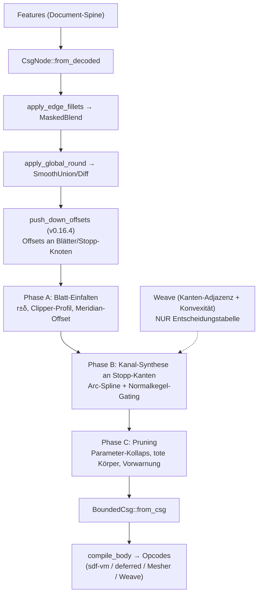

# offset_tree — Offset/Shell als Baum-Transformation (Produktfeature-Plan)

Stand 2026-07-18. Übersetzt die #384-Forschung in umsetzbare Phasen:
Doktrin und Bausteine aus `docs/research/sdf-metricity/SYNTHESIS.md` §9
(Commit 17d17b01), Spike-Validierung aus
`docs/research/sdf-metricity/iter3-offset-tree/LOG.md` (Commit bd1e9adb),
aufsetzend auf dem seit v0.16.4 produktiven Offset-Pushdown
(`crates/kernel/src/csg.rs::push_down_offsets`, Commit 24d67979).

Theoretische Grundlage: Rossignac & Requicha, „Offsetting operations in
solid modelling", CAGD 3 (1986) — Boolean-Identitäten (§2.4), Kanal-Flächen
als Rand-Superset (§2.6), Arc-Spline/PCC-Repräsentation (§3.1).

## 1. Ziel

Offset (±δ) und Shell (Wandstärke t) als **exakte Baum-Transformationen zur
Regenerationszeit**: Das Feature speichert nur δ bzw. t; ein Compiler-Pass
expandiert es je Regen zu einem nativen CSG-Baum (Makro-Expansion), der wie
jeder Körper kompiliert, rendert, boolt und fillet. Der Weave wird dabei nur
als **Entscheidungstabelle** gelesen (Kanten-Adjazenz + Konvexität), nie als
Geometrieträger behalten. Ground Truth bleibt die Feature-Historie.

Doktrin (SYNTHESIS §9): Das Feld ist Renderer und Innen/Außen-Klassifikator,
kein Messgerät. Betrag-konsumierende Operationen fragen nie das Feld, sondern
werden strukturell wegkompiliert, bevor das Feld entsteht.

Zielgenauigkeit: Nullstellenmenge des Offsets auf Kurventoleranz
(0.001-mm-Klasse erreichbar, gemessen im Spike), Außenfeld march-sicher.

## 2. Nicht-Ziele

* **Kein B-Rep-Offsetting / Parasolid-Nachbau.** Kein wasserdichtes
  Vernähen, kein tolerantes Modellieren, keine NURBS-SSI — das Ergebnis
  bleibt implizit, die Booleans löst das Feld gratis auf. Übernommen wird
  nur der leichte R&R-Teil: Kanten aufzählen/klassifizieren,
  Korrekturkörper einsetzen.
* **Twist/Bend sind ausgeschlossen.** Keine Isometrie — ein exakter Offset
  existiert dort prinzipiell nicht (auch nicht in Parasolid). Der Pushdown
  stoppt heute schon oberhalb dieser Knoten; das bleibt so und wird im UI
  als Einschränkung kommuniziert.
* **Rendering-/March-Sicherheit ist NICHT Teil dieses Plans.** Sie ist durch
  Stufe 1 (Circular-CD-smin, v0.16.2) und Stufe 2 (Compile-Zeit-
  Lipschitz-Netz, v0.16.3) bereits gelöst (SYNTHESIS §6).
* **Keine Innen-Betragsgarantie.** Die Keil-Subtraktion der Kanal-Korrektur
  degradiert den Innen-Betrag lokal (gemessen max 3.25 mm bei δ=2 im
  Kanal-Band, Nullmenge und Vorzeichen exakt). Wandstärke-Messung bleibt
  Sache der Orakel-Werkzeuge (Ball-Extremum, Hopf–Lax), nicht des Feldes.

## 3. Ausgangslage (produktiv, nicht neu erforschen)

* `push_down_offsets` (v0.16.4) schiebt Offsets durch die **exakten**
  Boolean-Fälle: +δ durch Union, −δ durch Intersection und durch Difference
  mit Vorzeichen-Flip am Subtrahenden; starre Transforms werden traversiert,
  gestapelte Offsets summiert. Feld-punktweise identisch (min/max sind
  translationsäquivariant). An allen anderen Knoten (duale Boolean-Fälle,
  smin/MaskedBlend/Morph, Twist/Bend, Shell, Blätter) **stoppt** der Pass
  und lässt `f − δ` stehen. Verdrahtet in
  `body.rs::build_bounded_for_body_rounded` und
  `build_bounded_with_primitives_rounded`, als letzter Schritt NACH
  Edge-Fillets und Global-Round, damit der Pass die finalen Knotenformen
  sieht. Ergebnis: Offsets sitzen jetzt an Blättern und Stopp-Knoten — der
  Einstiegspunkt für alles Folgende.
* Spike-Verdikte (iter3-offset-tree/LOG.md): (A) Extrude eines
  Path-Profils und achsenfernes Revolve sind heute exakte SDFs
  (≤ 2.7e-4 mm, `a_summary.csv`); nicht exakt sind nur 2D-Booleans im
  Profil, `Sketch2d::Offset` (f−δ) und achsberührendes Revolve
  (Phantom-Nullmenge auf der Achse, Ticket #390). (B) Kanal-Korrekturkörper
  konvergieren NUR mit Normalkegel-Gating am nächsten Kurvenpunkt (Variante
  C2); das wörtliche §9-Keil-Rezept (C1) konvergiert nicht (Restfehler
  ~0.27·δ, N-unabhängig). C2 erreicht 0.001 mm mit 128 Bögen gesamt bei
  ~720 ns/Eval (`b_zeroset.csv`, `b_costs.csv`); Arc-Splines brauchen ~8×
  weniger Elemente als Polylinien (`b_curve_approx.csv`). (C) Die
  R&R-Zerlegung ist als Mengen-Identität für jedes δ exakt —
  Topologiewechsel sind automatisch korrekt, tote Korrekturkörper kosten
  nur Evals und Provenance, nie Korrektheit.

## 4. Pass-Pipeline

Regen-Pfad nach vollem Ausbau (heute produktiv bis einschließlich
`push_down_offsets`; die offset_tree-Erweiterungen sind die Phasen A–C):

## 5. Phase A — Analytisches Blatt-Einfalten

Ziel: `Offset(Leaf, δ)` durch ein **neues Blatt mit offsetteten Parametern**
ersetzen, wo die Trägerklasse offset-abgeschlossen ist. Motivation: `f − δ`
auf einem exakten Blatt ist zwar für Dilation ein exaktes SDF, für Erosion
aber nur nullmengen-exakt; das eingefaltete Blatt ist in beiden Richtungen
wieder ein exaktes SDF — die Voraussetzung dafür, dass Phase B seine
Flächen-Sweeps als exakte Terme benutzen kann.

Regeln:

* **Analytische Primitive:** Kugel/Zylinder/Torus(-Rohrradius) → r±δ,
  Ebene → Ebene, Kegel → Spitzenverschiebung. Box wird bei +δ zur
  Rounded-Box (exakt), bei −δ zur geschrumpften Box (exakt).
* **Extrude:** Profil-Booleans (`Sketch2d::Union/Difference/…`) und
  `Sketch2d::Offset` werden VOR dem Offsetten **geometrisch aufgelöst**
  (Clipper-Klasse, s. u.) — sonst liften die gemessenen 2D-Fehlerklassen
  nach 3D (Fan bis 5.8 mm außen, f−δ-Ridge bis 1.53 mm innen,
  `a_summary.csv`). Danach gilt vorzeichenabhängig: bei **δ<0** (Erosion)
  exakt `Extrude(profil↓|δ|, half_height−|δ|)` (Erosion distribuiert über
  die Prisma-Intersektion); bei **δ>0** ist `f−δ` am exakten Extrude-Blatt
  bereits das exakte Dilations-SDF (die Deckelkanten-Rundung liefert die
  iq-Kompositionsformel gratis) — hier wird nur das Profil bereinigt, kein
  Parameter-Umbau nötig.
* **Revolve:** Offset kommutiert mit Revolve (nächster Punkt liegt in der
  Meridian-Halbebene) → 2D-Offset des Meridian-Profils in (u,v). **Gate:**
  Das (dilatierte) Profil darf die Achse nicht berühren — achsberührendes
  Revolve hat eine Phantom-Nullmenge auf der Achse (**#390 ist
  Vorbedingung**; bis dahin: Einfalten verweigern und `f−δ` stehen lassen,
  plus Feature-Fehler bei δ ≥ Achsabstand).
* **2D-Offsetting per Bibliothek** (Prefer-Libraries-Direktive): Kandidaten
  `cavalier_contours` (Pure Rust, Polylinien MIT Bogensegmenten — passt zum
  Arc-Path-Modell von `sketch2d.rs`) oder Clipper2-Bindings (nur Polygone,
  Bögen müssten geflattet werden). Auswahl-Spike mit Kriterium: exakte
  Bogen-Erhaltung, wasm-tauglich, Topologiewechsel (Insel verschwindet,
  Loop spaltet) korrekt.

**Konsumenten-Audit (Pflichtteil, vom Pushdown angemahnt):** Das Einfalten
ändert die **Leaf-Primitive-Identität** (FeatureId → Primitive), die heute
von Feature-Snap- und B-Rep-Carrier-Pfaden konsumiert wird (Doc-Kommentar an
`push_down_offsets`). Konsumenten der Primitive-Map bzw. der Blatt-Carrier:
`kernel_core.rs` (Regen→Mesher), `export_mesh.rs` (Feature-Snap
Kanten/Ecken), `dc.rs`, `native_prepare.rs`, `api/voxel.rs`,
`api/lichen.rs`, `brep/seed_weaver.rs`, `brep/face_offset.rs`,
`step_classifier.rs`. Je Konsument klären: Soll er die OFFSETTETE Fläche
sehen (Feature-Snap: ja — die gerenderte Kante ist die offsettete) oder die
Original-Definition (Feature-UI/Provenance)? Deliverable ist eine
Audit-Tabelle im PR plus Tests, bevor der erste Parameter umgeschrieben wird.

**Tests:** metricity-lab-Vergleich eingefaltetes Blatt vs. Ground Truth
(Wiederverwendung `iter3_offset_tree.rs`-Harness) für beide Vorzeichen;
Kernel-Unit-Tests je Regel in `csg_tests.rs`; Golden-Check des
CGAL-Server-Meshers (Opcode-Änderungen); Feature-Snap-E2E an einer
offsetteten Kante.

## 6. Phase B — Kanal-Korrekturkörper an den dualen Fällen

Ziel: An den Stopp-Knoten der dualen Fälle (Intersection/Difference bei +δ,
Union bei −δ) das verbleibende `f − δ` durch die exakte R&R-Zerlegung
ersetzen: offsettete Kinder ∪/∩ **Kanal-Korrekturkörper** entlang der
Schnittkanten, je Konvexität addiert (konkave Naht bei −δ über Union:
fehlendes Material) oder abgezogen (konvexe Kante bei +δ über Schnitt:
Überschuss-Keil, gemessen bis 0.414·δ naiv).

Bausteine (alle im Spike validiert):

* **Kantenliste + Konvexität aus dem Weave** — reine Entscheidungstabelle:
  welche Blatt-Paare teilen eine Kante, konvex oder konkav. Der Weave
  liefert außerdem die Kanten-Polylinien als Fit-Eingabe; behalten wird
  davon nichts.
* **Arc-Spline-Fit (PCC)** der Schnittkurve auf Zieltoleranz: O(N⁻³)-
  Konvergenz, ~8× weniger Elemente als Polylinien; 0.001 mm ≈ 32–64 Bögen
  je Loop. Je Stützstelle leben Position + die zwei analytischen
  Flächennormalen n_A, n_B AUF der Kurve (1D-Ökonomie).
* **Normalkegel-Gating (Variante C2):** Keil um den nächsten Kurvenpunkt
  q\*, getrimmt über die dualen Kegelvektoren m_A ∝ n_A − (n_A·n_B)·n_B
  (symmetrisch m_B): Keil = {⟨x−q\*, m̂_A⟩>0 ∧ ⟨x−q\*, m̂_B⟩>0 ∧ |x−q\*|>δ}.
  Das wörtliche §9-Rezept (Gating über die Originalkörper) ist bewiesen
  falsch — nicht wieder versuchen (LOG.md Gotcha 1).
* **Kernel-Seite:** neuer Opcode (z. B. OP_ARC_CHANNEL) mit closed-form
  Bogen-Distanz + Gating-Daten im Opcode-Strom, gespiegelt in allen vier
  Evaluatoren (CPU eval_opcodes, fidget-Bridge, sdf-vm-WGSL, deferred) —
  plus Chunk-Bounding-Spheres/AABB-Gating, damit der Term im Fernfeld auf
  einen Lower-Bound-Test zurückfällt. Lipschitz-Netz (Stufe 2): Kanal-Term
  ist Distanz-zu-Kurve minus Konstante, 1-Lipschitz, komponiert neutral.

Abgrenzung: Der C2-Exaktheitsbeweis gilt für konvexe Körper; nichtkonvex
bleibt C2 lokal korrekt, Überlappungen verschiedener Normalkegel (großes δ,
enge Features) werden in Phase C per Witness geprüft.

**Tests:** Steinmetz-Szene aus dem Spike als Regressionstest (Ziele:
≤ 0.01 mm mit 32 Bögen, ≤ 0.001 mm mit 128 Bögen gesamt); Außenfeld-
Überschätzung ≤ Kurventoleranz (March-Sicherheit); Tape-Parität CPU/GPU
< 1e-6-Klasse wie bei allen Opcodes; ein konkaver Fall (Union bei −δ /
Shell-Innennaht) zusätzlich zum konvexen Spike-Fall — der ist bisher NICHT
gemessen.

## 7. Phase C — Topologie, Pruning, Weave-Refresh

Die Expansion ist mengen-exakt für jedes δ — diese Phase ist Kosten- und
Folge-Feature-Hygiene, keine Korrektheitsrettung (LOG.md Teil C):

1. **Blatt-Parameter-Kollaps bei Erosion:** r−δ ≤ 0, half_height ≤ 0,
   2D-Profil verschwindet (liefert der Clipper-Offset topologisch exakt und
   gratis). Rein parametrisch, keine Heuristik; Ergebnis = leeres Blatt bzw.
   Feature-Fehler (error-toleranter Regen zeigt ihn rot an).
2. **Tote Korrekturkörper prunen** (nur Kosten/Provenance): Vorstufe
   Intervall-Arithmetik (Kanal-AABB gegen garantierte Innen-Boxen der
   Nachbarterme), Rest per Witness-Punkte auf dem Kanal-Rand +
   Ball-Extremum-Orakel (einige Dutzend Punkte à ~170 Evals, SYNTHESIS §5).
3. **Vorwarnsignal für Folge-Features:** Kanal-Selbstschnitte und
   Kanal-Paar-Schnitte (Kurve-Kurve-Distanz < 2δ, 1D-BVH, billig) markieren,
   wann die Kantenlisten des Ergebnisses ungültig sind → **Weave-Refresh**
   des expandierten Körpers, damit Fillet/zweiter Offset auf S↑δ echte
   Kanten sehen. Der Weave selbst ist der (teure, existierende) Detektor.

**Tests:** Shell mit t > lokale Wandstärke (Bohrung schließt sich korrekt,
kein Geisterkörper); Erosion bis zum Verschwinden; Fillet auf offsetteter
Kante nach Weave-Refresh.

## 8. Phase D — UI/Feature-Ebene

* **Feature „Offset"** (±δ, ein Wert) und **Feature „Shell"**
  (Wandstärke t, optional offene Faces — ersetzt langfristig den heutigen
  feldbasierten `CsgNode::Shell`-Modifier `max(d, −(d+t))` durch
  Expansion via Komplement-Dualität: S↓t über die Erosionsregeln).
* **Expliziter Scope ist Pflicht** (Direktive „Features brauchen expliziten
  Scope", analog Remove/Intersect): Ziel-Body/Bodies als Query, Warnung
  ohne Scope. Kein impliziter Merge.
* Das Feature persistiert NUR δ/t + Scope; Korrekturkörper und eingefaltete
  Blätter entstehen je Regen (Makro-Expansion) und landen nie im Dokument.
* Twist/Bend im Scope → Feature-Fehler mit klarer Meldung (kein stiller
  f−δ-Fallback im Produkt-Feature).
* Numerik-Eingaben via NumberInput, Formeln/Variablen wie überall.

## 9. Risiken und offene Fragen

* **Eval-Kosten bei vielen Kanten.** ~720 ns/Eval je Kanal der
  0.001-mm-Klasse (f64-Forschungscode, im Band); ein Gehäuse-Shell hat
  Dutzende Kanten. Gegenmittel: Fernfeld-Gating (gemessen ist der
  Worst-Case IM Band), Toleranz-Staffelung (Render 0.01 mm / Export
  0.001 mm), Opcode-Budget (`SDF_MAX_OPCODES`) beobachten. Offene Frage:
  f32-GPU-Verhalten der Bogen-Distanz + Gating (Spike war f64).
* **Provenance/Picking.** Korrekturkörper haben keine Feature-Blatt-
  Identität; Contributor-Tracking, Face-Picking und Sub-Face-Zuordnung
  toter Flächen im Feature-UI brauchen eine Regel (Vorschlag: Kanal erbt
  die Provenance der beiden Kanten-Eltern). Ungelöst, vor Phase B klären.
* **Interaktion mit Edge-Fillets/MaskedBlend- und smin-Stopps.** Der
  Pushdown stoppt an Blend-Knoten — dort gibt es keinen exakten Offset
  (Blendflächen sind keine Offset-abgeschlossene Klasse). Offset über
  einem gefilleteten Körper bleibt also teilweise f−δ. Offene Frage, ob
  die Feature-Reihenfolge „erst Offset/Shell, dann Fillet" (die Fillets
  laufen dann auf dem expandierten Baum) im UI empfohlen/erzwungen wird.
* **#390 als Vorbedingung** für Revolve-Offsets (achsberührend): ohne Fix
  bleibt die Phantom-Nullmenge; Phase A gated solange.
* **Kaskadierte Offsets** (Offset auf Offset, Shell auf Offset):
  Baumwachstum plus Kanal-auf-Kanal-Kanten, deren Spines schon
  Approximationen sind — R&R nennen genau das als Grund ihrer
  PCC-Entscheidung. V1-Politik: zulassen, aber Toleranzen addieren und ab
  Kaskadentiefe 2 warnen.
* **Konkaver Kanal ungemessen.** Der Spike hat nur den konvexen Fall
  (Schnitt, Materialabzug) quantifiziert; der konkave Additionsfall
  (Shell-Innennaht) ist Konstruktion nach demselben Muster, braucht aber
  eine eigene Messreihe (Phase-B-Test).
* **Nichtkonvexe Normalkegel-Überlappung** bei großem δ: Restrisiko per
  Witness + Ball-Extremum prüfen (Phase C), keine Exaktheitsgarantie im
  Überlappungsgebiet.

## 10. Verweise

* SYNTHESIS.md: §1 (Fehler-Taxonomie), §5 (2×2-Pushdown-Messung,
  Ball-Extremum), §6 (Stufen 1–3), §9 (Doktrin, offset_tree,
  Spike-Nachtrag).
* iter3-offset-tree: `LOG.md`, `a_summary.csv` (Blatt-Exaktheit),
  `a_2d_profile_errors.csv`, `a5_axis_scan.csv` (#390),
  `b_curve_approx.csv` (Arc vs. Polyline), `b_zeroset.csv` (C1/C2),
  `b_costs.csv` (ns/Eval), `b_validation.csv` (GT ~1e-9);
  Prototyp `crates/metricity-lab/src/bin/iter3_offset_tree.rs`.
* Commits: 17d17b01 (SYNTHESIS §9), bd1e9adb (Iteration-3-Spike),
  24d67979 (push_down_offsets produktiv, v0.16.4).
* Ticket #390 (achsberührendes Revolve, Phantom-Nullmenge).
* Kernel: `crates/kernel/src/csg.rs::push_down_offsets`,
  `crates/kernel/src/body.rs::build_bounded_for_body_rounded` /
  `build_bounded_with_primitives_rounded`.
