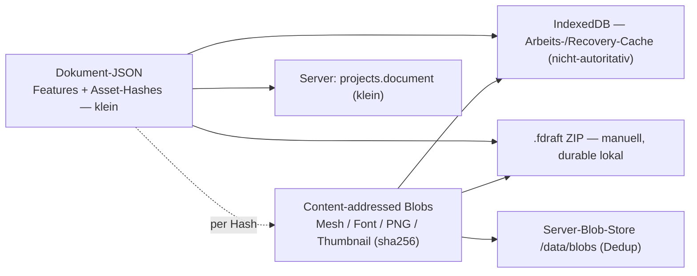

# Projekt-Asset-Speicherung & Persistenz — Plan (SSOT)

Status: Entwurf, 2026-07-10. Diese Datei ist die Single Source of Truth für den
Umbau der Projekt-Persistenz. Entscheidungen unten sind bewusst getroffen
(siehe §4) — Änderungen bitte hier, dann Code.

## 1. Problem

Das Projekt-Dokument ist grundsätzlich der **Feature-Baum** (`kernel.toJson()`):
rein parametrisch nur wenige KB. Aber **binäre Importe landen roh im Dokument**:

- `imported_mesh` speichert `__positions`/`__indices` als **JSON-Zahl-Arrays** in
  der Feature-Definition (`crates/kernel/src/features/imported_mesh.rs`) → in
  `toJson` → im Dokument. JSON-Zahlen sind sogar schlechter als binär
  (~8–10 B/Float statt 4). Ein 100k-Dreieck-Mesh ≈ 2–6 MB im Dokument.
- Fonts liegen als base64 inline im Dokument (`collectProjectAssets` extrahiert
  sie nur für das `.fdraft`-ZIP, nicht für localStorage/Server).
- SVG-Import wird zu Vektor-Sub-Calls (kompakt), ist also unkritisch. Raster/PNG-
  Import existiert derzeit nicht — käme es, gälte dasselbe Muster.

Das Dokument = `serializeProject()` = localStorage-Wert = Server-`document`-Body
= (im ZIP) die `document.json`. Also tragen **alle** Senken die eingebetteten
Meshes. Folgen:

- **localStorage**: Quota ≈ 5–10 MB/Origin gesprengt; `setItem` synchron → Jank;
  Overflow wird in `persistence.ts` verschluckt → Crash-Datenverlust.
- **`.fdraft` (Disk)**: der Lokal-Datei-Spiegel re-zippt bei jedem Autosave das
  ganze (große) Dokument.
- **Server**: jeder Sync schickt das komplette Dokument; große JSON-Zeile in der
  DB; periodischer Cloud-Sync würde Multi-MB/Min pro aktivem User senden.

## 2. Keystone: content-addressed Assets

Große Binär-Assets — importierte Meshes, Fonts, künftig Raster/PNG, und das
**Thumbnail** — werden **content-addressed Blobs** (sha256). Das Dokument
referenziert sie nur per Hash und bleibt damit wieder KB-klein. Die Blobs liegen
dort, wo die durable Wahrheit des jeweiligen Tiers liegt.

## 3. Ziel-Architektur



„Source of Truth" pro Tier:

| Tier | Durable Truth | IndexedDB-Rolle |
|---|---|---|
| **Cloud** | Server (Dokument-Zeile + Blob-Store, Dedup) | optionaler Offline-Cache |
| **Lokal** | manuell gespeichertes **`.fdraft`** (immer gezipped, alle Browser) | Arbeits-/Recovery-Cache |
| **Gast / ungespeichert** | — (inhärent ephemer bis zum ersten Save) | Working-Store |

Auf IndexedDB verlässt sich **niemand** für Durability: es ist nur der
Zwischen-Save-Cache (Reload/Vergessen-zu-speichern kostet nichts). Durable ist
die manuell gespeicherte `.fdraft` bzw. die Cloud.

## 4. Festgelegte Entscheidungen

1. **Content-addressed Assets** (sha256), Dokument referenziert per Hash. Keystone.
2. **Server sauber von Anfang an**: `projects.document` (klein) + **Blob-Store mit
   Dedup** (existierender `/data/blobs`-Store). Kein „embedded, später splitten".
3. **Browser-lokaler Arbeits-Store = IndexedDB** (ersetzt localStorage). GB-Quota,
   async, kein Jank. Nicht-autoritativ.
4. **Durable lokal = manuelles `.fdraft`**, **immer gezipped**, für alle Browser
   gleich (Download/Datei-Picker). Keine browser-spezifischen Disk-Autosaves.
5. **Verworfen**: OPFS, `.fdraft-dir` (lose Disk-Verzeichnisse),
   FSA-Continuous-Autosave (`localFileBridge`, v0.6.459 wird abgelöst).
6. **Cross-Browser-Durability** = Cloud + manuelles `.fdraft`. Browser-lokale
   Durability ist explizit kein Ziel.
7. **Thumbnails** = ein weiterer content-addressed Blob → gelten für alle
   Projekte (Server-Blob für Cloud, IndexedDB für Lokal/Gast).

## 5. Komponenten-Design

### 5.1 Asset-Layer & Hash
- Ein Asset = `{ hash: sha256hex, bytes: Uint8Array, kind }`. `hash` über die
  **rohen Bytes** (Mesh: die konkatenierten `positions`+`indices`-Buffer in fixem
  Layout; Font: die Datei-Bytes; PNG/Thumbnail: die Datei-Bytes).
- Blobs sind **immutable** (per Hash). Schreiben ist idempotent: existiert der
  Hash schon, no-op.
- Eine Client-Abstraktion kapselt die Ablage (§5.3), damit der Rest der App
  backend-agnostisch bleibt.

### 5.2 Asset-Externalisierung an der Serialisier-Grenze (P1, Kernel unverändert)
- **Der Kernel bleibt unverändert** — er nutzt intern weiter `__positions`/
  `__indices`. Die Asset-Trennung passiert rein **JS-seitig** an der `toJson`/
  `loadJson`-Grenze. Das de-riskt P1 (kein Rust-Formatbruch).
- **Save (deflate):** `serializeProject()` holt `toJson` (mit Positions), dann
  extrahiert JS jedes `imported_mesh` (und eingebettete Fonts), legt die Bytes
  als Blob ab und ersetzt sie im **persistierten** Dokument durch
  `__asset: <sha256hex>`. Nur das schlanke Dokument wird persistiert/übertragen.
- **Load (inflate):** JS liest das schlanke Dokument, holt die Blobs per Hash,
  ersetzt `__asset` wieder durch `__positions`/`__indices` und ruft
  `kernel.loadJson` mit dem vollen Dokument.
- Round-trip `inline(externalize(doc)) == doc` ist Pflicht (unit-getestet).
- Legacy-v1-Format (`__mesh`) wird beim Externalisieren mitbehandelt.
- **Spätere Optimierung (nicht P1):** Wenn die `toJson`-CPU für sehr große
  Meshes zum Problem wird, kann der Kernel später direkt den Hash emittieren
  (spart das Serialisieren der Positionen). Für P1 bewusst weggelassen — Ziel ist
  schlanke Persistenz/Übertragung bei minimalem Risiko.

**Fonts** (User-Direktive: als Blob + ins `.fdraft`): importierte Fonts werden
**content-addressed Blobs**, uniform mit Meshes. Sie liegen aber NICHT im
Kernel-Dokument (sie leben in `sketchTextFont.ts` `uploadedBytes`, per `fontId`
referenziert, heute separat via `collectProjectAssets` im ZIP). Daher **nicht**
über die Doc-String-Transform, sondern über einen **Font-Cache→Blob-Pfad**: pro
`fontId` → Bytes aus dem Cache → `sha256` → `writeBlob`; ein `fontId→hash`-
Manifest wird mitpersistiert; beim Laden `readBlob` → Font-Cache wieder füllen.
Gleicher Blob-Store → P2 (Server-Blobs) und P3 (`.fdraft`-Einträge) decken Mesh
UND Font uniform ab (Dedup). In P1 additiv nach dem Mesh-Pfad.

### 5.3 Client-Store-Abstraktion + IndexedDB
```ts
interface AssetStore {
  readDoc(): Promise<string | null>;
  writeDoc(json: string): Promise<void>;
  readBlob(hash: string): Promise<Uint8Array | null>;
  writeBlob(hash: string, bytes: Uint8Array): Promise<void>; // no-op wenn vorhanden
  listBlobs(): Promise<string[]>;      // für GC
}
```
- **IndexedDB-Backend** (Baseline, alle Browser): Object-Stores `doc` (1 Slot,
  wie heute die localStorage-Zeile) und `blobs` (key = hash). `localProjects.ts`
  nutzt IndexedDB schon (für FSA-Handles) → dieselbe DB erweitern.
- Migration: beim ersten Boot alten `fielddraft.project.v2`-localStorage-Eintrag
  nach IndexedDB übernehmen (eingebettete Meshes → in Blobs extrahieren), dann
  localStorage-Eintrag löschen.
- Repro-Tab (`?project=`) behält den Noop-Store (kein Teilen des Origin-Slots).

### 5.4 `.fdraft`-ZIP-Format (manuell, immer gezipped)
- Einträge: `document.json` (Features + Hashes) + `assets/<hash>` (binär) +
  `manifest.json`. Fonts sind schon separat; Meshes kommen als binäre Einträge
  dazu (statt inline im JSON).
- „Speichern" = Download bzw. Datei-Picker (`showSaveFilePicker` auf Chromium als
  Komfort, sonst `<a download>`), „Laden" = `<input type=file>` / Datei-Picker.
- Kein stilles Continuous-Autosave mehr. IndexedDB ist das Netz dazwischen.

### 5.5 Server: Dokument + Blob-Store (Dedup)
- `projects.document` bleibt kleines JSON (Features + Hashes).
- Blobs über den **existierenden content-addressed Store** (`putBlob`/`getBlob`,
  sha256). Neue Endpoints:
  - `PUT /api/blobs/{sha256}` — Upload nur falls fehlend (Dedup); Body = Bytes.
  - `GET /api/blobs/{sha256}` — Download.
  - Optional `POST /api/blobs/missing` — Client fragt, welche Hashes fehlen, und
    lädt nur die hoch (spart Round-Trips beim Sync).
- Auth/Scope wie Projekte (Owner). Größenlimit pro Blob (z.B. 64 MB).
- GC verwaister Blobs serverseitig (Refcount über Projekt-Dokumente oder
  periodischer Sweep) — siehe §6.

### 5.6 Thumbnails
- Ein Thumbnail ist ein Blob (`renderThumbnailBlob`, v0.6.490, existiert).
- Cloud: über den Blob-Store bzw. den bestehenden `PUT
  /api/projects/{id}/thumbnail`. Lokal/Gast: als Blob in IndexedDB, gekeyt per
  Projekt; die `ProjectsBrowser`-Karte liest ihn dort.
- **Kadenz** (bereits diskutiert): Thumbnail nur **beim Verlassen der
  Editor-Ansicht** erzeugen (Throttle ≥30 s) + einmalig nach Anlegen eines neuen
  Projekts. NICHT beim periodischen Doc-Save, NICHT bei `beforeunload`.

### 5.7 Cloud-Auto-Sync (nach P1/P2, wenn Dokument klein ist)
- Trigger, jeweils **nur wenn `syncState === "dirty"`**:
  - **Periodisch**, einstellbar `cloudSyncIntervalMin` (Default 1, 0 = aus).
  - **Exit der Editor-Ansicht** → awaited PATCH (zuverlässig).
  - **`beforeunload`** → `fetch(..., {keepalive:true})` best-effort (~64 KB-Cap;
    localStorage/IndexedDB ist das Netz, falls es durchrutscht).
- No-op-Saves entfallen per `dirty`-Gate. Payload = kleines Dokument + neue
  Blob-Hashes (Blobs vorab per §5.5 hochgeladen).

## 6. Offene Fragen / Risiken

- **GC verwaister Blobs** in allen drei Ablagen (Server, IndexedDB, `.fdraft`):
  Refcount vs. Mark-and-Sweep gegen das Dokument. Für `.fdraft` trivial (beim
  Export nur referenzierte Blobs einpacken).
- **Migration** bestehender Projekte mit eingebetteten `__positions` (localStorage
  + Server-`document`-Zeilen + alte `.fdraft`): Loader erkennt Legacy-Format und
  extrahiert die Vertices beim ersten Laden in einen Blob + Hash-Ref. „Keine
  Backward Compatibility" erlaubt einen harten Schnitt, aber bestehende
  gespeicherte Projekte sollen nicht kaputtgehen → Ein-Weg-Migration beim Laden.
- **Hash-Schema**: sha256hex über welches exakte Byte-Layout des Meshes
  (Endianness, Reihenfolge positions|indices) — festnageln, damit derselbe Mesh
  deterministisch denselben Hash gibt (Dedup).
- **„Lokale Projekte wiederöffnen"** ohne FSA-Handle: nur per Datei-Picker; die
  v0.6.459-„Lokale Projekte"-Liste wird entsprechend angepasst (Chromium darf
  optional FSA-Handles behalten — Bonus, nicht Baseline).
- **Kernel-Format-Bruch** (`imported_mesh`): Schema-Version im Dokument bumpen.

## 7. Phasen

- **P1 — Asset-Layer (Keystone).** `imported_mesh` + Fonts content-addressen
  (§5.2), `AssetStore`-Abstraktion + IndexedDB-Backend (§5.3), localStorage→
  IndexedDB-Migration. Ergebnis: Dokument überall wieder klein. Unabhängig
  wertvoll (fixt Quota + Jank).
- **P2 — Server sauber.** Blob-Endpoints + Dedup (§5.5), kleines Dokument-PATCH,
  Server-GC. Cloud-Load/Save re-inflate über Blobs.
- **P3 — Manuelles `.fdraft` + Cloud-Auto-Sync + Thumbnails.** `.fdraft`-ZIP mit
  Asset-Einträgen (§5.4), FSA-Continuous-Autosave ablösen, Cloud-Auto-Sync (§5.7),
  Thumbnails für alle Tiers (§5.6).

## 8. Non-Goals

OPFS als Store; `.fdraft-dir` (lose Disk-Verzeichnisse); FSA-Continuous-Autosave;
browser-lokale Durability als Garantie. Cross-Browser-Durability läuft
ausschließlich über Cloud + manuelles `.fdraft`.
