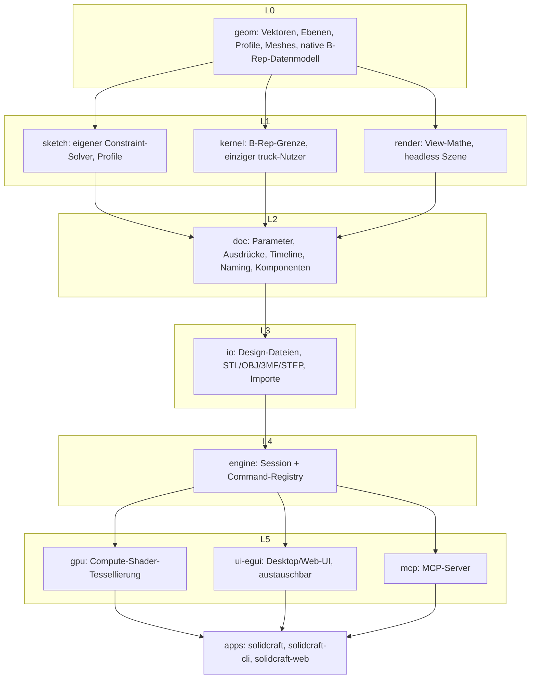
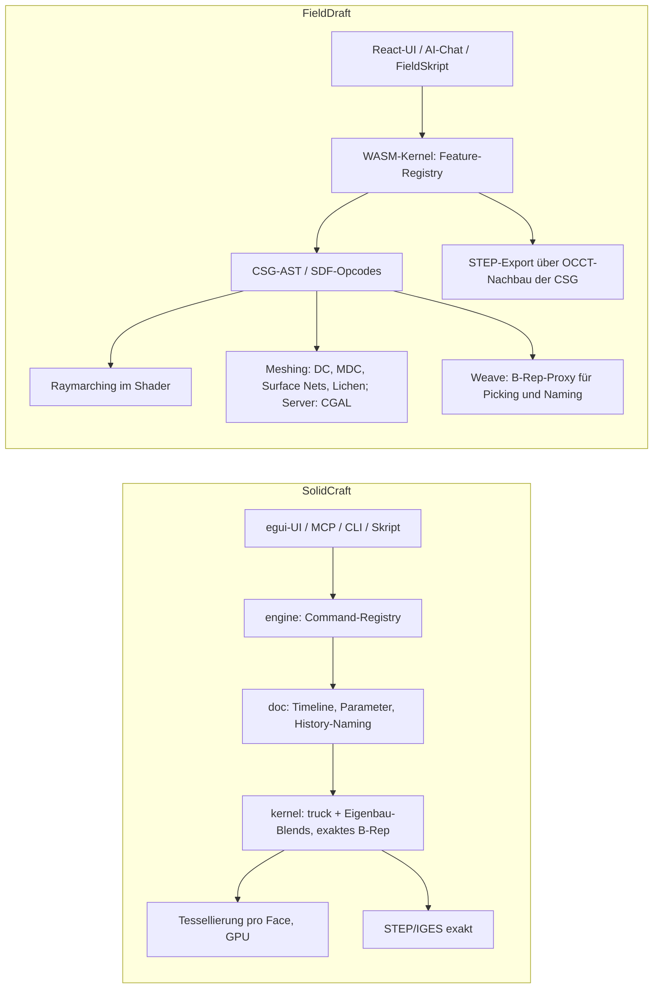
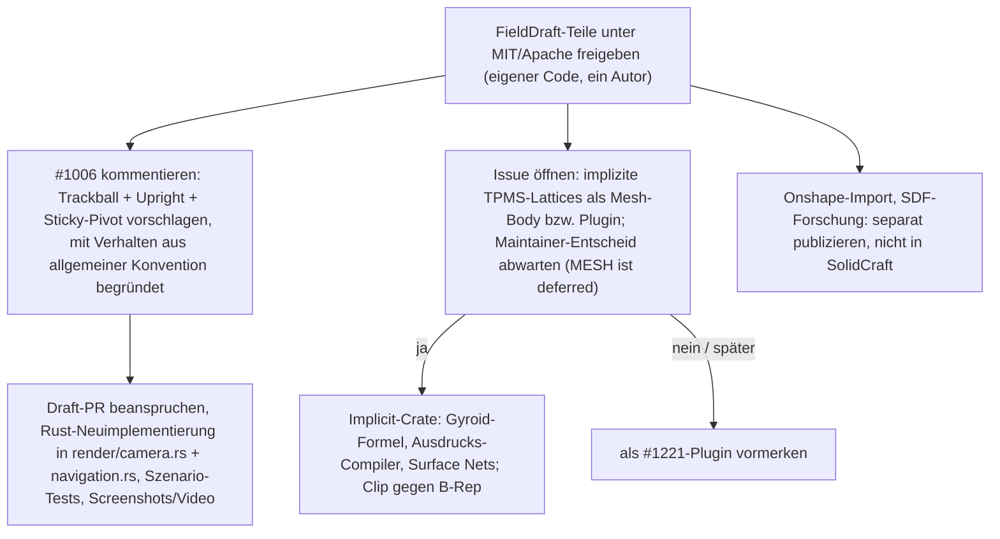

# SolidCraft vs. FieldDraft: Analyse und was sich übertragen lässt

Stand: 2026-10-21. Erstellt aus einem Shallow-Clone von SolidCraft (Stand `main` vom 2026-10-21, nur gelesen, nicht gebaut), GitHub-Metadaten über `gh` und einer Lektüre des FieldDraft-Repos. Unsichere Aussagen sind als solche markiert. Hintergrund der Einstellung: [DISCONTINUED.md](DISCONTINUED.md).

> **Nachtrag 2026-10-21:** FieldDraft steht inzwischen unter **MIT OR Apache-2.0** (`cgal-mesher/` unter GPL-3.0-or-later, Drittkomponenten in `THIRD_PARTY.md`). Die Lizenz-Befunde unten beschreiben den Stand vor der Veröffentlichung.

## 1. Kurzfazit

- **SolidCraft** ist in kurzer Zeit zu einem sehr breiten B-Rep-CAD herangewachsen: rund 448 000 Zeilen Rust, etwa 5 850 `#[test]`, 84 Oracle-Referenzteile, Desktop, Web (WASM), CLI und MCP. Gebaut wird es überwiegend von KI-Agenten unter einem Maintainer (bherbruck). Die Community ist groß (8 840 Sterne, 142 Contributors), die offene Last ebenfalls (1 706 offene Issues, 1 063 davon mit Label `bug`, 484 offene PRs).
- **Die Kernel-Arbeit ist dort gerade eingefroren.** Laut CONTRIBUTING.md („Kernel work is paused") und Issue #1597 wird der truck-basierte Kernel durch **solidcore** ersetzt, einen Rust-Port von NVIDIAs SMLib (Apache-2.0). Er ist zu etwa einem Drittel bis 62 % portiert und noch nicht end-to-end nutzbar. Beiträge zu Booleans, Fillets, Shell, STEP und Tessellierung werden derzeit nicht angenommen.
- **Harte Hürden für FieldDraft-Beiträge:**
  1. SolidCraft verbietet ausdrücklich, kommerzielle CAD-Produkte (namentlich Onshape) zu automatisieren oder Daten aus ihnen zu extrahieren. Damit fällt FieldDrafts **Onshape-Import als Beitrag weg**, ebenso alle Onshape-abgeleiteten Testfixtures.
  2. SolidCraft verlangt Clean-Room gegenüber GPL/LGPL/AGPL-Code („not even reading it"). FieldDraft ist im Cargo-Workspace als `AGPL-3.0-or-later` deklariert und hängt an PlaneGCS (LGPL, FreeCAD-Herkunft), opencascade.js/occt-import-js (LGPL) und CGAL Mesh_3 (GPL) im Server-Mesher.
  3. SolidCraft-Beiträge müssen MIT OR Apache-2.0 sein.
- **Lizenzlage bei FieldDraft:** Es gibt **keine LICENSE-Datei**. Nur `Cargo.toml` deklariert `license = "AGPL-3.0-or-later"`, die README sagt „Lizenz: offen". Alle 1 828 Commits stammen von einem Autor (Sebastian Baltes). Er kann eigenen Code also für einen Beitrag unter MIT/Apache neu lizenzieren. Das gilt nicht für den Code, der an LGPL/GPL-Abhängigkeiten gebunden ist.
- **Realistisch übertragbar** ist wenig Code, aber einige **Konzepte und Features**:
  1. Kamera-Navigation (Quaternion-Trackball): trifft das offene Issue #1006.
  2. Implizite/TPMS-Lattice-Features (Gyroid, Custom-SDF): SolidCraft hat dafür nichts. Mesh-Workflows sind dort bis auf Weiteres zurückgestellt („deferred"), der Beitrag bräuchte also vorab Zustimmung des Maintainers.
  3. Erfahrungen aus FieldSkript für das Plugin-Design #1221.
- Der Onshape-Import und das SDF-Wissen (Metrizität, Mesher) sind besser als **eigenständige Veröffentlichung** aufgehoben, nicht als SolidCraft-Beitrag.

## 2. SolidCraft im Detail

### 2.1 Projekt und Community

| Kennzahl | Wert | Quelle |
|---|---|---|
| Repo | github.com/tangency-labs/solidcraft (vorher bherbruck/solidcraft, ab v0.15.0 umgezogen; Repo unter tangency-labs angelegt am 2026-10-07) | `gh repo view`, newreleases.io |
| Lizenz | MIT OR Apache-2.0; Beiträge automatisch ebenso („By contributing you agree…"); **kein CLA** | README.md, CONTRIBUTING.md §Licence |
| Sterne / Forks / Watcher | 8 840 / 1 038 / 74 | `gh repo view` (2026-10-21) |
| Contributors | 142; bherbruck 813 Commits, danach jyviko 106, NOWN-DEV 94 … | `gh api …/contributors` |
| Issues | 1 706 offen / 776 geschlossen; 1 063 offene mit `bug`; 53 offene mit `kernel-paused` | GitHub Search API |
| PRs | 484 offen / 1 283 gemergt | GitHub Search API |
| Releases | v0.1.0 am 2026-10-09 (damals „SolveCraft"), v0.18.4 am 2026-10-21; oft mehrere Releases pro Tag plus Nightlies | `gh release list` |
| Umfang | ca. 448 000 Zeilen Rust in `crates/` (ui-egui 132 k, engine 104 k, kernel 95 k, doc 49 k, sketch 24 k) | `wc -l` |
| Tests | ca. 5 850 `#[test]`, 115 UI-Szenarien (`crates/ui-egui/tests/scenarios`), 84 Oracle-Fälle (`tests/oracle`) | grep / ls |
| Medien | Hackaday 2026-10-17 (Donald Papp): „parametric, automation-friendly CAD"; in den Kommentaren viel „vibe coded"-Skepsis und Fragen zur Wartbarkeit | https://hackaday.com/2026/10/17/solidcraft-is-parametric-automation-friendly-cad-for-desktop-and-browser/ |

Die Entwicklung ist ausdrücklich agentengetrieben: „Much of SolidCraft so far was written by AI coding agents (Claude) working in parallel" (CONTRIBUTING.md). Die Prozesse sind darauf ausgelegt. Ein Issue wird über einen Draft-PR beansprucht, ein Bot vergibt Labels und Claims, dazu kommen Merge-Queue, `approved-for-ci`-Gate und Format-Änderungen als je eine eigene Datei, damit es keine Konflikte gibt.

### 2.2 Schichten

Quelle: `docs/architecture.md`, AGENTS.md. Die Schichtung wird durch `cargo xtask layers` erzwungen.

Leitprinzipien aus AGENTS.md:

- **„Everything is a command":** 171 Dateien in `crates/engine/src/cmd`, jeder Befehl ein `CommandSpec` mit JSON-Parametern. Toolbar, Skripte, CLI, Control-Channel und MCP nutzen denselben Pfad.
- **„Never crash":** keine `unwrap`/`panic`/`unsafe` in Produktivcode. Jeder truck-Aufruf läuft über `solidcraft_kernel::guard` (Panic wird zu Error). `Session::execute` steht unter `catch_unwind`. Es gibt Crash-Reports mit Replay.
- **WASM darf nie brechen:** alles unterhalb der Apps baut für `wasm32-unknown-unknown`.

### 2.3 Kernel: truck, Patches, Eigenbau

- **Basis ist truck** (ricosjp, Apache-2.0). Gepatchte Kopien von `truck-shapeops`, `truck-geometry`, `truck-meshalgo` und `truck-stepio` liegen in `vendor/` und sind dort in `vendor/README.md` dokumentiert. Es geht vor allem um Boolean-Robustheit:
  - Fallbacks für die Projektion von Schnittkurven,
  - deterministische Reihenfolge der Faces,
  - Ray-Parität für Voids,
  - eine neue **Face-/Edge-History** (`and_with_history`/`or_with_history`) als Grundlage des Persistent Naming.
- **Eigene Implementierungen** in `crates/kernel/src` (151 Dateien), weil truck keine Fillets hat:
  - Fillet/Blend (`blend*.rs`, variabler Radius, Ecken, G2-Ecken-Patch),
  - Chamfer, Shell/Offset (`offset.rs`, `surface_offset.rs`), Draft, Delete/Split Face, Heal,
  - Loft mit Rails, Boundary-/Gordon-Flächen, Emboss, Helix,
  - IGES ein/aus, eigene Tessellierung (`tess/cdt.rs`).
- **Bekannte Schwächen** (CONTRIBUTING „Where help is wanted"): Fillet-Robustheit (Setback-Ecken, Fillets zwischen gekrümmten Flächen), Boolean-Robustheit („a random-design fuzzer currently gets about half of its designs through without a kernel error"), Geschwindigkeit. Die neuesten Issues sind zu großen Teilen „FILLET/LOFT: operation failed".
- **Nachfolger solidcore** (https://github.com/bherbruck/solidcore, Apache-2.0, 144 Sterne): Rust-Port von NVIDIA SMLib aus USD BRep, das Ziel ist numerische Gleichheit mit dem C++-Original bis 1e-9. Laut README ist es „about a third ported … nothing is usable end to end yet". Issue #1597 nennt etwa 62 % der Units (Stand 16. Oktober). **Bis zur Umstellung ist Kernel-Arbeit an SolidCraft pausiert.**

### 2.4 Weitere Subsysteme

| Thema | Befund | Beleg |
|---|---|---|
| Constraint-Solver | **Eigenbau** ohne externe Abhängigkeit (crate `sketch` hängt nur an geom/serde/thiserror/ttf-parser). Konstruktive Lösung nach Owen 1991 und Fudos-Hoffmann 1997 vor Levenberg-Marquardt; Freiheitsgrade aus dem Jacobi-Rang; Überbestimmung wird abgelehnt | `crates/sketch/src/{construct,solver,decompose}.rs`, docs/capabilities.md |
| Topological Naming | Namen folgen der **vom Kernel gemeldeten History** (kein Sampling): `F<feature>:side:<curve>`, `:blend:<edge>`, `@F<pattern>.<i>`. Lässt sich eine Referenz nicht exakt auflösen, gibt es eine Warnung statt einer Raterei. Lücken bei Sheet-Metal/Plastic/Surface-History (ROADMAP M5) | `docs/book/src/dev/naming.md`, `crates/doc/src/lineage.rs`, `history_names.rs` |
| Dateiformat | `.solidcraft`-Container (JSON plus binäre Mesh-Caches), versioniert `solidcraft/N` mit Migrationsschritten; native B-Rep-Kodierung „schema 3" als Modell-Cache | docs/native-brep.md, docs/design-container.md, CONTRIBUTING §format |
| Import | STEP AP203/214/242 und IGES als Basis-Feature (B-Rep). FreeCAD `.FCStd` und Rhino `.3dm` über **cadmpeg** (nur Desktop und CLI). 3MF/STL/OBJ/glTF als Mesh-Bodies, die Solid-Features ablehnen. `mesh.convert` für Teile mit konstantem Querschnitt. DXF/SVG in Sketches. **Kein Onshape-Import**, und er ist nach den Regeln auch unzulässig | docs/capabilities.md, docs/step-import.md, deny.toml |
| Export | STEP AP242 (Baugruppen, Farben), IGES 5.3, 3MF (mit Face-Tags), STL, OBJ, URDF, DXF (Flat Pattern, View) | docs/capabilities.md |
| Tessellierung/Rendering | Eigener Tessellierungs-Planer pro Face in (u,v), wasserdicht über geteilte Kantenknoten. Auswertung per GPU-Compute (`crates/gpu`), egui + wgpu, optional AO und PBR-Vorschau, CPU-Render-Jobs | docs/capabilities.md, docs/render-*.md |
| Kamera | yaw/pitch/roll-Orbit mit **geklemmter Pitch** (`crates/render/src/camera.rs` `orbit()`: `pitch.clamp(-lim, lim)`), Presets (SolidWorks, Blender, Touchpad …), eine zentrale `navigation::handle`. Issue **#1006 (offen, P2)** verlangt „classic trackball" als Standard | `crates/render/src/camera.rs:314`, `crates/ui-egui/src/navigation.rs` |
| Parameter | Einheitenbewusste Ausdrücke, Abhängigkeitsgraph, Zyklen mit Pfad, Umbenennen folgt den Referenzen, CSV/JSON-Import, Konfigurationstabellen (M14) | ROADMAP §Scope 2, M14 |
| Assemblies | Komponenten/Occurrences, 7 Gelenktypen, geschlossene Kinematik-Schleifen, Nocken, Motion Studies, Contact Sets, Interferenz, URDF | ROADMAP M9 |
| Agent-Schnittstelle | MCP-Server (stdio, headless oder `--connect` an die laufende App), JSON-Skripte, Control-Protocol per TCP mit Token, Browser-Command-API, Agent-Chat-Panel mit lokalen Coding-Agents | docs/mcp.md, docs/agent-chat.md, docs/control-protocol.md |
| Plugins | Design-Doc für WASM-Komponenten-Plugins (WIT, `run(command,args)`), parametrische Plugin-Features geplant (#1221); **Umsetzungsstand unklar** | docs/plugins.md |
| Tests | Unit- und Engine-Tests, UI-Szenarien (JSON), Oracle (analytisch oder **FreeCAD als externer Prozess**), Robustness-Goldens (96 Seeds), Action-Matrix-Ratchet, Hostile-Input-Fuzz über alle Commands, Mutation-Testing | CONTRIBUTING §Tests |
| Contribution-Regeln | Claim per Draft-PR, ein Thema pro PR, Screenshots/Video Pflicht bei sichtbaren Änderungen, `cargo xtask ci`, keine GPL-Lektüre, keine kommerziellen CAD-Daten, Assets mit Attribution, **kein CLA** | AGENTS.md, CONTRIBUTING.md |
| Roadmap/Lücken | Bewusst zurückgestellt: MESH, FORM (T-Splines), erweiterte Surface-Features, Drawings (M11), CAM, Simulation. Ein Release-Signing gibt es noch nicht | ROADMAP.md |

## 3. FieldDraft im Detail

| Kennzahl | Wert | Quelle |
|---|---|---|
| Ansatz | Browserbasiertes parametrisches CAD auf **SDF**-Basis: CSG-AST, Raymarching (Three.js TSL/WebGPU) und Meshing. Daraus wird für Picking und Naming ein B-Rep-Proxy „gewoben". Vorbild ist Onshape, Ziel FDM/SLA-Druck | README.md, docs/ARCHITECTURE.md §1 |
| Stack | Rust-Kernel → WASM (crates protocol, kernel, solver, features-macros, metricity-lab); React 19/TS/Vite/R3F; Go-Server mit MariaDB (Auth, Sync, Galerie, Mesh-Jobs, IssueVault-Tickets, AI-Chat-Proxy); nativer CGAL-Server-Mesher (C++) | docs/ARCHITECTURE.md §1–5, `cgal-mesher/README.md` |
| Umfang | ca. 195 000 Zeilen Rust, ca. 96 000 Zeilen TS/TSX ohne Tests, ca. 13 000 Zeilen Go | `wc -l` |
| Tests | ca. 1 760 Rust-`#[test]`, ca. 2 100 Vitest-Fälle in 222 Testdateien, 51 Playwright-Dateien (echte GPU) | grep |
| Version / Historie | v0.66.4; 1 828 Commits, **ein einziger Autor**, 2026-04-09 bis 2026-09-11 (letztes Commit-Datum laut `git log -1`) | git |
| Lizenz | **keine LICENSE-Datei**; `Cargo.toml` deklariert `AGPL-3.0-or-later`; README §8 (damals): „Lizenz: offen"; inzwischen MIT OR Apache-2.0 | Cargo.toml:14, README.md:326 ff. |
| Lizenz-Abhängigkeiten | PlaneGCS (LGPL-2.1+, aus FreeCAD), opencascade.js und occt-import-js (LGPL-2.1, OCCT), CGAL Mesh_3 (GPL-3, nur im separaten Container), fidget (MPL-2.0); sonst permissiv (nalgebra, spade, cavalier_contours, fast-surface-nets, baby_shark …) | web/package.json, crates/kernel/Cargo.toml |

Feature-Kinds laut `crates/kernel/src/features/`: Primitive, extrude, revolve, sweep, loft, helix, hole (inkl. ISO), fillet/shell, chamfer, thicken, offset, boolean, patterns/mirror/transforms, **gyroid (TPMS-Infill)**, **custom_sdf (Formel-Implicit)**, mate_connector, material, imported_mesh.

Bekannte Sackgassen, belegt in den Docs:

- **Booleans auf SDFs ergeben kein metrisches Feld.** docs/research/sdf-metricity/SYNTHESIS.md unterscheidet Normfehler, die lokal korrigierbar sind, von Fußpunktfehlern, bei denen das Feld lokal das perfekte SDF einer falschen Fläche ist und gradientenbasiert unsichtbar bleibt. Harte Booleans sind nur seitenselektiv exakt.
- **Fillets:** Der `smin`-Blend wirkte nicht an Kanten eines einzelnen Primitivs (#406) und verschliff Ecken (#383). Der Umbau auf analytische harte Cutter ist in P1 und P2 umgesetzt, P3 bis P6 sind offen (docs/FILLET-CUTTER-PLAN.md).
- **Onshape-Import:** Er funktioniert breit (BTON-Decoder 697/697, 11 Feature-Typen, Variablen, Muster, Mate-Connector-Ebenen), ist aber nicht fehlerfrei. Lange Abweichungslisten pro Dokument stehen in docs/ONSHAPE-IMPORT-GAP-MATRIX.md (3 983 Zeilen), z. B. 90°-Rotationen, Versatzfehler und fehlende Typen wie transform, deleteBodies, cPlane und sweep-Verdrahtung.

## 4. Architektur-Gegenüberstellung

Der Kernunterschied: SolidCraft rechnet **exakte Randdarstellung** und tessellisiert nur für die Anzeige. FieldDraft rechnet ein **implizites Feld** und muss die Randdarstellung nachträglich rekonstruieren: Kanten werden gewoben, Flächen klassifiziert, Meshes mit Feature-Snap erzeugt. Fast alle FieldDraft-Mühen (Weaver, Naming über Branch-IDs, Fillet-Cutter, Metrizität, Mesher-Kantentreue) sind Kosten dieser Rekonstruktion. SolidCraft bekommt dieselben Dinge strukturell geschenkt und kämpft dafür mit der klassischen B-Rep-Robustheit (Schnittkurven, Toleranzen, Fillet-Sonderfälle).

## 5. Vergleich Feature für Feature

| Bereich | SolidCraft | FieldDraft | Bewertung |
|---|---|---|---|
| Sketch | Linien, Bögen, Splines (NURBS), Kegelschnitte, Text, Offset, Trim, Muster, Projektion assoziativ, 3D-Sketch | Linie, Rechteck, Kreis, Bogen, Polygon, Trim, Mirror, Offset, B-Spline, assoziative Kantenprojektion, Text (opentype.js) | SolidCraft breiter |
| Constraints | eigener Solver (konstruktiv + LM), Krümmung G2, Überbestimmungs-Ablehnung | PlaneGCS (LGPL) mit eigener Adapter-Schicht (Inference, Drag, DoF-Preflight) | SolidCraft lizenzrein und eigenständig; FieldDrafts Solver ist für SolidCraft tabu |
| Features | sehr breit inkl. Draft, Split, Rib/Web, Gewinde modelliert, Surface-Workspace, Sheet Metal, Plastic | Kernmenge plus Gyroid und Custom-SDF; Teil-Revolve fehlt (laut Gap-Matrix) | SolidCraft klar überlegen, außer bei impliziten Features |
| Booleans | exakt (B-Rep), aber fragil (Fuzzer: ca. 50 % fehlerfrei) | Mengen-robust (min/max scheitern nie), aber kein metrisches SDF, Kanten nur rekonstruiert | unterschiedliche Fehlerbilder; FieldDraft „scheitert nie", liefert aber unpräzise Geometrie |
| Fillets | eigene Rolling-Ball-Blends, variabel, Ecken; Robustheitslücken | smin (verworfen), dann harte Cutter (P1/P2) | SolidCraft deutlich weiter |
| Offset/Shell | B-Rep-Offset, Shell innen/außen/beidseitig | SDF-Offset ist trivial (`f - r`), Shell ebenfalls; Offset-Tree-Forschung | hier ist SDF prinzipiell stark, solange das Feld metrisch ist, und das ist nach Booleans eben nicht garantiert |
| Lattices/TPMS | nicht vorhanden; MESH/FORM zurückgestellt | Gyroid-Infill, Custom-SDF per Formel | **FieldDrafts einziges echtes Alleinstellungsmerkmal** |
| Import | STEP/IGES exakt, FreeCAD/Rhino via cadmpeg, Mesh-Formate | STEP nur tessellisiert (occt-import-js), **Onshape parametrisch per REST** | Onshape-Import ist bei SolidCraft unzulässig |
| Export | STEP AP242, IGES, 3MF, STL, OBJ, URDF, DXF | STL, 3MF, STEP (CSG-Nachbau in OCCT) | SolidCraft überlegen |
| Assemblies | voll (Gelenke, Kinematik, Motion Studies) | Mate-Connectors, einfaches Frontend-Assembly-Modell (`web/src/assembly.ts`) | SolidCraft überlegen |
| Plattform | Desktop (Win/macOS/Linux), Web (egui/wgpu), CLI | nur Web, plus optionaler Go-Server mit Multi-User-Sync | FieldDraft hat Server-Features (Accounts, Galerie, Sync), die SolidCraft nicht hat und nicht anstrebt |
| Agent-Schnittstelle | MCP, Skripte, Control-Protocol, Agent-Chat mit lokalen CLIs | In-App-AI-Chat (AI SDK, mehrere Provider), FieldSkript-Skripte, Ticket-Agenten-Loop über IssueVault | SolidCraft systematischer (alles ist ein Command) |
| Tests | ca. 5 850 Tests, Oracle, Fuzz, Goldens, Action-Matrix | ca. 3 900 Tests inkl. Real-GPU-Playwright, viele Onshape-Fixtures | SolidCraft systematischer; FieldDrafts Fixtures sind dort unzulässig |
| Reife und Ressourcen | 142 Contributors, viele Releases, aber über 1 000 offene Bugs | ein Entwickler plus Agenten, nicht in Produktion | SolidCraft klar überlegen |

## 6. Übertragbarkeit: Kandidaten einzeln

Für alle Kandidaten gilt Folgendes:

- **Lizenz:** FieldDraft hat nur einen Autor, also ist eine Neulizenzierung eigener Teile unter MIT OR Apache-2.0 möglich.
- **Clean-Room:** SolidCraft verlangt, dass Beitragende GPL-Code nie gelesen haben. FieldDraft *nutzt* PlaneGCS, OCCT und CGAL über deren APIs. Ob dabei je Quellcode gelesen oder adaptiert wurde, lässt sich hier nicht feststellen (**unsicher**). Sauber ist daher eine **Neuimplementierung in Rust aus der Beschreibung bzw. der Mathematik**, nicht das Kopieren von FieldDraft-Dateien, die an diese Bibliotheken angrenzen. Beim Beitrag sollte die Herkunft offen benannt werden.
- **Kernel-Pause:** Alles, was `crates/kernel` berührt, wird derzeit nicht angenommen (label `kernel-paused`).

### Priorisierte Liste

| Rang | Kandidat | Was (Pfade) | Passung | Aufwand | Hindernisse | SolidCraft hat schon? |
|---|---|---|---|---|---|---|
| **1** | **Trackball-Kamera mit Upright-Modus und Sticky-Pivot** | `web/src/onshapeControls.ts` (563 Zeilen, TS/three.js): Quaternion-Akkumulation ohne Pol-Klemme, `free` vs. `upright` (Alt), Pivot rezentriert auf die Bounding-Sphere, solange sie in den Viewport passt | Gut. Gehört in `crates/render/src/camera.rs` (heute yaw/pitch/roll mit Pitch-Klemme) und `crates/ui-egui/src/navigation.rs` als weitere Orbit-Art. Löst **#1006 (offen, P2)** direkt | klein bis mittel (ca. 1–3 Agententage inkl. Tests und Szenarien); Code muss in Rust **neu geschrieben** werden | Nicht als „Onshape-Verhalten" framen (Regel „Independent"). Begründen mit dem öffentlichen Trackball-Taxonomie-Artikel aus #1006 und allgemeiner CAD-Konvention. Kamera-Datenmodell (yaw/pitch) ändert sich, betrifft Dateiformat/Views (**unsicher**, ob die Kamera persistiert wird). Zuerst in #1006 abstimmen, dann per Draft-PR beanspruchen | nein (nur Orbit-Presets, kein freier Trackball) |
| **2** | **Implizite Lattice-/TPMS-Features (Gyroid, Formel-Implicit)** | `crates/kernel/src/features/gyroid.rs`, `custom_sdf.rs`, `sdf_expr.rs` (Ausdruck→Tape, 699 Zeilen), Mesher `surface_nets.rs`, `dc.rs`, `mdc_adaptive.rs` (Rust, wasm-tauglich; Abhängigkeiten fast-surface-nets und ndshape, beide MIT/Apache) | Mittel. SolidCraft hat Mesh-Bodies, aber „B-rep features refuse them". Sinnvoll wäre ein eigenes Implicit-Crate (L1), das eine TPMS-Struktur gegen einen B-Rep-Body clippt (Inside-Test bzw. Distanz zum B-Rep nötig) und als Mesh-Body ausgibt, zum Beispiel für 3MF-Druckexport | groß (Wochen): Distanz/Inside zum B-Rep, Meshing in Druckqualität, UI, Tests | ROADMAP stellt MESH ausdrücklich zurück, also erst per Issue Zustimmung des Maintainers holen. Gehört eher in den Plugin-Pfad (#1221), sobald parametrische Plugins existieren. FieldDrafts SDF-Code hängt am eigenen CSG-AST und lässt sich nur in Teilen übernehmen (Gyroid-Formel, Ausdrucks-Compiler, Surface Nets) | nein (keine Lattices, keine Implicits) |
| **3** | **Erfahrungen aus FieldSkript in die Plugin-Architektur (#1221)** | `docs/FIELDSKRIPT-CONCEPT.md`, `web/src/fieldskript/`, `workerScriptHost.ts`, `aichat/guardPolicy`: laufzeit-definierte Features mit Schema→Dialog und gesandboxtem Worker | Konzeptionell gut (SolidCraft plant parametrische Plugin-Features), technisch nicht: FieldDraft ist JS im Worker, SolidCraft setzt auf WASM-Komponenten mit WIT | klein (Review-Kommentar, Design-Feedback) | keine Code-Übernahme; die Sandbox-Erfahrungen (Guard-Policy, Fehlerbilder) als Diskussionsbeitrag | Design-Doc vorhanden, Stand unklar |
| 4 | Testdisziplin „echtes Endergebnis prüfen" / Real-GPU-E2E | `web/tests/` (Playwright), Memory-Regel „user-sichtbares Ergebnis validieren" | gering; SolidCraft hat Szenarien, Oracle und Screenshot-Pflicht bereits | – | Playwright ist für egui-WASM kaum sinnvoll | weitgehend ja |
| 5 | Variablen-/Formelsystem | `crates/kernel/src/expr.rs`, `web/src/variableInput.ts` | nicht nötig | – | SolidCraft ist hier weiter (Einheiten, Konfigurationen, Abhängigkeitsgraph). Höchstens Ideen für offene UX-Issues wie #4071 (Parameter inline definieren) oder #2366 (Ausdrücke im Sketch-Dimension-Input); ob FieldDraft das inline kann, ist **ungeprüft** | ja |
| 6 | Ticket-/Agenten-Workflow (IssueVault, `needs_info`-Requeue, Agenten-Stempel) | `server/agent.go`, `server/tickets_state.go`, `agents/` | gering | – | SolidCraft hat Triage-Bot, Claim-Bot, `needs-info`-Automatik, In-App-Report und Crash-Replay. IssueVault ist FieldDraft-spezifische Infrastruktur | ja, in anderer Form |
| 7 | Mesher (Lichen, MDC, Feature-Snap, CGAL-Server) | `crates/kernel/src/lichen*.rs`, `mesher_*.rs`, `cgal-mesher/` | **nicht übertragbar** für B-Rep, denn SolidCraft tessellisiert exakt pro Face. Nur relevant als Teil von Kandidat 2 | – | CGAL ist GPL und fällt unter das Lese- und Linkverbot | eigener B-Rep-Tessellierer |
| 8 | **Onshape-Import** (REST/HMAC, BTON-Decoder, Query-Mapping) | `web/src/onshape/*` (ca. 15 700 Zeilen TS inkl. Tests), `server/onshape.go`, `web/scripts/onshapeFetch.mjs` | **nicht übertragbar** | – | AGENTS.md verbietet ausdrücklich: „must not drive, script, automate or extract data from commercial CAD products (Fusion, SolidWorks, Onshape, …)". Zusätzlich ist das Query-Mapping an FieldDrafts SDF-Naming gebunden (`qFace`, Branch-IDs), und die Fixtures sind Onshape-Exporte | nein, bewusst nicht |
| 9 | Kamera-Bridges, Sketch-in-3D, Overlays, Render-Pfade (Three.js/WebGPU) | `web/src/*Bridge.ts`, Raymarcher | **nicht übertragbar**: andere UI-Technik (egui/wgpu) und SDF-Raymarching ohne Gegenstück | – | – | – |
| 10 | Fillet-/Boolean-Know-how | docs/FILLET-CUTTER-PLAN.md, sdf-metricity | **nicht übertragbar**: SDF-spezifisch, außerdem gilt die Kernel-Pause | – | – | eigene B-Rep-Blends |

### Was stattdessen der Community nützen könnte

Das liegt außerhalb von SolidCraft und ist eine Empfehlung, keine Faktenlage.

- **FieldDraft selbst veröffentlichen.** Sinnvoll als eigenes Repo mit expliziter `LICENSE`. AGPL-3.0 ist mit den GPL/LGPL-Abhängigkeiten verträglich; ein CGAL-Container unter GPL-3 neben AGPL-3 ist kompatibel. Vorher prüfen:
  - Secrets: `.env`, `web/.onshape.local.json` und IssueVault-Tokens sind laut Doku gitignored; die History sollte trotzdem gescannt werden.
  - Die Onshape-Fixtures in `web/src/onshape/fixtures` und `crates/kernel/src/testdata` stammen aus eigenen Onshape-Dokumenten. Ob deren Veröffentlichung mit den Onshape-Nutzungsbedingungen vereinbar ist, ist **unsicher** und sollte vorher geprüft werden.
  - Den Status „eingestellt" klar kennzeichnen.
- **SDF-Forschung als Text veröffentlichen.** Die Metrizitäts-Synthese (Norm- vs. Fußpunktfehler, seitenselektive Exaktheit harter Booleans) ist als Artikel oder Report für die SDF-CAD-Community (libfive, fidget, Implicit-CAD) wertvoller als jeder Codebeitrag.
- **Onshape-BTON-Decoder als eigenständige kleine Bibliothek.** Möglich, weil er nur eigene Dokumente über die öffentliche REST-API liest. Ob das mit den Onshape-Bedingungen vereinbar ist, ist **unsicher**. Für SolidCraft ist er tabu.
- **SolidCraft als Nutzer helfen.** Reproduzierbare Bug-Reports mit Datei (`kernel-perf`-Fälle werden laut #1597 zu Testfällen für solidcore), Oracle-Fälle mit analytischen Erwartungswerten, Arbeit außerhalb des Kernels (UI, Sketch, Doku).

## 7. Empfohlener Weg zu einem SolidCraft-Beitrag

## 8. Quellen

- SolidCraft-Repo: https://github.com/tangency-labs/solidcraft, gelesen: README.md, AGENTS.md, CONTRIBUTING.md, ROADMAP.md, docs/architecture.md, docs/capabilities.md, docs/native-brep.md, docs/book/src/dev/naming.md, docs/mcp.md, docs/agent-chat.md, docs/plugins.md, vendor/README.md, crates/*/Cargo.toml, crates/render/src/camera.rs, crates/ui-egui/src/navigation.rs, crates/kernel/src/meshbody.rs, deny.toml
- Issues: #1597 (Kernel-Roadmap/solidcore), #1006 (Orbit-Stil), #1221 (Plugins), #4071, #2366; Labels `kernel-paused`, `bug`
- solidcore: https://github.com/bherbruck/solidcore, Fortschritt: https://tangency-labs.github.io/solidcore/
- Hackaday, 2026-10-17: https://hackaday.com/2026/10/17/solidcraft-is-parametric-automation-friendly-cad-for-desktop-and-browser/
- Release-Historie und Umzug: https://newreleases.io/project/github/tangency-labs/solidcraft/release/v0.15.0
- FieldDraft: README.md, Cargo.toml, web/package.json, docs/STATUS.md (Stand 2026-05-27, veraltet), docs/ARCHITECTURE.md, docs/ROADMAP.md, docs/WHY-NOT-ONSHAPE.md, docs/ONSHAPE-IMPORT-PLAN.md, docs/ONSHAPE-IMPORT-GAP-MATRIX.md, docs/ONSHAPE-IMPORT-STATE.md, docs/FILLET-CUTTER-PLAN.md, docs/research/sdf-metricity/SYNTHESIS.md, cgal-mesher/README.md, web/src/onshape/onshapeQuery.ts, web/src/onshapeControls.ts, web/src/assembly.ts, crates/kernel/src/features/{gyroid,custom_sdf}.rs
