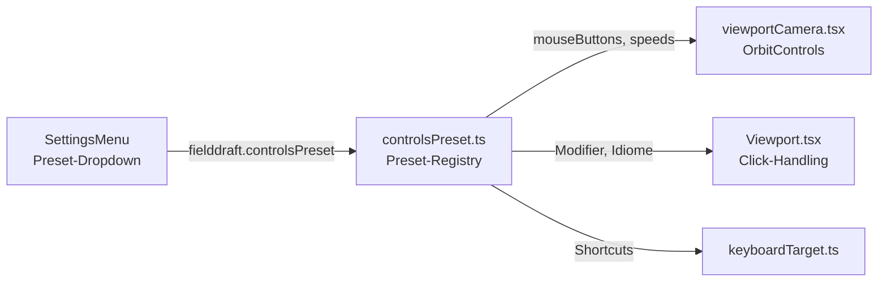

# UX-Presets — Maus- und Tastatursteuerung anderer CAD-Programme

Stand: 2026-06-10 — **umgesetzt in v0.6.21** (Registry `web/src/controlsPreset.ts`,
Setting `fielddraft.controlsPreset`). Was bewusst noch fehlt, steht unter
„Offene Punkte" am Ende.

Konzept aus Ticket 20260610-085906-evq2: Anwender bringen
Steuerungs-Gewohnheiten aus ihrem bisherigen Programm mit. Ein Preset-System
soll die wichtigsten Schemata per Setting abbilden: **Three.js-Editor,
Onshape, FreeCAD, Fusion 360, TinkerCAD** (plus FieldDraft-Default).

## Ist-Zustand

- Kamera: `@react-three/drei`-`OrbitControls` in `web/src/viewportCamera.tsx`
  mit den drei-Standardbindings (LMB Orbit, RMB Pan, Wheel Zoom) und festen
  Speeds. Im Sketch-Modus eine zweite, rotationsfreie Instanz.
- Selektion (seit evq2): Klick selektiert Vertex/Kante/Fläche
  (Spezifischeres gewinnt: Vertex > Kante > Fläche), zweiter Klick auf die
  selektierte Fläche eskaliert zum Körper. Shift/Ctrl/Cmd = Multi-Select.
  Entscheidungslogik zentral in `resolveElementClick`
  (`web/src/elementQuery.ts`).
- Settings: einzelne `localStorage`-Keys (`fielddraft.*`), UI in
  `web/src/SettingsMenu.tsx`. Es gibt noch kein Bündel-/Preset-Konzept.

## Vergleich der Steuerschemata

Orbit/Pan/Zoom der unterstützten Programme (Maus, Default-Konfiguration):

| Programm | Orbit | Pan | Zoom | Selektions-Idiom |
|---|---|---|---|---|
| FieldDraft (heute) | LMB-Drag | RMB-Drag | Wheel | Klick = Element, 2. Klick Fläche = Körper |
| Three.js-Editor | LMB-Drag | RMB-Drag (bzw. 2-Finger) | Wheel | Klick = Objekt (keine Sub-Elemente) |
| Onshape | RMB-Drag | MMB-Drag (oder Ctrl+RMB) | Wheel | Klick = Element, Doppelklick = Kette/Fläche, RMB-Menü |
| FreeCAD (CAD-Navigation) | MMB-Drag | MMB+LMB oder Space | Wheel | Klick = Element, Ctrl = Multi |
| Fusion 360 | Shift+MMB-Drag | MMB-Drag | Wheel | Klick = Element, Klick-Halten = Tiefen-Auswahlmenü |
| TinkerCAD | RMB-Drag | MMB-Drag | Wheel | Klick = Objekt, Drag = Box-Select |

Wichtigste Konfliktachse: **Wer bekommt die linke Maustaste?** FieldDraft und
der Three.js-Editor orbiten mit LMB; alle klassischen CAD-Systeme reservieren
LMB für Selektion/Box-Select und orbiten mit RMB/MMB. Das Preset entscheidet
also primär über die Button-Zuordnung der `OrbitControls` und darüber, ob
LMB-Drag eine Box-Selektion (später) oder eine Kamerafahrt ist.

## Zielarchitektur

Mermaid-Überblick:

1. **Preset-Registry** `web/src/controlsPreset.ts`: ein Objekt pro Preset
   mit drei Abschnitten —
   - `camera`: `mouseButtons` (`{LEFT, MIDDLE, RIGHT}` auf
     `THREE.MOUSE.ROTATE|PAN|DOLLY` oder `null`), `touches`,
     `rotateSpeed/panSpeed/zoomSpeed`, Modifier-Kombinationen
     (z. B. Fusion: Orbit nur bei Shift+MMB → `enableRotate` dynamisch).
   - `selection`: Multi-Select-Modifier (Shift vs. Ctrl), ob der
     Körper-Eskalationsklick aktiv ist, später Box-Select-Verhalten.
   - `keys`: Tastatur-Kürzel-Overrides (z. B. FreeCAD-Viewcube-Tasten),
     angedockt an das bestehende `keyboardTarget`/`viewCommands`-System.
2. **Persistenz**: ein Key `fielddraft.controlsPreset` (Werte: `fielddraft`,
   `threejs`, `onshape`, `freecad`, `fusion`, `tinkercad`), gelesen wie die
   übrigen Settings in `SettingsMenu.tsx`; Default `fielddraft`.
3. **Anwendung**: `viewportCamera.tsx` liest das Preset und setzt
   `mouseButtons`/Speeds der OrbitControls; `Viewport.tsx` fragt die
   Selektions-Idiome ab, statt Modifier hart zu codieren. Die
   Klick-Entscheidung bleibt in `resolveElementClick` — sie bekommt das
   Preset als Parameter, sobald sich Presets dort unterscheiden.

## Umsetzungsphasen

1. **Phase 1 — Kamera-Bindings** ✅ (v0.6.21): Preset-Registry
   (`controlsPreset.ts`) + Settings-Dropdown („Controls preset", UI-Tab) +
   `mouseButtons`-Mapping in `viewportCamera.tsx`. LMB ist bei
   Onshape/FreeCAD/Fusion/TinkerCAD frei für reine Selektion. Der
   Fusion-Sonderfall (Orbit nur bei Shift+MMB) tauscht die MIDDLE-Action
   bei Shift-Down/-Up direkt am Controls-Objekt. Auch die rotationsfreie
   Sketch-Instanz übernimmt das Button-Mapping (Pan bleibt auf der
   gewohnten Taste).
2. **Phase 2 — Selektions-Idiome** ✅: Multi-Select-Modifier
   pro Preset (`isAdditiveClick`), Körper-Eskalationsklick abschaltbar
   (`resolveElementClick` bekommt `bodyEscalation`), Objekt-Modus für
   Three.js-Editor/TinkerCAD (Klick selektiert das Feature, keine
   Sub-Elemente). Onshape-Doppelklick: siehe Offene Punkte.

   **Box-Select & implizites Multi-Select** (Ticket select-rectangle):
   `SelectionBindings` hat drei weitere Schalter —
   - `implicitMultiSelect` (nur Onshape): jeder einfache LMB-Klick
     TOGGELT das Element in der Multi-Select-Menge, ohne Modifier;
     Klick ins Leere oder **Space** (`spaceClears`) räumt auf. Der
     Körper-Eskalationsklick ist dafür im Onshape-Preset aus (Körper
     wählt man dort über die Parts-Liste).
   - `boxSelect`: LMB-Drag von einer leeren Stelle zieht ein
     Auswahlrechteck. `"window-crossing"` (Onshape, Fusion — beide
     Hersteller-Doku): links→rechts selektiert nur KOMPLETT enthaltene
     Kanten/Vertices (blaues Rechteck), rechts→links zusätzlich
     angeschnittene (gestricheltes Crossing-Rechteck). `"window"`
     (FreeCAD Std BoxSelection als LMB-Approximation, TinkerCAD
     Rubber-Band) selektiert immer nur komplett Enthaltenes; im
     Objekt-Modus (TinkerCAD) ganze Körper (Kugeln ohne B-Rep-Kanten
     über ihre Welt-AABB). FieldDraft-/Three.js-Preset: `null`, weil
     LMB dort die Kamera orbitet.
   - Implementierung: `boxSelect.ts` (pure NDC-Logik, getestet) +
     Drag-Handling/Overlay im Viewport; `store.applyBoxSelection`
     bzw. `store.selectFeatureSet` übernehmen die Mengen.
3. **Phase 3 — Tastatur** ✅ (View-Keys): `keys.views` pro Preset, vom
   globalen Shortcut-Handler in `App.tsx` konsumiert; FreeCAD bindet
   1–6 + 0 auf alle sechs Standardansichten. Shortcut-Tabelle (Settings)
   und Hilfe-Overlay zeigen die View-Zeile preset-abhängig.

## Offene Punkte

- **Onshape-Doppelklick** (Kette/alle Flächen eines Features) — erst
  sinnvoll, wenn Kanten-Ketten-Queries existieren.
- **FreeCAD-Pan-Chord** (MMB+LMB) ist auf RMB approximiert —
  OrbitControls kennt keine Tastenkombinationen aus zwei Maustasten.
- **Fusion RMB-Markierungsmenü** gibt es nicht; RMB ist dort schlicht frei.
