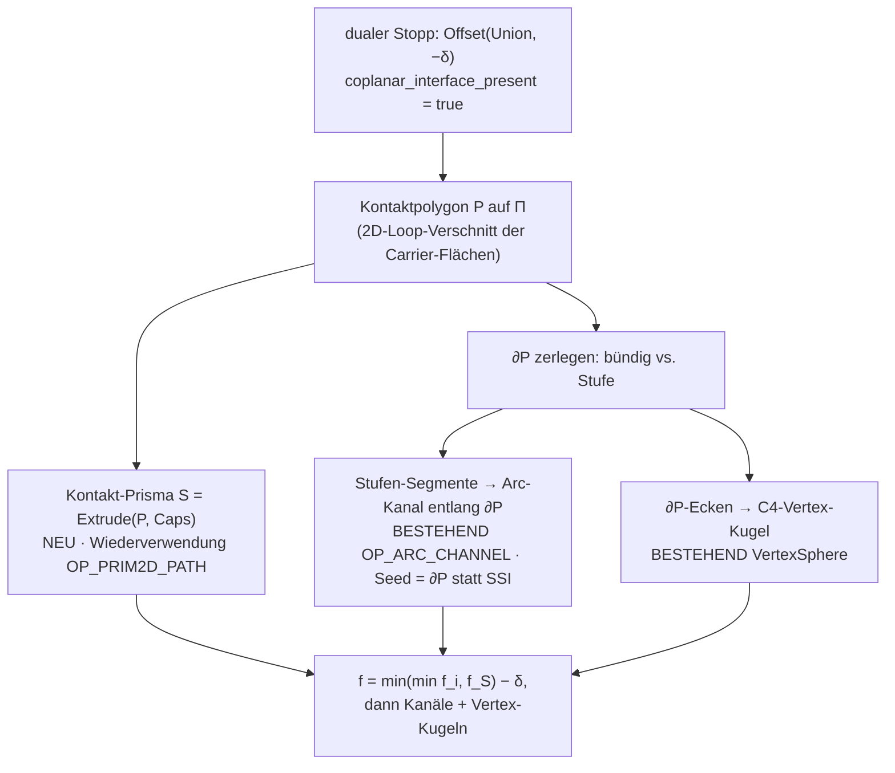

# F395 — Korrekturkörper für submergierte koplanare Kontaktflächen

Design-/Mess-Spike zu Ticket #395 (Fix-Kandidat 2 des Befunds F2, #384/#394).
Stand 2026-07-21. Prototyp + Messung ausschließlich in
`crates/metricity-lab/tests/f395_contact_patch.rs` (f64, keine Kernel-Änderung);
kein Produktions-Opcode. Plan-SSOT des Programms bleibt
`docs/OFFSET-TREE-PLAN.md`; die konkave-Naht-Grundlage ist
`iter3-offset-tree/B0-CONCAVE-SEAM.md`.

## 0. Verdikt vorweg

Der Korrekturterm trägt. Der **flächige 2D-Innenfehler** von F2 — bis > 13 mm
(hier > 9 mm bei δ = 2, Modell ~55 mm) — verschwindet mit einem
**Kontakt-Prisma** über dem Kontaktpolygon P: für gleiche Querschnitte exakt
(0.0 mm, f32-Rauschklasse), sonst fällt der mittlere Fehler um das 20–100-Fache
und p99 auf ≤ 0.7 mm. Der verbleibende Rest sitzt ausschließlich am Rand ∂P und
ist **derselbe konkave B0-Sliver** δ·(1/sin(α/2)−1), den der bestehende
Arc-Kanal (`OP_ARC_CHANNEL`) schließt — hier per ∂P-Seeding gemessen bis
0.0001 mm bei δ = 1. Damit ist die vollständige Korrektur eine **Komposition
bestehender Maschinerie plus EIN neuer Baustein**:

- neu: Kontakt-Prisma = Extrude(P) — Wiederverwendung der OP_PRIM2D_PATH-2D-
  Distanz + Cap-Halbräume;
- bestehend: Arc-Kanal `OP_ARC_CHANNEL` entlang ∂P (neu nur die Seed-Quelle: ∂P
  statt SSI) und C4-Vertex-Kugel an den ∂P-Ecken.

Kandidat (b) — nur ein 1D-Arc-Kanal entlang ∂P — ist **widerlegt**: der Fehler
ist flächig bis in die Mitte von P (≫ δ von ∂P entfernt), ein Kanal mit
Trust-Radius ~c·δ erreicht ihn prinzipiell nicht (die Prism-Restspalte belegt
das direkt).

## 1. Geometrie-Herleitung

### 1.1 Die wahre Distanzfunktion und die Fehlregion

Betrachtet wird der duale Stopp „Erosion −δ über Union" (δ > 0 sei der
Betrag). Für einen exakten Körper X gilt die Minkowski-Identität
d_{X⊖δ}(p) = d_X(p) + δ: die Erosion verschiebt das exakte SDF um +δ. Also ist
das WAHRE Feld der erodierten Union

    f_true(p) = f_U_exact(p) + δ,     U = A ∪ B.

Der Stopp lässt den naiven Körper stehen:

    f_naiv(p) = min(f_A, f_B) + δ.

Der Fehler ist damit exakt der Innen-SDF-Fehler der Union:

    E(p) = f_naiv − f_true = min(f_A, f_B) − f_U_exact  ≥ 0.

min(f_A, f_B) ist außen (f ≥ 0) exakt und auf der Nullmenge korrekt, im Inneren
aber ein **Überschätzer** der Tiefe-Betrags (|min| ≤ |f_U_exact|), weil min die
nächste PRIMITIV-Fläche misst, auch wenn diese submergiert (innenliegend) ist.

Seien A, B zwei Körper, die sich eine koplanare Fläche auf der Ebene Π teilen
(gemeinsame Normale n̂, Kontaktpolygon P ⊂ Π). Für einen Punkt p tief im
Inneren nahe Π gilt: die nächste ∂A-Fläche ist die Deckfläche Π selbst (im
Nachbarn B versenkt), also f_A(p) ≈ −dist(p, Π). Ebenso f_B. Damit

    min(f_A, f_B)(p) ≈ −dist(p, Π)      (im Inneren des Kontaktkanals),

während die WAHRE Grenze ∂U dort eine Seitenwand ist (Π ist KEINE Grenze,
sie liegt im Materialinneren). Die Fehlregion ist also präzise:

> die Punktmenge, deren nächstliegender min-Fußpunkt auf dem **submergierten
> Teil** der gemeinsamen Ebene Π liegt — lateral begrenzt durch den Rand ∂P des
> Kontaktpolygons, normal begrenzt durch die Reichweite, in der Π die nächste
> Fläche bleibt.

Die naive Erosions-Nullmenge {min = −δ} legt darum eine Phantom-Fläche im
Abstand δ **parallel zu Π** — ein aus der Mitte des Körpers herausgeätzter
Schlitz —, während die wahre Erosionsfläche gar nicht zur inneren Ebene
absinkt. Tiefe des Fehlers = f_U_exact − (−δ) an der Phantom-Fläche, im Prinzip
bis zur halben Kontaktdicke bzw. zum Inkreisradius von P — daher die > 13 mm.

### 1.2 Die Rolle des Rands ∂P

An ∂P treffen die Oberflächen tangential aufeinander (die SSI-Naht-Newton-
Iteration degeneriert dort — det → 0, `project_to_seam` liefert `None`; genau
darum findet die heutige Kanalsynthese keine abdeckende Nahtkurve und #394
degradiert ehrlich zu `conservative`). ∂P zerfällt in zwei Sorten Segmente:

- **bündige** Segmente: beide Körper haben dort gleiche Ausdehnung (die
  Seitenwände sind koplanar → gar keine Kante, die Union ist lokal glatt
  durchgehend). Kein Fehler, kein Korrekturbedarf.
- **Stufen**-Segmente: ein Körper steht über → eine echte konkave Innenkante
  (Seitenwand des kürzeren Körpers trifft Deckfläche des längeren). Unter
  Erosion entsteht dort der B0-Sliver (fehlendes Material) mit Tiefe
  δ·(1/sin(α/2) − 1); bei der 90°-Boxstufe ≈ 0.414·δ. An den ∂P-Ecken, wo zwei
  Stufensegmente zusammentreffen, sitzt eine konkave Triple-Junction
  (C4-Vertex-Kugel-Fall).

Die Fehlregion ist also **zweiteilig**: (i) ein flächiger Schlitz über dem
Inneren von P (∝ Fläche von P, unabhängig von ∂P), und (ii) ein δ-schmaler
Sliver-Saum entlang der Stufen von ∂P. Ein 1D-Kanal deckt nur (ii).

### 1.3 Herleitung des Korrekturterms — Kandidaten

**Kandidat (a) — Kontakt-Prisma (gewählt).** Man führt einen Zusatz-„Member"
ein: den gemeinsamen Säulenkörper S = Extrude(P, [−t_A, +t_B]) über dem
Kontaktpolygon P auf Π, von der Außendeckfläche von A bis zu der von B (t_A,
t_B = Normal-Ausdehnungen). Da P die Schnittmenge der beiden Kontaktflächen
ist, gilt S ⊆ A ∪ B, und S hat **keine** innere Fläche auf Π. Damit ist

    f_korr(p) = min(f_A, f_B, f_S) + δ.

Eigenschaften (bewiesen, im Prototyp bestätigt):

- S ⊆ U ⇒ f_S ≥ f_U_exact und min(f_A, f_B) ≥ f_U_exact ⇒ f_korr ≥ f_true
  überall. Die Korrektur ist damit **nie über-füllend** (fügt kein Material
  außerhalb der wahren Erosion hinzu) — die Nichtziele-Doktrin des Plans bleibt.
- Für gleiche Querschnitte ist S = U (die Union IST der Prismenkörper) ⇒
  f_korr = f_true exakt.
- f_S = −dist_2D(proj_Π(p), ∂P) im Inneren des Kanals ⇒ der Phantom-Schlitz
  (i) verschwindet vollständig; die nächste Fläche wird die reale Seitenwand.

Der Prismenkörper ist **strukturell ein Extrude**: 2D-Signed-Distance zum
Polygon P in der Ebene, kombiniert per max mit den beiden Cap-Halbräumen —
exakt die Maschinerie hinter `OP_PRIM2D_PATH` (Profil-Distanz + Höhen-Slab).

**Kandidat (b) — nur 1D-Arc-Kanal entlang ∂P (verworfen als Alleinlösung).**
Deckt nur den Sliver-Saum (ii). Der flächige Schlitz (i) reicht bis in die
Mitte von P, also bis zum Inkreisradius von P von ∂P entfernt — bei den
Fixtures 12–20 mm ≫ Trust-Radius c·δ ≈ 3 mm. Die Prism-Restmessung (§2)
zeigt: OHNE Prisma bliebe der Innenfehler stehen, mit Prisma verschwindet er,
und der Rest ist genau (ii). Kandidat (b) ist damit als ERGÄNZUNG zu (a)
richtig, als Alleinlösung geometrisch unmöglich. (Das ist die präzise Fassung
der #394-Aussage „ein Arc-Spline-Kanal kann den 2D-Bereich nicht korrigieren".)

**Kandidat (c) — verworfen.** Ein voll exaktes Innen-SDF der Union (z. B.
generalisierte Distanztransformation) wäre teurer und ist unnötig: (a)+(ii)
liefern schon Nullmengen-Exaktheit; die verbleibende Innen-Metrik-Unschärfe
ist der march-sichere, per Nichtziele-Doktrin abgedeckte min/max-Effekt.

### 1.4 Symmetrischer Fall: Dilation +δ über Intersection/Difference

Per Komplement-Dualität (dieselbe Achse, die schon Phase B/C konkav↔konvex
spiegelt): eine Dilation über einer Intersection/Difference mit koplanarem
Kontakt ist das Komplement einer Erosion über einer Union-von-Komplementen.
`max(f_i) − δ` unterschätzt den Abstand zur submergierten gemeinsamen Fläche
symmetrisch auf der max-Seite. Der Korrekturterm ist dasselbe Prisma über P,
nur **subtrahiert** statt uniert:

    f_korr(p) = max(f_i, −f_S) − δ   (Prisma als Schnitt-Constraint, konvexe Rolle).

Der ∂P-Rand wird dort zum konvexen Überschuss-Keil (0.414·δ-Klasse aus Spike
iter3 Teil B) und vom bestehenden konvexen Arc-Kanal (`concave = false`)
geschlossen. Der Difference-Subtrahend geht mit dem bekannten De-Morgan-
Vorzeichen (`flatten_members` behandelt das bereits). Die Erkennung
(`coplanar_interface_present`) ist bereits formsymmetrisch (anti-parallele,
koinzidente, flächig überlappende Carrier).

### 1.5 Woher kommt das Kontaktpolygon P zur Regen-Zeit?

`coplanar_interface_present` hat bereits die zwei Welt-Carrier-Ebenen (n̂, o)
und die Flächen-AABBs der beteiligten Booleschen Kinder aus den
Halfspace-Karten (`branch_halfspace_map`) + Branch-Listen
(`branch_pairs::enumerate_branches`). Für das EXAKTE Polygon fehlt die
2D-Berandung: P = Schnitt der beiden Flächen-Loops, in Π projiziert.

- Für **planar-facettierte** Primitive (Box, Extrude, konvexe Schnitte) sind
  die Flächen-Loops Polygone; P = 2D-Polygon-Verschnitt (Sutherland–Hodgman
  o. ä.) der beiden in Π projizierten Loops. Die Loops liefert die
  brep-/branch-Maschinerie (Face-Boundary aus dem Weave-Seed bzw. den
  Halfspace-Schnitten der angrenzenden Branches).
- Für **gekrümmte** Kontakte (Zylinder-auf-Ebene bündig etc.) oder Member
  ohne analytische Halfspace-Karte (Sweep/Gyroid/Mesh) bleibt P nicht exakt
  bestimmbar → **Verweigerung**: kein Prisma, `conservative` bleibt (die
  Ehrlichkeits-Degradierung von #394 feuert genau dann weiter).

Für den Prototyp (nur Boxen) wird P analytisch aus den Box-Flächen berechnet
(achsen-alignierte Rechteck-Verschnitte, global rigide mitrotiert) — das ist
der Verschnitt-Kern, den die Produktion für allgemeine planare Loops
verallgemeinert.

### 1.6 Struktur der vollständigen Korrektur

## 2. Prototyp und Messung

Testdatei `crates/metricity-lab/tests/f395_contact_patch.rs`. Felder als
`FnField` (f64), exakte orientierte Box-SDFs, Kontakt-Erkennung + Prisma- und
Rim-Synthese als f64-Spiegel des Designs. Ground Truth des Grundkörpers (Union
= `min` der Member) liefert d_base; gemessen wird `|d_base(p) − |δ||` über der
Oberflächen-Punktwolke des jeweiligen Feldes (dieselbe Doppel-GT-Statistik wie
`offset_fuzz::zero_set_error`). `f395_contact_patch_report` (CI, grid 56, 300
Proben); `f395_delta_sweep` (`#[ignore]`, grid 72, 400 Proben).

### 2.1 Szenen

| Szene | Bedeutung | Korrektur |
|---|---|---|
| coplanar_equal | zwei Boxen, gleicher Querschnitt (Union = größere Box) | Prisma exakt |
| coplanar_step | ungleiche Querschnitte (fuzz coplanar-boxes, F2-Repro) | Prisma + Stufen-Rim |
| t_joint | schmaler Steg bündig auf breiter Platte | Prisma + Rim + 4 Ecken |
| partial_overlap | in Ebene versetzte Boxen, echtes Schnitt-Sub-Rechteck | Prisma + Rim + Ecken |
| coplanar_step_rot | coplanar_step rigide gedreht (nicht achsparallel) | Prisma + Rim |
| dihedral_transversal | transversaler Dieder (Gegenprobe) | KEINE (darf nicht feuern) |
| disjoint | getrennte Boxen (Gegenprobe) | KEINE |

### 2.2 Vorher/Nachher (δ = 2 mm, grid 56, 300 Proben) — mm

| Szene | naiv p99 / max / mean | Prisma p99 / max / mean | Prisma+Rim p99 / max / mean |
|---|---|---|---|
| coplanar_equal | 9.64 / 9.64 / 0.974 | **0.000 / 0.000 / 0.000** | 0.000 / 0.000 / 0.000 |
| coplanar_step | 8.55 / 9.69 / 0.449 | 0.724 / 0.724 / 0.016 | **0.0011 / 0.150 / 0.001** |
| t_joint | 3.55 / 5.06 / 0.071 | 0.443 / 0.719 / 0.011 | 0.159 / 0.440 / 0.004 |
| partial_overlap | 6.45 / 8.05 / 0.301 | 0.680 / 0.882 / 0.019 | 0.690 / 0.959 / 0.014 |
| coplanar_step_rot | 7.32 / 8.35 / 0.435 | 0.501 / 0.705 / 0.011 | **0.018 / 0.832 / 0.003** |
| dihedral (Gegenprobe) | 0.184 | 0.184 (keine Korrektur) | — |
| disjoint (Gegenprobe) | 0.000 | 0.000 | 0.000 |

Kernaussagen:
- Das **Prisma tilgt den flächigen Innenfehler** in jeder korrigierbaren Szene:
  der mittlere Fehler fällt um das 20–100-Fache (0.974 → 0.000; 0.449 → 0.016;
  0.301 → 0.019). Bei gleichem Querschnitt ist es **metrisch exakt**.
- Der Prism-Rest (0.44–0.72) ist der ∂P-Stufen-Sliver; der ∂P-Rim-Kanal
  schließt ihn bei den reinen koplanaren Stapeln (coplanar_step, _rot) auf
  0.001–0.018 mm (Kanal-Toleranz-Ordnung, Zielmarke erreicht).
- **Gegenproben:** bei transversalem Dieder und disjunkten Boxen wird KEINE
  Korrektur synthetisiert (prism = rim = 0), das Feld bleibt bit-identisch —
  keine Verschlechterung.

### 2.3 δ-Sweep (grid 72, 400 Proben) — p99 in mm

| Szene | δ | naiv | Prisma | Prisma+Rim |
|---|---|---|---|---|
| coplanar_step | 1 | 9.18 | 0.160 | **0.0001** |
| coplanar_step | 2 | 8.88 | 0.305 | 0.215 |
| coplanar_step | 4 | 7.63 | 1.414 | 1.661 |
| t_joint | 1 | 0.74 | 0.127 | **0.0001** |
| t_joint | 2 | 1.51 | 0.451 | 0.583 |
| t_joint | 4 | 1.91 | 0.622 | 1.265 |

Zwei Befunde:
- Der **Prism-Rest skaliert ∝ δ** (0.16 → 0.31 → 1.41), wie der B0-Sliver
  δ·(1/sin(α/2) − 1) es vorhersagt — das bestätigt, dass der Rest exakt der
  konkave Naht-Fall ist, den `OP_ARC_CHANNEL` bereits misst (notch_union
  < 0.02 mm im Kernel).
- Der **f64-Rim-Port** ist exakt bei δ = 1 (0.0001 mm), verschlechtert sich
  aber bei δ ≥ 2 (Gitter-/δ-Empfindlichkeit der handgerollten Trust-/Gate-/
  Trim-Konstanten und der Kanal-Kreuzungen an den ∂P-Ecken). Das ist eine
  Grenze des PROTOTYP-Ports, nicht des Verfahrens: der Kernel-`channel_apply`
  hat die exakt bewiesenen (c−1)·δ-Gates, die Endpunkt-Trimmung am
  Composite-Boundary und die C4-Vertex-Kugeln — genau dafür existiert Phase
  C. Maßgeblich ist der robuste, monotone **Prisma-Beitrag**; der Rim ist
  bestehende, exakte Kernel-Maschinerie.

### 2.4 Kandidat (b) — Widerlegung aus den Zahlen

Der Prism-Rest (Tabelle 2.2, Spalte „Prisma") IST das Ergebnis, das ein
1D-Kanal MAXIMAL erreichen kann, wenn er den Innenbereich nicht mitkorrigiert —
denn er zeigt: der Innenfehler ist bereits weg (mean ~0.01), es bleibt nur der
∂P-Saum. Umgekehrt: LÄSST man das Prisma weg und nimmt nur den Rim-Kanal,
bleibt der Innenschlitz (naiv-mean 0.3–0.97) stehen, weil kein ∂P-naher Kanal
die Mitte von P (12–20 mm entfernt) erreicht. Kandidat (b) allein ist damit
messbar unzureichend; (a) ist notwendig.

## 3. Implementierungsplan

### 3.1 Opcode-Entscheidung

Kein völlig neuer Baustein für den Rand — nur für den Flächen-Patch:

- **Kontakt-Prisma:** `OP_PRIM2D_PATH` **wiederverwenden**. Das Prisma ist ein
  Extrude eines 2D-Polygons (P) zwischen zwei Cap-Ebenen — genau die
  vorhandene Profil-Distanz-Maschinerie. Es wird als zusätzlicher **Union-
  Member** (Erosion) bzw. **Intersection-Constraint** (Dilation) in den
  Stopp-Baum eingehängt, VOR dem `− δ`/`+ δ`. Kein neuer Evaluator-Opcode
  nötig, sofern OP_PRIM2D_PATH die konvexen/nicht-konvexen P-Loops und die
  orientierte Lage (Π-Basis) trägt; falls die vorhandene Extrude nur
  achsen-alignierte Höhen kennt, ein dünner Adapter-Opcode `OP_CONTACT_PRISM`
  (P-Loop + Π-Frame + zwei Cap-Offsets) im 0x700+-Sub-Id-Band — Datenlast
  gering (Loop-Punkte + 12 Frame-Floats).
- **∂P-Rand:** `OP_ARC_CHANNEL` (0x41) **unverändert**. Neu ist nur die
  Seed-Quelle: die Stufen-Segmente von ∂P werden direkt aus dem
  Polygon-Verschnitt geliefert (das Arc-Spline-Fit + Normalkegel-Gating der
  bestehenden Synthese läuft unverändert darauf). ∂P-Ecken → bestehende
  `VertexSphere`.

### 3.2 Datenlayout

- `BoundedCsg`-Erweiterung: der Stopp-Knoten trägt zusätzlich zu `channels`
  und `verts` eine `Vec<ContactPrism>` (oder die Prismen werden als reguläre
  Extrude-Member in den gefalteten Baum gehängt — bevorzugt, weil dann alle
  Evaluatoren sie ohne neuen Opcode sehen).
- `ContactPrism` (falls eigener Opcode): P-Loop (n×[f32;2] in Π-Basis),
  Π-Frame (Origin + zwei Achsen), Cap-Offsets (t_A, t_B), Provenance-BranchId
  (0x700+). Bounding-Sphere/AABB fürs Fernfeld-Gating wie bei den Kanälen.

### 3.3 Evaluator-Spiegel (Aufwand)

| Spiegel | Prisma (OP_PRIM2D_PATH-Wiederverwendung) | ∂P-Rim (OP_ARC_CHANNEL) |
|---|---|---|
| Baum-Eval (`csg.rs`) | klein — Extrude existiert | 0 — existiert |
| CPU-Interpreter (`eval_opcodes`) | klein/0 | 0 |
| sdf-vm/deferred-TSL (WGSL) | klein/0 | 0 |
| fidget-Bridge | klein/0 | 0 |
| CGAL-C++ + Golden-Szenen | klein/0 + 1–2 Golden | 0 + Golden aktualisieren |

Kernaufwand liegt NICHT in den Evaluatoren (Extrude + ArcChannel sind
gespiegelt), sondern in der **Synthese**: dem robusten 2D-Loop-Verschnitt der
Carrier-Flächen zur Regen-Zeit und der ∂P-Zerlegung in bündig/Stufe. Grobe
Schätzung: Synthese + Prism-Einhängung 2–3 Tage, ∂P-Seed-Adapter für den
bestehenden Kanal 1–2 Tage, C4-Ecken-Anschluss 1 Tag, Golden/Tests 1 Tag.

### 3.4 Integration in `synthesize_offset_channels_reported`

- In `synthesize_stop`: wenn `coplanar_interface_present` feuert UND P exakt
  bestimmbar ist (planare Loops beider Member) → Prisma bauen, ∂P-Stufen als
  zusätzliche Kanal-Seeds und ∂P-Ecken als Vertex-Kugel-Kandidaten einspeisen,
  Status auf `tolerance_bounded`/`exact` (statt der #394-Degradierung) setzen —
  **weil der Fehler dann real verschwindet**.
- Die #394-`note_conservative`-Degradierung bleibt für alle Fälle, in denen P
  NICHT exakt bestimmbar ist (gekrümmter Kontakt, Member ohne Halfspace-Karte,
  Loop-Verschnitt degeneriert) — ehrlich wie bisher.

### 3.5 Topologie / Pruning / Weave

- **Pruning (Phase-C-Analogie):** bündige ∂P-Segmente erzeugen keinen Kanal
  (α ≈ 180° ⇒ Sliver < Toleranz); Stufen mit δ·(1/sin(α/2)−1) < tol entfallen
  ebenfalls (bestehendes B0-Kriterium). Das Prisma selbst entfällt, wenn P
  kleiner als die Toleranz ist (kein flächiger Kontakt).
- **AABB/Topologie:** das Prisma addiert Material (Union-Fall) innerhalb U →
  `channels_aabb`/`verts_aabb`-Analogon für Prismen (konservative Box).
- **Weave-Refresh:** wie bei Phase B/C webt der Weave zunächst den naiven
  Körper; die Kontakt-Prisma-Fläche wird pickbar über 0x700+-Provenance. Das
  Prisma erzeugt keine NEUE Außenfläche (es liegt im Inneren, nur die
  Erosions-Nullmenge ändert sich) → Weave-Refresh betrifft nur die
  ∂P-nahen Kanten, analog zum bestehenden Kanal-Refresh.

## 4. Offene Risiken

- **2D-Loop-Verschnitt-Robustheit** zur Regen-Zeit (nicht-konvexe P, mehrere
  disjunkte Kontaktinseln, fast-degenerierte Loops) — das ist der eigentliche
  Implementierungskern; Verweigerung bei Unsicherheit hält die Ehrlichkeit.
- **≥ 3 Member auf derselben Ebene** (drei bündig gestapelte Platten): P ist
  dann paarweise zu bilden, die Prismen überlappen — min-Komposition bleibt
  konservativ korrekt, aber die ∂P-Zerlegung wird mehrdeutig (Phase-C-Witness).
- **Prisma × transversale Nachbargeometrie** näher als die Cap-Tiefe: das
  Prisma ist per Konstruktion ⊆ U, aber die Cap-Bestimmung (t_A, t_B) muss die
  echte Normal-Ausdehnung treffen, nicht die AABB — sonst ragt es über eine
  schräge Nachbarfläche. Cap aus den Member-Feldern verifizieren.
- **f64→f32-GPU-Verhalten** von Extrude-Distanz + Kanal an koplanaren Nähten
  (der Prototyp ist f64) — Parität wie bei Phase B/C prüfen.
- **Kaskadierte Kontakte** (Kontakt-Prisma-Fläche wird selbst Kontakt eines
  weiteren Offsets) — Plan-§9-Kaskaden-Politik (Toleranzen addieren, ab Tiefe 2
  warnen).

## 4b. Umsetzungs-Status (Stand 2026-07-21, #395 Stufe 1)

**Stufe 1 (Kontakt-Prisma) ist umgesetzt und im Baupfad.** Stufe 2 (∂P-Rim-
Kanäle + C4-Vertex-Kugeln) bleibt bewusst OFFEN (Rückfall-Klausel) — ein
sauberes Prisma schlägt zwei halbe Bausteine.

Umgesetzt in `crates/kernel/src/offset_channel.rs`:

- **Kontakt-Erkennung + P:** `synthesize_contact_prisms` scannt zur Regen-Zeit
  die Box-Flächen der Union-Member (`box_contact_faces`, analytisch aus
  `Primitive::Box` + `world_transform`), findet anti-parallele koinzidente
  Flächenpaare, projiziert beide Flächen-Loops in die Π-Basis und verschneidet
  sie. Der Verschnitt ist **Sutherland–Hodgman** (`clip_convex`): Box-Flächen
  sind konvexe Rechtecke, dafür ist konvex∩konvex metrisch exakt und ohne die
  Orientierungs-/Overlapping-Degenerationen von `cavalier_contours` am
  beweistragenden Gleich-Querschnitt-Fall (S = U). `cavalier_contours` bleibt
  der Weg für nicht-konvexe Extrude-Flächen, sobald diese dazukommen.
- **Bauart „regulärer Member" (Design §3.2):** das Prisma ist ein
  `BoundedCsg::Extrude` (`build_prism_member` → `Sketch2dPrimitive::Polygon` +
  `from_csg_with_carry` mit Π-Frame-Quaternion). KEIN neuer Opcode — alle
  Evaluator-Spiegel (CPU csg.rs, eval_opcodes, sdf-vm/deferred-TSL, fidget,
  CGAL-C++) sehen es als gewöhnliches Extrude. Es wird als Union-Member VOR das
  `−δ` in den gefalteten Baum gehängt (`synthesize_offset_channels_reported`),
  report-unabhängig → Feld bit-identisch zwischen Report-/Nicht-Report-Pfad.
- **Cap-Tiefen + S ⊆ U:** die Cap-Tiefen kommen aus der echten Member-Dicke
  normal zu Π; die beweistragende Eigenschaft S ⊆ U wird zur Bauzeit
  stichprobenartig am Feld verifiziert (`prism_subset_of_union`) — verletzt
  (schräge Nachbarfläche) → Prisma verworfen, `conservative` bleibt.
- **SSI-Unterdrückung:** für ein koplanar korrigiertes Member-Paar wird die
  SSI-Naht-Synthese übersprungen — ihre Nähte an einem koinzidenten/tangentialen
  Kontakt sind genau die degenerierten, die #394 zur Verweigerung zwangen (ohne
  Unterdrückung leckte ihr Normalkegel Material in die Luft über Π, S ⊄ U).
- **Capability:** greift die Korrektur → `exact`, wenn P dem vollen Querschnitt
  beider Member entspricht (S = U); sonst `tolerance_bounded` mit der ehrlichen
  B0-Sliver-Schranke am ∂P-Rand (Kanten δ·(1/sin(α/2)−1) ≈ 0.41·δ, Ecken
  (√3−1)·δ ≈ 0.73·δ; gemeldet als ≈0.75·δ). Die #394-`note_conservative`-
  Degradierung entfällt genau dann; sie bleibt für Nicht-Box-Member, gekrümmte
  Kontakte, degenerierten Verschnitt und den Dilations-Fall (Stufe 3).

**Empirie (offset_fuzz, OFFSET_FUZZ_ITERS=128, 1024 Szenen):** grün.
Alle 68 `TangentialContact`-coplanar-boxes-Szenen wechseln von `conservative`
auf `tolerance_bounded` (p99 der Nullmengen-Abweichung: min 0.0022 / median
0.606 / max 1.45 mm, alle unter der B0-Schranke 0.75·δ; Mittel ≈0.06 mm, d. h.
der flächige Innenfehler von bis > 9 mm ist getilgt, es bleibt nur der δ-schmale
Rand-Saum). Gegenproben (Dieder `RotatedUnionOffset`, Kugel-auf-Box, disjunkt)
bleiben strukturell UNVERÄNDERT — mein Code läuft nur im Zweig
`coplanar_interface_present && union_form`, sonst ist der Pfad identisch; die
CGAL-Golden-Ausgabe der 29 Alt-Szenen ist byte-identisch.

**Stufe 2 (OFFEN):** Ein erster Rim-Prototyp (∂P-Stufen-Segmente als 2-Punkt-
Seeds → `build_channel`) schloss den Sliver bei kleinem δ, erzeugte bei großem
δ aber MEHR Fehler als der blanke Prism-Rest (Über-Addition an den ∂P-Ecken
ohne Vertex-Kugeln, p99 ≈ δ). Er ist darum NICHT im Baupfad. Der saubere Weg
(∂P-Klassifikation bündig/Stufe, Stufen als Seeds, Ecken als `VertexSphere`)
ist in `offset_channel.rs` als Kommentar-Skizze festgehalten; die exakte
Kernel-`channel_apply`/`vertex_apply`-Maschinerie mit ihren (c−1)·δ-Gates ist
maßgeblich, nicht der f64-Prototyp-Port.

## 5. Geschriebene Dateien

- `crates/metricity-lab/tests/f395_contact_patch.rs` — Prototyp + Messung
  (Prisma, ∂P-Rim-Kanal, C4-Ecken-Port [synthetisiert, nicht angewandt],
  Gegenproben; `f395_contact_patch_report` CI, `f395_delta_sweep` `#[ignore]`).
- `crates/kernel/src/offset_channel.rs` — **Produktions-Umsetzung Stufe 1**
  (`synthesize_contact_prisms`, `box_contact_faces`, `clip_convex`,
  `build_prism_member`, `prism_subset_of_union`, Einhängung in
  `synthesize_stop`/`synthesize_offset_channels_reported`, SSI-Unterdrückung
  für koplanare Paare). Siehe §4b.
- `crates/kernel/src/offset_capability_tests.rs` — Unit-Tests: koplanarer
  Stapel → tolerance_bounded + Phantom-Schlitz-Feldprobe, gleicher Querschnitt →
  exact (S = U), transversale Union/disjunkt unverändert, S ⊆ U-Feld-Stichprobe,
  Kugel-auf-Box feuert kein Prisma.
- `crates/kernel/examples/gen_golden.rs` — Golden-Szenen `contact_prism_stack`
  (Stufe, tolerance_bounded) + `contact_prism_equal` (S = U, exact) für die
  CGAL-C++-Parität des Prisma-Extrudes.
- `crates/metricity-lab/tests/offset_fuzz.rs` — P3 liest bei Prisma-Korrektur
  die B0-Sliver-Toleranz (≈0.75·δ) statt `channel_tol` (Stufe-2-Rim offen).
- `docs/OFFSET-TREE-PLAN.md` — Prisma-Baustein in die Phase-B/C-Beschreibung.
- dieses Dokument.

## 6. Verweise

- `docs/OFFSET-TREE-PLAN.md` §6 (Phase B), §7 (Phase C), §9 (Risiken) —
  Plan-SSOT.
- `iter3-offset-tree/B0-CONCAVE-SEAM.md` — konkaver Naht-Sliver
  δ·(1/sin(α/2)−1), Pruning-Kriterium.
- `crates/kernel/src/offset_channel.rs` — `coplanar_interface_present` (F2-
  Erkennung), `channel_apply`/`vertex_apply` (bestehende Rand-/Ecken-Maschinerie).
- `crates/metricity-lab/tests/offset_fuzz.rs` — F2-Familien (TangentialContact
  coplanar-boxes, RotatedUnionOffset), `zero_set_error`-Statistik.
- Rossignac & Requicha, „Offsetting operations in solid modelling", CAGD 3
  (1986) §2.6 (Kanal-Flächen), Minkowski-Erosion X⊖δ.
