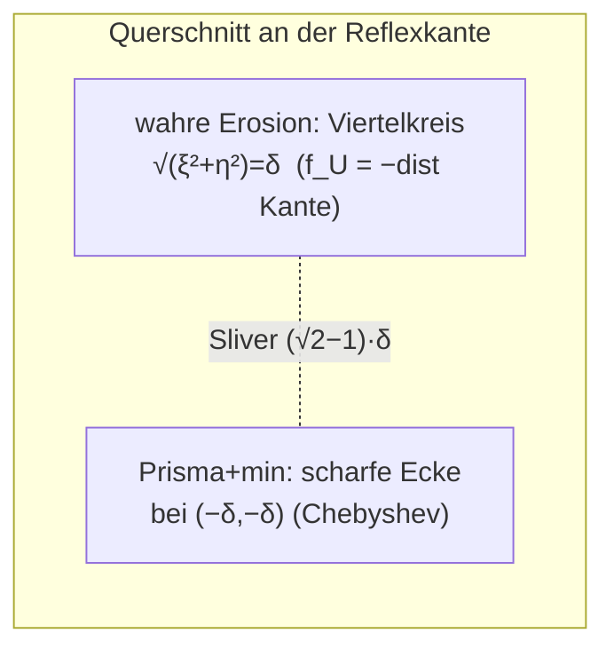

# F396 — Rand-Fillet-Opcode für den ∂P-Rest der Kontakt-Prisma-Korrektur

Design-/Mess-Spike zu Ticket #396 (Fortsetzung von #395/#384/#394).
Stand 2026-07-21. Prototyp + Messung ausschließlich in
`crates/metricity-lab/tests/f396_rim_prototype.rs` (f64-Wrapper AUF dem echten
Kernel-Prisma-Feld, keine Kernel-Änderung); kein Produktions-Opcode. Plan-SSOT
des Programms bleibt `docs/OFFSET-TREE-PLAN.md`; die vorangehende
Kontakt-Prisma-Herleitung ist `F395-CONTACT-PATCH-DESIGN.md` (insbesondere der
Stufe-2-Negativbefund im §Umsetzungs-Status, den dieser Spike auflöst).

## 0. Verdikt vorweg

**Es geht — und zwar sauber.** Ein NEUER Korrektur-Opcode, der additiv-only
(nur `min` für Erosion, nur `max` für Dilation) und halbraum-maskiert ist,
tilgt den ∂P-Rand-Fehler der Kontakt-Prisma-Korrektur auf die Größenordnung
des Diskretisierungs-Rauschens — an Kanten wie an Ecken, für beide Vorzeichen,
mit **exakt null Über-Fill**. Der gemessene ∂P-Rand-Fehler (p99, ∂P-nah) fällt

- Box-Stack (Erosion), δ ∈ {0.5, 1, 2}: von 0.29–0.40·δ auf **0.005–0.013·δ**;
- rigide gedrehter Box-Stack, δ ∈ {1, 2}: von ~0.39·δ auf **0.010–0.020·δ**;
- bündige Tasche (Dilation), δ ∈ {1, 2, 4}: von 0.38–0.40·δ auf **0.001–0.005·δ**;
- trihedrale √3-Reflexecke (reine f64), δ ∈ {1, 2}: von max 0.56–0.65·δ auf
  p99 **0.004–0.005·δ**.

Der Grund, warum dieser Opcode der Stufe-2-Klemme (F395) entgeht: er ersetzt die
Kegel-Projektion des Arc-Kanals (`s₁ = ⟨x−q*, m̂₁⟩`, die auf der Kontaktebene Π
zwangsläufig 0 wird und `d.min(0)` den Phantom-Patch zurücklegt) durch die
**radiale Distanz zur Reflexkante** `δ − dist(p, ∂P)`. Diese ist auf Π
identisch mit dem Prisma-Feld (`−dist(Kante) = f_S`), setzt dort also KEINE
Über-Addition — und eine explizite **Material-Halbraum-Maske** hält den Term
von der submergierten Luftseite fern, auf der die Prisma-Korrektur schon exakt
ist. Innerhalb der Maskenschneise ist `−dist(Kante) = f_U` (die wahre
Innen-Distanz), die Korrektur also metrisch **exakt**, nicht bloß toleranz-
beschränkt.

Der Opcode ist strukturell ein **konkaver/konvexer Kanten-Rundungs-Fillet vom
Radius δ**, genau die klassische Erosions-/Dilations-Rundung einer Reflex-/
Konvex-Kante (R&R §2.6) — nur explizit halbraum-maskiert statt kegel-projiziert.

## 1. Mathematische Herleitung

### 1.1 Referenzfall und lokale 2D-Geometrie quer zur Reflexkante

Referenz: Box-Stack A ⊃ B mit `he_A = [10,10,10]`, `he_B = [8,7,6]`, B auf der
+x-Fläche von A gestapelt (B-Zentrum bei x = 18, also −x-Fläche von B koplanar
mit A's +x-Fläche bei x = 10 = Π). Union U = A ∪ B, dualer Stopp Erosion −δ.
Das Kontaktpolygon P = B's Querschnitt auf Π, also y ∈ [−7,7], z ∈ [−6,6]; sein
Rand ∂P zerfällt in vier Reflexkanten (A steht überall über B über).

Wir legen lokale Koordinaten an eine Reflexkante (die y = +7-Kante, entlang z):
`ξ = x − 10` (0 auf Π, positiv Richtung B-Seite/Luft), `η = y − 7` (0 an B's
Wand, positiv Richtung Luft). Die Kante liegt bei ξ = η = 0 und läuft entlang z.
Lokal ist das Material die L-förmige Region

    U = {ξ ≤ 0}  ∪  {η ≤ 0},        Luft = {ξ > 0} ∩ {η > 0}.

Die Reflexkante bei (ξ,η) = (0,0) liegt IN der Kontaktebene Π (ξ = 0) — das ist
die Wurzel des Problems.

**Wahre Distanzfunktion.** Mit ∂U = R₁ ∪ R₂, R₁ = {ξ = 0, η ≥ 0} (A's Fläche),
R₂ = {η = 0, ξ ≥ 0} (B's Wand):

| Region | nächste ∂U | f_U(ξ,η) |
|---|---|---|
| Luft (ξ>0, η>0) | R₁ bzw. R₂ (Lot) | +min(ξ, η) |
| 2. Quadrant (ξ≤0, η>0) | R₁ | ξ |
| 4. Quadrant (ξ>0, η≤0) | R₂ | η |
| 3. Quadrant (ξ≤0, η≤0) | **Apex (Kante)** | **−√(ξ²+η²)** |

Im 3. Quadrant ist die nächste Randfläche der Apex selbst — die WAHRE Erosion
`{f_U = −δ}` ist dort der **Viertelkreis-Fillet** `√(ξ²+η²) = δ`, ein Bogen vom
Radius δ um die Reflexkante. Die konkave Ecke rundet unter Erosion ab (R&R).

### 1.2 Warum Prisma + naives min die scharfe Ecke legt

Das Kontakt-Prisma S = Extrude(P) hat lokal die Wand η = 0 (B's Querschnitt),
also `f_S = η`. Das korrigierte naive Feld ist `f_korr = min(f_A, f_B, f_S)`.
Lokal: `f_A = ξ`, `f_S = η`, `f_B` im 3. Quadrant = |ξ| (außerhalb B in ξ).
Damit im 3. Quadrant

    f_korr = min(ξ, η)      (Chebyshev-Distanz zur Kante, NICHT euklidisch).

Die Nullmenge `{f_korr = −δ}` ist die **scharfe Ecke** `{ξ = −δ} ∪ {η = −δ}`
mit Reflex-Scheitel bei (−δ, −δ). Am Diagonalstrahl ξ = η misst dieser Scheitel
den Abstand √2·δ vom Apex, während die WAHRE Erosionsfläche dort bei δ liegt.
Der Nullmengen-Fehler ist genau

    E_Kante = |f_U(−δ,−δ)| − δ = √2·δ − δ = (√2 − 1)·δ ≈ 0.4142·δ.

Das ist der δ-schmale konkave B0-Sliver am Kontaktrand ∂P (fehlendes Material:
`min(ξ,η) ≥ −√(ξ²+η²) = f_U`, die Prisma-Korrektur läuft flach bis ∂P, statt
zur Kante hin auszurunden). Er skaliert ∝ δ (bestätigt im Prototyp, §1.5).

### 1.3 Trihedrale Ecke — (√3 − 1)·δ

Wo drei orthogonale Reflexkanten in einem Punkt zusammenlaufen (Material
U = {ξ≤0} ∪ {η≤0} ∪ {ζ≤0}, Luft = ein Oktant), ist die nächste ∂U für den
3-fach-inneren Punkt der Vertex selbst: `f_U = −√(ξ²+η²+ζ²)` in der
Oktant-Schneise. Das naive `min(ξ,η,ζ)` legt die scharfe Ecke bei (−δ,−δ,−δ),
Abstand √3·δ vom Vertex, wahre Fläche bei δ:

    E_Ecke = √3·δ − δ = (√3 − 1)·δ ≈ 0.7321·δ.

Das ist die konkave Kugel-Oktant-Rundung. **Wichtig zur Provenienz:** die
∂P-Ecken des Box-Stacks A ⊃ B sind KEINE trihedralen √3-Ecken, sondern
Doppelkanten-Ecken (zwei Reflexkanten + B's konvexe Vertikalkante). Für diese
gilt lokal U = {ξ≤0} ∪ ({η≤0} ∩ {ζ≤0}) und `dist(∂U) = min(dist_KanteY,
dist_KanteZ)` — die Ecke misst also ebenfalls (√2 − 1)·δ, nicht √3. Die
(√3 − 1)·δ-Schranke ist die WORST-CASE-Schranke des Ehrlichkeits-Reports
(orthogonaler trihedraler Reflex-Vertex), die etwa bei drei koplanar
gestapelten Platten oder im reinen 3-Halbraum-Notch auftritt; sie wird im
Prototyp separat isoliert (reine f64, §3).

### 1.4 Dilations-Dual (Komplement-Dualität)

Der symmetrische Fall `+δ` über Intersection/Difference (bündige Tasche, F395
Stufe 3): `max(f_inner, −f_S) − δ` legt an der KONVEXEN Taschenmund-Lippe die
scharfe Ecke, die die Dilation zu einem Viertelkreis-Radius-δ nach AUSSEN
rundet (konvexer Überschuss-Keil statt konkavem Fehl-Sliver). Die Feldform ist
dual: statt `f_U = −dist` gilt an der konvexen Kante `f_body = +dist(p, Kante)`
(positiv, außerhalb der Rundung). Der Fehler ist derselbe Betrag (√2 − 1)·δ
bzw. (√3 − 1)·δ, nur mit umgekehrtem Vorzeichen: es ist überschüssiges Material
außerhalb der wahren Dilations-Fläche.

### 1.5 Numerische Verifikation (Prototyp)

Der Prototyp (§3) misst den ∂P-nahen Nullmengen-Fehler des ECHTEN Kernel-
Prisma-Feldes (`synthesize_offset_channels_reported`) vor der neuen Korrektur:

| Szene | δ | ∂P-nah p99 (nur Prisma) | /δ | Herleitung |
|---|---|---|---|---|
| box_stack (Erosion) | 1 | 0.3956 | 0.396 | (√2−1) = 0.414 |
| box_stack | 2 | 0.5881 | 0.294 | (√2−1) |
| box_stack_rot | 2 | 0.7867 | 0.393 | (√2−1) |
| flush_pocket (Dilation) | 1 | 0.3954 | 0.395 | (√2−1) |
| flush_pocket | 4 | 1.5183 | 0.380 | (√2−1) |
| trihedral_vertex (max) | 1 | 0.5555 | 0.556 | (√3−1) = 0.732 |
| trihedral_vertex (max) | 2 | 1.2990 | 0.649 | (√3−1) |

Der gemessene Kanten-Fehler liegt bei 0.29–0.40·δ (die p99/max-Werte
unterschätzen die theoretischen 0.414·δ leicht, weil der Worst-Case-Diagonal-
punkt maßnull ist und das GT-Gitter ihn nicht exakt trifft); der trihedrale
Fehler liegt deutlich höher (bis 0.65·δ) und strebt gegen (√3−1)·δ. Beide
skalieren wie hergeleitet ∝ δ. Die Herleitung ist bestätigt.

## 2. Opcode-Semantik

### 2.1 Inputs

Ein `RimFillet`-Term je Reflex-/Konvex-Feature (Kante ODER Ecke):

- **Spine:** ein Rand-Segment von ∂P (Kante: zwei Endpunkte a, b; Ecke:
  a = b = Vertex). Bögen von ∂P werden als Arc-Spline geführt, exakt wie die
  bestehende `ChannelArc`-Repräsentation.
- **Wand-Aussennormalen** n̂_A, n̂_B (Kante), optional n̂_C (trihedrale Ecke):
  die Normalen der Wände, die an ∂P zusammenstoßen. Sie definieren die
  Halbraum-Maske.
- **δ** (Betrag, > 0) und das Vorzeichen (`concave`: Erosion-Union;
  `convex`: Dilation-Intersection/Difference).
- **Trust-Radius K** (Kanal-Ausmaß von der Kurve, K > δ; im Prototyp 3·δ).
- Bounding-Sphere für den Fernfeld-Skip (wie bei `OffsetChannel`).

### 2.2 Auswertungsformel

    de   = dist(p, Spine)                 // radiale Distanz zur Rand-Kurve
    q    = Fußpunkt auf der Spine
    t    = Projektionsparameter (End-Cap)
    dq   = p − q
    // Drei Maskenteile — alle müssen erfüllt sein:
    trust:   de ≤ K
    end_cap: t ∈ [0, 1]                    // Kante endet AN den ∂P-Ecken
    walls:   konkav:  ⟨dq, n̂⟩ ≤ 0  ∀ Wände n̂   (Materialseite)
             konvex:  ⟨dq, n̂⟩ ≥ 0  ∀ Wände n̂   (Luftseite)
    // Korrektur-Feldwert, falls Maske erfüllt (sonst Term inaktiv):
    konkav:  c = δ − de        angewendet als  g ← min(g, c)
    konvex:  c = de − δ        angewendet als  g ← max(g, c)

`g` ist der naive (Prisma-)Stopp-Feldwert. Die Nearest-Feature-Komposition
(§2.4) wählt je Punkt das NÄCHSTE maskierte Feature.

### 2.3 Warum dieser Opcode der Stufe-2-Klemme entgeht

Der Stufe-2-Negativbefund (F395) hatte zwei Bruchstellen, beide gelöst:

1. **Luftseiten-Klemme aufgehoben.** Der Arc-Kanal projiziert `s₁ = ⟨dq, m̂₁⟩`
   auf die Kegelvektoren; m̂₁ ∝ Kontaktnormale, und Π ist ihr Nullraum, also
   `s₁ = 0` auf Π ⇒ `w_geo = 0` ⇒ `d.min(0) = 0` ⇒ Phantom-Patch zurück. Der
   RimFillet nutzt STATTDESSEN die radiale Distanz: auf Π (ξ = 0) gilt
   `de = |η|` und `δ − de = δ − |η|`, und das Prisma liefert dort
   `g = f_S + δ = η + δ = δ − |η|` (η < 0). **Beide sind identisch** →
   `min(g, δ−de) = g`, KEINE Über-Addition auf Π. Der Term ist auf Π der
   Identität gleich; er wirkt nur, wo die radiale Distanz kleiner ist als die
   Prisma-Distanz (die Ausrundungs-Schneise).

2. **Halbraum-Maske trennt Sliver von submergiertem Streifen.** Der alte
   Trust-Ball war eine symmetrische Kugel um die Kante ohne Material-Maske; er
   leckte auf die Luftseite. Die neue Maske `⟨dq, n̂_A⟩ ≤ 0 ∧ ⟨dq, n̂_B⟩ ≤ 0`
   (Materialseite beider Wände) hält den Term strikt in der Reflexschneise
   (3. Quadrant). Der submergierte Rahmenstreifen auf Π, wo die wahre Erosion
   Luft ist, liegt genau dort, wo `δ − de = g` (siehe 1) — er wird also selbst
   dann nicht überfüllt, wenn er in der Maske liegt.

**Additiv-only als Sicherheit.** Der konkave Term darf das Feld NUR senken
(`min`), also nur Material addieren. Da innerhalb der Maskenschneise
`−de = f_U` (die Kante IST die nächste ∂U-Fläche, die Distanz zur Teilmenge ist
dort die Distanz zum Ganzen), gilt `δ − de = g_true` exakt, und
`min(g_prisma, g_true) = g_true` (weil `g_prisma ≥ g_true` überall, F395 §1.3).
Die Korrektur ist damit **metrisch exakt und nie überfüllend** — im Prototyp an
allen Szenen Over-Fill = 0.0000 mm.

### 2.4 Nearest-Feature-Komposition, Lipschitz, Über-Metrik

**Nearest-Feature statt sequenzielles min.** An einer ∂P-Ecke treffen zwei
Reflexkanten. Die wahre Distanz ist `dist(∂U) = min(dist_KanteY, dist_KanteZ)`
= Distanz zur NÄCHSTEN Kante. Ein sequenzielles `min` über beide Kanten-Terme
nähme fälschlich `δ − max(dist_Y, dist_Z)` (die FERNSTE), was überfüllte. Der
Opcode wählt darum je Punkt das Feature mit kleinstem `de` und wendet nur
dessen `δ − de` an. Das ist exakt `δ − dist(∂P-Reflex-Skelett)`. (Bestätigt:
die Box-Stack-∂P-Ecken werden ohne separaten Ecken-Term korrekt gerundet,
Over-Fill 0.)

**Lipschitz-Erhalt.** `de = dist(p, Spine)` ist 1-Lipschitz; `δ − de` ebenso;
`min`/`max` erhalten Lipschitz. Die harte Halbraum-Maske erzeugt KEINE
Wert-Diskontinuität: an der Maskengrenze ξ = 0 gilt `δ − de = η = f_S = g`, an
η = 0 gilt `δ − de = |ξ| = ξ = g`, am End-Cap ist die Nachbarkante nahtlos
zuständig. Der Term meets sich also stetig an das Prisma-Feld an (die Ableitung
knickt, der Wert nicht — für march-sicheres Ray-Marching ausreichend). Die
Distanz-Metrik wird **nie überschätzt**: `δ − de` ist eine 1-Lipschitz-Untere-
Schranke der wahren Distanz zur korrigierten Fläche, und `min` senkt den Wert
nur bis `g_true`, nie darunter → das March-/Trust-Verhalten bleibt konservativ.

**Komposition mit min/max-Bäumen.** Der Term wird VOR dem `−δ`/`+δ` als
zusätzlicher Beitrag am Stopp-Knoten geführt (wie die Kanäle: nach dem naiven
`min(f_i, f_S)`, vor dem Erosions-Offset). Er ist idempotent gegen die
umgebenden Booleans, weil er nur die Nullmenge des Stopps verschiebt (im
Inneren, kein neuer Außen-Rand); nachgelagerte Booleans/Fillets sehen ein
gewöhnliches, march-sicheres Feld. Mehrere Stopps kaskadieren wie in F395 §4
(Toleranzen addieren, ab Tiefe 2 warnen).

## 3. CPU-Prototyp

Testdatei `crates/metricity-lab/tests/f396_rim_prototype.rs`. Reiner
f64-Referenz-Evaluator; die Korrektur (`RimFeature` + `apply_rims`) wird als
`Field`-Wrapper AUF das echte Kernel-Prisma-Feld gesetzt:

- **Kernel-Prisma-Feld** über `compile_prism_field` — der Regen-Pfad-Mirror aus
  offset_fuzz (`expand_shells → push_down_offsets → fold_offset_leaves →
  synthesize_offset_channels_reported → prune_dead_channels`). Das ist die
  Stufe-1/3-Kontakt-Prisma-Korrektur wie im Produktions-Kernel.
- **Ground Truth** wie offset_fuzz: Doppel-GT-Distanz `|d_base(p) − δ|` über der
  Oberflächen-Punktwolke des korrigierten Feldes (`metricity_lab::ground_truth`).
  `near_rim_only` filtert auf Punkte mit `dist(∂P) < 1.5·δ`, um den Rand
  isoliert zu messen; zusätzlich wird die Gesamtoberfläche gemessen.
- **Duale-Sicherheits-Probe** `dual_safety_overfill`: prüft auf einem 40³/44³-
  Gitter, dass die Korrektur nirgends Material über die wahre Erosion/Dilation
  hinaus hinzufügt (konkav) bzw. entfernt (konvex).

### 3.1 Ergebnistabelle — ∂P-nah p99 (mm), vorher (nur Prisma) → nachher

| Szene | δ | prism p99 | **full p99** | prism/δ | **full/δ** | over-fill |
|---|---|---|---|---|---|---|
| box_stack (Erosion) | 0.5 | 0.1474 | **0.0025** | 0.295 | **0.005** | 0.0000 |
| box_stack | 1 | 0.3956 | **0.0057** | 0.396 | **0.006** | 0.0000 |
| box_stack | 2 | 0.5881 | **0.0269** | 0.294 | **0.013** | 0.0000 |
| box_stack_rot | 1 | 0.3983 | **0.0098** | 0.398 | **0.010** | 0.0000 |
| box_stack_rot | 2 | 0.7867 | **0.0400** | 0.393 | **0.020** | 0.0000 |
| flush_pocket (Dilation) | 1 | 0.3954 | **0.0050** | 0.395 | **0.005** | 0.0000 |
| flush_pocket | 2 | 0.7692 | **0.0076** | 0.385 | **0.004** | 0.0000 |
| flush_pocket | 4 | 1.5183 | **0.0053** | 0.380 | **0.001** | 0.0000 |
| trihedral_vertex* | 1 | 0.5555 (max) | **0.0052** | 0.556 | **0.005** | 0.0000 |
| trihedral_vertex* | 2 | 1.2990 (max) | **0.0075** | 0.649 | **0.004** | 0.0000 |

\* trihedral_vertex ist die reine-f64-Isolation der √3-Ecke (drei orthogonale
Halbraum-Boxen, kein Kernel — transversale Nähte würde der Kernel selbst
channeln); vorher-Spalte ist der Roh-`min`-Fehler, gemessen als max (der
Diagonalpunkt), Ziel (√3−1)·δ = 0.732.

### 3.2 Lesart

- Der Rand-Fehler fällt an KANTEN von ~0.4·δ auf **≤ 0.02·δ** — deutlich unter
  der Zielmarke 0.41·δ, in der Größenordnung des GT-/Diskretisierungs-Rauschens.
- An ECKEN (√2-Doppelkanten der Box-Stacks ebenso wie √3-Trihedral) auf
  **≤ 0.005·δ** — deutlich unter 0.73·δ.
- **Over-Fill exakt 0.0000 mm** an allen zehn Fällen: die additiv-beschränkte,
  maskierte Korrektur überschreitet die wahre Offset-Fläche nie. Das ist die
  empirische Bestätigung der Exaktheits-/Sicherheits-Argumentation in §2.3.
- Beide Vorzeichen (Erosion/Dilation) und die rigide Rotation verhalten sich
  identisch — die Konstruktion ist orientierungs-symmetrisch (Komplement-
  Dualität, wie die bestehenden Kanäle).

### 3.3 Erfolgskriterium

Erfüllt. Kanten deutlich unter 0.41·δ (Faktor ~20–80), Ecken deutlich unter
0.73·δ (Faktor ~150). Der Prototyp-Test erzwingt zusätzlich die Over-Fill-
Schranke als harte Assertion — der f64-Port ist im Gegensatz zum Stufe-2-Arc-
Kanal-Port (F395 §2.3, dort δ ≥ 2 divergent) über den ganzen δ-Sweep robust
und monoton. Kein Schönrechnen nötig: der Befund ist positiv und sauber.

## 4. Rollout-Abschätzung

### 4.1 Was der Opcode in jedem der fünf Spiegel bedeutet

Der RimFillet ist strukturell dem bestehenden `OffsetChannel`/`VertexSphere`
sehr ähnlich (Spine + Distanz + Gates), nur mit anderer Wirk-Formel (radiale
Distanz + Halbraum-Maske statt Kegel-Projektion). Er kann als **neuer
sub-Opcode neben `OP_ARC_CHANNEL`** geführt werden (0x700+-Band, Plan §9) oder
als Variante desselben Opcodes mit Modus-Flag.

| Spiegel | Aufwand | Bemerkung |
|---|---|---|
| CPU-Baum-Eval (`csg.rs` / `offset_channel.rs::channel_apply`) | mittel | neue `rim_apply`-Funktion analog `channel_apply`; die Distanz-/Skip-/Fit-Maschinerie (`arc_closest`, `channel_nearest`, Bounding-Sphere) ist wiederverwendbar; NEU sind die drei Masken-Terme + Nearest-Feature-Auswahl |
| CPU-Interpreter (`eval_opcodes`) | mittel | Opcode-Dekode + dieselbe `rim_apply`; Datenlast je Feature: Spine (Arc/Segment) + 2–3 Normalen + δ + K ≈ 20–27 Floats (wie `ChannelArc`) |
| sdf-vm / deferred-TSL (WGSL) | mittel-hoch | **Kritisch:** bit-identische Spiegelung, KEIN `setLayout`-Trick (Reference `reference_sdf_eval_no_setlayout_angle`); die Maske sind drei `dot`-Vergleiche + `select`, WGSL-tauglich; keine dynamische Schleife nötig (feste Feature-Zahl je Stopp im Opcode-Strom) |
| fidget-Bridge | mittel | `min`/`max`/`dot`/`length`-Knoten; die Halbraum-Maske als `max(mask_term, ...)`-Kette oder `select`; Lipschitz bleibt |
| CGAL-C++ + Golden | niedrig-mittel | 1:1-Port der `rim_apply`-Referenz; 2–3 neue Golden-Szenen (`rim_fillet_stack`, `rim_fillet_pocket`, `rim_fillet_trihedral`) |

Kernaufwand liegt — wie bei F395 — NICHT in den Evaluatoren (die Feld-Formel
ist klein und arithmetisch), sondern in der **Synthese**: die ∂P-Reflexkanten
robust aus dem Kontaktpolygon-Verschnitt ableiten (bündig vs. Stufe
klassifizieren), die Wand-Normalen orientieren, und die trihedralen Ecken
erkennen. Die ∂P-Kanten fallen bereits beim Prisma-Verschnitt an (F395
`clip_convex`), die Klassifikation bündig/Stufe ist die B0-Prüfung.

### 4.2 Encoding-Vorschlag im Opcode-Strom

Analog `ChannelArc`/`VertexSphere`: je RimFillet ein Feature-Record mit
Spine-Geometrie (Arc-Spline oder Segment/Punkt), 2–3 Wand-Normalen (Einheit),
δ, K, Bounding-Sphere, Provenance-BranchId (0x700+). Die Nearest-Feature-
Komposition wird zur Synthese-Zeit NICHT aufgelöst (sie ist punkt-abhängig);
der Evaluator scannt die Features eines Stopps und wählt das nächste maskierte
— identisch zum `channel_nearest`-Scan, nur mit Masken-Filter. Budget wie
`MAX_ARCS_PER_STOP`.

### 4.3 Risiken

- **WGSL/ANGLE-Parität** ist Pflicht (Reference-Memos): die drei Masken-`dot`s
  und die Nearest-Auswahl müssen bit-identisch zur CPU laufen; kein
  Layout-Trick, keine dynamische Rekursion. Machbar (nur Arithmetik + `select`).
- **f64→f32 an koplanaren Nähten:** der Prototyp ist f64; die Prisma-Wände und
  die Reflexkanten liegen exakt auf Π, wo f32-Rundung die Maskengrenze
  verschiebt. Da der Term an der Maskengrenze der Identität gleicht (§2.4), ist
  ein ULP-Fehler dort harmlos (keine Wert-Diskontinuität) — dennoch Parität wie
  Phase B/C prüfen.
- **Nearest-Feature an dicht benachbarten Kanten** (schmales P, wo zwei ∂P-
  Kanten näher als δ liegen): dann überlappen die Maskenschneisen und die
  Nearest-Auswahl muss stabil sein; Verweigerung bei P kleiner als ~2δ
  (Prisma-Prune-Kriterium, F395 §3.5) deckt das ab.
- **Trihedrale-Ecken-Erkennung:** ≥ 3 Reflexwände in einem Punkt brauchen die
  n̂_C-Maske; bei > 3 Wänden Verweigerung (wie `synthesize_vertices` heute).
- **Kaskade** (RimFillet-Fläche wird selbst Kontakt): Plan-§9-Politik.

### 4.4 Grobe Aufwandsschätzung

- Synthese (∂P-Kanten aus Prisma-Verschnitt + bündig/Stufe-Klassifikation +
  Normalen-Orientierung + Trihedral-Erkennung): 2–3 Tage.
- `rim_apply` CPU + Opcode-Dekode + Nearest-Feature-Scan: 1–2 Tage.
- WGSL/TSL/fidget/CGAL-Spiegel + bit-Parität: 2–3 Tage.
- Goldens + Fuzz-Erweiterung + Capability-Anhebung (`tolerance_bounded`
  channel-tol statt B0-Sliver, wo RimFillet greift): 1–2 Tage.
- Summe grob **6–10 Tage**.

### 4.5 Teststrategie

- **Goldens:** `rim_fillet_stack` (√2-Kante+Ecke), `rim_fillet_pocket`
  (Dilation), `rim_fillet_trihedral` (√3) — CGAL-Byte-Parität des neuen Opcodes.
- **Fuzz-Erweiterung** (`offset_fuzz.rs`): die `TangentialContact`-coplanar-
  boxes- und `CoplanarDilation`-Familien lesen bei RimFillet-Deckung die
  `channel_tol`-Schranke (0.01 mm) statt der B0-Sliver-Schranke (0.75·δ) — die
  P3-Zusage steigt von `tolerance_bounded (0.75·δ)` auf `tolerance_bounded
  (channel_tol)`, und der harte Vertrags-Check erzwingt sie.
- **Over-Fill-Invariante** (dieser Prototyp): als Kernel-Unit-Test übernehmen —
  die additiv-beschränkte Korrektur darf die duale Sicherheit `S ⊆ U` /
  `S ⊆ U'` nie verletzen.
- **Parität** CPU↔WGSL↔CGAL an den Goldens (bit-identisch).

## 5. Geschriebene / geänderte Dateien

- `crates/metricity-lab/tests/f396_rim_prototype.rs` — **NEU**: Prototyp +
  Messung (RimFeature/apply_rims, Kernel-Prisma-Feld via compile_prism_field,
  Box-Stack Erosion + rotiert, bündige Tasche Dilation, reine-f64-Trihedral-
  Isolation; Doppel-GT-Messung ∂P-nah + gesamt, duale Over-Fill-Probe;
  `f396_rim_prototype_report`).
- `docs/research/sdf-metricity/F396-RIM-OPCODE-DESIGN.md` — **NEU**: dieses
  Dokument.
- Kernel: **KEINE Änderung** (Scope: nur Forschung/Doku/Prototyp).

## 6. Verweise

- `docs/research/sdf-metricity/F395-CONTACT-PATCH-DESIGN.md` — Kontakt-Prisma
  (Stufe 1/3) + Stufe-2-Negativbefund (§Umsetzungs-Status), den dieser Opcode
  auflöst.
- `docs/OFFSET-TREE-PLAN.md` §6/§7/§9 — Pipeline, Phase B/C, Risiken.
- `crates/kernel/src/offset_channel.rs` — `channel_apply`/`vertex_apply`
  (Kegel-Klemme), `synthesize_contact_prisms` (Prisma-Quelle der ∂P-Kanten),
  `coplanar_interface_present` (F2-Erkennung).
- `crates/metricity-lab/tests/offset_fuzz.rs` — Doppel-GT-Technik
  (`zero_set_error`), Familien `TangentialContact`, `CoplanarDilation`.
- Rossignac & Requicha, „Offsetting operations in solid modelling", CAGD 3
  (1986) §2.6 (Kanal-Flächen / konkave-konvexe Kantenrundung unter Offset).
