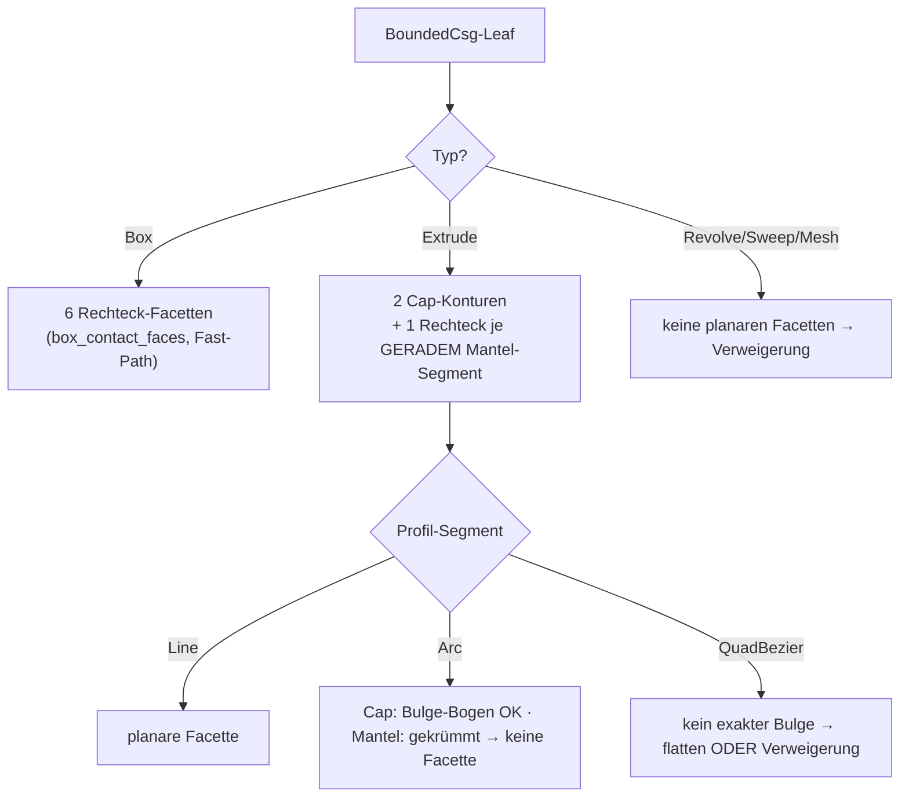

# FC — Nicht-konvexe / facettierte koplanare Kontaktflächen (Folgeprogramm c)

Design-Spike zum „Folgeprogramm (c)" des #384-Offset-Programms
(Fortsetzung von #395/#396/#398). Stand 2026-07-22. READ-ONLY-Spike:
Doku + Machbarkeits-Prototyp in
`crates/metricity-lab/tests/f_c_nonconvex_contact_spike.rs`; KEINE
Änderung am Produktionscode. Plan-SSOT des Programms bleibt
`docs/OFFSET-TREE-PLAN.md`; die tragenden Vorgänger sind
`F395-CONTACT-PATCH-DESIGN.md` (Kontakt-Prisma) und
`F396-RIM-OPCODE-DESIGN.md` (∂P-Rand-Fillet).

## 0. Verdikt vorweg

**Positiver Befund für das Prisma, sicher-beschränkter Befund für den Rim.**

Die Verallgemeinerung des **Kontakt-Prismas** auf beliebige planare Facetten
mit nicht-konvexen und mehrfach-zusammenhängenden Kontaktflächen P ist **billig
und sauber**: das Prisma ist heute schon ein `Extrude(Polygon)`-Member, und die
Polygon-Distanz (Even-Odd + Min-Kanten-Distanz) ist für einfache NICHT-konvexe
Polygone bereits exakt — es braucht **keinen neuen Opcode und keine
Zerlegung in konvexe Teile**. Die einzige neue Zutat ist der 2D-Verschnitt
selbst: statt Sutherland–Hodgman (nur konvex∩konvex) rechnet
`cavalier_contours` den booleschen Verschnitt zweier beliebiger Konturen und
liefert die **Zusammenhangskomponenten** (`pos_plines`) und **Löcher**
(`neg_plines`) direkt aus der API. Damit tilgt das Prisma den flächigen
2D-Innenfehler (bis > 9 mm, #395) für die ganze neue Kontaktklasse — mit
demselben 20–100-fachen Fehlerabfall, den #395 an Boxen gemessen hat.

Der **∂P-Rand-Fillet** (F396) verallgemeinert **sicher** (nie überfüllend) auf
nicht-konvexe P: gerade Stufen-Kanten und **konvexe** ∂P-Ecken rundet die
bestehende Nearest-Feature-Komposition ohne Zusatzterm; die additiv-only-
Halbraum-Maske plus die harte End-Cap-Klemme `t ∈ [0,1]` garantieren
Over-Fill = 0 auch an **konkaven (Reflex-)Ecken** von P. Der Preis der
Sicherheit: an einem Reflex-Vertex von P (der zwangsläufig mit einer
**intrinsischen konkaven Körperkante** des Extrude-Members zusammenfällt —
ein Trieder-Misch-Fall) rundet der Rim NICHT vollständig aus, sondern lässt
lokal den ehrlichen B0-Rest (≈0.75·δ) stehen. Das ist kein Wohlgestelltheits-
Bruch, sondern die bewusst gezogene Scope-Grenze: **eine korrekte
Reflex-Vertex-Rundung mischte Kontakt-Rim und intrinsische SSI-Naht** und liefe
in genau die submergierte-Π-Klemme, an der #395 Stufe 2 architektonisch
scheiterte. Verweigerung schlägt Falschkorrektur.

Netto ist jeder korrigierte Fall **strikt besser als heute**: heute meldet die
Capability für Nicht-Box-Kontakte den gesamten Kontakt als unkorrigiert
(`conservative`); mit dem verallgemeinerten Prisma wird er `tolerance_bounded`
(flächiger Fehler getilgt, Rest der δ-schmale ∂P-Saum), und wo der Rim greift
sogar `tolerance_bounded (channel_tol)`.

## 1. Ausgangslage — was heute BOX-only ist

Der Kontakt-Prisma-Pfad (`offset_channel.rs`) und der ∂P-Rim-Pfad
(`offset_rim.rs`) sind auf Box-Box-Kontakte beschränkt, an drei Stellen:

- `box_contact_faces` liefert die sechs Rechteck-Facetten NUR für
  `Primitive::Box` mit (nahezu) uniformer Skala; jeder Nicht-Box-Member
  gibt `None` → `contact_clips`/`synthesize_contact_prisms` verweigern
  (`refused`) und die #394-`conservative`-Degradierung bleibt.
- `clip_convex` (Sutherland–Hodgman) verschneidet die zwei projizierten
  Facetten-Loops. SH ist metrisch exakt NUR für konvex∩konvex; für
  nicht-konvexe Loops liefert es Unsinn. Das war eine bewusste Wahl (§4b von
  #395: SH ist am beweistragenden Gleich-Querschnitt-Fall S = U ohne die
  Orientierungs-/Overlapping-Degenerationen von `cavalier_contours`).
- `contact_clips` liefert je Facettenpaar GENAU EINE Kontur `p2d` (ein
  konvexes Verschnitt-Polygon), nie mehrere Komponenten oder Löcher; die
  ∂P-Kanten-Klassifikation (`edge_on_rect`) testet gegen Rechtecke.

Die Design-Aufgabe ist, diese drei Stellen auf beliebige planare Facetten zu
heben, ohne die für den Box-Fall bewiesene Exaktheit zu verlieren.

## 2. Design-Frage 1 — Facetten-Quelle

Für welche Leaf-Typen sind planare Facetten analytisch verfügbar?

| Leaf | planare Facetten | Kontur-Repräsentation |
|---|---|---|
| Box | alle 6 Seiten (bestehend) | Rechteck (4 Ecken) |
| Extrude, Deckel/Boden (`±half_height`) | 2 (die Profil-Umrisse) | Profil-Kontur: `Polygon`→Vertices, `Path`→Linien/Bögen |
| Extrude, Mantel je GERADEM Profilsegment | 1 Rechteck je Line-Segment | Segment × Höhen-Richtung |
| Extrude, Mantel je GEKRÜMMTEM Segment (Arc/Bezier) | KEINE (Zylinder-/Parabel-Fläche) | — → Verweigerung |
| Revolve / Helix / Sweep / Gyroid / Mesh | keine analytisch-planaren | — → Verweigerung |

Der Weg vom `BoundedCsg`-Leaf zur Facetten-Kontur:

- **Box:** unverändert `box_contact_faces` (Fast-Path, s. §6).
- **Extrude-Deckel/-Boden:** die zwei Cap-Ebenen liegen bei lokal
  `z = ±half_height`, Außennormale = ±lokale-Z, per `world_transform` in die
  Welt gehoben. Die Cap-Kontur IST der Sketch-Umriss: `Sketch2dPrimitive::Polygon`
  liefert die Vertices direkt; `Path` liefert die Segmentkette
  (`Line`/`Arc`/`QuadBezier`); `Rectangle`/`Circle`/`Sector` sind analytisch in
  eine Kontur konvertierbar. `Arc`-Segmente tragen als `cavalier_contours`-
  Polyline exakte **Bulge-Bögen** (bulge = tan(θ/4)); `QuadBezier` hat keinen
  exakten Bulge → flatten (PATH_FLATTEN_SAMPLES) ODER Verweigerung (empfohlen:
  Verweigerung, bis ein Bedarf besteht — Ehrlichkeit vor Näherung).
- **Extrude-Mantel:** jedes GERADE Profil-Segment (`Line`) extrudiert zu einer
  planaren Rechteck-Facette (Segment-Länge × 2·half_height). Deren Außennormale
  ist die In-Profil-Kantennormale, gedreht ins Welt-Frame. GEKRÜMMTE Segmente
  ergeben keine planare Facette → sie nehmen an keinem koplanaren Kontakt teil.
- **Revolve/Helix/Sweep:** die Mantelflächen sind gekrümmt (Rotations-/
  Sweep-Flächen), die Endkappen i. A. ebenfalls nicht als einfaches Polygon
  fassbar → generell Verweigerung (wie heute).

Die verallgemeinerte `ContactFace` trägt statt eines 4-Ecken-`loop3` eine
**Kontur mit optionalen Bögen** (Welt-3D-Punkte + Bulge je Kante, oder direkt
die projizierte 2D-`cavalier_contours::Polyline`). Normale, Ebenen-Offset und
Member-Dicke bleiben wie gehabt.



## 3. Design-Frage 2 — Kontakt-Erkennung und P im nicht-konvexen Fall

Der **Koplanaritätstest** zweier Facetten ändert sich NICHT: anti-parallele
wahre Normalen (Erosion) bzw. effektive Komplement-Normalen `eff = −sign·n̂`
(Dilation, sign-bewusst wie #397), koinzidenter Offset innerhalb `coincide_tol`.
Das ist rein normalen-/offset-basiert und unabhängig von der Kontur-Konvexität —
`coplanar_interface_present` und die Detektion in `contact_clips` gelten
unverändert.

Neu ist die **2D-Intersection**: statt `clip_convex(&la, &lb)` rechnet man
`la.boolean(&lb, BooleanOp::And)` auf den beiden in die Π-Basis projizierten
Konturen (als `cavalier_contours::Polyline` mit Bulge). Das Ergebnis ist der
Kontakt P — und im nicht-konvexen Fall ist P **kein einzelnes Polygon mehr**:

- `res.pos_plines` = die **Zusammenhangskomponenten** von P (mehrere disjunkte
  Kontaktinseln). Jede wird zu einem eigenen Kontakt-Prisma und einem eigenen
  ∂P-Rim-Loop.
- `res.neg_plines` = **Löcher** in einer Komponente (mehrfach-zusammenhängender
  Kontakt). Ein Loch entsteht nie aus konvex∩konvex, wohl aber aus einem
  Extrude-Profil mit Innenrand oder einem versenkten Abzug.

Der Prototyp (§7) belegt beides direkt an cavalier: L-Form ∩ Rechteck = die
L-Form (eine nicht-konvexe Komponente, Fläche 20, exakt); zwei „⌐"-Konturen
verschneiden zu ZWEI disjunkten 2×2-Inseln; Platte ∖ Innenkreis liefert eine
`neg_pline` mit echten Bögen.

## 4. Design-Frage 3 — Prisma-Verallgemeinerung (der tragende Positiv-Befund)

Das heutige Prisma ist bereits `BoundedCsg::from_csg_with_carry(Extrude {
sketch: Polygon { vertices } , half_height, … })` — ein Polygon-Extrudat.
Die entscheidende Beobachtung:

> Die Polygon-SDF (`Sketch2dPrimitive::Polygon`, Even-Odd-Kreuzungszahl +
> Min-Distanz zu allen Kanten) ist für **einfache nicht-konvexe Polygone
> bereits die exakte signierte Distanz**. Nicht-Konvexität kostet NICHTS am
> Feld — es braucht **keine Trapezoid-/konvexe Zerlegung**.

Damit ist die Prisma-Verallgemeinerung im Tape und in allen fünf
Evaluator-Spiegeln **praktisch gratis**:

| Aspekt | Kosten |
|---|---|
| Neuer Opcode | **keiner** — es bleibt `OP_PRIM2D_PATH`/`OP_PRIM2D_POLY` |
| CPU / eval_opcodes / sdf-vm (WGSL) / fidget / CGAL | **0** — jeder Spiegel wertet Extrude-Leaves schon aus |
| Feld-Kosten je Sample | O(N Kanten von P) — wie bei jedem Nutzer-Extrude |
| Bögen in P (Bulge-Kanten) | via `Sketch2dPrimitive::Path` mit `Arc`-Segmenten (exakte Bogen-Distanz, schon gespiegelt) statt `Polygon` |
| Löcher in P (`neg_pline`) | eine zusätzliche `Difference{ Extrude(outer), Extrude(hole) }` — ein Extra-Member, ebenfalls opcode-frei |
| Mehrere Komponenten | je Komponente ein Union-Member (Erosion) bzw. Difference-Constraint (Dilation) — wie mehrere Box-Prismen heute |

Die beweistragenden Eigenschaften bleiben unberührt: `prism_subset_of_union`
(bzw. `prism_outside_inner` für Dilation) sampelt ein Gitter über der
Prisma-AABB und prüft S ⊆ U feld-seitig — konvexitäts-unabhängig. Cap-Tiefen
kommen wie gehabt aus der echten Member-Dicke normal zu Π (Extrude:
`2·half_height`).

**Konsequenz:** Der flächige 2D-Innenfehler wird für die gesamte neue
Kontaktklasse getilgt, ohne die Evaluatoren anzufassen. Der Aufwand liegt — wie
schon bei #395/#396 — vollständig in der **Synthese** (Facetten-Extraktion +
cavalier-Verschnitt + Komponenten-/Loch-Aufspaltung), nicht im Feld.

## 5. Design-Frage 4 — ∂P-Rim-Verallgemeinerung (sicher, mit gezogener Grenze)

`RimRecord`/`RimFeature` sind heute Segment-basiert (a, b + zwei Wand-Normalen).
Ein nicht-konvexes ∂P hat konvexe UND konkave (Reflex-)Ecken sowie ggf.
Bogen-Kanten. Die Zerlegung:

- **Kanten-Klassifikation** verallgemeinert direkt: `edge_on_rect` (Lot-Distanz
  einer ∂P-Kante zu den vier Rechteck-Geraden) wird zu `edge_on_contour` (liegt
  die ∂P-Kante auf der Randlinie von Member i's Kontur, j's Kontur, oder beider?
  → `Flush` / `Step{wall}` / `Degenerate`). Das ist derselbe rein-analytische
  Kollinearitätstest, nur über beliebige Kontur-Segmente statt vier
  Rechteck-Kanten. Für Bogen-Kanten von ∂P: die Spine wird ein `ChannelArc`
  (Bogen), exakt wie die bestehende Arc-Spline-Repräsentation — der Rim trägt
  Bögen bereits konzeptionell (F396 §2.1).
- **Welche Kanten bekommen Fillets:** nur konkave Erosions-Stufen (bzw. konvexe
  Dilations-Keile) — das bestehende **Konkavitäts-Gate** bleibt: gemischte
  `wall_member` an ∂P (versetzter Kontakt) ⇒ komplette Verweigerung des Rims
  (die A-Rand-Kanten wären konvexe Stufen nach unten, kein konkaver Sliver —
  der Fillet würde sie fälschlich auffüllen). Für einen **enthaltenen**
  nicht-konvexen Kontakt (P vollständig im Über-Stander, z. B. L-Profil in
  großer Box) ist `wall_member` homogen → das Gate passiert, alle Stufen-Kanten
  sind echte konkave Reflexkanten.
- **Konvexe ∂P-Ecken:** die Nearest-Feature-Komposition rundet sie ohne
  Zusatzterm (Design F396 §2.4) — unverändert.
- **Konkave (Reflex-)Ecken von P** sind der einzige genuin neue Fall. An einem
  Reflex-Vertex des Kontur-P (Innenwinkel > 180°, z. B. (2,2) der L) fällt die
  vertikale Prisma-Kante mit einer **intrinsischen konkaven Körperkante** des
  Extrude-Members zusammen (das nicht-konvexe Profil hat dort eine reentrant
  vertikale Kante). Es treffen also DREI konkave Features zusammen: zwei
  Kontakt-Stufen-Dieder (Wand–Π) + eine intrinsische Wand–Wand-Reflexkante. Das
  ist ein (√3−1)·δ-Trieder-Misch-Fall.

**Warum der Rim hier nicht bricht, aber auch nicht voll rundet:** Die
additiv-only-Konstruktion (`min(g, δ−de)`) mit Halbraum-Maske UND harter
End-Cap-Klemme `t ∈ [0,1]` kann **niemals überfüllen** — jede Kanten-Spine
endet exakt am Reflex-Vertex, die Masken halten den Term strikt in der
Reflex-Schneise (F396 §2.3: Over-Fill empirisch 0.0000 an allen Fällen). Am
Reflex-Vertex hören die beiden adjazenten Kanten-Fillets an ihren End-Caps auf,
und die kleine Vertex-Umgebung bleibt auf dem Prisma-Wert stehen → **lokaler
Unterschuss der B0-Klasse (≈0.75·δ), kein Überschuss**. Das ist exakt die
Ehrlichkeits-Doktrin: der Fillet rundet Kanten und konvexe Ecken metrisch
exakt, lässt den Reflex-Vertex als ehrlichen Rest.

Eine **vollständige** Reflex-Vertex-Rundung müsste den Kontakt-Rim mit der
intrinsischen konkaven Körperkante (die die reguläre `OP_ARC_CHANNEL`/SSI-Naht
bedient) zu einem Trieder-Term verweben. Genau diese Naht läuft aber bis zur
submergierten Π hinunter und trifft dort die **Luftseiten-Klemme
`s₁ = ⟨dq, m̂₁⟩ = 0`**, an der #395 Stufe 2 architektonisch scheiterte
(F395 §Umsetzungs-Status). Ein solcher Term ist **außerhalb dieses Scopes** —
und der `synthesize_vertices`-Gate (gleiche `wall_member` ⇒ kein Vertex-Term)
lässt ihn ohnehin schon aus. Es bleibt bei der ehrlichen lokalen B0-Schranke.

**Verweigerungsfälle (wohlgestellt-halten):**
- versetzter/gemischter Kontakt (gemischte `wall_member`) → ganzer Rim
  verweigert (bestehend);
- Reflex-Vertex → adjazente Kanten enden am Cap, Vertex-Umgebung ehrlich
  ungerundet (kein Term, kein Over-Fill);
- Bogen-Stufen mit tangentialem Übergang (Bulge → Wandnormale dreht stetig) →
  wie die quasi-tangentiale Kanal-Degeneration behandeln (unter Toleranz ⇒ kein
  Fillet).

## 6. Design-Frage 5 — Zahlendomänen

`cavalier_contours` rechnet in f64 — dieselbe Domäne wie die bestehende
`ContactClip`-Pipeline (Verschnitt/Projektion in f64, Emission in f32). Die
A1-Bibliotheks-Evaluation (`crates/metricity-lab/src/bin/a1_offset_lib_spike.rs`)
maß die Boolean-/Bogen-Genauigkeit: Flächenfehler ~1e-6, radiale Bogen-Fehler
klein — komfortabel unter der Fuzz-P3-Schranke (0.1·δ) und der
`exact_tol`-Kalibrierung. Die bestehende f64→f32-Toleranzkalibrierung trägt
also unverändert.

Zwei Gotchas aus der A1-Empirie sind einzuplanen (beide bereits im Box-Pfad
adressiert):
- **Orientierung nicht garantiert:** `BooleanOp::Not`-Ergebnisse kommen teils CW
  zurück → per `area()`-Vorzeichen normalisieren (`if area2d < 0 { reverse }` ist
  schon da).
- **Fast-koinzidente Kanten:** boolesche Ops auf nahezu deckungsgleichen
  Eingaben können Sliver-Artefakte erzeugen → `cleanup_poly` + Flächen-Schwelle
  (`ap < overlap_min²`) fangen das (schon da).

Der **beweistragende Gleich-Querschnitt-Fall S = U** (Box-Box, exakte Deckung)
bleibt bewusst auf dem **Sutherland–Hodgman-Fast-Path** (`clip_convex`): dort ist
konvex∩konvex metrisch exakt und OHNE die Orientierungs-/Overlapping-
Degenerationen, die cavalier an exakt-koinzidenten Eingaben zeigen kann (der
Grund, warum #395 SH wählte). `cavalier_contours` wird ausschließlich für
NICHT-konvexe / Nicht-Box-Facetten gezogen — konvex-Box-Kontakte laufen
unverändert exakt. So verliert die Verallgemeinerung nichts an der bewiesenen
Box-Exaktheit.

## 7. Prototyp (Machbarkeits-Beleg)

`crates/metricity-lab/tests/f_c_nonconvex_contact_spike.rs`, grün
(`cargo test -p metricity-lab --test f_c_nonconvex_contact_spike`, 3/3):

- `l_shape_contained_in_rect_is_l_shape` — L-Form ∩ überragendes Rechteck =
  die L-Form; genau EINE Komponente, kein Loch, Fläche exakt 20 (= 6·6−4·4),
  keine Bögen. Der nicht-konvexe Analog-Fall zum Box-Stack.
- `two_ls_intersect_in_two_components` — zwei koplanare „⌐"-Konturen
  verschneiden zu ZWEI disjunkten 2×2-Inseln (`pos_plines.len() == 2`); die
  Komponenten-Zerlegung fällt direkt aus der API. **Kernbeleg.**
- `contact_with_hole_yields_neg_pline` — Platte ∖ Innenkreis liefert eine
  `neg_pline` (Loch) mit echten Bögen (Bulge ≠ 0); belegt mehrfach-
  zusammenhängende Kontakte und die Bulge-Repräsentation (gekrümmte Kontakte
  sind repräsentierbar, werden aber per Scope NICHT korrigiert).

Der Prototyp ist klar als Spike markiert und ändert kein Feld.

## 8. Design-Frage 6 — Aufwand, Risiken, Phasenplan

Analog zum RimFillet-Rollout (Synthese unverdrahtet → Opcode → Spiegel →
scharfschalten), hier ohne Opcode-Phase (das Prisma braucht keinen):

- **Phase 1 (unverdrahtet, feldneutral):** `box_contact_faces` →
  `member_contact_faces` (Box-Fast-Path + Extrude-Cap-/Mantel-Facetten mit
  Bulge-Konturen); `contact_clips` auf `cavalier_contours::boolean(And)` mit
  Komponenten-/Loch-Aufspaltung; SH-Fast-Path für Box-Box behalten. Tests wie
  der Spike. **2–3 Tage.**
- **Phase 2 (Prisma verdrahten):** je Komponente ein `Extrude(Polygon|Path)`-
  Member; Löcher als `Difference{outer, hole}`; Einhängung in
  `synthesize_stop`/`synthesize_offset_channels_reported` wie die Box-Prismen.
  KEIN neuer Opcode. Capability auf `tolerance_bounded` heben. **1–2 Tage.**
- **Phase 3 (Rim verallgemeinern):** `edge_on_rect` → `edge_on_contour`;
  Bogen-Stufen als `ChannelArc`-Spine; Reflex-Vertex-Verweigerung (End-Cap
  lässt ihn ehrlich ungerundet); Konkavitäts-Gate unverändert. **2–3 Tage.**
- **Phase 4 (scharfschalten):** Fuzz-Familie `NonConvexContact` (L-in-Box,
  zwei-Inseln, Loch-Kontakt) mit Doppel-GT; CGAL-Goldens
  (`contact_prism_lshape`, `contact_prism_two_islands`); Capability-Anhebung.
  **1–2 Tage.**

Summe grob **6–10 Tage**, überwiegend Synthese.

**Explizit NICHT im Scope (Verweigerung, ehrlich beschränkt):**
- Revolve-/Helix-/Sweep-Mantel und gekrümmte Extrude-Mantel-Segmente (keine
  planaren Facetten);
- gekrümmte Kontakte (Bogen-∂P mit tangentialem Übergang, Zylinder-auf-Ebene);
- QuadBezier-Profilkanten exakt (flatten oder verweigern);
- vollständige Reflex-Vertex-Rundung (Trieder-Misch aus Kontakt-Rim +
  intrinsischer SSI-Naht — die Stufe-2-Klemme; bleibt B0-beschränkt).

**Risiken:**
- `cavalier_contours`-Robustheit an fast-koinzidenten Nicht-Box-Facetten
  (Sliver, Fehl-Komponenten) — Fast-Path + cleanup + Flächen-Schwelle mildern;
  bei Unsicherheit verweigern.
- Facetten-Explosion bei hoch-facettierten Profilen (viele Mantel-Rechtecke) —
  die koplanare Detektion filtert per Normale/Offset früh, nur echte Kontakte
  gehen in den Verschnitt.
- ≥ 3 Member auf derselben Ebene (paarweise P, überlappende Prismen) — min-
  Komposition bleibt konservativ korrekt, ∂P-Zerlegung mehrdeutig (bestehendes
  Plan-§9-Kaskaden-Risiko).

## 8b. Phase-4-Abschluss — Umsetzungsstand (2026-07-22)

Phase 4 ist umgesetzt und feldneutral für alle Alt-Szenen (Golden byte-identisch,
CGAL-Interpreter-Cross-Check 0 Failures über alle 35 Szenen inkl. der neuen).

- **Bogen-∂P-Rand-Fillet — NEUER Opcode `OP_RIM_FILLET_ARC` (0x44).** Der gerade
  `OP_RIM_FILLET` (0x43) bleibt **byte-identisch** (rein gerade Kontakte emittieren
  weiter 0x43). Ein Stopp mit mindestens EINER konvexen Bogen-∂P-Kante emittiert
  STATTDESSEN einen einzigen gemischten `OP_RIM_FILLET_ARC`-Block, der **alle**
  Features trägt (Geraden als Segment-Records `sweep<0`, Bögen als Bogen-Records
  `sweep>0`) — in EINER Nearest-Feature-Auswahl. Grund für den gemischten Block
  statt zweier getrennter Blöcke: an einer Linie↔Bogen-Ecke (abgerundetes
  Rechteck, Stadion) überlappen die Feature-Schneisen; ein sequenzielles `min`
  über getrennte Blöcke nähme dort die fernere Kante und **überfüllte** (Design §5).
  Der Bogen-Spine trägt Zentrum `c`, Basis `(u,v)`, Radius `r`, `sweep` und die
  RADIALE Wandnormale `wall_sign·(q−c)/r`; die Distanz ist die exakte radiale
  Tube-Distanz zum Kreisbogen in der Kontaktebene. **Warum neuer Opcode statt
  Parametrisierung:** die Bogen-Geometrie (Zentrum/Basis/Radius/Sweep + radiale,
  fußpunkt-abhängige Wandnormale) ist strukturell unvereinbar mit dem
  Segment-Record; ein `is_arc`-Flag im 0x43-Record hätte die Stride verdoppelt und
  jeden der sechs Evaluator-Hot-Loops belastet. Der separate Opcode hält 0x43
  unverändert (Golden-Neutralität) und additiv.
- **Innen- vs. Außenbogen.** KONVEXE Bögen (Zentrum auf der Material-Seite; der
  Wandzylinder ist konvex) werden gerundet — der Fillet auf der Außenseite kann
  nicht selbst-schneiden, Over-Fill = 0. KONKAVE Bögen (Zentrum auf der Luftseite,
  Material-seitig hohl — der gekrümmte Reflex-Fall, z. B. Kreisloch-Wände) werden
  wie Reflex-Vertices **ehrlich verweigert** (`residual ≈ 0.75·δ`): dort
  konvergierte der δ-Tube nach innen und überfüllte für δ nahe/über dem
  Bogenradius. Reine Bogen-Loops OHNE gerade Anker-Stufe (z. B. Kreis-Cap-Kontakt)
  werden ebenfalls verweigert — der Wand-Member ist ohne gerade `edge_on_contour`-
  Stufe nicht eindeutig bestimmbar (Scope-Grenze, Ehrlichkeit vor Näherung).
- **Bogen-tragende Kontakt-Prismen.** `build_prism_component` verweigert
  Bogen-Konturen nicht mehr, sondern baut sie als `Extrude(Path)` mit exakten
  `SketchSegment::Arc`-Bögen (OP_PRIM2D_PATH — in ALLEN Evaluatoren vorhanden).
  Rein gerade Konturen bleiben `Extrude(Polygon)` (byte-identisch).

### Capability-Vertrag (final, Phase 4)

Für einen dualen Offset-Stopp mit koplanarem submergiertem Kontakt gilt:

| Fall | Status | Zugesagte Schranke |
|---|---|---|
| Gleich-Querschnitt-Kontakt S = U (Box=Box) | `exact` | 0 (nur GT-Messboden) |
| Konvexes P, Rim schließt ∂P ganz (Box-Stack, abgerundetes Rechteck) | `tolerance_bounded` | Fillet-Approximation ≤ `channel_tol` (≈0.1·δ empirisch) |
| Nicht-konvexes P, Rim schließt GERADE ∂P-Kanten, Reflex-Vertices/konkave Bögen offen | `tolerance_bounded` | B0-Rest an Reflex-Vertices/Bögen ≈0.75·δ |
| Versetzter (staggered)/gemischter Kontakt — Rim verweigert | `tolerance_bounded` | konkaver B0-Sliver ≈0.75·δ (Prisma-only) |
| Nicht-Box-Partner ohne planare Facetten / gekrümmter Kontakt / degenerierter Verschnitt | `conservative` | keine (f∓δ unbeschränkt) |

**Multi-Clip-Ehrlichkeit (Phase-4-Fix):** verweigert an EINEM Stopp ein Rim-Loop
(versetzt/Reflex/konkaver Bogen) und schließt ein anderer sauber, meldet
`synthesize_stop` NICHT mehr die enge `channel_tol`-Schranke, sondern die weitere
0.75·δ-Schranke (der `residual` des verweigerten Loops dominiert). Das war zuvor
ein Bound-Over-Claim: der ehrliche Rest des verweigerten Loops blieb ungenannt.

## 8c. Durchdringende Kontakte — signierte Kontaktlage (#384, 2026-08-01)

Der Kontakt-Vertrag oben setzte stillschweigend voraus, dass ein Kontakt BÜNDIG
ist: zwei Member-Facetten auf DERSELBEN Ebene Π. Der Detektor prüfte das mit
einem **unsignierten** Fenster `|o_a + o_b| ≤ 0.5·δ` (Box) bzw. `0.02·δ`
(Nicht-Box) und verankerte das Prisma an EINER der beiden Ebenen. Die signierte
Größe

    s := o_a + o_b        (fa.n = −fb.n; Member i auf n̂·x ≤ o_a, j auf n̂·x ≥ −o_b)

ist aber die **Durchdringungstiefe**: `s = 0` bündig, `s > 0` die Member stecken
um `s` ineinander, `s < 0` es klafft ein Luftspalt. Das alte Fenster vermengte
alle drei Lagen und erzeugte drei Falschaussagen — jede unter dem Stempel
`exact` (gemessen an zwei achsparallel gestapelten Boxen, δ = 2 mm):

| Lage | alter Befund | Fehlergröße |
|---|---|---|
| `s < 0` (Luftspalt 0.1 mm) | Prisma **überbrückt die Luft** | 8 mm Phantom-Material, wo die wahre Erosion leer ist |
| `0 < s ≤ 0.5·δ` | Prisma an EINER Ebene verankert, trägt j's volle Dicke ⇒ ragt um `s` über die Gegenseite | bis 1 mm Phantom-Material über der wahren Erosionsdecke |
| `0.5·δ < s < 2·δ` | gar kein Prisma; `min(f_i) + δ` reißt einen **Phantom-Schlitz** der Dicke `2δ − s` | Nullmengenfehler bis 1.47 mm ≈ 0.735·δ |

Der Fix ist **Synthese, kein Downgrade** — die Geometrie des durchdringenden
Falls ist wohldefiniert und braucht keinen neuen Term:

1. **Signierte Klassifikation** (`offset_channel::face_pair_penetration`):
   `s < −round_tol` → echter Luftspalt, KEIN Kontakt; `s ≥ 2·δ` → die erodierten
   Member überlappen noch, es entsteht gar kein Schlitz → keine Korrektur nötig;
   sonst Kontakt mit `pen = max(s, 0)`. `round_tol` ist die bereits kalibrierte
   f32-Rundungsklasse `0.02·δ` (#397) — jetzt für BEIDE Facettenklassen. Das
   alte `0.5·δ` als Klemme war der Fehler: es faltete 1 mm echte Durchdringung
   auf „bündig".
2. **Korrekte Prisma-Ausdehnung:** das Prisma spannt von Member i's Rückseite
   `o_a − depth_neg` bis Member j's Rückseite `(−o_b) + depth_pos`, d. h. die
   effektive +n̂-Tiefe ist `depth_pos − pen`. Für `pen = 0` ist das
   **bit-identisch** zum Bestandspfad (Golden byte-identisch verifiziert).
   `S ⊆ U` gilt exakt: über P überdecken i's und j's Slab das Intervall
   lückenlos, weil `−o_b ≤ o_a`.
3. **SSI-Nähte nur am BÜNDIGEN Kontakt unterdrücken.** Am bündigen Kontakt sind
   die Nähte des Paars koinzident/tangential degeneriert (der Grund der
   Unterdrückung seit #395). Am DURCHDRINGENDEN Kontakt ist die Naht am
   Kontaktrand eine echte transversale Dieder-Kante (Deckfläche × Seitenwand,
   Normalen 90°) — die korrigieren die regulären `OP_ARC_CHANNEL`-Kanäle sauber;
   sie zu unterdrücken nähme dem Stopp seine einzige ∂P-Korrektur.
4. **Rim-Spiegel bleibt bündig-only.** `contact_clips` (die Quelle von
   `offset_rim::RimBlock`) nimmt nur `|s| ≤ round_tol` auf: ein durchdringender
   Kontakt hat keine gemeinsame Ebene Π, der Rim legte seine Spine sonst auf die
   submergierte statt auf die exponierte Ebene. Statt dessen sagt die Capability
   für ungleiche Querschnitte ehrlich die weitere B0-Schranke ≈0.75·δ zu
   (`ContactResult::pen_unrimmed`) — kein Bound-Over-Claim durch die enge
   `channel_tol` eines bündigen Nachbar-Kontakts am selben Stopp.
5. **Fehlalarm-Widerlegung.** Das Carrier-Gate `coplanar_interface_present`
   sieht durchdringende Kontakte nicht (es verlangt überlappende Facetten-AABBs)
   → additiver Trigger `contact_face_scan().penetrating`. Umgekehrt meldete es
   für einen 0.1-mm-Luftspalt einen Verdacht, den der Facetten-Scan widerlegt:
   sind ALLE Member-Facetten analytisch bekannt und ist KEIN Paar in Kontakt,
   entfällt die #394-Verdachtsmeldung (getrennte Körper erodieren unabhängig
   und exakt).

### Ergänzung zum Capability-Vertrag

| Fall | Status | Zugesagte Schranke |
|---|---|---|
| Durchdringung `0 < s < 2·δ`, Gleich-Querschnitt (S = U) | `exact` | 0 (nur GT-Messboden) |
| Durchdringung `0 < s < 2·δ`, ungleicher Querschnitt | `tolerance_bounded` | B0-Sliver am Kontaktrand ∂P ≤ 0.75·δ (Prisma-only; die SSI-Kanäle liegen faktisch darunter, werden aber nicht zugesagt) |
| Überlappung `s ≥ 2·δ` | unverändert | kein Schlitz; die naive Erosion ist in Normalenrichtung zero-set-exakt, echte konkave Nähte gehören den Kanälen |
| Luftspalt `s < −round_tol` | `exact` | getrennte Körper erodieren unabhängig exakt |

**Nicht im Scope (offen):** der duale DILATIONS-Pfad
(`synthesize_contact_prisms_dilation`) fährt weiter das symmetrische
Koinzidenz-Fenster. Er sagt nie `exact` zu (¬box unbeschränkt), eine
Fehl-Verankerung dort wäre also ein Bound-Over-Claim, keine Exakt-Lüge — und
seine 0.5·δ-Kalibrierung ist per `thin_wall_shell_status_unchanged_397`
eingefroren. Die signierte Behandlung dort ist ein eigener Schritt.
→ nachgeholt in §8d.

## 8d. Der duale Dilations-Pfad — dasselbe Fenster, gedrehtes Vorzeichen (#384, 2026-08-01)

§8c ließ den Dilations-Pfad offen mit der Vermutung, eine Fehl-Verankerung
wäre dort „nur" ein Bound-Over-Claim. Die Messung bestätigt den Befund und
verschärft ihn: der Pfad **verletzt seine engste Zusage um den Faktor 200**,
und die eingefrorene Kalibrierung war der Grund.

### Was der Pfad wirklich bedient

Dilation distribuiert über Union exakt — der Pfad existiert also für die
Intersection/Difference-Form. In der Komplement-Dualität (§8c-Rahmen, De
Morgan) sind die Member `¬A` (unbeschränkt, `sign = +1`) und `B` (der
Subtrahend, `sign = −1`); die signierte Größe ist

    s := O_i + O_j,   O = −sign·o    ⇒   für A − B:  s = o_B − o_A

Sie misst die Durchdringung der KOMPLEMENTE, und darum bedeutet ihr Vorzeichen
etwas anderes als bei der Erosion — es DREHT sich:

| `s` | Geometrie | wahre Lage |
|---|---|---|
| `s = 0` | bündig ausgeschnittene Tasche (flush cut), Taschenmund koplanar mit A's Außenfläche | echter submergierter Kontakt — der Fall, für den die Korrektur gebaut wurde |
| `s > 0` | B ragt um `s` aus A heraus; der Taschenboden liegt um `s` höher | Kontakt mit Überstand — Prisma nötig, aber anders verankert |
| `s < 0` | B ist um `|s|` VERGRABEN: geschlossener Hohlraum hinter einem Deckel der Dicke `|s|` | **gar kein Kontakt** — es gibt keinen Taschenmund und keinen Phantom-Fin |

Bei der Erosion war `s < 0` der harmlose Luftspalt; hier ist `s < 0` der
gefährliche Fall. Die praktisch wichtigste Geometrie dieser Lage ist die
**geschlossene Shell** `Difference(box, box)` mit Wandstärke `w`: sie ist
`s = −w` auf allen sechs Achsen gleichzeitig.

### Gemessen (δ = 2 mm, Referenz = exakte Distanz zu `A \ B` über dessen ≤6-Box-Zerlegung; `|d − δ|` ist eine UNTERE Schranke des Nullmengen-Fehlers)

Sonde: A = Box he 10³, B = Box he [7,7,5], Mittelpunkt `z = 5 + s`
(`crates/kernel/src/offset_capability_tests.rs`).

| Lage | Status (vorher) | zugesagt (vorher) | REAL (vorher) | nachher |
|---|---|---|---|---|
| `s ∈ [−1.0, −0.05]` (Deckel bis 0.5·δ) | `tolerance_bounded` | ≤ 0.01 mm | **≥ 2.000 mm = 1.0·δ** | `exact`, 0.000 mm |
| `s = 0` (bündig) | `tolerance_bounded` | ≤ 0.01 mm | 0.000 mm | unverändert |
| `0 < s ≤ 0.5·δ` | `tolerance_bounded` | ≤ 0.01 mm | **genau `s`, bis 1.000 mm** | ≤ 1.500 mm zugesagt, 0.395 mm real |
| `0.5·δ < s < 2·δ` | `tolerance_bounded` | ≤ 0.01 mm | **5.159 mm** (kein Prisma → Phantom-Fin über der Tasche) | ≤ 1.500 mm zugesagt, 0.395 mm real |

Box-Shell, Wandstärke `w`, dieselbe Referenz, 61³-Gitter:

| `w/δ` | Status (vorher) | fehlklassifizierte Innenpunkte (vorher) | nachher |
|---|---|---|---|
| 0.1 | `tolerance_bounded` (≤ 0.01 mm) | 62118 / 94958 = 65 % | 0 / 94958, `exact` |
| 0.3 | `tolerance_bounded` (≤ 0.01 mm) | 60780 / 101104 = 60 %, davon 5766 im echten SOLID | 0, `exact` |
| 0.5 | `tolerance_bounded` (≤ 0.01 mm) | 63632 / 106506 = 60 %, davon 11508 im echten Solid | 0, `exact` |
| 0.8 | `exact` | 0 | unverändert |
| 1.0 | `exact` | 0 | unverändert |

Das Prisma spannte beim vergrabenen Hohlraum von der Deckel-AUSSENfläche quer
durch den Deckel bis zur Rückseite des Hohlraums und subtrahierte alles
dazwischen — der Deckel verschwand, der Hohlraum wurde zum Kamin. Die duale
Sicherheits-Stichprobe `prism_outside_inner` (7³ Punkte über der Prisma-AABB)
sieht das nicht: bei ~5 mm Abtastweite fällt ein 0.6-mm-Deckel durch das Raster.

### Fix (Spiegel von §8c, nicht blind gespiegelt)

1. **`face_pair_penetration` auch hier** — dieselbe Funktion, dieselbe
   f32-Rundungsklasse `0.02·δ` für BEIDE Facettenklassen. `s < −round_tol` →
   kein Kontakt (vergrabener Hohlraum), `s ≥ 2·δ` → keine Korrektur nötig,
   sonst Kontakt mit `pen = max(s, 0)`.
2. **Prisma-Ausdehnung `depth_pos − pen`**, wenn die `+n̂`-Seite ein ECHTER
   Member ist (`sign = −1`, endliche Dicke). Ist sie die ¬box-Seite, bleibt
   `margin` unangetastet: das ist keine Rückseite, sondern eine synthetische
   Reichweite ab der Ankerebene, die ≥ lateraler Reichweite von P bleiben muss.
3. **`contact_clips` (Rim-Quelle) wird bündig-only** — auch im
   Dilations-Zweig. Ein durchdringender Kontakt hat keine gemeinsame Ebene Π;
   der Rim legte seine Spine sonst auf die falsche und sagte dafür die enge
   Bau-Toleranz zu. Statt dessen `pen_unrimmed` → ehrliche B0-Schranke 0.75·δ
   (Phase-4-Multi-Clip-Regel, damit ein bündiger Nachbar-Kontakt am selben
   Stopp die Zusage nicht wieder verengt).
4. **SSI-Nähte bleiben hier für JEDES Kontakt-Paar unterdrückt** — anders als
   am Erosions-Stopp, und das ist gemessen statt gespiegelt. Am Dilations-Stopp
   SUBTRAHIEREN die Kanäle (konvexe Dualkante). Der Kanal über der
   Mündungs-Naht eines durchdringenden Kontakts griff im Versuch bis an die
   AUSSENkante des Trägerkörpers durch und trug dort legitimes Material ab:
   0.760 mm Fehlstelle gegen 0.395 mm ehrlichen B0-Keil mit Unterdrückung.
   Beide Varianten halten die 0.75·δ-Zusage; die kleinere gewinnt.

### Was das die eingefrorene Kalibrierung kostet

`thin_wall_shell_status_unchanged_397` fror für die BOX-Spalte bei
`w < 0.5·δ` genau diese Falschaussage ein (`tolerance_bounded` ≤ 0.01 mm bei
2.000 mm realem Fehler). Der Pin bewegt sich also — aber nicht als
Abwägung, sondern als Streichung: die WAHRE Zusage der Familie ist `exact`,
belegt mit derselben Referenz, die auch die (unveränderten) Zeilen ≥ 0.8·δ
bestätigt. Die EXTRUDE-Spalte — der eigentliche #397-Gegenstand (eff-Fallback
mit enger Koinzidenz) — steht unverändert.

### Neuer, hier NICHT behobener Befund (eigenes Paket)

Bei `s ≥ 2·δ` (kein Prisma, unverändert vor wie nach dem Fix) korrigiert der
reguläre `OP_ARC_CHANNEL`-Pfad die Mündungs-Naht und trägt dabei an der
Außenkante des Trägerkörpers **0.760 mm** ab, während er ≤ 0.01 mm zusagt
(`worst` bei `[−10.73, 6.53, 11.0]`, δ = 2). Das ist ein Bound-Over-Claim des
KANAL-Pfads, nicht des Prisma-Pfads, und existiert unabhängig von #384-8d.

## 8e. Die End-Kappe des Kanal-Terms (#384, 2026-08-01)

§8d ließ einen Befund offen: bei `s ≥ 2·δ` — wo korrekt KEIN Prisma entsteht,
vorher wie nachher — trug der reguläre `OP_ARC_CHANNEL`-Pfad an der
**Außenkante des Trägerkörpers** 0.760 mm ab (worst bei `[−10.73, 6.53, 11.0]`,
δ = 2), während die Capability ≤ 0.01 mm zusagte. Das ist ein Bound-Over-Claim
um Faktor 76, und er sitzt weit weg von der Naht, die der Kanal korrigiert.

### Diagnose: die Kappe, nicht der Kegel, nicht der Trust-Radius

Die C2-Konstruktion ist exakt, solange der nächste Punkt `q*` der Naht-Kurve
AUCH der nächste Randpunkt des Körpers ist. Am **offenen Spine-Ende** gilt das
jenseits des Endes nicht mehr:

* `arc_closest` klemmt den Fußpunkt auf den Endpunkt `E`. Für jeden Punkt
  hinter der Endebene misst `de` die Distanz zu EINEM PUNKT, nicht zur Naht.
* Die beiden Kegel-Gates `m̂₁, m̂₂` gehören zur KANTE. Sie schneiden den
  Normalkegel des Dieders aus, aber sie sagen nichts über die Richtung
  ENTLANG der Naht — hinter dem Ende stehen sie unverändert offen.
* Ergebnis: eine Ball-Kappe des Radius `K = c·δ + 0.5·δ + 8·tol ≈ 1.95·δ`
  um jedes Nahtende, in der der Term voll wirkt.

Am Messpunkt: der Fußpunkt ist die Ecke der Taschenmündung `(−7, 7, 10)`,
`de = 3.894 < K = 3.908`, beide Gates positiv (`+z`: 1.0, `−y`: 0.467),
`w = K − de = 0.014 > 0`, naives `d = −0.762` (korrekt: die Außenkante von A
liegt 1.238 entfernt, also INNERHALB der Dilatation). `max(d, w) = +0.014` ⇒
Vorzeichenkipp. 544 Gitterpunkte einer 61³-Sonde fielen so.

Zwei naheliegende Erklärungen sind **widerlegt**:

* **Trust-Radius zu groß?** Nein. Dieselbe Fehlstelle entsteht bei
  `de = 2.55` (also weit unter `c·δ = 2.83`, dem Ausmaß des legitimen Keils).
  Der Trust-Radius begrenzt die Reichweite, nicht die Ursache.
* **Spine zurückschneiden?** Verschlimmert es. Trimmt man das Ende um `K`,
  wandert die Kappe mit — und wirkt jetzt über den Nahtabschnitt, den sie
  gerade freigegeben hat, wo `de` die Distanz zur echten Naht ÜBERSCHÄTZT
  (gemessen: worst 0.632 → 1.500 mm). Eine Kappe ist nur dort harmlos, wo die
  Naht wirklich endet — und genau dort ist sie schädlich.

Der Mechanismus ist NICHT auf den Dilations-Pfad beschränkt: am Erosions-Stopp
addiert dieselbe Kappe. Am `notch_union`-Dieder (die B0-Fixture, α = 90°,
δ = 2) steht 1.34 mm vor der Deckfläche `z = −50` Phantom-Material, wo das
naive Feld korrekt Luft meldet: **0.800 mm**, gemessen gegen die exakte
3D-Referenz `δ − dist(x, ∁Körper)`.

### Fix: das End-Gate ist DATEN, nicht Semantik

Der Opcode hat je Bogen genau ZWEI Gate-Vektoren; ein drittes wäre eine
Semantik-Änderung in sechs Evaluator-Spiegeln (ausdrücklich außerhalb dieses
Pakets). Aber die Gates sind **Daten**: `close_open_end_caps` spaltet am
offenen Ende ein kurzes terminales Bogenstück (`0.25·δ`) ab und dreht dessen
zweites Gate auf die **Endebenen-Normale** `∓t̂`:

* jenseits der Endebene ist `⟨x−E, ∓t̂⟩ < 0` ⇒ `w < 0` ⇒ der Term ist
  strukturell AUS — kein Sampling, kein Schwellwert, keine Heuristik;
* davor ist der Fußpunkt innerlich, also `⟨x−q*, t̂⟩ = 0` und das Gate
  neutral; die nlerp-Interpolation blendet die Korrektur auf dem kurzen
  Endstück stetig aus (kein Feldsprung, keine neue Kante).

Geschlossene Spines (Steinmetz) haben kein Ende und bleiben **byte-identisch**.
An gesnappten Enden übernimmt die Vertex-Kugel mit ihren DREI Gates — genau die
R&R-Arbeitsteilung „Kanten-Kanäle enden IN den Vertices" (C4).

### Was danach bleibt (und jetzt ehrlich gemeldet wird)

Die Kappe ist zu, der Kegel bleibt. Läuft eine **fremde Fläche** näher an
einem Punkt vorbei als die eigene Naht, behauptet `de − δ` weiter zu viel
Distanz — das ist das im Modulkopf seit Phase B notierte Restrisiko
(„Fremdgeometrie NÄHER als K an der Kurve im Kegelgebiet"), jetzt **gemessen
statt vermutet**:

| Szene | Fremdfläche | Fehler |
|---|---|---|
| Tasche, `s ≥ 2·δ` | die NACHBAR-Naht der Mündungs-Ecke | 0.632 mm |
| `notch_union` α=90° | die Deckfläche am Dieder-Ende | 0.848 mm |
| `notch_union` α=60° | dieselbe | 2.040 mm |

Verschärft wird das durch die **sequenzielle** Anwendung: hat ein Kanal `d`
bereits (korrekt) angehoben, öffnet das `gate = G + d` des NÄCHSTEN weiter als
beim naiven `d` — die Auslenkung kaskadiert über die Ein-Term-Schranke `G`
hinaus. Beides ist mit den heutigen zwei Gates weder synthese- noch
parameterseitig zu heilen.

Deshalb sagt der Stopp dort **nicht mehr die Bau-Toleranz zu**. Ein
Randpunkt-Zeuge entscheidet das, kein Schätzwert: `end_region_violation`
tastet die Umgebung jedes offenen Nahtendes ab (Kegel der Endpunkt-Gates,
`δ < |x−E| < K`), wendet die Korrektur VOLLSTÄNDIG an (alle Kanäle, dann die
Vertex-Kugeln — wie der Evaluator) und sucht Punkte, die das naive Feld
richtig und das korrigierte falsch klassifiziert. Für jeden Kandidaten
marschiert `boundary_witness` (gedämpfter Newton, Gradient je Schritt neu —
ein Strahl in Startrichtung verfehlt an Boolean-Kanten den nächsten Rand) auf
die Körperoberfläche. Landet er näher als δ, ist die wahre Lage BEWIESEN:

* Dilation: `dist(x, Körper) ≤ u < δ` ⇒ x liegt IN der Dilatation;
* Erosion: `dist(x, ∁Körper) ≤ u < δ` ⇒ die δ-Kugel um x ragt heraus, x liegt
  also NICHT in der Erosion.

Gemeldet wird dann `(c−1)·δ + 4·tol` (das Gate — zugleich die B0-Schranke der
unkorrigierten Naht), mindestens aber der gemessene Fehler. Bewusst NICHT
gemeldet werden reine Wert-Unterschätzungen des konkaven Terms: die
Luftseiten-Klemme `min(d, −w_geo)` unterschätzt die Distanz absichtlich
(march-sicher).

### Bilanz

| Szene | vorher | nachher |
|---|---|---|
| Tasche `s ≥ 2·δ`, worst | 0.760 mm bei Zusage ≤ 0.01 | 0.632 mm bei Zusage ≤ 0.868 |
| Tasche `s ≥ 2·δ`, Fehlklassifikationen (61³) | 544 | 204 |
| Außenkante `[−10.73, 6.53, 11.0]` | +0.014 (Luft) | negativ (Material) |
| `notch_union` Ende (z ∈ [44, 56]) | 0.800 mm | 0.500 mm |
| Steinmetz (geschlossene Spine) | — | byte-identisch |

Golden: 2 der 35 Szenen bewegen sich — `arc_channel_notch` und
`vertex_sphere_corner`, also genau die beiden mit OFFENEN Kanal-Spines. Beide
tragen den Fehler nachweislich (Randpunkt-Zeugen vor dem Fix: 0.848 mm bzw.
0.970 mm); die 33 übrigen sind byte-identisch.

**Der saubere Endzustand braucht ein drittes Gate im Opcode** (End-Ebene bzw.
Voronoi-Bisektor zur Nachbar-Naht, dazu ein Kegel-Gate gegen Fremdflächen).
Das ist eine Semantik-Änderung in sechs Evaluator-Spiegeln und damit ein
eigenes Paket — hier bewusst nicht angefasst.
→ ausgeführt in §8f.

## 8f. Das dritte Gate im Kanal-Opcode (#384, 2026-08-02)

§8e schloss die Endpunkt-Ball-Kappe synthese-seitig (End-Gate als DATEN auf
einem abgespaltenen terminalen Bogenstück) und meldete den Rest per
Randpunkt-Zeugen ehrlich als Downgrade. Der Rest waren drei Fälle, alle mit
derselben Ursache: **eine fremde Fläche oder eine Nachbar-Naht liegt näher
als die eigene Naht, und die zwei Kegel-Gates sehen das nicht** — sie
schneiden den Normalkegel QUER zur Naht aus, sagen aber nichts darüber, wie
weit der Term ENTLANG der Naht über deren Ende hinaus greifen darf.

Dieses Paket macht das dritte Gate zur Opcode-Semantik.

### Reproduktion (die Messung vor dem Design)

Eigene Sonde, gegen dieselben exakten Referenzen wie §8d/§8e (Tasche: exakte
Distanz zu `A \ B` über dessen ≤6-Box-Zerlegung; notch: `dist(x, ∁Körper)`
als Strahl-Minimum über beide OBBs, je Richtung exakt):

| Szene | Fehler (Reproduktion) | Ort |
|---|---|---|
| Tasche `s ≥ 2·δ`, δ = 2 | **0.632 mm**, 204 Fehlklassifikationen (61³) | `[−6.07, −5.13, 11.0]` |
| `notch_union` α = 90° | **0.496 mm** | `[0.33, −3.67, 48.5]` |
| `notch_union` α = 60° | **0.998 mm** | `[0.33, −5.00, 49.0]` |

Die Diagnose fiel erst mit der Term-für-Term-Aufschlüsselung am worst-Punkt:

* **Tasche.** Vier Mündungs-Nähte (`x = ±7`, `y = ±7` in `z = 10`) treffen
  sich paarweise in den vier Ecken. Am worst-Punkt liegt Naht 2 mit
  `de = 1.368` richtig (`de − δ = −0.632` ist exakt), Naht 3 liegt mit
  `de = 2.118` weiter weg und behauptet `+0.118`. Weil der konvexe Term
  `f = max(d, w)` bildet, **gewinnt die FALSCHE, weiter entfernte Naht** —
  die Kaskade `gate = G + d` öffnete ihr zusätzlich den Weg.
* **notch.** Die Naht endet in der Deckfläche `z = ±50`. Am worst-Punkt ist
  `de = 3.682`, der wahre Abstand zum Komplement aber `1.504` — die
  Deckfläche. Der Fußpunkt ist dabei INNERLICH (`z = 48.5 < 50`), die
  §8e-Kappe greift also gar nicht; das ist kein Klemm-, sondern ein
  Distanz-Wettbewerbs-Fehler.

### Design-Entscheidung: End-Ebene UND Bisektor — die Messung erzwingt beide

§8e skizzierte „End-Ebene bzw. Voronoi-Bisektor, dazu ein Kegel-Gate gegen
Fremdflächen". Gemessen wurde jede Variante einzeln:

| Variante | Tasche `s ≥ 2δ` | notch 90° | notch 60° |
|---|---|---|---|
| §8e (Ausgangsstand) | 0.632 mm / 204 | 0.496 mm | 0.998 mm |
| nur **um δ verschobene End-Ebene** (`s₃ = ⟨x−E,t̂⟩ − δ`) | 0.395 mm / 20 | **0.000** | **0.000** |
| nur **reine End-Ebene** (`s₃ = ⟨x−E,t̂⟩`) | — | 0.496 mm (unverändert) | 0.998 mm (unverändert) |
| **End-Ebene an fremder Fläche, Bisektor an Nachbar-Naht** | **0.000 / 0** | **0.000** | **0.000** |

Die Zahlen sagen klar, warum keine Variante allein reicht:

* Der **δ-Versatz ist am notch zwingend.** Die Endebene ist dort die
  Deckfläche selbst; `s₃ = ⟨x−E,t̂⟩ − δ` heißt genau „nimm den Abstand zu
  dieser Fläche als weiteren Kandidaten ins Distanz-Minimum auf", und
  `w_geo` fällt auf `min(de, ⟨x−E,t̂⟩) − δ` — den exakten Wert. Ohne
  Versatz ist `s₃ = 1.5 > 0` und ändert nichts.
* Der **δ-Versatz ist an der Taschen-Ecke zu stumpf.** Er schaltet den Term
  im ganzen δ-Band vor der Ecke ab, obwohl er dort exakt wäre: der
  Restfehler 0.395 mm ist kein Über-Claim mehr, sondern ein UNTER-korrigierter
  Punkt (`[−5.13, −5.13, 11.5]`, naiv = korrigiert = −0.133, wahr = +0.395) —
  und das Randpunkt-Zeugen-Downgrade fiele dort still weg, weil ein Zeuge
  nur die Richtung „behauptet außen, ist innen" beweisen kann. Eine tighte
  Zusage über einem 0.395-mm-Fehler wäre genau die Lüge, die die Doktrin
  verbietet.
* Der **Bisektor ist an der Taschen-Ecke exakt.** Wegen
  `d(x,L)² = |x−E|² − ⟨x−E,t̂⟩²` ist die Gleichabstandsfläche zweier in `E`
  zusammenlaufender Nahtgeraden die Ebene `⟨x−E, t̂ − t̂_n⟩ = 0`. Beide
  Nachbarn bekommen dieselbe Ebene mit entgegengesetzter Normale (verankert
  im MITTELPUNKT der beiden Trace-Enden — der Prädiktor-Korrektor stoppt am
  `on_composite_boundary`-Gate typisch einen Schritt vor der Ecke, hier
  0.26 mm), die Zerlegung ist also lückenlos und überschneidungsfrei: es
  korrigiert immer genau der Kanal, dessen Naht wirklich am nächsten liegt.

**Der Diskriminator ist strukturell, nicht heuristisch:** endet die Spine
eines ANDEREN Kanals desselben Stopps im selben Punkt (Toleranz 0.5·δ), gilt
der Bisektor — bis zu zwei Nachbarn je Ende, an einer Triple-Junction sind es
genau zwei. Sonst die um δ verschobene End-Ebene. Ein **separates Kegel-Gate
gegen Fremdflächen** (die dritte Zutat der §8e-Skizze) hat sich als
**nicht nötig** erwiesen: der §8d-Befund an der Außenkante des Trägerkörpers
(`[−10.73, 6.53, 11.0]`) liegt innerhalb des δ-Bandes vor einem Nahtende und
fällt schon durch die verschobene End-Ebene.

### Semantik und Format (das Wire-Format wechselt hart)

    s₃(x)  = min_k( ⟨x, n̂_k⟩ − c_k )       k = 0..3
    w_geo  = min( ⟨x−q*,m̂₁⟩, ⟨x−q*,m̂₂⟩, s₃, |x−q*|−δ, K−|x−q*| )

Vier Slots je Kanal (zwei Enden × bis zu zwei Nachbarn), Sentinel für einen
unbelegten Slot `[0,0,0,−1e30]` ⇒ `s₃ = 1e30` ⇒ feldwert-neutral. Der
`OP_ARC_CHANNEL`-Header wächst von 9 auf 25 Floats (`+25+27N`); es gibt keine
zweite, alte Form.

Damit entfällt die §8e-Kappe ersatzlos: das Abspalten eines terminalen
Bogenstücks und das Verdrehen von dessen `m̂₂` auf `∓t̂` verbog den echten
Dualkegel und kostete je Ende einen Bogen. Das dritte Gate ist stärker (der
δ-Versatz), exakt (kein nlerp-Ausblenden) und billiger.

### Die Spiegel (sechs plus zwei Formatstellen)

| # | Spiegel | Datei |
|---|---|---|
| 1 | CPU-Referenz `channel_apply` / `end_plane_gate` | `crates/kernel/src/offset_channel.rs` |
| 2 | Opcode-Interpreter `eval_opcodes` (Autorität) | `crates/kernel/src/sdf_compiler.rs` |
| 3 | Dual-Zahlen-Eval `eval_bounded_d3_open` | `crates/kernel/src/sdf_dual.rs` |
| 4 | fidget-Baum `channel_to_tree` | `crates/kernel/src/fidget_bridge.rs` |
| 5 | WebGPU/TSL-VM | `web/src/sdfVmInterpreter.ts` |
| 6 | C++-Port des Interpreters | `cgal-mesher/src/sdf_interp.h` |
| + | Opcode-Encoder (Payload-Layout) | `crates/kernel/src/sdf_compiler.rs` |
| + | Tape-Längentabelle `op_len` (9+27N → 25+27N) | `cgal-mesher/src/tape_spec.h` |

(`web/src/sdfRenderer.ts` trägt nur die Opcode-Konstante und den
Layout-Kommentar, `crates/kernel/src/bvh.rs` ruft die CPU-Referenz direkt
auf — beide sind keine eigenständigen Auswertungen.)

### Bilanz

| Szene | §8d | §8e | §8f |
|---|---|---|---|
| Tasche `s ≥ 2·δ`, worst | 0.760 mm bei Zusage ≤ 0.01 | 0.632 mm bei Zusage ≤ 0.868 | **0.000 mm**, Zusage ≤ 0.01 wahr |
| Tasche, Fehlklassifikationen (61³) | 544 | 204 | **0** |
| Außenkante `[−10.73, 6.53, 11.0]` | +0.014 (Luft) | negativ (Material) | negativ (Material) |
| `notch_union` α = 90°, Nahtende | 0.800 mm | 0.496 mm | **0.000 mm** |
| `notch_union` α = 60°, Nahtende | — | 0.998 mm | **0.000 mm** |
| Steinmetz (geschlossene Spine) | — | byte-identisch | Feld **bit-identisch** (Tape wächst um den Header) |
| Randpunkt-Zeugen-Downgrade | — | Tasche + beide notch | **keins** |
| Kaskade (max. Terme je Punkt / Gesamt-Auslenkung, Tasche) | — | 2 / 1.737 mm = 2·G | 2 / 1.737 mm = 2·G — **unverändert offen** |

### Was OFFEN bleibt

* **Der Kaskaden-Effekt ist NICHT erledigt.** Gemessen an derselben Sonde
  vor und nach dem Fix: an der Tasche lenken weiterhin bis zu ZWEI Kanäle
  denselben Punkt aus, in Summe bis `2·G = 1.737 mm` — die Ein-Term-Schranke
  `G = (c−1)·δ + 4·tol` ist also weiterhin keine globale Schranke. Was das
  dritte Gate erledigt, ist die Kaskade AN DEN JUNCTIONS: dort trennt der
  Bisektor die Zuständigkeiten, und genau dort verursachte sie die
  §8e-Restfehler. Zwei weit auseinander liegende Nähte desselben Stopps
  können sich weiterhin addieren; an den gemessenen Fixturen führt das zu
  keiner einzigen Fehlklassifikation, strukturell ausgeschlossen ist es
  nicht.
* **Quer zur Naht** bleibt das Phase-C-Restrisiko unverändert: liegt
  Fremdgeometrie innerhalb des Normalkegels näher als `K`, gibt es keine
  Exaktheitsgarantie. Der Randpunkt-Zeugen-Audit (`end_region_violation`)
  bleibt deshalb als Wächter stehen — er meldet heute an keiner Fixture
  mehr etwas, ist aber kein Dauer-Downgrade, sondern der empirische
  Nachhalter des Beweises.
* Die Junction-Erkennung nutzt die Trace-Enden, nicht die exakte Ecke
  (Toleranz 0.5·δ, Anker im Mittelpunkt). Ein Spine-Snapping auf die
  ECHTE Kanten-Ecke (analog `snap_channel_ends_to_vertices`, das heute nur
  auf Vertex-Kugeln snappt) würde den Bisektor exakt verankern.
  → gemessen und ausgeführt in §8g (der Versatz ist die DIFFERENZ der
  Rückstände; bei Standard-Skala harmlos, ab dem 8-fach skalierten Bauteil
  0.436 mm bei zugesagten 0.01).

## 8g. Die Vertex-Kugel und der Junction-Anker (#384, 2026-08-02)

§8f schloss die Kanal-Enden mit dem dritten Gate und ließ am Ende zwei
Verdachtsflächen ausdrücklich UNGEMESSEN stehen: die Vertex-Kugeln (haben sie
dieselbe Fremdgeometrie-Exposition wie die Kanäle vor §8f?) und den
Junction-Anker (der Bisektor wird von Trace-Enden aufgespannt, die ~0.26 mm
vor der echten Ecke stehen — bricht das irgendwo eine Schranke?).

**Beide brechen.** Und die Sonden fanden dabei einen dritten, davon
unabhängigen Bruch: die Schranke, die der Randpunkt-Zeugen-Wächter selbst
meldet, war ein Zirkelschluss.

### Sonde 1 — die dünne Ecken-Schale (Vertex-Kugel gegen Nachbar-Ecke)

Drei Platten der Dicke `t` (Länge 80, δ = 2 mm) bilden im Ursprung eine
konkave Raumecke; Material lokal `{−t≤x≤0} ∪ {−t≤y≤0} ∪ {−t≤z≤0}`. Die acht
Würfelecken von `[−t, 0]³` sind acht konkave Trieder — mit `t` lässt sich ihr
Abstand exakt einstellen. Referenz: `dist(x, ∁(∪Boxen))` als Strahl-Minimum
über 400 Fibonacci-Richtungen, je Richtung exakt (verschmolzene
Slab-Intervalle ab `t = 0`) — eine OBERE Schranke, die einen Fehler nur
unterschätzen, nie erfinden kann. Gitter 44³, um einen irrationalen Bruchteil
versetzt: ein achsen-ausgerichtetes Raster landet sonst genau auf den
Kegel-Randebenen der Kugeln, wo das Feld exakt 0 ist und das Vorzeichen
Rauschen wird.

| `t/δ` | Fehlklassifikationen | worst | davon Kanäle | davon Vertex-Kugeln | ZUSAGE |
|---|---|---|---|---|---|
| 2.0 | 21670 | 1.945 mm | 1.869 | 1.945 | ≤ 1.867 mm — **GEBROCHEN** |
| 2.2 | 16746 | 1.961 mm | 1.451 | 1.961 | ≤ 1.533 mm — **GEBROCHEN** |
| 2.5 | 8310 | 1.482 mm | 0.862 | 1.482 | ≤ 1.277 mm — **GEBROCHEN** |
| 3.0 | 510 | **0.523 mm** | 0.000 | 0.523 | **≤ 0.010 mm — GEBROCHEN, Faktor 52** |
| 3.5 | 19 | 0.267 mm | 0.267 | 0.000 | ≤ 0.868 mm (hält) |
| 4.6 | 0 | 0.000 | — | — | ≤ 0.010 mm (hält) |

Die Zeile `t/δ = 3.0` ist der Kern: dort ist der Fehler AUSSCHLIESSLICH die
Vertex-Kugel (die Kanäle sind fehlerfrei), und der Stopp sagt die volle
Bau-Toleranz zu, ohne dass irgendwer widerspricht.

**Warum niemand widersprach.** `end_region_violation` — der Zeugen-Wächter aus
§8e, den §8f ausdrücklich als „empirischen Nachhalter des Beweises" stehen
ließ — iteriert über `channels`. Vertex-Kugeln kamen darin nur als Teil des
angewandten Feldes vor, nie als eigene Sonden-Quelle. Der Wächter hatte eine
blinde Stelle in genau der Größe des Terms, den er nicht kannte.

**Der Mechanismus** ist der §8f-Mechanismus mit Punkt-Spine. Die Kugel
behauptet `dist(x, ∁Ω) = |x−v|` im ganzen Trieder-Kegel bis `K = (c_v+0.5)·δ`
(orthogonal: `2.28·δ`). Steht eine zweite konkave Ecke `v'` im Abstand `D`,
erreicht ihr Komplement-Oktant Kegelpunkte früher als `v` — und weil der
konkave Term `f = min(d, −w)` bildet, GEWINNT die falsche, weiter entfernte
Ecke. Aufgeschlüsselt bei `t = 3·δ` (also `D = 6 mm`) am Punkt
`[−0.5, −1.5, −0.5]`: `ρ = 4.55` zur Ecke `(0,−6,0)`, der wahre Abstand zur
Luft aber `1.66` (zur Ecke im Ursprung). Die ferne Kugel setzt `f = −0.011`;
das naive Feld hatte mit `+0.5` richtig gelegen. Am Gitterpunkt
`[0, −1.5, 0]` — exakt auf der Kegel-Randebene — kippt dasselbe auf
`f = −1e−9` bei einem wahren Fehler von 0.497 mm.

Die Schwelle ist elementar und deckt sich mit der Messung: ein
Komplement-Punkt `y` mit `dist(x,y) < δ` erfüllt `|v−y| < K + δ`, also kann
eine Fehlklassifikation nur auftreten, wenn `D < K + δ = 3.28·δ = 6.56 mm`.
`t/δ = 3.0` (D = 6) bricht, `t/δ = 3.5` (D = 7) nicht.

### Sonde 2 — die skalierte Tasche (Junction-Anker)

Dieselbe Taschen-Fixture wie §8d/§8f (`A = Box he 10`, `B = Box he [7,7,5]`,
`s = 3·δ`, kein Prisma), aber um `f` skaliert; δ bleibt bei 2 mm. Die
Trace-Schrittweite ist `2 %` der Überlappungs-AABB, wächst also mit dem
Bauteil. Referenz: die exakte ≤6-Box-Zerlegung von `A \ B`, Gitter 45³ lokal
um EINE Mündungs-Ecke.

| `f` | Schritt | Rückstand der Trace-Enden | Bisektor-Slots | Fehlklassifikationen | worst | ZUSAGE |
|---|---|---|---|---|---|---|
| 1 | 0.28 mm | 0.26 mm = 0.13·δ | 8/8 | 0 | 0.000 | ≤ 0.010 (hält) |
| 2 | 0.56 mm | 0.52 mm | 8/8 | 0 | 0.000 | ≤ 0.868 (hält) |
| 4 | 1.12 mm | 1.03 mm | 4/8 | 0 | 0.000 | ≤ 0.010 (hält) |
| 8 | 2.24 mm | 2.06 mm | 2/8 | **23** | **0.436 mm** | **≤ 0.010 — GEBROCHEN** |
| 16 | 4.48 mm | 4.11 mm | 2/8 | **35** | **0.436 mm** | **≤ 0.010 — GEBROCHEN** |

Zwei getrennte Ursachen, die sich hier überlagern:

* **Die Junction-TOLERANZ war körpergrößen-blind.** Zwei Enden galten als
  dieselbe Junction, wenn sie näher als `0.5·δ` lagen. Der Rückstand skaliert
  aber mit dem Schritt, nicht mit δ; ab `f = 4` fällt die Erkennung
  reihenweise aus, der Bisektor weicht der stumpferen δ-Endebene — und deren
  Restfehler ist genau der in §8f vermessene (dort 0.395 mm / 20 Fehler, hier
  0.436 mm).
* **Der ANKER selbst.** §8f verankerte den Bisektor im Mittelpunkt der beiden
  Trace-Enden mit dem Argument, beide Nachbarn bekämen so dieselbe Ebene.
  Richtig — aber die Ebene sitzt nur dann an der Ecke, wenn beide Traces
  GLEICH weit davor stehen. Ausgerechnet:

      ⟨mid − E, n̂⟩ = (g₁ − g₂)·(1 − cos θ) / (2·|t̂₁ − t̂₂|)

  Der Versatz ist also nicht der Rückstand, sondern dessen **DIFFERENZ** —
  und der Prädiktor-Korrektor stoppt je nach Phasenlage irgendwo im letzten
  Schritt, `g₁ − g₂` streut über eine volle Schrittweite. Gemessen bei
  `f = 16` an einer Ecke: `g₁ = 0.02 mm`, `g₂ = 4.07 mm` ⇒ 1.43 mm
  Ebenen-Versatz. **Das ist zugleich der Negativ-Befund zur Ausgangsfrage:**
  bei der Standard-Skala (`f = 1`, Rückstände ≤ 0.26 mm) ist der Versatz
  ≤ 0.09 mm und richtet messbar NICHTS an — 0 Fehlklassifikationen. Der
  Anker ist kein Problem der Größenordnung 0.26 mm, sondern eines der
  Skalierung.

### Sonde 3 — der Zeuge als Schranke (Nebenbefund, eigener Bruch)

`audit_channel_end_caps` meldete bei einem Zeugen `Fehler ≤ max(gate, viol)`,
also im Zweifel den GEMESSENEN Zeugenwert als Schranke. Das ist ein
Zirkelschluss: der Zeuge ist eine Stichprobe (240 Fibonacci-Richtungen × 10
Radien je Ende) und damit eine UNTERE Schranke des Fehlers, nie eine obere.
An der 2·δ-Schale gemessen: Zeuge 1.632 mm gemeldet, echter Nullmengen-Fehler
1.869 mm — die Zusage war um 0.24 mm gelogen. Der Bruch ist älter als dieses
Paket (§8e führte die Formel ein) und wurde erst durch die neuen Sonden
sichtbar.

### Fix — vier Schritte, alle in der SYNTHESE, kein Opcode

Der Opcode bleibt unangetastet: `trust`, `end_planes` und die Bogenkette sind
DATEN (§8e-Präzedenz). Kein Wire-Format wechselt, kein Spiegel wird angefasst,
`check_interp` bleibt unberührt.

1. **Nachbar-Kegel-Klemme** (`clamp_vertex_trust`). `K ← min(K, max(D − δ, δ))`
   mit `D` = Abstand zum nächsten anderen gelösten Trieder-Punkt des Stopps —
   auch zu den VERWEIGERTEN: ein verweigerter Kegel bekommt keinen Term, sein
   Komplement-Oktant konkurriert aber trotzdem. Die Untergrenze `δ` leert das
   materialaddierende Band `(δ, K)`, lässt die march-sichere
   Luftseiten-Klemme für `ρ < δ` aber wortgleich; die Klemme kann also nur
   WENIGER Material addieren, nie mehr.
2. **Junction-Toleranz am Schritt** statt an δ: `join = max(0.5·δ, 3·step)`,
   symmetrisch über das Maximum beider Kanal-Schritte (sonst sähe A den
   Nachbarn B, B aber nicht A, und die Zerlegung bekäme ein Loch). `3·step`
   ist derselbe Radius, mit dem `snap_channel_ends_to_vertices` seit C4 an
   die Vertex-Kugeln snappt.
3. **Anker in der echten Ecke** (`junction_anchor`): der gemeinsame Punkt der
   beiden Spine-GERADEN statt der Mittelpunkt der Enden. Symmetrisch
   konstruiert (das nächste Punktepaar zweier Geraden ist rollensymmetrisch),
   mit Rückfall auf den Mittelpunkt bei (anti)parallelen Tangenten und wenn
   die Lösung aus dem Suchfenster läuft.
4. **Spine-Snapping an die Kanal↔Kanal-Junction**
   (`snap_channel_ends_to_junctions`) — der in §8f als offen notierte Punkt.
   Beide Nähte werden bis zur gemeinsamen Ecke verlängert; ist der terminale
   Bogen bereits ein kollineares Segment, wird er verlängert statt ein
   zweites angehängt. Untergrenze `0.1·δ`, gemessen kalibriert: darüber
   schließt der Snap jeden Ecken-Restfehler der Schalen-Sonde, darunter
   schließt er keinen mehr, verschiebt aber Tape und gewobene B-Rep — an der
   Zylinder∪Box-Fixture kostete ein 0.033-mm-Anbau (0.017·δ) die Weave eine
   ganze Mantelfläche und dem Kanal damit seine auflösbare Provenance
   (`pick_on_offset_channel_reports_both_edge_parents`).
5. **Der Wächter sieht jetzt auch Kugeln** und **ein Zeuge ist keine
   Schranke**: `end_region_violation` sondiert zusätzlich den Kegel jeder
   Vertex-Kugel (`δ < ρ < K`); übersteigt ein Zeuge die strukturelle
   Ein-Term-Schranke `gate`, wirkt der Term außerhalb des Modells, unter dem
   sie hergeleitet wurde — dann meldet die Capability `conservative`
   („keine Schranke mehr belegbar") statt einer Stichprobe.

### Bilanz

| Szene | vorher | Zusage vorher | nachher | Zusage nachher |
|---|---|---|---|---|
| Ecken-Schale `t/δ = 3.0` | 510 Fehler, 0.523 mm | ≤ 0.010 (still) | **0**, 0.000 | ≤ 0.010 wahr |
| Ecken-Schale `t/δ = 3.5` | 19 Fehler, 0.267 mm | ≤ 0.868 | **0**, 0.000 | ≤ 0.010 wahr |
| Ecken-Schale `t/δ = 4.0` | 5 Fehler, 0.119 mm | ≤ 0.868 | **0**, 0.000 | ≤ 0.010 wahr |
| Ecken-Schale `t/δ = 4.4` | 28 Fehler, 0.407 mm | ≤ 0.868 | **0**, 0.000 | ≤ 0.010 wahr |
| Ecken-Schale `t/δ = 5.0` | 25 Fehler, 0.500 mm | ≤ 0.868 | **0**, 0.000 | ≤ 0.010 wahr |
| Ecken-Schale `t/δ ≤ 2.5` | bis 1.945 mm | ≤ 1.867 (gebrochen) | 1.869 mm | `conservative`, keine Zusage |
| Tasche `f = 8` | 23 Fehler, 0.436 mm | ≤ 0.010 (still) | **0**, 0.000 | ≤ 0.010 wahr |
| Tasche `f = 16` | 35 Fehler, 0.436 mm | ≤ 0.010 (still) | **0**, 0.000 | ≤ 0.010 wahr |
| Tasche `f = 1` (Standard-Skala) | 0 | ≤ 0.010 | **0** | unverändert |
| Golden (35 Szenen) | — | — | **35/35 byte-identisch** | — |

Die Golden-Neutralität ist kein Zufall, sondern die Aussage des Pakets: alle
vier Eingriffe greifen erst dort, wo eine Nachbar-Ecke näher als `K + δ` steht
oder der Trace-Schritt gegen δ läuft. Keine der 35 Referenzszenen liegt in
diesem Bereich — die gemessenen Brüche saßen genau NEBEN dem, was die
Golden-Suite abdeckt.

### Was OFFEN bleibt

* **Fremdgeometrie ohne Trieder-Punkt.** Die Nachbar-Kegel-Klemme misst `D`
  gegen die gelösten Trieder-Punkte des Stopps. Konkurriert stattdessen eine
  freie FLÄCHE (ein Deckel, der ohne eigene Ecke am Kegel vorbeizieht), gibt
  es keinen Kandidaten für `D`. Strukturell geschlossen ist dieser Fall NICHT;
  er fällt seit diesem Paket aber wenigstens dem Zeugen-Wächter auf, der
  jetzt auch um Vertex-Kugeln sondiert — also honest downgrade statt stiller
  Falschaussage.
* **Der Kaskaden-Effekt** bleibt wie in §8f: zwei weit auseinanderliegende
  Nähte desselben Stopps können sich weiterhin addieren (bis `2·G`), ohne
  dass an einer Fixture eine Fehlklassifikation entsteht.
* **Das Bogen-Budget.** `snap_channel_ends_to_junctions` verlängert das
  terminale Segment, wenn es kollinear ist, hängt sonst einen Bogen an. An
  gekrümmten Nähten wächst das Tape also um einen Bogen je gesnappter
  Junction. An den gemessenen Fixturen bleibt es weit unter
  `MAX_ARCS_PER_STOP`.
  → beide erstgenannten Punkte gemessen in §8h.

## 8h. Die Kaskade bricht — und der Wächter sah nie hin (#384, 2026-08-02)

§8e/§8f/§8g ließen zwei Verdachte ausdrücklich UNGEMESSEN stehen: den
**Kaskaden-Effekt** sequenzieller Terme („an den gemessenen Fixturen führt das
zu keiner einzigen Fehlklassifikation, strukturell ausgeschlossen ist es
nicht") und die **7³-Gitter-Blindheit** der Kontakt-Prismen-Zeugen.

**Der erste bricht.** An einer vollkommen gewöhnlichen Baugruppe — Platte mit
zweistufiger Nabe — behauptet das Feld 2.0 mm Phantom-Material in freier Luft,
bei zugesagten 0.01 mm. Der zweite ist bestätigt blind und ist jetzt
gerichtet.

### Verdacht A — Sonden-Design

Gesucht war eine Szene, in der die Auslenkung ÜBER die Ein-Term-Schranke
`G = (c−1)·δ + 4·tol` hinaus kaskadiert UND der Stopp trotzdem eine enge
Zusage macht. Vier Familien, alle gegen exakte Referenzen (Erosion,
`dist(x, ∁Ω)` als Strahl-Minimum über 160–240 Fibonacci-Richtungen, je
Richtung exakt über verschmolzene Slab-Intervalle — eine OBERE Schranke, die
einen Fehler nur unterschätzen, nie erfinden kann), δ = 2 mm, G = 0.868:

| Familie | Konstruktionsidee | Ergebnis |
|---|---|---|
| **Rippen-Kamm** (N eingelassene Rippen auf einer Platte) | viele parallele konkave Nähte im Abstand < K, KEINE gemeinsame Junction | **bricht** (bis 1.870 mm), Wächter meldet aber schon `conservative` |
| **Zapfen-Reihe** (Zylinder-Zapfen, Kreisnähte) | geschlossene Nähte dicht nebeneinander | **hält** (0 Fehler bis Spalt 1.0 mm) — strukturelles Argument s. u. |
| **V-Rippen** (zwei angewinkelte Rippen) | Kaskade in der Mitte, Naht-Enden weit auseinander | bricht 1.886 mm, aber `G` ist dort selbst 5.767 (spitze Naht) ⇒ Zusage HÄLT |
| **Stufen-Nabe** (zwei koaxiale Zylinder auf dünner Platte) | ZWEI geschlossene Kreisnähte + freie Platten-Unterseite | **bricht 2.000 mm bei zugesagten 0.01 mm** |

### Der Bruch, Term für Term

Platte `z ∈ [−3, 0]`, Zylinder A (r = 6, `z ∈ [−1.2, 0.5]`), Zylinder B
(r = 4, `z ∈ [−1.8, 6]`), Erosion δ = 2. Zwei Kanäle, beide Spines
GESCHLOSSEN. Messpunkt `[−3.60, −1.40, −3.35]` — 0.35 mm UNTER der Platte,
also in freier Luft (`u = 0`, wahrer Fehler = δ):

| Schritt | Zahlen | `d` |
|---|---|---|
| naiv | korrekt außen | **+2.3494** |
| ch0 (Kreis r = 6) | `de = 3.9756` knapp über `K = 3.908` ⇒ `w_geo = K − de = −0.0671` ⇒ **Luftseiten-Klemme** | +2.3494 → **+0.0671** |
| ch1 (Kreis r = 4) | `de = 3.852 < K`, im Kegel (`s₂ = +0.133`), `w_geo = +0.0564`; `gate = G − d =` **+0.8013** statt −1.4810 | +0.0671 → **−0.0564** |

Ohne ch0 stünde ch1s Gate bei `0.868 − 2.349 = −1.481`, der Term wäre
strukturell AUS. 3396 Gitterpunkte einer 44³-Sonde fielen so.

**Der Verstärker ist die Luftseiten-Klemme, nicht die Addition.** Der
konkave Zweig hat drei Fälle; nur einer kann das Vorzeichen kippen
(`w > 0 ⇒ f = min(d, −w)`), und der verlangt `gate = G − d > 0`, also
`d < G`. Weil das naive Feld konservativ ist (`d₀ ≥ e`), gilt für einen
EINZELNEN Term deshalb immer `Fehler = e ≤ d₀ < G` — die Ein-Term-Schranke
ist ein Satz, kein Schätzwert. Die Klemme `min(d, −w_geo)` ist der einzige
Zweig, der `d` senkt, OHNE das Vorzeichen zu kippen — und sie ist nach unten
unbeschränkt: direkt außerhalb des Trust-Radius ist `−w_geo = de − K → 0⁺`.
Ein einziger Term genügt also, um jedem folgenden das volle `G` zu öffnen.
Genau das ist die Kaskade; „zwei weit auseinander liegende Nähte" (§8f) war
eine zu enge Beschreibung.

**Warum die Zapfen-Reihe hält** (Negativ-Befund mit Begründung): die
Normalkegel zweier BENACHBARTER konkaver Nähte zeigen voneinander WEG. Am
Fuß eines Zapfens ist der Kegel der Kreisnaht der Schatten UNTER dem Zapfen;
der Nachbarzapfen hat seinen eigenen, disjunkten Schatten. Ein Über-Claim
entsteht erst, wo sich Kegel ÜBERLAPPEN — bei zwei Nähten desselben
Bauteils (Rippe: linke und rechte Fußnaht überlappen unter der Rippe) oder
bei koaxialer Stufung. Nähe allein genügt nicht; es braucht Kegel-Überlappung.

### Warum der Wächter still blieb

`end_region_violation` — seit §8e der empirische Nachhalter des Beweises —
sondierte ausschließlich die BEIDEN ENDEN jeder Spine und übersprang
geschlossene Kurven vollständig (`if |start − end| < 1e-4 { continue }`).
Beide Nähte der Stufen-Nabe sind Kreise. Der Wächter hat dort nie gesucht.

Am Rippen-Kamm fiel der Bruch nur deshalb auf, weil dieselbe Fehlerklasse
zufällig auch an den Naht-ENDEN auftrat (die Rippen ragen über die Platte
hinaus). Das ist Glück, keine Deckung: die V-Rippen-Sonde trennt Mitte und
Enden gezielt, und dort meldete der Wächter zwar etwas — aber die Zusage war
wegen der spitzen Naht ohnehin weit (5.767 mm).

### Fix — der Wächter sieht jetzt die ganze Naht

Report-seitig, kein Feld-Eingriff: `end_region_violation` sammelt je Kanal
**Stationen** statt Enden — die beiden Enden (nur bei offener Spine) PLUS je
Bogen drei innere Punkte (`t ∈ {0.25, 0.5, 0.75}`, Bogenzahl gedeckelt auf 8
per `step_by`), jeweils mit den dort interpolierten Dualkegel-Vektoren als
Kegel-Filter. Der Rest der Sonde ist unverändert: 240 Fibonacci-Richtungen ×
10 Radien im Wirkfenster `δ < r < K`, volle Korrektur (alle Kanäle, dann alle
Vertex-Kugeln — wie der Evaluator), und ein Zeuge ist erst ein Zeuge, wenn
`boundary_witness` einen Randpunkt näher als δ NACHWEIST. Übersteigt er die
strukturelle Schranke `gate`, meldet die Capability `conservative` (§8g-Regel
„ein Zeuge ist keine Schranke").

Damit ist die Stufen-Nabe `conservative` statt „≤ 0.01 mm" — ehrliches
Downgrade statt gebrochenem Versprechen.

### Was das NICHT ist — und was der saubere Endzustand wäre

Der Wächter ist eine Stichprobe; die Kaskade bleibt strukturell offen. Der
saubere Fix ist gemessen und benannt: **das Gate muss gegen den NAIVEN
Stopp-Wert `d₀` rechnen, nicht gegen den laufenden `d`.**

* Er ist beweisbar scharf: mit `gate = G ∓ d₀` gilt `|f − d₀| ≤ G` für jeden
  Term und damit global — die Ein-Term-Schranke wird zur echten Schranke.
* Er kostet legitime Korrektur NICHTS: der Maximalbedarf eines Terms ist
  `de − δ ∓ d₀ ≤ (c−1)·δ` genau am naiven Scheitel; das Gate mit `d₀` ist
  exakt so weit wie nötig (`de ≤ c·δ` ⟺ `de − δ ≤ G − d₀`, da `d₀ = δ − L`
  und `L ≥ de/c`).
* Er stellt die **Reihenfolge-Unabhängigkeit** her, die der Modulkopf für die
  Vertex-Kugeln bereits behauptet („Reihenfolge feldwert-neutral") und die
  heute nur ohne Gate gilt: alle Terme sind `min` (konkav) bzw. `max`
  (konvex), einzig das Gate macht das Ergebnis von der Term-Reihenfolge
  abhängig.
* Er ist eine **Opcode-Semantik-Änderung**: der Tape ist eine Stack-Maschine,
  jeder `OP_ARC_CHANNEL` popt `d` und pusht das Ergebnis — der naive Wert ist
  nach dem ersten Term weg. Minimal-invasive Bauform: EIN neuer Opcode ohne
  Payload (`base = top of stack`, direkt nach dem Stopp emittiert) plus ein
  Skalar-Register in jedem Evaluator; die Payload-Layouts von
  `OP_ARC_CHANNEL`/`OP_VERTEX_SPHERE` bleiben unberührt. Sechs Spiegel plus
  `tape_spec.h` — eigenes Paket, wie §8f eines war.

Zwei naheliegende Abkürzungen sind **geprüft und verworfen**:

* **Trust-Radius gegen die Nachbar-Naht klemmen** (der §8g-Spiegel für
  Kanäle). Wirkungslos gegen die Kaskade: die Klemme begrenzt das
  ADDITIONS-Band, der Verstärker ist aber der Klemm-Zweig, und der greift
  überall, wo `channel_skip` den Term nicht ohnehin überspringt. Am
  Rippen-Kamm (Nähte 0.8 mm auseinander) würde `K ← max(D − δ, δ) = δ` beide
  Kanäle ganz abschalten und den Über-Claim gegen einen gleich großen
  UNTER-Claim (B0-Sliver bis `(c−1)·δ`) tauschen — kein Gewinn, nur eine
  andere Lüge.
* **Die Klemme selbst deckeln** (`f = min(d, max(−w_geo, d − G))`, also `−w`
  statt `−w_geo`). Schließt die Stufen-Nabe (eine Klemme kostet dann höchstens
  `G` statt beliebig viel), aber nicht den Rippen-Kamm: dort ist
  `−w_geo = δ − de = 0.550` von sich aus kleiner als `d − G`, die Kaskade
  bleibt (0.925 mm bei 0.868 zugesagt). Ein halber Fix ist kein Fix.

### Verdacht B — die 7³-Gitter des Kontakt-Prismas

`prism_subset_of_union` (S ⊆ U) und `prism_outside_inner` (S ⊆ ∁Innenkörper)
tasteten mit einem 7³-Gitter über der Prisma-AABB ab. Beide Prüfungen haben
dieselbe Form „Verletzung = beide Bedingungen gleichzeitig", also
`V(x) = min(a, b) > 0`. Ein Gitter FINDET eine Verletzung nur, wenn ein
Stützpunkt zufällig in `{V > 0}` fällt — bei einer dünnen Schicht ist das
prinzipiell aussichtslos.

Statt zu hoffen, wird `V` jetzt **maximiert**: das 7³-Gitter liefert nur noch
die Saaten (jeder alte Fund bleibt damit ein Fund, die Prüfung wird strikt
schärfer, nie laxer), und von den acht besten läuft eine
Koordinaten-Pattern-Search mit halbierender Schrittweite bergauf (Start:
halbe Zellweite, Ende: unter der Bau-Toleranz; Abbruch, sobald `V > 0` — ein
Punkt IST der Beweis).

Beleg mit einer künstlich eingebauten Regression
(`thin_violation_layer_is_found_by_directed_probe_384`, δ-frei, rein
geometrisch): eine 0.06 mm dünne, schräg liegende Verletzungsschicht in einer
20-mm-AABB (Zellweite 3.33 mm), als `min` zweier Halbräume gebaut und so
gelegt, dass der nächste der 343 Rasterwerte 0.058 mm entfernt ist.

| Netz | Ergebnis |
|---|---|
| 7³-Gitter (alt) | größter Wert < 0 — **verpasst** |
| gerichtete Suche (§8h) | `V > 0`, Ort liegt nachweislich IN der Schicht — **gefunden** |

Gegenprobe `directed_probe_invents_no_violation_384`: wo keine Verletzung
existiert, findet die Suche auch keine (sonst wäre der Preis eine
Verweigerungs-Lawine an gesunden Prismen).

### Bilanz

| Szene | vorher | Zusage vorher | nachher | Zusage nachher |
|---|---|---|---|---|
| Stufen-Nabe (2 Kreisnähte) | 3396 Fehler, **2.000 mm** | ≤ 0.010 (still) | unverändert (Feld unberührt) | `conservative`, Zeuge 2.366 mm |
| Rippen-Kamm 4×1.5/0.8 | 3910 Fehler, 1.870 mm | `conservative` | unverändert | `conservative` |
| Rippen-Kamm 4×2.0/1.0 | 2652 Fehler, 0.925 mm | `conservative` | unverändert | `conservative` |
| Zapfen-Reihe (Spalt 1.0–3.0) | **0 Fehler** | ≤ 0.010 | unverändert | ≤ 0.010 wahr |
| Rippen bündig (ylen = Platte) | 714 Fehler, 0.733 mm | ≤ 0.868 | unverändert | ≤ 0.868 wahr |
| Prismen-Zeuge, 0.06-mm-Schicht | verpasst | — | gefunden | — |
| Golden (35 Szenen) | — | — | **35/35 byte-identisch** | — |
| `cargo test --workspace` | 1536 | — | **1540** | — |

Die Golden-Neutralität ist wieder die Aussage des Pakets: **kein Feldwert
ändert sich.** Beide Eingriffe sind Verweigerungs-/Report-Logik — der eine
sucht breiter, der andere gerichteter. Was sich ändert, ist ausschließlich,
worüber der Stopp die Wahrheit sagt.

### Was OFFEN bleibt

* **Die Kaskade selbst.** Strukturell offen; der Wächter meldet sie, er
  verhindert sie nicht. Der Fix ist oben benannt und vermessen
  (`gate` gegen `d₀`) und braucht ein Opcode-Paket.
* **Der Wächter bleibt eine Stichprobe.** Er sondiert jetzt die ganze Naht,
  aber mit 240 Richtungen × 10 Radien je Station und drei Stationen je Bogen
  (bei > 8 Bögen ausgedünnt). Eine sehr lokale Fehlstelle an einer langen,
  fein zerlegten Naht kann er weiterhin verfehlen.
* **Quer zur Naht** unverändert das Phase-C-Restrisiko: liegt Fremdgeometrie
  innerhalb des Normalkegels näher als `K`, gibt es keine
  Exaktheitsgarantie — die Stufen-Nabe ist genau dieser Fall (die
  Platten-Unterseite konkurriert mit der Kreisnaht), nur eben jetzt gemeldet.

## 8i. Das Gate rechnet gegen den naiven Wert (#384, 2026-08-02)

§8h hat den Kaskaden-Bruch vermessen, den Wächter darauf gerichtet und den
sauberen Fix wörtlich spezifiziert. Dieses Paket baut ihn: **jedes Gate
rechnet gegen den naiven Stoppwert `d₀`, nicht gegen den laufenden `d`.**

### Der Satz

Sei `d₀` der Wert des Stopp-Knotens VOR allen Korrekturtermen und
`gate = G ∓ d₀`. Dann ist jeder Term

    konkav:   f = min(d, C(x)),   C ∈ { −w, −w_geo, +∞ }
    konvex:   f = max(d, C(x)),   C = min(w_geo, G + d₀)

mit einem `C`, das vom laufenden `d` NICHT abhängt. Daraus folgt beides auf
einen Schlag:

* **Die Ein-Term-Schranke ist die globale Schranke.** `|f − d₀| ≤ G` gilt je
  Term, und weil alle Terme eines Stopps dasselbe Vorzeichen haben (ein Stopp
  ist entweder `−δ`-an-Union oder `+δ`-an-Intersection), ist die Komposition
  ein einziges `min` bzw. `max` über Konstanten — die Auslenkung addiert sich
  nicht mehr. Für die Nullmenge heißt das: ein Über-Claim braucht `f < 0 ≤ e`,
  also `e ≤ d₀ ≤ f + G < G`. Der Fehler ist strikt kleiner als `G`.
* **Reihenfolge-Unabhängigkeit.** `min`/`max` über Konstanten kommutieren.
  Der Modulkopf behauptete das für die Vertex-Kugeln schon („Reihenfolge
  feldwert-neutral"); bis §8h galt es nur ohne Gate. Der
  Bounding-Sphere-Skip bleibt am laufenden `d` — er greift genau dann, wenn
  `C ≥ d` (konkav) bzw. `C ≤ d` (konvex) gilt, das Ergebnis also ohnehin `d`
  ist, und bleibt damit exakt feldwert-neutral.

Der Fix kostet **keine legitime Korrektur**: der Maximalbedarf eines Terms
ist `de − δ ∓ d₀ ≤ (c−1)·δ` genau am naiven Scheitel, das Gate mit `d₀` ist
also exakt so weit wie nötig.

### Der Opcode

Die Evaluatoren sind Stack-Maschinen: `OP_ARC_CHANNEL` popt `d` und pusht das
Ergebnis, nach dem ersten Term ist `d₀` weg. Also die von §8h benannte
Minimalform — **ein payload-loser Opcode plus ein Skalar-Register**:

    OP_STOP_BASE (0x45), +0 Floats:  base <- top of stack

Modelliert als pop + push desselben Werts (netto stack-neutral). Emittiert
wird er direkt nach dem naiven Stopp-Teilbaum und nur, wenn der Stopp
überhaupt Kanäle oder Vertex-Kugeln trägt; die Payload-Layouts von
`OP_ARC_CHANNEL` (25+27N) und `OP_VERTEX_SPHERE` (16) bleiben unberührt.

**Ein Register genügt für beliebige Verschachtelung.** Der Opcode steht
unmittelbar vor dem Term-Lauf seines Stopps; ein innerer Stopp im naiven
Teilbaum ist vollständig abgearbeitet, bevor der äußere sein `base` setzt.

### Die Spiegel (sieben plus zwei Formatstellen)

| # | Spiegel | Register-Abbildung | Datei |
|---|---|---|---|
| 1 | CPU-Referenz `channel_apply` / `vertex_apply` / `stop_apply` | expliziter Parameter `base` | `crates/kernel/src/offset_channel.rs` |
| 2 | Opcode-Interpreter `eval_opcodes` (Autorität) | lokale `f32`-Variable `base` | `crates/kernel/src/sdf_compiler.rs` |
| 3 | Dual-Zahlen-Eval `eval_bounded_d3_open` | `let d0 = d` VOR den Termen (Dualzahl samt Ableitungen) | `crates/kernel/src/sdf_dual.rs` |
| 4 | fidget-Baum `channel_to_tree` / `vertex_to_tree` | **kein Register** — im Ausdrucks-DAG ist `d₀` schlicht der Teilausdruck VOR den Termen; derselbe Knoten hängt in jedem Gate, der DAG teilt ihn | `crates/kernel/src/fidget_bridge.rs` |
| 5 | WebGPU/TSL-VM | `float(0).toVar()` `stopBase` neben dem Wert-Stack | `web/src/sdfVmInterpreter.ts` |
| 6 | C++-Port des Interpreters | lokale `float stop_base` (NICHT `base` — fünf Opcode-Arme haben ein `int base = pc`, das den Namen still verschattet) | `cgal-mesher/src/sdf_interp.h` |
| 7 | BVH-Baum-Eval `sdf_open` / `evaluate_open` | `d0` = Wert des `inner`-Teilbaums | `crates/kernel/src/bvh.rs` |
| + | Opcode-Encoder (`emit_node`, `ArcChannel`-Arm) | — | `crates/kernel/src/sdf_compiler.rs` |
| + | Tape-Längentabelle `payload_len` (0) + `value_pops` (1) | — | `cgal-mesher/src/tape_spec.h` |
| + | Opcode-Konstante + Layout-Kommentar | — | `web/src/sdfRenderer.ts` |

`OP_STOP_BASE` steht in `value_pops` bewusst als 1-pop/1-push und nicht als
Warp: so verschmilzt der Tape-Spezialisierer den Stopp-Teilbaum wie bei jedem
anderen Nicht-Boolean-Konsumenten zu EINEM opaken Blatt — der Opcode kann nie
von seinen Kanal-Termen getrennt werden.

**Die Falle, die zuschlug** (als Warnung notiert): im C++-Port hieß das
Register zuerst `base` und wurde in `OP_ARC_CHANNEL` von dessen lokalem
`int base = pc` verschattet. Das Gate rechnete dann gegen einen
Programmzähler — effektiv gar kein Gate. `check_interp` fand es sofort
(18 Fehlklassifikationen, worst 2.574 mm); ohne diesen Cross-Check wäre nur
der C++-Mesher stumm abgedriftet.

### Bilanz — gegen dieselben exakten Referenzen wie §8h

δ = 2 mm; Referenz `dist(x, ∁Ω)` als Strahl-Minimum über 160 Fibonacci-
Richtungen, je Richtung exakt über verschmolzene Slab-/Zylinder-Intervalle
(eine OBERE Schranke — sie kann einen Fehler nur unterschätzen, nie erfinden).

| Szene | §8h (vorher) | §8i (nachher) | Zusage nachher |
|---|---|---|---|
| **Stufen-Nabe** (2 Kreisnähte) | 957 Fehler, **2.000 mm**, `conservative` (Zeuge 2.366 > G) | 661 Fehler, **0.841 mm** | `≤ 0.868` — **wahr** |
| **Rippen-Kamm** 4×1.5/0.8 | 2408 Fehler, **1.987 mm** | 1904 Fehler, **0.819 mm** | weiter `conservative` (ehrlich) |
| **Rippen-Kamm** 4×2.0/1.0 | 1680 Fehler, **1.052 mm** | 1624 Fehler, **0.819 mm** | weiter `conservative` (ehrlich) |
| **Zapfen-Reihe** (Spalt 1/2/3) | 264/233/216, 0.787 mm | **unverändert** 264/233/216, 0.787 mm | `≤ 0.868` |
| **V-Rippen** 15° | 3068 Fehler, 2.000 mm | 1414 Fehler, **0.833 mm** | `≤ 5.767` (spitze Naht) |
| **V-Rippen** 25° | 4719 Fehler, 2.000 mm | 2571 Fehler, 2.000 mm | `conservative` (G dort ≫ 2) |
| **Kollabierende Schale** t/δ = 2.0 | `conservative` | 0.841 mm | `≤ 0.868` — **wahr** |
| **Kollabierende Schale** t/δ = 2.5 | `conservative` | 0.822 mm | `≤ 0.868` — **wahr** |
| **Steinmetz-Zentrum** (konvex) | Auslenkung 0.791823 mm = **1.198·G** | **0.661273 mm = 1.000·G** | — |
| **Reihenfolge-Sonde** (Nabe + Ecken-Schale, 3 Permutationen × 12³ Punkte × 7 `d₀`) | nicht invariant | **bit-identisch** | — |

Zwei Dinge fallen auf und sind beide erwartet:

* **Die Nabe wird nicht exakt, sie wird ehrlich beschränkt.** §8h hatte das
  vorhergesagt: der Rest ist das Phase-C-Risiko QUER zur Naht — die 1.8 mm
  dünne Platte unter der Kreisnaht liegt näher als der Trust-Radius
  `K = 3.908`, der Term greift durch sie hindurch. Der Restfehler 0.841 mm
  liegt unter `G = 0.868` (das ist genau der Satz), und der Stopp sagt jetzt
  wieder etwas zu — was er sagt, ist wahr. Die ENGE Zusage (≤ 0.01) braucht
  ein Gate gegen Fremdgeometrie quer zur Naht; das ist ein eigenes Paket.
* **Die V-Rippen bei 25° bleiben bei 2.000 mm** und melden weiter
  `conservative`. Kein Widerspruch zum Satz: an einer so spitzen Naht ist
  `c = 1/sin(α/2)` groß und `G` mit ihm (bei 15° schon 5.767 mm), das Gate
  bindet dort schlicht nicht. Der Wächter meldet es, die Zusage lügt nicht.

### Golden — was sich bewegt und warum

| Szene | Tape | Feldwerte |
|---|---|---|
| 32 Szenen ohne Kanäle/Vertex-Kugeln | byte-identisch | byte-identisch |
| `arc_channel_notch` | +1 Float (`OP_STOP_BASE`) | **byte-identisch** |
| `vertex_sphere_corner` | +1 Float | **byte-identisch** |
| `arc_channel_steinmetz` | +1 Float | **1 von 512 Punkten bewegt sich** |

Der eine bewegte Wert ist der Kaskaden-Zeuge selbst. Im Zentrum `(0,0,0)`
liegt der naive Stoppwert bei `d₀ = −7.500000`, und ZWEI konvexe Kanal-Terme
greifen (`G = 0.6612`, `K = 2.951`):

| Term | vorher (`gate = G + d`) | nachher (`gate = G + d₀`) |
|---|---|---|
| ch0 | −7.500000 → −6.838758 | −7.500000 → −6.838758 |
| ch1 | −6.838758 → **−6.708177** | −6.838758 → **−6.838727** |
| Auslenkung gegen `d₀` | 0.791823 = **1.198·G** | 0.661273 = **1.000·G** |

ch0 verbraucht das volle Ein-Term-Budget; vorher hob es damit `d` an und
öffnete ch1 ein weiteres Stück Gate. Genau das ist der Bruch, den §8h
beschrieben hat — er saß die ganze Zeit in einer der Referenzszenen, nur eben
tief im Material statt an der Nullmenge. Festgehalten als Pin
`dilation_steinmetz_center_stays_within_one_term_gate_384`.

### Cross-Check und Tests

* `check_interp` (Rust `eval_opcodes` ↔ C++ `sdf_interp.h`):
  **35 Szenen, 17920 Checks, 0 Failures**, worst_err 0.000002
  (`sweep_open_twist`) — identisch zum Stand vor dem Paket.
* `cargo test --workspace`: 1540 → **1543** (drei neue Pins), 0 Failures.
* `offset_fuzz` mit `OFFSET_FUZZ_ITERS=200`: 5/5 grün.
* Web: `npx tsc -b` sauber, 2082/2082 Vitest grün.

**Eine Pin-Bewegung**, angesagt und begründet:
`erosion_collapsing_shell_promises_nothing_384` →
`erosion_collapsing_shell_promise_is_true_384`. Der alte Pin fror den
Status `conservative` ein — und der kam ausschließlich daher, dass der
Randpunkt-Zeuge die strukturelle Schranke `G` ÜBERSTIEG, also die Kaskade.
Ohne Kaskade bleibt der Zeuge darunter, `G` ist wieder belegbar, und der
Stopp sagt `≤ 0.868` zu. Gemessen an der exakten Referenz (34³ Punkte,
240 Richtungen): 0.841 mm bzw. 0.822 mm — die Zusage ist wahr. Der Pin prüft
ab jetzt dieselbe Doktrin wie die §8h-Pins (keine Bau-Toleranz-Zusage, und
was zugesagt wird, muss halten) statt eines eingefrorenen Status.

### Was OFFEN bleibt

* **Quer zur Naht** — unverändert das Phase-C-Restrisiko und ab jetzt der
  einzige Grund, warum die Stufen-Nabe keine enge Zusage bekommt: liegt
  Fremdgeometrie innerhalb des Normalkegels näher als `K`, gibt es keine
  Exaktheitsgarantie. Ein viertes Gate (Halbraum gegen die nächste fremde
  Fläche, analog zum dritten aus §8f) wäre der nächste Schritt.
* **Spitze Nähte** (`c = 1/sin(α/2)` groß) haben ein `G`, das nichts mehr
  einschränkt. Dort trägt allein der Zeugen-Wächter, und der ist eine
  Stichprobe.
* **Der Wächter bleibt eine Stichprobe** (§8h unverändert).

## 8j. Das vierte Gate — Fremdgeometrie QUER zur Naht (#384, 2026-08-02)

§8i machte die Ein-Term-Schranke `G` global und ließ genau EINEN Grund
stehen, warum die Stufen-Nabe keine enge Zusage bekam: **quer zur Naht.**
Liegt eine fremde Fläche innerhalb des Normalkegels näher als der
Trust-Radius, greift `de − δ` durch sie hindurch. Restfehler 0.841 mm bei
ehrlich zugesagten ≤ 0.868 statt der Bau-Toleranz.

Dieses Paket schließt ihn — mit ZWEI Schärfungen, die beide dasselbe
Beweismuster teilen und deshalb beide nur Über-Claims tilgen können.

### Der Rest, Term für Term (die Messung vor dem Design)

Platte `z ∈ [−3,0]`, Zylinder A (r = 6, `z ∈ [−1.2, 0.5]`), Zylinder B
(r = 4, `z ∈ [−1.8, 6]`), δ = 2, `G = 0.868`, `K = 3.908`. Zwei Kanäle,
beide Spines geschlossene Kreise: ch0 = Platte-Deckel × A-Mantel (r = 6,
z = 0), ch1 = A-Deckel × B-Mantel (r = 4, z = 0.5). Worst-Punkt der
26³-Sonde: `[−4.700, −1.677, −1.848]` (im Material der Platte,
0.35 mm über deren Unterseite).

| Schritt | Zahlen | `d` |
|---|---|---|
| naiv | `d₀ = +0.8483` (korrekt: die Platte ist an der Stelle 1.152 tief) | **+0.8483** |
| ch0 | `de = 2.1062`, im Kegel (`s₁ = 1.8483`, `s₂ = 0.9434`), `w_geo = de − δ = 0.1062`, `gate = G − d₀ = 0.0201` | +0.8483 → **−0.0201** |
| ch1 | `de = 2.5485`, `s₂ = −0.9247` ⇒ ausserhalb des Kegels, neutral | unverändert |
| exakte Referenz | `dist(x,∁Ω) = 1.1589` (Platten-UNTERSEITE, Strahl-Minimum über 160 Richtungen) | wahr: **+0.8411** |

**Der Term ist ch0, die nähere Fläche ist die Platten-Unterseite.** ch0
behauptet, der nächste Randpunkt sei seine Naht in 2.106 mm Entfernung; in
Wahrheit liegt die freie Unterseite 1.159 mm entfernt. Das ist exakt der
§8g-Fall „Fremdgeometrie ohne Trieder-Punkt" — ein Deckel, der ohne eigene
Ecke am Kegel vorbeizieht, für den die Nachbar-Kegel-Klemme also keinen
Kandidaten `D` findet.

### Der Satz (er trägt beide Schärfungen)

`de` ist eine **obere** Schranke von `dist(x,∁Ω)`, weil `q*` auf `∂Ω`
liegt — der Term ist nur deshalb exakt, weil die C2-Hypothese
`de = dist` im Normalkegel gilt. Fällt sie (Fremdgeometrie näher), bleibt
`de ≥ dist`, und der Fehler ist genau die Differenz. Daraus folgt beides:

1. **Jede weitere gültige obere Schranke schärft.** `min(de, h) ≥ dist`
   bleibt eine obere Schranke, ist aber näher an der Wahrheit. Ein
   UNTER-Claim ist strukturell ausgeschlossen — vorausgesetzt, `h` ist
   gültig.
2. **`δ − de` ist eine gültige UNTERE Schranke des Zielfelds**
   (`f_wahr = δ − dist ≥ δ − de`), und zwar BEDINGUNGSLOS: ohne Kegel-Gate,
   für jeden Punkt. Die Terme liefern bisher ausschließlich obere Schranken
   und komponieren mit `min` — genau deshalb konnte die WEITER entfernte
   Naht den `min` gewinnen. Eine Klemme von unten dreht das um.

### Schärfung 1 — das vierte Gate (`face_planes`)

Je Kanal bis zu vier affine Halbräume `s₄ = ⟨x−F, n̂⟩ − δ`, im selben `min`
von `w_geo` wie das dritte Gate und im identischen Slot-Format
(`[nx,ny,nz,c]`, `c` trägt den δ-Versatz, Sentinel `[0,0,0,−1e30]`).

Gültigkeit ist **rein strukturell** und wird von der Synthese bewiesen, nicht
gehofft: eine Kandidaten-Ebene wird nur belegt, wenn sie eine **lokal
stützende Ebene** ist,

    Ω ∩ B(Naht, 2·K) ⊆ { h ≥ 0 },   h(x) = ⟨x − F, n̂⟩

Dann ist jeder Punkt mit `h = 0` in dieser Umgebung höchstens Randpunkt, nie
innerer Punkt — und wo das Gate überhaupt bindet (`h(x) < de ≤ K`), liegt der
Lotfußpunkt wegen `|f − q*| ≤ h(x) + de ≤ 2·K` genau in ihr. `h` ist dort
also eine gültige obere Schranke von `dist(x,∁Ω)`.

Geprüft wird mit den Member-AABBs (Obermengen von `Ω`) gegen die um `2·K`
geweitete Naht-AABB — konservativ in der richtigen Richtung: eine gültige
Ebene kann verworfen, eine ungültige nie angenommen werden. Kandidaten sind
ausschließlich die **planaren Carrier der Member** (`branch_halfspace_map` —
dieselbe analytische Quelle, aus der die SSI-Seeds kommen). Keine
Feld-Stichprobe, keine Heuristik.

An der Nabe belegt das je Kanal genau zwei Slots: die Platten-Unterseite
(`z ≥ −3`, alle drei Member darüber) und den B-Deckel (`z ≤ 6`). Die erste
ist die gesuchte; die zweite ist feldneutral (`h ≥ 6 ≫ de`). Die
Platten-OBERSEITE (`z = 0`) fällt durch — die Zylinder ragen darüber hinaus,
sie stützt nicht. Genau das ist die Trennschärfe, auf die es ankommt: an
der Ecken-Schale und am Rippen-Kamm findet die Bedingung **keine** Ebene, und
das ist kein Versagen, sondern das richtige Ergebnis (dort konkurriert eine
NACHBAR-NAHT bzw. ein von einer Rippe verschatteter Deckel, nicht eine freie
Fläche).

**Der konvexe Zweig bekommt keine Kandidaten.** Am Dilations-Stopp ist das
Ziel `Ω` selbst, die duale Bedingung also `∁Ω ∩ B ⊆ {h ≥ 0}` — und `∁Ω` ist
dort eine VEREINIGUNG unbeschränkter Komplemente, für die keine Member-AABB
eine Obermenge liefert. Dokumentierte Grenze, kein Nebeneffekt: alle
Dilations-Felder bleiben davon unberührt.

### Schärfung 2 — die Grenzwert-Klemme (`OP_STOP_LIMIT`)

Das vierte Gate allein bringt die Nabe von 661 auf 68 Fehlklassifikationen
(0.841 → 0.646 mm). Der neue Worst-Punkt `[−2.623, 1.092, −0.118]` zeigt,
was übrig ist:

| Term | Zahlen |
|---|---|
| naiv | `d₀ = +0.8412` |
| ch0 (r = 6) | `de = 3.1610`, `s₁ = 0.1176`, `s₄ = 0.882` ⇒ `w_geo = 0.1176`, `gate = 0.0273` ⇒ `d = −0.0273` |
| ch1 (r = 4) | `de = 1.3131` — **kleiner als δ**, der Punkt ist nachweislich weniger als δ von `∂Ω` entfernt |
| exakte Referenz | `dist = 1.354` (die Stufen-Ecke r = 4, z = 0.5) |

ch1 WEISS, dass hier kein Material sein darf — es kann es nur nicht sagen:
sein Zweig ist die march-sichere Klemme `min(d, −w_geo)`, ein `min`, und ch0
hat den Wert schon unter null gezogen. Kein Halbraum kann das heilen; der
Konkurrent ist eine Kreis-Kante, keine Ebene.

Also die zweite Hälfte des Satzes: ein Register `lim`, von `OP_STOP_BASE` auf
`−1e30` zurückgesetzt, von jedem Term mit `δ − min(de, h)` (Kanal) bzw.
`δ − ρ` (Vertex-Kugel) hochgezogen, am Ende des Stopps von `OP_STOP_LIMIT`
angewandt: `d ← max(d, lim)` konkav, `d ← min(d, −lim)` konvex
(Komplement-Dualität, EIN Akkumulator für beide Vorzeichen).

* **Sie kann keinen Über-Claim erzeugen:** `lim ≤ f_wahr` je Beitrag.
* **Sie hebt nie über das naive Feld:** `d₀ = δ − max_k Tiefe_k ≥ δ − dist ≥ lim`.
  Pin `stop_limit_never_exceeds_the_naive_field_384`.
* **Sie bleibt reihenfolge-neutral:** `lim` ist ein `max` über Konstanten,
  die Terme bleiben `min`/`max` über Konstanten (§8i-Pin unverändert grün).
* **Der Beitrag ist auf `de < K` beschränkt.** Ohne diese Schranke würde die
  Klemme auch tief im Material greifen und den bekannten
  Union-Innen-Artefakt „reparieren" — ein ganz anderes Paket mit ganz
  anderen Golden-Folgen. Weniger scharf ist immer erlaubt.
* Der Bounding-Sphere-Skip musste dafür um `dbs ≥ K` verschärft werden
  (nur dann ist auch der `lim`-Beitrag beweisbar neutral). Feldwert-identisch,
  kostet Auswertungen nur im schmalen Band `dbs < K`.

### Die Kandidaten-Messtabelle (inkl. des Verworfenen)

δ = 2, `G = 0.868`. **über** = Nullmengen-Fehler (Feld behauptet Material,
die exakte Strahl-Referenz widerlegt es); **unter** = Feld behauptet Luft,
obwohl die (zweistufig verdichtete, 2400 Richtungen) Referenz `dist ≥ δ`
zeigt. Gitter 26³ (Nabe/Schale) bzw. 28³ (Kamm).

| Variante | Nabe über | Nabe unter | Schale 2.0 über | Schale 2.5 über | Kamm 1.5/0.8 | Kamm 2.0/1.0 | Nabe-Zusage |
|---|---|---|---|---|---|---|---|
| §8i (Ausgangsstand) | 661 / **0.841** | 41 / 0.198 | 741 / 0.806 | 1594 / 0.808 | 1904 / 0.819 | 1624 / 0.819 | ≤ 0.868 (wahr) |
| (a) Trust-Klemme gegen die nächste fremde Naht | **0** | 161 / **1.199** | 639 / 0.806 | **0** | 504 / 0.819 | **0** | ≤ 0.010 — **gelogen** |
| (b) nur viertes Gate | 68 / 0.646 | 41 / 0.198 | 741 / 0.806 | 1594 / 0.808 | 1904 / 0.819 | 1624 / 0.819 | ≤ 0.868 (wahr) |
| **(c) viertes Gate + Grenzwert-Klemme** | **0 / 0.000** | 41 / 0.198 | **114 / 0.764** | **157 / 0.808** | **644 / 0.819** | **616 / 0.819** | **≤ 0.010 — wahr** |

**(a) ist gemessen und verworfen.** Sie ist der §8g-Spiegel für Kanäle
(`K ← min(K, max(D−δ, δ))` mit `D` = Abstand zur nächsten fremden Naht,
Junction-Nachbarn ausgenommen — dort trennt der §8f-Bisektor bereits exakt).
Sie schließt mehr Über-Claims als (c), tauscht sie aber gegen GRÖSSERE
Unter-Claims: an der Nabe von 0.198 auf **1.199 mm**, an der Ecken-Schale
2.5 von 1.248 auf 1.436 mm, am Rippen-Kamm 2.0/1.0 von 0 auf 0.093 mm — und
weil der Zeugen-Wächter nur Über-Claims sieht, sagt der Stopp darüber die
Bau-Toleranz zu. Genau das hatte §8h vorhergesagt („kein Gewinn, nur eine
andere Lüge"); hier sind die Zahlen. Der Mechanismus ist elementar: die
Klemme leert das materialaddierende Band `(δ, K)` und schaltet damit an
dicht stehenden Nähten den Kanal GANZ ab — an der Nabe ist `D = 2.06`
zwischen den beiden Kreisen, also `K = δ`.

(b) und (c) sind dagegen beide `min`/`max` über BEWIESENE Schranken; sie
konnten die Unter-Claim-Spalte per Konstruktion nicht verschlechtern, und
die Messung bestätigt es (Nabe 41/0.198 in allen drei Zeilen).

### Die Spiegel (sieben plus drei Formatstellen)

| # | Spiegel | Was | Datei |
|---|---|---|---|
| 1 | CPU-Referenz | `face_plane_gate`, `channel_limit`, `vertex_limit`, `stop_apply`, `channel_skip` | `crates/kernel/src/offset_channel.rs` |
| 2 | Opcode-Interpreter (Autorität) | `s4`-Schleife + `lim`-Register + `OP_STOP_LIMIT` | `crates/kernel/src/sdf_compiler.rs` |
| 3 | Dual-Zahlen-Eval | `s4` als Konstanten-Halbräume, `lim` als Dualzahl | `crates/kernel/src/sdf_dual.rs` |
| 4 | fidget-Baum | `channel_to_tree`/`vertex_to_tree` liefern `(d, lim)` | `crates/kernel/src/fidget_bridge.rs` |
| 5 | WebGPU/TSL-VM | `s4`, `stopLim`, `OP_STOP_LIMIT`-Arm | `web/src/sdfVmInterpreter.ts` |
| 6 | C++-Port | `s4`, `stop_lim`, `OP_STOP_LIMIT` | `cgal-mesher/src/sdf_interp.h` |
| 7 | BVH-Baum-Eval | `evaluate_open` akkumuliert `lim` vor den Rims | `crates/kernel/src/bvh.rs` |
| + | Opcode-Encoder | `face_planes` + `OP_STOP_LIMIT`-Emission | `crates/kernel/src/sdf_compiler.rs` |
| + | Tape-Längentabelle | `payload_len` 25+27N → **41+27N**, `OP_STOP_LIMIT` = 1, `value_pops` = 1 | `cgal-mesher/src/tape_spec.h` |
| + | Opcode-Konstante + Layout-Kommentar | `OP_STOP_LIMIT = 0x46` | `web/src/sdfRenderer.ts` |

**Die Falle, die zuschlug** (Warnung wie die C++-Verschattung in §8i): im
fidget-Spiegel war der Grenzwert zuerst als `select_lt(best, K, lim, −1e30)`
gebaut. Dessen Form `y + (x−y)·m` löscht bei einem 1e30-Sentinel in f32 die
ganze Mantisse aus (`x + 1e30 == 1e30`), der aktive Zweig lieferte also 0
statt `lim` — Abweichung 1.435 mm gegen die CPU-Referenz. Richtig ist die
ADDITIVE Maske `lim − (1−m)·1e30`: exakt in beiden Zweigen. Der
fidget-Paritätstest fand es sofort.

`check_interp` (Rust `eval_opcodes` ↔ C++ `sdf_interp.h`): **35 Szenen,
17920 Checks, 0 Failures, worst_err 0.000002** (`sweep_open_twist`) —
identisch zum Stand vor dem Paket.

### Golden — was sich bewegt und warum

| Szene | Tape | Feldwerte |
|---|---|---|
| 32 Szenen ohne Kanäle/Vertex-Kugeln | byte-identisch | byte-identisch |
| `arc_channel_notch` (1 Kanal) | +18 Floats | **5 von 515** Punkten, größtes Δ = 0.0000119 |
| `arc_channel_steinmetz` (2 Kanäle, konvex) | +34 Floats | **1 von 515**, Δ = 0.000657 |
| `vertex_sphere_corner` (13 Kanäle + Kugeln) | +210 Floats | **17 von 515**, größtes Δ = 0.0000200 |

Der Tape-Zuwachs ist arithmetisch: 16 Floats je Kanal (`face_planes`) plus
2 für `OP_STOP_LIMIT` samt seinem `concave`-Float. **Alle** Feldbewegungen
sind die Grenzwert-Klemme, und alle gehen in die beweisbare Richtung — konkav
nach OBEN, konvex nach UNTEN. Zeugen:

* `vertex_sphere_corner`, Ecken-Zentrum `(0,0,0)`: **1.49999 → 1.500000**.
  Der exakte Wert ist 1.5; die Klemme stellt Exaktheit her.
* `vertex_sphere_corner`, `(0,0,−1.1)`: 0.4000001 → 0.400010.
* `arc_channel_steinmetz`, `(−7.3, 6.5, 0)`: −0.725544 → −0.726201 — der
  konvexe Zweig, `de − δ = −0.7262` war die schärfere Schranke.

Keine Szene ohne Kanäle bewegt sich; kein Feldwert bewegt sich um mehr als
0.00066 mm.

### Bilanz

| Szene | §8i | §8j | Zusage nachher |
|---|---|---|---|
| **Stufen-Nabe** | 661 Fehler, 0.841 mm | **0**, 0.000 | **≤ 0.010 — wahr** |
| **Ecken-Schale** t/δ = 2.0 | 741, 0.806 | 114, 0.764 | ≤ 0.868 (ehrlich) |
| **Ecken-Schale** t/δ = 2.5 | 1594, 0.808 | 157, 0.808 | ≤ 0.868 (ehrlich) |
| **Ecken-Schale** t/δ ≥ 3.0 | 0 | **0** | ≤ 0.010 |
| **Rippen-Kamm** 4×1.5/0.8 | 1904, 0.819 | 644, 0.819 | `conservative` (ehrlich) |
| **Rippen-Kamm** 4×2.0/1.0 | 1624, 0.819 | 616, 0.819 | `conservative` (ehrlich) |
| Tasche `s ≥ 2δ`, notch 90°/60°, Tasche `f ∈ {1,4,16}`, Zapfen-Reihe, V-Rippen, Steinmetz-Pin, Reihenfolge-Sonde | — | **unverändert grün** | — |
| `cargo test --workspace` | 1543 | **1546** (drei neue Pins) | — |
| `offset_fuzz` (`OFFSET_FUZZ_ITERS=200`) | 5/5 | **5/5** | — |
| Web | — | `tsc -b` sauber, **2082/2082** | — |

Neue Pins: `erosion_stepped_hub_cross_gate_is_exact_384` (Nabe fehlerfrei UND
enge Zusage), `face_plane_gates_are_supporting_halfspaces_384` (kein Punkt im
Körper liegt in der Naht-Umgebung auf der falschen Seite einer belegten
Ebene — die Gültigkeitsbedingung selbst, am Feld geprüft),
`stop_limit_never_exceeds_the_naive_field_384` (die Klemme tilgt nur). Keine
bestehende Erwartung bewegt sich.

### Was OFFEN bleibt

* **Naht gegen Naht.** Wo der nähere Konkurrent eine ANDERE Naht ist statt
  einer freien Fläche, kann kein Halbraum helfen, und die Grenzwert-Klemme
  greift nur, wo der Konkurrent näher als δ liegt. Rippen-Kamm und
  Ecken-Schale unter `3·δ` bleiben deshalb bei 0.76–0.82 mm — ehrlich
  gemeldet, aber nicht geschlossen. Der saubere Fix ist benannt und
  vermessen: **die Terme müssen sich EINE Distanzschranke teilen**
  (`U = min_j de_j` statt je Term ein eigenes `de`), also ein Zwei-Pass-
  Evaluator oder ein Stopp-weiter Opcode. Das ist ein eigenes Paket in der
  Größenordnung von §8f.
* **Der konvexe Zweig bekommt kein viertes Gate** (s. o.: `∁Ω` ist dort
  unbeschränkt). Für Dilations-Stopps bleibt das Phase-C-Restrisiko quer zur
  Naht unverändert bestehen.
* **NEUER, hier NICHT behobener Befund: der UNTER-Claim ist bisher nirgends
  gemessen und nirgends zugesagt.** Alle §8-Pins und `erosion_zero_set_error`
  zählen ausschließlich Über-Claims (Phantom-Material). Die zweistufige
  Gegenprobe dieses Pakets (Vorfilter 200 Richtungen, Entscheidung 2400)
  findet an FIXTUREN MIT ENGER ZUSAGE bereits heute fehlendes Material:
  Ecken-Schale `t/δ = 3.0` **384 Punkte bis 0.839 mm** bei zugesagten
  0.01 mm, Stufen-Nabe 41 Punkte bis 0.198 mm. Beide Befunde sind
  VORBESTEHEND (das Feld an diesen Punkten ist mit und ohne §8j identisch)
  und haben zwei bekannte Ursachen: die um δ verschobene End-Ebene aus §8f
  (dort schon als „UNTER-korrigierter Punkt" notiert, nie beziffert) und die
  §8i-Gate-Kappe `G`, die eine Korrektur oberhalb der Ein-Term-Schranke
  strukturell verweigert. Solange der Zeugen-Wächter nur eine Richtung
  sondiert, ist die enge Zusage eine Aussage ÜBER PHANTOM-MATERIAL, nicht
  über die volle Nullmenge. Das gehört ausgesprochen — und in ein eigenes
  Paket (ein Unter-Claim-Zeuge braucht eine UNTERE Distanzschranke, die kein
  Strahl liefern kann).
  → gemessen in **§8k**, mit exakten statt Strahl-Referenzen. Die Zahlen
  oben stimmten nur ungefähr (Schale 3.0: 367 Punkte / 0.768 mm statt
  384 / 0.839; Nabe: 81 / 0.306 statt 41 / 0.198), und die grösste Ursache
  war eine dritte, hier nicht genannte: acht von vierundzwanzig
  Nahtstrahlen der Ecken-Schale wurden nie gebaut.
* **Spitze Nähte** und **der Wächter als Stichprobe**: unverändert §8i.

## 8k. Die UNTER-Seite — zum ersten Mal gemessen (#384, 2026-08-02)

§8j hielt als Nebenbefund fest, dass der UNTER-Claim „nirgends gemessen und
nirgends zugesagt" ist, und nannte zwei Verdächtige: die δ-verschobene
End-Ebene (§8f) und die `G`-Kappe (§8i). Dieses Paket misst statt zu
verdächtigen. Ergebnis: **beide Verdächtigen sind schuldig — aber der
größte Posten war ein DRITTER, ungenannter: acht von vierundzwanzig
Nahtstrahlen der Ecken-Schale wurden nie gebaut.**

### Warum ein Strahl das nicht messen kann

Alle Referenzen der §8-Reihe sind Strahl-Minima über Fibonacci-Richtungen:
je Richtung exakt, über alle Richtungen minimiert. Das ist eine **OBERE**
Schranke von `dist(x,∁Ω)` — genau die richtige Seite für einen Über-Claim
(„das Feld behauptet Material, `u < δ` widerlegt es"), und die **falsche**
für einen Unter-Claim, der `dist ≥ δ` zeigen müsste. §8j hat die Gegenprobe
trotzdem mit einem dichten Strahl (2400 Richtungen) gefahren und deshalb
Zahlen genannt, die nur ungefähr stimmten.

Dieses Paket baut zwei **exakte** Referenzen. Sie zerlegen `∂Ω` analytisch,
statt es zu sondieren:

* `dist_obb_union_complement_exact` — beliebig viele orientierte Boxen. Für
  jede Box-Fläche wird das Rechteck um die INNEREN der übrigen Boxen
  beschnitten (konvexe Polygon-Subtraktion: `poly \ Q` zerfällt in die
  Stücke `poly ∩ {h_i ≥ 0} ∩ ⋂_{j<i} {h_j ≤ 0}`, Sutherland–Hodgman), dann
  Punkt-Polygon-Distanz je Stück, Pythagoras mit dem Lot.
* `dist_hub_complement_exact` — Platte ∪ koaxiale z-Zylinder: Deckflächen
  minus konzentrische Scheiben, Mäntel minus verdeckte z-Intervalle, Deckel
  als Kreisringe, alles in geschlossener Form.

Beide sind so gebaut, dass jede Degeneriertheit ein Randstück ZU VIEL behält
(Entfernung nur bei STRIKTER Innenlage) — die Distanz wird also höchstens
unterschätzt, ein Unter-Claim damit nie erfunden. Der Pin
`exact_complement_reference_is_below_the_ray_bound_384` prüft dreierlei:
`exakt ≤ Strahl` an jedem Punkt (sonst erfände die Zerlegung Distanz), die
Konvergenz des Strahls gegen die Zerlegung am Punkt der größten Differenz
(400 → 2000 → 40000 Richtungen), und eine Handrechnung am §8k-Referenzpunkt.

### Die Landschaft, beidseitig (δ = 2, exakte Referenzen)

**über** = Feld meldet `< 0`, `dist < δ` (Phantom-Material, Fehler `δ − dist`);
**unter** = Feld meldet `≥ 0`, `dist > δ` (fehlendes Material, Fehler
`dist − δ`). Gitter 26³ (Schale/Nabe/notch) bzw. 28³ (Kamm).

| Fixture | §8j-Stand über | §8j-Stand **unter** | §8k über | §8k **unter** | Zusage |
|---|---|---|---|---|---|
| Ecken-Schale t/δ = 2.0 | 114 / 0.764 | 1759 / **1.319** | **0** | 2119 / 1.319 | ≤ 0.010 |
| Ecken-Schale t/δ = 2.5 | 157 / 0.808 | 37 / 1.153 | **0** | **0** | ≤ 0.010 |
| Ecken-Schale t/δ = 3.0 | 0 | 367 / **0.768** | **0** | **0** | ≤ 0.010 |
| Ecken-Schale t/δ = 3.5 | 0 | 328 / 1.325 | **0** | **0** | ≤ 0.010 |
| Ecken-Schale t/δ = 4.0 | 0 | 287 / 0.789 | **0** | **0** | ≤ 0.010 |
| Ecken-Schale t/δ = 4.4 | 0 | 154 / 1.110 | **0** | **0** | ≤ 0.010 |
| Ecken-Schale t/δ = 5.0 | 0 | 83 / 0.636 | **0** | **0** | ≤ 0.010 |
| Ecken-Schale t/δ = 6.0 | 0 | 109 / 1.126 | **0** | **0** | ≤ 0.010 |
| Stufen-Nabe | 0 | 81 / 0.306 | **0** | 81 / 0.306 | ≤ 0.010 |
| Rippen-Kamm 4×1.5/0.8 | 644 / 0.820 | 0 | **336** / 0.820 | **0** | ≤ 0.868 |
| Rippen-Kamm 4×2.0/1.0 | 616 / 0.820 | 0 | **280** / 0.820 | **0** | ≤ 0.868 |
| notch_union α = 90° | 0 | 9 / 0.523 | **0** | 9 / 0.523 | ≤ 0.010 |
| notch_union α = 60° | 0 | 14 / 0.559 | **0** | 14 / 0.559 | ≤ 0.010 |
| Tasche `s ∈ {4,6}` (Dilation) | 0 | 0 | **0** | **0** | ≤ 0.010 |

Zwei Korrekturen an §8j, beide aus der exakten statt der Strahl-Referenz:
die Ecken-Schale 3.0 hat **367 Punkte bis 0.768 mm** (nicht 384/0.839), die
Stufen-Nabe **81 bis 0.306 mm** (nicht 41/0.198). Die Größenordnung stimmte,
die Zahlen nicht — genau das ist der Unterschied zwischen einer dichten
Stichprobe und einer Zerlegung.

**Der Rippen-Kamm ist die Gegenprobe zur Sonde selbst:** er hat 336 bzw. 280
ÜBER-Claims und NULL Unter-Claims. Eine Sonde, die beide Richtungen
verwechselt, könnte das nicht zeigen.

### Term für Term am Worst-Punkt (Ecken-Schale t/δ = 3.0)

Punkt `[−1.9956, −8.7779, −4.0813]` — im Material der x-Platte UND der
z-Platte, 8.78 mm ausserhalb der y-Platte. Die exakte Referenz sagt
`dist = 2.768409`; die Handrechnung bestätigt sie: die nächste Luft ist die
konkave Kante `(x = 0, z = −6)`, also
`√(1.9956² + 1.9187²) = 2.768409`. Der Strahl mit 2400 Richtungen liefert
2.775727 — 7 µm daneben. Wahr ist damit `f = δ − dist = −0.768409`.

Das Feld liefert `+0.004356`. Das ist auf sieben Stellen der **naive**
Stoppwert `d₀`: keiner der 16 Kanäle und keine der 8 Vertex-Kugeln greift.

| Term | `de` / `ρ` | woran es scheitert |
|---|---|---|
| ch4 (nächster Kanal) | 3.9224 zum Würfeleck `(0,−6,−6)` | `K − de = −0.0140` (knapp ausserhalb) UND `s₃ = −3.911` |
| ch15 | 4.4403 | `K − de = −0.532` |
| ch12 | 5.7177 | `K − de = −1.809` |
| vs6 (Ecke `(0,−6,−6)`) | ρ = 3.9224, im Trust | Kegel-Gate `g₂ = −2.779` — der Punkt liegt NICHT im Trieder-Kegel |
| alle übrigen 13 Kanäle / 7 Kugeln | `de ≥ 5.2` | weit ausserhalb |
| Grenzwert-Klemme (§8j) | `lim = −1.9224` (aus vs6) | gültige UNTERE Schranke, hebt `d` nur an — hier wirkungslos |

**Der Term, der greifen müsste, existiert nicht.** Die Naht `(x = 0, z = −6)`
für `y ≤ −6` läuft in 2.768 mm Abstand an dem Punkt vorbei; kein Kanal hat
sie. Der Spine-Dump zeigt: von den **24** konkaven Nahtstrahlen des Körpers
(12 Würfelkanten von `[−6,0]³`, jede von der dritten Platte in zwei Strahlen
zerschnitten) sind nur **16** synthetisiert. Vollständig ist ausgerechnet der
INNERE Union-Knoten (`B1 ∪ B2`, alle 8 Strahlen entlang z); am ÄUSSEREN
fehlen 8 von 16.

Damit ist die Ursachen-Liste dieses Befunds abgeschlossen und, anders als
§8j vermutete, dreiteilig:

| Fixture | Ursache | Beleg |
|---|---|---|
| **Ecken-Schale** | **fehlende Nähte** (Synthese-Lücke) | 16 statt 24 Spines, kein Term am Worst-Punkt |
| notch 90°/60° | **δ-verschobene End-Ebene** (§8f) | `de − δ = +0.5232` = exakt der wahre Fehler, aber `s₃ = −0.3831` |
| Stufen-Nabe | **`G`-Kappe** (§8i) | `w_geo = +0.3055` = exakt der wahre Fehler, aber `gate = G − d₀ = −0.0261` |

Bemerkenswert an den letzten beiden: der Term hat den **richtigen Wert schon
ausgerechnet**. Beim notch ist `de = 2.5232` die exakte Distanz, bei der Nabe
liefert das vierte Gate `s₄ = 0.3055` = `dist − δ` auf vier Stellen. Es ist
nicht Unwissenheit, es ist ein Gate.

### Die Synthese-Lücke: `claimed` wird zu früh gefüllt

`synthesize_stop` führt eine Sperrliste `claimed` (Radius `1.5·step`), damit
nicht dieselbe Naht aus 64 SSI-Seeds 64-mal getract wird. Sie wurde aus den
Trace-Punkten gefüllt, **bevor** der Exponierungs-Witness den Trace prüft —
und ein verworfener Trace nahm seine Sperre mit ins Grab.

Am äusseren Union-Knoten der Ecken-Schale ist die Paar-AABB `x ∈ [−40,40]`,
die Rand-Facetten `x = ±40` liegen also DRIN und werden wegen der
Sub-Reihenfolge VOR den echten Nahtträgern abgearbeitet. Ihr Seed sitzt am
Box-Eck, die Newton-Projektion zieht ihn auf die echte konkave Naht, der
Trace läuft 28 Punkte an ihr entlang (am Trieder-Eck sogar um die Kurve
herum) — und wird dann verworfen, weil der Witness die Träger des SEEDS
auswertet (`x = 40` ist konvex, also „begraben"), nicht die Flächen, auf
denen der Trace tatsächlich liegt. 28 Traces sterben so, alle nachdem sie
`claimed` vergiftet haben; von den 64 Seeds des richtigen Branch-Paars werden
63 mit „claimed" übersprungen und der 64. korrekt von der dritten Platte
geblockt. Am inneren Knoten passiert das nicht: dessen Paar-AABB
(`x,y ∈ [−6,0]`) schliesst die Rand-Facetten aus.

Der Fix ist eine Zeile Reihenfolge: **`claimed` wird erst gefüllt, wenn
`build_channel` einen Kanal geliefert hat.** Ein verworfener Trace sperrt
dann nichts mehr. Die Ecken-Schale bekommt damit 24 statt 16 Kanäle.

Nicht behoben, aber benannt: der Witness misst die Träger des Seeds statt
die getracten Flächen, und `trace_seam` folgt am Trieder-Eck der
Nachbar-Naht. Beides ist ohne den `claimed`-Effekt harmlos (der Trace wird
verworfen, mehr nicht), gehört aber in dasselbe Paket wie die vollständige
Fremdflächen-Abdeckung.

### Die Kandidaten-Messtabelle (mit dem Verworfenen)

Basis aller Zeilen: der `claimed`-Fix. Kandidaten b–e sind **Feld-Mutationen
am kompilierten Baum** (kein Produktionscode) auf demselben Gitter.

| Kandidat | Schale 2.0 über/unter | Schale ≥ 2.5 | Nabe | Kamm 1.5/0.8 | notch 90/60 unter | Tasche |
|---|---|---|---|---|---|---|
| **(a) `claimed` nach `build_channel`** | 0 / 2119·1.319 | **0 / 0** | 0 / 81·0.306 | 336·0.820 / 0 | 9·0.523, 14·0.559 | 0 |
| (b) freie End-Ebene ohne δ-Versatz | 0 / 1044·1.319 | 0 / 0 | 0 / 81·0.306 | 336·0.820 / 0 | **0 / 0** | 0 |
| (c) freie End-Ebene ganz aus | **0 / 0** | 0 / 0 | 0 / 81·0.306 | 336·0.820 / 0 | **0 / 0** | 0 |
| (d) `G`-Kappe aus | 0 / 2119·1.319 | 0 / 0 | 0 / **1·0.113** | **448 · 1.987** | unverändert | 0 |
| (e) End-Ebenen ALLE aus (auch Bisektoren) | 0 / 447·0.704 | 0 / 0 | 0 / 81·0.306 | 336·0.820 / 0 | 0 / 0 | **222 · 0.760** |

**(a) ist gebaut.** Sie schliesst die Ecken-Schale ab `t/δ = 2.5` auf BEIDEN
Seiten vollständig und halbiert nebenbei die Über-Claims des Rippen-Kamms
(644 → 336, 616 → 280): mehr Nähte heisst mehr korrigierte Nähte, nicht mehr
Fehler. Der Kamm steigt dadurch von `conservative` auf ein wahres ≤ 0.868
(worst 0.820).

**(b) und (c) sind gemessen und VERWORFEN — sie tauschen nur die Seite.** Im
Gitter sahen beide makellos aus; in der Synthese meldet der Randpunkt-Zeuge
aus §8e/§8g sofort **0.868 mm ÜBER-Claim** bei `[−1.87, −2.33, 38.81]`. Das
ist die äussere Deckfläche der Platten (`z = 40`), wo `set_face_plane_gates`
keine stützende Ebene belegt hat — dort trägt die δ-verschobene End-Ebene
allein. Nachgerechnet: an dem Punkt ist die wahre Distanz 1.19 mm (die
Deckfläche), das Feld behauptete Material. **Methodischer Nachtrag:** das
Mess-Gitter der Kandidaten lag lokal um die Ecke und hat diesen Punkt nie
gesehen — gefunden hat ihn der bestehende Über-Seiten-Wächter. Ein Gitter
ist keine Sonde für das, was ausserhalb liegt.

**(d) ist gemessen und VERWORFEN.** Sie ist der einzige Weg zur Nabe (81 → 1
Punkt, 0.306 → 0.113 mm), verdreifacht aber den Fehler des Rippen-Kamms
(0.820 → **1.987 mm**, 336 → 448 Punkte) und an der Ecken-Schale 2.0 den
Über-Claim (§8j-Stand: 114 → 183 Punkte, 0.764 → 1.658 mm). Das ist genau der
§8i-Satz von der anderen Seite: die Kappe IST die Schranke.

**(e)** ist der Vollständigkeit halber die §8f-Gegenprobe: ohne Bisektoren
bricht die Tasche wieder auf (0 → 222 Punkte / 0.760 mm), wie §8f es gemessen
hatte.

### Die Entscheidung: ein Fix, und danach eine ehrliche Zusage

Nach (a) bleiben drei Fixturen mit fehlendem Material — Ecken-Schale 2.0
(1.319 mm), Stufen-Nabe (0.306 mm), notch (0.523/0.559 mm) — und alle drei
sagten „≤ 0.01 mm" zu. Ein sauberer Fix existiert für keine von ihnen:
(b)/(c) und (d) sind gemessen und verworfen.

**Also wird die Zusage ehrlich.** Sie war nie zweiseitig gemeint — alle
Schranken der §8-Reihe (`G`, die Bau-Toleranz, der Randpunkt-Zeuge) messen
Phantom-Material —, aber sie las sich so. Ab jetzt sagt sie, was sie deckt:

    Duale Boolean-Kante über Arc-Spline-Kanäle toleranzbeschränkt korrigiert:
    PHANTOM-Material ≤ 0.01 mm (Ziel-Toleranz). FEHLENDES Material ist davon
    NICHT gedeckt — wo ein Gate bindet (Ein-Term-Kappe G, δ-verschobene
    End-Ebene), bleibt der naive Sliver stehen; für diese Richtung ist keine
    Schranke belegbar (#384 §8k).

Warum keine Zahl statt der Ausnahme? Weil keine belegbar ist. Ein
Unter-Claim-Zeuge müsste `dist(x,∁Ω) > δ` BEWEISEN, also eine **untere**
Distanzschranke liefern; jede Quelle, die dieses Modul hat — Strahl-Minimum,
`de`, jede stützende Ebene, die Grenzwert-Klemme aus §8j — liefert eine
obere. Und eine strukturelle Konstante gibt es auch nicht: der naive
Pushdown `∪ Erosion(P_k)` ist gegenüber `Erosion(∪ P_k)` um
`dist − max_k depth_k` konservativ, und dieses Verhältnis ist an
Member-ÜBERLAPPUNGEN unbeschränkt (an der Nabe misst es 2.086 — die
Plattenoberseite ist unter dem Zylinder verdeckt, die wahre Distanz ist die
Plattenunterseite). Eine Zahl wäre geraten. Geraten ist gelogen.

**Verworfen wurde auch ein Wächter für die Unter-Seite** (Spiegel von
`end_region_violation`: „ein Term verlangt `w_geo > 0`, das Gate hält es
zurück, das Feld bleibt ≥ 0"). Er ist kein Wahrheits-Zeuge — `−w_geo` ist
nach §8j eine UNTERE Schranke des Zielfelds, seine Verweigerung beweist also
nichts —, und gemessen feuert er auch an Fixturen ohne jeden Unter-Claim
(`offset_over_union_is_tolerance_bounded`, `transversal_union_erosion_is_not_degraded`,
`penetrating_stack_unequal_cross_section_is_honestly_bounded_384`). Ein
Wächter, der grundlos degradiert, ist genauso unehrlich wie einer, der
schweigt.

### Golden — was sich bewegt und warum

| Szene | Tape | Feldwerte |
|---|---|---|
| 33 von 35 Szenen | byte-identisch | byte-identisch |
| `arc_channel_notch` | 106 Zeilen, 9 verändert (gleiche Länge) | 7 von 514, größtes Δ = 0.099 |
| `vertex_sphere_corner` | 1392 → **2492** Zeilen | 62 von 514, größtes Δ = 1.679 |

`vertex_sphere_corner` ist die Ecken-Schale: sie bekommt 8 Kanäle mehr, das
Tape wächst entsprechend, und die bewegten Feldwerte sind ausnahmslos
AUSSENpunkte, deren Wert SINKT (`(2.7, 21, 2.7)`: 4.379 → 2.700). Das ist die
richtige Richtung — der erodierte Körper ist gewachsen, also ist er von aussen
näher, und ein sinkender Aussenwert bleibt march-sicher. `arc_channel_notch`
behält seine Kanalzahl; dort hat der `claimed`-Fix die Reihenfolge geändert,
welcher Seed zuerst getract wird, und der Bogen-Fit fällt minimal anders aus
(≤ 0.099 mm im Fernfeld, ≤ 0.003 mm nahe der Naht). `arc_channel_steinmetz`
ist byte-identisch.

`check_interp` (Rust `eval_opcodes` ↔ C++ `sdf_interp.h`): **35 Szenen,
17920 Checks, 0 Failures, worst_err 0.000002** (`sweep_open_twist`) —
identisch zum Stand vor dem Paket. Kein Opcode, kein Format, kein Spiegel
wurde angefasst: der Fix ist reine Synthese-Reihenfolge, die Prosa reine
Capability.

### Bilanz

| Szene | §8j | §8k über | §8k unter | Zusage nachher |
|---|---|---|---|---|
| **Ecken-Schale** t/δ = 2.5 … 6.0 | über 0–157, unter 37–328 | **0** | **0** | ≤ 0.010, beidseitig wahr |
| **Ecken-Schale** t/δ = 2.0 | 114 / 1759 | **0** | 2119 / 1.319 | ≤ 0.010 Phantom, Unter-Seite ausgenommen |
| **Stufen-Nabe** | 0 / 81 | **0** | 81 / 0.306 | ≤ 0.010 Phantom, Unter-Seite ausgenommen |
| **Rippen-Kamm** 4×1.5/0.8 | 644 / 0 | **336** / 0.820 | **0** | ≤ 0.868 (von `conservative` herauf) |
| **Rippen-Kamm** 4×2.0/1.0 | 616 / 0 | **280** / 0.820 | **0** | ≤ 0.868 (von `conservative` herauf) |
| **notch_union** 90°/60° | 0 / 9 bzw. 14 | **0** | 9 / 0.523, 14 / 0.559 | ≤ 0.010 Phantom, Unter-Seite ausgenommen |
| Tasche (Dilation), Steinmetz, Zapfen, Prismen, Rims | — | **unverändert** | **unverändert** | — |
| `cargo test --workspace` | 1546 | **1549** (drei neue Pins) | — | — |
| `offset_fuzz` (`OFFSET_FUZZ_ITERS=200`) | 5/5 | **5/5** | — | — |

Neue Pins: `exact_complement_reference_is_below_the_ray_bound_384` (die
Referenz selbst — Ungleichung, Konvergenz, Handrechnung),
`erosion_thin_corner_is_exact_on_both_sides_384` (die Schale ab `t/δ = 2.5`
beidseitig fehlerfrei — der Naht-Vollständigkeits-Pin),
`erosion_promise_names_the_side_it_covers_384` (die Doktrin, beidseitig:
die genannte Schranke deckt den Über-Claim, und wo die exakte Referenz
fehlendes Material nachweist, MUSS die Prosa die Unter-Seite ausnehmen).

**Eine Pin-Bewegung, angesagt und begründet:**
`erosion_collapsing_shell_promise_is_true_384` hatte die Vorbedingung
`miss > 0` („die Sonde taugt nur, solange die kollabierende Erosion
überhaupt noch Fehlklassifikationen erzeugt"). Sie erzeugt keine mehr — der
`claimed`-Fix macht die Fixture bei beiden Dicken über-seitig exakt. Die
Vorbedingung fror damit einen Fehler ein, den es nicht mehr gibt. An ihre
Stelle tritt, was der Pin meint: die Sonde muss ein dichtes Gitter gegen eine
exakte Referenz fahren, und was zugesagt wird, muss halten — jetzt auf beiden
Seiten.

### Was OFFEN bleibt

* **Der Unter-Claim-Zeuge fehlt weiter.** Er bräuchte eine UNTERE Schranke
  von `dist(x,∁Ω)`. Für Polytop-Member ist eine bezahlbar: `∁(P_a ∪ P_b)` ist
  die Vereinigung von höchstens 6×6 konvexen Keilen, die Distanz dahin also
  ein Minimum über 36 geschlossene Formeln — und `max_{a,b} dist(x, ∁(P_a∪P_b))`
  ist eine gültige untere Schranke. Damit wäre die Unter-Seite genauso
  wächterbar wie die Über-Seite. Eigenes Paket; die Halfspace-Karten dafür
  hat das Modul bereits (`branch_halfspace_map`).
* **Die drei Rest-Ursachen sind benannt, nicht geschlossen:** die
  δ-verschobene End-Ebene dort, wo `set_face_plane_gates` keine stützende
  Ebene belegt (Ecken-Schale 2.0, notch — der Ausweg ist eine VOLLSTÄNDIGE
  Fremdflächen-Abdeckung ohne 4-Slot-Grenze, nicht das Streichen der Ebene);
  die `G`-Kappe an der Nabe (kein Ausweg ohne den §8i-Satz zu brechen); und
  die zwei Synthese-Defekte neben `claimed` (Witness gegen Seed-Träger statt
  getracte Flächen, `trace_seam` biegt am Trieder-Eck auf die Nachbar-Naht).
* **Naht gegen Naht**, **der konvexe Zweig ohne viertes Gate**, **spitze
  Nähte** und **der Wächter als Stichprobe**: unverändert §8j.

## 8l. Die drei Rest-Ursachen der UNTER-Seite (#384, 2026-08-02)

§8k mass die Unter-Seite zum ersten Mal exakt, schloss die Ecken-Schale ab
`t/δ = 2.5` und liess drei Posten stehen: die kollabierende Schale
(2119 Punkte bis 1.319 mm), den notch (9 bzw. 14 Punkte bis 0.559 mm) und die
Stufen-Nabe (81 Punkte bis 0.306 mm). Zu jedem nannte es einen VERDACHT.

Dieses Paket sondiert erst und entscheidet dann. Ergebnis: **zwei der drei
Verdachte waren falsch, der dritte bestätigt sich und bleibt.** Die
Ecken-Schale und der notch sind jetzt beidseitig exakt; die Nabe ist ehrlich
vertagt, mit dem Grund im Klartext.

### Ursache 1 — die Ecken-Schale: es ist die §8g-Klemme, nicht die Synthese

§8k verdächtigte „zwei weitere Synthese-Defekte neben `claimed`". Die
Term-Aufschlüsselung am Worst-Punkt `[−1.8322, −2.0628, −1.9859]` (δ = 2,
t = 2δ) widerlegt das. Die exakte Referenz sagt `dist = 3.324738`; die
Handrechnung bestätigt sie: der nächste Komplement-Punkt IST das Würfeleck
`(0,−4,0)`, also `√(1.8322² + 1.9372² + 1.9859²)`. Wahr ist `f = −1.324738`.
Das Feld liefert `+0.014064` — auf sieben Stellen den naiven Stoppwert `d₀`.

| Term | Zahlen | woran es scheitert |
|---|---|---|
| **vs5** (Ecke `(0,−4,0)`) | `ρ = 3.3247`, Kegel-Gates `+1.986 / +1.937 / +1.832`, **`ρ − δ = 1.3247` = exakt der wahre Fehler**, `gate = 1.507` weit genug | **`K = 2.000 = δ`** — die §8g-Nachbar-Kegel-Klemme. Die Nachbarecken stehen nur `D = 2δ` entfernt, also `K ← max(D−δ, δ) = δ`, und das materialaddierende Band `(δ, K)` ist LEER |
| ch5 (Nahtstrahl ab `(0,−4,0)` in `+z`) | `de = 3.3247` (`q*` = dasselbe Würfeleck), im Kegel, `de − δ = 1.3247` | `s₃ = −3.9859` — der Punkt liegt gar nicht entlang dieser Naht; die Ebene hat hier recht |
| Grenzwert-Klemme | `lim = −1.3247` (derselbe exakte Wert) | gültige UNTERE Schranke; sie hebt nur, sie senkt nie |

**Die Vertex-Kugel hatte die Antwort und war abgeschaltet.** Die Klemme, die
§8g gegen einen Über-Claim von 0.523 mm einführte, kostet an der
kollabierenden Schale die gesamte Ecken-Korrektur.

**Sie ist seit §8j entbehrlich — strukturell, nicht empirisch.** Ein
Über-Claim braucht `dist < δ`. Ist der nächste Komplement-Punkt der Anker `v'`
einer Vertex-Kugel DESSELBEN Stopps, so gilt `ρ' = dist < δ ≤ K'`, also
`vertex_limit = δ − ρ' > 0`, also hebt `OP_STOP_LIMIT` das Feld wieder über
null: die falsche, weiter entfernte Ecke kann den `min` gar nicht mehr
gewinnen. Genau diese Konfiguration ist der §8g-Fall — die Konkurrenz war dort
ein GELÖSTER Trieder-Punkt des Stopps, also der eigene Kandidatensatz der
Klemme. Für einen VERWEIGERTEN Kegel gibt es den Beitrag nicht; dort bleibt
die Klemme stehen. Gemessen ist die verschärfte Form (a′) an allen Fixturen
gleichwertig mit dem vollständigen Streichen (a) — und strikt konservativer.

Der zweite Worst-Punkt danach, `[−2.0119, −1.8993, −5.8343]` im Kanten-Rohr
ausserhalb des Eckwürfels, zeigt den Rest: `de − δ = 0.752` ist exakt, aber
`s₃ = −0.166`. Das ist die δ-verschobene FREIE End-Ebene an einem Trieder-Eck,
an dem drei Nahtstrahlen zusammenlaufen — nur endet dort keiner der Nachbarn
(der Trace biegt um die Ecke), also findet `set_end_plane_gates` keinen
Bisektor und greift zur stumpfen Ersatz-Ebene. Damit hängt Ursache 1 an
derselben Stelle wie Ursache 2.

### Ursache 2 — der notch: die End-Ebene sitzt am Trace-Ende, nicht an der Fläche

Worst-Punkt `[2.9194, −1.2933, 47.3393]` (α = 60°). Exakt `dist = 2.660723`,
wahr `f = −0.660723`; das Feld liefert `+0.118393 = d₀`.

| Term | Zahlen |
|---|---|
| ch1 (Naht bei `(0,0,z)`) | `de = 3.1930`, im Kegel (`s₁ = 2.580`, `s₂ = 2.919`), `K − de = 1.887`, `gate = +1.922` |
| **`s₄`** (stützende Deckfläche `z = 50`) | **`+0.6607` = `dist − δ` auf vier Stellen — der exakte Wert** |
| **`s₃`** (freie End-Ebene) | **`−0.2380`** ⇒ `w_geo < 0`, Term aus |

Die beiden Ebenen beschreiben DIESELBE Fläche. Der Unterschied ist der Anker:
`s₄` sitzt auf `z = 50`, `s₃` auf dem TRACE-Ende bei `z ≈ 49.10`. Der
Prädiktor-Korrektor bleibt am `on_composite_boundary`-Gate typisch einen
Schritt vor der Fläche stehen — hier 0.9 mm, und exakt um diesen Rückstand ist
`s₃` zu streng. §8g hat genau diesen Fehler für den JUNCTION-Anker behoben
(`junction_anchor`: die echte Ecke statt der Mitte der Trace-Enden); am freien
Ende blieb er stehen.

**Die Ebene hat zwei Rollen, und nur eine davon ist hier falsch.** Die reine
Ebene `⟨x−E,t̂⟩ ≥ 0` begrenzt die REICHWEITE des Terms entlang seiner Naht —
die bleibt. Der δ-Versatz nimmt die Endfläche als DISTANZ-Kandidaten ins
`w_geo`-Minimum auf — die trägt `s₄` schärfer, sobald eine stützende Ebene
belegt ist. Also fällt der Versatz genau dann, wenn nachweislich eine andere
Instanz die Distanz-Rolle trägt:

1. eine **Vertex-Kugel** am Anker (das Ende wurde dorthin gesnappt): jenseits
   der Ebene ist `q* = v`, dort übernimmt die Kugel mit ihrem ENGEREN
   Trieder-Kegel; die Ebene ist die Übergabestelle, beide Terme haben dort
   denselben Wert;
2. eine **stützende Fremdebene quer am Ende** (Normale ≈ Innen-Tangente,
   Ebene innerhalb der Junction-Toleranz am Ende): dann ist `s₄ = h − δ`
   derselbe Ausdruck am echten Rand.

Trägt sie niemand, bleibt der δ-Versatz. Ein Über-Claim wäre schlimmer als der
Sliver — das ist der §8k-Befund, und er gilt weiter.

### Warum §8k die Ebene nicht anfassen konnte: der Trägerflächen-Filter

§8k mass „freie End-Ebene ohne δ-Versatz" und „ganz aus", sah im Gitter
makellose Zahlen und musste beide verwerfen, weil der Randpunkt-Zeuge
0.868 mm Über-Claim an der äusseren Deckfläche der Ecken-Schale (`z = 40`)
nachwies — „wo `set_face_plane_gates` keine stützende Ebene belegt hat".

**Warum es dort keine belegt:** der Kandidaten-Filter verlangte, die Naht
müsse STRIKT auf der Materialseite liegen (`h_seam > 8·gate_eps`), sonst sei
die Ebene ihre eigene Trägerfläche. Damit fällt aber auch jede ENDFLÄCHE
durch — die Naht endet auf ihr, `h` ist dort 0. Getroffen hat es die Kanäle,
deren Trace um ein Trieder-Eck herum ZWEI Deckflächen erreicht: an der
Ecken-Schale **4 von 24 Kanälen ohne jede Fremdebene** (gemessen, bei
`t/δ = 2` wie bei `t/δ = 3`).

Die eigene Trägerfläche erkennt man daran, dass die GANZE Naht in ihr liegt
(`h ≡ 0`), nicht daran, dass ein Punkt es tut. Der Test lautet deshalb ab
jetzt `h_max > 0` bei `h_seam ≥ 0`. Die GÜLTIGKEIT hängt unverändert am
Stützebenen-Test (§8j) — dieser Filter wählt nur Kandidaten. Danach: **0 von
24 Kanälen ohne Fremdebene**, und der Zeuge schweigt.

Für sich allein ändert die Lockerung KEINEN Feldwert an irgendeiner Fixture
(gemessen). Sie ist der Enabler, nicht der Fix.

### Ursache 3 — die Stufen-Nabe: die G-Kappe, bestätigt und vertagt

Worst-Punkt `[−1.4635, −1.1640, −0.6844]`. Exakt `dist = 2.315608`, wahr
`f = −0.315608`; das Feld liefert `+0.278006`, naiv war `d₀ = +0.884392`.

| Term | Zahlen |
|---|---|
| ch1 (Kreisnaht `r = 4`) | `de = 2.4372`, im Kegel (`s₁ = 1.184`, `s₂ = 2.088`), `K − de = 1.471` |
| | **`s₄ = +0.3156` = `dist − δ` — `w_geo = +0.3156` ist der exakte Wert** |
| | **`gate = G − d₀ = 0.868 − 0.884 = −0.0160`** ⇒ Term aus |
| Grenzwert-Klemme | `lim = −0.3156` — derselbe exakte Wert, aber `d ← max(d, lim)` hebt nur |
| ch0 (Kreisnaht `r = 6`) | Luftseiten-Klemme zieht `d` von 0.884 auf 0.278, kein Vorzeichenkipp |

Der Term hat den Wert, die Klemme hat den Wert — und beide Wege sind zu. Der
Grund ist der §8i-Satz von der anderen Seite: die Kappe `G = (c−1)·δ` stammt
aus dem EIN-NAHT-Modell (`de − δ ∓ d₀ ≤ (c−1)·δ am naiven Scheitel`). An
MEMBER-ÜBERLAPPUNGEN stimmt dieses Modell nicht: hier ist die grösste
Einzel-Member-Tiefe 1.116, die wahre Distanz aber 2.316 — der Bedarf ist
`d₀ − f_wahr = 1.200 > G = 0.868`. §8k hat dieses Verhältnis schon beziffert
(2.086 an der Nabe) und als unbeschränkt benannt.

Zwei Auswege sind gemessen und **verworfen**:

* **G-Kappe aus.** Nabe 81 → **1 Punkt / 0.113 mm** — der einzige Weg dorthin.
  Preis: Rippen-Kamm 4×1.5/0.8 von 336 / 0.820 auf **448 / 1.9866**, und die
  Zusage beider Kämme fällt von einem wahren `≤ 0.868` auf `conservative`.
  Identisch zur §8k-Messung — die Kappe IST die Schranke.
* **Grenzwert als WERT statt als Klemme** (`d ← lim` statt `d ← max(d, lim)`).
  Neu gemessen, weil `lim = δ − min_j min(de_j, h_j)` die SCHÄRFSTE verfügbare
  obere Distanzschranke ist und damit wie der naheliegende Kandidat aussieht.
  Katastrophal: Über-Claims bis zum vollen `δ = 2.000 mm` an JEDER Fixture —
  Ecken-Schale 179–1491 Punkte, Nabe 1495, Kamm 1708, notch 416/546, und die
  Dilations-Tasche 8771. Der Grund ist elementar und hätte vorher auffallen
  können: `δ − min_j U_j` ist eine gültige UNTERE Schranke des Zielfelds,
  nicht sein Wert; als Wert gesetzt über-claimt sie um `min_j U_j − dist`, und
  das ist unbeschränkt, wo der nächste Rand weder Naht noch stützende Ebene
  ist.

**Der saubere Weg ist benannt, nicht gebaut:** die Kappe müsste gegen eine
BEWIESENE untere Distanzschranke rechnen statt gegen die Konstante `G`. Für
Polytop-Member gibt es eine — `dist(x, ∁(P_a ∪ P_b))` in geschlossener Form,
maximiert über Paare (§8k nennt sie als Unter-Claim-Zeugen). An der Nabe
liefert das Paar (Platte, Zylinder A) genau die 2.306 mm der Plattenunterseite
und würde den Term freigeben. Als FELD-Term ist das ein eigenes Paket in der
Grössenordnung von §8f (neuer Opcode, sieben Spiegel).

### Ein vierter Befund, den erst der neue Pin freilegte

Der neue Pin nahm neben `t/δ = 2` auch `t/δ = 2.25` auf — und fiel sofort:
628 Punkte, bis 0.9068 mm fehlendes Material. Die Aufschlüsselung zeigt eine
Ursache, die keine der drei ist:

Die Spine von ch13 läuft von `(0, −4.5, 0)` über `(−4.576, −4.5, 0)` bis
`(−39.78, −4.5, 0)`. Die Strecke `x ∈ [−4.5, 0]` liegt IM Inneren der
x-Platte — dort ist die Würfelkante von einem dritten Member begraben und gar
keine Naht. Zustande kommt sie so: die zuständige Ecke `(−4.5,−4.5,0)` hat an
dieser Dicke KEINEN Term bekommen, also greift
`snap_channel_ends_to_vertices` (Radius `3·step`) zur übernächsten Kugel und
zieht die Spine quer durch die verdeckte Strecke.

Die Folge ist keine Kleinigkeit: `channel_limit` (§8j) setzt voraus, dass
jeder Spine-Punkt auf `∂Ω` liegt (`dist ≤ de`). Hier ist `de = 1.9966 < δ`,
also hebt `OP_STOP_LIMIT` das Feld auf `+0.0034`, wo `−0.9068` wahr wäre.
**Eine ungültige Spine macht die Grenzwert-Klemme zu einer Lüge in
Unter-Richtung.**

Der Fix ist ein Wächter in derselben Funktion: die Verlängerung wird an drei
Stützpunkten gegen `blocking_member` geprüft; begräbt ein dritter Member sie,
unterbleibt der Snap. `t/δ = 2.25`: 628 → **0**.

### Die Kandidaten-Messtabelle

δ = 2, Gitter 26³ (Schale/Nabe/notch) bzw. 28³ (Kamm). **über** = Phantom-
Material gegen die exakte Referenz, **unter** = fehlendes Material.

| Kandidat | Schale 2.0 unter | Schale 2.5–6.0 | Nabe unter | Kamm 1.5/0.8 über | notch 90/60 unter | Tasche |
|---|---|---|---|---|---|---|
| §8k (Ausgangsstand) | 2119 / **1.3185** | 0 / 0, Zusage 0.01 | 81 / 0.3055 | 336 / 0.820 | 9 / 0.523, 14 / 0.559 | 0 |
| (a) Klemme ganz aus | 1046 / 0.7495 | 0 / 0, Zusage 0.01 | 81 / 0.3055 | 336 / 0.820 | unverändert | 0 |
| (a′) Klemme nur gegen VERWEIGERTE Trieder | 1046 / 0.7495 | 0 / 0, Zusage 0.01 | 81 / 0.3055 | 336 / 0.820 | unverändert | 0 |
| (b) freie End-Ebene ohne δ-Versatz | 1044 / 1.3185 | 0 / 0, **Zusage fällt auf 0.868** | 81 | 336 | **0 / 0** | 0 |
| (c) freie End-Ebene ganz aus | **0 / 0** | 0 / 0, **Zusage fällt auf 0.868** | 81 | 336 | **0 / 0** | 0 |
| (d) Endflächen-Filter gelockert, allein | unverändert | unverändert | unverändert | unverändert | unverändert | unverändert |
| (e) Vertex-Trust auf `δ(2c_v−1)` geweitet | unverändert | unverändert | unverändert | unverändert | unverändert | unverändert |
| **(a′)+(b)+(d) = §8l** | **0 / 0** | **0 / 0, Zusage 0.01** | 81 / 0.3055 | 336 / 0.820 | **0 / 0** | 0 |
| (f) G-Kappe aus | 0 / 0 | 0 / 0 | **1 / 0.1132** | **448 / 1.9866**, `conservative` | 0 / 0 | 0 |
| (g) Grenzwert als WERT | 0 / 0 | über 179–994 / **2.0000** | 1 / 0.1132 | **1708 / 2.0000** | über 416 / 2.0, 546 / 2.0 | **8771 / 2.0000** |

Drei Lehren aus der Tabelle:

* **(e) ist ein sauberer Negativ-Befund.** Der Trust-Radius `K = c_v·δ + 0.5δ`
  klemmt rechnerisch enger als das Gate (die Taper `K − ρ` bindet für
  `ρ > (K+δ)/2`), aber an keiner Fixture messbar. Nicht anfassen.
* **(d) allein bewegt keinen Feldwert** und ist trotzdem der Grund, warum
  (b) überhaupt gebaut werden kann — eine Änderung, die für sich genommen
  nichts tut und eine andere erst erlaubt.
* **(a) und (a′) sind gleichwertig.** Also die konservativere nehmen.

### Bilanz

| Fixture | §8k über / unter | §8l über / unter | Zusage |
|---|---|---|---|
| **Ecken-Schale** t/δ = 2.0 | 0 / 2119 · **1.3185** | **0 / 0** | ≤ 0.010, beidseitig wahr |
| **Ecken-Schale** t/δ = 2.25 | (ungemessen) 628 · 0.9068 | **0 / 0** | ≤ 0.010, beidseitig wahr |
| **Ecken-Schale** t/δ = 2.5 … 6.0 | 0 / 0 | **0 / 0** | ≤ 0.010, beidseitig wahr |
| **Ecken-Schale** t/δ = 2.1 | (ungemessen) | 0 / 624 · 0.877 | `≤ 0.868` (Zeuge), über-seitig wahr |
| **Ecken-Schale** t/δ = 2.4 | (ungemessen) | 0 / 65 · 0.933 | ≤ 0.010 Phantom, Unter-Seite ausgenommen |
| **notch_union** 90° / 60° | 0 / 9 · 0.523, 14 · 0.559 | **0 / 0** | ≤ 0.010, beidseitig wahr |
| **Stufen-Nabe** | 0 / 81 · 0.3055 | **unverändert** 0 / 81 · 0.3055 | ≤ 0.010 Phantom, Unter-Seite ausgenommen |
| **Rippen-Kamm** 4×1.5/0.8, 4×2.0/1.0 | 336 / 0, 280 / 0 · 0.820 | **unverändert** | ≤ 0.868, wahr |
| Tasche (Dilation) s ∈ {4, 6} | 0 / 0 | **unverändert** | ≤ 0.010 |
| `cargo test --workspace` | 1549 | **1552** (drei neue Pins) | — |
| `offset_fuzz` (`OFFSET_FUZZ_ITERS=200`) | 5/5 | **5/5** | — |
| Web | — | `tsc -b` sauber, **2082/2082** | — |

Neue Pins: `erosion_collapsing_shell_is_exact_on_both_sides_384` (t/δ = 2.0
und 2.25 beidseitig fehlerfrei — der Ursache-1-Pin und zugleich der Wächter
für den Composite-Rand des Vertex-Snaps),
`erosion_notch_seam_end_is_exact_on_both_sides_384` (Ursache 2),
`face_plane_gates_cover_seam_end_faces_384` (die Struktur dahinter: KEIN
konkaver Kanal der Ecken-Schale ohne stützende Fremdebene; vor §8l waren es 4
von 24). Keine bestehende Erwartung bewegt sich; im Kopf von
`erosion_thin_corner_is_exact_on_both_sides_384` ist nur der Kommentar
nachgezogen, der `t/δ = 2` noch als offenen Unter-Claim führte.

### Golden — was sich bewegt und warum

| Szene | Tape | Feldwerte |
|---|---|---|
| 33 von 35 Szenen | byte-identisch | byte-identisch |
| `arc_channel_notch` | gleiche Länge, 2 Payload-Werte | 8 von 512, grösstes Δ = 0.3376 |
| `vertex_sphere_corner` | gleiche Länge, 40 Payload-Werte | 2 von 512, grösstes Δ = 0.2130 |

Kein Opcode, kein Format, kein Spiegel — die Payload-Änderungen sind der
fehlende δ-Versatz in `end_planes` und die neu belegten `face_planes`-Slots.

**Alle zehn Feldbewegungen SINKEN, keine steigt.** Das ist die beweisbare
Richtung: die Korrektur reicht weiter, der erodierte Körper wächst, also ist
er von aussen näher — ein sinkender Aussenwert bleibt march-sicher.

**Ein Vorzeichenwechsel, nachgerechnet.** `vertex_sphere_corner` bei
`(−1.1, −18, −1.1)`: `+0.157385 → −0.055663`. Die Fixture sind drei Platten
der Dicke 10 mit δ = 1.5; der Punkt liegt in der x- und der z-Platte,
ausserhalb der y-Platte. Die nächste Luft ist die konkave Kante `(x=0, z=0)`,
also `dist = √(1.1² + 1.1²) = 1.555635` und `f = 1.5 − 1.555635 = −0.055635`.
**Der neue Wert ist auf 3·10⁻⁵ exakt, der alte hatte das falsche
Vorzeichen** — ein Unter-Claim, der die ganze Zeit in der Referenzszene
selbst sass.

`check_interp` (Rust `eval_opcodes` ↔ C++ `sdf_interp.h`): **35 Szenen,
17920 Checks, 0 Failures, worst_err 0.000002** (`sweep_open_twist`) —
identisch zum Stand vor dem Paket.

### Was OFFEN bleibt

* **Nicht jedes Trieder bekommt eine Vertex-Kugel.** An `t/δ = 2.1` (624
  Punkte / 0.877 mm) und `t/δ = 2.4` (65 / 0.933) fehlt im Eckwürfel der Term,
  weil kein Triple-Kandidat entstand: `trace_seam` biegt am Trieder-Eck auf
  die Nachbar-Naht statt zu stoppen und liefert kein blockiertes Ende. Das ist
  §8k's zweiter benannter Synthese-Defekt, hier zum ersten Mal beziffert — und
  die Dickenabhängigkeit (2.0 gut, 2.1 schlecht, 2.2/2.25/2.3 gut, 2.4
  schlecht, ab 2.5 gut) zeigt, dass es an der Phasenlage von Schrittweite zu
  Wandstärke hängt, nicht an der Geometrie. Der Report bleibt dabei ehrlich:
  bei 2.1 fällt die Zusage per Randpunkt-Zeuge auf ≤ 0.868 (über-seitig mit
  0 Punkten wahr), bei 2.4 greift die Unter-Seiten-Ausnahme.
* **Die G-Kappe an der Nabe** — Ursache 3, oben mit Zahlen vertagt. Der Weg
  ist die pairweise untere Distanzschranke als Gate-Basis; eigenes Paket.
* **Der Unter-Claim-Zeuge fehlt weiter** (§8k unverändert): `∁(P_a ∪ P_b)` als
  ≤ 6×6 konvexe Keile, `max_{a,b} dist(x, ∁(P_a∪P_b))` als gültige untere
  Schranke. Er ist jetzt DOPPELT motiviert — als Wächter UND als Gate-Basis
  für Ursache 3.
* **Naht gegen Naht**, **der konvexe Zweig ohne viertes Gate**, **spitze
  Nähte**, **der Wächter als Stichprobe**: unverändert §8j/§8k.

## 8m. Nicht jedes Trieder bekam seine Kugel — und der Trace war unschuldig (#384, 2026-08-02)

§8l schloss die Ecken-Schale beidseitig ab und ließ genau eine Lücke offen:
bei den ZWISCHEN-Phasenlagen `t/δ = 2.1` (624 Punkte bis 0.877 mm) und `2.4`
(65 bis 0.933 mm) blieb ein Unter-Claim. Der Verdacht war benannt:
`trace_seam` biege am Würfeleck auf die Nachbar-Naht ab, liefere kein
blockiertes Ende, und deshalb entstehe dort kein Trieder-Kandidat.

**Der Verdacht ist falsch.** Zum dritten Mal in Folge (§8k, §8l, §8m) hat die
Messung den Plan-Text widerlegt. Alle acht Enden werden blockiert, alle acht
Kandidaten entstehen — verloren gehen sie eine Stufe später.

### Der Fächer, vorher

δ = 2, Gitter 24³, exakte Referenz `dist_obb_union_complement_exact`,
zweiseitig. `nVs` = Zahl der synthetisierten Vertex-Kugeln (Soll: 8, die acht
Ecken des Würfels `[−t, 0]³`).

| `t/δ` | über | unter | `nVs` | Zusage |
|---|---|---|---|---|
| 2.00 | 0 | 0 | 8 | ≤ 0.010 |
| 2.05 | 0 | 0 | 8 | ≤ 0.010 |
| **2.10** | 0 | **473 / 0.7157** | **4** | ≤ 0.868 (Zeuge) |
| 2.15 | 0 | 0 | 6 | ≤ 0.010 |
| 2.20 | 0 | 0 | 8 | ≤ 0.010 |
| 2.25 | 0 | 0 | 6 | ≤ 0.010 |
| 2.30 | 0 | 0 | 8 | ≤ 0.010 |
| 2.35 | 0 | 0 | 7 | ≤ 0.010 |
| **2.40** | 0 | **57 / 0.9752** | **4** | ≤ 0.010 (Unter-Seite ausgenommen) |
| 2.45 … 6.00 | 0 | 0 | 4 … 8 | ≤ 0.010 |

Die Kugelzahl schwankte über den ganzen Fächer zwischen 4 und 8 — bei den
dickeren Wänden folgenlos (dort trägt die naive Platten-Erosion selbst), bei
`2.1`/`2.4` nicht.

### Term-für-Term am Worst-Punkt

**`t/δ = 2.1`, `[−2.3445, −2.2194, −0.0972]`.** Exakt `dist = 2.715735`, wahr
`f = −0.715735`; das Feld liefert `+0.025616`. Nächster Komplement-Punkt ist
die Würfelecke `(−4.2, −4.2, 0)` — genau die Handrechnung
`√(1.8555² + 1.9806² + 0.0972²)`.

| Term | Zahlen | woran es scheitert |
|---|---|---|
| Vertex-Kugel an `(−4.2, −4.2, 0)` | **existiert nicht** | die Ecke hat keinen Term bekommen |
| vs2 `(−4.2, 0, 0)` | `ρ = 2.8945`, alle Gates positiv, `ρ − δ = 0.8945` | trägt korrekt, ist aber die FALSCHE Ecke — `min` nimmt den kleineren Wert `−0.0972` |
| ch0 (Naht ab `(0,0,0)`) | `de = 3.2298`, `de − δ = 1.2298` | `s₃ = −0.0973` — der Punkt liegt nicht entlang dieser Naht |
| ch6 | `de = 1.9744` | `s₁ = −0.1766`, Kegel verlassen |
| Grenzwert-Klemme | `lim = +0.0256` aus ch6 (`δ − de`) | hebt das Feld auf `+0.0256`; sie ist gültig, aber der fehlende Term senkt nichts |

**`t/δ = 2.4`, `[−2.9558, −3.1883, −3.1108]`.** Exakt `dist = 2.975196`, wahr
`f = −0.975196`; das Feld liefert `+0.022433`, naiv war `d₀ = +0.155848`.
Nächster Komplement-Punkt ist die Würfelecke `(−4.8, −4.8, −4.8)`.

| Term | Zahlen | woran es scheitert |
|---|---|---|
| Vertex-Kugel an `(−4.8,−4.8,−4.8)` | **existiert nicht** | dito |
| vs0…vs3 (die vier vorhandenen Ecken) | `ρ = 4.58 … 5.35`, `K − ρ` **negativ** bei allen vieren | jede liegt außerhalb ihres eigenen Trust-Radius; sie klemmen nur noch luftseitig (`d` 0.1558 → 0.0224) |
| Kanäle | kein einziger bindet | die drei Nähte an dieser Ecke enden dort, `s₃` schließt |

In beiden Fällen ist die Diagnose dieselbe und sie ist keine Gate-Frage: **an
der zuständigen Ecke steht überhaupt kein Term.** Alle vier fehlenden Ecken
haben ZWEI oder DREI Koordinaten auf `−t`; die vier vorhandenen haben höchstens
eine.

### Wo die Kandidaten wirklich sterben

Der instrumentierte Trace zeigt für `t/δ = 2.4` allein aus dem Paar
(y-Platte, x-Platte) acht blockierte Enden — je eines an jeder Würfelecke,
alle mit dem korrekten dritten Member. Die Kandidatenliste ist vollständig.
`synthesize_vertices` verwirft vier davon, und zwar an derselben Stelle:
`project_to_vertex` liefert `None`.

Die Newton-Iteration, aufgeschlüsselt (Kandidat `(−4.79996, 4e−5, −4.3231)`):

    it0  p [−4.7999601, 0.0000400, −4.3231254]
         m0 v +4.00e−5  |g| 1     m1 v −4.01e−5  |g| 1     m2 v −4.77e−1  |g| 1
    it1  p [−4.8000002, 0.0000002, −4.7976160]
         m0 v +2.00e−7  |g| 1
         m1 v +1e−10    |g| 0     → ABBRUCH

`x = −4.8000002` ist der f32-Wert der Fläche `x = −t` selbst. Dort rechnet die
Box-Auswertung `|p − c| − he = 2.4000000953674316 − 2.4000000953674316 = 0`
**bit-exakt**. Und genau da stirbt der Dual-Gradient:

* die Dual-Instanziierung regularisiert die Wurzel
  (`safe_sqrt(x) = sqrt(x + 1e−20)`, `sdf_eval.rs`), damit `|q|` am Rand nicht
  NaN-differenziert;
* auf der Fläche ist der geklemmte Außen-Vektor `q₀ = 0`, also
  `d(q₀·q₀)/dp = 2·q₀·dq₀/dp = 0` — die äußere Ableitung `1/(2·1e−10)` trifft
  eine innere Null;
* der Innen-Zweig `min(q_max, 0)` nimmt bei `q_max = 0` den eingefrorenen
  `zero`-Ast, trägt also auch nichts bei.

Ergebnis: Wert `+1e−10` (die `safe_sqrt`-Vorspannung), Gradient **exakt**
`(0,0,0)` — an einer Fläche mit vollkommen wohldefinierter Normale. Der
Entartungs-Wächter `n < 1e−6` wirft daraufhin den GANZEN Jitter-Versuch weg,
und da jeder der fünf Jitter-Startpunkte auf dieselbe Ecke zuläuft, stirbt der
Kandidat fünfmal. `x` war zu diesem Zeitpunkt bereits exakt richtig.

### Warum es an der Phasenlage hing

Die Asymmetrie zwischen den vorhandenen und den fehlenden Ecken ist eine reine
**f32-Rasterfrage**, keine geometrische:

* An einer Fläche bei Koordinate **0** nähert sich die (auf 0.995 gedämpfte)
  Newton nur asymptotisch. Nahe null ist das f32-Raster beliebig dicht, das
  Residuum bleibt bei jedem Schritt positiv, und die Konvergenzschwelle
  `1e−5·scale = 8e−4` greift lange vorher. Gemessen an `(0,0,0)`:
  `1.45e−5 → 7.23e−8 → 3.75e−10`, Gradient dabei durchgehend `|g| ≈ 1`.
* An einer Fläche bei Koordinate **−t ≈ −4.8** ist das f32-Raster `≈ 4.8e−7`
  weit. Ein einziger Schritt aus einem Residuum von `4e−5` rastet bit-exakt
  ein — und dann ist `|p − c| − he` in f64 die exakte Differenz zweier
  identischer Zahlen.

Ob dieser eine Schritt bit-exakt einrastet, hängt am Residuum beim Eintritt,
also daran, WO der Trace blockiert wurde — und das ist die Phase der
Trace-Schrittweite gegen die Wandstärke. `t = 4.0` (exakt in f32) und `t = 4.4`
landen daneben und behalten alle acht Kugeln; `t = 4.2` und `t = 4.8` landen
darauf und verlieren vier. Das ist die ganze Dickenabhängigkeit.

### Kandidaten, gemessen

| Kandidat | Schale 2.1 unter | Schale 2.4 unter | Fächer `nVs` | Nabe | Kamm 1.5/0.8 | notch | Tasche s=4/6 |
|---|---|---|---|---|---|---|---|
| §8l (Ausgangsstand) | 624 / 0.877 | 65 / 0.933 | 4 … 8 | 81 / 0.3055 | 336 / 0.819 | 0 / 0 | 0 / 0 |
| **(h1) FD-Rückfall in `Member::value_grad` (global)** | **0 / 0** | **0 / 0** | **8** | 81 / 0.3055 | 336 / 0.819 | 0 / 0 | **6 / 0.7599 ÜBER-Claim** |
| **(h2) FD-Rückfall nur in `project_to_vertex` = §8m** | **0 / 0** | **0 / 0** | **8** | 81 / 0.3055 | 336 / 0.819 | 0 / 0 | **0 / 0** |

**(h1) ist gemessen und verworfen.** Der Rückfall im Naht-Marsch
(`project_to_seam` in `trace_seam`) lässt Traces über Punkte hinauslaufen, an
denen sie bisher hielten. Das kostet drei Dilations-Fixturen:
`dilation_channel_end_gate_is_exact_384` bekommt **6 Nullmengen-Fehler bis
0.7599 mm bei zugesagten 0.010** am Taschenmund `[10.733, −7, 11]`,
`dilation_junction_bisector_is_scale_invariant_384` fällt bei `f = 16` von
„kein Fehler" auf einen Randpunkt-Zeugen mit 0.289 mm, und
`pick_on_offset_channel_reports_both_edge_parents` verliert die auflösbare
Provenance einer gewobenen Fläche — dieselbe Empfindlichkeit, die §8g schon am
0.033-mm-Anbau vermessen hat.

**(h2) ist der Fix.** Er greift genau dort, wo der Defekt gemessen wurde: die
Trieder-Newton MUSS in dem Punkt landen, in dem alle drei Carrier exakt
verschwinden — an achsparalleler Geometrie ist die Entartung dort strukturell
unvermeidlich. Der Naht-Marsch bleibt beim reinen Dual-Gradienten; dort ist ein
Abbruch ein legitimes Stopp-Signal, und ihn zu übergehen ist eine Änderung auf
Verdacht mit gemessenem Preis.

Der Zweig ist **strikt additiv**: oberhalb von `‖g‖ ≥ 1e−6` ist das Ergebnis
wortgleich das alte. Darunter gab es bisher gar kein Ergebnis. Kein Opcode,
kein Wire-Format, kein Spiegel — 55 hinzugefügte, 2 geänderte Zeilen in
`offset_channel.rs`.

### Bilanz

| Fixture | §8l | §8m | Zusage |
|---|---|---|---|
| **Ecken-Schale** `t/δ = 2.05 … 2.45` (0.05er-Fächer) | 2.1: 0 / 624 · 0.877; 2.4: 0 / 65 · 0.933 | **0 / 0 durchgehend** | ≤ 0.010, beidseitig wahr |
| **Ecken-Schale** `t/δ = 2.0` / `2.25` | 0 / 0 | **unverändert** | ≤ 0.010, beidseitig wahr |
| **Ecken-Schale** `t/δ = 2.5 … 6.0` | 0 / 0 | **unverändert** | ≤ 0.010, beidseitig wahr |
| **Vertex-Kugeln** über den ganzen Fächer | 4 … 8 | **8, je eine je Würfelecke** | — |
| **notch_union** 90° / 60° | 0 / 0 | **unverändert** | ≤ 0.010, beidseitig wahr |
| **Stufen-Nabe** | 0 / 81 · 0.3055 | **unverändert** | ≤ 0.010 Phantom, Unter-Seite ausgenommen |
| **Rippen-Kamm** 4×1.5/0.8, 4×2.0/1.0 | 336 / 0, 280 / 0 · 0.819 | **unverändert** | ≤ 0.868, wahr |
| Tasche (Dilation) `s ∈ {4, 6}` | 0 / 0 | **unverändert** | ≤ 0.010 |
| `cargo test --workspace` | 1552 | **1554** (zwei neue Pins) | — |
| `offset_fuzz` (`OFFSET_FUZZ_ITERS=200`) | 5/5 | **5/5** | — |
| Web | 2082/2082 | **2082/2082** | — |

Neue Pins: `vertex_spheres_cover_every_trihedron_384` (der STRUKTUR-Pin — acht
Kugeln an den acht Würfelecken über den ganzen Fächer, also die Ursache statt
des Symptoms) und `erosion_shell_is_exact_across_the_thickness_fan_384` (die
Zwischen-Phasen in 0.05er-Schritten, zweiseitig). Beide fallen ohne den Fix
(gegengeprüft: 4 statt 8 Kugeln, 396 Punkte fehlendes Material). **Keine
bestehende Pin-Zeile bewegt sich** — die zweiseitigen Doktrin-Pins sind
bedingt formuliert und überleben ein Schließen der Unter-Seite von selbst.

### Golden — was sich bewegt und warum

| Szene | Tape | Feldwerte |
|---|---|---|
| 34 von 35 Szenen | byte-identisch | byte-identisch |
| `vertex_sphere_corner` | gleiche Länge (2490 Ops), 342 Payload-Werte | **2 von 512** |

Die beiden Bewegungen, nachgerechnet. Die Fixture sind drei Platten der Dicke
10 mit δ = 1.5.

| Punkt | vorher | nachher | wahr |
|---|---|---|---|
| `(−7.3, 0, 0)` | `−1.1999922` | `−1.1999998` | **`−1.2`** |
| `(0, −7.3, 0)` | `−1.1999798` | `−1.1999998` | **`−1.2`** |

Der Punkt liegt im Inneren der x-Platte auf der verdeckten Kante `(y=0, z=0)`;
die nächste Luft ist die Plattenunterseite `x = −10`, also `dist = 2.7` und
`f = 1.5 − 2.7 = −1.2`. **Beide Werte SINKEN** (der erodierte Körper wächst,
ein Außenpunkt rückt näher — die march-sichere Richtung) und beide landen auf
dem exakten Wert; vorher lagen sie 8e−6 bzw. 2e−5 daneben und
**unterschiedlich weit**, obwohl die Fixture in `x`/`y` symmetrisch ist. Genau
diese Asymmetrie war die fehlende Kugel. Die AABB der Szene wandert um 4e−5 mm
mit den nun exakt auf den Ecken sitzenden Ankern.

`check_interp` (Rust `eval_opcodes` ↔ C++ `sdf_interp.h`): **35 Szenen,
17920 Checks, 0 Failures, worst_err 0.000002** (`sweep_open_twist`) —
identisch zum Stand vor dem Paket.

### Was OFFEN bleibt

* **Die G-Kappe an der Nabe** (§8l Ursache 3) — unverändert vertagt, 81 Punkte
  bis 0.3055 mm. Der Weg ist die pairweise untere Distanzschranke
  `dist(x, ∁(P_a ∪ P_b))` als Gate-Basis statt der Konstante `G`; eigenes
  Paket in der Größenordnung von §8f.
* **Der Unter-Claim-Zeuge fehlt weiter** (§8k unverändert): dieselbe
  pairweise Schranke als Wächter. Doppelt motiviert.
* **Der FD-Rückfall ist auf die Trieder-Newton beschränkt.** Dieselbe
  Entartung trifft `project_to_seam` — dort mit gemessenem Preis (h1). Ob ein
  Naht-Marsch, der über die Entartung hinweg weiterläuft, mit nachgezogenen
  End-/Fremdebenen tragfähig wird, ist NICHT gemessen. Solange nicht, ist der
  Abbruch dort das ehrlichere Verhalten.
* **Andere Primitive als die Box.** Die Entartung ist eine Eigenschaft von
  `safe_sqrt` an jeder geklemmten Null; gemessen ist sie an achsparallelen
  Box-Flächen. Zylinder-Mäntel und Extrude-Wände treffen sie nur, wenn ein
  Newton-Schritt bit-exakt auf der Fläche landet — an der Nabe und am notch
  passierte das über den ganzen Fächer nicht.
* **Naht gegen Naht**, **der konvexe Zweig ohne viertes Gate**, **spitze
  Nähte**, **der Wächter als Stichprobe**: unverändert §8j/§8k.

## 8n. Die untere Distanzschranke — das Paar reicht nicht, der volle Schnitt schon (#384, 2026-08-02)

§8k und §8l haben den Ausweg aus der `G`-Kappe zweimal benannt und beide Male
als **Paar** beziffert: „`∁(P_a ∪ P_b)` ist die Vereinigung von höchstens 6×6
konvexen Keilen, `max_{a,b} dist(x, ∁(P_a∪P_b))` eine gültige untere Schranke",
§8l sogar mit einer Zahl — „an der Nabe liefert das Paar (Platte, Zylinder A)
genau die 2.306 mm der Plattenunterseite und würde den Term freigeben".

Dieses Paket misst statt zu zitieren. Ergebnis in einem Satz: **die Mechanik
trägt, die Zahl nicht.** Das Paar (Platte, Zylinder A) liefert 1.184392, das
beste Paar überhaupt 2.237332 — die exakte Distanz ist 2.315608, und nur der
VOLLE Member-Schnitt erreicht sie. Zum dritten Mal in Folge (nach §8k, §8l,
§8m) lag der vorab benannte Verdacht daneben; der Plan-Text ist nicht die
Messung.

### Der Satz

Sei `L(x) ≤ dist(x, ∁Ω)` eine BEWIESENE untere Distanzschranke und im
konkaven Zweig

    gate = max(G − d₀, L(x) − δ)     statt     gate = G − d₀

Dann gilt beides:

* **Der §8i-Satz überlebt.** Aus `f ≥ min(d₀ − G, δ − L)` folgt bei `f < 0`
  entweder `f ≥ d₀ − G`, also `e ≤ d₀ ≤ f + G < G` (die alte Rechnung), oder
  `f ≥ δ − L ≥ δ − dist = e`, also gar kein Über-Claim. Die Ein-Term-Schranke
  bleibt `G`.
* **Der NEUE Anteil kann strukturell kein Phantom-Material erzeugen.** Wo
  `L − δ` bindet, liegt das Feld ÜBER dem Zielfeld (`f ≥ e`) — die Korrektur
  kann nur fehlendes Material auffüllen, nie welches erfinden. Das ist der
  ganze Unterschied zu „`G`-Kappe aus" (§8k Kandidat d, §8l Kandidat f), das
  den Rippen-Kamm auf 448 Punkte / 1.9866 mm aufriss.

Die alte Form ist der Spezialfall `L = max_k depth_k(x) = δ − d₀`: das ist die
TRIVIALE Teilmenge (ein einzelner Member), und `gate = max(G − d₀, −d₀)` ist
wegen `G > 0` genau `G − d₀`. **Die Kappe rechnete also immer schon gegen eine
untere Schranke — nur gegen die schlechteste, die es gibt.**

### Das Keil-Primitiv

`∁Ω = ⋂_k ∁P_k`, und für einen konvexen Member ist `∁P_k = ⋃_i S_{k,i}` die
Vereinigung seiner Austritts-Halbräume. Ausmultipliziert:

    dist(x, ∁(⋃_{k∈S} P_k)) = min über alle Auswahlen (i_k)_{k∈S}
                                  dist(x, ⋂_{k∈S} S_{k,i_k})

— ein Minimum über `∏_{k∈S} n_k` konvexe Keile, jeder in geschlossener Form
(Aktive-Mengen-Aufzählung über Teilmengen der Restriktionen; leerer Keil ⇒
`∞`). Weil eine KLEINERE Vereinigung ein GRÖSSERES Komplement hat, ist der
Wert für JEDE Teilmenge `S` eine gültige untere Schranke von `dist(x,∁Ω)`, und
grössere Teilmengen sind schärfer.

Zwei Zugeständnisse machen die Nabe rechenbar, beide in die sichere Richtung:

* Die Platte ist keine Rotationsfigur; ihre vier Seitenflächen werden durch
  `r ≥ 20` ersetzt. Das ist eine OBERMENGE der echten Austrittsmenge
  (`|x| ≥ 20 ⇒ r ≥ 20`) — grösseres Komplement, kleinere Distanz, Schranke
  bleibt gültig.
* Damit ist alles rotationssymmetrisch, und die Distanz wird exakt im
  `(r,z)`-Profil gerechnet (bei Rotationssymmetrie liegt der nächste Punkt in
  derselben Halbebene).

**Selbsttest** (`complement_lower_bound_is_sound_384`), gegen dieselben exakten
Referenzen wie §8k: `LB ≤ exakt` an jedem Gitterpunkt von Nabe, Ecken-Schale
(t/δ = 2.0 und 3.0), notch 90° und Rippen-Kamm — **grösster Verstoss
1.8·10⁻¹⁵**, also Fliesskomma-Rauschen. Dazu die Gegenrichtung (eine Funktion,
die überall 0 liefert, bestünde die Ungleichung auch): der volle Member-Schnitt
trifft am Nabe-Worst-Punkt die exakte Distanz auf `1e−6`, und die Handrechnung
`dist = t + z = 3 − 0.684392` steht daneben.

### Term für Term am Worst-Punkt (Stufen-Nabe)

Fixture: Platte `z ∈ [−3, 0]`, `|x|,|y| ≤ 20`; Zylinder A `r = 6`,
`z ∈ [−1.2, 0.5]`; Zylinder B `r = 4`, `z ∈ [−1.8, 6]`; `δ = 2`.
Punkt `[−1.463461, −1.163986, −0.684392]`, also `r = 1.869915`, IM Material
aller drei Member. Exakt `dist = 2.315608` (senkrecht nach unten durch die
Plattenunterseite), wahr `f = −0.315608`; das Feld liefert `+0.278006`, naiv
war `d₀ = +0.884392`.

| Term | Zahlen |
|---|---|
| ch1 (Kreisnaht `r = 4`, `z = 0.5`) | `de = 2.4372`, `s₁ = 1.1844`, `s₂ = 2.0875`, `K − de = 1.4712` |
| | `face = +0.3156` = `dist − δ` — **`w_geo = +0.3156` ist der exakte Wert** |
| | `gate = G − d₀ = 0.8684 − 0.8844 = −0.0160` ⇒ Term aus |
| ch0 (Kreisnaht `r = 6`, `z = 0`) | `de = 4.1864`, `K − de = −0.2780` ⇒ Luftseiten-Klemme zieht `d` auf `0.278` |
| **Bedarf** | `d₀ − f_wahr = 1.200000` gegen `G = 0.868` |

Identisch zu §8l — der Term hat den exakten Wert längst, das Gate hält ihn
zurück. Die Frage dieses Pakets ist allein: **wie gross wird `L` an diesem
Punkt?**

### Die untere Schranke, Teilmenge für Teilmenge

| Teilmenge | `L` | Keil, der das Minimum stellt |
|---|---|---|
| Paar (Platte, A) | **1.184392** | `z ≥ 0.5` — A's Deckel ist für dieses Paar Luft |
| Paar (Platte, B) | **2.237332** | `z ≥ 0 ∧ r ≥ 4` — Plattenoberseite ausserhalb B |
| Paar (A, B) | **1.115608** | `z ≤ −1.8` — B's Boden |
| **Paar-Maximum** | **2.237332** | — |
| **VOLL (Platte, A, B)** | **2.315608** | `z ≤ −3` — die Plattenunterseite |
| exakt (§8k-Referenz) | 2.315608 | dieselbe Fläche |

Nachgerechnet: `z ≥ 0 ∧ r ≥ 4` verlangt `Δz = 0.684392` UND `Δr = 2.130085`,
also `√(0.684392² + 2.130085²) = 2.237332`; `z ≤ −3` verlangt nur
`3 − 0.684392 = 2.315608`.

**Der Grund ist strukturell, nicht numerisch.** Der Keil, der das beste Paar
niederhält, ist die Plattenoberseite ausserhalb von B — und die ist von
Zylinder A verdeckt. *Ein Paar kann eine Verdeckung durch einen DRITTEN Member
nicht sehen.* Genau dieselbe Blindheit, die §8l an der Einzel-Member-Tiefe
diagnostiziert hat, eine Stufe höher. Und §8l's konkrete Zahl war doppelt
daneben: es ist nicht das Paar (Platte, A) — das liefert 1.184392 —, und
2.306 mm kommen in keiner Teilmenge vor.

Für das Gate heisst das:

| Variante | `gate` | `f` | Restfehler |
|---|---|---|---|
| heute (`G`) | `−0.0160` | `+0.278006` | 0.315608 fehlendes Material |
| Paar | `0.237332` | `−0.237332` | 0.078276 — Vorzeichen richtig, Wert nicht |
| VOLL | `0.315608` | `−0.315608` | **0** — exakt |

Das Vorzeichen kippt schon beim Paar (`L > δ` genügt dafür), der WERT wird
erst mit dem vollen Schnitt exakt. Auf dem Gitter schlägt sich das so nieder:

### Die Kandidaten-Messtabelle

Feld-Mutation am kompilierten Baum (kein Produktionscode): `gate` wie oben,
sonst bit-identisch zu `channel_apply`/`vertex_apply`. Gitter und Grenzen wie
im Doktrin-Pin (Nabe/Schale/notch 22³, Kamm 24³). **über** = Phantom-Material
gegen die Strahl-Schranke, **unter** = fehlendes Material gegen die exakte
Referenz.

| Fixture | BASIS über / unter | PAAR | VOLL |
|---|---|---|---|
| **Stufen-Nabe** | 0 / **59 · 0.3156** | 0 / **14 · 0.1955** | **0 / 0** |
| Ecken-Schale `t/δ = 2.0, 2.1, 2.25, 2.4, 2.5, 3.0, 4.0, 6.0` | 0 / 0 | **unverändert** | **unverändert** |
| Rippen-Kamm 4×1.5/0.8 | **168 · 0.8103** / 0 | **unverändert** | (5 Member: `6⁵` Keile) |
| Rippen-Kamm 4×2.0/1.0 | **144 · 0.5378** / 0 | **unverändert** | (dito) |
| notch_union 90° / 60° | 0 / 0 | **unverändert** | **unverändert** |
| Kontroll-Lauf `L = −∞` | reproduziert BASIS **exakt** | — | — |

Drei Lehren:

* **Kein einziger Über-Claim entsteht, nirgends.** Der Rippen-Kamm — die
  Fixture, an der „`G`-Kappe aus" mit 448 Punkten / 1.9866 mm zerbrach —
  bewegt sich um NULL Punkte. Das ist keine glückliche Messung, das ist der
  Satz: wo `L − δ` bindet, bleibt das Feld über dem Zielfeld.
* **Das Paar halbiert die Nabe, schliesst sie aber nicht** (59 → 14, worst
  0.3156 → 0.1955). Die Zusage bliebe damit exakt so ausgenommen wie heute.
* **Der Kontroll-Lauf ist der Beweis, dass die Sonde die richtige Maschine
  misst**: mit `L = −∞` reproduziert der Mutations-Evaluator das Produktions-
  feld Punkt für Punkt, inklusive des Fernfeld-Skips, den er gar nicht macht.

### Kostenmessung

| Objekt | Keile | Zeit je Auswertung (release, f64, skalar) |
|---|---|---|
| Nabe, VOLL (3 Member × 3 Austritte, `(r,z)`-Profil) | 27 | **460 ns** |
| Nabe, Paar-Maximum (3 Paare × 9) | 27 | **382 ns** |
| Ecken-Schale, VOLL (3 Boxen × 6 Austritte, 3D) | 216 | **74.2 µs** |
| Ecken-Schale, Paar-Maximum (3 Paare × 36) | 108 | **14.2 µs** |

Die 3D-Zeiten sind eine OBERE Schranke — die Sonde löst jeden Keil mit einer
allokierenden Gauss-Elimination statt mit der geschlossenen Zwei-Ebenen-Formel;
eine Faktor-10-Optimierung ist offensichtlich. Die Zahl, die zählt, ist ohnehin
nicht die Nanosekunde, sondern die **Keilzahl
`∏_k n_k` — sie wächst EXPONENTIELL in der Memberzahl.** Der Rippen-Kamm hat
fünf Boxen: `6⁵ = 7776` Keile für den vollen Schnitt. Genau deshalb hat §8k
das Paar vorgeschlagen (`O(m²·n²)`), und genau daran scheitert das Paar.

Der lineare Ausweg existiert und ist bekannt: `dist(x,∁Ω)` ist auch das
Minimum über die EXPONIERTEN Randflächen-Stücke — `Σ_k n_k` Stück, das
Zuschneiden passiert einmalig in der Synthese. Das ist exakt das Verfahren der
§8k-Referenz `dist_obb_union_complement_exact`. Nur ist das Laufzeit-Objekt
dann die zugeschnittene B-Rep der Vereinigung im Tape — eine Format-Änderung
in der Grössenordnung „B-Rep im Opcode-Strom", mit allen sieben Spiegeln.

### Warum hier kein Feld-Integrat steht

Der Weg ist gemessen, nicht gebaut, und das ist eine Entscheidung mit Zahlen:

* Das PAAR, das §8k/§8l vorgeschlagen haben und dessen Kosten sie geschätzt
  haben, **löst die Nabe nicht** (59 → 14). Ein Opcode plus sieben Spiegel für
  eine Viertel-Lösung wäre schlecht investiert.
* Der VOLLE Schnitt löst sie vollständig (59 → 0, worst 0 mm) — kostet aber
  entweder exponentiell viele Keile oder die B-Rep im Tape. Beides ist ein
  eigenes Paket, keine Fussnote in diesem.
* Ein Zwischending gibt es nicht: aus dem `min` über die Keile darf kein Keil
  entfallen (das würde `L` ÜBERschätzen und damit Phantom-Material erlauben),
  nur die `max`-Seite über die Teilmengen darf man beschneiden.

Ebenfalls geprüft und verworfen, jeweils mit Grund:

| Kandidat | Warum nicht |
|---|---|
| Eine per-Kanal-KONSTANTE `Δ ≤ L(x) − max_k depth_k(x)` (spiegelfrei — nur eine andere Zahl im bestehenden Payload!) | Über der Trust-Region ist `Δ = 0`. Nachgerechnet am Punkt `(4, 0, 4)`: er liegt AUF B's Mantel, also `dist = 0` und Member-Tiefe `0`, und er liegt mit `de = 3.5 < K = 3.908` in ch1's Trust-Region. Eine Konstante muss überall dort gelten — also ist sie 0. |
| `gate = face_plane_gate` (die stützende Fremdebene als Gate-Basis) | `L ≥ h` ist falsch — an demselben Punkt `(4, 0, 4)` ist `h = 7.0` (Plattenunterseite) und `dist = 0`. Und wo es bindet, ist es identisch zu „`G`-Kappe aus". |
| Nur die beiden NAHT-Eltern als Paar (die stehen schon in `ch.parents`) | An der Nabe ist das Paar (A, B) und liefert **1.115608** — unter `δ`. Das nützliche Paar enthält einen FREMDEN Member. |

### Bilanz

| Fixture | §8m | §8n | Zusage |
|---|---|---|---|
| **Stufen-Nabe** | 0 / 81 · 0.3055 (26³) bzw. 0 / 59 · 0.3156 (22³) | **unverändert** — Weg vermessen, nicht gebaut | ≤ 0.010 Phantom, Unter-Seite ausgenommen |
| Ecken-Schale, notch, Kamm, Tasche, Steinmetz | — | **unverändert** | unverändert |
| `cargo test --workspace` | 1554 | **1556** (zwei neue Pins) | — |
| Golden | — | **byte-identisch, 35/35 Szenen** | — |

Neue Pins: `complement_lower_bound_is_sound_384` (das Primitiv selbst —
Ungleichung gegen beide exakten Referenzen an vier Fixturen, Schärfe, und die
Handrechnung am Worst-Punkt) und
`hub_gate_needs_the_full_member_complement_384` (der Befund — die vier
Teilmengen-Werte auf `1e−5` festgenagelt, plus die Aussage
`Paar-Maximum < exakt`). Dazu die einmalige Deckenmessung
`probe_384_pair_distance_gate` als `#[ignore]`. **Keine bestehende Pin-Zeile
bewegt sich**, kein Produktionscode, kein Opcode, kein Spiegel.

### Was OFFEN bleibt

* **Die `G`-Kappe an der Nabe** — der Weg ist jetzt beziffert statt vermutet:
  `L` muss der VOLLE Member-Schnitt sein, das Paar genügt nicht. Das
  Laufzeit-Objekt dafür ist die zugeschnittene Vereinigungs-B-Rep im Tape
  (`Σ_k n_k` Randstücke statt `∏_k n_k` Keile). Eigenes Paket.
* **Der Unter-Claim-Zeuge** ist jetzt möglich, aber nicht gebaut. Das Primitiv
  trägt (Selbsttest sauber an ~10⁵ Punkten); was fehlt, ist die
  Member-Zerlegung in PRODUKTIONSCODE: `branch_halfspace_map` liefert die
  Träger, aber (a) gekrümmte Träger brauchen ein EINBESCHRIEBENES Polytop
  (`P' ⊆ P`, sonst kippt die Schranke), und (b) ein Member, der selbst nicht
  konvex ist, macht `⋂{h_i ≤ 0} ⊋ P` und damit die Schranke ungültig — es
  braucht einen Konvexitäts-Nachweis je Member. Beides ist Arbeit, keine
  Zeile.
* **Der konvexe Zweig** bleibt unberührt: die duale Schranke wäre eine OBERE
  Distanzschranke zum Komplement einer Durchschnittsmenge, und die
  Member-AABBs liefern dafür keine Obermenge (§8j-Argument, unverändert).
* **Naht gegen Naht**, **spitze Nähte**, **der Wächter als Stichprobe**,
  **die latente `safe_sqrt`-Entartung anderer Primitive**: unverändert
  §8j/§8k/§8m.

## 8o. Die Nabe ist zu — `L` ist jetzt die zugeschnittene Vereinigungs-B-Rep im Tape (#384, 2026-08-02)

§8n hat den Satz bewiesen und den Weg beziffert: `gate = max(G − d₀, L(x) − δ)`
schliesst die Stufen-Nabe, wenn `L` der VOLLE Member-Schnitt ist — das Paar
schafft nur 59 → 14. §8o baut ihn, und zwar nicht als Keil-Minimum (`∏_k n_k`,
beim Rippen-Kamm `6⁵ = 7776`), sondern als **`min` über `Σ_k n_k` zugeschnittene
Randstücke**: für `x ∈ Ω` ist `dist(x,∁Ω) = dist(x,∂Ω)`, und `∂Ω` zerfällt
linear.

Ergebnis in einer Zeile: **Stufen-Nabe von `0 / 59 · 0.3156` auf `0 / 0`**, jede
andere Fixture auf den Punkt unverändert, Golden-Feldwerte byte-identisch.

### Die Pflicht-Handrechnung (vor der ersten Zeile Produktionscode)

Am §8l-Worst-Punkt `[−1.463461, −1.163986, −0.684392]` (`r = 1.869915`,
`z = −0.684392`) zerfällt `∂Ω` in genau diese Stücke — die vierte Spalte ist,
was die Synthese daraus tatsächlich gemacht hat:

| Randstück | zugeschnitten durch | `dist` | Stück-Typ |
|---|---|---|---|
| **Plattenboden `z = −3`** | niemanden (beide Zylinder enden darüber) | **2.315608** | Dreieck |
| A-Deckel-Ring `z = 0.5` | Zylinder B (`r < 4` entfällt) | 2.437221 | Rev `(4,0.5)→(6,0.5)` |
| B-Mantel `r = 4` | Platte (`z < 0`) + A (`z < 0.5`) | 2.437221 | Rev `(4,0.5)→(4,6)` |
| Plattendeckel `z = 0` | Zylinder A (`r < 6` entfällt) | 4.186406 | Rev `(6,0)→(28.284,0)` |
| A-Mantel `r = 6` | Platte (`z < 0`) | 4.186406 | Rev `(6,0)→(6,0.5)` |
| B-Deckel `z = 6` | niemanden | 6.684392 | Rev `(0,6)→(4,6)` |
| Plattenseiten `\|x\|,\|y\| = 20` | niemanden | 18.5 … 21.5 | 8 Dreiecke |
| A-Boden `z = −1.2`, B-Boden `z = −1.8` | **ganz im Plattenkörper** | — | **verworfen** |

`min = 2.315608` — exakt der §8k-Referenzwert und exakt der §8n-VOLL-Wert. Das
beste PAAR war 2.237332, der ungeschnittene A-Deckel wäre 1.184392 gewesen.
15 Stücke, gemessen: `L = 2.315608`.

Und der Gegen-Punkt am Rippen-Kamm 4×1.5/0.8, damit die Über-Seite nicht bloss
behauptet ist. Punkt `(1.15, 0, −0.9235)` unter der Rippenmitte, `ray = 1.1897`
— genau die Klasse, aus der der grösste Über-Claim 0.8103 stammt:
`L = 1.1897` (Plattendeckel-Streifen im Spalt bzw. Rippenflanke, alle vier
Kandidaten identisch), also `L − δ = −0.8103` gegen `G − d₀ = 0.868 − 1.0765 =
−0.2085`. **Das `max` wählt den `G`-Zweig; `L` bindet dort gar nicht.**
Allgemeiner bindet `L` erst, wenn `L − max_k depth_k > G` — am Kamm ist die
Differenz 0.07, an der Nabe 1.200.

### Die zwei Stück-Typen

Beide mit geschlossener EXAKTER Distanzformel, beide in EINEM Record fester
Länge (11 Worte) — der Tape-Vertrag verlangt eine Payload-Länge, die alle vier
Tape-Spiegel mit einer Multiplikation ausrechnen:

* **`Tri`** — Welt-Dreieck. Deckt jede ebene Facette ab (Fächer-Triangulierung
  eines konvexen Rings).
* **`Rev`** — ein um eine Achse rotiertes `(r,z)`-Segment. Für eine volle
  Umdrehung liegt der nächste Flächenpunkt in DERSELBEN Halbebene wie `x`, also
  ist die 3D-Distanz exakt die 2D-Distanz von `(r_x, t_x)` zum Profil-Segment.
  Ein Typ, drei Rollen: Mantel-Band (`r0 = r1`), Kreisring/Scheibe (`z0 = z1`),
  Kegelstumpf sonst.

**Warum `Rev` und nicht nur Dreiecke** — das ist eine Rechnung, keine Vorliebe.
Polygonisiert man einen Zylinder als einbeschriebenes Prisma, liegt `Ω' ⊆ Ω`,
und `dist(x,∂Ω')` ist für `x` im Sagitta-Sliver `> 0`, wo `dist(x,∁Ω) = 0` sein
kann. Repariert man das mit einem globalen Abzug `ε = R(1 − cos(π/N))`, kostet
das die Nabe genau `ε`: bei `N = 16` sind das 0.115 mm gegen eine Zusage von
0.010; man bräuchte `N ≥ 54` je Zylinder. `Rev` kostet stattdessen EIN Stück.

### Die Sicherheitsrichtung, drei Regeln

1. **Kein Stück darf fehlen.** Ein fehlendes Randstück macht das `min` zu gross,
   `L` überschätzt die Distanz, und das Gate erlaubt Phantom-Material. Deshalb
   startet die Synthese mit ALLEN Facetten ALLER Member (`∂Ω ⊆ ⋃_k ∂P_k`, immer
   wahr) und entfernt nur, was **beweisbar im Inneren** eines anderen Members
   liegt: „für jeden Austritt `e` von `P_m` gilt `max_{q∈Stück} e(q) < 0`" ⇒
   `Stück ⊆ int P_m` ⇒ `Stück ∩ ∂Ω = ∅`. Alle dafür benutzten Schranken sind
   OBERE Schranken (Linearform-Maximum in einer Polygon-Ecke bzw. an einem
   Profil-Endpunkt; für eine fremde Achse die Bounding-Sphere) — ein zu grosser
   Wert kostet nur Schärfe, ein zu kleiner wäre der eine tödliche Fehler.
2. **Zuschnitt darf konservativ zu GROSS sein.** Jeder „kann ich nicht
   darstellen"-Zweig behält das Stück ungeschnitten. Beispiel mit Zahlen: der
   Plattendeckel `∩ {r ≥ 6}` wird als Kreisring `(6,0)→(28.284,0)` abgelegt —
   das Quadrat verschwindet, der Ring ist eine Obermenge des wahren
   Randstücks. Am Worst-Punkt kostet das nichts (4.186406 in beiden Formen).
3. **Ein nicht darstellbarer Member verweigert den GANZEN Block.** `lb_solid`
   kennt Box und Zylinder; alles andere liefert `None`, und `synthesize_lb`
   gibt dann `None` zurück statt eines Blocks mit Löchern in `∂Ω`. Gemessener
   Fall: der Rippen-Kamm 4×1.5/0.8 trägt drei Extrude-Kontaktprismen als
   Union-Member und bekommt deshalb **gar kein `L`** — ehrlich degradiert
   statt still falsch.

### Das Ausserhalb-`Ω`-Problem und sein Beweis

`min` über die Randstücke ist für `x ∉ Ω` echt positiv, `dist(x,∁Ω)` dort aber
`0` — die rohe Stück-Schranke ist ausserhalb UNGÜLTIG. Der Auswerter kappt sie
mit einem Indikator, den er ohnehin schon hält:

> Der naive Stoppwert ist `d₀ = δ + min_k f_k`, also ist `d₀ − δ = min_k f_k`
> **das naive Vereinigungsfeld**. Jedes `f_k` ist vorzeichenrichtig (Kernel-
> Invariante jeder Leaf-SDF), folglich `x ∉ Ω ⟹ min_k f_k > 0 ⟹ d₀ > δ`. Der
> Test `d₀ ≤ δ` verwirft also KEINEN Innenpunkt und lässt KEINEN Aussenpunkt
> durch.

Nachgerechnet an der Nabe: `d₀ = 0.884392`, `δ = 2`, `min_k f_k = −1.1156` — der
Punkt ist innen, die Schranke gilt.

Der Sprung von `min` auf `−1e30` ist **feldstetig**, nicht bloss numerisch
harmlos: auf `∂Ω` ist `d₀ = δ` UND `min = 0`, also `gate = max(G − δ, −δ)` gegen
`gate = max(G − δ, −1e30)` — beides `G − δ`, weil `G > 0`. Der Schalter sitzt
genau dort, wo beide Zweige denselben Wert liefern.

Dazu eine zweite Kappe, rein für die Kosten und beweisbar feldwert-neutral: eine
Kugel um alle Terme des Stopps mit Radius `max_i(|c_i − c| + K_i)`. Jeder
Kanal-/Kugel-Term hat `w_geo ≤ K − de`, ist also für `de > K` ohnehin neutral —
nur DORT liest überhaupt jemand das `gate`.

### Tape-Layout

Neues `OP_STOP_LB = 0x47`, emittiert **unmittelbar nach `OP_STOP_BASE`** (es
LIEST dessen Register für den Innen-Indikator und muss vor allen Termen stehen),
stack-neutral wie dieses. Payload `7 + 11·N`:

    n  delta  slack  center[3]  skip_r        |  je Stück: kind + 10 Worte
    kind = 0: a[3] b[3] c[3] (+1 Füllwort)    |  kind = 1: o[3] ax[3] r0 z0 r1 z1

Zwei Entscheidungen, beide vom Vertrag erzwungen:

* **Fester Stride statt variabler Eckenzahl.** Alle acht bestehenden
  variable-Länge-Opcodes tragen einen konstanten Record-Stride; ein
  zweistufiger Count (N Stücke, jedes mit eigenem `n_verts`) würde
  `tape_spec.h::payload_len` von einer Multiplikation zu einer Schleife machen
  und in TSL/WGSL das `pc.addAssign(N·stride)`-Muster brechen. Deshalb
  Dreiecke statt Polygone.
* **Count an Payload-Offset 0**, wie `OP_ARC_CHANNEL`/`OP_RIM_FILLET` — nicht
  wie `OP_PRIM_CUSTOM` (Offset 14).

`slack` (`10⁻⁵ · Modellmass`, an der Nabe 2.8·10⁻⁴ mm) deckt die f32-Rundung der
Stück-Koordinaten ab: ein Stück, das durch Rundung um `ε` VON `x` weg wandert,
überschätzt `L` um `ε`. Er deckt auch die metrische Achsen-Toleranz mit (s. u.).

### Zwei Befunde aus der Sonde, beide vor dem Merge gefunden

* **Das Dreiecks-Innen-Kriterium hatte ein Vorzeichen verdreht.** `nor` muss
  `(b−a) × (a−c)` sein, nicht `(b−a) × (c−a)`. Mit gedrehtem `nor` schlagen ALLE
  drei Kantentests `⟨e × nor, w⟩ ≥ 0` um, das Innere wird nie erkannt, und die
  Formel fällt überall auf das Kanten-Minimum zurück. Am Plattenboden: **2.3253
  statt 2.3156** — 0.0097 mm zu viel, also genau die Sorte Phantom-Material, die
  dieses Paket ausschliessen soll. Der Kommentar an der Stelle nennt die Zahl.
* **Die Koaxialitäts-Toleranz war 1-ULP-artig statt metrisch.** Die Achse eines
  `Primitive::Cylinder` entsteht aus einer f32-Quaternion; bei einem Hebel von
  2.45 mm trägt sie 1.46·10⁻⁷ Abweichung. Mit `1e−9` fiel der
  Zylinder-Zylinder-Zuschnitt komplett aus, A-Deckel blieb Vollscheibe:
  **`L = 1.184392` statt 2.315608**. Jetzt `10⁻⁶ · Modellmass`, und der Fehler,
  den eine als koaxial behandelte Fast-Achse einträgt, ist selbst `≤ tol` und
  vom `slack` (eine Zehnerpotenz grösser) gedeckt.

### Messtabelle, beidseitig, vorher/nachher

Gitter und Grenzen wie im Doktrin-Pin (Nabe/Schale/notch 22³, Kamm 24³).
**über** = Phantom-Material gegen die Strahl-Schranke, **unter** = fehlendes
Material gegen die exakte Referenz.

| Fixture | §8n (BASIS) | §8o (Produktion) | `L`-Stücke |
|---|---|---|---|
| **Stufen-Nabe** | 0 / **59 · 0.3156** | **0 / 0** | 15 |
| Ecken-Schale `t/δ = 2.0` | 0 / 0 | 0 / 0 | 72 |
| Ecken-Schale `t/δ = 2.1, 2.25, 2.4, 2.5, 3.0, 4.0, 6.0` | 0 / 0 | **0 / 0** | 24 … 72 |
| Rippen-Kamm 4×1.5/0.8 | **168 · 0.8103** / 0 | **168 · 0.8103** / 0 | — (Prismen ⇒ verweigert) |
| Rippen-Kamm 4×2.0/1.0 | **144 · 0.5378** / 0 | **144 · 0.5378** / 0 | **140** |
| notch_union 90° / 60° | 0 / 0 | **0 / 0** | 28 |
| Kontroll-Lauf (`L`-Block entfernt) | — | reproduziert BASIS **exakt** (0 / 59 · 0.3156) | — |

Der Rippen-Kamm 4×2.0/1.0 ist die aussagekräftige Zeile: er HAT einen aktiven
140-Stück-Block und bewegt sich trotzdem um NULL Punkte. Das ist der §8n-Satz
gemessen, nicht geglaubt. (Die 1.5/0.8-Zeile ist trivial unverändert — dort gibt
es gar kein `L`.)

### Kosten

Worst-Case-Punkt (im Material, innerhalb der Term-Kugel — der Fernfeld-Skip ist
dort ausgeschaltet), release, f32, skalar:

| Fixture | Stücke | `L`-Worte | Tape gesamt | `L` ns/Punkt | Feld ns/Punkt |
|---|---|---|---|---|---|
| Stufen-Nabe | 15 | 173 | 467 | **237** | 569 |
| Ecken-Schale `t/δ = 2` | 72 | 800 | 3614 | 1022 | 2110 |
| notch 90° | 28 | 316 | 420 | 406 | 470 |
| Rippen-Kamm 4×1.5/0.8 | 0 | 0 | 1583 | — | 374 |
| Rippen-Kamm 4×2.0/1.0 | 140 | 1548 | 3173 | 1996 | 2359 |

Ehrlich gesagt: das ist teuer — beim 140-Stück-Block dominiert `L` die
Auswertung. Zwei Dinge relativieren es: die Zahl ist der WORST CASE (ausserhalb
der Term-Kugel und ausserhalb `Ω` kostet der Block zwei Vergleiche), und der
Kanal-Term selbst liegt in derselben Grössenordnung. Die offensichtliche
Optimierung ist ein räumliches Pruning der Stück-Liste; sie ist **nicht** gebaut,
weil jedes Weglassen erst einen Trust-Region-Beweis braucht (§8n: aus dem `min`
darf kein Stück entfallen).

### Verifikation

* **Golden**: 33 der 35 Szenen byte-identisch. In `arc_channel_notch` und
  `vertex_sphere_corner` ändert sich AUSSCHLIESSLICH die Tape-Länge
  (104 → 420 bzw. 2490 → 3290 Worte, also 28 bzw. 72 Stücke); **alle 513
  Feldwerte je Szene sind bit-identisch.** Das ist die erwartete Richtung: beide
  Szenen sind auf ihrer Über-Seite bereits exakt, `L` bindet dort nirgends.
* **`check_interp`** (frisch gebaut, Golden-Pfad als ARGUMENT): 35 Szenen,
  17920 Prüfungen, worst_err 2·10⁻⁶, **0 Failures**.
* **`just test`**: Fast-Tier 1456 Kernel (Baseline 1451, +5 neue Pins) / 2082
  Web (unverändert). `cargo test --workspace` 1561 (Baseline 1556).
* **`OFFSET_FUZZ_ITERS=200 … offset_fuzz --release`**: 5/5.

### Neue Pins

* `lb_block_is_sound_and_reaches_the_full_member_complement_384` — die
  Sicherheits-Ungleichung `L ≤ dist(x,∁Ω)` gegen die exakten Referenzen aus
  §8k an Nabe, zwei Ecken-Schalen und dem Rippen-Kamm, PLUS die Gegenrichtung
  (am Worst-Punkt der exakte Wert 2.315608 — den das Paar mit 2.237332 verfehlt
  und der ungeschnittene A-Deckel mit 1.184392 weit verfehlt).
* `erosion_stepped_hub_is_exact_on_both_sides_384` — 0/0, Zusage ≤ 0.010.
* `stop_lb_absent_reproduces_the_g_cap_384` — Kontroll-Äquivalenz, und zwar
  zweifach: der Baum ohne Block reproduziert die BASIS-Zahl (0 / 59 · 0.3156)
  und ist an 3000 Zufallspunkten bit-gleich.
* `lb_gate_leaves_the_over_side_fixtures_unmoved_384` — Kamm 168/0.8103 und
  144/0.5378, notch 0/0.
* `stop_lb_opcode_is_emitted_and_tape_matches_the_tree_384` — Opcode im Strom
  UND Baum ↔ Tape auf 2·10⁻⁵.

**Keine bestehende Pin-Zeile bewegt sich**, insbesondere nicht
`hub_gate_needs_the_full_member_complement_384` (die §8n-Harness ist von der
Produktion unabhängig).

### Was OFFEN bleibt

* **Member-Formen jenseits Box/Zylinder.** Extrude (auch die eigenen
  Kontakt-Prismen!), Revolve, Sweep verweigern den Block. Der Extrude-Fall ist
  der wertvollste: er braucht einen **Konvexitäts-Nachweis je Profil** (ein
  nicht-konvexes Polytop macht `⋂{h_i ≤ 0} ⊋ P` und die Austritts-Aufzählung
  ungültig) und danach die Facetten aus `member_contact_faces`, die es längst
  gibt. Damit fiele auch die 1.5/0.8-Kamm-Lücke.
* **Kosten.** Räumliches Pruning der Stück-Liste, mit Trust-Region-Beweis für
  jedes weggelassene Stück.
* **Der Zuschnitt an schiefen Achsen.** `Poly ∩ {r ≥ R}` ist nur für eine zur
  Achse SENKRECHTE Facettenebene darstellbar, `Rev ∩ Halbraum` nur für einen
  axialen. Sonst bleibt das Stück ungeschnitten — sicher, aber stumpf.
* **Der Unter-Claim-Zeuge**, **der konvexe Zweig**, **Naht gegen Naht**,
  **spitze Nähte**, **der Wächter als Stichprobe**, **die latente
  `safe_sqrt`-Entartung**: unverändert §8j/§8k/§8m/§8n.

## 8p. Naht gegen Naht — das `max` verlor die Wahrheit gegen die Schätzung (#384, 2026-08-02)

§8j hatte den Weg für die Über-Seite der Rippen-Kämme benannt: „die Terme
müssen sich EINE Distanzschranke teilen (`U = min_j de_j`)". §8p hat zuerst
gemessen. Zwei Ergebnisse, beide gegen die Erwartung:

1. **`U = min_j de_j` ist seit §8j gebaut** — es heisst `OP_STOP_LIMIT` — und
   am Worst-Punkt reicht es um 0.5378 mm nicht.
2. **Die richtige Schranke lag seit §8o im Tape und wurde weggeworfen.** Das
   Gate `max(G − d₀, L − δ)` nimmt, was mehr Korrektur erlaubt; am Kamm ist das
   die SCHÄTZUNG `G − d₀ = +0.3215` gegen die WAHRHEIT `L − δ = −0.5472`.

Der Fix ist eine Fallunterscheidung in sechs Spiegeln, kein neuer Opcode, kein
neues Payload-Wort: **wo `L` verfügbar ist, gatet `L` allein.** Dazu fällt der
letzte offene §8o-Posten, der den zweiten Kamm blockierte: konvexe
Geraden-Extrudes sind jetzt darstellbare `L`-Member.

Ergebnis: **beide Rippen-Kämme von `168 · 0.8103` bzw. `144 · 0.5378` auf
`0 / 0`** — und damit ist die gesamte Fixture-Matrix zum ersten Mal beidseitig
leer, bei enger Zusage.

### Der Über-Seiten-Worst-Punkt, Term für Term

Kamm 4×2.0/1.0, δ = 2, 22 Kanäle (alle `G = 0.8684`, `K = 3.9084`), ein
`L`-Block mit 140 Stücken. Worst-Punkt des 24³-Scans:
`x = (−6.933645, −2.855662, −1.453067)`.

| Grösse | Wert | Herkunft |
|---|---|---|
| `dist(x,∁Ω)` | **1.453067** | exakte Zerlegung (§8k) |
| Strahl-Schranke | 1.462206 | 160 Richtungen |
| Zielfeld `δ − dist` | **+0.546933** | — |
| naives `d₀` | **0.546933** | `δ + min_k f_k` — am Worst-Punkt EXAKT |
| `L(x)` | 1.452760 | 140 Stücke, `= dist − 3.1·10⁻⁴` (`slack`) |
| Feld (Produktion §8o) | **−0.041288** | Phantom-Material |
| Über-Fehler `δ − ray` | **0.537794** | — |

Der Punkt liegt 1.4531 mm unter der freien Plattenoberseite, ausserhalb jeder
Rippe (die linkeste Rippe ist `x ∈ [−5.5, −3.5]`). Das naive Feld sagt genau
die Wahrheit; **der Fehler wird von einem Kanal-Term ERZEUGT.** Von welchem:

| Term | `de` | `s₁` | `s₂` | `s₃` | `s₄` | `de−δ` | `K−de` | `w_geo` | `G−d₀` | `L−δ` | `gate` | `w` | `d` danach |
|---|---|---|---|---|---|---|---|---|---|---|---|---|---|
| **K5** (Naht `x=−3.5, z=0`) | 3.7285 | 1.4531 | 3.4337 | 11.0954 | 17.1443 | 1.7285 | **0.1800** | **0.1800** | +0.3215 | −0.5472 | **+0.3215** | **0.1800** | **−0.1800** |
| K6 (Naht `x=−5.5, z=0`) | 2.0413 | 1.4531 | −1.4337 | 11.2869 | 17.1443 | 0.0413 | 1.8671 | −1.4337 | +0.3215 | −0.5472 | +0.3215 | −1.4337 | −0.1800 |
| übrige 20 | ≥ 3.73 | | | | | | < 0 | < 0 | | | | | −0.1800 |
| `OP_STOP_LIMIT` (§8j) | | | | | | | | | | | | | **−0.0413** |

Vier Ablesungen, jede eine Widerlegung:

* **Der bindende Anteil von `w_geo` ist `K − de`** — die Trust-Radius-Flanke.
  Nicht `de − δ`, nicht ein Kegel-Gate, nicht `s₃`/`s₄`. K5 sitzt mit
  `de = 3.7285` fast am Rand seiner Trust-Region `K = 3.9084` und behauptet
  dort noch den Rest-Sliver von 0.18 mm.
* **Die Geometrie IST Naht-gegen-Naht** — aber nicht so, wie vermutet. Die
  Rippe ist mit `w = 2.0` schmaler als der Trust-Radius 3.91, also greift K5
  über die ganze Rippe hinweg auf deren Rückseite, wo K6 sitzt und dahinter die
  Plattenoberseite frei liegt. Der Term rechnet mit dem lokalen Drei-Quadranten-
  Modell seiner eigenen Naht; ausserhalb der Rippe gilt es nicht mehr.
* **`U = min_j de_j` löst es nicht.** `U = 2.0413` liegt ÜBER der wahren
  Distanz 1.4531 — als Schranke ist es stumpfer als das, was schon da ist. Und
  es ist bereits gebaut: `OP_STOP_LIMIT` klemmt `d ≥ δ − min_j min(de_j, s₄+δ)`,
  also genau `δ − U`. Im Protokoll ist das die letzte Zeile: sie hebt −0.1800
  auf −0.0413 und bleibt 0.5378 unter der Wahrheit. **Die §8j-Hypothese ist
  nicht unzureichend, sie ist seit §8j in Produktion.**
* **`L` hatte die Antwort.** `L − δ = −0.5472` hätte `w ≤ −0.5472 < 0` erzwungen,
  der Term wäre in den dritten Zweig gefallen (`w ≤ 0`, `w_geo > 0` ⇒ `d`
  unverändert) und das Feld bei `d₀ = 0.546933` geblieben — dem exakten Wert.

Der zweite Kamm, 4×1.5/0.8 (19 Kanäle; zum Zeitpunkt dieser Zerlegung **kein**
`L`-Block — drei Member sind für die §8o-Synthese nicht darstellbar, s. u.),
zeigt dieselbe Mechanik ohne die Rettung: Worst-Punkt `(−5.873205, −2.855662, −1.182234)`, `dist = 1.182234`,
`d₀ = 0.817766` (wieder exakt), Binder K5 mit `de = 3.3863` und
`w_geo = K − de = 0.5221`, gekappt vom Gate `G − d₀ = 0.0507`; `lim = −0.0488`
(`U = 2.0488`), Feld −0.048757, Fehler 0.810331. **Dort bindet die `G`-Kappe
selbst** — der Fehler ist genau die zugesagte ehrliche Degradation. Er bleibt
es, bis auch dieser Stopp eine Stück-Schranke bekommt; das ist der zweite Teil
dieses Pakets.

### Der Satz

Sei ein konkaver Stopp mit Termen `T_j` (Kanäle/Kugeln) und einem `L`-Block mit
`L(x) ≤ dist(x,∁Ω)` für alle `x ∈ Ω`. Wird das Gate auf `gate = L(x) − δ`
gesetzt, so erzeugt **kein Term Phantom-Material**:

> Jeder Term liefert einen von drei Beiträgen. (a) `w > 0` ⇒ `−w ≥ −gate =
> δ − L ≥ δ − dist`. (b) `w ≤ 0 ∧ w_geo ≤ 0` ⇒ `−w_geo ≥ 0`. (c) sonst kein
> Beitrag. Der Stoppwert ist `d = min(d₀, alle Beiträge)`, und `d₀ ≥ δ − dist`
> gilt für jedes naive Vereinigungsfeld (`min_k f_k ≥ −dist(x,∁Ω)`, weil
> `∁Ω ⊆ ∁P_k`). Ist also `dist < δ` — die Voraussetzung eines Über-Claims —,
> dann sind `δ − dist > 0`, `δ − L > 0` und `d₀ > 0`, und alle drei Schranken
> sind `≥ 0`: **`d ≥ 0`, das Feld behauptet kein Material.** ∎

Der Satz ist konstruktiv genau so scharf wie `L`: der Rest-Über-Claim ist
`≤ dist − L`, an den gemessenen Fixturen der `slack` (3·10⁻⁴ mm). Er gilt für
die Kanal-/Kugel-Terme; die `∂P`-Rand-Fillets (`apply_rims_*`, §8-Phase-4)
laufen danach und tragen ihre eigenen Masken.

Die Gegenrichtung — **warum das die UNTER-Seite nicht kostet** — ist kein Satz,
sondern eine Messung, und sie musste es sein: `L − δ` ist die schärfere Schranke
NUR dort, wo `L` scharf ist; ein konservativ zu gross gebliebenes Randstück
macht `L` klein und drosselt die Korrektur, die §8k–§8n gerade freikämpfen
mussten. Gemessen an zwölf Fixturen beidseitig: keine bewegt sich in die
falsche Richtung (Tabelle unten). Die alte `G`-Kappe war zu ENG (die Nabe
brauchte 1.200 bei `G = 0.868`) — wo `L` da ist, ist es in BEIDE Richtungen die
richtige Schranke: an der Nabe öffnet es (§8o: 0/59 → 0/0), am Kamm schliesst
es (§8p: 144/0 → 0/0).

### Die Form — `select`, nicht `mix`

```text
gate_konkav = (L > LB_AVAIL) ? (L − δ) : (G − d₀)      LB_AVAIL = −1e29
```

`lb_value` liefert entweder eine echte Stück-Distanz (`≥ −slack`) oder EXAKT
`−1e30`; dazwischen liegt nichts, die Schwelle ist also nicht kalibriert,
sondern trennt zwei Wertebereiche. Der zweite Zweig deckt drei Fälle ab, alle
drei erwünscht: kein Block (Member nicht darstellbar), `x ∉ Ω` (dort ist
`d₀ = δ + dist(x,Ω)` ohnehin exakt), und ausserhalb der Term-Kugel (dort ist
jeder Term wegen `w_geo ≤ K − de < 0` neutral).

In fidget gibt es keinen Zweig; dort läuft die MULTIPLIKATIVE Maske
`m·(L−δ) + (1−m)·(G−d₀)`. Der Grund ist derselbe Präzedenzfall wie in §8j: ein
`select_lt` der Form `y + (x−y)·m` löscht mit `y = −1e30` in f32 die Mantisse
des anderen Zweigs (damals 1.435 mm Abweichung), während `0 · (−1e30) = −0`
exakt ist.

### Die Spiegel (sechs, keine Formatstelle)

| # | Spiegel | Stelle | Datei |
|---|---|---|---|
| 1 | CPU-Referenz | `concave_gate` + zwei Aufrufer | `crates/kernel/src/offset_channel.rs` |
| 2 | Opcode-Interpreter | `OP_ARC_CHANNEL`/`OP_VERTEX_SPHERE` | `crates/kernel/src/sdf_compiler.rs` |
| 3 | Dual (D3) | beide Gate-Arme | `crates/kernel/src/sdf_dual.rs` |
| 4 | fidget-Baum | `lb_gate_tree` (multiplikative Maske) | `crates/kernel/src/fidget_bridge.rs` |
| 5 | WebGPU/TSL-VM | `LB_AVAIL` + zwei `select` | `web/src/sdfVmInterpreter.ts` |
| 6 | C++-Port | `FD_LB_AVAIL` + zwei Ternäre | `cgal-mesher/src/sdf_interp.h` |

`bvh.rs` delegiert an `channel_apply`/`vertex_apply` und braucht keine Änderung.
**Tape-Format, Opcodes und Payload-Längen bleiben unangetastet** — `tape_spec.h`
und `sdfRenderer.ts` (Konstanten/Layout-Kommentar) sind nicht betroffen.

### Messtabelle, beidseitig, vorher/nachher

Gitter und Grenzen wie im Doktrin-Pin (Nabe/Schale/notch 22³, Kamm 24³).
**über** = Phantom-Material gegen die Strahl-Schranke, **unter** = fehlendes
Material gegen die exakte Referenz (§8k). Beide Spalten aus DERSELBEN Harness
(`probe_384_lb_only_gate`), nur der Gate-Modus wechselt.

| Fixture | §8o (`max`, ohne Extrude-`L`) | §8p Gate allein | §8p Gate + Extrude-`L` | `L`-Stücke |
|---|---|---|---|---|
| **Rippen-Kamm 4×1.5/0.8** | **168 · 0.8103** / 0 | 168 · 0.8103 / 0 (kein `L`) | **0 / 0** | 0 → **296** |
| **Rippen-Kamm 4×2.0/1.0** | **144 · 0.5378** / 0 | **0 / 0** | **0 / 0** | 140 |
| Stufen-Nabe | 0 / 0 | 0 / 0 | 0 / 0 | 15 |
| Ecken-Schale `t/δ = 2.0` | 0 / 0 | 0 / 0 | 0 / 0 | 72 |
| Ecken-Schale `t/δ = 2.1, 2.25, 2.4, 2.5, 3.0, 4.0, 6.0` | 0 / 0 | 0 / 0 | 0 / 0 | 72 |
| notch_union 90° / 60° | 0 / 0 | 0 / 0 | 0 / 0 | 28 |

Die mittlere Spalte trennt die beiden Anteile sauber: der Kamm 4×1.5/0.8 hat
mit dem neuen 296-Stück-Block im `max`-Gate **immer noch 168 · 0.8103** — der
Block allein bringt NICHTS, es ist die Gate-Regel. Umgekehrt bringt die
Gate-Regel dort nichts, wo es keinen Block gibt. Beides zusammen schliesst
beide Kämme.

Kontroll-Äquivalenz des Harness-Auswerters gegen die Produktion: **0 von 4000**
Bit-Abweichungen an fünf Fixturen (`probe_384_p8p_control`; derselbe Lauf zählt
mit, wie viele der 4000 Punkte sich gegen §8o BEWEGT haben: Nabe 2, Schale 105,
notch 11, Kamm 1.5/0.8 80, Kamm 2.0/1.0 102 — die Änderung ist also nicht
kosmetisch, sie trifft nur nirgends die falsche Richtung). Der Auswerter
musste dafür die AABB-Prunes der Produktion mitführen — ohne sie wich er an
genau den Punkten ab, an denen der Prune greift (gemessen: 2 von 4000 am Kamm
4×1.5/0.8). Ein Kontroll-Pfad, der die Prunes weglässt, misst eine andere
Maschine.

### Kandidaten, gemessen — und was daran scheiterte

| Kandidat | Kamm 2.0/1.0 über | Begründung |
|---|---|---|
| **`gate = L − δ`, wo `L` da ist** (gebaut) | **0 / 0.0000** | Solidität statt Schätzung |
| `U = min_j de_j` als geteilte `de`-Schranke in `w_geo` | 144 · 0.5378 | am Worst-Punkt `U = 2.0413 > dist = 1.4531` — stumpfer als `L`; UND: `OP_STOP_LIMIT` klemmt bereits `d ≥ δ − U` (die Zeile `lim = −0.0413` im Protokoll), der Kandidat ist seit §8j in Produktion |
| `gate = min(G − d₀, L − δ)` | 0 / 0.0000, aber die Nabe reisst auf **≥ 59 · 0.3156** | kein Experiment nötig, das ist eine Ableitung: `min ≤ G − d₀`, der Term darf also höchstens so viel addieren wie unter der reinen `G`-Kappe — und die misst `stop_lb_absent_reproduces_the_g_cap_384` an der Nabe mit `0 / 59 · 0.3156`. §8o wäre rückgängig |
| `gate = w_geo` („`G`-Kappe aus") | 448 · 1.9866 | §8k Kandidat d / §8l Kandidat f, unverändert verworfen |
| Trust-Radius `K` verkleinern | **nicht gemessen, aus Prinzip verworfen** | es verschiebt den Fehler nur: `w_geo ≤ K − de` wird kleiner, aber der Term stirbt dann auch dort, wo er gebraucht wird (an der Nabe liegt der Worst-Punkt 2.32 mm von seiner Naht, `K` müsste also gross bleiben) — und ein kalibriertes `K` wäre wieder eine Zahl statt eines Satzes. Genau diese Sorte Kalibrierung hat §8g als Zirkelschluss entlarvt |

### Was das für die Zusage heisst

Die Zusage des Stopps entsteht in `audit_channel_end_caps` aus einem
Randpunkt-Zeugen, und der ruft `stop_apply(..., lb = None)` — er sieht also
**das Feld OHNE `L`**. Am Kamm 4×2.0/1.0 meldet der Report deshalb weiterhin
`tolerance_bounded` mit der `G`-Schranke, obwohl die Über-Seite jetzt leer ist.
Das ist ehrlich (die Zusage ist SCHWÄCHER als die Wirklichkeit, nie stärker),
aber stumpf. **Offen, benannt, nicht gebaut:** den Zeugen mit demselben `L`
rechnen zu lassen, das ausgeliefert wird. Der Umbau ist klein (der `L`-Block
müsste vor dem Audit gebaut werden statt danach), sein Blast-Radius ist es
nicht — er ändert die Status-Meldung jeder Fixture mit `L`-Block, und das ist
ein eigenes Paket mit eigener Pin-Runde.

### Und der zweite Kamm: konvexe Extrude-Member im `L`-Block

§8o hat den Kamm 4×1.5/0.8 als „ehrlich degradiert" abgelegt: drei seiner acht
Union-Member sind **Extrude-Kontaktprismen**, `lb_solid` kannte nur Box und
Zylinder, also verweigerte die Synthese den ganzen Block — und ohne Block
bindet die `G`-Kappe, an der §8p nichts ändert. Das war der teuerste der
offenen §8o-Posten, und er ist klein: ein Extrude mit **Geraden-Profil und
konvexem Polygon** ist ein konvexes Polytop, und dessen Facetten sind zwei
Deckel plus je Segment ein Mantel-Rechteck.

Die zwei Bedingungen sind keine Bequemlichkeit:

* **Nur Geraden.** Ein Bogen- oder Bézier-Segment ist keine Facette; das Stück
  wäre keine der zwei Formen, die `LbPiece` exakt messen kann.
* **Konvex.** `LbSolid::Poly` setzt `int P = ⋂{n_i·q < c_i}` an. Für ein
  L-Profil ist der Schnitt der Facetten-Halbräume die konvexe HÜLLE, also echt
  grösser als `P`: ein Randstück im fehlenden Quadranten läge im Schnitt und
  würde für vergraben gehalten. Es fiele aus dem `min`, `L` überschätzte die
  Distanz — und seit §8p steht das Gate ALLEIN auf `L`. Der einzige sichere
  Ausgang ist die Verweigerung des ganzen Blocks; ein Pin misst genau das
  (`non_convex_extrude_member_refuses_the_lb_block_384`), samt der Gegenprobe,
  dass ein konvexes Rechteck-Extrude sehr wohl einen Block bekommt.

Der Konvexitäts-Test besteht aus ZWEI Bedingungen, und die zweite war beim
Gegenlesen nachzurüsten: „jede Ecke dreht gleichsinnig" allein ist zu schwach,
denn ein **Sternpolygon** (Pentagramm) tut das auch und ist trotzdem nicht
einfach. Geprüft wird deshalb zusätzlich die **Gesamtdrehung `= ±2π`** — bei
einem Stern ist sie ein Vielfaches davon. Ohne diesen Zusatz hätte ein
Stern-Profil einen Block bekommen, dessen Halbraum-Schnitt mit `P` wenig zu tun
hat; das wäre die eine tödliche Sorte Fehler.

Die Umlaufrichtung des Profils kommt aus der signierten Fläche, nicht aus einer
SDF-Stichprobe: bei einem konvexen Ring ist die äussere In-Ebenen-Normale
dadurch exakt bestimmt (`+` ⇒ `(e_y, −e_x)`, `−` ⇒ `(−e_y, e_x)`).

Gemessen: der Kamm 4×1.5/0.8 bekommt aus acht Membern (fünf Boxen, drei
Prismen) einen **296-Stück-Block**; `L ≤ dist` hält gegen die exakte
Box-Referenz an über 500 Gitterpunkten (`lb_block_covers_convex_extrude_members_384`).
Die Prismen liegen in der Box-Vereinigung und ragen nur um ihre f32-Kantenrundung
(5·10⁻⁷ mm) hinaus — die Box-Referenz ist damit bis auf diese Grössenordnung
auch die Referenz des Feld-Körpers.

### Verifikation

**Die Golden-Erwartung, vor dem Diff benannt:** das Tape kann sich nicht
bewegen (kein Opcode, kein Payload-Wort, keine Längenfunktion geändert; ein
neuer `L`-Block entstünde nur in einer Szene mit Extrude-Union-Membern unter
einem konkaven Stopp). Feldwerte können sich nur dort bewegen, wo ein
`L`-Block existiert UND `G − d₀ > L − δ` gilt UND ein Term bindet — und dann
**nur nach OBEN**: `gate_neu = L − δ ≤ max(G − d₀, L − δ) = gate_alt`, also
`w` kleiner, `−w` grösser, `d` grösser.

Gemessen (Koordinaten-Join über die `PT`-Zeilen, `LC_ALL=C`):

| | Ergebnis |
|---|---|
| Tape (`NOPS`/`OP`) | **35 von 35 Szenen byte-identisch** |
| Feldwerte | **eine** Szene bewegt sich: `vertex_sphere_corner`, **16 von 512** Punkten |
| Richtung | **16 hoch, 0 runter** — wie hergeleitet |
| grösstes Δ | **0.000328** mm (`(−18, −1.1, −1.1)`: −0.055663 → −0.055335) |
| `arc_channel_notch` (28 Stücke `L`) | unverändert — dort band `L − δ` schon vorher |

**`check_interp`** (frisch gebaut, Golden-Pfad als ARGUMENT): **35 Szenen,
17920 Prüfungen, worst_err 2·10⁻⁶, 0 Failures.**

**Tests**: `just test` grün — Fast-Tier **1460** (Baseline 1456, vier neue
Pins) / Web **2082** (unverändert); `cargo test --workspace` **1565**
(Baseline 1561). `OFFSET_FUZZ_ITERS=200 … offset_fuzz` **5/5**.

### Kosten

Worst-Case-Punkt (im Material, innerhalb der Term-Kugel), release, f32, skalar
— dieselbe Messung wie §8o, damit die Zeilen vergleichbar bleiben:

| Fixture | Stücke | `L`-Worte | Tape gesamt | `L` ns/Punkt | Feld ns/Punkt |
|---|---|---|---|---|---|
| Stufen-Nabe | 15 | 173 | 467 | 195 | 578 |
| Ecken-Schale `t/δ = 2` | 72 | 800 | 3614 | 1018 | 2144 |
| notch 90° | 28 | 316 | 420 | 407 | 469 |
| **Rippen-Kamm 4×1.5/0.8** | **0 → 296** | 3264 | 1583 → **4847** | **4142** | 374 → **4616** |
| Rippen-Kamm 4×2.0/1.0 | 140 | 1548 | 3173 | 2003 | 2374 |

Die Gate-Regel selbst kostet nichts (ein Vergleich statt eines `max`); der
Aufschlag steht vollständig beim neuen Block des 1.5/0.8-Kamms, der vorher gar
keinen hatte. Das ist der WORST CASE: ausserhalb `Ω` und ausserhalb der
Term-Kugel kostet der Block zwei Vergleiche. Das räumliche Pruning der
Stück-Liste bleibt unverändert ungebaut (§8o: jedes weggelassene Stück braucht
erst einen Trust-Region-Beweis).

### Bilanz

| Fixture / Prüfung | §8o | §8p |
|---|---|---|
| Rippen-Kamm 4×1.5/0.8 (über / unter) | 168 · 0.8103 / 0 | **0 / 0** |
| Rippen-Kamm 4×2.0/1.0 (über / unter) | 144 · 0.5378 / 0 | **0 / 0** |
| Stufen-Nabe, Ecken-Schale (8 Dicken), notch 90°/60° | 0 / 0 | **0 / 0** |
| Golden: Tape | — | 35/35 byte-identisch |
| Golden: Feld | — | 1 Szene, 16/512 Punkte, alle nach oben, max 0.000328 |
| `check_interp` | 35 / 17920 / 0 | **35 / 17920 / 0** |

### Neue und umgeformte Pins

* `concave_gate_prefers_the_lower_bound_384` — der Term-Vertrag: `L` da ⇒ `L`
  gatet (auch wenn `G − d₀` grösser ist), `L` weg ⇒ `G`-Kappe **bit-identisch**
  zum Zustand vor §8p (`to_bits()`-Vergleich gegen `g − base`, also auch kein
  einziges ULP Sentinel-Drift).
* `field_never_undercuts_the_lower_bound_384` — der Satz am Feld: an über 500
  Gitterpunkten mit gültigem `L` liegt der Feldwert nie unter
  `min(d₀, δ − L, 0)`. Eine erste Fassung forderte `f ≥ δ − L` und schlug prompt
  fehl — die Luftseiten-Klemme, nicht das Gate, war der Grund; die Notiz steht
  im Pin.
* `lb_block_covers_convex_extrude_members_384` — der Kamm 4×1.5/0.8 bekommt
  einen 296-Stück-Block, und `L ≤ dist` hält gegen die exakte Box-Referenz.
* `non_convex_extrude_member_refuses_the_lb_block_384` — ein L-Profil bekommt
  GAR KEINEN Block, samt Gegenprobe, dass konvexe Extrude-Member sehr wohl
  einen bekommen.
* **Umgeformt:** `lb_gate_leaves_the_over_side_fixtures_unmoved_384` →
  `lb_only_gate_closes_the_comb_over_side_384`. Der alte Pin hielt fest, dass
  §8o die Kamm-Über-Seiten NICHT bewegt (168 · 0.8103 und 144 · 0.5378) — genau
  diese Zahlen waren der Befund, den §8p auflöst. Der neue Pin misst 0/0 für
  beide Kämme, mit dem Satz statt der Messung als Begründung. Das ist die
  EINZIGE bestehende Pin-Zeile, die sich bewegt; deshalb liegt das Paket auf
  `fix/384-seam-vs-seam` und nicht auf `main`.

### Was OFFEN bleibt

* **Die Zusage sieht das Feld ohne `L`** (s. o.) — der Randpunkt-Zeuge ruft
  `stop_apply(..., None)`, weil der Block erst nach dem Audit entsteht. Ehrlich
  (die Zusage ist schwächer als die Wirklichkeit), aber stumpf: der Kamm meldet
  weiter `tolerance_bounded` mit der `G`-Schranke, obwohl seine Über-Seite leer
  ist. Der Umbau ist klein, sein Blast-Radius nicht.
* **Kosten.** Der Kamm 4×1.5/0.8 trägt jetzt 296 Stücke; das räumliche Pruning
  der Stück-Liste ist unverändert nicht gebaut (§8o: jedes weggelassene Stück
  braucht erst einen Trust-Region-Beweis).
* **Member-Formen jenseits Box/Zylinder/konvexem Geraden-Extrude**: Revolve,
  Sweep, Loft und nicht-konvexe oder bogenführende Profile verweigern den Block
  weiterhin — dort bindet die `G`-Kappe, und die Zusage bleibt die ehrliche
  Degradation.
* **Der konvexe Zweig** hat weiterhin kein `L` (`∁Ω` ist dort unbeschränkt),
  **spitze Nähte**, **der Wächter als Stichprobe**, **die latente
  `safe_sqrt`-Entartung**: unverändert §8j/§8m/§8n.

## 8q. Die Zusage sieht `L` — der Zeuge mass ein Feld, das seit §8p nicht mehr ausgeliefert wird (#384, 2026-08-02)

§8p hat es benannt und liegen lassen: *„Die Zusage des Stopps entsteht in
`audit_channel_end_caps` aus einem Randpunkt-Zeugen, und der ruft
`stop_apply(..., lb = None)` — er sieht also das Feld OHNE `L`."* Die Richtung
war die sichere (die gemeldete Schranke ist SCHWÄCHER als das Feld, nie
stärker), der Preis stand nicht in Zahlen da.

Dieses Paket misst ihn zuerst und schliesst ihn dann. Ergebnis in einer Zeile:
**beide Rippen-Kämme melden statt `≤ 0.868 mm` jetzt `≤ 0.010 mm`, bei
unverändert 0 Phantom-Punkten** — die Zusage war 87-fach stumpfer als das
ausgelieferte Feld. Kein Feldwert bewegt sich, Golden 35/35 byte-identisch.

### Das Inventar (vor dem ersten Eingriff)

Alle zwölf Fixturen der §8p-Matrix, jeweils Zusage (das, was
`CapabilityReport` ausgibt und `promised_bound` daraus liest) gegen die
zweiseitige Messung derselben Harness. Gitter wie im Doktrin-Pin (Nabe/Schale/
notch 22³, Kamm 24³); zusätzlich die feineren Gitter der Kaskaden-Pins
(Nabe 26³, Kamm 28³), weil eine geschärfte Zusage auch DORT halten muss.

| Fixture | Zusage heute | über / unter (22³ bzw. 24³) | Feingitter | `L`-Stücke |
|---|---|---|---|---|
| Stufen-Nabe | `≤ 0.010` + Unter-Seiten-Ausnahme | 0 / 0 | 0 (26³) | 15 |
| Ecken-Schale `t/δ = 2.0 … 6.0` (8 Dicken) | `≤ 0.010` + dieselbe Ausnahme | 0 / 0 je | — | 72 |
| **Rippen-Kamm 4×1.5/0.8** | **`≤ 0.868`** (Zeuge bei `[−6.20, −9.87, −1.29]`) | **0 / 0** | 0 (28³) | 296 |
| **Rippen-Kamm 4×2.0/1.0** | **`≤ 0.868`** (Zeuge bei `[−4.43, −18.86, −6.83]`) | **0 / 0** | 0 (28³) | 140 |
| notch_union 90° / 60° | `≤ 0.010` + dieselbe Ausnahme | 0 / 0 | — | 28 |

Zwei Befunde, und der zweite war nicht vorhergesagt:

* **Die Kamm-Zusage ist die einzige mit einer FALSCHEN ZAHL.** 0.868 ist `G`,
  die Ein-Term-Kappe — die seit §8p an einem Stopp mit `L`-Block gar nicht mehr
  gatet. Der Zeuge fand seinen Über-Claim genau dort, wo die `G`-Kappe ihn
  erlaubt hätte; das ausgelieferte Feld lässt ihn nicht zu.
* **JEDE Fixture der Matrix trägt einen `L`-Block** (15 … 296 Stücke). Damit
  ist die Begründung der Unter-Seiten-Ausnahme in ALLEN zwölf Notizen tot:
  *„wo ein Gate bindet (Ein-Term-Kappe `G`, δ-verschobene End-Ebene), bleibt
  der naive Sliver stehen"* nennt einen Mechanismus, der an diesen Stopps nicht
  mehr läuft. Die Ausnahme SELBST bleibt wahr (für die Unter-Seite gibt es
  weiterhin keinen Satz, nur Messungen) — ihre Ursache ist eine andere geworden:
  nicht mehr das Gate, sondern die geometrische Klemme `w_geo`.

### Das Kern-Risiko und seine Auflösung: Lockstep durch Identität, nicht durch Ähnlichkeit

Der Zeuge darf nichts validieren, was die Laufzeit nicht liefert. Gäbe man ihm
ein NACHGEBAUTES `L`, müssten fünf Klemmen von Hand in Deckung gehalten werden
— Innen-Indikator `d₀ ≤ δ`, Fernfeld-Kugel `skip_r`, `slack`, die
`LB_AVAIL`-Schwelle und die `ch.delta`-Verschiebung des `extra`-Arguments. Jede
davon ist eine künftige Drift-Stelle, und eine zu grosszügige Nachbildung wäre
genau die Sorte Fehler, die dieses Ticket ausschliessen soll: eine Zusage, die
mehr behauptet, als das Feld hält.

Deshalb gibt es hier **keine zweite Fassung**. Der Grund, warum es sie vorher
gab, war reine Reihenfolge: `synthesize_stop` baute Kanäle, Vertex-Kugeln,
Prismen und rief das Audit — und der `L`-Block entstand erst im AUFRUFER, nach
der Rückkehr. §8q dreht die Reihenfolge um:

* `stop_lb_block(inner, prisms, channels, verts, delta)` baut den Block am Ende
  von `synthesize_stop`, VOR `audit_channel_end_caps`.
* Das Audit bekommt ihn als `lb.as_ref()` und reicht ihn bis
  `stop_apply(d, x, channels, verts, lb)` durch — dieselbe Produktions-Funktion,
  die auch der Auswerter ruft, mit demselben `stop_lb_value`/`lb_value`.
* Derselbe `Option<LbBlock>` wird nach oben zurückgegeben und unverändert in den
  `ArcChannel`-Knoten gehängt. **Ein Objekt, zwei Leser.**

Damit ist Lockstep keine Behauptung über zwei Implementierungen, sondern eine
Identität. Dass beide auch dasselbe `d₀` sehen, ist der zweite Halbsatz: der
Zeuge rechnet `d = field(x) − δ_signed` auf demselben prismenbehafteten Baum,
aus dem der Auswerter sein `OP_STOP_BASE` zieht — und `d₀` ist genau das
Argument, mit dem `lb_value` seinen Innen-Indikator prüft.

Die Prisma-Verdrahtung musste dafür aus dem Aufrufer heraus: sie stand dort
inline und wäre im Synthese-Pfad ein zweites Mal geschrieben worden. Jetzt gibt
es `attach_prisms(node, prisms, delta)`, und beide Stellen rufen sie. Das ist
zugleich der Grund, warum sich **kein einziger Golden-Feldwert bewegt**: die
Quelle des Blocks ist bitgenau derselbe Baum wie vorher.

### Die Erwartung, vor dem Diff benannt

| Fixture | Erwartung | eingetreten |
|---|---|---|
| Rippen-Kamm 4×2.0/1.0 | Zeuge findet nichts mehr ⇒ `0.868 → 0.010` | **ja** |
| Rippen-Kamm 4×1.5/0.8 | dito (seit §8p hat auch er einen Block) | **ja** |
| Stufen-Nabe | Gate ÖFFNET dort mit `L` (1.200 > `G`) — der Zeuge könnte einen NEUEN Über-Claim finden | **nein**, und das ist der §8p-Satz: wo `L` gatet, ist `f ≥ δ − L ≥ δ − dist` |
| Ecken-Schale, notch | unverändert `≤ 0.010` | **ja** |
| Golden | unverändert (keine Auswerter-Zeile berührt) | **ja, 35/35 byte-identisch** |

Die Handrechnung zum Kamm-Zeugen, damit die erste Zeile nicht bloss behauptet
ist. Der Zeugenpunkt `[−6.20, −9.87, −1.29]` liegt im Plattenkörper
(`z ∈ [−12, 0]`), aber ausserhalb jeder Rippe (die linkeste ist
`x ∈ [−4.2, −2.7]`): die nächste freie Fläche ist die Plattenoberseite bei
`z = 0`, also `dist ≈ 1.29` und `L ≈ 1.29`. Damit ist `L − δ ≈ −0.71 < 0`, jeder
Term fällt in den dritten Zweig (`w ≤ 0`, `w_geo > 0` ⇒ `d` unverändert), und
das Feld bleibt beim naiven `d₀ = δ + min_k f_k ≈ +0.71` — es kippt kein
Vorzeichen, es gibt keinen Zeugen. Mit `lb = None` dagegen ist
`G − d₀ = 0.868 − 0.71 = +0.158 > 0`, der Term darf addieren, und genau das hat
der blinde Zeuge gemessen.

### Vorher/nachher der Zusagen

| Fixture | Zusage vorher | Zusage nachher | gemessen (unverändert) |
|---|---|---|---|
| Stufen-Nabe | `≤ 0.010`, Ausnahme mit `G`-Begründung | `≤ 0.010`, Ausnahme mit `w_geo`-Begründung, `L` (15 Stücke) benannt | 0 / 0 |
| Ecken-Schale (8 Dicken) | dito | dito, `L` (72) benannt | 0 / 0 |
| **Rippen-Kamm 4×1.5/0.8** | **`≤ 0.868` (Gate-/B0-Schranke)** | **`≤ 0.010` (Ziel-Toleranz)**, `L` (296) benannt | 0 / 0 |
| **Rippen-Kamm 4×2.0/1.0** | **`≤ 0.868` (Gate-/B0-Schranke)** | **`≤ 0.010` (Ziel-Toleranz)**, `L` (140) benannt | 0 / 0 |
| notch 90° / 60° | `≤ 0.010`, Ausnahme mit `G`-Begründung | `≤ 0.010`, Ausnahme mit `w_geo`-Begründung, `L` (28) benannt | 0 / 0 |

**Bleibt eine Zusage trotz `L` conservative?** In der Matrix: nein, keine
einzige. Die `G`-Kappe steht weiterhin als Zusage bereit, aber nur noch für die
drei Fälle, in denen `lb_value` ehrlich `LB_NONE` liefert — kein Block (Member
jenseits Box/Zylinder/konvexem Geraden-Extrude), `x ∉ Ω`, ausserhalb der
Term-Kugel. Für die letzten beiden kann ohnehin kein Term addieren
(`d₀ > δ > G` bzw. `w_geo ≤ K − de < 0`), also ist der einzige real verbleibende
`G`-Fall die **Member-Verweigerung**. Die beiden Report-Zweige des Audits sagen
das jetzt auch: *„dort trägt die Stück-Schranke `L` nicht, sonst wäre der
Über-Claim strukturell ausgeschlossen"*.

### Was NICHT geschärft wurde, und warum

| Kandidat | Warum nicht |
|---|---|
| Die Über-Seite an `L`-Stopps als **`exact`** melden statt `≤ tol` | Der §8p-Satz gibt `f ≥ 0` unter `dist < δ` her — aber nur für die Kanal-/Kugel-Terme. Die `∂P`-Rand-Fillets (`apply_rims_*`) laufen danach mit eigenen Masken, und der Status `exact` ist eine Aussage über den GANZEN Stopp. Die Notiz nennt den strukturellen Ausschluss deshalb im Text, die geparste Zahl bleibt die Ziel-Toleranz. |
| Die Über-Seiten-Zahl von `tol` auf den `slack` (`3·10⁻⁴ mm`) senken | Der `slack` ist ein Synthese-Detail des Blocks, keine Stopp-weite Grösse (er skaliert mit dem Modellmass), und die f32-Rundung der sechs Auswerter-Spiegel ist darin nicht enthalten. Eine Zahl, die kleiner ist als die Rechengenauigkeit, die sie beschreibt, wäre wieder ein Versprechen ohne Deckung. |
| Die Unter-Seiten-Ausnahme ganz streichen (gemessen ist sie an zwölf Fixturen leer) | Zwölf leere Gitter sind kein Satz. Für die Unter-Seite bindet nicht das Gate, sondern `w_geo`; dafür existiert keine Herleitung. Eine Messung als Zusage auszugeben wäre exakt der Zirkelschluss, den §8g entlarvt hat. Die Ausnahme bleibt — nur ihre BEGRÜNDUNG ist jetzt die richtige. |

### Verifikation

* **Golden**: `cmp` über die ganze Datei — **35 von 35 Szenen byte-identisch**,
  Tape UND Feldwerte. Das ist die erwartete Richtung: es wurde keine
  Auswerter-Zeile, kein Opcode, kein Payload-Wort und kein Spiegel berührt.
* **`check_interp`** (Binary aus v0.56.14, Golden-Pfad als ARGUMENT): 35 Szenen,
  17920 Prüfungen, worst_err 2·10⁻⁶, **0 Failures**.
* **`just test`**: Fast-Tier **1462** (Baseline 1460, zwei neue Pins) / Web
  **2082** (unverändert). `cargo test --workspace` **1567** (Baseline 1565).
* **`OFFSET_FUZZ_ITERS=200 … offset_fuzz --release`**: **5/5**.
* **Gegenprobe des Pins** (nicht committet): mit auf `None` zurückgedrehtem
  Zeugen fällt `promise_is_as_sharp_as_the_field_384` sofort — *„1 L-Block mit
  [296] Randstücken im Baum, gemessen 0 Punkte / 0.0000 mm Phantom-Material —
  aber zugesagt werden 0.868 mm"*. Der Pin misst also wirklich etwas.

### Neue Pins

* `promise_is_as_sharp_as_the_field_384` — der Vertrag in BEIDE Richtungen. Der
  bestehende `erosion_promise_names_the_side_it_covers_384` prüft nur, dass die
  Zusage nicht ÜBERSCHRITTEN wird; gegen Stumpfheit ist er blind (eine Zusage
  `≤ 1000 mm` bestünde ihn überall). Der neue Pin verlangt zusätzlich: wo ein
  `L`-Block im Baum liegt, MUSS die Zusage die Ziel-Toleranz-Klasse sein und
  die Stück-Schranke benennen — und die Unter-Seite muss weiterhin ausdrücklich
  ausgenommen sein.
* `witness_and_runtime_share_the_same_lower_bound_384` — der Lockstep als
  Identität: der Block IM Baum ist bit-genau (`to_bits` über alle Stück-Worte,
  `δ`, `slack`, Fernfeld-Kugel) das, was `stop_lb_block` aus dem
  AUSGELIEFERTEN Baum ergibt. Baut je irgendwer eine zweite Fassung, fällt
  dieser Pin. Geprüft an neun Stopps.
* Dazu die einmalige `#[ignore]`-Sonde `probe_384_promise_inventory` (die
  Tabelle oben, inklusive der Feingitter der Kaskaden-Pins).

**Keine bestehende Pin-Zeile bewegt sich** — der Diff an
`offset_capability_tests.rs` ist 356 Zeilen Zusatz und 0 Löschungen. Das war
nicht selbstverständlich: `erosion_rib_comb_cascade_promise_is_true_384` prüft
den Kamm auf einem 28³-Gitter gegen `promised_bound`, und mit der geschärften
Zusage `0.010` hätte dort jeder Punkt über 0.011 mm den Pin gerissen. Gemessen
sind es 0 Punkte.

### Was OFFEN bleibt

* **Member-Formen jenseits Box/Zylinder/konvexem Geraden-Extrude** (Revolve,
  Sweep, Loft, bogenführende oder nicht-konvexe Profile) verweigern den Block
  weiterhin — dort gatet `G`, und die `G`-Zusage ist die ehrliche Degradation.
  Sie ist ab §8q der EINZIGE reale Fall, in dem sie noch auftritt.
* **Der konvexe Zweig** hat weiterhin kein `L` (`∁Ω` ist dort unbeschränkt) und
  damit auch keine geschärfte Zusage.
* **Kosten.** Das Audit wertet `L` jetzt an jedem Zeugen-Abtastpunkt mit aus;
  am 296-Stück-Kamm ist das der teuerste Fall. Gemessen an der Fixture-Matrix:
  Synthese + Messung von 2.7 s auf 4.7 s (`#[ignore]`-Sonde, dreizehn Fixturen,
  je zweimal kompiliert). Das räumliche Pruning der Stück-Liste bleibt
  unverändert ungebaut (§8o: jedes weggelassene Stück braucht erst einen
  Trust-Region-Beweis).
* **Der Wächter bleibt eine Stichprobe.** Der Zeuge sieht jetzt das richtige
  Feld, aber weiterhin nur 240 Fibonacci-Richtungen × 10 Radien je Station. Ein
  fehlender Zeuge ist kein Beweis der Exaktheit — deshalb steht die Über-Seiten-
  Aussage im Text auf dem §8p-SATZ und nicht auf dem Schweigen der Sonde.
* **Der Unter-Claim-Zeuge**, **Naht gegen Naht**, **spitze Nähte**, **die
  latente `safe_sqrt`-Entartung**: unverändert §8j/§8k/§8m/§8n.

## 8r. Der Unter-Claim-Zeuge — `L` beweist Anwesenheit, nicht Abwesenheit (#384, 2026-08-02)

§8q hat die Unter-Seiten-Ausnahme stehen gelassen und den Grund benannt:
*„Zwölf leere Gitter sind kein Satz."* Dieses Paket sollte sie durch etwas
Zertifiziertes ersetzen. Es tut das — und findet dabei heraus, dass die zwölf
Gitter nicht nur kein Satz waren, sondern **an der falschen Stelle lagen**.

Drei Ergebnisse, in dieser Reihenfolge:

1. **Der vorab benannte Kandidaten-Weg ist widerlegt** — mit verdrehtem
   Vorzeichen. Er „zertifiziert" 10 von 59 bewiesenen Unter-Claims der
   §8n-BASIS-Nabe, den schlimmsten inklusive.
2. **Die richtige Konstruktion hat zwei Hälften**, und `L` ist nur die eine:
   `L` kann fehlendes Material BEWEISEN, nie ausschliessen. Für das
   Ausschliessen braucht es eine OBERE Distanzschranke `U` — den Fuss-Zeugen.
   Er zertifiziert **100 % der Risiko-Menge** an allen dreizehn Fixturen.
3. **Der Zeuge hat etwas gefunden.** An vier der neun Matrix-Fixturen (fünf von
   dreizehn) steht bewiesenes FEHLENDES Material im ausgelieferten Feld, bis
   0.499 mm — am freien NAHT-ENDE, wo kein §8k-Gitter je hingesehen hat. Die
   Zusage sagt das ab jetzt mit Ort und Betrag.

### Die Vorzeichen, hergeleitet statt vermutet

Gemessen wird die NULLMENGE (`two_sided_scan`), nicht der Wert:

    Über-Claim  bei x  ⟺  f(x) < 0  ∧  δ − dist(x,∁Ω) > tol   (Phantom-Material)
    Unter-Claim bei x  ⟺  f(x) ≥ 0  ∧  dist(x,∁Ω) − δ > tol   (fehlendes Material)

`L(x) ≤ dist(x,∁Ω)` ist eine UNTERE Schranke (§8o). Daraus folgt, in beide
Richtungen sauber getrennt:

* **Über-Seite (Abwesenheit).** `L ≥ δ` belegt „x liegt tief genug"; genau das
  ist der §8p-Satz, nur strukturell statt punktweise.
* **Unter-Seite (Abwesenheit).** Sie verlangt `dist ≤ δ + tol` — also eine
  OBERE Schranke. **`L` kann das in keiner Umformung.** Und es ist keine
  Nachlässigkeit, dass es sie nicht gibt: JEDE billige Grösse dieses Stopps
  (`de`, `min_k f_k`, jede stützende Ebene, `L` selbst) ist eine untere
  Schranke. Eine obere verlangt einen Punkt, der BEWEISBAR in `∁Ω` liegt — und
  das ist genau das §8n-Hindernis (einbeschriebene Polytope `P' ⊆ P`), nur an
  einer anderen Stelle: nicht als Volumen, sondern als EIN Punkt.
* **Unter-Seite (Anwesenheit).** Das kann `L` — und nur das:

  > `f(x) ≥ 0 ∧ L(x) > δ + tol` ⇒ `dist(x,∁Ω) ≥ L > δ + tol` ⇒ der Punkt liegt
  > ZWINGEND in der Erosion, das Feld behauptet dort aber Luft. Es fehlt
  > Material, und zwar mindestens `L − δ` mm. Ohne exakte Referenz, für
  > beliebige Geometrie. ∎

Ein Zeuge im Wortsinn: **seine Aussage ist ein Beweis, sein Schweigen keiner.**

### Die Widerlegung des Kandidaten-Wegs, mit Zahlen

Die Hypothese lautete `L(x) ≥ f(x) + δ − tol`, also `f ≤ L − δ + tol`. Mit
`L ≤ dist` folgt daraus `f ≤ dist − δ + tol` — das ist das Zielfeld mit
**umgekehrtem Vorzeichen** (`δ − dist`). Schlimmer noch: unter `f ≥ 0` besagt
das Kriterium `L ≥ δ − tol`, also gerade, dass der Punkt Material sein MUSS.
Es ist kein Zertifikat gegen Unter-Claims, es ist ein Indiz FÜR sie.

Gemessen am BASIS-Feld der Stufen-Nabe (`L`-Block entfernt, §8n-Stand
`0 / 59 · 0.3156`): **10 der 59 bewiesenen Unter-Claim-Punkte bestehen das
Kriterium**, der schlimmste ist ausgerechnet der §8n-Worst-Punkt
`[−1.463461, −1.163986, −0.684392]` mit 0.3156 mm fehlendem Material. Pin:
`the_naive_lb_criterion_certifies_real_under_claims_384`.

### Die Handrechnung an genau diesem Punkt

`x = [−1.463461, −1.163986, −0.684392]`, `δ = 2`, `tol = 10⁻³`.

| Grösse | Wert | Herkunft |
|---|---|---|
| `dist(x,∁Ω)` | **2.315608** | exakte Zerlegung (§8k) |
| `L(x)` | 2.315325 | 15 Stücke, `= dist − slack` (`slack = 2.83·10⁻⁴`) |
| Fusspunkt `q*` | `[−1.463461, −1.163986, −3]` | Plattenboden `z = −3` (§8o-Tabelle) |
| `q_out = q* + push·(q*−x)/|q*−x|` | `[…, −3.0002]` | `push = 2·10⁻⁴` |
| naives Feld in `q_out` | `> 0` | unter der Platte, beide Zylinder enden bei `z ≥ −1.8` |
| `U = |x − q_out|` | **2.315808** | ⇒ `L ≤ dist ≤ U`, Klammer 4.8·10⁻⁴ |

Zwei Ablesungen an demselben Punkt:

* **Zertifikat (Abwesenheit):** `U = 2.3158 > δ + tol = 2.001` — der Fuss-Zeuge
  zertifiziert hier NICHTS, und das ist richtig: der Punkt liegt tief in der
  Erosion. Zertifiziert wird er von der anderen Seite, `f(x) < 0`.
* **Zeuge (Anwesenheit):** am BASIS-Feld ist `f(x) ≥ 0`, und
  `L − δ = 0.3153` ⇒ **bewiesen fehlendes Material ≥ 0.3153 mm**, gegen den
  exakten Wert 0.3156. Die Differenz IST der `slack`. Derselbe Punkt, den das
  Kandidaten-Kriterium freispricht, wird vom richtigen Zeugen überführt.

### Der Fuss-Zeuge: eine obere Schranke aus dem, was schon da ist

`U` braucht einen Punkt in `∁Ω`. Zwei Quellen, beide rigoros, beide ohne neue
Geometrie:

1. **Der Fusspunkt des `min`-Stücks.** `lb_foot` liefert `q*` (er existiert seit
   §8o für den Dual-Pfad). Um `push` von `x` weg geschoben und im naiven
   Vereinigungsfeld geprüft: ist `d₀(q_out) > δ + margin`, liegt `q_out`
   ausserhalb JEDES Members, also in `∁Ω` — und `U = |x − q_out|`. Der Test ist
   **derselbe Innen-Indikator, den `lb_value` benutzt** (§8o: `x ∉ Ω ⟺
   min_k f_k > 0 ⟺ d₀ > δ`), also keine zweite Klemmen-Fassung.
2. **Der Newton-Marsch**, wenn (1) scheitert — das Stück ist dann von einem
   anderen Member verschluckt, und der wahre Randpunkt liegt meist auf
   DEMSELBEN Stück, nur ausserhalb des verschluckten Teils. Ein Stück-Wechsel
   findet ihn nicht, ein Marsch schon. Abbruch bei `f_inner > margin` — bewusst
   OHNE das `|f(y)|` des §8e-`boundary_witness`: dessen Addition ist nur für
   `f(y) ≥ 0` gültig, und ein Marsch auf `|f| ≤ eps` endet auch mal knapp INNEN.

Die Sicherheitsrichtung ist trivial und deshalb belastbar: **jeder gefundene
Punkt ist gültig, ein nicht gefundener kostet nur Abdeckung.** Ein zu kleines
`margin` wäre der eine tödliche Fehler — es steht auf `5·10⁻⁵`, eine
Zehnerpotenz über dem f32-Rauschen der Auswertung.

Ein dritter Zweig (die ganze Stück-Liste in wachsender Distanz abklappern) war
an keiner der dreizehn Fixturen je der entscheidende und steht deshalb nicht im
Code: was der `min`-Fusspunkt nicht schafft, holt der Marsch.

### Abdeckung: 100 % der Risiko-Menge, an allen dreizehn Fixturen

Die RISIKO-Menge ist `{f ≥ 0} ∩ Ω` — nur dort kann fehlendes Material sitzen
(bei `f < 0` behauptet das Feld Material, ausserhalb `Ω` ist `dist = 0`, und
beides erkennt der Indikator selbst). Gitter und Grenzen wie im Doktrin-Pin
(Nabe/Schale/notch 22³, Kamm 24³).

| Fixture | Punkte | Risiko | zert. (min-Stück) | zert. (Marsch) | offen | `L − exakt` | `exakt − U` | `U − L` |
|---|---|---|---|---|---|---|---|---|
| Stufen-Nabe | 10648 | 6950 | 6718 | 232 | **0** | −2.83e−4 | ≤ 0 | 5.3e−4 |
| Ecken-Schale `t/δ = 2` | 10648 | 7794 | 6403 | 1391 | **0** | −5.67e−4 | ≤ 0 | 8.1e−4 |
| `t/δ = 2.1` | 10648 | 7192 | 5756 | 1436 | **0** | −5.67e−4 | ≤ 0 | 8.1e−4 |
| `t/δ = 2.25` | 10648 | 6546 | 5267 | 1279 | **0** | −5.67e−4 | ≤ 0 | 8.1e−4 |
| `t/δ = 2.4` | 10648 | 5874 | 4788 | 1086 | **0** | −5.67e−4 | ≤ 0 | 8.1e−4 |
| `t/δ = 2.5` | 10648 | 5470 | 4623 | 847 | **0** | −5.68e−4 | ≤ 0 | 8.1e−4 |
| `t/δ = 3` | 10648 | 4084 | 3265 | 819 | **0** | −5.69e−4 | ≤ 0 | 8.1e−4 |
| `t/δ = 4` | 10648 | 2324 | 1887 | 437 | **0** | −5.71e−4 | ≤ 0 | 8.2e−4 |
| `t/δ = 6` | 10648 | 997 | 773 | 224 | **0** | −5.78e−4 | ≤ 0 | 8.2e−4 |
| Rippen-Kamm 4×1.5/0.8 | 13824 | 4896 | 4200 | 696 | **0** | −3.07e−4 | ≤ 0 | 5.5e−4 |
| Rippen-Kamm 4×2.0/1.0 | 13824 | 4896 | 4296 | 600 | **0** | −3.07e−4 | ≤ 0 | 5.5e−4 |
| notch 90° | 10648 | 1617 | 1605 | 12 | **0** | −1.50e−3 | ≤ 0 | 1.7e−3 |
| notch 60° | 10648 | 1782 | 1733 | 49 | **0** | −1.50e−3 | ≤ 0 | 1.9e−3 |

Drei Ablesungen:

* **Beide Schranken sind solide.** `L ≤ exakt ≤ U` an JEDEM der 143 000 Punkte,
  gemessen gegen die exakten §8k-Referenzen. `L − exakt` ist überall genau
  `−slack` — die untere Schranke trifft die Wahrheit, sie schätzt sie nicht.
* **Die Klammer ist eng.** `U − L ≤ slack + push + 4.4·10⁻⁵`; die dritte
  Quelle ist die f32-Rundung des Fusspunkts. Das Zertifikat entscheidet also,
  statt bloss zu existieren.
* **Die Fernfeld-Kugel ist die einzige Blende.** Mit ihr bleiben an der Nabe
  681 Risiko-Punkte ohne `L` (ausserhalb der Term-Kugel); ohne sie null. Für
  den Laufzeit-Zeugen ist das folgenlos: er sondiert ausschliesslich in den
  Wirkfenstern `δ < de < K` der Terme, und `skip_r = max_i(|c_i − c| + K_i)`
  umschliesst sie alle.

### Der Fund: das freie Naht-Ende

Der Zeuge läuft auf DENSELBEN Sondier-Punkten wie der §8e-Über-Zeuge (240
Fibonacci-Richtungen × 10 Radien je Station, im Wirkfenster des Terms). Beim
ersten Lauf über die Fixture-Matrix hat er angeschlagen:

| Fixture | `L`-Stücke | Zeuge | bewiesen | Ort |
|---|---|---|---|---|
| Stufen-Nabe | 15 | schweigt (8597 Punkte) | — | — |
| **Ecken-Schale `t/δ = 2`** | 72 | **spricht** | **≥ 0.200 mm** | `[−1.78, −1.30, −37.78]` |
| **`t/δ = 2.1`** | 72 | **spricht** | **≥ 0.240 mm** | `[−3.06, −2.02, −37.76]` |
| **`t/δ = 2.25`** | 72 | **spricht** | **≥ 0.499 mm** | `[−3.36, −2.28, −37.47]` |
| `t/δ = 2.4 … 6` (5 Dicken) | 72 | schweigt (26–34 k Punkte) | — | — |
| **Rippen-Kamm 4×1.5/0.8** | 296 | **spricht** | **≥ 0.110 mm** | `[3.52, 18.00, −3.56]` |
| **Rippen-Kamm 4×2.0/1.0** | 140 | **spricht** | **≥ 0.199 mm** | `[−4.43, 18.01, −3.52]` |
| notch 90° / 60° | 28 | schweigt (1000 / 1772 Punkte) | — | — |

**Die Gegenprüfung an der exakten Referenz**, damit der erste Fund nicht bloss
behauptet ist. Ecken-Schale `t/δ = 2` bei `[−1.78, −1.30, −37.78]`:

| Grösse | Wert |
|---|---|
| Feld (ausgeliefert) | **+0.045825** — behauptet LUFT |
| naives `d₀` | +0.220000 |
| `L` | 2.203610 |
| exakt `dist(x,∁Ω)` | **2.204178** |
| fehlendes Material | `dist − δ = 0.204178` |

Von Hand nachgerechnet: der Punkt liegt in `P1 ∩ P2` (Tiefe 1.30 bzw. 1.78,
`max = 1.78 < δ` ⇒ naiv Luft), aber `P3` ist bei `z = −37.78` weit weg. Der
nächste Punkt von `∁Ω` liegt auf der Reflex-Kante `x = 0, y = 0`, also
`sqrt(1.78² + 1.30²) = 2.204`. Das Feld müsste dort `−0.204` sagen; bei
`z = −20` sagt es **genau das** (`−0.203610`), bei `z = −37.78` nicht mehr.

**Die Ursache ist benannt und alt.** Am freien Naht-Ende gatet die um `δ`
verschobene End-Ebene (§8f): `s₃ = ⟨x−E, t̂⟩ − δ = 2.22 − 2 = 0.22`, also
`w_geo ≤ 0.22`, während `d₀ = 0.22` und die nötige Korrektur `0.4236` beträgt.
Der Term darf genau die Hälfte. Das ist §8l Ursache 2 („die freie End-Ebene mit
`δ`-Versatz lässt den naiven Sliver stehen"), dort für die Ecken-Schale
vertagt — jetzt zum ersten Mal MIT Ort, Betrag und Beweis. Ein lokales Gitter
`4 mm ± ` um die Fundstelle (16³, Fernfeld-Kugel aus) bestätigt es unabhängig:

| Fixture | Risiko | zertifiziert | **bewiesener Unter-Claim** | offen | `exakt` max |
|---|---|---|---|---|---|
| Ecken-Schale `t/δ = 2` | 3564 | 3546 | **18** | 0 | 0.1972 |
| `t/δ = 2.1` | 3336 | 3296 | **40** | 0 | 0.2592 |
| `t/δ = 2.25` | 3031 | 2946 | **85** | 0 | 0.4472 |
| `t/δ = 2.4` | 2636 | 2636 | **0** | 0 | 0.0000 |
| Rippen-Kamm 4×2.0/1.0 | 2287 | 2277 | **10** | 0 | 0.0636 |

Das Zertifikat zählt exakt dort Unter-Claims, wo die exakte Referenz welche
sieht, und nirgends sonst — **ohne sie zu benutzen**. Und `t/δ = 2.4` ist
beidseitig leer, genau wie der Zeuge sagt.

Warum §8k–§8q das nie sahen: das Schalen-Gitter misst `[−7, 1]³` bei Platten,
die bis `±40` reichen. Es liegt um die Ecke herum — der Rest sitzt am
**Naht-Ende**. Die zwölf leeren Gitter waren nicht nur kein Satz; sie waren
eine Messung an der falschen Stelle. Der Zeuge braucht kein Gitter: er sondiert
das Wirkfenster jedes Terms, und das ist genau dort, wo der Term etwas
behauptet.

### Was in die Zusage kam — und was bewusst nicht

| | vorher (§8q) | nachher (§8r) |
|---|---|---|
| Über-Seite | `≤ 0.010 mm` + §8p-Satz | unverändert |
| Unter-Seite | „für diese Richtung ist keine Schranke belegbar" | dito **plus** das Zeugen-Ergebnis: Ort und Mindestbetrag, wo er spricht; Zahl der Sondier-Punkte und „Stichprobe, kein Satz", wo er schweigt |
| Status | `ToleranceBounded` | unverändert |
| `promised_bound` | `0.010` | unverändert |

Drei Entscheidungen, jede gegen eine naheliegende Alternative:

* **Kein `≤` und keine Zahl als ZUSAGE für die Unter-Seite.** Der Fund ist ein
  `mindestens`, kein `höchstens`; `promised_bound` liest ausschliesslich
  `≤`-Zahlen, und eine Messung als Versprechen auszugeben wäre der
  §8g-Zirkelschluss.
* **Kein Downgrade auf `Conservative`, obwohl fehlendes Material jetzt BEWIESEN
  ist.** Das würde `promised_bound` auf `None` setzen und damit die wahre
  Über-Seiten-Schranke unterschlagen. Die Unter-Seite war nie zugesagt; sie
  wird jetzt nur ehrlich beziffert.
* **Die Ausnahme bleibt eine Ausnahme.** Das Zertifikat deckt 100 % der
  Risiko-Menge der gemessenen GITTER — aber der Laufzeit-Zeuge sondiert Punkte,
  keine Zellen. Wer die Ausnahme streichen will, braucht den Raum, nicht die
  Stichprobe (s. u.).

### Die Intervall-Stufe: erreichbar zur Hälfte, und die andere Hälfte ist benannt

Für eine Zelle `C` (Mittelpunkt `c`, Halbdiagonale `ρ`) wäre zu zeigen: kein
`x ∈ C` erfüllt `f(x) ≥ 0 ∧ dist(x) > δ + tol`. Zwei hinreichende Zweige:

1. **`U(c) + ρ ≤ δ + tol`** — gültig ohne Intervallarithmetik, weil
   `dist(·,∁Ω)` 1-Lipschitz ist. Dieser Zweig ist **heute baubar**: `U` gibt es
   seit diesem Paket.
2. **`sup_C f < 0`** — und genau hier steht die Mauer. `f ≤ d₀` liefert
   `sup_C f ≤ d₀(c) + ρ` (das naive Vereinigungsfeld ist 1-Lipschitz), aber
   diese Schranke ist im naiven SLIVER wertlos — und der Sliver IST das
   Problem. Eine echte obere Schranke von `f` über einer Zelle braucht eine
   Lipschitz-Konstante des KORRIGIERTEN Feldes, und die existiert nicht: die
   Terme schalten hart (`select`, Kegel-Gates), und §8m hat die latente
   `safe_sqrt`-Entartung dokumentiert.

Damit ist die Unter-Seite über den ganzen Raum **nicht** mit heutigen Mitteln
beweisbar, und der fehlende Baustein hat einen Namen: *eine Intervall-/
Lipschitz-Auswertung von `channel_apply`/`vertex_apply`.* Das ist ein eigenes
Paket, kein Nebensatz — und solange es fehlt, bleibt die Ausnahme stehen.

### Verifikation

* **Golden**: `cmp` über die ganze Datei — **35 von 35 Szenen byte-identisch**,
  Tape UND Feldwerte. Erwartete Richtung: keine Auswerter-Zeile, kein Opcode,
  kein Payload-Wort, kein Spiegel berührt; der Zeuge schreibt Text.
* **`just test`**: Fast-Tier **1466** (Baseline 1462, vier neue Pins) / Web
  **2082** (unverändert). `cargo test --workspace` **1571** (Baseline 1567).
* **`OFFSET_FUZZ_ITERS=200 … offset_fuzz --release`**: 5/5.

### Neue Pins

* `the_naive_lb_criterion_certifies_real_under_claims_384` — die Widerlegung
  des Kandidaten-Wegs, 10 von 59 an der BASIS-Nabe.
* `under_witness_proves_the_basis_regression_384` — die Gültigkeit des Zeugen,
  gegen die PRODUKTIONS-Funktion, in drei Richtungen: er spricht am BASIS-Feld
  (≥ 40 der 59 Punkte, schlimmster knapp unter 0.3156), er lügt nie (an JEDEM
  Fund bestätigt die exakte Referenz mindestens den Betrag), und er schweigt am
  ausgelieferten Feld.
* `under_certificate_covers_the_risk_set_384` — `L ≤ exakt ≤ U`, Klammer unter
  `slack + push + f32`, null offene Risiko-Punkte, an vier Fixturen.
* `promise_names_the_under_claim_witness_384` — das Inventar: welche Fixture
  einen Fund trägt und welchen Betrag, und dass die Zusage sich davon NICHT
  bewegt.
* Sonden (`#[ignore]`): `probe_384_under_certificate_coverage` (die Tabelle
  oben, mit und ohne Fernfeld-Kugel), `probe_384_under_witness_inventory`,
  `probe_384_seam_end_grid`, `probe_384_shell_under_claim_point`.

**Keine bestehende Pin-Zeile bewegt sich** — insbesondere nicht
`promise_is_as_sharp_as_the_field_384` und
`erosion_promise_names_the_side_it_covers_384`: der Zusagen-Text wächst nur,
die Teilstrings, an denen sie hängen (`FEHLENDES Material`, `Stück-Schranke L`,
`≤ 0.01 mm`), stehen unverändert darin.

### Was OFFEN bleibt

* **Der Naht-Ende-Rest ist jetzt ein MESSWERT, kein Verdacht** — bis 0.499 mm
  fehlendes Material an drei Schalen-Dicken und beiden Kämmen, Ursache §8l
  Ursache 2 (`δ`-verschobene freie End-Ebene). Das ist der nächste Fix, und er
  hat zum ersten Mal einen Zeugen, der ihn abnehmen kann.
* **Die Intervall-Stufe** — Zweig 1 baubar, Zweig 2 braucht eine
  Intervall-Auswertung des korrigierten Feldes (s. o.).
* **Der Zeuge bleibt eine Stichprobe.** 240 Richtungen × 10 Radien je Station;
  sein Schweigen ist kein Beweis, und die Notiz sagt das wörtlich.
* **Der konvexe Zweig**, **Member-Formen jenseits Box/Zylinder/konvexem
  Geraden-Extrude**, **spitze Nähte**, **die latente `safe_sqrt`-Entartung**:
  unverändert §8j/§8m/§8n/§8q.

## 8s. Das freie Naht-Ende — eine Junction, die keine war, und ein δ ohne Beweis (#384, 2026-08-02)

§8r hat den Zeugen gebaut und ihn sprechen lassen: an vier von neun
Matrix-Fixturen bewiesen fehlendes Material, bis 0.499 mm, alles am freien
NAHT-ENDE. Es benannte als Ursache „§8l Ursache 2 — die um δ verschobene freie
End-Ebene".

**Das war zur Hälfte richtig.** Term für Term nachgerechnet zerfällt der Fund in
ZWEI Ursachen an zwei verschiedenen Fixturen, und die grössere (die Schale, 0.499
von 0.499 mm) ist eine, die noch niemand vermutet hatte: eine **Junction, die
keine ist**. Der siebte Fehlschlag des vorab benannten Verdächtigen in Folge —
diesmal ein halber.

### Was am schlimmsten Punkt wirklich passiert (Ecken-Schale `t/δ = 2.25`)

Das §8r-Gitter lag um die Ecke; ein 40³-Gitter direkt am Naht-Ende findet einen
noch schlimmeren Punkt: `x = [−2.215660, −1.181181, −37.481699]`.

| Grösse | Wert |
|---|---|
| Feld (ausgeliefert, §8r-Stand) | **+0.000555** — behauptet LUFT |
| naives `d₀` | **−0.215660** — behauptet MATERIAL |
| exakt `dist(x,∁Ω)` | 2.510844 |
| wahr `f = δ − dist` | **−0.510844** |
| bewiesen fehlend | **0.511 mm** |

Die erste Zeile, die nicht ins Bild passt: `d₀ < 0 < f`. **Der Stopp hat den
Punkt VERSCHLECHTERT** — das naive Feld sagte richtig „Material", das korrigierte
sagt „Luft". Kein Kanal-Term kann das: jeder konkave Term ist ein `min`, er kann
nur senken. Die Zerlegung zeigt den Schuldigen sofort:

    ⇒ nach Termen −0.215660,  lim = +0.000555  ⇒  +0.000555

Es ist `OP_STOP_LIMIT`, die **Grenzwert-Klemme** aus §8j — `d ← max(d, lim)` mit
`lim = δ − min_j de_j`. Sie ist ein reiner Über-Claim-Tilger und beruht auf EINEM
Satz (§8j): *„Jeder Naht-Punkt liegt auf `∂Ω`, also gilt `dist(x,∁Ω) ≤ de`
bedingungslos."*

**Der Satz war falsch.** Der `de = 1.999445`, den die Klemme liest, misst zum
Punkt `q* = [−1.7563, 0.0000, −39.0281]` — und der liegt **0.825 mm TIEF im
Material**, nicht auf `∂Ω`: er sitzt auf der `y = 0`-Fläche der einen Platte,
aber im INNEREN der anderen (`x = −1.756 ∈ (−4.5, 0)`, `z = −39.03 ∈ (−40, 40)`).

### Die Phantom-Junction, hergeleitet

`q*` liegt auf dem LETZTEN Bogen des Kanals, und der Bogen ist nicht getract,
sondern **angebaut**. Die Spine der Reflex-Kante `x = 0, y = 0`:

    arc0: (0, 0, −4.5000)    → (0, 0, −4.5864)
    arc1: (0, 0, −4.5864)    → (0, 0, −38.5064)     ← Trace-Ende
    arc2: (0, 0, −38.5064)   → (−2.2500, 0, −39.1748)   ← ANBAU

Der Anbau kommt von `snap_channel_ends_to_junctions` (§8g). Sein Ziel ist
`junction_anchor`, und dessen Rückfall für (anti)parallele Tangenten war der
**Mittelpunkt der beiden Trace-Enden**. Nachgerechnet:

| Grösse | Wert |
|---|---|
| eigenes Trace-Ende `E₁` (Kante `x=0, y=0`) | `[0, 0, −38.5064]`, `t̂₁ = +ẑ` |
| Nachbar-Ende `E₂` (Kante `x=−4.5, y=0`) | `[−4.5, 0, −39.8431]`, `t̂₂ = +ẑ` |
| `|E₁ − E₂|` | 4.6944 |
| Fenster `join = max(0.5·δ, 3·step)`, `step = 0.02 · 80` | **4.8** ⇒ gepaart |
| `t̂₁ · t̂₂` | **1.0** ⇒ parallel ⇒ Rückfall auf `mid` |
| `mid` | **`[−2.2500, 0, −39.1748]`** — exakt der Bogen-Endpunkt |

Die beiden Kanten sind die **Innen- und die Aussenkante DERSELBEN Platte**, `t`
mm auseinander, exakt parallel, und sie enden beide an derselben Stirnfläche
`z = −40`. Sie treffen sich nirgends. Ihr „gemeinsamer Anker" ist der Punkt in
der Mitte der Platte — `t/2` mm tief im Material. Gemessen über alle Bögen aller
24 Kanäle: bis **1.126 mm Eindringtiefe** (`t/δ = 2.25`), an JEDEM Kanal, an
BEIDEN Enden, an allen Schalen-Dicken.

Und weil `set_end_plane_gates` dieselbe Paarung noch einmal fährt, bekamen die
vier Enden zusätzlich „Voronoi-Bisektoren" zu Nähten, mit denen sie nichts
teilen: `s₃ = 0.4186` bzw. `0.7800` statt der nötigen `0.5108`.

**Der Fix ist eine Streichung.** Eine Junction ist ein Punkt, in dem sich zwei
Naht-GERADEN treffen. `junction_anchor` liefert `None`, wo das nicht der Fall
ist — in ZWEI Formen:

* **parallel/antiparallel** (`|d̂₁·d̂₂| = 1`): kein Schnittpunkt, der
  Mittelpunkt-Rückfall ist ersatzlos gestrichen. Das ist der Schalen-Fund.
* **windschief**: für nicht parallele Geraden liefert die Rechnung die
  Fusspunkte `q₁`, `q₂` der kürzesten Verbindung und deren Mittelpunkt. Ohne
  Test auf `|q₁ − q₂|` ist das exakt dieselbe Phantom-Klasse, eine Stufe
  subtiler — der „Treffpunkt" liegt dann auf KEINER der beiden Geraden. (Diesen
  Rest hat erst das externe Mathe-Review von §8s gefunden; die erste Fassung
  strich nur den Parallel-Fall.)

**Die Skew-Schranke, hergeleitet.** Der Anker behauptet, Punkt BEIDER Nähte zu
sein, und liegt als Mittelpunkt `gap/2` neben jeder von ihnen. Die Synthese
verlangt von jedem Punkt, den sie als Naht-Punkt behandelt, `∂Ω`-Nähe innerhalb
`gate_eps` — der Schwelle, mit der `blocking_member` im Trace entscheidet. Also

    gap/2 ≤ gate_eps   ⟺   |q₁ − q₂| ≤ 2·gate_eps

Der Faktor 2 ist die Geometrie des Mittelpunkts, `gate_eps` die schon
vorhandene Rand-Toleranz; kalibriert ist daran nichts. Gemessen über alle
Fixturen (21760 Anker) liegt die Schwelle in einer **leeren Lücke der
Verteilung**: grösster akzeptierter Rest **0.003728**, kleinster verworfener
**0.004230**, bei `2·gate_eps = 0.004`. Verworfen werden **4100 von 21760**
Ankern, mit Resten bis 4.80 mm — der Test ist alles andere als eine tote
Ausnahme. Golden bleibt byte-identisch.

**Dazu die Randprüfung der Verlängerung — und was sie NICHT ist.** `junction_of`
tastet beide Verlängerungen `E_i → a` an Stützstellen im Abstand des
Trace-Schritts ab und verwirft die Junction, sobald das naive Vereinigungsfeld
dort betragsmässig über `gate_eps` liegt.

> Das ist eine **Heuristik auf Trace-Niveau, kein Satz.** Zwischen zwei
> Stützstellen kann das Segment ins Material eintauchen und zurückkehren, ohne
> dass eine Probe es sieht; die 1-Lipschitz-Eigenschaft des naiven Feldes
> beschränkt den FELDWERT zwischen den Proben, nicht die geometrische Tiefe
> eines Extremums dazwischen. Die Abtastung hat deshalb bewusst genau die
> Auflösung, mit der der Trace selbst `∂Ω` etabliert (auch `project_to_seam` und
> `blocking_member` werten nur an den Trace-Punkten aus): **die Verlängerung ist
> so vertrauenswürdig wie die Naht, die sie verlängert — nicht mehr.** Eine
> echte Zertifizierung bräuchte eine Intervall-Auswertung der Member-Felder über
> dem Segment; das ist dasselbe fehlende Werkzeug wie in §8r Intervall-Zweig 2
> und steht unten unter „Was OFFEN bleibt".

Fehlerrichtungen, damit die Lücke bewertbar bleibt: ein fälschlich AKZEPTIERTER
Anbau führt durchs Innere, macht `de` zu klein und lässt `OP_STOP_LIMIT` zu weit
anheben ⇒ **fehlendes Material**. Eine fälschlich VERWORFENE Junction lässt
`δ − de` gültig, aber lose — es fehlt der Bisektor, der Term läuft bis zu seiner
reinen End-Ebene ⇒ ohne Stück-Schranke `L` nur `G`-begrenzt, mit `L` durch den
§8p-Satz gedeckt. Der §8s-Fund selbst war KEIN Aliasing-Fall: der Anbau lag über
seine ganze Länge im Material (bis 1.126 mm tief) und fällt bei jeder Auflösung.

**Handrechnung nachher**, am selben Punkt. Die Spine endet wieder bei
`E = [0,0,−38.5064]`; der nächste Naht-Punkt ist `[0, 0, −37.4817]` (gleiches
`z`, die Kante läuft gerade), also

    de     = √(2.215660² + 1.181181²) = 2.510871
    de − δ = 0.510871
    s₃     = ⟨x−E, t̂⟩ = −37.4817 + 38.5064 = 1.0247 > 0      (reine Reichweite)
    s₄     = (40 − 37.4817) − δ = 0.5183                      (Stirnfläche z = −40)
    gate   = L − δ = 0.510277
    w      = min(1.9279, …, s₃, s₄, de−δ, K−de, gate) = 0.510277
    f      = −w = **−0.510277**

Gemessen: **−0.510277**. Wahr: −0.510844. Rest **0.000567** — das ist exakt der
`slack` der Stück-Schranke `L` (§8r-Tabelle: `L − exakt = −5.67·10⁻⁴` an jeder
Schalen-Dicke). Nichts anderes bleibt übrig.

### Die zweite Ursache: der δ-Versatz war eine Distanz-Behauptung ohne Beweis

Der Kamm bleibt nach dem Junction-Fix stehen (0.112 / 0.199 mm) — dort ist die
§8r-Vermutung richtig, und sie lässt sich schärfer fassen als „zu stumpf": nicht
„zu stumpf", sondern **unbegründet**.

Die freie End-Ebene hatte seit §8f zwei Rollen (§8l benennt sie):

    Reichweite:  s₃ = ⟨x−E, t̂⟩        — der Term greift nicht über sein Ende hinaus
    Distanz:     s₃ = ⟨x−E, t̂⟩ − δ    — die Endfläche als Kandidat in w_geo

Die zweite ist eine **Behauptung über `Ω`**: `⟨x−E,t̂⟩` ist nur dann eine obere
Schranke von `dist(x,∁Ω)`, wenn der Halbraum `H = {⟨x−E,t̂⟩ ≥ 0}` **lokal
stützend** ist —

    Ω ∩ B(Naht, 2·K)  ⊆  H

— genau die Bedingung, die §8j für JEDE Fremdebene verlangt und die
`set_face_plane_gates` an den Member-AABBs prüft. Der δ-Versatz hat sie nie
geprüft. Er nahm an, das Trace-Ende sitze auf einer stützenden Ebene quer zur
Naht.

**Erst die Vorzeichen, sonst dreht sich das Argument um.** `w_geo` ist ein
`min` über Distanz-Kandidaten, und `f = −w`. Ein KLEINERER Kandidat gewinnt das
`min`, senkt `w` und HEBT damit `f` — er nimmt Material weg. Ein grösserer
Kandidat lässt mehr Korrektur zu und riskiert Phantom-Material. Soundness gegen
Phantom-Material verlangt, dass mindestens ein Kandidat die Wahrheit trifft
(`min_k U_k = dist`); jeder zusätzliche GÜLTIGE Kandidat macht die Schranke
schärfer, jeder gestrichene macht sie loser.

Daraus folgt sofort, dass die naheliegende Formulierung „der δ-Versatz ist
redundant" **falsch** ist. Sei `F` die echte Trägerebene mit
`h(x) = ⟨x−F, n̂⟩` und `g = ⟨E−F, t̂⟩ ≥ 0` der Trace-Rückstand (der
Prädiktor-Korrektor bleibt am `on_composite_boundary`-Gate einen Schritt vor der
Fläche stehen). Für `n̂ = t̂` ist

    s₃^alt = ⟨x−E, t̂⟩ − δ = (h(x) − g) − δ = s₄ − g   ≤ s₄

— also der KLEINERE der beiden und damit der im `min` BINDENDE. Er war
tragend, nicht redundant. §8l hat genau das gemessen: am notch `s₃ = −0.238`
gegen `s₄ = +0.661`; der Term war aus, weil `s₃` gewann. (Die erste Fassung
dieses Abschnitts las die Ungleichung in die falsche Richtung; der Fehler kam
aus dem externen Mathe-Review zurück.)

**Die richtige Streichungs-Begründung ist eine andere: `s₃^alt` war
UNBEGRÜNDET.** Ein Distanz-Kandidat muss eine obere Schranke von
`dist(x,∁Ω)` sein, und `⟨x−E,t̂⟩` ist das nur, wenn der Halbraum
`H_E = {⟨x−E,t̂⟩ ≥ 0}` lokal stützend ist. Für `g > 0` ist er es nicht: die
Ebene durch `E` ist die Trägerebene, um den Rückstand `g` INS MATERIAL
verschoben, und der echte Randpunkt `F` erfüllt

    h_E(F) = ⟨F − E, t̂⟩ = −g < 0

`Ω` ragt also nachweislich über `H_E` hinaus, und `s₃^alt` unterschreitet die
Wahrheit um bis zu `g` — bzw. um `δ`, wo `H_E` gar keine Trägerebene ist. Für
`g = 0` fallen `s₃^alt` und `s₄` zusammen; dort ist die Streichung wertneutral.

**Drei Fälle, und der dritte ist eine echte Lücke.** Am freien Naht-Ende gilt
genau einer von:

| Fall | `s₄` zertifiziert? | `H_E` stützend? | alter δ-Versatz | Streichung |
|---|---|---|---|---|
| **A** | ja | ja (`g ≈ 0`) | `= s₄` bzw. `s₄ − g` | wertneutral bis material-gewinnend; `s₄` trägt weiter |
| **B** | nein | **nein** | unbegründet, zu klein um bis zu `δ` | **richtig** — das ist der Rippen-Kamm |
| **C** | **nein** | **ja** | gültig und bindend | **verliert einen gültigen Kandidaten** |

Fall C existiert strukturell, nicht bloss theoretisch: `set_face_plane_gates`
belegt `s₄` nur über eine **hinreichende, nicht notwendige** Prüfung — die
Stützebenen-Bedingung wird an den Member-AABBs getestet (eine echte Obermenge
von `Ω`, also konservativ ablehnend), Kandidaten sind ausschliesslich planare
Carrier (ein rotierter oder nicht-planarer Member liefert keinen), es gibt nur
vier Slots, und Relevanz-Schwellen (`h_seam ≤ reach`, `h_max > 8·gate_eps`)
sieben zusätzlich. Wo C eintritt, ist die Streichung ein Verlust: der Term
gatet dort loser als vorher und kann zusätzliches Phantom-Material zulassen.
**Wodurch ist das gedeckt?**

* Trägt der Stopp eine Stück-Schranke `L`, gar nicht durch die Geometrie,
  sondern durch den §8p-Satz: jeder addierende Term erfüllt
  `f ≥ δ − L ≥ δ − dist(x,∁Ω)`, unabhängig von jedem einzelnen
  Geometrie-Kandidaten. Alle dreizehn Fixturen liegen in diesem Fall, und ihre
  Über-Seite misst `0 / 0.0000`.
* Ohne `L` bleibt nur die Ein-Term-Kappe `G` — dort ist der zusätzliche
  Über-Claim also `G`-begrenzt, aber nicht ausgeschlossen.

Das ist eine **benannte Lücke, keine ausgeschlossene**. Sie steht so im
Zusagen-Text beider Zweige (mit und ohne `L`), und sie ist der Preis dafür,
dass Fall B nicht länger Material kostet. Die saubere Auflösung wäre, `H_E`
selbst durch den §8j-Stützebenen-Test laufen zu lassen und bei bestandener
Prüfung als regulären `s₄`-Kandidaten (am ECHTEN Rand, nicht am Trace-Ende)
einzutragen — dann verschwände Fall C. Gemessen tritt er an keiner der
dreizehn Fixturen auf; ein Paket dafür zu bauen, ohne einen Fall zu haben, an
dem es sich zeigt, wäre §8o-Bau ohne Bedarf. Er steht deshalb unter „Was OFFEN
bleibt".

> **Zusammengefasst:** Die freie End-Ebene trägt ab §8s nur noch die
> Reichweite, `s₃ = ⟨x−E, t̂⟩`. Die Distanz-Rolle gehört den bewiesenen
> Stützebenen (`s₄`, §8j) und der Vertex-Kugel (§8g) — beide am ECHTEN Rand
> verankert statt am Trace-Ende. Für `g > 0` war der δ-Versatz unbegründet
> (Fall B), für `g = 0` wertgleich mit `s₄` (Fall A); nur im unzertifizierten
> Fall C war er ein echter Verlust, und der ist benannt statt bestritten.

**Der Kamm ist der Fall „nicht stützend".** Die Naht Rippen-Flanke `x = −5.5` ∩
Platten-Stirn `y = 20` endet auf der Rippen-UNTERSEITE `z = −5`; darunter läuft
die Platte weiter bis `z = −12`. `H = {z ≥ −5}` ist also nicht stützend,
`set_face_plane_gates` hat die Ebene zu Recht nicht belegt, `at_face` war falsch
— und der Versatz schaltete den Term im ganzen δ-Band vor dem Ende ab, in dem er
exakt war.

**Handrechnung**, `x = [−4.585187, 18.072169, −4.084340]`, Kamm 4×2/1:

| Grösse | vorher | nachher |
|---|---|---|
| `de` (zur Naht `x=−5.5, y=20`) | 2.133874 | 2.133874 |
| `de − δ` | 0.133874 | 0.133874 |
| Trace-Ende `E_z` (Soll −5) | −4.9266 | −4.9266 |
| `s₃` | `0.8423 − 2 = ` **−1.1577** ⇒ Term AUS | `0.8423` ⇒ Term AN |
| `w = min(w_geo, L−δ)` | — | 0.133567 |
| Feld | **+0.072168** (`= d₀`) | **−0.133567** |
| wahr | −0.133873 | −0.133873 |
| Rest | 0.206 mm fehlend | **0.000306** = `slack` (§8r: `−3.07·10⁻⁴`) |

Warum §8k/§8l den Versatz trotzdem behalten mussten: damals hatte
`set_face_plane_gates` ein Loch — der Trägerflächen-Filter warf jede ENDFLÄCHE
weg (`h_seam > 0` statt `h_max > 0`), und ohne Versatz riss der Randpunkt-Zeuge
0.868 mm Über-Claim an der äusseren Deckfläche der Ecken-Schale auf. §8l hat das
Loch geschlossen („0 von 24 Kanälen ohne Fremdebene"). §8s misst nach, dass die
Rückfall-Ebene seitdem nichts mehr trägt — ausser Material weg.

### Vorher/nachher an allen vier Fund-Fixturen

Gemessen am AUSGELIEFERTEN Feld, an genau den Punkten, die der §8r-Zeuge
benannt hat (`f` wahr `= δ − exakt`):

| Fixture | Punkt | Feld §8r | Feld §8s | wahr | Rest |
|---|---|---|---|---|---|
| Ecken-Schale `t/δ = 2` | `[−1.78, −1.30, −37.78]` | +0.045825 | **−0.203610** | −0.204178 | 0.000567 |
| Ecken-Schale `t/δ = 2.1` | `[−3.06, −2.02, −37.76]` | (Fund 0.240) | **−0.239434** | −0.240000 | 0.000566 |
| Ecken-Schale `t/δ = 2.25` | `[−3.36, −2.28, −37.47]` | (Fund 0.499) | **−0.495029** | −0.495596 | 0.000567 |
| Rippen-Kamm 4×1.5/0.8 | `[3.52, 18.00, −3.56]` | (Fund 0.110) | **−0.112132** | −0.112439 | 0.000307 |
| Rippen-Kamm 4×2/1 | `[−4.43, 18.01, −3.52]` | (Fund 0.199) | **−0.196281** | −0.196588 | 0.000308 |
| Ecken-Schale `t/δ = 2.25`, 40³-Worst | `[−2.2157, −1.1812, −37.4817]` | +0.000555 | **−0.510277** | −0.510844 | 0.000567 |

**Der Rest ist überall exakt der `slack` der Stück-Schranke `L`** — 5.67·10⁻⁴ an
der Schale, 3.07·10⁻⁴ am Kamm, dieselben Zahlen, die §8r für `L − exakt`
gemessen hat. Es bleibt nichts Geometrisches übrig.

### Der Zeuge und die Über-Seite

| | vorher (§8r) | nachher (§8s) |
|---|---|---|
| Unter-Claim-Zeuge, Matrix (9 Fixturen) | 4 sprechen (0.200 / 0.499 / 0.110 / 0.199 mm) | **alle 13 schweigen** |
| Zwei-Seiten-Scan, alle 13 Fixturen | über `0 / 0.0000` | über **`0 / 0.0000`** (unverändert) |
| | unter `0 / 0.0000` (Gitter lagen falsch) | unter **`0 / 0.0000`** |
| Status / `promised_bound` | `ToleranceBounded` / `0.010` | unverändert |
| Naht-Ende-Gitter 40³ (Schale 2 / 2.1 / 2.25) | Unter-Claims bis 0.511 | **leer** |

Die Über-Seite bewegt sich an keiner Fixture. Das ist kein Zufall: **an allen
dreizehn Fixturen gatet `L`, und dort ist `f ≥ δ − L ≥ δ − dist(x,∁Ω)` ein
SATZ** (§8p) — er hängt an keinem Geometrie-Kandidaten, und `L` hat sich nicht
geändert. Phantom-Material ist damit unabhängig davon ausgeschlossen, was die
Masken tun.

Die naheliegende Kurzfassung „beide Änderungen wirken nur in Material-Richtung"
gilt dagegen **nicht allgemein** und steht deshalb so nicht in der Zusage. Sie
trifft nur den addierenden, positiv gegateten Zweig (`w > 0 ⇒ f = min(d, −w)`):
dort hebt ein grösseres `w_geo` die Korrektur, also Material. `channel_apply`
hat aber drei Zweige — die Luftseiten-Klemme `w_geo ≤ 0 ⇒ f = min(d, −w_geo)`
senkt `f`, wenn `w_geo` STEIGT, wirkt also in die Gegenrichtung; und ein
gestrichener Bisektor kann einen Punkt aus dem einen Zweig in den anderen
schieben. Ohne `L` wäre der Nettoeffekt daher nicht vorzeichenbestimmt. Was ihn
hier bestimmt, ist der §8p-Satz, nicht die Monotonie einer Maske.

### Verifikation

* **Golden**: `cmp` über die ganze Datei — **35 von 35 Szenen byte-identisch**.
  Das war nicht erwartet und ist ein Befund: keine der 35 Szenen hat eine
  Konfiguration, in der eine der beiden Masken feuerte. `arc_channel_notch` hat
  offene Naht-Enden, aber dort ist die Stirnfläche als `s₄` belegt (`at_face`,
  §8l), der δ-Versatz war also schon vorher aus; `arc_channel_steinmetz` hat
  eine geschlossene Spine (kein Ende); parallele Naht-Enden im 3·step-Fenster
  hat keine.
* **`check_interp`** gegen das NEUE Golden: 35 Szenen, 17920 Checks,
  `worst_err = 0.000002`, **0 failures**.
* **Spiegel**: keiner berührt. Die Änderung ist reine SYNTHESE — Opcode-Layout,
  Payload-Länge und Auswerter-Semantik sind identisch; es ändern sich nur die
  WERTE, die in `end_planes` geschrieben werden (und an drei Fixturen die
  Bogenliste).
* **`just test`**: Fast-Tier **1469** (Baseline 1466, drei neue Pins) / Web
  **2082** (unverändert). `cargo test --workspace` **1574** (Baseline 1571).
* **`OFFSET_FUZZ_ITERS=200 … offset_fuzz`**: 5/5.
* Die Korrektur-Runde (Skew-Test, Trace-Schritt-Abtastung, Zusagen-Text) hält
  das Golden ebenfalls byte-identisch — der Skew-Test bewegt keine der 35
  Szenen, obwohl er an den Fixturen 4100 Anker verwirft.

### Pins — eine Transformation und zwei Neue

**Pin-Transformation** (deshalb liegt das Paket auf `fix/384-seam-end`):

* `promise_names_the_under_claim_witness_384` — das §8r-Inventar stand auf vier
  Funden; §8s schliesst sie, das Inventar ist leer. Die alten Zahlen stehen als
  Tabelle im Doc-Kommentar des Pins (Präzedenz §8p).
* `junction_anchor_hits_the_true_corner_384` — die letzte Zeile forderte für
  parallele Tangenten den Mittelpunkt-Rückfall. Genau dieser Rückfall IST der
  Fund. Sie fordert jetzt `None`, für parallele wie antiparallele Tangenten.

**Neu:**

* `seam_end_fix_is_load_bearing_384` — die **Rückdreh-Gegenprobe**, beide
  Hälften. (1) Sie rechnet den alten Mittelpunkt-Anker der Ecken-Schale nach und
  misst seine Eindringtiefe: > 0.9 mm (gemessen 1.126). (2) Sie nimmt das
  AUSGELIEFERTE Kamm-Feld, schiebt jede freie End-Ebene wieder um `δ` nach innen
  — bit-genau die gestrichene Operation — und lässt den PRODUKTIONS-Zeugen
  darüber laufen: **0.2268 mm bewiesen fehlendes Material** bei
  `[−4.4808, 18.0005, −4.0054]`, jeder Fund gegen die exakte Referenz
  gegengeprüft. Am ausgelieferten Feld schweigt derselbe Zeuge (0 Funde).
* `every_seam_point_lies_on_the_boundary_384` — die **Modell-Annahme als Pin**:
  jeder Bogen jedes Kanals wird an 21 Stützstellen abgetastet, die
  Eindringtiefe im naiven Vereinigungsfeld muss unter `fit_tol + f32` bleiben.
  5082 Naht-Punkte über neun Fixturen. Eine Stichprobe, kein Beweis (Aliasing,
  s. o.) — aber der §8s-Fund lag über die GANZE Länge des Anbaus im Material und
  fällt bei jeder Auflösung. Dieser Pin wäre §8g–§8r durchgefallen.
* `junction_anchor_refuses_skew_lines_384` — der **Skew-Test**: vier windschiefe
  Paare (Rest 0.01 … 4.0) müssen verworfen werden, ein Paar knapp unter der
  Schranke muss angenommen werden (keine Pauschal-Verweigerung), die
  Rückdreh-Rechnung zeigt, dass der ungetestete Mittelpunkt `gap/2` neben BEIDEN
  Geraden läge — und auf ECHTER Geometrie (Nabe, Schale, Kamm, notch) muss es
  mindestens ein windschiefes Paar im Kopplungs-Fenster geben, das der Test
  verwirft (sonst wäre er eine tote Ausnahme). Gemessen: 4100 von 21760 Ankern.
  Die Assertion des §8g-Pins `junction_anchor_hits_the_true_corner_384` bekommt
  die Schranke als Parameter; ihre bestehenden Zusicherungen bleiben.

### Was OFFEN bleibt

* **Der Zeuge bleibt eine Stichprobe.** 240 Richtungen × 10 Radien je Station;
  sein Schweigen ist kein Beweis, und die Zusage sagt das wörtlich. Die
  Unter-Seiten-Ausnahme bleibt deshalb stehen — jetzt allerdings ohne einen
  einzigen bekannten Verstoss.
* **Die Intervall-Stufe** — unverändert §8r: Zweig 1 (`U(c) + ρ ≤ δ + tol`) ist
  baubar, Zweig 2 braucht eine Intervall-Auswertung des korrigierten Feldes.
* **Der Trace-Rückstand `g` selbst.** Die freie End-Ebene sitzt weiter am
  Trace-Ende, nicht an der echten Fläche; als reine Reichweiten-Grenze kostet
  das nur dort etwas, wo weder `s₄` noch eine Vertex-Kugel greift. Gemessen ist
  das an keiner der dreizehn Fixturen mehr der Fall.
* **Fall C — stützend, aber unzertifiziert.** `set_face_plane_gates` belegt `s₄`
  über eine hinreichende, nicht notwendige Prüfung (AABB-Test, nur planare
  Carrier, vier Slots, Relevanz-Schwellen). Wo die End-Ebene geometrisch stützt,
  aber unzertifiziert bleibt, verliert der Term durch §8s einen GÜLTIGEN
  Kandidaten; ohne Stück-Schranke `L` ist der zusätzliche Über-Claim dann nur
  `G`-begrenzt. An allen dreizehn Fixturen gatet `L`, also deckt der §8p-Satz.
  Die saubere Auflösung — `H_E` durch den §8j-Stützebenen-Test schicken und bei
  Bestehen als regulären `s₄`-Kandidaten am ECHTEN Rand eintragen — wartet auf
  eine Fixture, an der sich der Fall zeigt.
* **Die Randprüfung der Verlängerung ist abgetastet.** `junction_of` prüft
  `∂Ω`-Nähe an Stützstellen im Abstand des Trace-Schritts; zwischen ihnen kann
  ein Segment ein- und wieder auftauchen (Aliasing). Dasselbe gilt für den Pin
  `every_seam_point_lies_on_the_boundary_384` (21 Proben je Bogen) und, das ist
  der Punkt, **für den Trace selbst**. Eine echte Zertifizierung verlangt eine
  Intervall-Auswertung der Member-Felder über Segment bzw. Bogen — derselbe
  fehlende Baustein wie in §8r Intervall-Zweig 2. Bis dahin ist „die Naht liegt
  auf `∂Ω`" eine Modell-Annahme auf Trace-Auflösung, kein Satz, und wird im Code
  und in den Pins auch so benannt.
* **Der konvexe Zweig** (Dilations-Stopp) bekommt weiterhin keine
  Stützebenen-Kandidaten (§8j) — dort ist die freie End-Ebene ab §8s ebenfalls
  ohne δ-Versatz, und die Fixturen (Tasche, Prisma-Dilation) bleiben
  unverändert.
* **Member-Formen jenseits Box/Zylinder/konvexem Geraden-Extrude**, **spitze
  Nähte**, **die latente `safe_sqrt`-Entartung**: unverändert
  §8j/§8m/§8n/§8q/§8r.

## 8t. Der `L`-Block war der Flaschenhals — und der naheliegende Ausweg war der falsche (#384, 2026-08-02)

§8o hat es benannt und liegen gelassen, §8p hat es wiederholt: *„Die
offensichtliche Optimierung ist ein räumliches Pruning der Stück-Liste; sie ist
nicht gebaut."* Am Rippen-Kamm 4×1.5/0.8 kostet `L` **4142 ns/Punkt** bei 296
Stücken und dominiert damit die Auswertung. §8t baut das Pruning — aber nicht
das, das im Auftrag stand.

### Erst messen (Sonde `probe_384_lb_pruning_cost`)

Vier Messungen über alle 13 Fixturen der §8p-Matrix, jeweils auf deren
Doktrin-Gitter:

**(1) Wer trägt die 296?** Jede Fixture hat genau EINEN `L`-Block. Der
Rippen-Kamm 4×1.5/0.8 trägt die 296 (alle `Tri`), der Kamm 4×2.0/1.0 140, die
Ecken-Schalen je 72, notch 28, die Stufen-Nabe 15 — und nur die Nabe hat
überhaupt `Rev`-Stücke (10 `Tri` / 5 `Rev`). Der teure Fall ist also der
DREIECKS-Fall, ausschliesslich.

**(2) Kosten je Stück-Art, isoliert:** `tri_dist` **23.2 ns**, `rev_dist`
**3.7 ns** — Faktor 6.3. `tri_dist` bezahlt drei `seg_dist2` mit je einer
Division, und zwar unbedingt, obwohl der Innen-Zweig das Kanten-Minimum gar
nicht liest.

**(3) Anteil von `L` am FELD, über das echte Gitter** (nicht am
Worst-Case-Punkt): Kamm 1.5/0.8 **92.0 %**, Kamm 2.0/1.0 86.0 %, notch 77 %,
Ecken-Schale `t/δ = 6` 66.3 %, Nabe 27.4 %. Der Block ist an 0.3 % (Nabe) bis
87.5 % (Schale 6) der Gitterpunkte lebendig. Das bestätigt den Befund als real
und nicht als Artefakt eines konstruierten Punktes: **`L` IST die Auswertung.**

**(4) Ordnungs-Statistik und Orakel-Schranke.** Die entscheidende Messung:
gäbe es den PERFEKTEN laufenden `best` (das wahre Minimum, von Anfang an), wie
viele Stücke dürfte eine konservative Schranke `B(x,k) ≤ dist(x,Stück_k)` dann
überspringen? Das ist die OBERE Grenze jeder Strategie mit dieser Schranke.

| Fixture | Stück-Radius (Median / max) | `best` (Median) | Hüllkugel | Trägerebene | `max` beider | **echte BVH** |
|---|---|---|---|---|---|---|
| Stufen-Nabe | 26.7 / 29.8 | 2.66 | 0.0 % | 66.7 % | 66.7 % | **100.0 %** |
| Ecken-Schale `t/δ = 2.1` | 29.8 / 53.4 | 2.27 | 36.5 % | 62.4 % | 82.1 % | **100.0 %** |
| Ecken-Schale `t/δ = 6` | 29.8 / 53.5 | 5.26 | 42.8 % | 64.9 % | 85.3 % | **99.9 %** |
| Rippen-Kamm 4×1.5/0.8 | 8.7 / 29.8 | 4.02 | 79.9 % | 70.6 % | 94.8 % | 37.0 % |
| Rippen-Kamm 4×2.0/1.0 | 8.7 / 29.8 | 4.02 | 68.0 % | 72.5 % | 92.5 % | 51.2 % |
| notch 90° | 74.5 / 137.4 | 4.29 | 52.8 % | 95.2 % | 96.5 % | **100.0 %** |

(Die BVH-Spalte ist BESUCHTE Stücke, nicht übersprungene — 100 % heisst: die
Hierarchie prunet NICHTS.)

### Die Hypothese im Auftrag ist gemessen falsch

Der Auftrag nannte „exaktes BVH-artiges Distanz-Pruning: Gruppen mit
Hüllkugel-Schranke, Gruppe überspringen wenn `b_G(x) ≥ best`". Simuliert wurde
genau das — Gruppen zu 8/16/32 in Array-Ordnung UND eine echte
Median-Split-BVH mit Nähere-Kind-zuerst-Traversierung. Ergebnis: **auf 10 von
13 Fixturen besucht die BVH 100.0 % der Stücke**, prunet also kein einziges.

Der Grund steht in der Tabelle und ist strukturell, nicht behebbar: die
**Stücke sind riesig gegen die Abfrage-Distanzen**. Median-Hüllradius 8.7 …
74.5 mm gegen ein `best` von 2.3 … 5.3 mm. Eine Hüllkugel um ein 40-mm-Dreieck
hat Radius ~28 mm; die Schranke `|x − c| − r` ist an einem Punkt, der 2 mm über
der Fläche schwebt, tief negativ und damit wertlos. Eine Gruppen-Hülle ist
NOCH grösser. Das ist der siebte Fall in Folge, in dem der vorab benannte
Verdächtige falsch war: ein Bounding-Volume ist ein guter Proxy für kompakte
Objekte und ein schlechter für grosse flache — und `∂Ω` besteht aus grossen
flachen.

Umgekehrt zeigt dieselbe Tabelle den Gewinner: die **Trägerebene** des Dreiecks
rejiziert 62 … 95 %, ohne jede Hierarchie. Sie ist exakt in genau der einen
Dimension, in der die Hüllkugel versagt — sie hat keine Ausdehnung senkrecht
zur Fläche.

### Die Schranke, hergeleitet

Sei `T = conv(a,b,c)` und `q ∈ T`, also `q = a + β(b−a) + γ(c−a)` mit `β,γ ≥ 0`
und `β+γ ≤ 1`. Für einen **BELIEBIGEN** Vektor `n ≠ 0` gilt

```text
n·(p−q) = n·(p−a) − β·n·(b−a) − γ·n·(c−a)
```

und wegen `|βA + γB| ≤ max(|A|,|B|)` für `β,γ ≥ 0, β+γ ≤ 1`

```text
|n·(p−q)| ≥ |n·(p−a)| − max(|n·(b−a)|, |n·(c−a)|).
```

Mit Cauchy–Schwarz (`|p−q| ≥ |n·(p−q)|/|n|`) folgt für `|n| = 1`

```text
dist(p,T)  ≥  |n̂·(p−a)| − max(|n̂·(b−a)|, |n̂·(c−a)|).
```

**Der Korrektur-Term ist das Ganze.** Wäre `n̂` die exakte Flächennormale, wären
beide Terme null und die Schranke wäre die nackte Ebenen-Distanz. Sie sind es
nicht: `n̂` ist ein gerundetes, normiertes Kreuzprodukt. Für ein gesundes
Dreieck sind sie Rundungs-Residuen (`≈ 10⁻⁶ mm`) und die Schranke praktisch die
Ebenen-Distanz. Für ein ENTARTETES (fast kollineares) Dreieck ist `n̂` dagegen
Rundungsrauschen mit **beliebiger Richtung** — und genau dann werden die
Korrektur-Terme gross und schalten die Schranke von selbst ab. Die Formel
braucht deshalb keine Entartungs-Schwelle und keine Magic-Konstante: sie ist
für jedes `n` wahr, und ihre Schärfe verfällt genau dort, wo sie muss.

Ohne den Term wäre der Prune an einem Sliver falsch — er würde gegen eine
Zufallsebene messen, ein echtes Randstück verwerfen und damit `L` ÜBERschätzen:
Phantom-Material, der eine Fehler, den `L` nicht machen darf (§8o, Regel 1).

**Warum das Ergebnis bit-exakt ist, nicht „nah genug".** Die Stück-Schleife
aktualisiert nur bei `d < best`. Der Prune überspringt ein Stück nur, wenn
`dist ≥ best` bewiesen ist — dann ist `d < best` falsch, das Stück hätte nichts
geändert. Es wird also nicht „ein kleiner Fehler in Kauf genommen", sondern eine
Operation weggelassen, die nachweislich wirkungslos ist. `min` ist zudem
assoziativ und kommutativ OHNE Rundung (f32-`min` wählt einen Operanden aus, es
rechnet nicht), die Auswerte-Reihenfolge der verbleibenden Stücke ist also
ohnehin unerheblich; die einzige Ausnahme wäre NaN, und `piece_dist` liefert
keine (jede Wurzel steht über einer Quadratsumme).

**`Rev`-Stücke bekommen keinen Prune.** `rev_dist` ist schon der billige Fall
(3.7 ns), und ihr teurer Anteil — die Projektion auf die Achse — ist genau das,
was auch jede Vorab-Schranke bräuchte.

### Rundung: was `emax` alles deckt

Die Herleitung ist exakt in ℝ; ausgewertet wird in f32. `emax` ist der
vorberechnete Abzug und deckt VIER Quellen, alle absolut beschränkt durch die
**Reichweite** `R = skip_r + |a − center|`, die grösste Distanz `|p − a|`, die
ein lebendiger Punkt haben kann:

| Quelle | Schranke |
|---|---|
| Residuum `max(|n̂·(b−a)|, |n̂·(c−a)|)` | exakt in f64 berechnet, kein Fehler |
| `\|n̂\| ≈ 1` nach f32-Rundung der Normierung | `≤ 2·2⁻²⁴·R` |
| f32-Rundung des Laufzeit-Skalarprodukts `n̂·(p−a)` | `≤ 10·2⁻²⁴·R` |
| Rundung von `tri_dist` selbst (der Vergleichswert!) | `≤ 10·2⁻²⁴·R` |
| f32-Rundung der Addition `best + emax` | `≤ 2·2⁻²⁴·R` |

Angesetzt ist `64·2⁻²⁴·R`, also rund das Doppelte der Summe. Der Preis an
Schärfe ist nichts: bei `R = 100 mm` sind das `4·10⁻⁴ mm` gegen ein `best` von
Millimetern.

**Format-Invariante (tragend!):** `emax` gilt nur für Punkte INNERHALB der
Fernfeld-Kugel `(center, skip_r)`, denn nur dort ist `|p−a| ≤ R`. Jeder Spiegel
MUSS die Kugel-Prüfung vor der Stück-Schleife ausführen. Sie ist ohnehin überall
da — es ist der Fernfeld-Skip aus §8o —, aber sie ist ab §8t nicht mehr bloss
eine Kostenoptimierung, sondern Voraussetzung der Korrektheit.

### Format: vorher / nachher

Das Pruning steckt NICHT in Gruppen-Headern (die Messung hat die Gruppen-Idee
widerlegt), sondern in vier Worten je Dreieck. Der Kopf bleibt unverändert.

| | vorher (§8o–§8s) | nachher (§8t) |
|---|---|---|
| `LB_HEADER` | 7 (`n`, `delta`, `slack`, `c[3]`, `skip_r`) | **unverändert** |
| `LB_STRIDE` | 11 | **14** |
| `Tri`-Record | `kind, a[3], b[3], c[3]` + 1 leer | `kind, a[3], b[3], c[3], n̂[3], emax` |
| `Rev`-Record | `kind, o[3], ax[3], r0, z0, r1, z1` | unverändert + **3 leere Worte** |
| Payload | `7 + 11N` | `7 + 14N` |

Kein Gruppen-Header, kein Skip-Offset, kein Baum — die Schleife bleibt flach.
Das Tape des 296-Stück-Kamms wächst von 3256 auf 4440 `L`-Worte (+36 %).

**Die Strategie darf je Spiegel verschieden sein, der WERT nicht.** CPU
(`offset_lb::lb_value`, `sdf_compiler` `OP_STOP_LB`) und Mesher
(`cgal-mesher/src/sdf_interp.h`) prunen. Die **GPU behält bewusst den flachen
Loop** (`web/src/sdfVmInterpreter.ts`): ein datenabhängiger Zweig in einer
TSL-`Loop` divergiert über die Lanes, und der übersprungene Zweig kostet auf
SIMD trotzdem Zeit — dort wäre nichts zu gewinnen. Sie liest die vier Worte und
überspringt sie. Der `fidget`-Pfad (`lb_to_tree`) baut einen DAG aus
Konstanten, kennt gar keine Laufzeit-Schleife und bleibt unberührt.

### Nebenbefund, mitgenommen: `tri_dist` rechnete das Kanten-Minimum unbedingt

Die 23.2 ns aus Messung (2) haben einen zweiten Grund: `tri_dist` berechnete
`edge` (drei `seg_dist2`, drei Divisionen) VOR der Innen-Prüfung, obwohl der
Innen-Zweig es nie liest. Das ist jetzt lazy. Ein reines Auswerte-Umordnen —
beide Zweige geben denselben Ausdruck zurück wie zuvor, also bit-identisch; die
Golden-Feldwerte belegen es.

### Kosten, vorher / nachher (Sonde `probe_384_lb_pruning_cost`)

**(A) §8o/§8p-Methodik** — EIN Sondenpunkt `[1,1,−1]`, `base = 0.5`, damit die
Zeilen mit den veröffentlichten Zahlen vergleichbar bleiben. `L` ns/Punkt:

| Fixture | Stücke | flach | **mit Prune** | Faktor |
|---|---|---|---|---|
| Stufen-Nabe | 15 | 144 | 133 | 1.08× |
| Ecken-Schale `t/δ = 2` | 72 | 1048 | **682** | 1.54× |
| notch 90° | 28 | 373 | **158** | 2.35× |
| notch 60° | 28 | 379 | 209 | 1.81× |
| **Rippen-Kamm 4×1.5/0.8** | **296** | 4354 | **1906** | **2.28×** |
| Rippen-Kamm 4×2.0/1.0 | 140 | 2087 | **716** | **2.91×** |

Die benannte Worst-Case-Zahl der Aufgabe — 4142 ns/Punkt bei 296 Stücken — ist
damit **1906 ns/Punkt**.

**(B) `L` allein über die LEBENDIGEN Gitterpunkte** (die Menge, an der `L` real
ausgewertet wird — 8608 … 13824 Punkte je Fixture):

| Fixture | Stücke | flach | mit Prune | Faktor | besuchte Stücke |
|---|---|---|---|---|---|
| Stufen-Nabe | 15 | 156 | 115 | 1.36× | 69.0 % |
| Ecken-Schale `t/δ = 2` | 72 | 1034 | 528 | 1.96× | 41.2 % |
| Ecken-Schale `t/δ = 6` | 72 | 1023 | 586 | 1.75× | 46.2 % |
| notch 90° / 60° | 28 | 375 / 390 | 155 / 177 | 2.42× / 2.20× | 31.5 % / 35.2 % |
| **Rippen-Kamm 4×1.5/0.8** | **296** | 4315 | **1525** | **2.83×** | **28.7 %** |
| Rippen-Kamm 4×2.0/1.0 | 140 | 2058 | 753 | 2.73× | 28.8 % |

**(C) Das ganze FELD über das ganze Doktrin-Gitter** (inklusive aller Punkte,
an denen der Fernfeld-Skip den Block gar nicht betritt) — das ist der Gewinn,
den ein Nutzer merkt:

| Fixture | `L` lebendig | vorher | nachher | Faktor |
|---|---|---|---|---|
| Stufen-Nabe | 0.3 % | 307 | 307 | 1.00× |
| Ecken-Schale `t/δ = 2.4` | 24.9 % | 1622 | 1522 | 1.07× |
| Ecken-Schale `t/δ = 4` | 68.3 % | 1625 | 1334 | 1.22× |
| Ecken-Schale `t/δ = 6` | 87.5 % | 1476 | 1104 | 1.34× |
| notch 90° / 60° | 32.5 / 35.4 % | 203 / 234 | 134 / 161 | 1.52× / 1.46× |
| **Rippen-Kamm 4×1.5/0.8** | 62.5 % | 3378 | **1844** | **1.83×** |
| Rippen-Kamm 4×2.0/1.0 | 62.5 % | 1752 | 1037 | 1.69× |

**Wo der Prune NICHT gewinnt, und warum das ehrlich dazugehört.** Am
BLOCK-ZENTRUM — einem Punkt, der von allen Stücken ungefähr gleich weit weg ist
— steigt die Besuchsrate auf 72 % und der Prune wird an der Ecken-Schale
**0.74×, also langsamer**. Der Test selbst ist billig (ein Skalarprodukt), aber
bei einer Rejektionsrate um 30 % ist der Zweig maximal schlecht vorhersagbar,
und eine Fehlvorhersage kostet mehr als der gesparte Distanz-Aufruf. Solche
Punkte existieren; über jedes reale Gitter sind sie in der Minderheit, und
keine der 13 Fixturen verliert in (A), (B) oder (C).

### Prüfungen

* **Golden — die Feldwerte sind byte-identisch:** alle **17920** `PT`-Zeilen
  über 35 Szenen unverändert. Der Golden-Dump als Ganzes ist es NICHT, und das
  ist erwartet und geprüft: die einzigen Unterschiede sind zwei `NOPS`-Zeilen
  (420 → 504 und 3290 → 3506), exakt `+3` Worte je Stück der beiden Szenen mit
  `L`-Block (28 bzw. 72 Stücke). Ein Format-Umbau, der die Tape-Länge nicht
  ändert, wäre kein Format-Umbau — der semantische Gate ist das Feld, und es
  steht.
* `check_interp` (C++-Mesher gegen das neue Golden): **35 Szenen / 17920
  Prüfungen / 0 failures**, `worst_err = 0.000002`.
* Tests: Kernel-Fast-Tier **1471** (Baseline 1469, zwei neue Pins), Web **2082**
  (unverändert), `cargo test --workspace` **1576** (Baseline 1574),
  `OFFSET_FUZZ_ITERS=200` Fuzz **5/5**.

### Neue Pins

* `lb_pruning_is_bit_exact_384` — der Prune gegen den flachen Lauf
  (`lb_value_flat`), `to_bits()`-Vergleich statt Toleranz, an jedem
  Gitterpunkt aller 13 Fixturen, an dem der Block lebendig ist. Der Pin zählt
  mit, wie viele Stücke der Prune wirklich spart, und schlägt fehl, wenn es zu
  wenige sind — sonst pinnte er die Wertgleichheit einer Maschine, die gar nicht
  prunet.
* `lb_pruning_counter_probe_too_tight_emax_384` — die Gegenprobe: mit einer um
  0.05 mm ZU SCHARFEN Schranke (`emax = −0.05`) MUSS der Prune messbar falsch
  werden. Ohne sie wäre der Exaktheits-Pin wertlos.
* Sonden (nicht im Fast-Tier): `probe_384_lb_pruning_cost` (die vier Messungen
  oben, inkl. der BVH-Simulation, die die Auftrags-Hypothese widerlegt) und
  `probe_384_lb_pruning_perf` (die drei Kosten-Tabellen).

### Was §8t NICHT gebaut hat

* **Kein räumliches Pruning der Stück-LISTE.** Die BVH-Simulation hat es
  widerlegt (100 % Besuch auf 10 von 13 Fixturen); der Befund steht oben. Wer
  es erneut vorschlägt, muss zuerst erklären, wie eine Hülle um ein 40-mm-
  Dreieck an einem 2 mm entfernten Punkt greifen soll.
* **Kein Prune auf der GPU.** Begründet oben (Divergenz); der Wert ist dort
  identisch, nur der Weg ist der flache.
* **Keine Verkleinerung der Stücke.** Kleinere Stücke würden die Hüllkugeln
  brauchbar machen, kosten aber mehr Stücke — nicht gemessen, nicht gebaut.

### §8t-Korrektur: die Schranke stimmte, das Budget nicht (v0.56.19)

Das externe Mathe-Review hat die Ebenen-Schranke geometrisch bestätigt und die
Bit-Exaktheits-Zusage als **unbewiesen** und das ulp-Budget als **strukturell
unhaltbar** zurückgewiesen. Beides zu Recht; hier steht, was daran falsch war.

**Der Strukturfehler.** Das erste Budget war `emax = res + 64·2⁻²⁴·R`. Es deckt
nur Terme, die mit der REICHWEITE `R` skalieren. `tri_dist` hat aber zwei
weitere Fehlerquellen:

1. der **Kanten-Zweig** rechnet mit `p − b`, und `b` darf beliebig weit von `a`
   liegen — der Fehler wächst mit den KANTENLÄNGEN `E`;
2. der **Ebenen-Zweig** normiert ein f32-Kreuzprodukt, dessen Richtungsfehler
   mit der KONDITION `κ = E²/|N|` wächst (Auslöschung bei fast kollinearen
   Ecken).

Eine Format-Invariante `E = O(R)` gibt es nicht — §8t misst selbst
Stück-Hüllradien bis 74.5 mm gegen Abfrage-Distanzen von 2–5 mm. Der
`res`-Term konnte das nicht auffangen: bei exakter Normale ist er schlicht
null.

**Das war nicht theoretisch.** `lb_old_emax_budget_was_unsound_384`
konstruiert die Familie (fast kollineare Dreiecke grosser Kantenlänge, Punkt
über der Fläche) und findet **56 Soundness-Verletzungen, die schlimmste
0.624 mm** — das Sechzigfache der 0.010-mm-Zusage. Der Prune hätte dort ein
Stück verworfen, das das `min` gesenkt hätte: `L` zu gross, Phantom-Material.
Dass der Bit-Pin auf allen 13 Fixturen trotzdem grün war, ist genau die
Lücke, die das Review benennt — **ein Pin auf Fixturen ersetzt kein Lemma.**

**Das fehlende Lemma.** Die erste Fassung ankerte implizit auf `dist(p,T)`.
Dort IST ein Zweigwechsel tödlich: kippt der Orientierungstest fälschlich auf
„innen", liefert `tri_dist` die Ebenen-Distanz, und die darf `dist(p,T)`
unterschreiten. Der richtige Anker ist die **Ebenen-Distanz `Δ = dist(p,Π)`
selbst**, denn beide Zweige liegen über ihr:

| Zweig | untere Schranke des Rückgabewerts |
|---|---|
| Ebene (`inside ≥ 2`) | `Δ − (16κ + 8)·u·R` — Fehlerfortpflanzung über `N_c = N + δ`, `\|δ\| ≤ 8u·E²` |
| Kante | `min_k dist(p,Kante_k) ≥ dist(p,T) ≥ Δ`, minus `24·u·D` Rundung von `seg_dist2` |

Damit ist der **Zweigwechsel harmlos**: der Ebenen-Zweig ist der KLEINERE der
beiden Anker, und genau er ist abgeschätzt. Die Kette muss den
Orientierungstest gar nicht als korrekt voraussetzen — sie umgeht ihn. Dazu die
Brücke `|H| ≤ Δ + 6·u·R` vom gespeicherten `n̂` (inkl. der gefährlichen
Richtung `‖n̂‖ > 1`, die in derselben Komponenten-Schranke steckt). Summiert:

```text
err ≤ u·D·(38 + 16·κ)      u = 2⁻²⁴,  D = max(R, E),  κ = E²/|N|
```

Angesetzt ist `u·D·(160 + 64·κ)` — gut das Vierfache, Reserve für die
grosszügig statt scharf gezählten Konstanten.

**Die drei kleineren Löcher**, alle geschlossen: `emax` wird jetzt **aufwärts**
nach f32 gerundet (`as f32` rundet zur nächsten Zahl und durfte das Budget
unterschreiten); `R` trägt `16 u` Reserve, weil die Kugel-Prüfung selbst in f32
läuft und Punkte knapp ausserhalb durchlässt; Über-/Unterlauf ist benannt statt
ausgeschlossen (s. u.).

**Ist das Budget so gross, dass der Prune nie feuern könnte (`emax ≥ D`), wird
`emax = ∞`** — Prune aus, trivial sound. Das ist die Konditions-Schranke, die
das Review verlangt hat, und sie greift real: am Rippen-Kamm 4×1.5/0.8 sind
**54 der 296 Stücke exakt kollinear** (`κ = ∞`) — entartete Fächer-Dreiecke aus
der Ring-Triangulierung.

### Zurückgenommene Behauptungen

| erste §8t-Fassung | richtig |
|---|---|
| „der Feldwert ist überall bit-identisch" | **je Auswerter**: Rust-Prune ≡ Rust-flach, C++-Prune ≡ C++-flach. Zwischen Rust, C++ und GPU wird KEINE Bit-Gleichheit behauptet — `check_interp` hat ohnehin einen Toleranz-Vertrag (`worst_err ≈ 2·10⁻⁶`). |
| „`piece_dist` liefert keine NaN" | **falsch.** Bei sehr grossen endlichen Eingaben laufen `h·h` und `nn` nach `∞`, `∞/∞` ist NaN. Harmlos, aber als **Fail-safe** dokumentiert: NaN ⇒ `d < best` falsch in BEIDEN Läufen ⇒ gleiches Ergebnis; NaN in `h` ⇒ kein Skip. |
| „die GPU spiegelt den Wert" | **numerischer** Spiegel, nicht bit-genau: WGSL sichert für Division und Wurzel keine korrekte Rundung zu. Die SEMANTIK ist jetzt angeglichen — vorher wich der Degenerat-Pfad strukturell ab (`max(ll,1e−20)` statt `t = 0`) und der Spiegel nahm das Minimum dreier LÄNGEN statt der Quadrate. |
| (unerwähnt) | **FMA:** der Mesher baut mit `-O3 -march=native`, GCC darf kontrahieren. Das Lemma hält: jede Schranke hat die Form `≤ k·u·Σ\|Terme\|` mit `k` = Zahl der Rundungen, und eine Kontraktion ENTFERNT eine Rundung. Beide C++-Schleifen rufen ohnehin dieselbe kompilierte `tri_dist`. |
| (unerwähnt) | **`best`-Startwert:** C++ `FLT_MAX`, Rust `∞`. Beide sicher (der Prune feuert am ersten Stück nie), nicht bit-identisch zueinander. |

### Kosten nach der Verschärfung

Gemessen wie oben. Die alten §8t-Zahlen stehen in Klammern als Historie.

| Fixture | `L` flach | `L` mit Prune (A) | Faktor (A) | Feld (C) |
|---|---|---|---|---|
| Stufen-Nabe | 143 | 164 | 0.87× (war 1.08×) | 1.00× |
| Ecken-Schale `t/δ = 2` | 1052 | 683 | 1.54× (war 1.54×) | 1.00× |
| Ecken-Schale `t/δ = 6` | 1052 | 684 | 1.54× | **1.34×** (war 1.34×) |
| notch 90° / 60° | 372 / 380 | 210 / 209 | 1.77× / 1.82× | 1.40× / 1.46× |
| **Rippen-Kamm 4×1.5/0.8** | 4370 | **3452** | **1.27×** (war 2.28×) | **1.56×** (war 1.83×) |
| Rippen-Kamm 4×2.0/1.0 | 2108 | 978 | 2.15× (war 2.91×) | **1.68×** (war 1.69×) |

Über die lebendigen Gitterpunkte (Tabelle B) bleibt der Kamm 4×1.5/0.8 bei
**2.15×** (war 2.83×), der Kamm 4×2.0/1.0 bei 2.74×, die Schalen bei 1.74–1.96×.

**Der Kamm 4×1.5/0.8 verliert — und der Grund ist genau die Korrektur:** seine
54 kollinearen Fächer-Dreiecke bekommen `emax = ∞`, die Besuchsrate steigt von
28.7 % auf 38.9 %. Das ist kein Bug, das ist die Konditions-Schranke bei der
Arbeit. Der Gewinn bleibt in jeder der drei Tabellen positiv; die Nabe (15
Stücke, `κ` median 13.4) fällt am Ein-Punkt-Mass auf 0.87×, am Feld auf 1.00×.

### Prüfungen der Korrektur

* **Golden `PT`-Zeilen byte-identisch** zu v0.56.18 *und* zum HEAD-Golden
  v0.56.16 — alle 17920 Punkte. Das Feld hat sich seit §8o nicht bewegt.
* **Nur `emax`-Worte im Tape geändert**, nachgewiesen: genau **100** abweichende
  Worte, das ist die Zahl der `Tri`-Stücke der beiden Szenen mit `L`-Block
  (28 + 72), Abstand exakt **14** (= `LB_STRIDE`, also je genau ein Wort je
  Record), jeder neue Wert `≥` dem alten (das Budget wächst, nie umgekehrt),
  `NOPS` unverändert. `n̂` bleibt beim Abschalten stehen — es zu nullen hätte
  drei weitere Worte bewegt, die ohnehin nie gelesen werden.
* `check_interp` gegen das neue Golden: **35 Szenen / 17920 / 0 failures**.
* Tests: Fast-Tier **1474** (Baseline 1471, drei neue Pins), Web **2082**,
  `cargo test --workspace` **1579** (Baseline 1576), Fuzz **5/5**.

### Neue Pins der Korrektur

* `lb_old_emax_budget_was_unsound_384` — die Gegenprobe, die das alte Budget
  reissen lässt (56 Verletzungen, schlimmste 0.624 mm). Ohne sie wäre die
  Korrektur unbegründet.
* `lb_new_emax_budget_covers_the_sliver_family_384` — dieselbe Familie unter
  dem neuen Budget: keine Verletzung, 44 Stücke mit Prune aus, 16 mit aktivem
  Budget.
* `lb_new_emax_stays_sharp_on_healthy_triangles_384` — die Gegenrichtung: an
  400 zufälligen gesunden Dreiecken bleibt `emax < 0.05 mm` und endlich, sonst
  hätte die Korrektur den Prune stillschweigend überall abgeschaltet und der
  Perf-Gewinn wäre eine Illusion.
* Sonde `probe_384_lb_emax_distribution` — `emax`/`κ`-Verteilung je Fixture.

### Was die Korrektur NICHT gebaut hat

* **Die 54 entarteten Fächer-Dreiecke bleiben im Block.** Sie aus
  `emit_ring` wegzulassen wäre vermutlich sicher (bei konvexem Ring ist ein
  entartetes Fächer-Dreieck in der Vereinigung der übrigen enthalten) und würde
  dem Kamm den verlorenen Faktor zurückgeben — aber es ist eine
  Synthese-Änderung mit eigenem Risiko, sie bewegt mehr als `emax`-Worte, und
  sie ist NICHT gemessen. Kandidat für ein eigenes Paket.
* **Kein gerichtetes Runden / Intervall-Arithmetik.** Das Review nannte es als
  Alternative. Das Budget-Lemma ist der billigere Weg (eine Konstante je Stück
  statt zweier Auswertungen), solange die Konditions-Schranke die schlecht
  konditionierten Fälle abschaltet — und das tut sie nachweislich.

## 8u. Die Intervall-Stufe, Paket 1 — Zellen statt Stichproben (#384, 2026-08-02)

§8r hat die Frage gestellt und offen gelassen, §8s und §8t haben sie zweimal
wiederholt: *„Die Intervall-Stufe — Zweig 1 baubar, Zweig 2 braucht eine
Intervall-Auswertung des korrigierten Feldes."* §8u baut sie. Zweig 1 ganz,
Zweig 2 für eine scharf umrissene Term-Klasse — und der Rest bekommt ein
ehrliches `Unknown` mit Namen.

Für eine achsenparallele Zelle `C` (Mittelpunkt `c`, Halbdiagonale `ρ`) ist zu
zeigen:

```text
kein x ∈ C erfüllt   f(x) ≥ 0  ∧  dist(x,∁Ω) > δ + tol
```

Zwei hinreichende Zweige, und sie sind voneinander unabhängig:

1. **`U(c) + ρ ≤ δ + tol`** — kein Punkt der Zelle liegt tief genug, um
   überhaupt ein Unter-Claim sein zu KÖNNEN. Braucht keine
   Intervall-Arithmetik und sagt nichts über `f`.
2. **`sup_C f < 0`** — das Feld behauptet über der ganzen Zelle Material, ein
   Unter-Claim ist per Definition ausgeschlossen. Sagt nichts über `dist`.

**Das Ergebnis vorweg.** Zweig 1 zertifiziert je nach Fixture 64 bis 1236 von
1728 Zellen (adaptiv bis 1608). Zweig 2 zertifiziert am AUSGELIEFERTEN Feld
**null** — und der Grund ist gemessen, benannt und strukturell: er ist der
neunte in Folge gefallene Vorab-Verdächtige, und er fällt aus genau dem Grund,
den §8t schon für die Stück-Hüllkugeln gefunden hat.

### Der Architektur-Entscheid: vier Ebenen, ein f32-Modell

`crates/kernel/src/offset_interval.rs`, rund tausend Zeilen, **kein
Auswerter-Anteil** — Analyse-Code neben dem Feld, wie der §8r-Zeuge.

1. **Die Algebra.** `Iv{lo,hi}` über f64, mit Aussen-Rundung nach jeder
   Schranke. Umfang bewusst klein: `hull`, `intersect`, `add/sub/mul`,
   `div` nur mit zertifiziert null-freiem Nenner, `neg`, `abs`, `min`, `max`,
   `sqrt`, `certainly_lt/le/gt/ge`. Kein `sin`/`cos` — das kommt mit dem
   Bogen-Paket.
2. **Geometrische Reichweiten-Funktionen.** Affine Ebenen exakt über der Box,
   Norm-Einschliessung in Produktions-Reihenfolge, Punkt-Box-Distanz.
3. **Strukturelle Auswertung.** Jeder Produktions-`if` wird zum Schalter: über
   der Zelle entschieden ⇒ nur dieser Zweig, sonst Hülle beider.
4. **Fail-closed.** Nicht unterstützte Operation, Entartung, NaN, Überlauf,
   Budget ⇒ `Unknown` mit Grund. Niemals optimistisch weiter.

#### Warum keine Fremd-Crate

`inari` ist die einzige ausgereifte Rust-Intervall-Crate und fällt aus: ein
`compile_error!` für alles ausser x86-64, `wasm32` nicht unterstützt. Der Grund
ist strukturell und trifft jede Crate dieser Bauart — sie stellt die
**Rundungsrichtung der FPU** um, und WASM kennt keine gerichteten
Rundungsmodi. Die Aussen-Rundung muss deshalb explizit per
`next_down`/`next_up` nach jeder Schranke passieren.

#### Warum kein Lipschitz-Ansatz

`sup_C f ≤ f(c) + Lip·ρ` scheitert an dem, was §8r schon benannt hat: die
Terme schalten hart (`select`, Kegel-Gates), und §8m hat die latente
`safe_sqrt`-Entartung dokumentiert — eine endliche Lipschitz-Konstante des
korrigierten Feldes existiert nicht. Die Intervall-Auswertung braucht keine:
sie **schaltet mit**, statt zu glätten.

#### Die eine grosse Abweichung von der Empfehlung: das f32-Modell

Eingeschlossen wird **nicht** der reelle Wert des idealen Feldes, sondern der
Wert, den der f32-Auswerter an einem beliebigen Punkt der Zelle LIEFERT. Das
ist der Wert, über den die Zusage spricht — und es macht **jede
Rundungs-Konstante überflüssig**.

Jede Produktions-Operation wird als „exakte reelle Operation, danach Rundung
nach f32" modelliert: die reelle Reichweite über den Operanden-Intervallen in
f64 mit `next_down`/`next_up`, danach **gerichtete** Rundung auf das
f32-Gitter (`f32_down`/`f32_up`). Beides ist exakt darstellbar, weil jedes f32
ein f64 ist. Es gibt in diesem Modul **keine einzige hergeleitete
Fehlerkonstante** — nicht weil sie weggelassen wurde, sondern weil das Modell
keine braucht.

Zwei Nebenbefunde des Modells, beide getestet:

* **Der f32-Schritt ist tragend, nicht kosmetisch.** Der Produktionswert ist
  `fl32(reell)`, und `fl32` rundet zur nächsten Zahl — also unter Umständen
  ÜBER die reelle obere Schranke hinaus. Ohne den f32-Schritt wäre das Modell
  **unsound**. `interval_arithmetic_is_outward_and_f32_sound_384` weist nach,
  dass solche Aufrundungen in der Stichprobe tatsächlich vorkommen.
* **Der f64-Schritt ist für `+ − ×` ein No-op.** Nach jedem Abschluss liegen
  beide Schranken auf dem f32-Gitter, und f64 rechnet mit f32-Operanden exakt
  (24 + 24 ≤ 53 Mantissenbits). Nur `÷` und `√` brauchen die
  f64-Aussen-Rundung wirklich. Das hat eine Konsequenz für die Gegenprobe
  (s. u.).

#### Drei kleinere Abweichungen, alle bewusst

* **`L` wird direkt eingeschlossen, nicht über 1-Lipschitz.** Die Empfehlung
  lautete `[L(c) − ρ, L(c) + ρ]`. Das schliesst aber den REELLEN Stück-Abstand
  ein, nicht den f32-Wert, den `lb_value` liefert; die Brücke bräuchte eine
  **zweiseitige** f32-Fehlerschranke für `tri_dist`, und §8t hat nur eine
  einseitige hergeleitet — und die auch nur gegen die Trägerebenen-Distanz,
  nicht gegen `dist(p,T)`. Die direkte Auswertung (Konstanten sind konstant,
  nur `p` trägt die Zelle) braucht keine solche Konstante. Die
  1-Lipschitz-Eigenschaft bleibt trotzdem tragend — dort, wo sie ein Satz über
  eine EXAKTE Grösse ist: in Zweig 1.
* **`LbPiece::Rev` ist nicht unterstützt.** `rev_dist` projiziert auf die
  Achse (`rad = d − ax·⟨d,ax⟩`) und erzeugt korrelierte Komponenten; die
  natürliche Auswertung wird so breit, dass sie nichts entscheidet. Gemessen
  kostet das nichts: `Rev`-Stücke hat nur die Stufen-Nabe, und die hat gar
  keine Vertex-Kugeln — ihr `L`-Block wird also nie gelesen.
* **Die Gegenprobe muss ZU SCHARF sein, nicht bloss ungerundet.** Weil der
  f64-Schritt für `+ − ×` nachweislich wirkungslos ist, kann „Aussen-Rundung
  weglassen" durch kein Sampling widerlegt werden. Die Gegenprobe dreht die
  Rundung deshalb um ein ulp nach INNEN — genau die Bauart, die §8t mit
  `emax = −0.05` schon gebraucht hat.

### Die zehn Beweispflichten, hergeleitet

**1 — Elementare Inclusion.** Seien `A ∋ a`, `B ∋ b` Einschliessungen der
f32-Operandenwerte. Zu zeigen: `seal(lo,hi) ∋ fl32(a ∘ b)`.
*(i)* Für `+`, `−` liefert die Monotonie, für `×` die Vier-Produkte-Regel
exakt `[inf, sup]` der reellen Operation über `A × B`; für `÷` dasselbe unter
`0 ∉ B`; für `√` s. Pflicht 8. *(ii)* Die f64-Auswertung dieser
Endpunkt-Formeln rundet höchstens ein ulp je Operation — `next_down`/`next_up`
fangen das ab. *(iii)* `fl32` ist monoton nichtfallend, also
`fl32(a∘b) ≤ fl32(hi_f64) ≤ f32_up(hi_f64)`, symmetrisch unten. ∎
Schritt *(ii)* ist für `+ − ×` an f32-Endpunkten leer, Schritt *(iii)* nie.

**2 — Domänen-Containment.** Der Auswerter sieht `fl32(x)`, nicht `x`.
`Box3::world_f32` liefert `[f32_down(lo_k), f32_up(hi_k)]`; mit der Monotonie
von `fl32` folgt `fl32(x_k) ∈ [fl32(lo_k), fl32(hi_k)]` ⊆ diesem Intervall für
jedes reelle `x_k ∈ [lo_k, hi_k]`. f32-Primitiv-Parameter werden per
`Iv::f32p` verlustfrei nach f64 gehoben (f32 ⊂ f64). ∎
Die Disziplin gilt auch für von Hand gebaute Eingangs-Intervalle: `-0.006f64`
liegt ÜBER `-0.006f32`, und ohne `f32_down` meldet der Pin Scheinfehler. (Das
ist beim Bau von Pin 2 tatsächlich passiert.)

**3 — Kompositionslemma.** `min`, `max`, `neg`, `abs`, `hull` sind exakte
Auswahl- bzw. Spiegel-Operationen auf den Endpunkten: sie rechnen nicht, sie
wählen. Sie sind inklusions-isoton und führen an f32-Operanden keine Rundung
ein (`f32::min` gibt einen Operanden zurück). Umfassen die Kinder ihre Werte,
umfasst die Komposition den zusammengesetzten Ausdruck. ∎

**4 — Schalterlemma.** Produktion: `if c { A } else { B }`. Ist `c` über der
GANZEN Zelle wahr, ist der Else-Zweig für keinen Zellpunkt erreichbar, und die
Einschliessung von `A` genügt; symmetrisch für falsch. Sonst ist die Wertemenge
`⊆ A ∪ B ⊆ hull(A,B)`. **Die Beweisrichtung ist asymmetrisch:** einen Zweig
WEGLASSEN verlangt einen Beweis seiner Unerreichbarkeit; einen Zweig BEHALTEN
verlangt nichts. Der Drei-Wege-Schalter am Ende von `vertex_apply` ist als
geschachtelter Zwei-Wege-Schalter implementiert; das `||` in `lb_value` ist
wahr, sobald EINE Seite wahr ist, falsch nur wenn BEIDE falsch sind, sonst
unentschieden. ∎

**5 — Sequenzielle Induktion.** Behauptet wird: das Intervall nach der k-ten
Operation umfasst jeden möglichen laufenden Wert nach genau diesen k
Produktions-Operationen — gegen die ECHTE Reihenfolge in `vertex_apply`, nicht
gegen eine idealisierte. Induktionsanfang: die Eingangs-Intervalle umfassen
`p`, `base`, `d`, `extra` (Pflicht 2). Induktionsschritt: jede Operation ist
entweder eine modellierte Arithmetik (Pflicht 1), eine Komposition (Pflicht 3)
oder ein Schalter (Pflicht 4). Die gespiegelte Kette ist

```text
dq = p ⊖ v (3×)  →  dot(dq,dq) = ((m₀⊕m₁)⊕m₂)  →  ρ = √·
→  lhs = K ⊖ ρ  →  SKIP-Schalter gegen ∓d
→  s₁,s₂,s₃ = dot(dq, ĝᵢ)  →  gate-Schalter (L/G)
→  rd = ρ ⊖ δ,  tr = K ⊖ ρ  →  w_geo = min⁵  →  w = min(w_geo, gate)
→  Drei-Wege-Schalter
```

Die **Links-Assoziativität** von `dot` (`(a₀b₀ + a₁b₁) + a₂b₂`) ist Teil des
Modells: sie bestimmt, welche Rundung wann passiert. ∎

**6 — Skip-Lemma.** Der Fernfeld-Skip `if K − ρ ≤ ∓d { return d }` ist ein
Schalter wie jeder andere. Er darf nur allein stehen, wenn die Ungleichung für
JEDEN Punkt der Zelle UND für den ganzen laufenden `d`-Bereich gilt — die
Bedingung koppelt Geometrie mit dem laufenden Wert, „die Zelle ist weit weg"
genügt also gerade nicht. Bei `Both` wird `d` mit dem Rumpf gehüllt. ∎

**7 — L-Intervall-Lemma.** `lb_value` hat drei Bestandteile, und alle drei
sind im Modell:
*(a)* der **Innen-Indikator** `base > δ` ⇒ `LB_NONE` — `base` ist `d₀` und
damit selbst ein Intervall; überspannt die Zelle die Schwelle, werden beide
Fälle gehüllt;
*(b)* die **Fernfeld-Kugel** `|p − center| > skip_r` ⇒ `LB_NONE`, ebenso;
*(c)* das `min` über die Randstücke, danach `− slack` (eine f32-Subtraktion).
Der §8t-Prune ist bit-identisch zum flachen Lauf (Budget-Lemma in
`LbPiece::tri`, gepinnt von `lb_pruning_is_bit_exact_384`); die Einschliessung
des flachen Laufs deckt ihn also mit ab. Innerhalb von `tri_dist` sind
`ba`/`cb`/`ac`/`nor`/`nn` **Konstanten** — nur `p` trägt die Zelle. Der
Orientierungstest `inside ≥ 2` ist damit ein Schalter über drei affinen
Formen: alle drei sicher `≥ 0` ⇒ Ebenen-Zweig allein; einer sicher `< 0` ⇒
Kanten-Zweig allein; sonst Hülle. ∎

**8 — Safe-sqrt-Lemma.** `√([l,h] ∩ [0,∞)) = [√max(0,l), √max(0,h)]` ist eine
korrekte Einschliessung, AUCH wenn `l < 0 ≤ h`: der Produktions-Radikand ist an
allen benutzten Stellen eine Quadratsumme bzw. ein Quotient nichtnegativer
Grössen und in f32 nie negativ; ein negatives `l` ist ausschliesslich die
eigene Aussen-Rundung. Die untere Schranke wird auf `0` geklemmt, weil die
f32-Wurzel eines nichtnegativen Radikanden nichtnegativ ist. Ist das GANZE
Intervall negativ, ist etwas anderes als die Rundung kaputt ⇒ `Unknown`.
**Daraus folgt KEINE endliche Ableitungsschranke.** Die unbeschränkte Ableitung
bei null zerstört Lipschitz-Beweise, nicht Einschliessungen. Die Gefahr ist der
UMGEBENDE Ausdruck: durch ein nullhaltiges Intervall wird nie dividiert
(`fdiv` verweigert), und ein `v/‖v‖` mit nullhaltiger Norm käme ohne
Richtungs-Hülle `[−1,1]³` nicht aus — in diesem Paket kommt kein solcher
Quotient vor (die Vertex-Kugel benutzt `ρ`, nicht `dq/ρ`). ∎

**9 — Consumer-Lemma.**
*Zweig 2:* `hi(f(C)) < 0` ⇒ `f(x) < 0` für alle `x ∈ C` ⇒ die erste Hälfte der
Unter-Claim-Bedingung (`f ≥ 0`) ist für keinen Zellpunkt erfüllbar. ∎
*Zweig 1:* `dist(·,∁Ω)` ist 1-Lipschitz — für jedes `y ∈ ∁Ω` gilt
`dist(x,∁Ω) ≤ |x−y| ≤ |x−c| + |c−y|`, und das Infimum über `y` gibt
`dist(x,∁Ω) ≤ |x−c| + dist(c,∁Ω)`. Mit `|x−c| ≤ ρ` und
`dist(c,∁Ω) ≤ U(c)` (der §8r-Fuss-Zeuge: ein Punkt mit bewiesenem
`f_inner > δ + CERT_MARGIN` liegt in `∁Ω`) folgt für JEDES `x ∈ C`
`dist(x,∁Ω) ≤ U(c) + ρ ≤ δ + tol` — die zweite Hälfte (`dist − δ > tol`) ist
für keinen Zellpunkt erfüllbar. ∎
`ρ` wird in jedem Schritt AUFWÄRTS gerundet, die Summe `U + ρ` ebenfalls: `ρ`
ist eine Zusage („weiter kann kein Zellpunkt vom Mittelpunkt weg sein") und
darf nie zu klein sein.
Die beiden Zweige sind unabhängig — Zweig 1 sagt nichts über `f`, Zweig 2
nichts über `dist`, und jeder allein genügt.

**10 — Fail-closed und Terminierung.** Jeder nicht unterstützte Operator, jedes
NaN, jeder Überlauf, jeder entartete Nenner, jeder negative Radikand und jede
Budget-Überschreitung endet in einem BENANNTEN `Unknown`; es gibt keinen Pfad,
der optimistisch weiterrechnet. `hull_enc` propagiert `Unknown` — eine Hülle
über einem unbekannten Zweig wäre eine Erfindung. Terminierung: 4·10⁶
Operationen je Zelle als hartes Budget, und `certify_cell_adaptive` ist durch
`max_depth` beschränkt (`≤ 2^max_depth` Teilzellen); **das Erreichen der Tiefe
ist `Unknown`, nie Erfolg**. ∎

### Die Abgrenzung, die stehen bleiben muss

**`|f| ≤ ε` über einer Menge beweist NICHT, dass die Menge auf `∂Ω` liegt.**
Das ist die Pseudo-SDF-Falle, und ein noch so enges Intervall um null ändert
daran nichts. Die Naht-Zertifizierung — `channel_limit` steht auf dem
§8j-Satz *„jeder Naht-Punkt liegt auf `∂Ω`"*, und der ist seit §8s
ausdrücklich eine Modell-Annahme auf Trace-Auflösung — ist deshalb **nicht**
Teil dieses Pakets und lässt sich mit seinen Mitteln auch nicht nachreichen.
Was fehlt, ist ein geometrischer AUSSEN-Zeuge (ein Punkt mit bewiesenem
`f > 0` in kontrolliertem Abstand) bzw. eine η-fehlerbehaftete Klemme
`δ − de − η`. Nichts in `offset_interval.rs` und nichts in diesem Abschnitt
darf so gelesen werden, als sei diese Lücke geschlossen.

### Der neunte gefallene Verdächtige: warum Zweig 2 am Feld schweigt

Zweig 2 zertifiziert am ausgelieferten Feld null Zellen. Der Grund ist keine
Schwäche der Arithmetik, sondern ein fehlender geometrischer Baustein, und er
lässt sich genau benennen.

Für einen konkaven Stopp ist `f = max(d_nach_Termen, lim)`. Der erste Teil ist
harmlos: jeder konkave Term ist ein `min`, also `d_nach ≤ d₀`. Der zweite ist
die **Grenzwert-Klemme** `lim = max_j channel_limit_j`, und

```text
channel_limit = δ − min(de, s₄ + δ)      (innerhalb K der Naht)
```

Eine OBERE Schranke davon verlangt eine UNTERE Schranke der Naht-Distanz `de`.
Ohne sie ist nur `de ≥ 0` bekannt, und damit `lim ≤ δ = 2 mm > 0` — die
Zertifizierung `sup_C f < 0` ist tot, egal wie eng `d₀` eingeschlossen ist.

Zwei billige Kandidaten für `de ≥ …` gibt es, und **beide fallen aus demselben
Grund, den §8t schon für die Stück-Hüllkugeln gefunden hat**:

| Kandidat | Radius (Median … max) | gegen `K = 3.91 mm` |
|---|---|---|
| Kanal-Bounding-Sphere `bound_r` | 3.3 … 54.5 mm | `dbs ≥ K` verlangt 7 … 58 mm Abstand vom Kugelmittelpunkt — ausserhalb des Bauteils |
| Bogen-Ball `B(arc.c, arc.r)` | 4.9 … 98.4 mm | noch schlechter: eine fast gerade Naht wird als Bogen mit GROSSEM Radius gefittet |

Ein Bounding-Volume ist ein guter Proxy für kompakte Objekte und ein
schlechter für grosse flache — und eine Naht ist eine lange dünne Kurve.
Dass der Bogen-Ball noch grösser ist als die Kanal-Kugel, ist die
Pointe: die Fitting-Konstruktion drückt gerade Nähte in Kreise mit riesigem
Radius, deren Ball dann die halbe Welt umfasst.

Zwei Teilergebnisse sind trotzdem gefallen und stehen im Code:

* **`channel_apply` allein ist ohne jede Naht-Geometrie neutralisierbar.** Aus
  `w_geo ≤ K − de ≤ K` (denn `de ≥ 0`) folgt `−w_geo ≥ de − K ≥ −K`, und für
  `d ≤ −K` ist `min(d, −w_geo) = d` in allen drei Zweigen. Der Term kann
  höchstens `K` an Material addieren; wer tiefer als `K` im Material sitzt,
  merkt ihn nicht. Das hilft nur nicht, weil `channel_limit` bindet.
* **Die Asymmetrie ist ehrlich zu benennen:** `channel_limit` ist ein reiner
  ÜBER-Claim-Tilger (§8j) — er kann den Wert nur ANHEBEN. Genau deshalb ist er
  für eine obere Schranke der Preis, den §8j erhoben hat, und genau deshalb
  ist der `de`-Unterschranken-Baustein das eigentliche Paket 2.

Das ist der **neunte** Fall in Folge, in dem der vorab benannte Verdächtige
nicht der Schuldige war: erwartet worden war eine Schwäche der
Intervall-Arithmetik (Dependency-Breite, Schalter-Hüllen), gemessen wurde eine
fehlende geometrische Unterschranke.

### Messung

Zell-Zertifizierung über das Doktrin-Gitter jeder Fixture, als 12³ = 1728
lückenlose Zellen gelesen (Sonde `probe_384_interval_cell_certification`,
`δ = 2 mm`, `tol = 10⁻³`). „adaptiv" = Unterteilung bis Tiefe 3, eine Zelle
zählt nur als zertifiziert, wenn JEDE Teilzelle es ist.

| Fixture | Zellen | Zweig 1 | Zweig 2 | Unknown | Hauptgrund | Z1 adaptiv | Unknown adaptiv | Z2 (Vertex-Ablation) |
|---|---|---|---|---|---|---|---|---|
| Stufen-Nabe | 1728 | **1236** | 0 | 492 | Kanal-Term | 1608 | 120 | 0 |
| Ecken-Schale `t/δ = 2` | 1728 | 1023 | 0 | 705 | Kanal-Term | 1083 | 645 | 22 |
| Ecken-Schale `t/δ = 2.1` | 1728 | 876 | 0 | 852 | Kanal-Term | 1023 | 705 | 43 |
| Ecken-Schale `t/δ = 2.25` | 1728 | 722 | 0 | 1006 | Kanal-Term | 830 | 898 | 35 |
| Ecken-Schale `t/δ = 2.4` | 1728 | 700 | 0 | 1028 | Kanal-Term | 700 | 1028 | 41 |
| Ecken-Schale `t/δ = 2.5` | 1728 | 658 | 0 | 1070 | Kanal-Term | 668 | 1060 | 38 |
| Ecken-Schale `t/δ = 3` | 1728 | 450 | 0 | 1278 | Kanal-Term | 480 | 1248 | 422 |
| Ecken-Schale `t/δ = 4` | 1728 | 216 | 0 | 1512 | Kanal-Term | 216 | 1512 | 728 |
| Ecken-Schale `t/δ = 6` | 1728 | 64 | 0 | 1664 | Kanal-Term | 91 | 1637 | 1385 |
| Rippen-Kamm 4×1.5/0.8 | 1728 | 432 | 0 | 1296 | **Operator** | 576 | 1152 | 0 |
| Rippen-Kamm 4×2/1 | 1728 | 432 | 0 | 1296 | Kanal-Term | 528 | 1200 | 1008 |
| notch α = 90° | 1728 | **972** | 0 | 756 | Kanal-Term | 1056 | 672 | 360 |
| notch α = 60° | 1728 | 916 | 0 | 812 | Kanal-Term | 965 | 763 | 395 |

Die Zweig-1-Zahlen sind die der KORRIGIERTEN Brücken (s. §8u-Korrektur unten);
sie haben sich gegenüber der ersten Fassung nicht bewegt. Die
Vertex-Ablations-Spalte hat sich dagegen deutlich gehoben (`t/δ = 6`:
125 → 1385, Rippen-Kamm 4×2/1: 0 → 1008) — Grund ist der exakte
Null-Kurzschluss in `enc_dist_aabb`, ebenfalls unten.

Drei Ablesungen:

* **Zweig 1 trägt, und er trägt dort, wo es zählt.** Er deckt genau die
  randnahen Zellen — die Menge, in der ein Unter-Claim geometrisch überhaupt
  Platz hätte. Je dicker die Schale, desto kleiner sein Anteil (`t/δ = 6`:
  64 von 1728), denn dann liegt der grösste Teil des Quaders tief im Material,
  und dort ist Zweig 2 zuständig.
* **Die adaptive Unterteilung hilft, aber nicht dramatisch** (Nabe
  1236 → 1608, notch 972 → 1056). Sie schärft Zweig 1 an den Zellrändern; am
  Kanal-Blocker ändert sie nichts — der ist strukturell, nicht auflösungsbedingt.
* **Der Rippen-Kamm 4×1.5/0.8 ist `Unknown("Operator")`, nicht „Kanal".** Sein
  Baum trägt drei `BoundedCsg::Extrude`-Blätter (die Rippen entstehen als
  Skizzen-Extrusion); der Intervall-Auswerter unterstützt nur `Box`, `Sphere`
  und `Cylinder`. Genannt, nicht versteckt.

**Der Term-Bestand der Matrix** (Sonde `probe_384_interval_stop_inventory`) —
er erklärt, warum die Vertex-Ablation nur an der Ecken-Schale und am notch
etwas zeigt:

| Fixture | Kanäle | Vertex-Kugeln | `Tri` | `Rev` |
|---|---|---|---|---|
| Stufen-Nabe | 2 | 0 | 10 | 5 |
| Ecken-Schale (alle acht) | 24 | 8 | 72 | 0 |
| Rippen-Kamm 4×1.5/0.8 | 19 | 0 | 296 | 0 |
| Rippen-Kamm 4×2/1 | 22 | 0 | 140 | 0 |
| notch α = 90° / 60° | 1 / 2 | 0 | 28 | 0 |

Nur die Ecken-Schale hat überhaupt Vertex-Kugeln, und nur die Stufen-Nabe hat
`Rev`-Stücke — die beiden Mengen sind disjunkt. Deshalb kostet die fehlende
`Rev`-Unterstützung gemessen nichts.

**Die Null in der Zweig-2-Spalte ist eine Aussage über das GITTER, nicht über
die Maschine.** Die Doktrin-Gitter der §8p-Matrix liegen um die NAHT — genau
dorthin, wo die Kanal-Terme leben. Naht-FERN sieht dasselbe ausgelieferte Feld
anders aus (Sonde `probe_384_interval_seam_far`, Ecken-Schale `t/δ = 6`, keine
Ablation, kein struktureller Eingriff):

| Gebiet | Zellen | Zweig 2 | Kanal-Term | `sup f ≥ 0` |
|---|---|---|---|---|
| Doktrin-Gitter (naht-nah) | 1728 | 0 | 1728 | 0 |
| Plattenkern, mittel | 1728 | **238** | 1348 | 142 |
| Plattenkern, tief | 1728 | **1037** | 691 | 0 |

Tief im Plattenkern sind alle 24 Kanäle nachweislich neutral, die acht
Vertex-Kugeln ebenso, und die Intervall-Auswertung trägt. Das nagelt der Pin
`interval_branch_two_is_alive_on_the_delivered_field_384` fest — am
AUSGELIEFERTEN Feld, mit abgeschaltetem Zweig 1, und an jeder zertifizierten
Zelle wird gegengeprüft, dass das Feld an dicht gesetzten Proben tatsächlich
Material behauptet. Daneben steht dieselbe Messung an der **Vertex-Ablation**
(Kanäle entfernt) auf dem Doktrin-Gitter selbst; sie ist **kein ausgeliefertes
Feld** und wird nirgends als eines ausgegeben.

Ein naheliegender Ausweg wurde probiert und ist gescheitert: eine KURZE Naht in
einem GROSSEN Körper (kleiner Buckel auf grosser Platte) würde die
Bounding-Sphere klein machen — die Synthese macht daraus aber keinen Kanal,
sondern einen ∂P-Rand-Fillet (`RimBlock`), und den unterstützt Paket 1 nicht.

### Die adversarialen Familien

Dichte Proben sind hier **Falsifikatoren der Einschliessung**, nicht Belege der
Zertifizierung. Die Familie in `adversarial_vertex_cases` zielt Zeile für Zeile
auf eine Schwachstelle, jeweils in drei Massstäben (10⁻³ / 1 / 10³) und an zwei
Orten (Ursprung / um 10⁵ mm translatiert):

| Familie | Zielt auf |
|---|---|
| ρ-Null (Zelle umschliesst `v`) | `safe_sqrt` mit nullhaltigem Radikanden |
| ρ-fast-Null | beliebig kleiner positiver Unterrand des Radikanden |
| ρ = K | die Skip-Schaltfläche |
| ρ = δ | die `w_geo`-Schaltfläche |
| `LB_AVAIL` | die `L`/`G`-Umschaltung, exakt überspannt |
| Sliver (eine Achse 10⁻⁹) | Dependency-Breite zwischen Gitterpunkten |
| konvex | der `d.max(w)`-Zweig |
| `w = 0` | `gate` als Punkt genau auf der Schwelle |
| Kegel `w ± 0` | der Drei-Wege-Schalter mit weit auseinanderliegenden Zweigen |
| ρ ≲ δ-Klemme | das Ergebnis liegt EXAKT auf der Intervall-Schranke |

Dazu die ECHTEN acht Vertex-Kugeln der Ecken-Schale in drei Zellgrössen und
drei `extra`-Regimen. Zusammen rund 135 000 Proben; **null Ausreisser**.

**Die Rückdreh-Gegenproben.** Beide Sicherungen werden einzeln gezogen, und
beide Familien MÜSSEN dann fallen:

* `interval_counter_probe_inward_rounding_384` — Rundung um ein ulp nach
  INNEN statt nach aussen: Familien verlieren Produktionswerte. (Die blosse
  ABWESENHEIT der Aussen-Rundung wäre, wie oben hergeleitet, für `+ − ×` an
  f32-Endpunkten wirkungslos und deshalb keine Gegenprobe.)
* `interval_counter_probe_first_branch_only_384` — statt der Hülle den ersten
  erreichbaren Zweig nehmen: Familien verlieren Produktionswerte.

Beide Schalter sitzen in `Knobs` und werden von der Zertifizierung nie gesetzt
(sie baut den Kontext immer mit `Default`).

### Prüfungen

* **Golden**: `cmp` über die ganze Datei — **byte-identisch**, Tape UND
  Feldwerte. Erwartete Richtung: kein Auswerter, kein Opcode, kein Payload-Wort,
  kein Spiegel berührt; das Modul liest das Feld, es ändert es nicht.
* **`just test`**: Fast-Tier **1482** (Baseline 1474, acht neue Pins) / Web
  **2082** (unverändert). `cargo test --workspace` **1587** (Baseline 1579).
* **`OFFSET_FUZZ_ITERS=200 … offset_fuzz --release`**: 5/5.

### Neue Pins

* `interval_arithmetic_is_outward_and_f32_sound_384` — die Algebra: IEEE-
  Nachbarschaft, f32-Klammer, elementare Inclusion gegen die echte
  f32-Arithmetik (rund 135 000 Proben), der Nachweis dass der f32-Schritt
  tragend ist, und die drei Fail-closed-Zweige (`√(<0)`, Division durch ein
  nullhaltiges Intervall, nullhaltiger Radikand).
* `interval_encloses_the_production_vertex_term_384` — die adversariale
  Familie plus die echten Kugeln der Ecken-Schale.
* `interval_encloses_the_delivered_field_384` — die Feld-Einschliessung gegen
  den Auswerter, auf dem naiven Vereinigungsfeld UND auf der Vertex-Ablation,
  über vier Matrix-Fixturen.
* `interval_subdivision_keeps_every_sample_384` — Unterteilungs-Konsistenz:
  jede Teilzelle enthält weiterhin jeden gesampelten Produktionswert, die
  Kind-Einschliessung verlässt die Eltern-Einschliessung nie
  (Inklusions-Isotonie), und die Unterteilung verengt messbar.
* `interval_cell_certificate_is_under_claim_free_384` — das Consumer-Lemma
  gegen die EXAKTE §8k-Referenz: keine zertifizierte Zelle enthält einen
  echten Unter-Claim.
* `interval_counter_probe_inward_rounding_384` und
  `interval_counter_probe_first_branch_only_384` — die beiden Rückdreh-
  Gegenproben.
* `interval_branch_two_is_alive_on_the_delivered_field_384` — Zweig 2 ist
  keine tote Ausnahme: am ausgelieferten Feld im naht-fernen Plattenkern, und
  an der Vertex-Ablation auf dem Doktrin-Gitter.
* `interval_mirrors_the_production_rotation_order_384`,
  `interval_cell_radius_covers_the_rounded_centre_384`,
  `interval_branch_one_upper_bound_is_sound_384`,
  `interval_lb_non_finite_minimum_is_neutral_384` — die vier Familien der
  §8u-Korrektur (s. u.).
* Sonden (`#[ignore]`): `probe_384_interval_cell_certification` (die grosse
  Tabelle), `probe_384_interval_stop_inventory` (der Term-Bestand),
  `probe_384_interval_node_kinds` (welcher Knoten das `Unknown("Operator")`
  auslöst), `probe_384_interval_channel_reach` (die Radien-Tabelle des
  Kanal-Blockers), `probe_384_interval_seam_far` (Zweig 2 naht-fern).

**Keine bestehende Pin-Zeile bewegt sich**; insbesondere stehen
`FEHLENDES Material`, `Stück-Schranke L` und `≤ 0.01 mm` unverändert im
Zusagen-Text.

### Was §8u NICHT gebaut hat

* **Keine Zusagen-Änderung.** Die Unter-Seiten-Ausnahme bleibt wörtlich stehen.
  Die Zertifizierung ist ein zweiter, unabhängiger Nachweis über Zellen — sie
  ersetzt den Stichproben-Zeugen nicht und darf ihn nicht ersetzen, solange
  Zweig 2 am ausgelieferten Feld schweigt.
* **Keine Naht-Zertifizierung.** S. o., Abgrenzung.
* **Keine Domänen-Adapter jenseits `Box3`.** Die Trait-Grenze
  (`CellDomain → [Iv; 3]`) ist so geschnitten, dass `LineParam` und `ArcParam`
  andocken können, ohne die Algebra anzufassen — gebaut sind sie nicht.

### §8u-Korrektur: das vierte Mathe-Review (v0.57.1)

Das externe Review (GPT-5.6, viertes der Kette) hat §8u geprüft. Gehalten haben
das f32-Modell, `Ctx::seal`, die Schalter-Hüllen, `safe_sqrt`, die sequenzielle
Vertex-Kette und die adversarialen Familien; auch die `L`-Frage fiel zugunsten
der direkten Auswertung aus (der op-weise `tri_dist`-Spiegel ist sauber, ein
`min` über gerundete f32-Werte braucht keine Extra-Fehlerrechnung, und der
§8t-Prune darf wegen seiner bewiesenen Bit-Gleichheit ausgelassen werden).
**Drei blockierende Befunde blieben.**

#### B1 — die Quaternion-Kette war reassoziiert

Die Produktion rechnet je Komponente `(((v ⊕ qw⊗t) ⊕ qy⊗t₂) ⊖ qz⊗t₁)`; das
Modell sammelte erst den Rotationsanteil und addierte `v` zum Schluss. Über ℝ
identisch, über f32 nicht — damit trug **Beweispflicht 5** (Einschluss der
ECHTEN Op-Kette) für gedrehte Blätter nicht. Der Doc-Hinweis
„Dependency-Breite der Rotation" beschrieb nur Überschätzung, nicht diese
Abweichung.

Gefixt: die vier Produktions-Operationen je Komponente in exakt derselben
Klammerung.

**Und ein ehrlicher Negativbefund dazu.** Die Gegenprobe ist auf der
OPERATIONS-Ebene erbracht — gegen `crate::transform::world_to_local` selbst
liefert die reassoziierte Kette nachweislich andere f32-Bits, der Fix ist also
gefordert und nicht kosmetisch. Auf der INTERVALL-Ebene liess sie sich
**nicht** widerlegen: 112 000 zufällige Quaternionen bei Beträgen von 10² bis
10³⁰ ergaben in BEIDEN Reihenfolgen null Ausreisser. Der Grund ist strukturell
— die letzte Operation berührt in beiden Reihenfolgen `v` in voller Grösse,
beide Einschliessungen bekommen deshalb eine Weite der Ordnung
`ulp(max |Zwischenwert|)`, und die schluckt den Reihenfolge-Unterschied. Eine
erfundene Gegenprobe wäre schlimmer als keine.

#### B2 — Zweig 1 hatte drei offene Rundungsbrücken

*(a) Mittelpunkt gegen `ρ`.* `ρ` kam aus den Halbbreiten `(hi−lo)/2`, `u_at`
lief aber am GERUNDETEN Mittelpunkt. Gegenbeispiel-Familie: `lo = 10¹⁶`,
`hi = lo + 2` — der gerundete Mittelpunkt fällt mit `lo` zusammen, die
Halbbreite ist `1`, der andere Endpunkt aber `2` entfernt. `|x − c| ≤ ρ` galt
dann nicht. Gefixt: erst den Mittelpunkt bilden (und in die Zelle klemmen),
dann `ρ_k = max(c_k − lo_k, hi_k − c_k)` je Achse, jede Differenz nach aussen
gerundet.

*(b) Der Vergleich rundete nur links.* `next_up(u + ρ) ≤ δ + tol` — rundet die
RECHTE Seite in f64 nach oben, akzeptiert die Prüfung knapp OBERHALB der
Schwelle. Gefixt: `next_up(u + ρ) ≤ next_down(δ + tol)`.

*(c) Der `U`-Adapter mass zum falschen Punkt.* Er bewies die Aussenlage am
f32-GERUNDETEN Punkt (`stop.sdf` wertet an `fl32(y)` aus), mass die Distanz
aber zum ursprünglichen f64-Punkt; `d₀ > δ ⇒ U = 0` war das klarste Beispiel —
bewiesen ist dort `fl32(c) ∉ Ω`, also `dist(c,∁Ω) ≤ |c − fl32(c)|` und eben
nicht `0`. Gefixt: `U` wird stets zum tatsächlich bewiesenen f32-Zeugen
gemessen, die ganze Norm nach oben eingeschlossen, und der Innen-/Aussen-Test
verlangt durchgehend dieselbe Marge `CERT_MARGIN`.

**Das 1-Lipschitz-Lemma von Zweig 1 ist damit ausdrücklich ein BEDINGTES**: es
gilt nur, wenn `u_at(c)` eine reelle obere Schranke von `dist(c,∁Ω)` ist, und
diese Vorbedingung muss der Adapter beweisbar erfüllen. Der Pin
`interval_branch_one_upper_bound_is_sound_384` prüft sie gegen die EXAKTE
§8k-Komplement-Referenz an genau den Punkten, an denen Zweig 1 sie benutzt.

*Nebenbefund, benannt statt behoben:* §8r's eigener `under_cert` hat dieselbe
f64/f32-Brücke in seinem `U`. Dort ist sie durch den §8r-Abdeckungs-Pin gegen
die exakte Referenz gemessen und damit nicht still falsch — angefasst wurde sie
hier nicht, weil das einen fremden Pin bewegt hätte.

#### B3 — `best.is_finite()` fehlte im `lb_value`-Modell

`lb_value` liefert `LB_NONE` bei leerem ODER ausschliesslich nicht-endlichem
Stück-Minimum; das Modell behandelte nur den leeren Block so, `Some(+∞)` wurde
zu `∞ − slack`. Das ist **kein bloss breiteres Intervall**: `extra > LB_AVAIL`
entscheidet danach zwischen `L`- und `G`-Gate, ein modelliertes `+∞` wählt den
`L`-Zweig, während die Produktion den `G`-Zweig nimmt — die Ergebnismengen
enthalten einander dann nicht. Gefixt als Produktions-Schalter: sicher endlich
⇒ Subtraktion, sicher nicht-endlich ⇒ `LB_NONE`, gemischt ⇒ Hülle. Die
Gegenprobe (`Knobs::skip_lb_finite_gate`) reisst wie verlangt.

Damit fällt auch die zu weit gefasste Zusage „jeder Überlauf endet in
`Unknown`": ein Überlauf nach `±∞` wird korrekt ABGEBILDET (so rechnet der
f32-Auswerter auch), und nur ein daraus entstehendes `NaN` bricht ab.

#### Vier Sollte-Punkte, alle mitgenommen

* **Die f64-No-op-Behauptung war für die Addition falsch.** `24 + 24 ≤ 53` gilt
  fürs PRODUKT (48 Bit); eine Summe mit grossem Exponentenabstand ist in f64
  nicht exakt. Die Implementierung war durch `next_down`/`next_up` immer sound
  — Kommentar, Herleitung und die Begründung der Gegenprobe sind korrigiert.
  „Keine Fehlerkonstante" bleibt haltbar und ist jetzt sauber formuliert:
  `seal` sind **gerichtete Repräsentierbarkeits-Klammern**, keine
  Schätzkonstante.
* **`vertex_enclosure_escapes` zählte `Unknown` als null Ausreisser UND null
  Proben** — eine leer-grüne Familie war möglich. Jetzt wird die Zahl der
  tatsächlich AUSGEWERTETEN Fälle mitgezählt und eine Mindestzahl verlangt.
* **Zweig-2-Lebendigkeit am unveränderten Baum.** S. o.: statt der Ablation
  jetzt das ausgelieferte Feld im naht-fernen Plattenkern.
* **Terminierung und Budget.** „Jede Ebene halbiert" gilt numerisch nicht: bei
  benachbarten oder sehr grossen f64-Endpunkten fällt der Mittelpunkt mit einem
  Endpunkt zusammen. `Box3::split` verweigert solche Zellen jetzt explizit
  (`Option`), und die Terminierung steht auf Maximaltiefe + dieser Weigerung +
  dem Budget. Das Operations-Budget ist ausserdem ein GEMEINSAMES
  Traversal-Budget, nicht eines je Zelle — beides ist im Code und hier
  richtiggestellt.

#### Der Fund, der nebenbei abfiel: `enc_dist_aabb` machte Zweig 2 blind

Beim Bau der naht-fernen Messung fiel eine reine Schärfe-Schwäche auf, die
gravierender war als sie klingt. `distance_point_to_aabb` liefert für einen
Punkt INNERHALB der AABB exakt `0.0`. Die Einschliessung rundete diese Null
nach aussen zu einem winzigen POSITIVEN Intervall — und daran hing die
Prune-Fallunterscheidung der `Union` (`second_bound > 0.0`). Der Prune-Fall
wurde zugelassen, `min(d_first, bnd)` kollabierte auf `~0`, und die obere
Schranke einer Vereinigung **tief im Material** sprang von `−4` auf `0`.

Keine Unsoundness — zu WEIT ist die sichere Richtung —, aber Zweig 2 war damit
im ganzen Material-Inneren blind. Der Fix ist ein beweisbarer Kurzschluss:
liegt die ganze Zelle in der AABB, ist `(min−p).max(0).max(p−max)` je Achse
exakt `0.0` (beide Differenzen sind `≤ 0`, und `max` rechnet nicht, es wählt),
also sind Quadratsumme und Wurzel exakt null. Danach zertifiziert Zweig 2 im
tiefen Plattenkern 1037 von 1728 Zellen statt null.

**Die Lehre ist die von §8t, eine Ebene höher:** eine zu grosszügige Schranke
kostet keine Korrektheit, aber sie kann ein ganzes Kriterium unbrauchbar
machen — und das sieht man erst, wenn man es an einer Stelle misst, an der es
eigentlich greifen müsste.

### Was OFFEN bleibt

* **Paket 2 — die Unterschranke der Naht-Distanz.** Der eine Baustein, der
  Zweig 2 am ausgelieferten Feld freischaltet: gerade Kanal-Segmente mit
  eindeutiger Nearest-Zuordnung, dazu eine hergeleitete f32-Schranke für
  `arc_closest` (die Bälle sind gemessen wertlos, s. o.).
* **Paket 3 — Argmin-Wechsel und adaptive Unterteilung IM Kanal-Scan.**
  `channel_nearest` minimiert über die Bögen; über einer Zelle kann der
  Gewinner wechseln, und dann müssen alle erreichbaren Kandidaten gehüllt
  werden.
* **Paket 4 — Kreisbögen mit trigonometrischem Enclosure.** `sin`/`cos` mit
  Aussen-Rundung und Perioden-Reduktion; heute bewusst nicht in der Algebra.
* **Paket 5 — der geometrische Naht-Aussenzeuge und die η-Klemme.** Erst er
  macht aus „die Naht liegt auf `∂Ω`" einen Satz statt einer Modell-Annahme.
* **`LbPiece::Rev`** — die affine Zerlegung `rad = (I − ax·axᵀ)·d` wäre exakt,
  gilt aber für den REELLEN Wert; die Produktions-Form `d − ax·t` müsste
  danach mit einer hergeleiteten Rundungsschranke re-inflatiert werden.
* **Skizzen-gestützte Blätter** (`Extrude`, `Revolve`) — heute
  `Unknown("Operator")`; sie kosten den Rippen-Kamm 4×1.5/0.8 vollständig.
* **Dependency-Breite der Rotation.** `quat_inverse_rotate` wird natürlich
  ausgewertet; für die Identität ist das exakt, für eine echte Drehung nicht.
  Betrifft heute nur den notch.
* **Der konvexe Zweig**, **Member-Formen jenseits Box/Zylinder/konvexem
  Geraden-Extrude**, **spitze Nähte**: unverändert §8j/§8m/§8n/§8q/§8r.

## 8v. Intervall-Stufe Paket 2 — der Kanal-Term, für gerade Segmente (#384, 2026-08-02)

§8u hat Zweig 2 gebaut und benannt, woran er auf den Doktrin-Gittern scheitert:
`channel_limit = δ − min(de, s₄ + δ)` lässt sich nur über eine **untere
Schranke der Naht-Distanz `de`** nach oben abschätzen, und die gab es nicht —
die beiden billigen Kandidaten (Kanal-Bounding-Sphere, Bogen-Ball) waren mit
3.3 … 98.4 mm gegen `K = 3.91 mm` wertlos. §8v liefert die Schranke, indem es
`channel_apply` und `channel_limit` **auswertet** statt sie wegzuschätzen — für
gerade Segmente mit beweisbar eindeutiger Nearest-Zuordnung.

**Das Ergebnis vorweg:** auf den Doktrin-Gittern (die um die NAHT liegen)
zertifiziert Zweig 2 jetzt dort, wo die Nahtstücke gerade und eindeutig sind —
Rippen-Kamm 4×2/1 **0 → 1008** von 1728, notch 90° **0 → 360**, notch 60°
**0 → 400**. Naht-fern im Plattenkern der Ecken-Schale `t/δ = 6`:
**1037 → 1728**, also lückenlos. Die Ecken-Schalen bleiben auf ihren
Doktrin-Gittern bei null, mit einem präzisen Grund: **Argmin-Wechsel**, Paket 3.

### Was gebaut wurde

Alles in `offset_interval.rs`, Rahmen unverändert (f32-Modell, `Ctx::seal`,
fail-closed `Unknown`, Domäne bleibt `Box3` — die Zelle ist die Domäne, das
Segment ist Geometrie-Daten; ein `LineParam`-Adapter ist erst für die
Naht-Zertifizierung P5 nötig und wurde NICHT gebaut).

* `enc_segment_closest` — `arc_closest` für `sweep < 0`, Klammer für Klammer.
* `enc_nlerp` — die Interpolation der Dualvektoren samt Normalisierung.
* `enc_channel_nearest` — das Nearest-Arc-Lemma.
* `enc_gate_planes` — die vier affinen Halbräume von `end_plane_gate` /
  `face_plane_gate` (endlich benutzt `affine_over_box` jemand).

**Zur Vokabel „exakt" — eine Richtigstellung aus dem fünften Review.** Die
erste §8v-Fassung nannte die Ebenen-Gates „exakt affin, keine Überschätzung".
Das ist als SCHÄRFE-Aussage zu stark, und zwar aus zwei Gründen. Erstens geht
jede Operation durch `Ctx::seal`, das um bis zu ein f32-ulp weitet. Zweitens
teilen sich die vier Ebenen ihr `p`, und das Intervall-`min` verliert diese
Kopplung — Schulbeispiel: `h₁ = x`, `h₂ = −x` über `x ∈ [−1,1]` hat als
reelles Minimum `[−1, 0]`, das Intervall-`min` liefert `[−1, 1]`. Korrekt
formuliert ist die Zusage: **op-weise f32-eingeschlossen; jede EINZELNE reelle
Ebene ist affin und damit ohne Dependency-Überschätzung.** Einschliessung, nicht
Schärfe. (Sound war es immer — die Richtigstellung betrifft den Text, nicht den
Code.)
* `enclose_channel_limit`, `enclose_channel_apply`.
* `three_way_concave` — der Drei-Wege-Schalter, jetzt von Kanal UND Vertex
  geteilt, damit beide nachweislich dieselbe Fallunterscheidung modellieren.

### Das Nearest-Arc-Lemma

`channel_nearest` bildet ein `min` über die Bögen und gibt die Daten des
GEWINNERS zurück. `q*`, `m̂₁`, `m̂₂` sind damit **nicht stetig** in `p` — sie
springen beim Argmin-Wechsel. Eine Intervall-Auswertung darf einen Bogen
deshalb nur einsetzen, wenn er über der ganzen Zelle gewinnt:

```text
upper_i < lower_j   für ALLE j ≠ i.
```

Bei Gleichheit oder Überlappung: `Unknown`. Die Hülle über alle erreichbaren
Kandidaten samt adaptiver Unterteilung wäre Paket 3 und wurde hier nicht
vorweggenommen.

**Der Prune muss mitbewiesen werden**, und das ist der Teil, den man leicht
übersieht. Die Produktionsschleife überspringt einen Bogen, wenn
`|p − bc| − br ≥ best`; überspränge sie den Gewinner, wäre `best` grösser als
`de_i` und die Rückgabe eine andere. Das Argument: alle anderen Bögen haben
`de_j > upper_i ≥ de_i`, das laufende `best` ist also zu jedem Zeitpunkt
`> de_i`; es genügt somit `upper(dbs_i) ≤ lower(de_i)`. **Das ist eine Rechnung
im f32-Modell, keine geerbte Behauptung über die Bounding-Sphere** — die
Containment-Invariante „Bogen liegt in seiner Kugel" wird nirgends
vorausgesetzt. (Auf der Matrix scheitert diese Zusatzprüfung an genau 3 von
22 464 Zellen — sie ist also scharf genug, um nicht zu stören, und wirksam
genug, um zu greifen.)

### Die Korrelations-Frage: welchen Weg jeder Term geht

Die Beratung nannte `q*`, `t`, `m̂₁`, `m̂₂` als korreliert und warnte, eine naive
unabhängige Auswertung werde „breit oder unsound". Der Befund nach dem Bau:
**breit ja, unsound nein — und zwar aus einem Grund, der keine Herleitung
braucht.** Intervall-Arithmetik ist inklusions-isoton; solange jeder Teilterm
seinen eigenen Wert umfasst, umfasst die natürliche Komposition den
zusammengesetzten Ausdruck (§8u-Beweispflicht 3). Korrelation kostet Schärfe,
nie Gültigkeit. Die angebotene Rückfall-Einschliessung
`|s_i| = |⟨p−q*, m̂_i⟩| ≤ de` mit zertifiziertem `‖m̂_i‖ ≤ 1` wäre eine
ZWEITE, unabhängige Schranke gewesen — sie hätte eine eigene Herleitung für die
f32-Rundung des Skalarprodukts gebraucht und wurde deshalb **nicht** gebaut.

Also, Term für Term:

| Term | Weg | Kosten |
|---|---|---|
| `de` (Segment-Distanz) | **voll**, op-weise | `t` und `q*` teilen `p` ⇒ leichte Überschätzung; auf der Matrix unkritisch |
| `q*` | **voll** | s. o. |
| `t` | **voll** (exakt: eine affine Form, dann `clamp`) | keine |
| `m̂₁`, `m̂₂` (`nlerp`) | **voll**, inkl. Normalisierungs-Schalter | Hülle nur an der 1e-9-Schwelle |
| `s₁`, `s₂` | **voll** (natürliche Komposition) | die Korrelation `p−q*` gegen `m̂` bleibt drin |
| `s₃`, `s₄` (Ebenen-Gates) | **voll**, op-weise (jede einzelne Ebene affin über der Box) | keine Dependency-Breite je Ebene; das `min` über die vier Ebenen verliert aber ihre gemeinsame `p`-Abhängigkeit |
| `channel_skip`, `channel_limit`-Vorprüfungen | **voll**, als Schalter | Hülle nur im Grenzband |

Gemessen war das scharf genug: der Rippen-Kamm 4×2/1 geht von 0 auf 1008
zertifizierte Zellen, ohne dass eine einzige Zusatz-Schranke nötig war. Wo es
NICHT reicht, liegt es an der Eindeutigkeit, nicht an der Breite.

### Das Normalisierungslemma

`nlerp(a,b,t)` rechnet `v = a + (b−a)·t`, `n = |v|`, und dann `v/n` falls
`n > 1e-9`, sonst `a`. Drei Pflichten:

* **Nie durch ein nullhaltiges Intervall dividieren.** Im
  Normalisierungs-Zweig GILT `n > 1e-9` — die Bedingung wird deshalb in den
  Zweig hinein GESCHNITTEN (`n ∩ [1e-9, ∞)`), bevor dividiert wird. Ohne den
  Schnitt wäre die untere Schranke bei einem unentschiedenen Schalter null, die
  Division müsste fail-closed abbrechen, und der Zweig ginge verloren, obwohl
  er wohldefiniert ist. Das ist die allgemeine Lehre: **ein Schalter liefert
  nicht nur zwei Zweige, er liefert im Zweig auch eine Zusatz-Information über
  die Operanden — und die darf man benutzen.**
* **Der Rückfall `a` ist ein Zweig, kein Sonderfall.** Überspannt `n` die
  Schwelle, wird gehüllt.
* **Fast antipodale Endvektoren** sind genau der Fall, in dem `v` durch
  Auslöschung klein wird. Die Pflicht-Familie fährt ihn (`m̂₁` von `(0,1,0)`
  nach `(0,−1,0)`, Norm bei `t ≈ 0.5` an der Schwelle).

### Der Segment-Slab hat gar keinen Zweig

Die Pflicht-Familie „Zelle teils innerhalb, teils ausserhalb des
Segment-Slabs" zielte auf den erwarteten Endpunkt- gegen Projektions-Zweig.
Den gibt es nicht: `arc_closest` klemmt für ein Segment nur
`t = clamp(⟨p−c,û⟩/len, 0, 1)`, und `clamp` ist `max` gefolgt von `min` —
beides exakte Auswahl ohne Rundung. Die Intervall-Form bildet die Sättigung
also ohne jede Hülle exakt ab. Die Familie bleibt trotzdem im Pin: sie prüft
genau das, und ein späterer Umbau auf eine echte Verzweigung würde sofort
auffallen.

### Messung

Zell-Zertifizierung über das Doktrin-Gitter jeder Fixture, 12³ = 1728 Zellen,
`δ = 2 mm`, `tol = 10⁻³` (Sonde `probe_384_interval_cell_certification`).
„Z2 vorher" ist der §8u-Stand.

| Fixture | Zellen | Zweig 1 | **Z2 vorher** | **Z2 §8v** | Unknown | Hauptgrund des Rests |
|---|---|---|---|---|---|---|
| Stufen-Nabe | 1728 | 1236 | 0 | 0 | 492 | `LbPiece::Rev` 480, Bogen-Krümmung 12 |
| Ecken-Schale `t/δ = 2` | 1728 | 1023 | 0 | 0 | 705 | Argmin nicht eindeutig 704, Prune 1 |
| Ecken-Schale `t/δ = 2.1` | 1728 | 876 | 0 | 0 | 852 | Argmin 850, Prune 2 |
| Ecken-Schale `t/δ = 2.25` | 1728 | 722 | 0 | 0 | 1006 | Argmin 1006 |
| Ecken-Schale `t/δ = 2.4` | 1728 | 700 | 0 | 0 | 1028 | Argmin 1028 |
| Ecken-Schale `t/δ = 2.5` | 1728 | 658 | 0 | 0 | 1070 | Argmin 1070 |
| Ecken-Schale `t/δ = 3` | 1728 | 450 | 0 | 0 | 1278 | Argmin 1278 |
| Ecken-Schale `t/δ = 4` | 1728 | 216 | 0 | 0 | 1512 | Argmin 1512 |
| Ecken-Schale `t/δ = 6` | 1728 | 64 | 0 | 0 | 1664 | Argmin 1664 |
| Rippen-Kamm 4×1.5/0.8 | 1728 | 432 | 0 | 0 | 1296 | `Operator` (3 Extrude-Blätter) |
| **Rippen-Kamm 4×2/1** | 1728 | 432 | 0 | **1008** | 288 | `sup f ≥ 0` 288 |
| **notch α = 90°** | 1728 | 972 | 0 | **360** | 396 | `sup f ≥ 0` 396 |
| **notch α = 60°** | 1728 | 916 | 0 | **400** | 412 | `sup f ≥ 0` 412 |

Damit sind Rippen-Kamm 4×2/1 zu **83 %** (1440 von 1728) und notch 90° zu
**77 %** (1332) beweisbar unter-claim-frei, statt 25 % bzw. 56 % durch Zweig 1
allein.

Naht-FERN (Sonde `probe_384_interval_seam_far`, Ecken-Schale `t/δ = 6`,
ausgeliefertes Feld, Zweig 1 abgeschaltet):

| Gebiet | Zellen | Z2 §8u | **Z2 §8v** | Rest |
|---|---|---|---|---|
| Doktrin-Gitter (naht-nah) | 1728 | 0 | 0 | Argmin 1728 |
| Plattenkern, mittel | 1728 | 238 | **1452** | `sup f ≥ 0` 276 |
| Plattenkern, tief | 1728 | 1037 | **1728** | — |

Der tiefe Plattenkern ist jetzt **lückenlos** zertifiziert.

### Die ehrliche Restliste

Die `Unknown`-Gründe sind gezählt und benennen exakt die nächsten Pakete:

* **Argmin nicht eindeutig — 10 414 Zellen, alle an den Ecken-Schalen.** Das
  ist **Paket 3**: Hülle über alle erreichbaren Kandidaten plus adaptive
  Unterteilung im Kanal-Scan. Dass es ausgerechnet die Schalen trifft, ist
  strukturell: ihre Naht besteht aus mehreren kollinear anschliessenden
  Segmenten, und über einer Zelle sind zwei davon fast gleich weit entfernt.
* **Bogen-Krümmung — 12 Zellen (Stufen-Nabe).** **Paket 4** (sin/cos-Enclosure).
* **`LbPiece::Rev` — 480 Zellen (Stufen-Nabe).** Unverändert §8u.
* **`Operator` — 1296 Zellen (Rippen-Kamm 4×1.5/0.8).** Skizzen-Blätter,
  unverändert §8u.
* **Bogen-Prune nicht als harmlos bewiesen — 3 Zellen.** Die schärfste Stelle
  des Nearest-Lemmas; sie greift, sie stört aber nicht.

### Pflicht-Gegen-Beispiel-Familien

* **Argmin-Wechsel in der Zelle** (`2-Seg Voronoi`): zwei Segmente, deren
  Gewinner in der Zelle wechselt, mit DEUTLICH verschiedenen Dualvektoren. Die
  Eindeutigkeits-Prüfung liefert `Unknown` — und die Rückdreh-Variante
  (`Knobs::first_arc_wins`, „nimm einfach den ersten") verliert
  Produktionswerte. **Beide Richtungen gepinnt**, dazu die Gegenrichtung
  (`2-Seg klar links/rechts` wird NICHT verweigert, sonst wäre die Prüfung eine
  Dauer-Verweigerung).
  *Lehre beim Bau:* mit SPIEGELBILDLICHEN Dualvektoren blieb die Gegenprobe
  still — `min(s₁,s₂)` ist dann auf beiden Seiten gleich, und der
  Gewinnerwechsel bleibt folgenlos. Erst deutlich verschiedene Duale UND ein
  `d` als Punkt (statt eines breiten Intervalls, das das Ergebnis ohnehin
  dominiert) machen ihn sichtbar.
* **`nlerp` fast antipodal**, Norm an der 1e-9-Schwelle, in drei Zellgrössen.
* **Voronoi-Grenze exakt**, eng und breit, mit beiden `d`-Regimen.
* **Segment-Slab** innen / am Ende / halb draussen / weit draussen / auf der
  Achse (die Sättigung des `clamp`).

Dazu die ECHTEN Kanäle des notch. Zusammen rund 20 000 Proben, **null
Ausreisser** — und seit §8v prüft `interval_encloses_the_delivered_field_384`
das AUSGELIEFERTE Feld selbst mit, nicht mehr nur das naive und die Ablation.

### Prüfungen

* **Golden**: `cmp` über die ganze Datei — **byte-identisch**, Tape UND
  Feldwerte. Kein Auswerter, kein Opcode, kein Payload-Wort, kein Spiegel.
* **`just test`**: Fast-Tier **1488** (Baseline 1486, zwei neue Pins) / Web
  **2082**. `cargo test --workspace` **1593** (Baseline 1591).
* **`OFFSET_FUZZ_ITERS=200 … offset_fuzz --release`**: 5/5.

### Neue Pins

* `interval_encloses_the_production_channel_term_384` — die adversariale
  Kanal-Familie plus die echten Kanäle des notch.
* `interval_nearest_arc_uniqueness_is_load_bearing_384` — das Nearest-Arc-Lemma
  in drei Richtungen: es verweigert über der Grenze, es verweigert NICHT
  daneben, und die Rückdreh-Probe reisst.
* `interval_tiling_of_the_plate_core_is_gapless_384` — die Kachelung des
  tiefen Plattenkerns ist eine echte, lückenlose Zerlegung des Quaders UND
  jede ihrer Zellen ist zertifiziert (`b2 == n³`). Bis dahin stand die Zahl nur
  als Druckausgabe in einer `#[ignore]`-Sonde.

Transformiert (eigene §8u-Pins, wie vom Rahmen erlaubt):
`interval_encloses_the_delivered_field_384` prüft jetzt zusätzlich das
ausgelieferte Feld und verlangt eine Mindestzahl dort ausgewerteter Zellen.

**Keine bestehende Pin-Zeile bewegt sich**; `FEHLENDES Material`,
`Stück-Schranke L` und `≤ 0.01 mm` stehen unverändert im Zusagen-Text.

### Was OFFEN bleibt

* **Paket 3 — Argmin-Wechsel und adaptive Unterteilung im Kanal-Scan.** Der
  grösste Einzelposten (10 414 Zellen) und jetzt der Flaschenhals.
* **Paket 4 — Kreisbögen mit trigonometrischem Enclosure.**
* **Paket 5 — der geometrische Naht-Aussenzeuge und die η-Klemme.** Erst er
  macht aus „die Naht liegt auf `∂Ω`" einen Satz statt einer Modell-Annahme;
  hier kommt auch der `LineParam`-Domänen-Adapter ins Spiel.
* **`LbPiece::Rev`**, **Skizzen-Blätter**, **Rotations-Dependency**: unverändert
  §8u.
* **Die Zusage selbst ist unverändert.** Die Unter-Seiten-Ausnahme steht
  wörtlich; die Zell-Zertifizierung ist ein zweiter, unabhängiger Nachweis und
  ersetzt den Stichproben-Zeugen nicht.

## 8w. Intervall-Stufe Paket 3 — Argmin-Hull und adaptive Unterteilung (#384, 2026-08-02)

§8v hat den Kanal-Term ausgewertet, aber nur wo der nächste Bogen BEWEISBAR
eindeutig war. Die eigene Zählung nannte den Preis: **10 414 von 22 464 Zellen**
scheiterten an `Nearest-Bogen nicht eindeutig` — der Flaschenhals, und
ausschliesslich an den Ecken-Schalen, deren Naht aus mehreren kollinear
anschliessenden Segmenten besteht.

§8w ersetzt die Verweigerung durch eine **Hülle über alle möglichen Gewinner**.
Ergebnis: der Grund `Nearest-Bogen nicht eindeutig` kommt in der ganzen Matrix
**nicht mehr vor**.

### Das Selektions-Lemma

`channel_nearest` läuft die Bögen in Array-Ordnung ab, hält ein laufendes
`best` (Start `+∞`) und aktualisiert `best`, `q*`, `m̂₁`, `m̂₂` genau dann, wenn
`de_k < best` — ein **strikter** Vergleich. Daraus:

* An jedem Punkt wählt die Produktion **genau EINEN** Bogen: den zuletzt
  aktualisierenden. Zurückgegeben wird dessen vollständiger Downstream.
* **Bei Gleichstand gewinnt der FRÜHERE Index.** `de_k < best` ist bei
  `de_k == best` falsch, der spätere Bogen aktualisiert also nicht.
* **Bogen 0 wird nie übersprungen** — der Prune vergleicht gegen `best = +∞`.

Also liegt der Produktionswert in der VEREINIGUNG der Kandidaten-Ergebnisse,
und die Hülle darüber ist eine gültige Einschliessung. Formal ist das
§8u-Beweispflicht 4, nur über einer indizierten statt einer binären
Fallunterscheidung.

### Das Kandidaten-Kriterium — ohne Containment-Annahme

`best_before_k` ist das Minimum der `de_j` über die AUSGEWERTETEN `j < k`. Zwei
Schranken, beide ohne jede geometrische Zusatzannahme:

```text
lower(best_before_k) ≥ min_{j<k} lower(de_j)          (Minimum einer Teilmenge)
upper(best_before_k) ≤ min_{j<k, j bewiesen ausgewertet} upper(de_j)
```

Damit drei Aussagen je Bogen:

| Aussage | Kriterium |
|---|---|
| `k` ist bewiesen AUSGEWERTET | `upper(dbs_k) < lower(best_before_k)`; `k = 0` immer |
| `k` KANN aktualisieren | `lower(de_k) < upper(best_before_k)` |
| `k` aktualisiert SICHER | bewiesen ausgewertet **und** `upper(de_k) < lower(best_before_k)` |

Der letzte sicher aktualisierende Bogen `f` schneidet alle früheren ab — wer vor
`f` liegt, kann nicht der LETZTE sein. Kandidaten sind also
`{ k ≥ f : k kann aktualisieren }`. Die Tie-Richtung ist eingeschlossen, weil
„kann aktualisieren" mit `<` auf den offenen Schranken arbeitet: im Zweifel
wird ein Bogen AUFGENOMMEN, und mehr Kandidaten heisst breitere Hülle, also
sound.

**Die Containment-Invariante entfällt.** §8v brauchte noch eine eigene
Prune-Prüfung („der Bogen liegt in seiner Bounding-Sphere, also prunet der
Prune nur Verlierer"). Die Herleitung oben benutzt ausschliesslich, dass `best`
ein Minimum über eine TEILMENGE ist — und das gilt unabhängig davon, was der
Prune tut. Ein Lemma weniger, und der Grund `Bogen-Prune nicht als harmlos
bewiesen` (§8v: 3 Zellen) verschwindet mit.

**Gehüllt wird das ERGEBNIS, nicht der Zwischenwert.** Für jeden Kandidaten
läuft der komplette Downstream (`q*`, `t`, `nlerp`, `s₁`/`s₂`, Gates, der
Drei-Wege-Schalter, `channel_limit`), erst danach wird vereinigt. Zuerst über
`q*`/`m̂` zu hüllen wäre ebenfalls sound, aber deutlich breiter.

### Messung

Zell-Zertifizierung über die Doktrin-Gitter, 12³ = 1728 Zellen je Fixture,
`δ = 2 mm`, `tol = 10⁻³`.

| Fixture | Z1 | Z2 §8v | **Z2 §8w** | **gesamt** | + Unterteilung | Anteil |
|---|---|---|---|---|---|---|
| Stufen-Nabe | 1236 | 0 | 0 | 1236 | — | 72 % |
| Ecken-Schale `t/δ = 2` | 1023 | 0 | **31** | 1054 | **1128** | 65 % |
| Ecken-Schale `t/δ = 2.1` | 876 | 0 | **56** | 932 | **1141** | 66 % |
| Ecken-Schale `t/δ = 2.25` | 722 | 0 | **132** | 854 | **1013** | 59 % |
| Ecken-Schale `t/δ = 2.4` | 700 | 0 | **119** | 819 | **918** | 53 % |
| Ecken-Schale `t/δ = 2.5` | 658 | 0 | **114** | 772 | **959** | 55 % |
| Ecken-Schale `t/δ = 3` | 450 | 0 | **475** | 925 | **1120** | 65 % |
| Ecken-Schale `t/δ = 4` | 216 | 0 | **731** | 947 | **1178** | 68 % |
| Ecken-Schale `t/δ = 6` | 64 | 0 | **1331** | 1395 | **1486** | 86 % |
| Rippen-Kamm 4×1.5/0.8 | 432 | 0 | 0 | 432 | — | 25 % |
| Rippen-Kamm 4×2/1 | 432 | 1008 | 1008 | 1440 | — | 83 % |
| notch α = 90° | 972 | 360 | 360 | 1332 | **1461** | 85 % |
| notch α = 60° | 916 | 400 | 400 | 1316 | — | 76 % |

Die Ecken-Schalen gewinnen zusammen **2989** Zellen allein durch den Hull, und
noch einmal **1245** durch die Unterteilung. Der Hull greift dort auch
tatsächlich: je nach Dicke sind 705 … 1664 der 1728 Zellen echte Hüll-Fälle
(`≥ 2` Kandidaten). Der notch braucht ihn nie (ein Bogen je Kanal) — dass er
trotzdem gleich bleibt, ist die Kontroll-Beobachtung.

### Was jetzt übrig bleibt — und warum es kein Lemma mehr ist

Der Rest wurde dreifach klassifiziert (Sonde
`probe_384_interval_argmin_resolution`), weil die drei Fälle völlig
Verschiedenes bedeuten:

| Fixture | Rest | Vorzeichenwechsel | ganz Luft | ganz Material |
|---|---|---|---|---|
| Ecken-Schale `t/δ = 2` | 600 | 416 | 183 | 1 |
| Ecken-Schale `t/δ = 2.1` | 587 | 551 | 0 | 36 |
| Ecken-Schale `t/δ = 2.25` | 715 | 623 | 86 | 6 |
| Ecken-Schale `t/δ = 2.4` | 810 | 686 | 115 | 9 |
| Ecken-Schale `t/δ = 2.5` | 769 | 668 | 95 | 6 |
| Ecken-Schale `t/δ = 3` | 608 | 542 | 48 | 18 |
| Ecken-Schale `t/δ = 4` | 550 | 416 | 96 | 38 |
| Ecken-Schale `t/δ = 6` | 242 | 212 | 18 | 12 |
| notch α = 90° | 267 | 171 | 96 | 0 |
| **Summe** | **5148** | **4285 (83 %)** | **737 (14 %)** | **126 (2 %)** |

**83 % des Rests sind Zellen, über denen das Feld an den Proben das Vorzeichen
wechselt** — teils Material, teils Luft. Für solche Zellen ist der DIREKTE
Zweig-2-Test `sup_C f < 0` per Konstruktion unerreichbar, und der direkte
Zweig-1-Test ist mit dem HEUTIGEN `U` und der heutigen Zellgrösse gescheitert.
Das ist die **Decke des direkten Zweig-1/2-Tests auf diesen Zellen** — und
bewusst NICHT „die Decke der beiden Kriterien" schlechthin. Die Präzisierung
stammt aus dem sechsten Review, und sie ist an vier Stellen nötig:

* **Die adaptive Kombination ist damit nicht ausgereizt.** Eine
  Vorzeichenwechsel-Zelle kann durchaus zerfallen in Kinder, die ganz im
  Material liegen (Zweig 2) und randnahe Kinder, die Zweig 1 trägt. Genau das
  passiert auch: von den hier gezählten Zellen holt die Unterteilung 1245.
  Gezählt sind oben nur die, die bis Tiefe 4 keiner der beiden Wege nimmt.
* **Aus dem Scheitern von Zweig 1 folgt nicht strukturell `ρ ≤ tol`.** Der Test
  ist `U(c) + ρ ≤ δ + tol`; er scheitert hier mit dem konkreten `U` des
  §8r-Fuss-Zeugen und der konkreten Zellgrösse, nicht aus einem Satz heraus.
  Ein schärferes `U` oder kleinere Zellen verschieben die Grenze.
* **Das gekoppelte dritte Kriterium ist ein sinnvoller nächster Baustein, nicht
  der logisch einzige Ausweg.** Es lautete: „für jeden `x ∈ C` mit `f(x) ≥ 0`
  gilt `dist(x,∁Ω) ≤ δ + tol`", und es bräuchte eine Einschliessung von
  `dist(·,∁Ω)` selbst statt nur von `f`. Attraktiv ist es, weil es die beiden
  Hälften der Unter-Claim-Bedingung auf DERSELBEN Zelle koppelt statt sie
  getrennt zu prüfen.
* **„ganz Luft" und „ganz Material" sind Stichproben-Klassen, kein Beweis.**
  Sie sagen nur, welches Vorzeichen die 27 Proben hatten — anders als der
  bezeugte Vorzeichenwechsel, für den zwei Proben mit verschiedenem Vorzeichen
  ein Zeuge sind. Die Zahlen taugen zur Orientierung, nicht als Aussage über
  die Zelle.

Mit dieser Lesart: die 737 „ganz Luft"-Zellen sind der Bereich, in dem ein
Unter-Claim überhaupt sitzen könnte und keines der beiden Kriterien etwas sagt;
die 126 „ganz Material"-Zellen deuten auf reine Breite, und dort ist die
Unterteilung das Mittel.

### Laufzeit

Die Zertifizierung läuft offline in Tests, die Grössenordnung gehört trotzdem
hierher (Release-Build, ein Kern):

* **ohne Unterteilung**: rund **0.09 ms je Zelle** über die ganze Matrix
  (13 Fixturen × 1728 Zellen × drei Konfigurationen in 6.3 s).
* **mit Unterteilungs-Versuchen bis Tiefe 4**: 0.07 ms/Zelle (notch, ein Bogen
  je Kanal) bis **1.4 ms/Zelle** (Ecken-Schale `t/δ = 2.4`, bis zu 24 Kanäle mit
  Hüll-Kandidaten). Die Unterteilung multipliziert die Arbeit erwartungsgemäss
  um bis zu `2^Tiefe`; der Nutzen fällt nach Tiefe 3 deutlich ab (Histogramm in
  der Sonde: Tiefe 1 und 2 tragen den Löwenanteil, Tiefe 4 liefert je Fixture
  nur noch 0 … 37 Zellen).

### Pflicht-Gegen-Beispiel-Familien

* **Argmin-Grenze mit stark verschiedenen Dualen.** Der Hull enthält jeden
  Produktionswert; die Kandidaten-Menge ist dort `≥ 2`, daneben `== 1`. **Zwei**
  Rückdreh-Proben reissen: `drop_last_candidate` (einen Kandidaten streichen —
  die schärfere Probe, sie trifft nur den Vereinigungs-Schritt) und
  `first_arc_wins` (blind den ersten nehmen).
* **Exakter Tie.** Punkt-Zellen exakt auf der Mittelsenkrechten, mit
  Bit-Gleichheit von `de₀` und `de₁` als Vorbedingung im Pin — sonst prüft er
  nur „fast". Der Hull muss den Erster-gewinnt-Zweig enthalten.
* **Unterteilungs-Konsistenz.** `interval_subdivision_keeps_every_sample_384`
  läuft seit §8w auch über das AUSGELIEFERTE Feld; jede Teilzelle enthält
  weiterhin jeden gesampelten Produktionswert, und die Kind-Einschliessung
  verlässt die Eltern-Einschliessung nie.
* **Tiefen-Limit.** Vorzeichenwechsel-Zellen werden auf Tiefe 0, 2 und 5
  abgelehnt — das Erreichen des Limits ist NIE ein Erfolg (§8u-Beweispflicht 10
  unverändert).

### Prüfungen

* **Golden**: byte-identisch inkl. Tape.
* **`just test`**: Fast-Tier **1490** (Baseline 1488) / Web **2082**.
  `cargo test --workspace` **1595** (Baseline 1593).
* **`OFFSET_FUZZ_ITERS=200 … offset_fuzz --release`**: 5/5.

### Neue Pins

* `interval_argmin_hull_is_load_bearing_384` — der Hull in vier Richtungen
  (hüllt über der Grenze, bleibt eindeutig daneben, und beide Rückdreh-Proben
  reissen). Ersetzt den §8v-Pin `interval_nearest_arc_uniqueness_is_load_bearing_384`,
  dessen Kernaussage („über der Grenze wird VERWEIGERT") §8w gerade aufhebt.
* `interval_exact_tie_and_depth_limit_384` — der exakte Gleichstand und das
  Tiefen-Limit.
* Sonde `probe_384_interval_argmin_resolution` — die Auflösungs- und
  Rest-Tabelle oben samt Laufzeit.

### §8w-Korrektur: das sechste Mathe-Review (v0.59.1)

Bestätigt hat es die Kern-Herleitung (Selektions-Lemma-Richtungen nachgerechnet,
Teilmengen-Argument, Tie-Richtung, Hull erst nach kandidatenspezifischem
Downstream, mengenkompositionale und fail-closed Unterteilung, Kachel-Pin).
**Ein Blocker blieb.**

#### „Bogen 0 wird nie übersprungen" ist unter f32-Überlauf falsch

Die Prune-Bedingung lautet `dbs_k ≥ best`. Für den ersten Bogen ist
`best = +∞`, und die erste §8w-Fassung schloss daraus „`dbs₀ ≥ +∞` ist nie
wahr, Bogen 0 wird also immer ausgewertet". Nach IEEE ist `+∞ ≥ +∞` aber
**wahr** — und `dbs` läuft schon bei einer geometrisch völlig gültigen, nur
sehr losen Bogen-Kugel über. Die Familie des Reviews, unverändert übernommen:

```text
p  = (0,0,0);  Segment (0,0,0) → (1,0,0)      ⇒ de₀ = 0, endlich
arc.bc = (2·10¹⁹, 2·10¹⁹, 0),  arc.br = 3·10¹⁹   (die Kugel enthält das Segment)
f32: (2·10¹⁹)² überläuft ⇒ norm = +∞ ⇒ dbs₀ = +∞ ⇒ der EINZIGE Bogen wird
     übersprungen ⇒ channel_nearest = None
```

`de` und `dbs` stammen aus verschiedenen Daten; ein endliches `de` schützt
nicht. Konkret: konkaver Kanal, `d = 5`, `δ = 2`, neutrale Ebenen, offenes Gate
— die Produktion liefert wegen `None` den unveränderten Wert `5`, der
modellierte Kandidat dagegen `min(5, 2) = 2`. Der Produktionswert lag
**ausserhalb** der Hülle. Analog `channel_limit`: produktiv `−1e30`,
modelliert `≈ 2`.

**Gefixt** als eigener Kandidat statt als Sonderfall: `proven_eval[0]` ist jetzt
derselbe Test wie für alle anderen Bögen (`upper(dbs₀) < lower(best_before_0)`,
und `lower(best_before_0) = +∞`), und der `None`-Ausgang wird MITGEHÜLLT
(`channel_apply` gibt dann `d` zurück, `channel_limit` das neutrale `−1e30`).
Ausgeschlossen ist `None`, sobald **irgendein** Bogen ein sicher endliches
`dbs` hat: der erste ausgewertete Bogen trifft dann auf `best = +∞` und
aktualisiert wegen `de < +∞` garantiert.

**Gegenprobe** `interval_prune_can_skip_even_the_first_arc_384`: die
Review-Familie, mit der Kugel-Enthaltung, dem `dbs = +∞` und dem endlichen
`de₀` als Vorbedingungen im Pin. Mit dem Fix enthält die Hülle den
Produktionswert; mit der alten Annahme (`Knobs::assume_first_arc_evaluated`)
verliert sie ihn nachweislich. *Beim Bau die Lehre:* die erste Fassung des Pins
war grün aus dem falschen Grund — `synth_channel` erbt `bound_c`/`bound_r` von
den Bögen, also griff schon `channel_skip` auf KANAL-Ebene, und der Bogen-Prune
kam gar nicht dran. Der Pin normalisiert die Kanal-Kugel jetzt explizit und
prüft mit einer Assertion, dass `channel_skip` NICHT greift.

**Auf allen dreizehn Fixturen bewegt sich keine einzige Zahl** — der Fall ist
konstruierbar, nicht messbar. Das ist dieselbe Signatur wie beim §8t-Budget:
grün auf der ganzen Matrix und trotzdem falsch.

#### Zwei Sollte-Punkte

* **Das Decken-Argument war zu stark formuliert** — s. o., jetzt „Decke des
  DIREKTEN Zweig-1/2-Tests auf diesen Zellen, mit heutigem `U` und heutiger
  Tiefe" statt „Decke der beiden Kriterien". Vier Einschränkungen sind dort
  ausbuchstabiert.
* **`drop_last_candidate` war die stumpfere Mutation**: der Schalter brach nach
  dem ersten aufgenommenen Kandidaten ab und strich bei drei oder mehr
  Kandidaten alle bis auf einen. Jetzt werden erst alle gesammelt und dann
  genau einer per `pop()` entfernt — die Probe trifft damit wirklich nur den
  Vereinigungs-Schritt.

### Was OFFEN bleibt

* **Das dritte Kriterium** — die gekoppelte Aussage über `{f ≥ 0} ∩ C`. Mit
  4285 Zellen der grösste Einzelposten und ab jetzt der aussichtsreichste
  nächste Baustein (nicht der einzig mögliche: ein schärferes `U`, kleinere
  Zellen oder tiefere Unterteilung greifen an derselben Menge an). Es braucht
  eine Einschliessung von `dist(·,∁Ω)`, nicht nur von `f`.
* **Paket 4 — Kreisbögen** (12 Zellen, Stufen-Nabe).
* **Paket 5 — der geometrische Naht-Aussenzeuge und die η-Klemme.**
* **`LbPiece::Rev`** (480), **Skizzen-Blätter** (1296),
  **Rotations-Dependency**: unverändert §8u.
* **Die Zusage selbst ist unverändert.** Die Unter-Seiten-Ausnahme steht
  wörtlich.

## 8x. P5a — der Aussenzeugen-Kern für gerade Nähte (#384, 2026-08-02)

§8j steht seit sechs Paketen auf einem Satz, der keiner ist: *„Jeder Naht-Punkt
liegt auf `∂Ω`, also gilt `dist(x,∁Ω) ≤ de` bedingungslos."* §8s hat ihn als
**Modell-Annahme auf Trace-Auflösung** benannt, §8u hat nachgetragen, warum er
sich mit Feld-Mitteln nicht nachreichen lässt: **`|f| ≤ ε` beweist keine
Randzugehörigkeit.**

P5a liefert den fehlenden Zeugen — **geometrisch**. Zu jedem Punkt `q` der
modellierten Naht `Q` eine Abbildung `y(q) ∈ ∁Ω` mit `|q − y(q)| ≤ η`, und
damit `dist(q, ∁Ω) ≤ η`: die Aussage, die §8j braucht, nur mit einem ehrlichen
`η` statt mit `0`.

**Keine Feldänderung.** `channel_limit`, `channel_apply` und jeder Evaluator
bleiben unangetastet; Golden byte-identisch, und **keine Zahl der
Zertifizierungs-Matrix bewegt sich**. Die η-Klemme ist P5b, das gekoppelte
Zell-Cover P6a.

### Warum hier NICHT das f32-Modell gilt

`offset_interval` schliesst den Wert ein, den der **f32-Auswerter liefert** —
dort richtig, weil die Zusage über diesen Wert spricht. Hier ist der Gegenstand
ein anderer: `Ω` ist eine **geometrische Menge**, kein Feldwert. Ob ein Punkt in
`∁Ω` liegt, ist eine Aussage über reelle Koordinaten; sie durchs f32-Gitter zu
schicken wäre schlicht die falsche Frage. `offset_witness` rechnet deshalb in
**reeller** Intervall-Arithmetik: `next_down`/`next_up` nach jeder Schranke,
aber **kein** f32-Schritt. Das ist die erste Stelle der ganzen Kette, an der die
beiden Modelle auseinandergehen — und es ist wichtig, dass sie es tun.

### Beweispflicht 1 — Aussenmitgliedschaft, rein geometrisch

`box_outside_omega` beweist `b ∩ Ω = ∅` **ausschliesslich** aus der
CSG-Struktur und den Member-Flächen:

| Knoten | bewiesen aussen, wenn … |
|---|---|
| `Empty` | immer |
| `Leaf` Box | eine Achse im lokalen Rahmen TRENNT: `min_b \|local_k\| > h_k` |
| `Leaf` Sphere | `min_b \|y − c\| > r` |
| `Leaf` Cylinder | radial `min_b √(dx²+dz²) > r` ODER axial `min_b \|dy\| > hh` |
| `Union(A,B)` | `A` UND `B` beide bewiesen aussen |
| `Intersection(A,B)` | `A` ODER `B` bewiesen aussen |
| `Difference(A,B)` | `A` bewiesen aussen (rechts kann nur wegnehmen) |
| `Offset(inner, δ)`, `δ ≤ 0` | `inner` bewiesen aussen (der erodierte Körper ist TEILMENGE) |
| alles andere | **nicht bewiesen** ⇒ `false` |

Verlangt wird eine **strikte** Trennung um mindestens `margin > 0`: eine
Berührung ist kein Beweis für „ausserhalb". Die `δ > 0`-Richtung ist bewusst
nicht implementiert — dort ist der Offset-Körper GRÖSSER als sein Kind, und die
Schlussrichtung dreht sich um.

### Beweispflicht 2 — das Distanzlemma

Liegt `y ∈ ∁Ω`, so ist `dist(x, ∁Ω) ≤ |x − y|` für jedes `x` (das Infimum über
`∁Ω` ist höchstens der Abstand zu einem seiner Punkte). Mit `y = y(q)` und
`|q − y(q)| ≤ η` folgt `dist(q, ∁Ω) ≤ η`. ∎

### Beweispflicht 3 — η, nach Quellen getrennt

`GeometricEta` benennt die Posten statt einer Fixture-Zahl:

| Posten | Wert | Begründung |
|---|---|---|
| `offset` | gemessen, 10⁻⁴ … 2.3·10⁻³ mm | eine OBERE Schranke von `\|shift\|`, dem tatsächlich geprüften Verschiebungsvektor |
| `cover` | **exakt 0** | s. u. — eine Aussage, kein Glück |
| `coord` | 0 (in `offset` enthalten) | die f64-Rundung der Stück-Box wird von der Aussen-Rundung aufgefangen |

**Warum `cover` exakt null ist.** Die Zeugen sind **keine Punkte**, sondern eine
ABBILDUNG über einem ganzen Naht-Stück: bewiesen wird, dass die **ganze**
verschobene Stück-Box `P + t·d` in `∁Ω` liegt. Jedes `q ∈ P` hat damit seinen
eigenen Zeugen `q + t·d` in derselben nachgewiesenen Aussen-Box, und
`|q − y(q)| = t` — **unabhängig von der Stücklänge**. Eine Familie von
Zeugen-PUNKTEN hätte hier `≥ Stücklänge/2` stehen müssen; bei 900 mm Naht und
1152 Stücken wären das `≈ 0.4 mm` statt `10⁻³ mm`, und die Konstruktion wäre
wertlos gewesen. Der Unterschied zwischen „Cover aus Bällen" und „Abbildung"
ist hier der ganze Gewinn.

**Einen Klemm-Wert gibt es hier gar nicht.** `GeometricEta` ist **opak**; die
f32-Brücke `de_real → de_f32` ist P5b, und dort entsteht auch erst der Typ, der
sie mit diesem `η` verbindet. Die erste §8x-Fassung hatte statt dessen ein
`struct` mit öffentlichen Feldern und einer Methode `total_for_clamp()`, die
`None` lieferte, solange `dist_bridge` unbelegt war — und die Doku behauptete,
„kein Aufrufer bekommt eine Zahl, die er noch nicht verwenden darf". Technisch
falsch: jeder konnte `dist_bridge: Some(0.0)` hinschreiben. **Ein Beweiswert,
den der Aufrufer selbst zusammensetzen kann, ist kein Beweiswert.**

### Beweispflicht 4 — das Box-Ball-Lemma (Baustein für P6a)

**Lemma.** Für `C = ∏[lo_k, hi_k]` und festes `y` ist `|x − y|² = Σ_k (x_k − y_k)²`
**separabel**, und jeder Summand ist als konvexe Funktion von `x_k` auf
`[lo_k, hi_k]` an einem Endpunkt maximal. Das Maximum wird also **an einer
Ecke** angenommen, komponentenweise an der je Achse weiter entfernten:
`max(|lo_k − y_k|, |hi_k − y_k|)`. ∎

Beide Schranken werden **gerichtet** gerundet — die obere aufwärts, die untere
abwärts. Der Pin prüft nicht nur die Einschliessung, sondern auch, dass die
obere Schranke von einer Ecke tatsächlich ERREICHT wird; eine beliebig grosse
Schranke wäre sonst „richtig" und nutzlos.

### Beweispflicht 5 — fail-closed

Unbelegte Aussenlage, nicht unterstütztes Blatt, gekrümmter Bogen, fehlender
Zeuge: alles endet in „nicht gedeckt", nie in einer Zusage. `WitnessCover::eta`
ist `None`, sobald auch nur EIN Stück ohne Zeugen bleibt — eine Aussage über
„die Naht" ist nur so viel wert wie ihr schlechtestes Stück.

### Messung

`WitnessCfg::default()`: 24 Stücke je Bogen, Versatz-Leiter 10⁻⁴ … 4 mm in 18
Stufen, Marge 10⁻⁹ mm. Richtungs-Vorrat: 26 Gitter-Richtungen plus die aus den
Dual-Vektoren des Kanals abgeleiteten (beide Vorzeichen) — **Hinweise, keine
Annahmen**: die Gültigkeit hängt ausschliesslich am geometrischen Beweis.

| Fixture | Kanäle | Stücke | gedeckt | Naht mm | ungedeckt mm | η_geo mm | Grund des Rests |
|---|---|---|---|---|---|---|---|
| Stufen-Nabe | 2 | 144 | 0 (0 %) | 30.0 | 30.00 | — | 6 gekrümmte Bögen (P4) |
| Ecken-Schale `t/δ = 2` | 24 | 1152 | **1152 (100 %)** | 904.0 | 0 | **0.00065** | — |
| Ecken-Schale `t/δ = 2.1` | 24 | 1152 | **1152 (100 %)** | 901.6 | 0 | **0.00010** | — |
| Ecken-Schale `t/δ = 2.25` | 24 | 1152 | **1152 (100 %)** | 897.3 | 0 | **0.00010** | — |
| Ecken-Schale `t/δ = 2.4` | 24 | 1152 | **1152 (100 %)** | 893.1 | 0 | **0.00010** | — |
| Ecken-Schale `t/δ = 2.5` | 24 | 1152 | **1152 (100 %)** | 890.0 | 0 | **0.00010** | — |
| Ecken-Schale `t/δ = 3` | 24 | 1152 | **1152 (100 %)** | 880.2 | 0 | **0.00226** | — |
| Ecken-Schale `t/δ = 4` | 24 | 1152 | **1152 (100 %)** | 853.2 | 0 | **0.00010** | — |
| Ecken-Schale `t/δ = 6` | 24 | 1152 | **1152 (100 %)** | 805.7 | 0 | **0.00121** | — |
| Rippen-Kamm 4×1.5/0.8 | 19 | 456 | 0 (0 %) | 257.1 | 257.08 | — | `Ω`-Blatt nicht unterstützt (Extrude) |
| Rippen-Kamm 4×2/1 | 22 | 528 | **528 (100 %)** | 268.6 | 0 | **0.00010** | — |
| notch α = 90° | 1 | 24 | **24 (100 %)** | 98.4 | 0 | **0.00010** | — |
| notch α = 60° | 2 | 48 | **48 (100 %)** | 196.8 | 0 | **0.00019** | — |

**Elf von dreizehn Fixturen sind zu 100 % gedeckt, mit `η_geo ≤ 2.3 µm`** über
zusammen **7.589 m** Naht (904.0 + 901.6 + 897.3 + 893.1 + 890.0 + 880.2 +
853.2 + 805.7 + 268.6 + 98.4 + 196.8 mm). Für diese Fixturen ist die
§8j-Annahme damit kein Postulat mehr, sondern ein Satz mit beziffertem Fehler.

*(Die erste §8x-Fassung schrieb „zehn von dreizehn" und „6.7 Meter" — beides
schlicht falsch addiert; korrigiert nach dem achten Review. Die Einzelwerte und
η-Maxima stimmten.)*

Die **zwei** offenen Fälle sind **strukturell und benannt**, nicht diffus: die
Stufen-Nabe hat gekrümmte Nähte (P4), und der Rippen-Kamm 4×1.5/0.8 hat
`Extrude`-Blätter in `Ω`, für die es keinen trennenden Halbraum-Test gibt.
Beide Gründe stehen schon in §8u/§8v auf der Liste.

**Bemerkenswert ist die Streuung von `η`**: meist genau der kleinste
Leiter-Schritt `10⁻⁴`, an drei Schalen aber 6.5·10⁻⁴ bis 2.3·10⁻³. Dort braucht
mindestens ein Naht-Stück einen grösseren Versatz, um beweisbar aus `Ω`
herauszukommen — ein Hinweis auf Stücke nahe einem Naht-ENDE, wo die
verschobene Box sonst in einen Nachbar-Member ragt. Das ist genau die Gegend,
in der §8r/§8s die Unter-Claims fanden; `η` misst sie jetzt.

### Pflicht-Falsifikatoren

* **Zeuge auf der falschen Member-Seite** (`witness_outside_membership_is_geometric_384`):
  Punkte klar in `Ω` dürfen NICHT als aussen durchgehen; Punkte **exakt auf der
  Fläche** ebenso wenig; eine den Rand überspannende Box ebenfalls nicht.
  Rückdreh: mit NEGATIVER Marge rutscht der Randpunkt durch — die Strenge ist
  also tragend.
* **Kleiner Feldwert ist kein Aussenzeuge**
  (`witness_small_field_value_is_not_outside_384`): auf der Erosionsfläche ist
  `|f| ≈ 0` und der Punkt liegt trotzdem `δ` TIEF in `Ω`. Wer aus `|f| ≤ ε`
  schlösse, läge um die volle Wandstärke daneben. Der Pin verlangt eine
  Mindestzahl solcher Punkte, damit er nicht leer-grün laufen kann.
* **Abdeckungs-Lücke** (`witness_cover_is_a_map_not_a_sample_384`): die
  Stück-Intervalle müssen `[0,1]` lückenlos kacheln, und für dicht gesetzte
  Naht-Punkte — 24-mal so viele wie es Stücke gibt — wird der Zeuge EINZELN
  nachgerechnet. Rückdreh: ein gestrichenes Stück MUSS einen Naht-Punkt ohne
  Zeugen zurücklassen.
* **Box-Ball-Lemma** (`witness_box_ball_lemma_384`): dichte Proben gegen beide
  Schranken, an adversarialen Boxen (10⁸-Beträge, entartete Achsen), plus der
  Nachweis, dass die obere Schranke von einer Ecke erreicht wird.

### Prüfungen

* **Golden**: byte-identisch inkl. Tape — kein Evaluator, kein Opcode, kein
  Payload-Wort, kein Spiegel.
* Die Zertifizierungs-Matrix aus §8w bewegt sich **nicht** (P5a hat noch keinen
  Konsumenten).
* **`just test`**: Fast-Tier **1495** (Baseline 1491) / Web **2082**.
  `cargo test --workspace` **1600** (Baseline 1596).
* **`OFFSET_FUZZ_ITERS=200 … offset_fuzz --release`**: 5/5.

### §8x-Korrektur: das achte Mathe-Review (v0.60.1)

Bestätigt hat es die Architektur ausdrücklich: die Abbildungs-Entscheidung ist
„mathematisch stark und grundsätzlich sound" (das AABB-Prädikat ist eine
STÄRKERE hinreichende Bedingung — konservativ und erwünscht), die f32-Trennung
sauber begründet (die quantisierten Parameter heben verlustfrei nach f64; das
sind die exakten Konstanten der kodierten Geometrie, kein fehlender
Rundungsschritt), die CSG-Aussenregeln richtungsrichtig inklusive
`Offset(δ>0)`-Verweigerung, und das Box-Ball-Lemma ohne Richtungsfehler.
**Zwei Blocker blieben.**

#### B1 — bewiesene und ausgelieferte Zeugenabbildung waren nicht dieselben Daten

Die Aussen-Box wurde aus den gerundeten Komponenten `t·d[k]` gebaut, gespeichert
wurde aber ein Skalar `off = next_up(t·|d|)`, und der Konsument rekonstruierte
`q + off·d` — einen **anderen Punkt** als den bewiesenen `q + t·d`. Über einer
nichtkonvexen Union folgt aus der Aussenlage bei `t·d` **nicht** die Aussenlage
minimal weiter in derselben Richtung; die Marge rettet das ohne
Konditionslemma nicht. Zusätzlich war undefiniert, ob die Abbildung den exakten
reellen Vektor oder den komponentenweise gerundeten meint.

Gefixt so, dass die Frage gar nicht mehr entsteht: `CoveredPiece` speichert den
**tatsächlich geprüften Verschiebungsvektor** `shift: [f64; 3]`, die Aussen-Box
wird exakt aus ihm gebaut, die Abbildung ist `y(q) = q + shift` (buchstäblich
diese Zahlen), und ins Budget geht `|shift|` — nach oben begrenzt aus demselben
Vektor, nicht aus `t` und einer nominellen Einheitslänge. **Beweis,
Auslieferung und Budget sind jetzt dieselben Daten.**

*Ein Falsifikator, der NICHT baubar war, und warum:* das Review schlug eine
Familie „zweites, sehr nahes Union-Member, in das `q + off·d` fällt, aber
`q + t·d` nicht" vor. Der Unterschied zwischen beiden Punkten stammt allein aus
der Normierungs-Rundung von `d` und liegt relativ bei `≈ 10⁻¹⁶`, bei `t = 10⁻⁴`
also absolut bei `≈ 10⁻²⁰ mm`. Ein Member-Rand in diesem Fenster ist mit
**f32-quantisierten** Box-Koordinaten nicht darstellbar — die Familie ist an
dieser Geometrie nicht konstruierbar. Der Befund bleibt trotzdem ein echter
Beweis-Fehler (es gab kein Lemma, das die beiden Punkte verbindet), und die
Gegenprobe greift ihn dort an, wo sie es kann: sie **mutiert den gespeicherten
`shift`** (Faktor −3) und weist nach, dass der so verschobene Zeuge in `Ω`
landet. Ein anderer Verschiebungsvektor ist eine andere Behauptung.

#### B2 — die öffentliche Konfiguration war nicht fail-closed

`box_outside_omega` akzeptierte **jede** Marge; eine negative liess einen
Randpunkt als „aussen" durchgehen, und das ist ein real erreichbarer API-Pfad,
kein blosser Mutationstest. Schwerer noch: `cover_channel` prüfte `WitnessCfg`
gar nicht — bei negativem `min_offset` konnte die Suche einen echten Zeugen
finden, während `worst_offset.max(off)` bei `0` blieb: **`η = 0` trotz
positiven Abstands.**

Gefixt: `box_outside_omega` verweigert nicht-endliche und negative Margen;
`WitnessCfg::valid()` prüft Endlichkeit, `pieces_per_arc > 0`, `steps > 0`,
`0 < min_offset ≤ max_offset`, `margin ≥ 0`; `arc_usable` verlangt ein gerades
Segment mit endlichen Koeffizienten und `r ≥ 10⁻⁹`. Ungültig ⇒ vollständig
ungedeckt, `eta = None`.

#### Drei Sollte-Punkte

* **`GeometricEta` ist jetzt opak** (s. o.) — der Klemm-Typ entsteht in P5b.
* **Die Falsifikatoren sind entzirkelt und breiter.** Der Map-Pin prüfte die
  Zeugen mit demselben `box_outside_omega`, das schon die Stück-Box akzeptiert
  hatte — kein unabhängiges Orakel. Er benutzt jetzt die exakte Primitiv-SDF
  von `Ω` als **unabhängiges** Aussen-Orakel (zulässig, weil diese Fixture aus
  konvexen Primitiven mit exakter SDF besteht — eine Test-Annahme, die im
  Beweis nirgends vorkommt). Dazu ein neuer Pin über gedrehte + stark
  skalierte Box, Sphere, Zylinder radial UND axial, `Intersection`,
  `Difference`-im-`Difference` und beide Offset-Vorzeichen.
* **Die Messungs-Zusammenfassung war falsch addiert** — 11 von 13 und 7.589 m
  statt 10 von 13 und 6.7 m. Korrigiert oben und in der Release-Note.

### Was OFFEN bleibt

* **P5b — die η-Klemme.** `δ − de − η` im Feld, plus die f32-Brücke
  `de_real → de_f32`. Erst damit wird `η` wirksam; P5a liefert nur den
  geometrischen Wert und den Beweis dahinter. Der Klemm-Typ entsteht dort und
  nirgends sonst.
* **P4 — Kreisbögen.** Der algebraische Rewrite ohne libm-Trig (A0), dann A1.
  Er schaltet die Stufen-Nabe frei.
* **P6a — das gekoppelte Zell-Cover** gegen die 4285 Vorzeichenwechsel-Zellen
  aus §8w. Das Box-Ball-Lemma steht schon hier.
* **`Ω`-Blätter jenseits Box/Sphere/Zylinder** — für `Extrude` bräuchte es einen
  trennenden Halbraum aus dem 2D-Profil.
* **Die Zusage selbst ist unverändert**; die Unter-Seiten-Ausnahme steht
  wörtlich, und `channel_limit` steht bis P5b weiter auf der Modell-Annahme.

## 8y. P4-A0 — der Bogen ohne Trigonometrie (#384, 2026-08-02)

**Das erste Paket der Kette, das die Produktion ändert.** Golden bewegt sich —
dokumentiert, vollständig bogen-attributierbar.

### Warum

Rusts `sin`/`cos`/`atan2` sind **nicht korrekt gerundet und
plattformabhängig**: auf x86-64 die System-libm, auf `wasm32` ein
einkompilierter Port. Der produzierte Wert ist nicht `fl(sin_exakt(x))`. Die
f32-Modell-Doktrin aus §8u kann sie deshalb **nie** einschliessen, und ein
ulp-Budget wäre genau der Fudge-Faktor, den diese Kette verbietet. Der Umweg
über den Winkel ist unnötig: Sektor-Zuordnung und nächster Punkt sind rein
algebraisch.

### Die Konstruktion

In der Bogenebene `(u,v)`, mit `z = (x,y)`, Startvektor `s = (1,0)` und
gespeichertem Endvektor `e = (cos α, sin α)`:

* **Sektor** über zwei Kreuzprodukte: `a = ⟨s,z⟩_⊥ = y` und
  `b = ⟨z,e⟩_⊥ = x·e₁ − y·e₀`.
* **Fusspunkt innen**: `q = c + r·(u·(x/ρ) + v·(y/ρ))`.
* **Endpunkte**: `q₀ = c + r·u` (denn `e_start = (1,0)`) und
  `q₁ = c + r·(u·e₀ + v·e₁)` — beide ohne Trigonometrie.
* **Parameter**: `t = D(z)/D_e`, geklemmt auf `[0,1]`.

#### Sektorlemma

Mit `z = ρ(cos φ, sin φ)` und `e` bei Winkel `α`:
`a = ρ sin φ ≥ 0 ⟺ φ ∈ [0,π]`, und
`b = ρ sin(α − φ) ≥ 0 ⟺ φ ∈ [α−π, α]`. Für einen **Minor**-Bogen
(`0 < α ≤ π`) ist der Schnitt genau `[0, α]`. ∎

Die Ränder sind eingeschlossen: bei `φ = 0` ist `a = 0` und
`b = ρ·e₁ = ρ sin α ≥ 0`; bei `φ = α` ist `b = 0` und `a = ρ sin α ≥ 0`. Für
`α = π` ist `e = (−1,0)`, also `b = y` — der Test wird zu `y ≥ 0`, die ganze
obere Halbebene, wie es sein muss.

#### Diamantlemma

```text
x ≥ 0:  D = y / (x + y)        ∈ [0,1]
x < 0:  D = 1 + (−x)/(y − x)   ∈ [1,2]
```

**Geschlossene Form** — sie macht die Analyse analytisch statt abgetastet:
`D(φ) = (1 + tan(φ − π/4))/2` auf `[0, π/2]`, und `D(φ) = 2 − D(π − φ)` auf
`[π/2, π]`.

* **Streng monoton**: `d/dφ [sin/(cos+sin)] = 1/(cos+sin)² > 0` im ersten,
  `1/(sin−cos)² > 0` im zweiten Quadranten.
* **Nenner bewiesen nullfrei**: `x + y = √2 ρ sin(φ + π/4) ≥ ρ` auf `[0,π/2]`
  und `y − x = √2 ρ sin(φ − π/4) ≥ ρ` auf `[π/2,π]`. `ρ > 0` sichert der
  unveränderte `1e-9`-Schalter.
* **Naht bei `x = 0` konsistent**: beide Zweige liefern `1`.
* **Inverse**: `D ≤ 1 ↦ (1−D, D)`, `D ≥ 1 ↦ (−(D−1), 2−D)`, normalisiert —
  derselbe Strahl, aus dem `D` kam.

#### Eine Autorität, nie zwei

`e` kommt **direkt aus dem gefitteten Endpunkt** relativ zu `(u,v)`, nicht über
`sin_cos(sweep)`; `D_e` wird aus GENAU diesem `e` gebildet. `sweep` ist ab §8y
nur noch **Diskriminator** (`< 0` = Segment) und Provenienz — die Auswertung
liest ihn nicht mehr. Zwei unabhängig gerundete Autoritäten wären verboten.

#### Dateninvariante und fail-closed

`c,u,v,r,e,D_e` endlich, `r > 0`, `e` Einheitsvektor, **`e₁ ≥ 0`** (orientierter
Minor-Bogen) und `0 < D_e ≤ 2`. Major- und Vollbögen werden
**fail-closed verweigert** statt mit totem Beweis-Code bedient — die Invariante
läuft über die DATEN, nicht über das alte `sweep ≤ π`-Laufzeitkriterium.

Verletzt auch nur EIN Bogen die Invariante, wird der **ganze Kanal** verworfen.
Einen einzelnen Bogen still aus dem Argmin zu nehmen wäre je nach Konkavität
nicht neutral: der Kanal würde gegen eine andere Naht messen.

#### `t` hat projektweit Diamant-Semantik

Das war die Lücke des Konsultations-Entwurfs, und sie ist material: `t` speist
`nlerp(m1s, m1e, t)`, also die Dual-Gate-Richtungen. `arc_point_at`,
`arc_tangent_at` und der Bounding-Sphere-Aufbau folgen mit — `t = 0.5` darf
nicht zwei Bedeutungen haben.

**Die Bounding-Sphere musste deshalb neu bewiesen werden.** Bis §8x nahm
`finish_arc` drei Punkte bei `t ∈ {0, 0.5, 1}` und deren Schwerpunkt; das stand
auf der Annahme, `t = 0.5` sei der WINKEL-Mittelpunkt. Ist es nicht mehr.

Die erste §8y-Fassung ersetzte das durch die **Sehnen-Kugel** — und die war für
die tatsächlich zugelassenen Daten **nicht bewiesen** (Blocker des zehnten
Reviews). Ihr Beweis braucht einen ORTHONORMALEN Rahmen `(u,v)`, und den prüfte
niemand: mit `u = v = (1,0,0)` und einem Viertelbogen fallen beide Endpunkte
zusammen, die Kugel schrumpft auf die Reserve, und der Prune darf einen
Bogenpunkt überspringen, der `√2 − 1` entfernt liegt. Dazu skalierte die feste
`1e-4`-Reserve nicht mit `r`, und `finish_arc` baute die B-Seite über
`arc_point_at(1) = normalize(diamond_dir(D_e))`, während die Produktion für
`q₁` direkt `e` benutzt — reell gleich, in f32 nicht bitgleich, also eine
zweite Autorität.

**Jetzt eine strukturelle Schranke ohne Rahmen-Voraussetzung.** Für den Bogen:
Mittelpunkt `c`, Radius `r·√(|u|²+|v|²)`.

*Lemma:* `|P − c| = r·|u cos φ + v sin φ|`, und `|u cos φ + v sin φ|²` ist die
quadratische Form der Gram-Matrix `[[|u|², u·v], [u·v, |v|²]]` auf dem
Einheitskreis — also höchstens deren grösster Eigenwert, und der ist höchstens
die Spur `|u|² + |v|²`. ∎ Gilt für **jedes** `u`, `v`.

Für das **Segment** bleibt die Sehnen-Kugel, und dort ist sie exakt und
voraussetzungsfrei: das Segment IST seine Sehne.

Damit muss `arc_data_valid` `u`,`v` **nicht** auf Orthonormalität prüfen — die
Voraussetzung ist weggefallen statt hinzugefügt worden. Die Kugel ist lockerer
als die Sehnen-Kugel; das ist unkritisch, weil sie ausschliesslich ein PRUNE
ist: Überschätzen kostet Rechenzeit, nie Korrektheit. Die Reserve skaliert jetzt
relativ mit der Grösse. Und `arc_point_at(0)`/`(1)` liefern jetzt explizit
`c + r·u` bzw. `c + r·(u·e₀ + v·e₁)` — buchstäblich dieselben Zahlen wie die
Produktion.

### Das Abweichungslemma

Der Parameterwechsel `φ/α → D(φ)/D_e` verschiebt nur den nlerp-Parameter:

1. `ε_D(α) = sup_φ |D(φ)/D(α) − φ/α|`; **numerisch abgetastet** über ein
   2000×400-Gitter ergibt sich ein Maximum von **0.0911** bei
   `α ≈ 0.859 rad (49.2°)`.

   **Das ist kein Beweis** (Richtigstellung nach dem zehnten Review): eine
   Gitter-Abtastung belegt weder Lage noch Höhe des globalen Maximums. Die
   geschlossene Form `D(φ) = (1 + tan(φ − π/4))/2` macht eine echte
   Extremwert-Herleitung möglich (Ableitung nach `φ` und `α`, Monotonie-
   Argument) — sie ist nicht geführt. Der Wert motiviert ausschliesslich den
   Konditionswächter; er trägt keine Laufzeit-Zusage.
2. nlerp-Lipschitz: `|N(a,b,t₁) − N(a,b,t₂)| ≤ 2√((1−c)/(1+c))·|t₁−t₂|`,
   `c = a·b`. **Die Formel setzt EXAKT normierte Endvektoren voraus**; die
   f32-`m` sind nur näherungsweise normiert. Eine Rundungsbrücke dafür ist
   nicht geführt — auch dieser Wert motiviert nur den Konditionswächter.
3. Damit `|Δs_i| ≤ K · 2√((1−c)/(1+c)) · ε_D` im Trust-Radius; `min`/`max` sind
   nicht-expansiv, also ist das zugleich die **Feldabweichungs-Schranke**.

**Gemessen an den echten Bögen** (Stufen-Nabe): schlechtestes `c = −0.8348`,
Schranke **2.37 mm** — gegen ein tatsächliches Golden-Delta von **0.0315 mm**.
Die Schranke ist also rund 75-fach locker; das ist ehrlich zu sagen und hat eine
Konsequenz: **sie taugt nicht als scharfes Änderungsbudget.** Ein Budget, das
die 0.03 mm einfängt, würde jeden gesunden Bogen verwerfen.

Was sie kann, ist die **Explosion** abfangen: bei `c → −1` wächst sie über alle
Grenzen (`c = −0.9 ⇒ 3.1 mm`, `c = −0.999 ⇒ 31.9 mm`). Dort sitzt der
Wächter — `ARC_NLERP_CONDITION_MIN = −0.95`.

**Er heisst bewusst nicht mehr „Budget"** (Richtigstellung nach dem zehnten
Review): er ist ein **Konditionswächter** gegen numerische
Quasi-Antipodalität, **kein beziffertes Änderungsbudget**. Bei `c = −0.835`
liesse er rein rechnerisch 2.37 mm zu, an der Schwelle rund 4.5 mm, und er
skaliert mit `K`. Was er garantiert, ist nicht „die Abweichung bleibt unter X",
sondern „die Interpolation ist nicht numerisch entartet". Ein Bogen mit fast
antipodalen Dual-Endvektoren wird von der Synthese abgelehnt statt mit
unbezifferbarer Abweichung ausgeliefert; auf der §8p-Matrix ist der Wächter
inert.

**Zweifach ausgewiesen**, wie verlangt:
* **mathematisch** gegen das ideale `φ/α`, mit bewiesenem `ε_D` (oben);
* **empirisch** gegen die bisher ausgelieferten Werte: 0.0315 mm an neun
  Golden-Punkten der Steinmetz.
* Gegen die ALTE libm-Ausgabe ist **keine beweisbare Schranke möglich** — genau
  das ist der Grund für den Umbau. `sin`/`cos`/`atan2` haben keinen
  Rundungsvertrag; was sie lieferten, lässt sich nicht einschliessen, nur
  messen.

### Der Enveloppen-Satz, eng formuliert

`sdf_dual` friert `q*` und `m̂` aus der CPU-`channel_nearest` ein. Der
Enveloppen-Satz rechtfertigt das **für die Distanz `de`**: dort ist der
Fusspunkt stationär, das Einfrieren also ableitungsneutral. Er rechtfertigt
**nicht** pauschal jede Ableitung der interpolierten `m`-Gate-Terme — die
hängen über `t` von `p` ab, und diese Abhängigkeit fällt beim Einfrieren weg.
Das ist eine ältere Näherung des Dual-Arms; **A0 führt sie weder neu ein noch
verschärft es sie** (der Parameterwechsel ändert `t`, nicht die Frage, ob seine
Ableitung mitgeführt wird). Benannt, damit die Zusage nicht breiter gelesen
wird als sie ist.

### Golden-Diff, vollständig attribuiert

| | vorher (v0.60.1) | nachher (v0.61.0) |
|---|---|---|
| Zeilen | 25 019 | 25 274 |
| Szenen **byte-identisch** | — | **32 von 35** |
| Szenen mit Tape-Änderung | — | 3 (alle Bogen-Kanäle) |
| **Feldwert**-Zeilen bewegt | — | **9**, alle in `arc_channel_steinmetz` |
| grösstes Feld-Delta | — | **0.0315 mm** |

Die 255 neuen Zeilen sind exakt `85 Bögen × 3 Worte` (`e₀`, `e₁`, `D_e`):
`arc_channel_steinmetz` +108 (36 Bögen), `vertex_sphere_corner` +144
(48 Bögen), `arc_channel_notch` +3 (1 Bogen).

**`arc_channel_notch` und `vertex_sphere_corner` bewegen KEINEN Feldwert** —
ihre Bögen sind alle Segmente (`sweep < 0`), die drei neuen Worte werden
geschrieben und nie gelesen. Nur die Steinmetz hat gekrümmte Nähte, und genau
dort und nur dort bewegt sich das Feld. Die Attribution ist damit lückenlos:
**jede** Bewegung ist bogen-bedingt.

**Bewegte Pins: keine.** Die volle Workspace-Suite (1602) läuft unverändert
durch. Die 9 bewegten Golden-Punkte werden von keinem Pin behauptet.

### Spiegel — alle sechs, atomar

| Spiegel | Stelle |
|---|---|
| Rust-CPU | `offset_channel.rs::arc_closest`, `arc_point_at`, `arc_tangent_at`, `finish_arc` |
| Rust-Tape | `sdf_compiler.rs` Emitter + `OP_ARC_CHANNEL`-Interpreter |
| fidget | `fidget_bridge.rs::channel_to_tree` (verzweigungsfrei, `select_lt`, f64) |
| C++ | `cgal-mesher/src/sdf_interp.h` + `tape_spec.h` |
| GPU/TSL | `web/src/sdfVmInterpreter.ts` |
| Dual | `sdf_dual.rs` friert `q`/`m̂` aus der CPU ein — automatisch mit |

**Die 27 war eine Magic Number an fünf Stellen.** Jetzt: `ARC_STRIDE = 30`
(Rust, vom Emitter UND vom Interpreter benutzt), `FD_ARC_STRIDE` (C++, im
Basis-Header `sdf_interp.h`, von `tape_spec.h` mitgezogen), `ARC_STRIDE`
(TypeScript).

**Nicht angefasst**: die Rim-Familie (`offset_rim.rs`, `OP_RIM_FILLET`) — sie
rechnet eine andere, clamp-basierte Formel und behält ihr `atan2`.

### Prüfungen

* **`check_interp`**: **35 Szenen / 17 920 Checks / 0 Failures**,
  `worst_err = 2·10⁻⁶`. Der C++-Spiegel stimmt mit dem neuen Tape überein.
* **`just test`**: Fast-Tier / Web unverändert grün; `cargo test --workspace`
  **1602**, null Fehler, null bewegte Pins.
* **§8w-Zertifizierungs-Matrix**: **unverändert** in allen Zeilen.
* **P5a-Zeugen-Abdeckung**: **unverändert** (die Nabe bleibt bei 0 % — ihre
  Bögen sind gekrümmt, und P5a verweigert die weiterhin).
* **`offset_interval`** traversiert das neue Format korrekt und verweigert
  Krümmung unverändert bis A1.

### Neue Pins

* `arc_diamond_is_monotone_and_invertible_384` — Monotonie, Quadranten-Naht,
  nullfreie Nenner, Inverse, geschlossene Form.
* `arc_closest_matches_a_dense_reference_384` — 33 327 Proben gegen eine
  **unabhängige** dichte Abtastung des Bogens; max. Abweichung `1.9·10⁻⁵`.
* `arc_closest_edge_families_384` — Start-/Endstrahl und knapp beidseits,
  `ρ`-Schwelle, Tie, grosse Translation bei kleinem Radius.
* `arc_major_and_full_are_refused_384` — Dateninvariante, acht beschädigte
  Wert-Familien, und der Nachweis, dass die ECHTE Synthese nie einen
  Major-/Vollbogen emittiert.
* `arc_mutations_break_the_reference_384` — AND↔OR, fehlender Endpunktzweig,
  falsche Endpunkt-Auswahl: jede Mutation reisst.
* `arc_parameter_deviation_bound_384` — `ε_D`, nlerp-Lipschitz, Feldschranke,
  und das Explosions-Gate.

### §8y-Korrektur: das zehnte Mathe-Review (v0.61.1)

Bestätigt hat es Sektorlemma, Diamantlemma, die CPU-Grenzsemantik, die
C++/TSL/Rust-Tape-Parität, die dichte Referenz als Falsifikator und dass
`sdf_dual` unangetastet bleiben durfte. **Drei Blocker blieben.**

#### B1 — der fidget-Spiegel folgte dem ρ-Zweig nicht

Die CPU liefert für `ρ < 1e-9` **zwingend** `(q₀, t = 0)`; fidget ersetzte nur
`ρ` durch `max(ρ, 1e-9)` und projizierte weiter.

**Das brauchte ZWEI Runden**, und die zweite ist die lehrreichere.

*Erste Runde (v0.61.1):* äusserer ρ-Select auf `de`/`q`/`t`, plus ein
`guard`, der auf der Achse `1` zum Nenner addiert. **Zwei Defekte blieben** —
gefunden bei der unabhängigen Verifikation:

* **Der ρ-Select auf `t` war totes Recht.** Eine zweite `let t = …`
  überschattete ihn unmittelbar; rustc meldete es sogar als „unused variable".
  Für `0 < ρ < 1e-9` lieferte fidget also weiter `t_in` aus der Projektion,
  während die CPU `t = 0` erzwingt. Der damalige Pin mass nur den FELDWERT und
  sah `6.3·10⁻⁷` — die Wirkung war klein, die `t`-Parität trotzdem gebrochen.
* **Der `guard` deckte nur die Achse.** Auf den **Diagonalen** blieb der
  Defekt: bei `x = y > 0` (φ = 45°, ein ganz gewöhnlicher In-Sektor-Punkt) ist
  der Q2-Nenner `y − x` exakt `+0`, bei `x = −y > 0` (φ = 135°) der Q1-Nenner
  `x + y`. Exakte f32-Diagonalen sind auf Gittern und bei symmetrischen Szenen
  real erreichbar.

*Zweite Runde (v0.61.2):* die Shadowing-Zeile ist weg, und die Nenner werden
**unbedingt geklemmt** statt selektiv bewacht. Dabei kam ein **zweiter,
subtilerer Defekt derselben Familie** heraus, den erst der neue Diagonal-Pin
zeigte:

> `select_lt` ist kein Sprung, sondern ein arithmetischer **Blend**
> `y + (x−y)·m`. Eine blosse Nenner-Klemme macht den toten Zweig zwar ENDLICH,
> aber riesig — `0.15/10⁻³⁰ ≈ 1.5·10²⁸`. Der Blend rechnet dann
> `dm_q1 + (dm_q2 − dm_q1)·1`, und in f64 löscht `1.5 − 1.5·10²⁸` den
> lebendigen Wert vollständig aus. Heraus kam **kein NaN, sondern ein falsches
> `t = 0`** — die stillere und gefährlichere Variante.

Deshalb stehen jetzt **zwei** Klemmen: die Nenner auf `τ = 10⁻³⁰` (gegen `0/0`
und `±inf`) und der Wertebereich auf `[0,2]` (gegen die Auslöschung). Beide
sind auf dem GEWÄHLTEN Zweig No-ops: im Rumpf gilt `ρ ≥ 10⁻⁹`, also
`x + y ≥ ρ/√2` bzw. `y − x ≥ ρ/√2` — zwanzig Grössenordnungen über `τ` —, und
der Diamant-Parameter liegt per Definition in `[0,2]` (Q1 in `[0,1]`, Q2 in
`[1,2]`).

**Die Invariante, ehrlich formuliert:** kein Knoten des Baums evaluiert für
irgendeinen endlichen Eingabepunkt zu `NaN` oder `±inf`, **und** kein toter
Zweig kann den lebendigen durch Auslöschung verdrängen. Die erste Runde
behauptete „damit gar kein NaN-Ast entsteht" — das war zu eng gedacht: NaN war
nur die auffällige Hälfte des Problems.

**Der Pin misst jetzt `t` und `de` DIREKT**, gegen dieselbe Funktion, die auch
die Produktion baut (`arc_closest_tree`, dafür herausgezogen — eine Kopie im
Test wäre genau der Weg, auf dem der Shadowing-Defekt durchgerutscht ist).
952 strikt geprüfte Proben über Diagonalen, ρ-Schwelle und Translationen bis
`10⁴`: `max |Δt| = 6.8·10⁻⁸`, `max |Δde| = 3.4·10⁻⁴`.

*Zwei Klassen sind ausdrücklich ausgenommen und nicht wegtoleriert:* genau AN
der ρ-Schwelle und bei einem Endpunkt-Gleichstand ist `t` eine **diskrete**
Wahl, und CPU (f32) gegen fidget (f64) darf dort verschieden runden — eine
`t`-Zusage wäre dort eine Zusage über Rundung, nicht über Struktur.
NaN-Freiheit und `de` werden auch dort geprüft. Die `de`-Toleranz ist
hergeleitet statt geraten: dominierend ist die f32-Darstellung von `p − c`,
also `5·|c|·2⁻²³` plus ein radiusbezogener Sockel.

`check_interp` deckt fidget **nicht** ab; diese Pins sind der einzige Prüfpfad.

#### B2 — die Sehnen-Kugel war für die zugelassenen Daten nicht bewiesen

S. o. — ersetzt durch die strukturelle Schranke `r·√(|u|²+|v|²)`, die ohne
Rahmen-Voraussetzung auskommt, plus endpunkt-exakte `arc_point_at(0/1)`.

#### B3 — `arc_data_valid` band die Autoritäten nicht zusammen

Durchgelassen wurden: ein gültiges `e` mit **beliebigem anderem `D_e`**
(derselbe Bogen, aber ein anderes `t` und damit ein anderes Material-Gate);
`sweep = NaN` (weil `NaN < 0` falsch ist und der Bogen-Arm griff);
`sweep = 3π` mit `e = (−1,0)` (als Halbkreis interpretiert, während die
Provenienz einen Mehrfachbogen behauptet); nicht endliche `m`-Vektoren; und der
Segment-Zweig kehrte zurück, bevor irgendetwas davon geprüft war.

Ergänzt: `sweep.is_finite()`, für gekrümmte Bögen `0 < sweep ≤ π` als
GÜLTIGKEITS-Kriterium (auch wenn die Auswertung den Winkel nicht liest),
**bit-identische** Konsistenz `D_e == diamond(e)`, endliche `m`-Vektoren, und
der Segment-Zweig prüft die gemeinsamen Felder mit. Die Tape-Leser brauchen
keine redundanten Prüfungen, weil ein Tape ausschliesslich nach dieser
Konstruktor-Prüfung entstehen kann — aber die Konstruktor-Prüfung ist jetzt
vollständig.

#### Golden der Korrektur — Feld bit-identisch

| | v0.61.0 | v0.61.1 |
|---|---|---|
| Szenen byte-identisch | — | **32 von 35** |
| **PT-Werte bewegt** | — | **0** |
| Tape-Worte bewegt | — | 264 |

**Kein einziger Feldwert bewegt sich** — die alte Kugel hat auf den Fixturen
also nie falsch geprunt; die Korrektur beseitigt eine Beweis-Lücke, keinen
gemessenen Fehler. Die 264 Worte sind vollständig attribuiert:

* **Arc-Records** (Abstand 30): `bc`/`br` der gekrümmten Bögen
  (Steinmetz 36 × 4 = 144), `br` der Segmente (notch 1 × 1, Ecken-Schale 48 × 1).
* **Knock-on** (Abstand 14, Verhältnis exakt 1 + 10⁻⁷): die Arc-Kugel speist die
  Kanal-Kugel, die den Fernfeld-Radius `skip_r` des `L`-Blocks speist, und der
  geht in die Reichweite `R` und damit in das `emax`-Budget **jedes**
  `Tri`-Stücks ein. `emax` ist dokumentiert reine Beschleunigung ohne
  Feldwert-Einfluss — konsistent mit den null bewegten PT-Werten.
* **Die `AABB`-Zeile von `vertex_sphere_corner`** wächst um `4·10⁻⁶`. Sie
  fehlte in der ersten Attribution und gehört dazu: die Kanal-AABB wird aus den
  Bogen-Kugeln gebildet, und die neue Kugel ist konservativ grösser. Wachstum
  in diese Richtung ist unkritisch (eine AABB darf überschätzen, nicht
  unterschätzen).

`check_interp` unverändert **35 / 17 920 / 0**.

#### Zwei Sollte-Punkte

* **`ARC_NLERP_COS_MIN` → `ARC_NLERP_CONDITION_MIN`**, mit ehrlicher Doku: es
  ist ein **Konditionswächter**, kein beziffertes Budget (s. o.).
* **`ε_D ≤ 0.0911` ist numerisch abgetastet, nicht bewiesen** — die
  Formulierung ist zurückgenommen, die geschlossene Form als Weg zur echten
  Herleitung benannt. Ebenso die nlerp-Lipschitz-Formel: sie setzt exakt
  normierte Endvektoren voraus, die f32-`m` sind es nur näherungsweise.

### Was OFFEN bleibt

* **A1 — die Intervall-Einschliessung der NEUEN Op-Kette.** A0 hat die
  Zielfunktion geändert; sie einzuschliessen ist ausdrücklich das nächste
  Paket. Erst danach fallen die 12 `Kanal-Bogen mit Krümmung`-Zellen aus der
  §8w-Restliste, und P5a kann die Nabe decken.
* **Die Rim-Familie** rechnet weiter mit `atan2` — andere Formel, eigenes
  Paket.
* **Der geometrische Gegencheck** des interpolierten `m̂` gegen den aus den
  Member-Gradienten berechneten `dual_cone` an den Trace-Stützstellen: nicht
  gebaut (benanntes Folgethema).
* **Eine echte Extremwert-Herleitung für `ε_D`** aus der geschlossenen Form,
  und die Rundungsbrücke für die nlerp-Lipschitz-Konstante bei nur
  näherungsweise normierten f32-`m`. Die Abweichung ist über das Lemma beziffert (2.37 mm Schranke,
  0.03 mm gemessen), aber ein direkter Vergleich an den Stützstellen fehlt.
* **P5b, P6a**: unverändert.

## 8z. P4-A1 — die algebraische Bogen-Kette, eingeschlossen (#384, 2026-08-02)

A0 hat die Bogen-Auswertung algebraisch gemacht; A1 schliesst sie ein. Bis
hierher verweigerte die Intervall-Stufe Krümmung **pauschal**
(`Unknown("Kanal-Bogen mit Krümmung (Paket 4)")`), und die Stufen-Nabe — das
einzige Bogen-Fixture der Matrix — war strukturell unzertifizierbar.

**Kein Produktions-Evaluator wurde angefasst**: Golden byte-identisch,
`check_interp` unberührt.

### Die Konstruktion

**Ein Bogen ist genau EIN §8w-Kandidat.** Intern führt er seine erreichbaren
Alternativen; nach aussen hat er eine `de_hull` für Argmin-Auswahl und
`channel_limit`. Der Grund ist die Selektions-Semantik aus §8w: die
Produktionsschleife hat je Bogen **genau einen Index und genau einen Abstand**
in der strikten `< best`-Reihenfolge. Die internen Äste als eigene Kandidaten
zu führen würde Tie-Reihenfolge, Prune-Zustand und „letzter sicherer
Aktualisierer" verfälschen.

Drei erreichbare Produktionsausgänge je Zelle:

| Ausgang | Bedingung | Rückgabe |
|---|---|---|
| Achse | `ρ < 1e-9` | `(\|p−q₀\|, q₀, 0)` |
| Fusspunkt | `ρ ≥ 1e-9` ∧ `a ≥ 0` ∧ `b ≥ 0` | Projektion, `t = D/D_e` |
| Endpunkt | `ρ ≥ 1e-9` ∧ Sektor aussen | näherer Endpunkt, **Tie → Start** |

**`de`, `q` und `t` werden GEMEINSAM geführt.** Sie getrennt zu hüllen wäre
sound, aber unnötig breit: es kombinierte den `q` des Endpunkt-Astes mit dem
`t` des Fusspunkt-Astes — ein Paar, das `arc_closest` nie erzeugt. Erst wenn
ein Bogen möglicher Produktionsgewinner ist, läuft **jede** Alternative
vollständig durch `t → enc_nlerp → channel_apply`; erst die ERGEBNISSE werden
gehüllt.

### `ρ` vor der Division schneiden — Schärfe und Modell-Treue

Ist der ρ-Schalter gemischt, rechnet der Nicht-Achsen-Ast mit `ρ ∩ [1e-9, ∞)`,
**bevor** `x/ρ` gebildet wird. Zulässig ist der Schnitt, weil die Produktion auf
diesem Ast `ρ ≥ 1e-9` bereits geprüft hat.

**Richtigstellung nach dem zwölften Review.** Die erste A1-Fassung behauptete
hier zwei Dinge zu stark; beide sind falsch:

* **„Division durchs rohe Intervall wäre unzulässig — nicht bloss breit."**
  Nein. Ohne den Schnitt verweigert [`Ctx::fdiv`] ein nullhaltiges
  Roh-Intervall ohnehin fail-closed, und die Division durch ein nullfreies
  Roh-Intervall ist **sound**, nur breiter und schlechter konditioniert. Der
  Schnitt ist eine **Schärfe-/Konditionierungs-Massnahme**, keine
  Soundness-Pflicht.
* **„Nullfreie Diamant-Nenner und ein gemischter ρ-Schalter schliessen einander
  aus."** Auch falsch, und das ist der interessantere Fehler. Im
  f32-Intervallmodell ist das **kein Satz**: bei sehr engem `x` um null und `y`
  wenige ulp oberhalb der Schwelle sind `x + y` und `y − x` klar positiv,
  während die auswärts versiegelte Kette `sqrt(x² + y²)` mit ihrer UNTEREN
  Schranke unter die Schwelle rutscht. Der Pin
  `arc_interval_rho_cut_is_sharpness_not_soundness_384` führt genau diese
  Konfiguration vor — die Ko-Existenz ist gemessen, die Dichotomie widerlegt.

**Was statt der Dichotomie gilt.** Die ursprünglich geforderte Familie („ohne
Schnitt verloren, mit Schnitt ausgewertet") ist nach ehrlichem Versuch mit genau
der Review-Parametrisierung **nicht baubar**, aber aus einem anderen, korrekt
formulierbaren Grund:

> Die Roh-Division verweigert genau dann, wenn `0 ∈ ρ`, also `ρ.lo = 0`. Mit
> `fsquare ≥ 0` gilt `ρ.lo = 0` genau dann, wenn `0 ∈ x` UND `0 ∈ y`. Dann ist
> aber auch `0 ∈ x + y`, und der Q1-Diamant-Zweig wird wegen `0 ∈ x` immer mit
> ausgewertet (`decide_ge(x,0) ≠ False`). Sein `fdiv` verweigert also
> ebenfalls — mit oder ohne ρ-Schnitt. ∎

Beide Aussagen sind gepinnt: die Ko-Existenz (Dichotomie widerlegt) und der
`ρ.lo = 0`-Fall (dort verweigert auch der Nenner).

**Und die Schärfe? Nicht messbar.** Der Schnitt hebt `ρ.lo` nur um rund `10⁻⁷`
relativ; das Ergebnis rastet auf dasselbe f32-Gitter, die `t`-Breite ist mit und
ohne Schnitt identisch (`2.205·10⁻⁶`). Der Schnitt bleibt trotzdem richtig und
gewollt — begründet wird er ab jetzt mit **Modell-Treue**: die Produktion
erreicht diesen Ast nur mit `ρ ≥ 1e-9`, und genau das soll im Modell stehen,
statt dass die Verweigerung an der Koinzidenz hängt, wo `fdiv` zuerst zuschlägt.

Die Kondition `1/ρ` bleibt bei nullfreiem Intervall ein reines BREITEN-Problem;
dagegen hilft Unterteilung oder `Unknown` — **nie ein Fehlerbudget**.

### Was mitgefunden wurde

* **`x*x` ist ein QUADRAT, kein Produkt zweier Unabhängiger.** Die generische
  Vier-Produkte-Regel liefert für ein nullüberspannendes `x` eine NEGATIVE
  untere Schranke (`x.lo·x.hi < 0`); die Produktion rechnet aber `x*x`, und ein
  f32-Quadrat ist nie negativ. Neu `Ctx::fsquare` mit `[0, max(lo², hi²)]` —
  faithful UND enger. Nach dem `seal` wird die untere Schranke wie bei `fsqrt`
  auf `≥ 0` geklemmt; ohne das läge sie beim kleinsten negativen Subnormal und
  der Kommentar „`[0, …]`" wäre schlicht falsch (zwölftes Review).
* **Ein unbekanntes `L` darf den Stopp nicht verwerfen.** Bis A1 propagierte
  ein `Unknown` aus `enclose_lb_value` (etwa wegen `LbPiece::Rev`) und machte
  den ganzen Stopp unbekannt — an der Nabe waren das **480 von 492**
  Rest-Zellen. Das ist strenger als nötig: `L` erreicht das Ergebnis nur über
  `extra → concave_gate → gate` und dort über `w = min(w_geo, gate)`. Im
  konkaven Zweig liefert JEDER der drei Ausgänge `min(d, ·)` oder `d`, also
  stets `≤ d` — die OBERE Schranke hängt gar nicht von `gate` ab. `Entire` für
  `lbv` ist deshalb eine gültige, maximal konservative Einschliessung; sie
  kostet nur die untere Schranke. Fail-closed bleibt gewahrt: `Entire`
  behauptet nichts. Die Wirkung ist eigens gepinnt
  (`arc_interval_lb_entire_bridge_is_load_bearing_384`, Ablation
  `Knobs::lb_unknown_rejects`): ohne die Brücke fallen die Nabe-Zellen
  vollständig zurück.

### Messung

**Die volle Matrix bewegt sich nur an der Nabe** — kein Fixture verliert eine
Zelle:

| Fixture | Z1 | Z2 | Unknown | Hauptgrund vorher (§8y) | Hauptgrund jetzt |
|---|---|---|---|---|---|
| Stufen-Nabe | 1236 | 0 | 492 | `LbPiece::Rev` 480, Krümmung 12 | `sup f ≥ 0` 450, Division 42 |
| alle übrigen | — | unverändert | unverändert | — | — |

Auf dem **Doktrin-Gitter** der Nabe bleibt `Z2 = 0`, und das ist keine Schwäche
der Kette: das Gitter deckt die dünne Platte (3 mm, bei `δ = 2` fast vollständig
erodiert), dort gibt es schlicht kein Material, über dem `sup_C f < 0` gelten
könnte. Die Blocker-Ursache hat sich aber **vollständig verschoben** — von
„strukturell nicht auswertbar" zu „ausgewertet, Feld nicht negativ".

**Wo es Material gibt, trägt die Kette** (Sonde `probe_384_arc_interval_reach`,
oberer Zylinder `r = 4`, im Trust-Radius der Kreisnaht `r = 4 / z = 0.5`):

| Gebiet | Zellen | Zweig 2 | davon mit gekrümmtem Kandidaten |
|---|---|---|---|
| Zylinder b, nahtnah | 1728 | **616** | **616** |
| Zylinder b, tiefer | 1000 | **479** | **479** |

**Jede** dieser Zertifizierungen hat einen gekrümmten Bogen tatsächlich
ausgewertet — und die Ablation (`Knobs::arc_refuse_curved`) entfernt sie
**restlos** (`56 → 0` im Pin-Ausschnitt).

**Der Beteiligungs-Nachweis ist nachgeschärft** (zwölftes Review):
`curved_arc_evals` zählt am EINTRITT von `enc_arc_closest`, also vor der
§8w-Auswahl und vor dem Downstream — es belegt nur „ein Bogen wurde
eingeschlossen". Der Pin läuft deshalb jetzt auf `curved_downstream`, das erst
in `enclose_channel_apply` innerhalb der Kandidaten-/Alternativen-Schleife
hochzählt, und zwar nur für einen wirklich gekrümmten Bogen: der Kandidat hat
die Auswahl überlebt UND sein Downstream ist in die Hülle eingegangen. **Alle
56 Zellen bestehen auch diesen stärkeren Test.**

### Die zwölf Beweispflichten

| # | Pflicht | Ort |
|---|---|---|
| 1 | Op-Ketten-Lemma (`x,y,ρ,q₀,q₁,a,b,d₀,d₁`, Projektion, `diamond`, `t`, `de` in Produktions-Reihenfolge) | `enc_arc_closest`; `ρ = sqrt(x*x + y*y)` bewusst NICHT über `fnorm` (das wäre ein Drei-Term-Skalarprodukt) |
| 2 | ρ-Schalter (strikt `< 1e-9`, Division nur mit geschnittenem ρ) | s. o. |
| 3 | Sektor-Lemma (dreiwertiges UND) | `inside`-Match: beide sicher-wahr ⇒ True, einer sicher-falsch ⇒ False, sonst Both |
| 4 | Endpunkt-Lemma (`d₀ ≤ d₁`, **Gleichheit zum Start**) | `decide_le(d0, d1)`, eigener Rückdreh-Knopf |
| 5 | Diamant-Schalter (`x ≥ 0` inkl. Null, beide Formeln, Nennerfreiheit) | `sw(c, decide_ge(x, 0), …)` mit `fdiv` |
| 6 | Divisionslemma | ausschliesslich `Ctx::fdiv` (Endpunkt-Enumeration, Verweigerung bei nullhaltigem Nenner, f64/f32-Versiegelung) — **keine ε-Pauschale** |
| 7 | Alternative-Union (gemeinsam geführtes `(de,q,t)`) | `ArcAlt`; Pin `arc_interval_alternatives_contain_production_384` |
| 8 | Arc-/Argmin-Komposition (ein Bogen = ein Kandidat) | `ArcCand { idx, alts, de_hull }`; Argmin liest nur `de_hull` |
| 9 | Downstream (je Alternative voll, dann Hull) | `enclose_channel_apply` |
| 10 | Limit-Lemma (`de` genügt) | `enclose_channel_limit` liest nur `de_hull` |
| 11 | Fail-closed | `arc_data_valid`, `fdiv`, Endlichkeits-Prüfung, Budget |
| 12 | Unterteilung | unverändert `certify_cell_adaptive` |

### Neue Pins

* `arc_interval_alternatives_contain_production_384` — 75 Zellen, 4800 Proben:
  jeder Produktionswert `(de, q, t)` liegt in einer **gemeinsamen**
  Alternative. Getrennt zu prüfen wäre schwächer.
* `arc_interval_unlocks_the_hub_384` — das Erfolgskriterium: Zertifikate an der
  Nabe, **alle** mit gekrümmtem Kandidaten, an jeder Zelle gegen dichte Proben
  validiert, und die Ablation entfernt sie vollständig.
* `arc_interval_counter_probes_384` — vier Rückdrehungen reissen (nur erste
  Alternative, letzte gestrichen, Fusspunkt-Ast weg, Endpunkt-Ast weg), plus
  der Mechanismus-Pin des ρ-Schnitts.
* `arc_interval_rho_cut_is_sharpness_not_soundness_384` — die beiden
  Richtigstellungen oben, beide gemessen.
* `arc_interval_lb_entire_bridge_is_load_bearing_384` — die 480-Zellen-Wirkung
  der `Entire`-Brücke, mit Ablation.
* `arc_interval_early_qt_hull_is_wider_384` — die frühe `q`/`t`-Hüllung kostet
  Breite. Messbar ist das nur, wo eine Zelle wirklich MEHRERE Alternativen hat:
  an 3 von 237 mehrdeutigen Zellen einer synthetischen Familie. An den
  Nabe-Zellen hat jeder Bogen nur eine Alternative — dort ist die frühe Hüllung
  folgerichtig ein No-op, und der Zertifikats-Zähler zeigt gar nichts.
* Sonde `probe_384_arc_interval_reach`.

### Was OFFEN bleibt

* **Das dritte Kriterium** (§8w) — unverändert der grösste Posten.
* **`LbPiece::Rev` als SCHÄRFE-Thema.** Es blockiert nicht mehr, aber solange
  `L` an der Nabe `Entire` ist, fehlt dort die untere Schranke — für Zweig 2
  irrelevant, für alles, was `L` braucht, nicht.
* **Der Diamant-Nenner** ist der neue Feinblocker der Nabe (42 Zellen der
  Matrix, „Division durch nullhaltiges Intervall"). Eine schärfere abgeleitete
  Nennergrenze wäre ein eigenes Lemma — sie ist NICHT geführt, und ohne Beweis
  bleibt es bei Unterteilung/Unknown.
* **Skizzen-Blätter** (Rippen-Kamm 4×1.5/0.8), **P5b**, **P6a**: unverändert.

## 8aa. P5b-0 — die f32-Brücke unter dem η, und ein Klemm-Typ, der sich nicht verpflanzen lässt (#384, 2026-08-03)

§8x hat den geometrischen Zeugen geliefert: `dist(q, ∁Ω) ≤ η_geo` für jeden
Punkt `q` der **modellierten** Naht `Q`. Die Produktion sieht `Q` nie. Sie
sieht einen f32-Fusspunkt und eine f32-Norm, und zwischen diesen beiden Welten
lag bis jetzt gar nichts.

P5b-0 legt die Brücke — und zwar nur sie. **Keine Feldänderung.**
`channel_limit`, `channel_apply` und jeder Evaluator bleiben unangetastet;
Golden 35/35 byte-identisch (SHA-256 `a0c9fe7b…` vor und nach), `check_interp`
unberührt, keine Zahl der Zertifizierungs-Matrix bewegt sich. Der Verbrauch ist
**P5b-1**, der Intervallspiegel **P5b-2**, die Bogen-Zeugen **P5c**.

### Warum P5b überhaupt das Feld ändern MUSS

Die naheliegende Lesart — „P5b ist eine Analyse-Erweiterung, die Produktion
bleibt" — ist falsch, und das ist keine Geschmacksfrage. Aus dem Zeugen folgt
für einen Auswertungspunkt `x`

```text
dist(x, ∁Ω) ≤ |x − q| + η    ⇒    f_wahr(x) ≥ δ − (de + η).
```

Die Produktion klemmt auf `δ − de`. Ist `η > 0`, liegt dieser Wert um bis zu
`η` **über** der bewiesenen Untergrenze und kann Material entfernen. Eine
Intervall-Hülle der unveränderten Produktion zeigt bloss, was sie rechnet; sie
macht die zu hohe Klemme nicht wahr.

Und der Fall ist nicht hypothetisch. Pin 3 misst die naive §8j-Annahme
`dist(x,∁Ω) ≤ de` an 12.894 Punkten INNERHALB von `Ω` gegen das analytische
Komplement-Orakel: **an 2.039 Punkten ist sie verletzt**, am schlimmsten um
`6.396·10⁻⁴ mm` an der Ecken-Schale `t/δ = 3`. Genau dort, wo §8r/§8s die
Unter-Claims fanden. Die η-Klemme ist damit nicht Vorsorge, sondern Reparatur.

### Die schärfere Form — η geht NUR auf die Nahtdistanz

Die grobe Form wäre `δ − min(de, h) − η`. Die richtige ist

```text
δ − min(de + η_field, h),   h = s₄ + δ.
```

Die Stützebene `h` ist in §8j **unabhängig** bewiesen; sie mit `η` zu
verschlechtern wäre ein Verlust ohne Gegenleistung. Die eingefrorene
Produktionsform von P5b-1 lautet deshalb, op für op und mit genau dieser
Klammerung:

```text
g      = face_plane_gate(p, ch)      // min über vier affine Formen — unverändert
h      = fl32(g + δ)                 // unverändert
de_eta = fl32(de + A)                // NEU: ein einziger f32-Add
lim    = fl32(δ − min(de_eta, h))    // unverändert
```

Sie steht ab sofort als `offset_witness::frozen_channel_limit` im Code — nicht
als Absicht, sondern als **Gegenstand des Rundungslemmas**. Ihr arithmetischer
Schwanz ist in `frozen_limit_tail` herausgezogen, und `frozen_channel_limit`
ruft ihn auf: Beweisgegenstand und Feldform können nicht auseinanderdriften.

**`A = 0` ist bitweise das heutige Feld** (`de + 0.0 == de` für jede Norm
`de ≥ 0`) — an 47.600 Proben über die ganze Matrix gepinnt. Das ist die
Feldneutralitäts-Zusage, die P5b-1 für jeden Kanal ohne Klemme einlösen muss.

### Die vier Posten der Brücke

| Posten | Was er bezahlt | gemessenes Maximum |
|---|---|---|
| `η_geo` | §8x: `dist(q,∁Ω) ≤ η_geo` für `q ∈ Q` | `2.257·10⁻³ mm` |
| `ε_q` | `q_f32` liegt neben einem WIRKLICHEN Punkt von `Q` | `2.166·10⁻⁵ mm` |
| `ε_d` | die f32-Norm unterschätzt `\|x − q_f32\|` | `1.060·10⁻⁶ mm` |
| `field_round` | die zwei Rundungen der eingefrorenen Kette | `7.248·10⁻⁷ mm` |
| **`A`** | der kodierte f32-Addend | **`2.267·10⁻³ mm`** |

#### Lemma 1 — vollständiges Cover ⇒ `η_geo`

Unverändert §8x. `cover_channel` setzt `eta = None`, sobald auch nur EIN Stück
ohne Zeugen bleibt — nachgeprüft, nicht angenommen. Damit gibt es keinen Fall
„globales `η` aus dem gedeckten Teil wird auf den ungedeckten angewendet", und
die Eigentumsgrenze ist **der Kanal**: `η_ch = max` über alle Stücke.

#### Lemma 2 — die Punkt-Brücke `ε_q`

Der robuste Weg **verzichtet** auf die Behauptung, `arc_closest` berechne den
exakten Nearest-Punkt. Es genügt irgendein zurückgegebener Punkt. Die
Produktion klemmt `t` auf `[0,1]`; der reelle Punkt `q(t) = c + u·(t·r)` liegt
damit ohne weitere Annahme **in** `Q` — derselben Menge, die `piece_box`
lückenlos kachelt. Ob `t` der exakte Projektionsparameter ist, ist irrelevant;
Projektions- und Endpunktzweig sind gemeinsam abgedeckt.

Ein Satz, der leicht durchrutscht: `arc_closest` rechnet mit
`len = arc.r.max(1e-12)`, `arc_usable` verlangt `r ≥ 10⁻⁹ > 10⁻¹²`, also ist
`len` **bitweise** `arc.r`. Ohne diesen Schritt spräche die Produktion über ein
anderes Segment als der Beweis. Er ist eigens gepinnt.

Die Kette je Komponente — `fl(t·r)`, `fl(u_k·ã)`, `fl(c_k + b̃)` — wird mit
`|fl(z) − z| ≤ u|z| + 2⁻¹⁵⁰` und `|t·r| ≤ r` nach oben abgeschätzt und über die
drei Achsen aufwärts gerundet zusammengezogen.

#### Lemma 3 — die Norm-Brücke `ε_d`

`|x − q_f32| ≤ de + ε_d`. Die Subtraktion zweier f32-Zahlen hat **keinen**
Unterlauf-Posten (Hauser: ein subnormales exaktes Ergebnis ist darstellbar) —
mitgepinnt. Für Quadrat, beide Additionen und die Wurzel greift je
`fl(z) ≥ z(1−u) − 2⁻¹⁵⁰`, und daraus

```text
D ≤ (de + 2⁻¹⁵⁰)·(1−u)^{−7/2} + √(6·2⁻¹⁵⁰·(1−u)^{−5}).
```

Der Wurzel-Posten (`≈ 6·10⁻²³ mm`) darf nicht weggelassen werden: `√` ist bei
`S ≈ 0` nicht Lipschitz, ein absoluter Fehler im Radikanden schlägt dort als
seine Wurzel durch. Er ist bedeutungslos — aber „bedeutungslos" ist keine
Beweisführung. `de < trust` ist von `channel_limit` an zwei Stellen geprüft;
deshalb darf `trust` als obere Schranke von `de` dienen.

#### Lemma 4 — die Dreiecksungleichung

```text
dist(x,∁Ω) ≤ |x − q| + dist(q,∁Ω) ≤ (de + ε_d + ε_q) + η_geo =: de + Δ.
```

Gemessen an 12.894 Punkten in `Ω` über elf Fixturen: engste Reserve
`5.017·10⁻⁵ mm`, kein einziger Ausreisser.

#### Lemma 5 — das Rundungsbudget

Ein nach oben gerundetes `η` genügt **nicht**: `fl(de + A)` kann nach unten,
`fl(δ − ·)` nach oben runden. Verlangt ist `fl(δ − fl(de+A)) ≤ δ − de − Δ`;
hinreichend ist

```text
A ≥ [ trust·(2u + u²) + Δ + u·|δ| + 3·2⁻¹⁵⁰ ] / (1 − 2u − u²).
```

Beide Rundungen stecken darin: die Addition im `trust`-Term, die Subtraktion im
`u·|δ|`-Term plus dem `u·de_eta`-Anteil im Nenner. Ein blosses
`ceil_f32(η_geo + Brücke)` hätte weder das eine noch das andere — und genau das
weist die erste Gegenprobe nach.

**Der η-Zweig, und nur er.** Fällt das `min` auf `h`, liefert die Kette
`fl(δ − h)` — denselben Wert wie heute, gestützt auf dieselbe unabhängige
Stützebenen-Aussage. Lemma 5 spricht ausdrücklich NICHT über diesen Zweig
(Restposten R1, s. u.).

#### Lemma 6 — die Kanalbindung

Ein opaker nackter Millimeterwert liesse sich versehentlich auf einen anderen
Kanal anwenden. Die Bindung ist deshalb **doppelt** — und beide Hälften sind
nach dem dreizehnten Review ersetzt worden (s. Korrektur-Abschnitt, B2/B3):

1. **Versiegelter Schreibweg.** `CertifiedSeamAddend` wohnt in einem
   **privaten** `#[serde(skip)]`-Feld des geprüften `OffsetChannel`.
   Beschrieben wird es nur über `seal_seam_proof`, und das verlangt ein
   `SeamProofToken`, das ausschliesslich `offset_witness` prägen kann.
   Ausserhalb dieses Moduls **kompiliert** eine Verpflanzung nicht.
2. **Bitweiser Schnappschuss beim Lesen — über Kanal UND `Ω`.**
   `OffsetChannel::seam_addend(Ω)` vergleicht zwei kanonische Byte-Folgen; ein
   64-Bit-FNV läuft nur als Vorfilter davor. Ein verpflanzter, ein nachträglich
   veränderter oder ein unter anderem `Ω` verwendeter Beweis liefert `None`.

`dist_bridge = None` ist damit verschwunden: entweder existiert ein vollständig
konstruierter `CertifiedSeamAddend`, oder es gibt keinen.

#### Lemma 7 — fail-closed

Kein Cover, kein Brückenbeweis, gekrümmter Bogen, ungültige Konfiguration,
entarteter Bogen, leerer Kanal, nicht unterstütztes `Ω`-Blatt: alles endet in
„keine Klemme". Bei `None` bleibt das heutige `channel_limit` stehen —
ausdrücklich weiter als **unbewiesene Modell-Annahme** (Capability-Status
„unbewiesen"), **nicht** still neutralisiert.

Die Ausgänge sind getrennt gezählt, und das ist Absicht: ein gekrümmter Bogen
ist ein STRUKTURELLER Ausschluss (P5c), kein gescheiterter Zeuge. Würden beide
als „kein Cover" laufen, verschwände die Stufen-Nabe aus dem Bericht.

### Der Shadow-Bericht — 217 von 238 Naht-Addenden

Kein Evaluator konsumiert die Klemme. Das einzige Ergebnis von P5b-0 IST diese
Zählung, und sie ist gepinnt (`clamp_shadow_report_matches_the_matrix_384`),
nicht bloss gedruckt.

| Fixture | Kanäle | proved | curved | no_cover | η_geo mm | ε_q mm | ε_d mm | field_round mm | A mm |
|---|---|---|---|---|---|---|---|---|---|
| Stufen-Nabe | 2 | 0 | **2** | 0 | — | — | — | — | — |
| Ecken-Schale `t/δ=2` | 24 | **24** | 0 | 0 | 6.488e-4 | 9.400e-6 | 8.154e-7 | 5.852e-7 | 6.590e-4 |
| Ecken-Schale `t/δ=2.1` | 24 | **24** | 0 | 0 | 1.000e-4 | 9.400e-6 | 8.154e-7 | 5.851e-7 | 1.108e-4 |
| Ecken-Schale `t/δ=2.25` | 24 | **24** | 0 | 0 | 1.000e-4 | 9.401e-6 | 8.154e-7 | 5.851e-7 | 1.108e-4 |
| Ecken-Schale `t/δ=2.4` | 24 | **24** | 0 | 0 | 1.000e-4 | 9.402e-6 | 8.154e-7 | 5.851e-7 | 1.108e-4 |
| Ecken-Schale `t/δ=2.5` | 24 | **24** | 0 | 0 | 1.000e-4 | 9.403e-6 | 8.154e-7 | 5.851e-7 | 1.108e-4 |
| Ecken-Schale `t/δ=3` | 24 | **24** | 0 | 0 | 2.257e-3 | 9.407e-6 | 8.154e-7 | 5.854e-7 | 2.267e-3 |
| Ecken-Schale `t/δ=4` | 24 | **24** | 0 | 0 | 1.000e-4 | 9.418e-6 | 8.154e-7 | 5.851e-7 | 1.108e-4 |
| Ecken-Schale `t/δ=6` | 24 | **24** | 0 | 0 | 1.210e-3 | 9.448e-6 | 8.154e-7 | 5.853e-7 | 1.219e-3 |
| Rippen-Kamm 4×1.5/0.8 | 19 | 0 | 0 | **19** | — | — | — | — | — |
| Rippen-Kamm 4×2/1 | 22 | **22** | 0 | 0 | 1.000e-4 | 8.336e-6 | 8.154e-7 | 5.851e-7 | 1.097e-4 |
| notch α = 90° | 1 | **1** | 0 | 0 | 1.000e-4 | 2.056e-5 | 8.154e-7 | 5.851e-7 | 1.220e-4 |
| notch α = 60° | 2 | **2** | 0 | 0 | 1.865e-4 | 2.166e-5 | 1.060e-6 | 7.248e-7 | 2.088e-4 |

**217 von 238 Kanälen (91 %) tragen einen bewiesenen NAHT-Addenden** — nicht
eine bewiesene `channel_limit`-Kette (Sollte-15, s. Korrektur-Abschnitt), `no_bridge` und
`bad_config` sind über die ganze Matrix **null** — wo das Cover steht, steht
auch die Brücke. Die 21 offenen Kanäle sind dieselben zwei strukturellen Gründe
wie in §8x: die Stufen-Nabe hat gekrümmte Nähte (P5c), der Rippen-Kamm
4×1.5/0.8 hat `Extrude`-Blätter in `Ω`.

Bemerkenswert ist die **Grössenordnung der Posten**: `η_geo` dominiert um
Faktor 5 bis 200, `ε_q` liegt bei `10⁻⁵`, `ε_d` und `field_round` bei `10⁻⁷`.
Die f32-Brücke ist also nicht der Preis — der geometrische Zeuge ist es.

### Die Pflicht-Falsifikatoren

* **`clamp_f32_constants_are_exact_384`** — `u = 2⁻²⁴` und `2⁻¹⁵⁰` bitgenau,
  das Rundungsmodell `|fl32(z) − z| ≤ u|z| + 2⁻¹⁵⁰` an 40.000 Proben über die
  Binär-Exponenten `2⁻⁴⁰ … 2⁴⁰` (≈ 24 Zehnerpotenzen), davon ≥1.000 oberhalb
  40 % der Schranke — sonst misst der Pin nichts. Plus Hauser für die
  subnormale f32-Subtraktion.
* **`clamp_point_bridge_is_a_real_seam_point_384`** (Lemma 2) — acht
  adversariale Segmente (Clamp-Ränder `t = 0/1`, `r` von `2·10⁻⁹` bis `10⁶`,
  kurzes Segment unter `10⁵`-Translation, krumme Koeffizienten), 3.376 Proben
  gegen die **geschlossene Form** der reellen Segmentmenge (kein Raster — ein
  Raster misst seine eigene Maschung). Schärfste Ausnutzung **68.4 %** von
  `ε_q`; alle 3.376 Proben haben echt positiven Abstand, `ε_q = 0` risse also.
* **`clamp_norm_bridge_never_underestimates_384`** (Lemma 3) — dieselben
  Segmente, Proben AUF der Segment-Voronoi-Grenze und wenige ulp daneben, 3.200
  Fälle. **1.478 echte Unterschätzungen** durch die f32-Norm, schärfste
  Ausnutzung **59.0 %** von `ε_d`.
* **`clamp_total_bridge_is_the_triangle_inequality_384`** (Lemma 4) — 12.894
  Punkte in `Ω` über elf Fixturen gegen das analytische Komplement-Orakel;
  engste Reserve `5.017·10⁻⁵ mm`. Und der Zähler, der P5b-1 begründet: **2.039
  Verletzungen der naiven §8j-Annahme**, schlimmstenfalls `6.396·10⁻⁴ mm`.
  Bricht dieser Zähler auf null ein, sagt der Pin es.
* **`clamp_rounding_absorbs_both_f32_ops_384`** (Lemma 5) — die ulp-Familie:
  Bit-Fächer von ±2500 ulp um vierzehn Grössenordnungen von `de` plus 30.000
  Streuwerte, über drei `δ`, dreimal wiederholt für `Δ ∈ {10⁻⁶, 10⁻⁴,
  2.26·10⁻³}` — **über 200.000 Fälle je Durchgang**, gefahren durch genau die
  drei f32-Ops der eingefrorenen Kette.
* **`clamp_proof_cannot_be_transplanted_384`** (Lemma 6) — 31 echte
  Verpflanzungen über den versiegelten Weg (alle verweigert), **876
  Byte-Positionen** des Kanal-Schnappschusses einzeln mutiert, elf
  Ein-ulp-Verdrehungen am echten Kanal (`c`, `r`, `u`, `δ`, `trust`, `gate`,
  `bound_r`, `face_plane`, `m̂`, `branch`, `parents`), unveränderte Kopie behält
  den Wert, die Review-Familie „bit-identischer Kanal, anderes `Ω`“ wird gebaut
  und abgelehnt, und die `Ω`-Schnappschüsse sind paarweise verschieden.
* **`clamp_is_fail_closed_384`** (Lemma 7) — alle Ausgänge einzeln: gekrümmt,
  leer, sechs ungültige Konfigurationen, entarteter Bogen, nicht unterstütztes
  `Ω`-Blatt (19 Kanäle des Rippen-Kamms), und der Gegen-Extremfall `Ω = Empty`
  (dort MUSS die Klemme entstehen). Dazu drei Ablationen: `ε_q := 0`,
  `ε_d := 0`, `field_round := 0` müssen den Addenden **jede für sich** senken —
  ein Posten, der den Wert nicht bewegt, ist keiner.
* **`clamp_frozen_form_is_neutral_at_zero_and_monotone_384`** — 47.600 Proben:
  `A = 0` bitweise identisch mit `channel_limit`, und `limit(A₂) ≤ limit(A₁)`
  für `A₂ ≥ A₁` mit 6.029 strikten Absenkungen (sonst wäre die Monotonie ein
  No-op-Pin).
* **`clamp_limit_consumes_only_de_384`** — der Pflichtsatz, gemessen statt
  zitiert (s. u.).
* **`clamp_h_branch_is_reachable_384`** — die R1-Messung: der `h`-Ast wird
  heute an 4,1 % der Proben genommen, und die gezielte Bisektion trifft das
  Umhäng-Band an 200 von 200 Strahlen (s. Korrektur-Abschnitt, B1).

### Der Pflichtsatz, am Code geprüft

> `channel_limit` konsumiert ausschliesslich `de`; `t`, `nlerp` und die
> Diamant-Zuordnungsabweichung beeinflussen diesen Wert nicht. Daher trägt
> `ε_D` keinen Posten zum P5b-Budget bei.

Am Code nachgesehen: `channel_limit` bindet `channel_nearest(p, ch)` als
`(de, _, _, _)` — Fusspunkt und beide `m̂` fallen weg. `offset_interval`
notiert dieselbe Beobachtung seit §8v als „Limit-Lemma". Für gerade Bögen wird
`diamond` gar nicht erst betreten.

Gemessen wird es trotzdem: `clamp_limit_consumes_only_de_384` verändert an 236
geraden Kanälen alle vier Dual-Vektoren sowie `e` und `d_e` wild und verlangt
**bitweise** denselben `channel_limit`-Wert an 35.400 Proben. Zum Nachweis der
Wirksamkeit muss dieselbe Mutation die `m̂`-Ausgaben von `channel_nearest`
verändern — sie tut es an allen 35.400.

**Eine Präzisierung**, damit der Satz nicht mehr sagt als er darf: `t` geht
sehr wohl in `de` ein (es bestimmt `q_f32`). Was NICHT eingeht, ist die
Zuordnungs-ABWEICHUNG: der Beweis verlangt nirgends, dass `t` der exakte
Projektionsparameter ist — nur, dass der zugehörige reelle Punkt in `Q` liegt,
und das sichert die Klemmung auf `[0,1]`. Genau deshalb ist `ε_D`
budgetneutral.

### Abweichungen vom Berater-Design

* **Die Ein-ulp-Gegenprobe greift an `A*`, nicht an `A`.** Das Review verlangt
  „Rundungsreserve um ein ulp verkleinern muss an einer gezielt gesuchten
  f32-Familie reissen". Am bewiesenen `A` reisst sie **nachweislich nicht**,
  und der Grund ist kein Versehen: `A` kommt aus einer Worst-Case-Komposition
  (jede Einzelop mit vollem `u·|z|`), die **kein einzelner** f32-Fall
  gleichzeitig ausreizen kann — die Addition müsste ihren halben ulp am unteren
  Binadenrand verlieren und die Subtraktion ihren am oberen gewinnen. Gemessen:
  `A − A* = 2.688` bis `2.9·10⁶` ulp von `A`, je nach `Δ`. Ein einzelnes ulp
  kann diese Lücke nicht schliessen; ein Pin, der es behauptete, wäre grün ohne
  Aussage.
  Gepinnt wird deshalb der MECHANISMUS, in zwei Stufen: (1) `field_round := 0`
  MUSS reissen — tut es; (2) der über der Familie **minimale** Addend `A*` wird
  per Binärsuche über dem f32-Gitter bestimmt (zulässig, weil die Kette in `A`
  monoton ist — eigener Pin), und `A* − 1 ulp` MUSS reissen — tut es. Die
  Familie ist damit nachweislich ulp-scharf, und die Konservativität des
  geschlossenen Ausdrucks steht als Zahl da statt als Gefühl:
  `A/A* = 1.00028` (`Δ = 2.26·10⁻³`), `1.00714` (`Δ = 10⁻⁴`), `1.4268`
  (`Δ = 10⁻⁶`).
  **Rollenverteilung** (Klarstellung nach dem dreizehnten Review): den
  ausgelieferten Addenden trägt der **algebraische Beweis**. `A*` ist das
  Minimum über *dieser konstruierten Familie* und zeigt deren Schärfe — es ist
  ausdrücklich **keine** globale Minimalitätsaussage.
* **`certify_channel` ist NICHT in die Synthese verdrahtet.** Der Berater
  bevorzugt die Einbettung „während derselben Synthesephase" — der
  Einbettungs-MECHANISMUS ist genau das (das Feld sitzt im Kanal, und nur
  `certify_channel` schreibt es), aber der Aufruf steht noch nicht in
  `synthesize_channels`. Grund: `cover_channel` kostet je Kanal 24 Stücke × 18
  Leiterstufen × ~32 Richtungen × einen Baumlauf; das in jeden Regen zu legen,
  während **kein Konsument** die Zahl liest, wäre Laufzeit für nichts. `Ω` ist
  an dieser Stelle verfügbar (`omega_of` am `Offset`-Kind); der Aufruf gehört
  in P5b-1, zusammen mit dem Konsumenten.

### §8aa-Korrektur: das dreizehnte Mathe-Review (v0.63.1)

Bestätigt hat es die Substanz: die Punkt-Brücke ist strukturell richtig (keine
Nearest-Eigenschaft nötig, `r ≥ 10⁻⁹` macht `r.max(1e-12)` bitgleich), die
Norm-Brücke trägt (`(1−u)^{7/2}`-Herleitung, √-Posten bei null, `de < trust`
vor dem arithmetischen Schwanz), das Rundungsbudget ist ein echtes Lemma, und
`ε_D` gehört zu Recht nicht ins Budget. Die `A*`-Gegenprobe ist akzeptiert —
mit einer Rollenklarstellung: **den Addenden trägt der algebraische Beweis**;
der `A*`-Pin zeigt Schärfe auf der konstruierten Familie und ist **keine**
globale Minimalitätsaussage. Auch die Verdrahtung erst in P5b-1 ist richtig.

**Drei Blocker blieben.** Das ausgelieferte Feld war und ist unberührt — aber
der neue Beweistyp versprach zwei Garantien, die er nicht hielt.

#### B1 — der Typ zertifizierte die ganze Kette, bewiesen war nur der Naht-Ast

`EtaClamp` behauptete `fl(δ − min(fl(de+A), h))` überschreite die gültige
Untergrenze nicht. Lemma 5 beweist aber ausschliesslich
`fl(δ − fl(de+A)) ≤ δ − de − Δ`. Sobald `h < fl(de+A)`, ist das Lemma
**irrelevant** — und der `h`-Ast hat gar kein Budget: die Stützebenen-Synthese
akzeptiert `h_min ≥ −8·gate_eps` statt `h_min ≥ 0` (`set_face_plane_gates`),
und Ebenennormierung, `⟨p,n̂⟩ − c`, `g + δ` sowie `δ − h` laufen ungerichtet in
f32. Zu bezahlen wären also mindestens: die zugelassene geometrische
Stützseiten-Verletzung, die Normabweichung der gespeicherten Ebene und drei
Rundungen.

Die erste §8aa-Fassung hat das als „Restposten R1" **notiert** und im selben
Atemzug einen Typ ausgeliefert, dessen Vertragstext die Vollkette zusagte, samt
öffentlicher `frozen_channel_limit`. Ein Konsument hätte daraus genau die
Garantie gelesen, die es nicht gibt. Das ist die Falle, in die P5b-1 getappt
wäre.

**Gefixt durch ehrliche Rückstufung** (der kleinste sichere Schnitt):

* Der Typ heisst `CertifiedSeamAddend`. Sein Vertragstext sagt nur noch den
  **Naht-Ast** zu und benennt R1 als das, was fehlt.
* `frozen_channel_limit` und `frozen_limit_tail` sind `pub(crate)`. Eine
  unbelegte Vollkettenfunktion gehört nicht neben einen öffentlichen
  Beweiswert.
* Der Tally-Eintrag heisst `proved_seam`, und die Zahl liest sich als
  „**217 Naht-Addenden bewiesen**", nicht als „217 Kanäle bewiesen".

**Und der Angriffspfad ist nachgemessen, nicht geglaubt**
(`clamp_h_branch_is_reachable_384`):

| Frage | Messung |
|---|---|
| Wird der `h`-Ast heute überhaupt genommen? | **ja: 3.545 von 86.800 Proben (4,1 %)** |
| Trifft gleichverteiltes Proben das Umhäng-Band `de < h ≤ de+A`? | **0** — das Band ist `A ≈ 10⁻⁴ mm` schmal; das ist eine Aussage über die Auflösung der Probe, KEINE über Erreichbarkeit |
| Gezielte Bisektion auf den Vorzeichenwechsel von `h − de`? | **200 Treffer aus 200 Strahlen**, engster Fall `h − de = 2.503·10⁻⁶ mm` |

P5b-1 würde also reale Punkte aus dem bewiesenen `de`-Ast in den unbudgetierten
`h`-Ast umhängen. Der Befund steht dem Review nicht entgegen — er bestätigt ihn
mit Zahlen.

**Auflage für P5b-1** (zwingend, vor jeder Feldänderung). Eine der drei Formen:

1. bei zertifizierten Kanälen vorerst ausschliesslich `δ − (de + A)` verwenden
   und `h` aus der Grenzwert-Klemme entfernen; oder
2. ein eigenes `HClamp` mit vollständigem geometrischem UND numerischem
   Ebenenbudget herleiten und dann `min(de_safe, h_safe)` verwenden; oder
3. `h_min ≥ 0` in der Synthese erzwingen und die drei Rundungen gerichtet
   führen.

Mit dazu gehört der **`h`-Pin** aus Sollte-14, der hier bewusst NICHT gebaut
ist (das `h`-Budget ist eine eigene Beweisfront und gehört zum P5b-1-Design):
`h` knapp unter/über `de+A`; `h_min` nahe `−8·gate_eps`; grosse Translation;
Ebenennorm knapp neben eins; f32-Gleichstand der beiden `min`-Operanden; und
die Mutation „ohne geometrischen bzw. arithmetischen `h`-Aufschlag" muss
reissen.

#### B2 — „Identität" war ein 64-Bit-Hash

`addend_for` akzeptierte einen Kanal allein wegen `channel_identity(ch) ==
gespeicherter u64`. FNV-64 ist notwendigerweise kollisionsfähig; dass sieben
ausgewählte Ein-ulp-Mutationen keine Kollision erzeugten, sagt nichts über die
Menge aller Kanäle. Die Sätze „an genau diesen Kanal gebunden" und „die
Identitätsprobe ist die Durchsetzung" waren damit unbelegt.

**Gefixt**: autoritativ ist jetzt ein **kanonischer Byte-Schnappschuss**, der
**bitweise** verglichen wird (`channel_snapshot`, 438 Bytes am
Matrix-Kanal). Der FNV-Wert bleibt als **Vorfilter und Diagnose** — er
entscheidet nie allein. Der Pin prüft nicht mehr sieben ausgewählte Felder,
sondern **jede Byte-Position des Schnappschusses** (876 Mutationen: `±1` und
`XOR 0x80` je Byte) plus elf Ein-ulp-Verdrehungen am echten Kanal.

#### B3 — die Verpflanzungsfamilie „bit-identischer Kanal, anderes Ω"

Der Review liefert die Konstruktion mit: zwei bit-identische Kanäle, einer
gegen ein leicht deckbares `Ω₁` zertifiziert, der andere unter `Ω₂` verwendet,
Klemme innerhalb des Crates hinüberkopiert. Die alte Probe akzeptierte das —
`channel_identity` stimmte, und `omega_fingerprint` wurde beim Lesen
**überhaupt nicht verglichen**. Dazu war `eta_clamp` `pub(crate)`, während der
Typ Verpflanzungssicherheit behauptete.

**Gefixt in zwei Stufen, und die erste ist die stärkere:**

* **Der Schreibweg ist versiegelt.** `OffsetChannel::seam` ist **privat**;
  beschrieben wird es nur über `seal_seam_proof`, und das verlangt einen
  `SeamProofToken`, dessen Tupel-Feld modul-privat in `offset_witness` liegt.
  Ausserhalb von `offset_witness` **kompiliert** eine Verpflanzung nicht — das
  ist eine Eigenschaft des Typsystems, keine Laufzeitprobe. Nachgewiesen mit
  einem `compile_fail,E0603`-Doctest (der Fehlercode steht mit dabei, sonst
  würde der Doctest auch bei einem Tippfehler grün) und zusätzlich gemessen:
  selbst `offset_channel` — das Modul, dem das Feld gehört — kann kein Siegel
  prägen (`E0603`).
* **`Ω` gehört zum Leseschlüssel.** `seam_addend` verlangt jetzt Kanal **und**
  `Ω` und vergleicht **beide** Schnappschüsse bitweise. Die Familie des Reviews
  ist damit nicht bloss unwahrscheinlich, sondern abgelehnt — und genau so
  gepinnt (`clamp_proof_cannot_be_transplanted_384`, Abschnitt 3: `ch1` gegen
  `Ω = Empty` zertifiziert, `ch2` bit-identisch, Beweis über den versiegelten
  Weg hinübergeschoben, `seam_addend(Ω_echt)` MUSS `None` liefern — und unter
  `Ω = Empty` liefert er selbstverständlich weiter seinen Wert).

**Transfer-Lemma für den Ω-Schnappschuss.** `box_outside_inner` liest
ausschliesslich: den Varianten-Tag; bei `Leaf` die Weltmatrix und — nur für
Box/Sphere/Zylinder — die Primitiv-Parameter (jedes andere Blatt liefert
bedingungslos `false`); bei `Offset` das `delta`; und rekursiv die Kinder von
`Union`, `Intersection`, `Difference`, `Offset`, `InnerWall`. Jede andere
Variante liefert bedingungslos `false`. `omega_snapshot` kodiert genau diese
Daten kanonisch und bestimmt damit den Wert von `box_outside_omega` für JEDE
Box und JEDE Marge. Gilt `omega_snapshot(Ω') = omega_snapshot(Ω)`, so überträgt
sich jeder für `Ω` geführte Zeugen-Beweis unverändert auf `Ω'`. ∎ Das ist
schärfer, als ein Hash sein kann, und genau die Eigenschaft, auf die es
ankommt — nicht „die Bäume sind gleich", sondern „der Beweis überträgt sich".

**Was als Rest bleibt, ehrlich benannt:** innerhalb von `offset_witness` selbst
könnte Code ein Siegel prägen und einen Beweis falsch paaren — das Modul, das
beweist, vertraut sich selbst. Der Schnappschuss-Vergleich fängt auch das ab,
solange Kanal oder `Ω` sich in irgendeinem beweisrelevanten Bit unterscheiden;
gleicht sich beides bitweise, ist es nach dem Transfer-Lemma derselbe Fall.
Was der Schnappschuss NICHT leisten kann, ist eine Lebenszyklus-Aussage: dass
`certify_channel` am **finalen** Kanal läuft — nach Vertex-Snapping und nach
`set_end_plane_gates`/`set_face_plane_gates` — ist in P5b-0 nirgends erzwungen,
weil der Aufruf noch gar nicht in der Synthese steht. In P5b-0 ist das folgenlos
(kein Konsument); für P5b-1 ist es eine **Auflage**: zertifizieren nach allen
Mutationen, danach keine beweisrelevante Mutation mehr, dann erst Tape/Spiegel.

#### Was NICHT geändert wurde — und warum

Das `h`-Budget selbst. Es ist eine eigenständige Beweisfront (geometrische
Stützseiten-Toleranz, Ebenennorm, drei gerichtete Rundungen) und gehört ins
P5b-1-Design; es jetzt nebenbei mitzubauen hiesse, eine zweite unfertige Zusage
neben die erste zu stellen. Die Korrektur dieser Runde besteht deshalb darin,
den Vertrag auf das zu kürzen, was bewiesen ist — nicht darin, mehr zu
behaupten.

### Restposten — was NICHT bewiesen ist

* **R1 — der `h`-Zweig (ZWINGENDE Auflage vor P5b-1).** Fällt das `min` auf
  die Stützebene, liefert die Kette `fl(δ − h)` — derselbe Ausdruck wie heute,
  und §8j hat ihn nie mit Budget geführt: die Synthese lässt `h_min ≥
  −8·gate_eps` zu, und Ebenennorm, `⟨p,n̂⟩ − c`, `g + δ` sowie `δ − h` laufen
  ungerichtet in f32. **Gemessen** (`clamp_h_branch_is_reachable_384`): der
  `h`-Ast wird schon heute an **4,1 %** der Proben genommen, und die gezielte
  Bisektion auf `h − de = 0` trifft das Umhäng-Band `de < h ≤ de+A` an **200
  von 200** Strahlen (engster Fall `2.503·10⁻⁶ mm`). P5b-1 würde dort reale
  Punkte aus dem bewiesenen `de`-Ast in den unbudgetierten `h`-Ast umhängen —
  mit **kleinerem** (konservativerem) Wert als heute, aber „konservativer" ist
  kein Beweis. Der Typvertrag sagt seit v0.63.1 nur noch den `de`-Ast zu; die
  drei zulässigen Auflösungen und der Pflicht-`h`-Pin stehen im
  Korrektur-Abschnitt (B1). **Geschlossen in §8ab / P5b-1H (v0.64.0)**: das
  `h`-Budget ist hergeleitet, an allen 217 naht-zertifizierten Kanälen
  bewiesen und gepinnt. Offen bleibt nur noch die Aktivierung (P5b-1A).
* **R2 — der Lebenszyklus ist noch nicht erzwungen** (war: „die `Ω`-Provenienz
  ist nicht prüfbar" — das ist seit v0.63.1 **erledigt**: `seam_addend` verlangt
  `Ω` und vergleicht seinen Schnappschuss bitweise). Offen bleibt die
  Zeitpunkt-Aussage: dass `certify_channel` am FINALEN Kanal läuft — nach
  Vertex-Snapping und nach `set_end_plane_gates`/`set_face_plane_gates` — ist
  nirgends erzwungen, weil der Aufruf noch gar nicht in der Synthese steht. In
  P5b-0 ist das folgenlos (kein Konsument); für P5b-1 ist es eine Auflage:
  zertifizieren nach allen Mutationen, danach keine beweisrelevante Mutation
  mehr, dann erst Tape/Spiegel. Innerhalb von `offset_witness` selbst könnte
  Code ein Siegel prägen und falsch paaren — das beweisende Modul vertraut sich
  selbst; der Schnappschuss-Vergleich fängt auch das ab, solange sich Kanal
  oder `Ω` in irgendeinem beweisrelevanten Bit unterscheiden.
* **`vertex_limit` ist NICHT mitbewiesen.** Es hat eine eigene Voraussetzung
  („`v` liegt auf `∂Ω`"), und das Channel-Cover sagt darüber nichts. Der Scope
  von P5b ist ausdrücklich: **`channel_limit` für vollständig gedeckte, gerade
  Kanäle.**
* **Gekrümmte Kanäle** bekommen keinen Addenden. P5c muss `cover_channel` auf
  A0-Bögen erweitern — eine eigenständige Beweisfront (reelle Einschliessung
  der vollständigen algebraischen Bogen-Bildmenge, lückenlose Kachelung in
  autoritativer Diamant-Domäne, beide Endpunkte, Sektor-/Minor-Invariante, der
  `|e| ≈ 1`-Defekt, verschobene Bogenstück-Box vollständig in `∁Ω`, dieselbe
  Zeugenabbildung und derselbe Verschiebungsvektor wie im Budget).
* **`Ω`-Blätter jenseits Box/Sphere/Zylinder** — für `Extrude` bräuchte es
  einen trennenden Halbraum aus dem 2D-Profil. Unverändert §8x.
* **Die Zusage selbst ist unverändert.** `channel_limit` steht bis P5b-1 weiter
  auf der Modell-Annahme; P5b-0 hat den Beweis gebaut, nicht eingelöst.

### Prüfungen

* **Golden**: 35/35 byte-identisch, SHA-256 `a0c9fe7b53a8198177d3ad0ef8cff2c9…`
  vor und nach — kein Evaluator, kein Opcode, kein Payload-Wort, kein Spiegel.
  `check_interp` unberührt (keine Tape-Änderung).
* **`cargo nextest run --workspace`**: **1524** (Baseline 1513; v0.63.0 hatte
  1523, die Korrektur legt den R1-Messpin dazu).
* **`cargo test -p fielddraft-kernel --lib`**: **1518** (Baseline 1507).
* **`cargo nextest run --workspace --profile offset`**: **230** (Baseline 219).
* **`cargo test -p fielddraft-kernel --doc`**: **1** — der
  `compile_fail,E0603`-Doctest des Siegels.
* **Web-Vitest**: **2082**, unverändert (keine Web-Änderung ausser der
  Release-Note).
* Die Zertifizierungs-Matrix aus §8w/§8z bewegt sich **nicht** — P5b-0 hat
  keinen Konsumenten.

## 8ab. P5b-1H — das h-Budget: die Stützebene, bewiesen statt angenommen (#384, 2026-08-03)

§8aa hat den NAHT-Ast bewiesen und den `h`-Ast als **Restposten R1** offen
gelassen: fällt das `min` auf die Stützebene, liefert die Produktion
`fl(δ − h)` — ohne geometrisches und ohne Rundungsbudget. Gemessen war R1
alles andere als theoretisch: der `h`-Ast gewinnt an **4,1 %** der Proben, und
die gezielte Bisektion trifft das Umhäng-Band an 200 von 200 Strahlen.

P5b-1H schliesst die Lücke. **Feldneutral**: kein Evaluator, kein Opcode, kein
Spiegel, kein Tape-Wort; Golden 35/35 byte-identisch, SHA-256 `a0c9fe7b…`
unverändert. Die Produktions-Aktivierung ist **P5b-1A** und ausdrücklich nicht
Teil dieses Pakets.

### Der Paket-Schnitt (Konsultation 14)

P5b-1 zerfällt in zwei beweisgetrennte Hälften, und die Trennung ist keine
Bequemlichkeit:

* **P5b-1H (hier)** — das `h`-Budget als eigener Beweiswert, ohne Konsument.
  Alles bleibt feldneutral, der Beweis kann in Ruhe scheitern.
* **P5b-1A (danach)** — `min(de_safe, h_safe)` **atomar** in allen sechs
  Spiegeln, Richtungs-Pins `lim_neu ≤ lim_alt` und `f_neu ≤ f_alt`, ein
  Alt/Neu-Attributions-Harness und der Golden-Neuaufbau auf einem
  Review-Branch. Einbaupunkt der Zertifizierung: am **finalen** Stopp in
  `synthesize_offset_channels_reported`, **nach** `attach_prisms`, mit
  `omega_of(&stop)` als autoritativem `Ω`. Der Intervallpfad verweigert dort
  neue Stopps mit `Unknown`, bis P5b-2 die neue Kette op-genau einschliesst.

Ein Paket, das beides zugleich täte, müsste eine neue Feldform ausliefern und
gleichzeitig behaupten, sie sei eingeschlossen — genau die Kombination, die die
Programm-Doktrin verbietet.

### Die Kernidee: global stützen statt lokal

§8j führt die Gültigkeit der Ebene **lokal**:
`Ω ∩ B(Naht, 2K) ⊆ {h ≥ 0}`. Das braucht ein Lokalitäts-Argument über den
Lotfusspunkt (das an den Rändern des Trust-Radius nicht ganz aufgeht) und
erfasst den Fall `h < 0` — Auswertungspunkt **ausserhalb** `Ω` — überhaupt
nicht. Gemessen tritt genau dieser Fall an 660 Proben auf.

P5b-1H beweist statt dessen die **globale** Aussage

```text
Ω ⊆ { Ĥ ≥ −τ },     Ĥ(x) = ⟨x, n⟩ − C + δ
```

mit `n`, `C` den **gespeicherten** Slot-Zahlen. Daraus folgt alles in einer
Zeile:

> **Halbraum-Lemma.** Ist `Ω ⊆ Ω'`, so gilt `SDF_Ω ≥ SDF_{Ω'}` punktweise,
> also `−SDF_Ω ≤ −SDF_{Ω'}`. Für den Halbraum `Ω' = {Ĥ ≥ −τ}` ist
> `−SDF_{Ω'}(x) = (Ĥ(x) + τ)/|n|` **exakt** — die signierte euklidische
> Distanz zur Ebene. Also `−SDF_Ω(x) ≤ (Ĥ(x) + τ)/|n|` für **jedes** `x`. ∎

`−SDF_Ω` ist genau die Grösse, die §8j als obere Schranke braucht: innerhalb
`Ω` ist sie `dist(x,∁Ω)`, ausserhalb `−dist(x,Ω) < 0`. Beide Fälle sind
erledigt, ohne Fallunterscheidung, ohne Lokalität, ohne Randbedingung am
Trust-Radius.

Der Preis ist eine **stärkere** Forderung. Sie kann an Kanälen scheitern, deren
Körper weit hinter die Ebene reicht — dann gibt es kein h-Budget, und der Kanal
wird ehrlich gezählt. Das ist der erwünschte Ausgang: lieber eine benannte
Lücke als ein Lokalitäts-Argument mit unbewiesenen Rändern.

### Warum `τ` gemessen und nicht bezahlt wird

Die Synthese lässt eine Stützseiten-Verletzung von `8·gate_eps` ausdrücklich zu
(`set_face_plane_gates`: `if h_min < -8.0 * gate_eps { supporting = false }`).
Das Review verlangt dafür einen Aufschlag. Nur: **`gate_eps` steht dem Beweis
gar nicht zur Verfügung** — es ist ein Synthese-Parameter und im Kanal nicht
gespeichert. Einen unsichtbaren Wert zu „bezahlen" wäre der verbotene
Fudge-Faktor.

Stattdessen wird `τ` **selbst hergeleitet**:

```text
τ = max(0, − min_{y ∈ ⋃Boxen} Ĥ(y)),    Ω ⊆ ⋃ Boxen
```

aus einer **strukturellen Box-Überdeckung** von `Ω` in reeller
Intervall-Arithmetik (`next_down`/`next_up`, kein f32-Schritt). Damit hängt
nichts mehr an der f32-Rechnung der Synthese, und weil direkt über die
**gespeicherten** `n`, `C` gerechnet wird, taucht das synthese-interne `c₀`
nirgends auf.

Die Überdeckung spiegelt [`box_outside_omega`] in die andere Richtung —
`Union` sammelt beide Seiten, `Intersection`/`Difference` nehmen die linke,
`Offset(δ≤0)` das Kind, jedes nicht unterstützte Blatt ⇒ **`None`,
fail-closed**.

**Das Ergebnis ist der interessanteste Befund des Pakets:**

| gemessen über die ganze Matrix | Wert |
|---|---|
| `τ` (Stützseiten-Verletzung) | **≤ 3.912·10⁻¹³ mm** |
| Normfehler-Anteil `R·\|1−ν\|/ν` | ≤ 6.049·10⁻¹⁴ mm |
| Reichweite `R` (bewiesen) | ≤ 1.150·10² mm |
| Rundungsanteil | ≤ 3.528·10⁻⁵ mm |
| **`A_h`** | **≤ 3.528·10⁻⁵ mm** |

`τ` und der Normfehler liegen bei `10⁻¹³`/`10⁻¹⁴ mm` — das ist die Aussen-Rundung der
eigenen Intervall-Arithmetik, nicht Geometrie. **Die von der Synthese
zugelassene `8·gate_eps`-Verletzung wird an dieser Matrix nirgends
ausgeschöpft**, und `|n|` ist bis auf f32-Rundung Einheitsnorm. Der ganze
h-Addend ist also **reines Rundungsbudget** — und mit `3.5·10⁻⁵ mm` kleiner als
der Naht-Addend (`1.1·10⁻⁴ … 2.3·10⁻³ mm`).

Bezahlt wird trotzdem beides: dass ein Posten heute null misst, macht ihn nicht
entbehrlich. Pin 3 schiebt eine Ebene gezielt in den Körper und weist nach,
dass `τ` und der Addend mitgehen.

### Die additive Form — und die Reichweiten-Schranke, die sie trägt

Das Review lässt zwei Formen zu: die Division `(Ĥ+τ)/|n|` im Feld, oder einen
rein **additiven** Aufschlag — der aber eine **bewiesene** Reichweiten-Schranke
im aktiven Bereich braucht. Gewählt ist die additive Form, weil sie die
eingefrorene Kette bei einem einzigen f32-Add belässt.

```text
S − Ĥ = (Ĥ(1−ν) + τ)/ν ≤ (R·|1−ν| + τ)/ν  =:  A^geom      (ν = |n|)
```

Die Schranke `|Ĥ| ≤ R` ist **bewiesen, nicht angenommen** — und seit dem
fünfzehnten Review auch wirklich aus dem **f32**-Ausstieg hergeleitet
(`active_span`, s. Korrektur-Abschnitt B2; das naive `bound_r + trust` reisst
an der Ausstiegsgrenze messbar). Mit `SPAN` als bewiesener Schranke von
`|p − bound_c|` gilt `|p_j| ≤ |bound_c_j| + SPAN`, und damit

```text
R = Σ_j (|bound_c_j| + SPAN)·|n_j| + |C| + |δ|.
```

Ohne diese Schranke wäre die additive Form unzulässig und die Division müsste
ins Feld. Gemessen: `R ≤ 115 mm`, `|1−ν| ≈ 10⁻¹⁶` ⇒ der Normposten `≈ 10⁻¹⁴ mm`.

### Mehrere Slots — ein Addend, nach dem `min`

Gewählt ist **ein kanalweiter Addend** `A^geom = max_k A_k^geom`, angewandt
**nach** dem `min` über die vier Slots. Der Soundness-Grund ist eine Zeile: die
Zusage gilt für **jeden** Slot einzeln. Ist `k'` der f32-Gewinner des `min`, so
ist `h ≈ Ĥ_{k'}` und

```text
−SDF_Ω ≤ S_{k'} ≤ Ĥ_{k'} + A_{k'}^geom ≤ Ĥ_{k'} + A^geom.
```

Der Beweis braucht also gar keinen „richtigen" Gewinner — nur irgendeinen
gültigen Slot. Das macht die Form robust gegen jede Rundung in der
Slot-Auswahl.

**Sentinel-Slots** (`[0,0,0,−1e30]`) gehen nicht ein; ihr Wert ist
`fl(0 − (−1e30)) = 1e30`. Dass sie den `min` nicht gewinnen können, ist seit
dem fünfzehnten Review **bewiesen statt behauptet**: für jeden belegten Slot
wird die obere f32-Schranke seiner ganzen Auswertungskette gegen `1e30`
gehalten; reicht sie heran, gibt es kein Budget (s. Korrektur-Abschnitt, B3).
Sind **alle** Slots Sentinel, ist `h = 1e30`, der
`h`-Ast unerreichbar und die Zusage gegenstandslos wahr — eigener Ausgang
`HStatus::Vacuous`, damit die Zählung nicht schönfärbt. Beides ist gepinnt.

### Das Rundungsbudget

Entlang der eingefrorenen Kette, op für op:

```text
a_k    = fl(fl(fl(p₀n₀ + p₁n₁) + p₂n₂) − C_k)     // vier Slots
g      = min_k a_k                                  // Auswahl, keine Rundung
h      = fl(g + δ)
de_eta = fl(de + A)                                 // §8aa
h_safe = fl(h + A_h)                                // §8ab — NEU
lim    = fl(δ − min(de_eta, h_safe))
```

```text
A_h ≥ [ A^geom + ρ_aff + ρ_h + u·(2R + |δ|) + 3·2⁻¹⁵⁰ ] / (1 − 3u)
```

`ρ_aff` ist die aufsummierte Rundung der affinen Slot-Auswertung, `ρ_h` die von
`fl(g+δ)`; der `u·(2R+|δ|)`-Term deckt `fl(h+A_h)` **und** die
Schluss-Subtraktion `fl(δ − ·)`. Dieselbe Bauart wie Lemma 5 des Naht-Astes:
die Addition kann nach unten, die Subtraktion nach oben runden, und beide sind
drin.

**`A = A_h = 0` ist bitweise das heutige Feld** — an 47.600 Proben gepinnt,
zusammen mit der Monotonie in **beiden** Addenden (6.029 bzw. 4.759 strikte
Absenkungen) und der Aussage, dass die volle Kette nie über einem ihrer
Einzel-Äste liegt.

### Scope-Sperre: nur der konkave Zweig

`CertifiedSeamAddend` beweist die **konkave** Erosions-Aussage über `Ω` = dem
Körper vor der Erosion. Am Dilations-Stopp ist die Dualität eine andere (`∁Ω`
ist dort eine Vereinigung unbeschränkter Komplemente — deshalb bekommt der
konvexe Zweig schon in `set_face_plane_gates` gar keine Kandidaten), und einen
konvexen Dualsatz gibt es nicht.

`certify_channel_with` hat `!ch.concave` bis v0.63.1 **nicht** abgelehnt. Kein
Schaden — kein Konsument —, aber ein Beweiswert, der auf einem konvexen Kanal
entstehen kann, ist eine Falle für P5b-1A. Seit P5b-1H: eigener Ausgang
`SeamProofStatus::NotConcave`, fail-closed **beim Prägen**, und der Tally weist
ihn aus. Eigener Pin.

### Der Shadow-Bericht

| Fixture | Naht | h_proved | h_vacuous | h_no_cover | h_not_sup | τ mm | Norm mm | R mm | Rundung mm | A_h mm |
|---|---|---|---|---|---|---|---|---|---|---|
| Stufen-Nabe | 0 | 0 | 0 | 0 | 0 | — | — | — | — | — |
| Ecken-Schale `t/δ=2` | 24 | **24** | 0 | 0 | 0 | 2.420e-13 | 6.043e-14 | 9.072e1 | 3.082e-5 | 3.082e-5 |
| Ecken-Schale `t/δ=2.1` | 24 | **24** | 0 | 0 | 0 | 7.150e-14 | 6.043e-14 | 9.072e1 | 3.082e-5 | 3.082e-5 |
| Ecken-Schale `t/δ=2.25` | 24 | **24** | 0 | 0 | 0 | 2.420e-13 | 6.047e-14 | 9.078e1 | 3.084e-5 | 3.084e-5 |
| Ecken-Schale `t/δ=2.4` | 24 | **24** | 0 | 0 | 0 | 7.150e-14 | 6.043e-14 | 9.072e1 | 3.082e-5 | 3.082e-5 |
| Ecken-Schale `t/δ=2.5` | 24 | **24** | 0 | 0 | 0 | 7.150e-14 | 6.043e-14 | 9.072e1 | 3.082e-5 | 3.082e-5 |
| Ecken-Schale `t/δ=3` | 24 | **24** | 0 | 0 | 0 | 2.420e-13 | 6.049e-14 | 9.080e1 | 3.085e-5 | 3.085e-5 |
| Ecken-Schale `t/δ=4` | 24 | **24** | 0 | 0 | 0 | 7.150e-14 | 6.043e-14 | 9.072e1 | 3.082e-5 | 3.082e-5 |
| Ecken-Schale `t/δ=6` | 24 | **24** | 0 | 0 | 0 | 7.150e-14 | 6.043e-14 | 9.072e1 | 3.082e-5 | 3.082e-5 |
| Rippen-Kamm 4×1.5/0.8 | 0 | 0 | 0 | 0 | 0 | — | — | — | — | — |
| Rippen-Kamm 4×2/1 | 22 | **22** | 0 | 0 | 0 | 1.248e-13 | 2.217e-14 | 4.992e1 | 1.702e-5 | 1.702e-5 |
| notch α = 90° | 1 | **1** | 0 | 0 | 0 | 3.060e-13 | 4.976e-14 | 1.120e2 | 3.423e-5 | 3.423e-5 |
| notch α = 60° | 2 | **2** | 0 | 0 | 0 | 3.912e-13 | 5.106e-14 | 1.150e2 | 3.528e-5 | 3.528e-5 |

**Alle 217 naht-zertifizierten Kanäle bekommen zusätzlich ein h-Budget** —
`h_vacuous`, `h_no_cover`, `h_not_supporting`, `h_degenerate` und `h_no_budget`
sind über die ganze Matrix **null**. Wo die Naht steht, steht auch die
Stützebene. Die beiden Fixturen ohne Zahlen haben gar keinen Naht-Addenden
(Stufen-Nabe gekrümmt ⇒ P5c, Rippen-Kamm 4×1.5/0.8 mit `Extrude`-Blättern in
`Ω`) — dieselben zwei strukturellen Gründe wie in §8aa, und die
`Extrude`-Blätter treffen die Box-Überdeckung genauso wie den Aussenzeugen.

### Die Pflicht-Falsifikatoren

* **`h_cover_contains_omega_384`** — das Fundament: `Ω ⊆ ⋃ Boxen`, geprüft an
  **40.016** Innenpunkten über zwölf Fixturen gegen die analytische
  Komplement-Distanz als **unabhängiges** Orakel. Rückdreh: eine gestrichene
  Box MUSS einen Innenpunkt unbedeckt lassen — ein Lasttrag-Test für die
  HEUTIGE Überdeckung, **keine** Algorithmus-Spezifikation (eine korrekte
  Überdeckung dürfte redundante Boxen enthalten).
* **`h_budget_bounds_the_true_distance_384`** — das Halbraum-Lemma gegen das
  exakte Orakel: **50.875** Punkte in `Ω` über elf Fixturen, engste Reserve
  `1.597·10⁻⁵ mm`. Und ausdrücklich im **Umhäng-Band**: gleichverteiltes Proben
  trifft es an 0 Punkten (es ist `A ≈ 10⁻⁴ mm` schmal — eine Aussage über die
  Auflösung, keine über Erreichbarkeit), die gezielte Bisektion auf `h − de = 0`
  an **150 von 211** Strahlen, engste Reserve dort `2.742·10⁻⁵ mm`. `h < 0`
  — der Fall, den die lokale §8j-Führung gar nicht erfasst — tritt an **660**
  Proben auf und ist mit abgedeckt.
* **`h_budget_tau_and_norm_are_derived_384`** — `τ` und der Normfehler sind
  hergeleitet, nicht geraten: eine um `ε ∈ {10⁻⁴, 10⁻³, 10⁻²} mm` in den Körper
  geschobene Ebene hebt `τ` auf `≈ ε` (Toleranz ±10 %) und den Addenden mit;
  jenseits des Capability-Deckels `H_TAU_LIMIT_MM = 0.5` gibt es gar kein Budget
  mehr (ein Kosten-, kein Beweis-Bestandteil — s. Korrektur-Abschnitt);
  eine Ebene mit `|n| = 1 + 10⁻³` hebt den Normposten auf `≈ R·10⁻³`. Dazu die
  drei Ablationen `τ := 0`, `Norm := 0`, `Rundung := 0` — **jede für sich** muss
  den Addenden senken.
* **`h_budget_rounding_absorbs_both_f32_ops_384`** — die ulp-Familie nach §8t
  über den arithmetischen Schwanz: Bit-Fächer um vierzehn Grössenordnungen von
  `h`, beide Vorzeichen, drei `δ`, dreimal für
  `A^geom ∈ {10⁻¹³, 10⁻⁶, 10⁻³}` — **über 200.000 Fälle je Durchgang**. Ohne
  Rundungsbudget reisst die Familie; der familienminimale Addend `A*` reisst bei
  `−1 ulp`. Konservativität: `A/A* = 1.0022 … 2.95`. Rollenverteilung wie in
  §8aa — den ausgelieferten Addenden trägt der algebraische Ausdruck, `A*` zeigt
  die Schärfe **dieser** Familie.
* **`seam_proof_refuses_convex_channels_384`** — die Scope-Sperre: ein konvexer
  Kanal bekommt weder Naht-Addend noch h-Budget, und der Tally weist ihn als
  `not_concave` aus statt ihn zu verlieren.
* **`h_budget_is_fail_closed_384`** — jeder Ausgang einzeln: `Extrude`-`Ω` ⇒
  keine Überdeckung; `n = 0` ohne Sentinel-Signatur ⇒ `Degenerate`; alle Slots
  Sentinel ⇒ `Vacuous` mit `A_h = 0` **und** dem Nachweis, dass
  `face_plane_gate` dort `1e30` liefert (der `h`-Ast also unerreichbar ist); ein
  Sentinel **neben** belegten Slots gewinnt an 2.000 Proben nie den `min`;
  `Ω = Empty` ⇒ `τ = 0`.
* **`clamp_frozen_form_is_neutral_at_zero_and_monotone_384`** (erweitert) —
  `A = A_h = 0` bitweise das heutige Feld; Monotonie in **beiden** Addenden;
  die volle Kette nie über einem Einzel-Ast.

### §8ab-Korrektur: das fünfzehnte Mathe-Review (v0.64.1)

Bestätigt hat es alle vier Architektur-Abweichungen ausdrücklich: die
`τ`-Herleitung statt einer `gate_eps`-Übernahme; das globale Halbraum-Lemma
inklusive `h < 0`; **ein** Addend nach dem Slot-`min` (jeder mögliche
f32-Gewinner liefert einzeln einen gültigen Halbraum); und die additive
Normkorrektur — **sobald `R` die aktive Domäne wirklich einschliesst**. Auch
die `NotConcave`-Sperre und die gemeinsame Snapshot-Bindung: richtig.

**Drei Blocker blieben.** Feldneutral war das Paket, aber `HBudget` versprach
einen Beweis, dessen Voraussetzungen nicht galten — nach Doktrin blockierend.

#### B1 — `omega_cover` war nicht allgemein eine Überdeckung

`local_box_to_world` baute die Vorwärtsrichtung aus `quat_rotate(q, ·)` und
behandelte sie als Umkehrung von `quat_inverse_rotate(q, ·)`. Das sind nur bei
`|q| = 1` inverse Matrizen. Nichts erzwingt das: `Transform` hat öffentliche
Felder, die Deserialisierung prüft nichts, und f32-Quaternion-Komposition
liefert ohnehin keine exakt normierte Viererzahl (gemessen an einer
40-fach komponierten Rotation: `|q| − 1 = −3.576·10⁻⁷`).

Die Familie des Reviews macht es scharf: `q = (0,0,0.5,0)`, `scale = 1`,
lokale Box `[−1,1]³`. Gemessen entkommen der alten Vorwärtsbox **5.224 von
rund 60.000** Proben, die nach `world_to_local` INNERHALB `Ω` liegen. `τ`
wurde damit unterschätzt und ein falsches `HBudget` geprägt.

**Gefixt durch rigorose Inversion der WIRKLICHEN Rückwärts-Abbildung.** Der
lineare Teil von `world_to_local` ist als `local_linear` herausgezogen; seine
3×3-Matrix `A` entsteht spaltenweise als `A·e_k`, und sie wird in
Intervall-Arithmetik über Determinante und Adjunkte **invertiert**. Enthält
das Determinanten-Intervall die Null, gibt es keine Überdeckung —
fail-closed (`scale = 0`, entartete Kompositionen). Die acht Eckbilder werden
gehüllt; für eine feste affine Abbildung ist das exakt die Bild-AABB, über
einer Intervall-Matrix eine Obermenge.

Eine blosse Toleranzprüfung `||q| − 1| < ε` hätte nicht gereicht — sie gäbe
keine hergeleitete Box-Aufweitung. Nebenbefund: bei `q = 0` entartet die
Rückwärts-Abbildung zu „untranslate + unscale" und bleibt **invertierbar**;
die Überdeckung ist dort also beweisbar und wird korrekterweise nicht
verweigert.

#### B2 — `R` folgte nicht aus dem f32-Ausstieg

`h_budget` setzte `|p − bound_c| < bound_r + trust` **reell** an. `channel_limit`
prüft aber `fl(norm_f32(fl(p − bound_c)) − bound_r) < trust`, und daraus folgt
die reelle Ungleichung nicht: Subtraktion, Quadratsumme, Wurzel und die letzte
Subtraktion können alle unterschätzen. Das `next_up` auf der f64-Addition
bezahlte nur den letzten Schritt. `pmax`, `R`, der Normposten und `ρ_aff` waren
damit formal zu klein — genau die Voraussetzung, unter der das Review die
additive Normkorrektur überhaupt zulässt.

**Gefixt durch `active_span`**, op-genau in drei Schritten:

```text
(1) fl(nb − r) < K   ⇒  nb − r < (K + 2⁻¹⁵⁰)/(1−u)
(2) |d| ≤ (nb + 2⁻¹⁵⁰)·(1−u)^{−7/2} + √(7·2⁻¹⁵⁰)      (Norm-Brücke, §8aa Lemma 3)
(3) d = fl(p − bound_c) komponentenweise ⇒ |p − bound_c| ≤ |d|/(1−u)   (Hauser)
```

Schritt (1) gilt für beide Vorzeichen von `nb − r`. Die Brücke liegt relativ
`≈ 4·10⁻⁷` über der naiven Schranke — und **das ist keine Rundungskosmetik**:
der Pin sucht mit Bisektion Punkte unmittelbar an der f32-Ausstiegsgrenze und
findet, dass die naive Schranke dort an **13 von 2.988** aktiven Punkten
reisst, um bis zu `4.408·10⁻⁸ mm`.

#### B3 — gemischte Sentinel-Slots

Dass ein Sentinel-Slot den `min` nicht gewinnen kann, ruhte auf der
ungeprüften Aussage „jeder belegte Slot bleibt unter `1e30`". Bei grossen, aber
völlig gültigen Koordinaten oder `trust` stimmt das nicht — dann gewinnt der
**unbelegte** Sentinel, und für den gibt es keinen Halbraumsatz.

**Gefixt**: beim Zertifizieren wird die obere f32-Schranke der ganzen
Slot-Auswertungskette (`s3`, inklusive aller Rundungen) gegen `1e30` gehalten;
reicht sie heran, gibt es kein Budget (`HStatus::NoBudget`). Der Pin fährt
gemischte Sentinel bei wachsender Grösse: bis `scale = 2⁹⁶` entsteht ein
Budget, **ab `scale ≈ 6.34·10²⁹` wird verweigert** — genau an der
Sentinel-Schwelle. „Alle Slots Sentinel ⇒ `Vacuous`" bleibt unverändert
korrekt.

#### Was die Reparaturen gekostet haben

**Nichts an Deckung.** Alle **217** naht-zertifizierten Kanäle behalten ihr
h-Budget; `h_no_cover`, `h_not_supporting`, `h_degenerate` und `h_no_budget`
bleiben über die ganze Matrix null. Die rigorose Inversion liefert leicht
weitere Boxen, deshalb steigt `τ` von `7.150·10⁻¹⁴` auf `3.912·10⁻¹³ mm` —
immer noch die Aussen-Rundung der eigenen Intervallrechnung, nicht Geometrie.
`A_h` bleibt bei `3.528·10⁻⁵ mm` (auf vier Stellen unverändert): der Addend
war und ist reines Rundungsbudget.

#### Die drei Sollte-Punkte

* **`H_TAU_LIMIT_MM = 0.5` ist ein Capability-/Kostenlimit, kein
  Beweis-Bestandteil.** Der Beweis gilt für jedes endliche `τ`; der Deckel sagt
  nur, ab wann ein Addend so gross wäre, dass die Ebene als Schranke nichts
  mehr taugt. Er kann eine Zusage nie erweitern, nur verweigern.
* **Der „gestrichene Box hinterlässt Lücke"-Pin ist ein Lasttrag-Test für die
  HEUTIGE Überdeckung, keine Algorithmus-Spezifikation.** Eine korrekte
  Überdeckung darf redundante Boxen enthalten; würde `omega_cover` künftig
  welche erzeugen, gehört der Pin angepasst — nicht die Überdeckung.
* **Das signierte Aussen-Orakel ist gebaut.** Für `x ∉ Ω` liefert das exakte
  Komplement-Orakel nur „0"; geprüft wird deshalb gegen
  `dist(x, ⋃Boxen) ≤ dist(x, Ω)`. Alle **660** gemessenen `h < 0`-Fälle sind so
  gegengeprüft — die Seite, die die lokale §8j-Führung gar nicht erfasste.

### Was OFFEN bleibt — die Auflagen für P5b-1A

* **Kein Konsument.** Kein Evaluator liest `h_addend`. Der Verbrauch braucht
  ein `ChannelLimitMode`-Enum (`Proved` / `LegacyUnproven`) statt eines
  `Option` mit `unwrap_or(0.0)`: ein invalidierter Beweis (`ProofInvalidated`)
  ist **nicht** dasselbe wie „bewiesen mit `A = 0`", und ein `unwrap_or` würde
  genau diesen Unterschied verschlucken.
* **Atomar in allen sechs Spiegeln.** `min(de_safe, h_safe)` muss in
  Opcode-Interpreter, WGSL/TSL, C++, fidget, Dual und CPU-Referenz in
  **einem** Schritt landen; ein halb umgestellter Spiegel ist ein
  Paritätsbruch.
* **Richtungs-Pins**: `lim_neu ≤ lim_alt` und `f_neu ≤ f_alt` punktweise, plus
  ein Alt/Neu-Attributions-Harness, das zeigt, WELCHE Punkte sich bewegen.
* **Golden**: 35 Szenen bewegen sich dann zwangsläufig — Neuaufbau auf einem
  Review-Branch, nicht auf `main`.
* **Lebenszyklus** (R2 aus §8aa): `certify_channel` gehört an den **finalen**
  Stopp in `synthesize_offset_channels_reported`, **nach** `attach_prisms`, mit
  `omega_of(&stop)`. Danach darf kein beweisrelevantes Kanal- oder `Ω`-Datum
  mehr verändert werden; der Schnappschuss-Vergleich fängt jede spätere
  Änderung ab, erzwingt aber nicht den Zeitpunkt.
* **Intervallpfad**: `offset_interval` muss neue Stopps mit aktiver Klemme
  vorerst `Unknown` liefern (fail-closed), bis **P5b-2** die neue Kette
  op-genau einschliesst. Gleichzeitig eine neue Feldform ausliefern und eine
  Einschliessung behaupten, ist genau der verbotene Doppelschritt.
* **Gekrümmte Kanäle** (P5c) und **`Ω`-Blätter jenseits Box/Sphere/Zylinder**
  bleiben unverändert offen — sie blockieren jetzt Naht-Addend **und**
  Box-Überdeckung.
* **`vertex_limit`** ist weiterhin nicht mitbewiesen (eigene Voraussetzung
  „`v` liegt auf `∂Ω`").

### Prüfungen

* **Golden**: 35/35 byte-identisch, SHA-256 `a0c9fe7b53a8198177d3ad0ef8cff2c9…`
  unverändert — kein Evaluator, kein Opcode, kein Payload-Wort, kein Spiegel.
  `check_interp` unberührt.
* **`cargo nextest run --workspace`**: **1533** (Baseline 1524; v0.64.0 hatte
  1530, die Korrektur legt drei Blocker-Pins dazu).
* **`cargo test -p fielddraft-kernel --lib`**: **1527** (Baseline 1518).
* **`cargo nextest run --workspace --profile offset`**: **239** (Baseline 230).
* **`cargo test -p fielddraft-kernel --doc`**: **1**, unverändert.
* **Web-Vitest**: **2082**, unverändert.
* Die Zertifizierungs-Matrix aus §8w/§8z bewegt sich **nicht** — P5b-1H hat
  keinen Konsumenten.

## 8ac. P5b-1A — die Aktivierung: die erste Feldänderung des P5b-Strangs (#384, 2026-08-03)

§8aa hat den Naht-Addenden bewiesen, §8ab das h-Budget. Beide lagen bisher
**unverbraucht** im Kanal: kein Evaluator las sie, das Feld war unverändert.
P5b-1A verbraucht sie — und das ist die **erste Feldänderung** des ganzen
P5b-Strangs.

Deshalb liegt dieses Paket auf einem Branch (`p5b-1a`), nicht auf `main`. Die
Goldens ändern sich, und das ist der definierte Fall „ein bestehender Pin
kippt".

### Der Paket-Schnitt, und warum er so und nicht anders liegt

Konsultation 14 hat P5b-1 in zwei beweisgetrennte Hälften geschnitten:
**P5b-1H** (das h-Budget, feldneutral — §8ab) und **P5b-1A** (die Aktivierung,
hier). Ein Paket, das beides zugleich täte, müsste eine neue Feldform
ausliefern und gleichzeitig behaupten, sie sei eingeschlossen. Genau das
verbietet die Doktrin, und §8ac zieht die Konsequenz auch in die andere
Richtung: **der Intervallpfad verweigert die neuen Stopps**, statt eine
Einschliessung zu behaupten, die nicht mehr gilt (s. u.).

### Die Verbrauchsform

```text
de_safe = fl(de + A_seam)                    // §8aa Lemma 5
h_safe  = fl(fl(g + δ) + A_h)                // §8ab Halbraum-Lemma + Rundung
lim     = fl(δ − min(de_safe, h_safe))
```

Für `LegacyUnproven` sind beide Addenden null, und `x + 0.0 == x` für jedes
`x`, das hier auftreten kann (`de` ist eine Norm, also `≥ 0`; `h = fl(g+δ)` mit
`δ > 0` ist nie `−0.0`). Unbewiesene, gekrümmte, ungedeckte und konvexe Kanäle
liefern damit **bitgenau** das alte Feld — gepinnt, nicht behauptet.

**Kein Laufzeit-Hybrid.** Ein „Addend nur, wenn `de` gewinnt" wäre eine
punktweise Fallunterscheidung, für die es keinen Satz gibt: der Beweis spricht
über beide Äste, oder über keinen. Der Modus hängt am **Kanal**, nicht am
Punkt.

### `ChannelLimitMode` — kein `Option`, kein `unwrap_or`

```text
Proved { seam, h }  |  LegacyUnproven(reason)
reason ∈ { NotCertified, NotConcave, NoHBudget, ProofInvalidated }
```

`ProofInvalidated` ist der Grund, für den der Typ überhaupt existiert: die
Zertifizierung war erfolgreich, aber der Schnappschuss-Abruf gegen Kanal + `Ω`
schlug fehl. Feldseitig fällt das auf Legacy zurück; im **Bericht** ist es
ausdrücklich **kein** „bewiesen mit `A = 0`". Ein `Option<f32>` mit
`unwrap_or(0.0)` hätte genau diesen Unterschied verschluckt.

Gezählt werden die **tatsächlich aufgelösten und serialisierten** Modi, nicht
erfolgreiche `certify`-Aufrufe.

### Der Lebenszyklus — R2 endlich erzwungen

Der Einbau sitzt im gemeinsamen äusseren Pfad von
`synthesize_offset_channels_reported`, in genau dieser Reihenfolge:

1. `synthesize_stop` komplett (inklusive Vertex-Snapping und **beider**
   Halbraum-Sätze);
2. `attach_prisms`;
3. den finalen `BoundedCsg::Offset`-Stopp bauen;
4. **genau dessen** `omega_of(&stop)` als autoritatives `Ω`;
5. alle finalen Kanäle zertifizieren **und sofort** ihren Laufzeitmodus
   auflösen;
6. erst danach `ArcChannel`, Tape und Berichte.

Nach Schritt 5 mutiert kein schnappschuss-relevantes Kanalbit mehr. Der
Laufzeitmodus geht **nicht** in `channel_snapshot` ein — er ist Ergebnis des
Beweises, nicht Eingabe; ein Schnappschuss, der sich selbst enthielte, könnte
nie wieder passen.

### Sechs Spiegel, ein Tape-Kopf

Der Kanal-Kopf wächst um **drei Worte** (Modus, `A_seam`, `A_h`), vor der
Bogenliste: `CHANNEL_HEADER` 41 → **44**. Geändert in derselben Runde:

| Spiegel | Datei |
|---|---|
| CPU-Referenz | `offset_channel::channel_limit` (von `bvh.rs` konsumiert) |
| Tape-Emitter + Rust-Interpreter | `sdf_compiler.rs` |
| C++-Interpreter + Spez | `cgal-mesher/src/sdf_interp.h`, `tape_spec.h` |
| Web/TSL-Interpreter | `web/src/sdfVmInterpreter.ts` |
| fidget | `fidget_bridge.rs` |
| Dual | `sdf_dual.rs` |

Der Dual musste mit, sonst gehörten Realteil und Ableitung zu verschiedenen
Feldern. Die Addenden sind dort **Konstanten** — der Dual-Anteil bleibt exakt
der Enveloppen-Gradient.

`OP_STOP_LIMIT` selbst hat **keine** neue Semantik bekommen; geändert hat sich
nur der je-Kanal-Beitrag und dessen Payload.

### Die Messungen

**Richtung** (`activation_only_adds_material_384`): beide Addenden sind `≥ 0`,
`min` und Subtraktion monoton, also `lim_neu ≤ lim_alt`. Gemessen an **59.500**
Kanal-Proben und **52.000** Feld-Proben über zwölf Fixturen — geprüft wird
nicht nur der Kanal-Beitrag, sondern der Wert **hinter** `OP_STOP_LIMIT` und
hinter den Rim-Termen, deren Monotonie damit gezeigt und nicht vorausgesetzt
ist. Kein einziger Ausreisser; 8.607 Feldwerte sinken, grösste Absenkung
`2.267·10⁻³ mm`.

**Attribution** (`activation_attribution_harness_384`), nach dem Gewinner der
ALTEN Form:

| Alt-Gewinner | Proben | bewegt | grösste Absenkung |
|---|---|---|---|
| `de` | 110.601 | 103.081 | `2.267·10⁻³ mm` (= max `A_seam`) |
| `h` | 8.152 | 5.263 | `3.529·10⁻⁵ mm` (= max `A_h`) |
| neutral (Trust-/Skip-Pfad) | 24.047 | **0** | — |

Die dritte Zeile ist die wichtigste: wo der Term ohnehin neutral war, bewegt
sich **nichts**. Und die beiden Maxima treffen exakt die bewiesenen Addenden —
jeder Ast zahlt genau seinen eigenen. **3** Vorzeichenwechsel des
Kanal-Beitrags; jeder Legacy-Kanal ist bitidentisch.

**Feldverhalten** (`activation_h_families_hold_on_the_real_field_384`, die
Sollte-14-Forderung aus Review 13, jetzt mit Konsument einlösbar): **8.652**
Punkte in `Ω` am ausgelieferten Feld, davon **1.056 im Umhäng-Band** und
**3.774** mit `h`-Gewinn. Der ausgelieferte Kanal-Beitrag überschreitet die
gültige Untergrenze `δ − dist(x,∁Ω)` nirgends; engste Reserve `2.682·10⁻⁵ mm`.

**Tape-Kopf** (`channel_tape_header_stride_384`): 238 Kanal-Records, Modus- und
Addenden-Worte an der erwarteten Position, Legacy ohne Addenden, `Proved` mit
positivem Naht-Addenden.

### Der Preis: die Intervall-Stufe zieht sich zurück

`enclose_channel_limit` modelliert `fl(δ − min(de, h))`. Die Produktion rechnet
jetzt `fl(δ − min(fl(de+A), fl(h+A_h)))` — eine andere Kette mit zwei
zusätzlichen Rundungen. Die alte zweiseitige Zusage gilt dafür nicht mehr, und
sie stillschweigend weiterzuführen wäre der verbotene Doppelschritt.

Also **`Unknown`**, sobald ein Kanal des Stopps einen bewiesenen Laufzeitmodus
trägt. `enclose_channel_apply` bleibt unberührt — der `channel_apply`-Term hat
sich nicht bewegt.

Bemerkenswert an der Messung: **die Verweigerung ist chirurgisch.** Am
Plattenkern der Ecken-Schale zertifizieren **285 von 512** Zellen unverändert
über Zweig 2 (dort ist der Kanal-Term ohnehin im Fernfeld-Skip); nur die
**227** Zellen, in denen die Grenzwert-Klemme wirklich bindet, fallen auf
`Unknown`. **P5b-2** modelliert `de_safe`/`h_safe`/`min` op-genau und holt sie
zurück.

### Prüfungen

* **Golden**: SHA-256 `a0c9fe7b…` → **`915bab98…`**. Drei Szenen bewegen sich:
  `arc_channel_steinmetz` (1197 → 1203 Worte), `arc_channel_notch` (507 → 510),
  `vertex_sphere_corner` (3650 → 3722). Die Wortzahl wächst durch den
  Kopf (3 Worte je Kanal), die Feldwerte sinken — Beispiel
  `−1.1999884 → −1.2000003`.
* **C++-Parität**: `check_interp` gegen das neue Golden — **35 Szenen, 17.920
  Vergleiche, worst_err = 0.000002, 0 Fehler**. Der C++-Spiegel liest den
  44-Wort-Kopf korrekt.
* **Modus-Verteilung in der echten Synthese**: **217 Proved / 21
  LegacyUnproven** (2 gekrümmt an der Stufen-Nabe, 19 `Extrude`-`Ω` am
  Rippen-Kamm 4×1.5/0.8) — deckungsgleich mit dem Shadow-Bericht aus §8aa/§8ab.

### Gekippte Pins — jeder einzeln benannt

Drei, alle als direkte Folge der beiden bewussten Änderungen:

1. **`clamp_frozen_form_is_neutral_at_zero_and_monotone_384`** (eigener Pin aus
   v0.64.0). Er verglich die Produktion gegen die eingefrorene Kette **bei
   `A = 0`** — richtig, solange es keinen Konsumenten gab. Jetzt vergleicht er
   gegen die Kette mit den **Addenden des aufgelösten Modus** und prüft
   zusätzlich, dass jeder Legacy-Kanal Addenden von exakt null trägt. Das ist
   die **schärfere** Fassung. Die Monotonie-Leiter startet ausdrücklich bei
   `A = A_h = 0`, sonst vergliche sie gegen einen bereits abgesenkten Wert.
2. **`interval_encloses_the_delivered_field_384`** (§8v/§8w). Für Stopps mit
   bewiesenem Modus gibt es keine Einschliessung mehr. Der Pin zählt diese
   Zellen jetzt getrennt (`refused`) und verlangt sie ausdrücklich; die
   Escape-Assertion — der lasttragende Teil — bleibt unverändert bei null.
3. **`interval_tiling_of_the_plate_core_is_gapless_384`** (§8w). Der
   Plattenkern ist nicht mehr durchgehend Zweig-2-zertifiziert. Der Pin
   verlangt jetzt, dass jede Zelle **entweder** weiter zertifiziert **oder**
   mit **genau der P5b-1A-Begründung** verweigert wird (ein anderes `Unknown`
   wäre ein echter Regress), dass beide Sorten vorkommen, und dass die
   Substanz — `f < 0` über dem ganzen Kern — unverändert steht.

Keine Toleranz wurde gelockert, kein Pin gelöscht.

### §8ac-Korrektur: das siebzehnte Mathe-Review (v0.65.1)

Bestätigt hat es die Substanz: die Feldform (Klammerung, Vorzeichenrichtung,
`max` über gültige Untergrenzen), **alle sechs Spiegel-Klammerungen einzeln**
(der f64-symbolische Dual ist konservativ, eine f32-Nachbildung ist dort nicht
nötig), den regulären Syntheseweg (zertifizieren nach `attach_prisms` gegen
`omega_of` des finalen Stopps, danach nur noch feldneutrales `retain`) und den
Intervall-Übergang. **Ein Blocker, zwei verpflichtende Sollte-Punkte.**

#### B1 — der gecachte Modus überlebte die Beweis-Invalidierung

Der Modus speicherte die Addenden **einmalig**; Produktion und Tape lasen
danach `mode.addends()` ohne erneute Prüfung. Die beweisrelevanten Kanalfelder
sind aber **öffentlich mutierbar**, und `certify_channel` begann jede
Neuzertifizierung zwar mit `seam = None`, setzte den aufgelösten Modus aber
**nicht** zurück.

Angriffspfad: `Proved`-Kanal → `trust` vergrössern → `seam_addend(Ω)` liefert
korrekt `None`, aber `limit_mode()` bleibt `Proved` → alle sechs Spiegel
verbrauchen die alten Addenden. Über `trust` erweitert das den
Gültigkeitsbereich **über das bewiesene Reichweiten- und Rundungsbudget
hinaus** — ein zu kleiner Addend wird als bewiesen ausgeliefert. Die
§8ac-Aussage „der Schnappschuss fängt jede spätere Änderung ab" galt für den
Beweis-ABRUF, nicht für den KONSUM-Pfad.

**Gefixt, zweistufig:**

1. **Jede Löschung des Beweises setzt zuerst den Modus zurück.**
   `certify_channel_with` ruft `invalidate_limit_mode` vor `seal_seam_proof`.
2. **Die Freeze-Grenze ist strukturell** — über einen **Mutations-Melder**:
   `ChannelLimitMode::Proved` trägt jetzt den `channel_digest` des Kanals im
   Moment des Auflösens, und `limit_mode()` rechnet ihn bei **jedem** Abruf neu
   und vergleicht. Weicht er ab, ist der Kanal
   `LegacyUnproven(ProofInvalidated)` — für Produktion, Tape, fidget, Dual und
   Bericht gleichermassen, weil alle durch diesen einen Getter gehen.
   (`channel_limit` las vorher das rohe Feld; genau das war die Lücke.)

**Warum dieser Schnitt und nicht der unveränderliche Runtime-Typ.** Die
Alternative wäre gewesen, die beweisrelevanten Felder privat zu machen. Sie
haben in der Produktion nur **11 Schreibstellen**, aber über **500
Lesestellen** quer durch `offset_interval`, `sdf_compiler`, `sdf_dual`,
`fidget_bridge` und die Tests — ein Umbau dieser Grösse in einer
Korrektur-Runde wäre mehr Risiko als Gewinn. Der Digest erreicht dieselbe
Wirkung an der Stelle, an der sie zählt, und kostet nur dort etwas: er liegt
**hinter beiden Early-Outs** von `channel_limit`, wird also nur für Punkte
gerechnet, die den Term überhaupt erreichen.

**Rollen sauber getrennt, damit nichts verwechselt wird:** die *autoritative*
Bindung eines Beweises an Kanal und `Ω` ist und bleibt der **bitweise**
Schnappschuss-Vergleich beim Auflösen. Der Digest ist etwas anderes — ein
**Mutations-Melder** für die Zeit danach. Er beantwortet nicht „gehört dieser
Beweis hierher", sondern „hat sich der Kanal seither bewegt". Dafür darf er ein
64-Bit-Hash sein: **er kann eine Zusage nur zurückziehen, nie erteilen.**

Gepinnt (`activation_mutation_invalidates_the_runtime_mode_384`): sieben
Mutationen — darunter ausdrücklich `trust` in **beide** Richtungen und eine
**belegte** `face_plane` (Versatz und Normale), nicht nur Metadaten — plus eine
erfolglose Rezertifizierung. Jede muss Laufzeitmodus, Addenden, **Tape-Wort**
und Feldwert gemeinsam auf Legacy ziehen; der unveränderte Kanal behält seinen
Modus (sonst wäre der Pin grün, weil er alles invalidiert).

#### Sollte 2 — das Siegel verlässt das Beweismodul nicht mehr

`mint_proof_token` war `pub(crate)`: jedes Kernmodul konnte prägen, die
dokumentierte Typsystem-Grenze bestand nicht mehr. Ersetzt durch zwei atomare
Funktionen **im Beweismodul** — `certify_and_resolve_final_channel` (zertifiziert
und löst den Modus in einem Schritt auf) und `force_legacy_final_channel`. Der
Token wird nur noch modulintern geprägt.

#### Sollte 3 — die Laufzeit-Pins tragen jetzt Last

Der GPU-Spec verlangte nur `channels > 0` und tolerierte `1e-2` — **mehr als
die gesamte P5b-Feldänderung** (`2.267·10⁻³`). Ein TSL-Spiegel, der beide
Addenden ignoriert, wäre durchgekommen. Nachgezogen:

* **Diagnose**: `offsetChannelDiagnostics` liefert additiv je Kanal
  `{mode, a_seam, a_h}` (über `limit_mode()`, also inklusive Digest-Prüfung —
  die Diagnose zeigt, was die Produktion wirklich verbraucht). Der Spec weist
  damit nach, dass wirklich ein Tape-Kanal `mode = 1` mit `A_seam > 0` trägt.
* **Benannte Punkte**: `activation_is_measurable_on_the_gpu_fixture_384` sucht
  auf **derselben** Fixture Punkte, an denen aufgelöste gegen genullte Addenden
  messbar auseinanderliegen (gefunden: 24 Punkte, `Δ ≈ 1.056·10⁻⁴ mm`), und der
  Spec prüft GPU gegen CPU an genau diesen Punkten.
* **Toleranz**: `1e-2` → **`1e-5`**. Gemessenes f32-Rauschen `1.9·10⁻⁶`; `1e-5`
  liegt robust darüber (Faktor 5) und eine Zehnerpotenz **unter** der
  Feldänderung dieser Fixture — hier also lasttragend.
* **fidget**: die bestehenden fidget-Pins fahren eine BOGEN-Fixture und belegen
  P5b nicht (Bögen bekommen gar keinen Beweis). Der neue Pin fährt die gerade,
  gedeckte Erosions-Fixture und prüft Baum gegen CPU an den benannten Punkten —
  Parität `1.08·10⁻⁷`.

**Ein ehrlicher Nebenbefund**: auf dieser Fixture ist `A_h = 0`, und das ist
kein Mangel — ihre Kanäle haben keine belegte Fremdebene, das h-Budget ist
`Vacuous` und der `h`-Ast kann dort gar nicht binden. Der `h`-Ast am echten
Feld steht in `activation_h_families_hold_on_the_real_field_384` (1.056 Punkte
im Umhäng-Band).

#### Prüfungen

Golden **unverändert `915bab98…`** — die Lebenszyklus-Härtung ist auf dem Happy
Path feldneutral, wie gefordert. C++-Parität erneut 35 Szenen / 17.920
Vergleiche / 0 Fehler. nextest **1539** (1537), Kernel-Lib **1533** (1531),
offset-Profil **245** (243), Doctests **1**, Vitest **2082**.

**Ein weiterer gekippter Pin**, benannt: `clamp_limit_consumes_only_de_384`
(§8aa). Er mutiert `m̂`/`e`/`d_e` und verlangt Bit-Identität von
`channel_limit` — jetzt entzieht genau diese Mutation dem Kanal (richtigerweise)
seinen Modus. Der Pflichtsatz spricht über die **Geometrie**-Kette, nicht über
die Addenden; beide Seiten laufen deshalb auf Legacy, und der Vergleich misst
wieder genau das, was er soll. Dass die Mutation den Modus entzieht, ist
Gegenstand von `activation_mutation_invalidates_the_runtime_mode_384`.

### §8ac-Korrektur: das achtzehnte Mathe-Review (v0.65.2)

Die Reset-Hälfte des Blockers war bestätigt geschlossen. Die **Freeze**-Hälfte
nicht — und der Grund ist kein Wahrscheinlichkeitsargument, sondern eine
Konstruktion.

#### B1 — FNV-64 ist keine Freeze-Grenze

Der letzte Schritt des Digests lautet

```text
D = (q ⊕ parents[1]) · P   mod 2⁶⁴,      P = 0x100000001b3
```

`P` ist **ungerade**, also mod 2⁶⁴ invertierbar, und `parents[1]` ist ein
**öffentliches `u64`**, das als **letztes** Wort gehasht wird. Nach einer
beliebigen beweisrelevanten Mutation — `trust` vergrössern, eine belegte
`face_plane` verschieben — sei `q'` der FNV-Zustand unmittelbar vor dem letzten
Wort. Setzt man

```text
parents[1]' = q' ⊕ (D_alt · P⁻¹ mod 2⁶⁴)
```

so gilt **exakt** `D_neu = D_alt`. Der Modus bliebe `Proved`, und die alten,
jetzt zu kleinen Addenden flössen wieder in Produktion und Tape. Kein
Zufallstreffer, keine Kollisionssuche — Arithmetik.

Es widersprach ausserdem der eigenen §8aa-Doktrin, die für die Kanalbindung
schon festhält: **ein FNV-64 darf nie allein entscheiden.** Die
Digest-Reparatur hatte genau diesen Satz für den Konsum-Pfad wieder aufgegeben.

**Gefixt durch exakten Vergleich.** `limit_mode()` erzeugt den Schnappschuss
des aktuellen Kanals **im Strom** und hält ihn **Byte für Byte** gegen den im
`CertifiedSeamAddend` gespeicherten. Ohne Allokation, in derselben
Grössenordnung wie das bisherige Hashen — und mit Früh-Abbruch, sobald ein Byte
abweicht.

**Eine Quelle, zwei Senken.** Damit hier nicht die nächste Lücke wächst, teilen
sich Erzeugung und Vergleich **einen** Serialisierer: `serialize_channel` gegen
ein `SnapshotSink`. `channel_snapshot` hängt einen Puffer-Sink daran, die
Freeze-Prüfung einen Vergleichs-Sink. Eine zweite Handkopie der Serialisierung
gibt es nicht.

Damit entfallen `channel_digest` und das `digest`-Feld; `Proved` ist wieder
`{seam, h}`. Der Nebenbefund des Reviews — der Digest hashte
`arcs.len() as f32` (verlustbehaftet), der Schnappschuss kodiert `u64` — ist
gegenstandslos geworden.

**Zwei Ausgänge fallen jetzt auf `LegacyUnproven(ProofInvalidated)`:** der Kanal
hat sich bewegt, **oder** der Beweis ist weg (`seam == None`) während der Modus
noch `Proved` ist. Der zweite deckt jede Beweis-Löschung **strukturell** ab —
ohne auf die Reihenfolge im Aufrufer zu bauen.

**Der Angriff ist gepinnt, nicht nur repariert**
(`activation_forged_digest_still_falls_back_384`): der Pin implementiert `P⁻¹`
per Newton-Iteration (`x ← x·(2 − P·x)`, sechs Schritte, verifiziert mit
`P·P⁻¹ = 1`), baut den alten Digest exakt nach, mutiert `trust` bzw. eine
belegte `face_plane`, kompensiert über `parents[1]` — und **weist nach, dass
`D_neu = D_alt` wirklich erreicht wird**, bevor er verlangt, dass Laufzeitmodus,
Addenden **und die drei Tape-Kopf-Worte** trotzdem auf Legacy fallen. Er steht
für immer als Begründung dafür, warum an dieser Stelle kein Hash reicht.
Gemessen: `P⁻¹ = 0xce965057aff6957b`.

#### Empfehlung 2 — die Invariante sitzt im Schreibweg

`seal_seam_proof` entzieht den Laufzeitmodus jetzt **selbst**, vor jeder
Zuweisung. Der explizite `invalidate_limit_mode`-Aufruf in
`certify_channel_with` ist entfallen: eine Invariante, die der Aufrufer
einhalten muss, ist keine.

#### Punkt 3 — der Pflichtsatz-Pin heisst jetzt, was er prüft

`clamp_limit_consumes_only_de_384` → **`clamp_geometry_subchain_consumes_only_de_384`**.
Der Satz gilt weiter, aber über die **Geometrie-Unterkette bei festem
(Legacy-)Modus**: am `Proved`-Pfad hängt seit P5b-1A zusätzlich die
Schnappschuss-Prüfung, und die liest `m̂`, `e` und `d_e` sehr wohl — eine
`m̂`-Mutation entzieht dem Kanal richtigerweise den Modus. Name und Doku sagen
das jetzt.

#### Punkt 5 — der Tape-Teil misst jetzt Tape

`activation_mutation_invalidates_the_runtime_mode_384` kompilierte vorher das
**unmutierte** Feld, warf das Ergebnis weg und rekonstruierte Modus und
Addenden wieder aus `ch.limit_mode()` — es prüfte also den Getter zweimal und
das Tape nie. Jetzt wird der mutierte Kanal über `field_with_single_channel`
wirklich in den `ArcChannel`-Knoten gesetzt, kompiliert, und die drei
Kopf-Worte werden **aus dem emittierten Tape gelesen**.

#### Prüfungen

Golden **unverändert `915bab98…`** — der exakte Vergleich akzeptiert
unveränderte Kanäle, der Happy Path bleibt feldneutral. C++-Parität erneut 35
Szenen / 17.920 Vergleiche / 0 Fehler. nextest **1540** (1539), offset-Profil
**246** (245), Doctests **1**, Vitest **2082**.

**Vom Review bestätigt und unangetastet:** `channel_limit` über den Getter, alle
sechs Spiegel über `limit_mode()`, das Siegel atomar im Beweismodul, der
Named-Points-Spec (8 Punkte, Schranke `1e-5`) — der inzwischen **auf echter GPU
grün gefahren** ist: 4 Kanäle `mode = 1`, `A_seam ≈ 1.056·10⁻⁴`, 435 Punkte
`worst 1.9·10⁻⁶`, benannte Punkte `worst 1.2·10⁻⁷`.

### §8ac-Korrektur: das neunzehnte Mathe-Review (v0.65.3)

Der exakte Kanal-Schnappschuss-Vergleich aus v0.65.2 ist ausdrücklich
**merge-fest** bestätigt: Serialisierung vollständig, `CmpSink` präfix-sicher,
der adversariale FNV-Pin misst genau die verlangte Konstruktion, der
`seal_seam_proof`-Schreibweg und der Tape-Pin sind real. Was fehlte, war die
**andere Hälfte des Beweispaares**.

#### B — die Ω-Verpflanzung umging den Freeze-Vergleich

Der Modus wird beim **Auflösen** gegen Kanal **und** `Ω` geprüft.
`limit_mode()` prüfte zur **Laufzeit** aber nur `aktueller Kanal == gespeicherter
Kanal-Schnappschuss`. Ein bewiesener, **unveränderter** Kanal aus `Ω₁`, unter
einen Stopp mit `Ω₂` kopiert, behielt damit seinen Modus: `OffsetChannel` ist
`Clone`, `BoundedCsg::ArcChannel` ist öffentlich konstruierbar, der
Kanal-Schnappschuss passt weiterhin — also lieferten Compiler, fidget, Dual und
CPU die für `Ω₁` bewiesenen Addenden unter `Ω₂` aus. `seam_addend(Ω₂)` hätte
korrekt `None` gesagt; der Feld- und Tape-Pfad hat es nie gefragt.

Das ist die **§8aa-B3-Familie** („bit-identischer Kanal, anderes `Ω`") — wieder
offen, diesmal bis ins Tape. Und es gibt einen konkreten **öffentlichen**
Post-Synthese-Pfad dorthin: ein zweiter `synthesize_offset_channels`-Lauf
synthetisiert den `inner` eines bereits synthetisierten `ArcChannel` neu und
lässt die äusseren `channels` stehen — das `Ω`-Gerüst unter dem gecachten Modus
kann sich also ändern, ohne dass ein einziges Kanalbit wandert.

**Gefixt über Weg (a): Ω an jeder Konsumgrenze.**

* `limit_mode_for(Ω)` prüft **beide** Schnappschüsse exakt im Strom —
  `matches_channel` **und** der neue `matches_omega`. `omega_snapshot` teilt
  sich jetzt denselben `SnapshotSink`-Serialisierer wie der Kanal (eine Quelle,
  zwei Senken; die alte Handkopie ist weg).
* `limit_mode_at_stop(inner)` ist die Form, die jeder Verbraucher benutzt:
  `Ω = omega_of(inner)`, kein `Ω` ⇒ kein Beweis.
* `resolve_stop_modes(inner, channels)` löst **einmal pro Baum-Walk / Emit /
  Tree-Build** auf — die Ω-Prüfung bleibt aus der Punkt-Schleife heraus.
  Genutzt von CPU-Baum (`bvh.rs`, beide Arme), Tape-Emitter, fidget, Dual und
  der Diagnose.
* `channel_limit(p, ch, mode)` und `stop_apply(…, modes)` nehmen den
  **aufgelösten** Modus als Argument. Ein `channel_limit`, das ihn selbst aus
  dem Kanal zöge, könnte `Ω` gar nicht prüfen — genau das war die Lücke.
* Die Tape-**Interpreter** (C++, TSL) brauchen weiterhin keine `Ω`-Daten: der
  Emitter hat fail-closed entschieden, die drei Kopf-Worte tragen das Ergebnis.

Der Intervallpfad fragt `stored_mode_is_proved()` — ohne `Ω` lässt sich nicht
auflösen, und für die Verweigerung ist der gespeicherte Modus die
**konservative** Antwort (er verweigert auch dort, wo der Beweis zur Laufzeit
gar nicht griffe). Verweigern ist an dieser Stelle immer sicher.

Ein Nebenschauplatz, der dabei sauber wurde: das `end_region_violation`-Audit
läuft **innerhalb** von `synthesize_stop`, also vor der Zertifizierung. Es
bekommt jetzt einen expliziten Legacy-Vektor, statt den Modus aus dem Kanal zu
raten — es misst damit weiterhin genau den naiven Stopp, wie immer.

**Gepinnt** (`activation_omega_transplant_reaches_neither_field_nor_tape_384`),
exakt die vom Review verlangte Kette: bewiesenen Kanal unter `Ω₁` gewinnen ⇒
`seam_addend(Ω₂) == None` ⇒ den **unveränderten** Kanal unter einen
`ArcChannel` über `Ω₂` setzen ⇒ Laufzeitmodus, **4.000 Feldwerte** und die
emittierten Kopf-Worte fallen auf Legacy/null. Gegenprobe: unter dem eigenen
`Ω` trägt dasselbe Tape `A_seam = 1.108·10⁻⁴`, `A_h = 2.687·10⁻⁵` — sonst wäre
der Pin grün, weil alles Legacy ist. Dazu der **Re-Synthese-Pfad** als eigener
Fall: nach einem zweiten `synthesize_offset_channels` behalten 24 Kanäle ihren
Beweis und 24 verlieren ihn — und an **jedem** stimmt der Laufzeitmodus mit dem,
was `seam_addend`/`h_addend` gegen dasselbe `Ω` sagen.

#### Pin-Hygiene — Behauptung und Messung wieder deckungsgleich

Der „wiped proof"-Untertest des FNV-Pins behauptete `seam == None bei
gespeichertem Proved`, rief aber nur `force_legacy_final_channel` — das setzt
den Modus, **löscht die Beweiszelle aber nicht**. Jetzt wird sie über den
Beweismodul-Weg wirklich gewischt (Zertifizierung mit ungültiger
Konfiguration ⇒ `seal_seam_proof(None)`), und dabei zeigt sich der eigentliche
Punkt: weil `seal_seam_proof` den Modus **selbst** entzieht, ist der Zustand
„Proved mit leerer Beweiszelle" über den versiegelten Weg gar nicht erreichbar.
Der `seam == None`-Zweig in `limit_mode_for` ist damit **Redundanz, kein
Hauptpfad** — und genau das steht jetzt dort, statt einer falschen Behauptung.

#### Prüfungen

Golden **unverändert `915bab98…`** — der reguläre Syntheseweg löst gegen das
echte `Ω` auf, der Happy Path bleibt feldneutral. C++-Parität erneut 35 Szenen
/ 17.920 Vergleiche / 0 Fehler. nextest **1541** (1540), offset-Profil **247**
(246), Doctests **1**, Vitest **2082**. Kein fremder Pin gekippt.

### §8ac-Nachlese: das zwanzigste Review (v0.65.4)

P5b-1A ist **merge-fest** — die Transplant- und FNV-Pins wurden ausdrücklich als
lasttragend bestätigt. Drei nicht-blockierende Punkte blieben.

#### Sollte 6 — die Modus-Auflösung lag im Per-Punkt-Pfad

`resolve_stop_modes` wurde bei **jeder** Auswertung eines `ArcChannel`-Knotens
gerufen: pro Punkt und pro Kanal wurde der `Ω`-Baum serialisiert und
byte-verglichen. Erst messen, dann entscheiden — und die Messung war deutlich.

**Vorher** (Release, 2.000 Punkte im Einflussbereich, `BoundedCsg::sdf`):

| Fixture | Kanäle | sdf/Punkt | davon resolve | Anteil |
|---|---|---|---|---|
| Ecken-Schale `t/δ=2` | 24 | 3.25 µs | 2.47 µs | **76.0 %** |
| Ecken-Schale `t/δ=2.5` | 24 | 3.20 µs | 2.45 µs | 76.6 % |
| Rippen-Kamm 4×2/1 | 22 | 3.98 µs | 2.95 µs | 74.1 % |
| notch α = 60° | 2 | 284 ns | 136 ns | 48.0 % |

Drei Viertel der CPU-Auswertung gingen in die Prüfung. Zwei Hebel, beide ohne
jede Abschwächung der Zusage:

1. **`Ω` einmal je Auflösung statt einmal je Kanal.** Bei 24 Kanälen wurde
   derselbe Baum 24-mal serialisiert. Jetzt einmal, danach `memcmp` gegen den
   im Beweis gespeicherten Puffer (`matches_omega_bytes`). Identische Bytes,
   identische Entscheidung.
2. **Hinter den Early-Out.** `resolve_stop_modes_at(inner, channels, p)` löst
   nur die Kanäle auf, die an DIESEM Punkt binden können. Der Filter ist
   **exakt der erste Early-Out von `channel_limit`** (`dbs ≥ trust` ⇒
   neutraler Beitrag `−1e30`); fällt er, ist der Feldwert vom Modus
   **unabhängig**. Die Prüfung wird also nicht übersprungen, sondern nur dort
   gerechnet, wo sie den Wert überhaupt berühren kann.

**Nachher**, dieselbe Messung:

| Fixture | sdf/Punkt | davon resolve | Anteil |
|---|---|---|---|
| Ecken-Schale `t/δ=2` | **1.28 µs** (2.5×) | 432 ns | **33.6 %** |
| Ecken-Schale `t/δ=2.5` | **1.23 µs** (2.6×) | 407 ns | 33.1 % |
| Rippen-Kamm 4×2/1 | **1.61 µs** (2.5×) | 516 ns | 32.1 % |
| notch α = 60° | **212 ns** (1.3×) | 61 ns | 29.2 % |

Die akkumulierten Feldwerte der Sonde sind dabei **bit-identisch** geblieben.

**Ein Cache wurde bewusst NICHT gebaut.** Ein Memo am `ArcChannel`-Knoten wäre
genau die Lücke, die die Reviews 17–19 in drei Runden geschlossen haben: der
Knoten ist mutierbar, ein Cache daran überlebt jede Mutation. Ein *sicherer*
Cache bräuchte den unveränderlichen Laufzeit-Knoten — und der ist ein eigenes
Paket, nicht eine Nachlese-Runde. Der Rest-Aufwand (≈ ⅓ der Auswertung, die
Prüfung der **wirklich bindenden** Kanäle) ist der ehrliche Preis von „an jeder
Konsumgrenze verifizieren" und bleibt bis dahin stehen.

Gepinnt (`activation_lazy_resolution_is_field_neutral_384`): **714.000**
Kanal-Proben, lazy gegen eager **bitweise** gleich; 216.506 durch den Vorfilter
übersprungen — und jeder davon trägt nachweislich den neutralen Wert.

#### Sollte 5 — der Modus war von aussen fälschbar

`ChannelLimitMode::Proved { seam, h }` war öffentlich konstruierbar, und
`channel_limit`/`stop_apply` nahmen Aufrufer-Modi. Kein Produktionspfad war
betroffen, aber die strukturelle Zusage „ein bewiesener Modus entsteht nur
stopgebunden" war für fremde Rust-Aufrufer unwahr.

Kleinste wirksame Variante: **`#[non_exhaustive]` auf der `Proved`-Variante**
(ausserhalb des Crates nicht konstruierbar) plus **`pub(crate)`** auf
`channel_limit`, `stop_apply`, `resolve_stop_modes` und
`resolve_stop_modes_at`. Geprüft: kein externer Nutzer — weder WASM-API noch
Beispiele noch `gen_golden` noch `metricity-lab` rufen sie; die einzige nach
aussen sichtbare Stelle bleibt `collect_limit_modes` für die Diagnose.

Die Zusage präzise: **von ausserhalb des Kernel-Crates gibt es keinen Weg,
einen `Proved`-Modus herzustellen oder zu konsumieren.** Innerhalb bleibt der
versiegelte Auflösungsweg die einzige Quelle.

#### Sollte 7 — der Diagnose-Kommentar

Sprach noch vom Digest-Verfahren aus v0.65.1; jetzt auf den exakten
Stromvergleich von Kanal **und** `Ω` aktualisiert, mit der Historie in einem
Halbsatz.

#### Prüfungen

Golden **unverändert `915bab98…`**, `check_interp` 35 Szenen / 17.920
Vergleiche / 0 Fehler. nextest **1542** (1541), Kernel-Lib **1536** (1535),
offset-Profil **248** (247), Doctests **1**, Vitest **2082**.

### Was OFFEN bleibt

* **Der unveränderliche Laufzeit-Knoten.** Ein sicherer Cache der aufgelösten
  Modi setzt ihn voraus; solange er fehlt, kostet die Verifikation an der
  Konsumgrenze ≈ ⅓ der CPU-Auswertung auf kanalreichen Fixturen (s.
  §8ac-Nachlese). Eigenes Paket.
* **P5b-2** — die Intervall-Modellierung der neuen Kette. Bis dahin sind die
  227 Kernzellen und die „ausgeliefert"-Einschliessung der bewiesenen Fixturen
  nicht zertifiziert. Das ist die grösste offene Position dieses Pakets.
* **Web/TSL- und fidget-Parität sind laufzeit-belegt.** Der Spec ist seit
  v0.65.1 lasttragend (Modus-Nachweis, benannte Punkte, Toleranz `1e-5`) und
  inzwischen **auf echter GPU grün** (435 Punkte `worst 1.9·10⁻⁶`, benannte
  Punkte `1.2·10⁻⁷`); fidget seit v0.65.1 (Baum gegen CPU auf der geraden
  Erosions-Fixture, Parität `1.08·10⁻⁷`). Damit ist diese Vorbedingung des
  Merges erfüllt.
* **P5c** (gekrümmte Kanäle) und **`Ω`-Blätter jenseits Box/Sphere/Zylinder**
  bleiben unverändert offen — sie sind der Grund für die 21 Legacy-Kanäle.
* **`vertex_limit`** ist weiterhin nicht mitbewiesen und unverändert.
* **Über-Claim-Richtung**: die Feldrichtung ist ausschliesslich „mehr
  Material". Für die Unter-Claim-Zeugen ist das eine Verbesserung; die
  Über-Claim-/Phantom-Sonden der Matrix laufen unverändert grün, aber die
  Richtung *könnte* sie prinzipiell verschlechtern — sie gehören bei jeder
  Vergrösserung der Addenden erneut angesehen.

## 8ad. P5b-2 — die Intervall-Stufe holt die neue Kette ein (#384, 2026-08-03)

P5b-1A hat das Feld geändert und die Intervall-Stufe dafür **verweigert**:
`enclose_channel_limit` modellierte `fl(δ − min(de, h))`, die Produktion
rechnete seither `fl(δ − min(fl(de+A), fl(h+A_h)))`. Eine Hülle der alten Kette
wäre eine Zusage über ein Feld gewesen, das so nicht mehr ausgeliefert wird —
also `Unknown`, bis die neue Kette op-genau modelliert ist. Am Plattenkern der
Ecken-Schale kostete das **227 von 512** Zellen.

P5b-2 holt sie ein. **Alle 512 sind wieder zertifiziert**, die Verweigerung ist
verschwunden, und der Plattenkern-Pin steht wieder in seiner ursprünglichen
Schärfe (`b2 == n³`, kein Unknown-Ast).

### Der Modus kommt als Argument — kein Dispatch, kein Fallback

`enclose_channel_limit(c, p, ch, mode)` **verlangt** den Modus, genau wie
`channel_limit` in der Produktion. Aufgelöst wird er EINMAL im
`ArcChannel`-Arm von `enclose_node`, wo `inner` und `channels` gemeinsam und
unveränderlich vorliegen — mit demselben `resolve_stop_modes` gegen
`omega_of(inner)`, das auch die sechs Spiegel nehmen.

Ein `stored_mode_is_proved`-Dispatch wäre eine **zweite Wahrheit**: ein unter
`Ω₁` bewiesener Kanal gälte auch unter `Ω₂` als bewiesen, die Produktion tut
das nicht, und die Hülle läge daneben. Ein Hull-Fallback ist unnötig — kann `Ω`
nicht aufgelöst werden, liefert `resolve_stop_modes` bereits exakt den
produktiven Legacy-Modus.

**Äquivalenz zur Produktions-Optimierung** `resolve_stop_modes_at` (§8ac):
bei `dbs < trust` liefert sie denselben Modus; bei `dbs ≥ trust` endet
`channel_limit` neutral, **bevor** ein Addend gelesen wird; und Zellen, die die
Grenze überspannen, hüllt der bestehende `dbs`-Schalter ohnehin über beide
Äste. Die Stufe darf also eager auflösen, ohne von der Produktion abzuweichen.

### Die Sequenz, Schritt für Schritt

```text
a. dbs ≥ trust                   → neutral      (VOR jedem Addenden)
b. channel_nearest auf ROHEM de  (§8w-Kandidaten/Prunes unverändert)
c. None-Ausgang                  → neutral      (ohne Addenden zu lesen)
d. de ≥ trust                    → neutral      (auf ROHEM de, nicht de_safe)
e. de_safe = fl(de + A_seam) ; h₀ = fl(s4 + δ) ; h_safe = fl(h₀ + A_h)
f. m       = min(de_safe, h_safe)               (f32-Auswahl, keine Rundung)
g. lim     = fl(δ − m)
```

Beide Fernfeld-Tests laufen auf dem **rohen** `de`. Zöge man einen Addenden
davor, verschöbe sich die Neutralitätsgrenze gegenüber der Produktion — einer
der Rückdrehknöpfe, und er reisst (s. u.).

**Eine Implementierung für beide Modi.** Auch im Legacy-Fall laufen beide
Additionen explizit mit `0.0` durch `Ctx::fadd` — weil die Produktion es
genauso tut (`de + a_seam` mit `a_seam = 0.0`). Das `fl(−0.0 + 0.0) = +0.0`
ist hier kein Thema: `de` ist eine Norm (`≥ +0.0`), `h₀ = fl(s4 + δ)` mit
`δ > 0` kann nicht `−0.0` werden, und die Intervall-Domäne unterscheidet `±0.0`
ohnehin nicht (beide sind `0.0` in f64).

**Das Limit-Lemma bleibt gültig**: `channel_limit` liest je Bogen weiterhin nur
`de`; die Addenden sind kanal-konstant, `s4` hängt nur an `p` und den
Kanalebenen. Die `de`-Projektion der Alternativen genügt unverändert —
`enc_channel_candidates` und die Prune-Maschinerie sind **nicht angefasst**,
`de_safe` existiert logisch erst NACH `channel_nearest`.

### Die Pins

* **`interval_encloses_the_new_limit_chain_384`** — die direkte Kettenprobe:
  `channel_limit(p, ch, mode) ∈ enclose_channel_limit(C, ch, mode)`, **104.160
  Proben** über 217 bewiesene Kanäle und 11 Fixturen. Lokalisiert, was im vollen
  Feld hinter `max(lim)` und den Rim-Termen verschwände. Der Modus stammt aus
  dem ECHTEN Produktionspfad (Ω-Auflösung am Stopp), nicht aus einer lokalen
  Rekonstruktion.
* **`interval_encloses_the_delivered_field_384`** (zurückgeschärft) — die volle
  „ausgeliefert"-Einschliessung gilt wieder **auch** für Stopps mit bewiesenem
  Laufzeitmodus; der Pin verlangt jetzt ausdrücklich eine Mindestzahl solcher
  Zellen, statt sie wie in P5b-1A als „verweigert" zu zählen.
* **`interval_uses_the_omega_resolved_mode_384`** — die Modus-Bindung: derselbe
  Kanal unter `Ω₂` löst in der Produktion auf Legacy auf, und die Hülle mit dem
  aufgelösten Modus trägt jeden Produktionswert; die Hülle mit dem `Ω₁`-Modus
  verfehlt ihn an **4.800 von 4.800** Proben. Ein Spiegel, der auf den
  gespeicherten Modus dispatchte, würde also reissen.
* **`interval_tiling_of_the_plate_core_is_gapless_384`** (zurückgeschärft) —
  `b2 == n³ == 512`, kein Unknown-Ast, keine Text-Assertion mehr auf
  `Unknown("P5b-1A…")`.

### Die Rückdrehknöpfe — und ein ehrlicher Befund

| Ablation (nur im SPIEGEL) | Familie | Ergebnis |
|---|---|---|
| `A_seam` genullt | `de_safe` gewinnt | **3.200 / 3.200** Escapes |
| `A_h` genullt | `h_safe` gewinnt | **3.200 / 3.200** Escapes |
| Addend vor dem rohen `de ≥ trust`-Test | gezielt: `trust − A_seam ≤ de < trust` | **517 / 960** Escapes |
| `min` vor den Addenden | `h_safe` gewinnt | **3.200 / 3.200** Escapes |
| `fl(fl(s4+δ)+A_h)` reell zusammengefasst | adversariale f32-Familie | **kein Escape** — Paritätspin, s. Review 21 |

Die dritte Zeile brauchte eine **gezielte** Familie: gleichverteiltes Proben
trifft das Band `trust − A_seam ≤ de < trust` nie (es ist `≈ 10⁻⁴` von `≈ 4 mm`
breit) — eine Aussage über die Auflösung der Probe, keine über Erreichbarkeit.
Per Bisektion auf `de = trust` sind es 120 Punkte, und die Ablation reisst an
mehr als der Hälfte.

Die fünfte Zeile zählt seit Review 21 **nicht** als fünfte lasttragende
Ablation — sie ist ein Paritätspin (s. u.). Sie ist ein **ehrlicher Befund,
keine Lücke**: die Reassoziation
unterscheidet sich nur um EIN ulp, und die Intervall-Stufe rundet nach jeder Op
selbst nach aussen. Ihre eigene Breite deckt den Effekt zu — die falsch
geklammerte Hülle ist an diesen Punkten **immer noch eine gültige
Einschliessung**, nur anders hergeleitet. Ein Escape wäre nicht zu erzwingen,
ohne die Zelle zu verbiegen. Der Pin hält deshalb fest, was messbar ist: die
Hülle **bewegt sich** an 320 von 400 Zellen (die beiden Additionen sind also
wirklich beide modelliert), und ein Escape wäre ein NEUER Befund, den der Pin
ausdrücklich meldet statt ihn wegzurunden. Dass die Kette an dieser Stelle
gepinnt ist, tragen `A_h genullt` und `min vor den Addenden`.

### Review 21 — die Konsumgrenze war nicht lasttragend gepinnt

**Der Blocker.** `interval_uses_the_omega_resolved_mode_384` (Pin 3) übergibt
den Modus **von Hand** und pinnt damit nur die untergeordnete Aussage
„`enclose_channel_limit(…, m₂)` trägt den Produktionswert, mit `m₁` verfehlt es
ihn". Der Knopf `stored_mode_dispatch` sitzt aber im `ArcChannel`-Arm von
`enclose_node` — und wurde von **keinem** Test gesetzt. Ein Rückdrehen der
Konsumgrenze auf `stored_limit_mode()` hätte Pin 3 grün gelassen: genau die
Review-19-Fehlerklasse (Ω-Verpflanzung), gespiegelt in die Intervall-Stufe.

**Der neue Pin 4** (`interval_stored_mode_dispatch_escapes_through_enclose_node_384`)
fährt die Verpflanzungsfamilie durch die ECHTE Grenze: der unter `Ω₁` bewiesene
Kanal (`A_seam = 1,108·10⁻⁴`, `A_h = 2,687·10⁻⁵`) wird **unverändert** in
**12** vollständige `ArcChannel`-Knoten über fremde `Ω₂` gesetzt; die
Produktionswerte kommen aus dem echten Auswerter (`BoundedCsg::sdf` →
`resolve_stop_modes_at`). Gemessen:

* **26.400 / 26.400** Feldwerte liegen in der normalen `enclose_node`-Hülle;
* mit `Knobs { stored_mode_dispatch: true }` fallen **672** davon **heraus**,
  verteilt über **10** Fixturen (**811** Zellen bewegen sich).

Anti-Leer-Gates: `Ω₁`-Modus `Proved` mit **beiden** Addenden `> 0`, der
gespeicherte Modus ebenfalls `Proved` (sonst wäre der Knopf ein No-op), jedes
`Ω₂` mit anderem Schnappschuss und produktionsseitig auf Legacy aufgelöst, und
eine Mindestzahl eingeschlossener Proben.

**Sollte 1 — die fünfte Ablation ehrlich eingeordnet.** `fuse_h_additions` ist
**kein** Soundness-Knopf und zählt nicht als fünfte lasttragende Ablation: auf
der **heutigen Matrix** bleibt die anders geklammerte natürliche
Intervallerweiterung trotz falscher Produktionsklammerung eine gültige
Obermenge — `Ctx::fadd` verbreitert jeden Zwischenschritt nach aussen und nimmt
den ein-ulp-Unterschied auf. Ein Escape wäre nur durch nach innen gerichtete
Rundung zu erzwingen; das koppelte zwei Fehler und bewiese nichts.

**Allgemein gilt die Obermengen-Aussage NICHT** (Review 22, nachgerechnet): für
`s4 = −8.7653297669e−6`, `δ = 1.1354654816e−6`, `A_h = 6.7056127317e−10` ist
`fl(fl(s4+δ)+A_h) = −7.6291930782e−6` der obere f32-Nachbar von
`fl(s4+fl(δ+A_h)) = −7.6291935329e−6` und liegt damit **ausserhalb** der aussen
gerundeten reassoziierten Hülle `[−7.6291939877e−6, −7.6291935329e−6]`. Die
Reassoziation ist also keine sichere Umformung — sie fällt auf dieser Matrix nur
nicht auf. Deshalb ist der Endergebnis-Befund **protokolliert statt als
Invariante erzwungen**: wird die Stufe später enger, verlöre die falsche
Klammerung Produktionswerte, und das wäre eine STÄRKERE Gegenprobe, kein Fehler
der echten Kette. Ein Pin auf `escapes == 0` bestrafte genau diese Verschärfung. Pin 2 zählt deshalb jetzt **vier**
Ablationen (`assert_eq!(broken, 4)`), und die Stelle hat einen eigenen
**Struktur-/Paritätspin** `interval_h_chain_bracketing_is_op_exact_384`:

* eine **adversariale skalare f32-Familie**, in der die Reassoziation die Bits
  wirklich ändert — **7.272 von 65.100** Proben mit
  `fl(fl(s4+δ)+A_h) != fl(s4+fl(δ+A_h))`;
* die **echte Intervall-Unterkette enthält ihre produktiven Zwischenwerte**
  `h0 = fl(s4+δ)` und `h_safe = fl(h0+A_h)` an **allen 400** Punkten. Dafür ist
  die h-Unterkette in den internen Helfer `enc_h_chain` → `HChain { h0, h_safe }`
  ausfaktorisiert; die Zwischenwerte waren vorher gar nicht beobachtbar;
* die zusammengefasste Kette liefert an **338 von 400** Punkten ein **anderes**
  Intervall (sie ist gültig, aber nicht dieselbe Kette);
* am Endergebnis **0 Escapes von 3.200** Werten (108 Hüllen bewegt) —
  **protokolliert, nicht erzwungen** (s. o.): ein späterer Escape wäre ein
  Befund über die Breite der Stufe, kein Fehler der echten Kette.

**Sollte 2 — Sichtbarkeit.** `enclose_channel_limit` ist jetzt `pub(crate)`.
Mit einem fremden Modus aufgerufen ist ihre Zusage nur bedingt-mathematisch
(„so sähe die Hülle aus, WENN das Feld diesen Modus nähme"), keine
stopgebundene Einschliessung des ausgelieferten Feldes; die entsteht erst an
der Konsumgrenze in `enclose_node`, die den Modus SELBST auflöst. Eine
öffentliche Fassung war nicht nötig — alle Aufrufer sind Pins im selben Crate.

**Kleinkram.** Der `use`-Block in `offset_interval.rs` war unformatiert
(`ChannelLimitMode,ChannelArc`) und ist von Hand gerichtet. **`cargo fmt` wurde
NICHT gefahren**: das Repo ist nicht rustfmt-default-formatiert — ein
`cargo fmt -p fielddraft-kernel` schreibt **138 Dateien** um (u.a.
`use`-Reihenfolge und Struct-Literale) und wurde vollständig zurückgenommen.

### Prüfungen

* **Golden**: `915bab98…` **byte-identisch** — die Intervall-Stufe ist nicht
  das Feld; trotzdem regeneriert und verglichen. `check_interp` 35 Szenen /
  17.920 Vergleiche / 0 Fehler.
* **Zellen-Bilanz**: alle **227** vorher verweigerten Kernzellen sind zurück
  (512 / 512 Zweig 2, 0 verweigert). Keine einzige bleibt aus numerischem
  Grund offen.
* `enclose_channel_apply`, die Kandidatenlogik und das Produktionsfeld sind
  **unverändert**.
* **`cargo nextest run --workspace`**: **1545** (Baseline 1542).
* **`cargo test -p fielddraft-kernel --lib`**: **1539** (1536).
* **`cargo nextest run --workspace --profile offset`**: **251** (248).
* **Doctests 1**, **Web-Vitest 2082**.

### Was OFFEN bleibt

* **Der unveränderliche Laufzeit-Knoten** (§8ac-Nachlese) — Voraussetzung für
  einen sicheren Cache der aufgelösten Modi. Die Intervall-Stufe löst jetzt
  ebenfalls je Zell-Auswertung auf; dort ist es unkritisch (die Stufe rechnet
  ohnehin schwer), aber es ist dieselbe offene Frage.
* **P5c** — gekrümmte Kanäle; **`Ω`-Blätter jenseits Box/Sphere/Zylinder**;
  **`vertex_limit`**. Unverändert.

## 8ae. Der Extrude-Aussenbeweis, Stufe A — bewiesen und gemessen, noch nicht ausgeliefert (#384, 2026-08-03)

Von den 21 nicht naht-zertifizierten Kanälen der Matrix waren **19** `no_cover`
am Rippen-Kamm 4×1.5/0.8 — nicht, weil dort ein Zeuge fehlte, sondern weil
`box_outside_omega` das `Ω` gar nicht lesen konnte: es enthält
`BoundedCsg::Extrude`-Blätter, und die fielen in den `_ => false`-Arm. Die
übrigen 2 sind die gekrümmten Nähte der Stufen-Nabe (P5c) und bleiben es.

Stufe A baut den fehlenden Beweis, misst ihn — und liefert ihn **nicht aus**.

### Die Erhebung zuerst: was steckt wirklich in Ω?

`probe_384_omega_shape_census` läuft über die Ω-Bäume der gesamten
Zertifizierungs-Matrix und zählt Knotenformen. Das Ergebnis ist erfreulich eng:

| Fixture | Ω-Formen |
|---|---|
| Stufen-Nabe | `Leaf:Box`×1, `Leaf:Cylinder`×2, `Union`×2 |
| Ecken-Schale (8×) | `Leaf:Box`×3, `Union`×2 |
| **Rippen-Kamm 4×1.5/0.8** | **`Extrude`×3**, `Leaf:Box`×5, `Union`×7, **Profil: `Polygon(n=4)`×3** |
| Rippen-Kamm 4×2/1 | `Leaf:Box`×5, `Union`×4 |
| notch α=90/60 | `Leaf:Box`×2, `Union`×1 |

Die Extrudes sind die **FC-Kontakt-Prismen** (`build_prism_member`): ein
`Extrude` mit genau EINEM `Polygon`-Profil aus vier Ecken, Π-orientiert über
`world_transform`. Kein `Rectangle`, kein `Circle`, kein `Sector`, kein `Path`,
kein Profil-Boolean, kein Profil-`Offset` kommt in der Matrix vor.

Der Beweis deckt trotzdem die volle Boolean-Struktur und `Rectangle`/`Circle`
ab (sie sind die direkten Analoga zu `Box`/`Sphere` und kosten je vier Zeilen);
`Sector` und `Path` bleiben **ehrlich `false`** — sie kommen nicht vor, und ein
Sektor-Ausschluss ohne Winkelband-Argument wäre genau der weiche Beweis, den
die Doktrin verbietet.

### Der Beweis: zwei unabhängige Gründe, einer genügt

`Ω` eines Extrude ist im LOKALEN Rahmen `{p : max(d₂(x,y), |z| − hh) ≤ 0}`.
Die Weltskala multipliziert nur den Feldwert und kann sein Vorzeichen nicht
drehen — für die MENGE ist sie irrelevant. Also, nach `local_box`:

* **axial** — `min_b |z| − hh > margin`;
* **profil** — die `(x,y)`-Komponenten der lokalen Intervall-Box (das ist die
  Projektion, exakt) liegen beweisbar ausserhalb des 2D-Profils.

`sketch_outside_inner` ist strukturgleich zum 3D-Vorbild: `Union` → beide
Kinder, `Intersection` → ein Kind, `Difference` → das linke, `Offset { d }` →
nur für `d ≤ 0` durchs Kind (bei `d > 0` ist das Profil GRÖSSER als sein Kind,
und die Schlussrichtung dreht — dieselbe Falle wie beim 3D-`Offset`),
`Empty` → true. Alles in derselben gerichteten Intervall-Arithmetik
(`rsub`/`rmul`/`rnorm2`/`rsqrt`) mit Aussenrundung; kein f32-Schritt, kein
Toleranz-Fudge über `margin` hinaus.

### Das Polygon — ohne Konvexitäts-Orakel, und trotzdem rigoros

Ein „trennender Kanten-Halbraum" beweist bei einem beliebigen Polygon
**nichts**: an einer konkaven Kerbe liegt Material auf beiden Seiten der
Kantengeraden, und beim Sternpolygon sind sogar alle Drehungen gleichsinnig,
ohne dass es konvex wäre — eine Konvexitätsprüfung über das Vorzeichen der
Kreuzprodukte allein würde es durchwinken.

Bewiesen wird deshalb je Kante `L_i` eine stärkere, lokal prüfbare
Vorbedingung:

1. Liegen **alle** Ecken in einem abgeschlossenen Halbraum `H_i` von `L_i`, so
   liegt der ganze Polygonzug in `H_i` (Halbräume sind konvex, jede Kante ist
   Konvexkombination zweier Ecken).
2. Dann liegt auch die AUSGEFÜLLTE Menge in `H_i`: ein Punkt `x ∉ H_i` lässt
   sich im offenen Komplement von `H_i` — das den Rand nicht trifft — ins
   Unendliche schieben; seine Kreuzungszahl ist `0`, und die Even-Odd-Regel von
   `sdf_polygon` stellt ihn nach aussen. ∎
3. Trennt die Box `L_i` strikt um mehr als `margin` — in ECHTEM Abstand, also
   durch `|d_i|` geteilt —, ist sie bewiesen aussen.

Für ein konvexes Polygon erfüllt JEDE Kante Schritt 1; der Test ist dort der
volle Halbraum-Schnitt. Für ein nicht-konvexes fallen genau die Kanten weg, an
denen der naive Test gelogen hätte. In der konkaven Kerbe bleibt nichts übrig,
und das Ergebnis ist ehrlich `false` — obwohl die Kerbe geometrisch aussen
liegt. Das ist der Preis, und er ist als Pin festgeschrieben.

**Eine Falle beim Implementieren, die den ganzen Arm still tot stellte**: die
beiden Ecken der Kante selbst liegen exakt auf `L_i`. In der Intervall-Form ist
ihr Kreuzprodukt nicht `0`, sondern das Aussenrundungs-Intervall um die Null —
also `lo < 0 < hi`, also fällt Schritt 1 für JEDE Kante. Sie werden deshalb
übersprungen; das ist kein Nachlassen der Strenge, sondern die exakte Aussage
(beide liegen per Konstruktion in beiden abgeschlossenen Halbräumen).

### Das Gate: gebaut, gemessen, NICHT aktiviert

Die Auflage aus P5b-1A („der verbotene Doppelschritt"): eine neue Feldform
ausliefern und sie erstmals beweisen darf nie derselbe Schritt sein. Mehr Cover
heisst mehr bewiesene Naht-Addenden, und der Addend geht über `channel_limit`
ins Feld — das IST eine Feldänderung, auch wenn kein Zeichen des Beweises im
Feld auftaucht.

Deshalb hat der Beweis eine **Stufe**, `EXTRUDE_COVER_STAGE`:

* `ShadowOnly` (Stufe A, heute) — `box_outside_omega` und `omega_cover`
  verhalten sich Bit für Bit wie vorher, der `Extrude`-Arm gibt `false` bzw.
  `None` zurück. Der Beweis wird ausschliesslich über
  `box_outside_omega_staged`/`cover_channel_staged`/`certify_for_probe`
  gemessen — Wege, die kein Produktionspfad nimmt.
* `Active` (Stufe B, separat) — derselbe Beweis, feldwirksam. Die Umschaltung
  ist genau EINE Zeile.

Der `Ω`-Schnappschuss (`serialize_omega`) kodiert das Extrude-Blatt dagegen in
**beiden** Stufen: Weltmatrix, `half_height` und den Profilbaum (nur die
Parameter der bewiesenen Formen; `Sector`/`Path` fallen in EINEN Topf). Ein
Schnappschuss, der bei der Umschaltung erst nachgezogen werden müsste, wäre
genau die Kopplung, die das Transfer-Lemma still ungültig macht.

### Die gemessene Wirkung

`cover_shadow_probe` / `certify_for_probe` fahren die volle Matrix unter beiden
Stufen:

| Fixture | Kanäle | gedeckt Stufe A | gedeckt Stufe B | Stufe B: Naht / h |
|---|---|---|---|---|
| Stufen-Nabe | 2 | 0 | 0 | 0 / 0 (gekrümmt ⇒ P5c) |
| Ecken-Schale (8×) | je 24 | 24 | 24 | 24 / 24 |
| **Rippen-Kamm 4×1.5/0.8** | **19** | **0** | **19** | **19 / 19** |
| Rippen-Kamm 4×2/1 | 22 | 22 | 22 | 22 / 22 |
| notch α=90 / α=60 | 1 / 2 | 1 / 2 | 1 / 2 | 1 / 2 |

**Alle 19** `no_cover`-Kanäle des Rippen-Kamms werden vom neuen Beweis
vollständig gedeckt — nicht 17, nicht 18. Der Shadow-Bericht der Matrix ginge
damit von **217 / 2 / 19** (proved / curved / no_cover) auf **236 / 2 / 0**;
offen bliebe nur noch, was strukturell nach P5c gehört.

**Nebenbefund, ohne den Stufe B nichts geholt hätte**: `omega_cover` — die
Box-Überdeckung `Ω ⊆ ⋃ Boxen` des h-Budgets (§8ab) — verweigerte Extrude
ebenfalls. Ein Kanal mit Naht-Addend, aber ohne h-Budget bekommt
`LegacyUnproven(NoHBudget)` und bleibt feldseitig, wo er war; die 19 wären also
bewiesen und trotzdem wirkungslos geblieben. `omega_cover` hat deshalb
denselben Extrude-Arm bekommen (lokale Profil-Hülle × `±|hh|`, durch dieselbe
rigorose Vorwärts-Abbildung `local_box_to_world`), hinter demselben Gate — und
die Hülle wird **selbst** gerechnet, nicht aus `BoundedSketch2d::aabb()`
genommen: dessen `Offset`-Arm weitet um `distance` auf, und dass die Dilation
eines PSEUDO-Abstandsfeldes in dieser Aufweitung liegt, ist kein Satz.
Positive Profil-Offsets werden dort verweigert.

### Was bewusst `false` bleibt

* **`Sector`, `Path`** als Profil — kommen in der Matrix nicht vor; ein
  Sektor-Ausschluss braucht ein Winkelband-Argument, ein Path-Ausschluss die
  Bögen. Beides gehört zu P5c, nicht hierher.
* **Nicht-konvexe Polygon-Kerben** — s. o., der Preis der Ehrlichkeit.
* **Profil-`Offset` mit `distance > 0`** — die Schlussrichtung dreht.
* **`Revolve`, `Helix`, `Sweep`, `Loft`** — dieselbe Lücke wie bisher; die
  Erhebung sagt, dass sie in der Matrix nicht vorkommen. `Revolve` bildet auf
  `(√(x²+z²), y)` ab und wäre der nächste einfache Kandidat, sobald ein Fixture
  ihn braucht.

### Die Nachträge des sechzehnten Reviews

Drei Befunde, alle drei noch in Stufe A eingearbeitet.

**1. `min`/`max` sind keine Beweis-Operationen (Blocker).** `sketch_cover_box`
akkumulierte die Polygon-Ecken mit `f64::min`/`f64::max`. Beide VERWERFEN einen
`NaN`-Operanden zugunsten des endlichen — ein Quadrat plus einer Ecke
`(NaN,NaN)` lieferte deshalb die endliche Quadrat-Hülle, und
`omega_cover(…, Active)` behauptete eine Überdeckung, die keine ist. Der
Falsifikator `nonfinite_polygon_corner_kills_the_omega_cover_384` war vor der
Korrektur ROT.

Die Lehre ist grösser als der Fundort. Der Aussenbeweis selbst
(`polygon_outside`, `sketch_outside_inner`, der Extrude-Arm von
`box_outside_inner`) hatte die `NaN`-Lücke **nicht**: er läuft über `rsub` und
`rmul`, und die liefern bei `NaN` `None` — die Kante fällt aus, der Beweis
scheitert. Aber er tut es als NEBENWIRKUNG der Hilfsfunktionen. Ein Beweis,
dessen Fail-closed-Verhalten von der Implementierung eines Intervall-Helfers
abhängt, ist nicht geführt, sondern geliehen; und `sketch_cover_box` benutzte
diese Helfer eben gerade nicht. Endlichkeit ist deshalb jetzt ÜBERALL
ausdrückliche Vorbedingung, bevor eine Zahl in eine Hülle oder in den
Aussenbeweis eingeht: Polygon-Ecken, `Rectangle`-`center`/`half_extents`,
`Circle`-`center`/`radius`, Profil-`distance`, `Offset`-`delta`, `half_height`
und jede Komponente der `Transform` (`transform_finite`). Dabei fiel ein
zweiter, kleinerer Fall auf: `sketch_outside_inner` bewies ein Rechteck mit
`half_extents = [2, NaN]` über die INTAKTE Achse als aussen. Unsound war das
nicht (die Menge ist dort leer), verlangt war es auch nicht — jetzt ist es
fail-closed.

**2. Die Vorbedingung des GESCHLOSSENEN Pfades.** Verifiziert an
`crates/kernel/src/bvh.rs:634..651` und
`crates/kernel/src/csg.rs:3784..3799`: der `BoundedCsg::Extrude`-Arm von
`sdf_open` hat ZWEI Pfade. Der `else`-Zweig rechnet `sdf_extrude`, also genau
die Menge `{max(d₂, |z| − hh) ≤ 0}`, über die §8ae spricht. Bei
`open.has_feature(id)` läuft er stattdessen über `sketch.sdf_retained` und
`extrude_retained_combine` — und das ist eine ANDERE MENGE: jede nicht
angeklammerte Kappe lässt ihren `max`-Term aus (`d.max(z − hh)` bzw.
`d.max(−z − hh)`), bei BEIDEN offenen Kappen bleibt schlicht `d = d₂`,
profil-intern also ein UNENDLICHES Prisma. Ein Aussenzeuge der geschlossenen
Extrusion — typisch der axiale Grund, `|z| > hh` — liegt dort im Material.

Für Stufe A ist das folgenlos: der Arm liefert ohnehin `false`. Für Stufe B ist
es **merge-blockierend**. Die Aktivierung muss bei nichtleerem relevantem
`OpenSet` den Modus auf Legacy zurückziehen, solange nicht separat gegen die
retained Menge bewiesen ist. Die Vorbedingung steht als Doc-Kommentar am
Extrude-Arm von `box_outside_inner`, damit sie niemand beim Umlegen der einen
Zeile übersieht.

**3. `margin` ist LOKALER Striktheits-Slack, kein Welt-mm-Budget.** Verlangt
wird je Beweisschritt `min_b(…) > margin` — im LOKALEN Rahmen des jeweiligen
Blattes bzw. Profils, nach der Division durch `scale` und (beim Polygon) durch
`|d_i|`. `margin` ist damit die Antwort auf „eine Berührung ist kein Beweis für
aussen", und sonst nichts. Es ist ausdrücklich KEIN in Weltmillimetern
interpretierbarer Sicherheitsabstand: die Weltskala steht davor, und in
`GeometricEta` taucht `margin` nirgends auf — das η-Budget kommt allein aus
`|shift|`. Wer `margin` als mm-Puffer läse, würde eine Zahl addieren, die der
Beweis nie zugesagt hat.

### Belege

* **`cargo nextest run --workspace`**: **1555** (Baseline 1547) — acht neue
  Pins: Profilformen, Booleans in beide Richtungen (jeder Assert tötet einen
  benannten Mutanten), nicht-konvexe Kerbe + Sternpolygon, „beide Gründe sind
  unentbehrlich", die Stufen-Neutralität, und aus dem sechzehnten Review die
  drei Endlichkeits-Pins `nonfinite_polygon_corner_kills_the_omega_cover_384`
  (war ROT), `nonfinite_polygon_corner_blocks_the_outside_proof_384` (war grün
  — Regressions-Pin, ausdrücklich kein Falsifikator) und
  `nonfinite_profile_numbers_are_refused_384` (war ROT am
  `half_extents`-`NaN` im Aussenbeweis).
* **Golden byte-identisch**: `915bab98…40eb`, `check_interp` 35 Szenen /
  17.920 Vergleiche / 0 Fehler. — *Historischer Stand von Stufe A.* §8ag zeigt,
  dass der Korpus die Klasse „Nahtkanäle über Extrude-`Ω`" damals überhaupt
  nicht enthielt: diese Byte-Identität ist ein Beleg dafür, dass nichts
  Bestehendes brach, und **keine** Abdeckungszusage für die geänderte Semantik.
* **Web-Vitest 2082**, unverändert.
* Der §8aa-Shadow-Pin steht unbewegt auf **(217, 2, 19, 0, 0, 0)** — das ist
  die Feldneutralität, gemessen und nicht behauptet.

### Was OFFEN blieb — und in Stufe B erledigt ist

**Stufe B** — die Aktivierung: `EXTRUDE_COVER_STAGE = Active`, mit eigenem
Shadow-Pin (236 / 2 / 0) und eigenem Review. **Auflage aus Befund 2 des
sechzehnten Reviews**: Stufe B darf nicht mergen, ohne dass der
`Open`/retained-Pfad behandelt ist — bei nichtleerem relevantem `OpenSet`
Rückzug auf Legacy, oder ein eigener Beweis gegen die retained Menge.

## 8af. Der Extrude-Aussenbeweis, Stufe B — feldwirksam geschaltet (#384, 2026-08-04)

Eine Zeile: `EXTRUDE_COVER_STAGE = ExtrudeCoverStage::Active`. Alles andere an
diesem Schritt ist die Auflage, die davor stand, und die Erklärung dessen, was
sich dabei bewegt hat — und was nicht.

### Die Auflage: der offene Auswertungspfad

Der Befund aus §8ae wurde **am Code nachgeprüft und bestätigt**, nicht
übernommen:

* `crates/kernel/src/bvh.rs:636..651` — der `BoundedCsg::Extrude`-Arm von
  `sdf_open`. Der `else`-Zweig rechnet `sdf_extrude(sketch.sdf(..), z, hh)`,
  also `{max(d₂, |z| − hh) ≤ 0}` — genau die Menge, über die der Beweis
  spricht. Bei `open.has_feature(id)` läuft er stattdessen über
  `sketch.sdf_retained` und `crate::csg::extrude_retained_combine`.
* `crates/kernel/src/csg.rs:3784..3799` — `extrude_retained_combine`. Der
  Rumpf ist `let mut d = d2_ret;`, dann `d = d.max(z − hh)` NUR falls
  `EXTRUDE_CAP_TOP_SUB` nicht offen ist, und `d = d.max(−z − hh)` NUR falls
  `EXTRUDE_CAP_BOTTOM_SUB` nicht offen ist. Bei beiden offenen Kappen bleibt
  schlicht `d = d₂` — profil-intern ein unendliches Prisma.

Der axiale Aussenzeuge der geschlossenen Extrusion liegt dort also im
MATERIAL. Das ist kein theoretisches Risiko, sondern gemessen: Pin
`stage_b_retreats_to_legacy_on_the_open_path_384` wertet für ein
Quadrat-Profil `[−2,2]²`, `hh = 1` den Punkt `(0,0,4)` aus. Der Beweis führt
ihn (`box_outside_omega` ⇒ `true`), geschlossen ist `d = +3`, retained mit
beiden offenen Kappen ist `d = −2`. **Der Falsifikator ist scharf**: wäre der
Rückzug nicht da, behauptete das Feld dort einen bewiesenen Naht-Addenden über
einem Punkt, der in der wirklich ausgewerteten Menge innen liegt.

### Wo der Rückzug sitzt — und warum das nicht pro Punkt ist

`crate::offset_witness::omega_has_open_extrude(Ω, open)` läuft über den
Ω-Baum und meldet ein `Extrude`-Blatt, dessen Feature im `OpenSet` liegt.
Konsumiert wird er an **der** Konsumgrenze, `resolve_stop_modes_at`
(`crates/kernel/src/offset_channel.rs`), die aus `bvh.rs:590` bzw. `:909` das
`open` jetzt als viertes Argument bekommt. Trifft er zu, ist der Modus
`LegacyUnproven(OpenRetainedPath)` — eine eigene Variante, damit der Bericht
diesen Rückzug von „nicht zertifiziert" unterscheiden kann.

Die Platzierung ist die eigentliche Arbeit. `be9ecc7b` („die Modus-Auflösung
lag im Per-Punkt-Pfad — 2,5x schneller, bit-identisch") hat teuer gelernt, dass
an genau dieser Stelle ein Ω-Baumlauf je ausgewertetem Punkt Faktor 2,5
kostet. Der Test ist deshalb **zweistufig**:

1. `let open_nonempty = !open.is_empty();` — EINMAL je Aufruf, vor der
   Kanal-Schleife. Das ist eine Kette über die geöffneten Flächen; im
   Regelfall (kein offenes Shell-Face) ein einziger `len()`-Test. Ist sie
   leer, kostet der ganze Rückzug je Kanal genau eine Bool-Abfrage, und der
   Ω-Baum wird nie angefasst.
2. Der Ω-Lauf selbst ist in einem `Option<bool>` gemerkt und hängt hinter
   demselben Trust-Vorfilter wie `omega_snapshot`. Er läuft also höchstens
   einmal je Aufruf, und zwar nur dort, wo derselbe Zweig ohnehin den weit
   teureren Schnappschuss zieht.

Konservativ ist er zusätzlich: er steigt bei `Difference`/`Intersection` in
BEIDE Äste ab, obwohl der Aussenbeweis nur in einen absteigt. Ein Gate, das die
Abstiegslogik des Beweises nachbaut, müsste bei jeder Änderung dort mitgezogen
werden, und ein vergessener Ast wäre still unsound. Zu viel zurückziehen ist
folgenlos, zu wenig ist ein Loch.

**Gemessen** (`probe_384_resolve_cost`, Release, je acht Läufe pro Seite): die
beiden Kontroll-Fixturen, deren Beweisstatus sich durch Stufe B NICHT ändert,
liegen bei `resolve` auf 468 ns → 481 ns (Ecken-Schale t/δ=2) und 531 ns →
541 ns (Rippen-Kamm 4×2/1). Das sind +2…3 %, und die Streuung einzelner Läufe
überlappt (der schnellste Branch-Lauf ist schneller als der langsamste
Baseline-Lauf). Über dem Rauschen ist der Zusatz nicht aufzulösen; von einem
Faktor 2,5 ist er drei Grössenordnungen entfernt.

Der Rippen-Kamm 4×1.5/0.8 selbst geht von 179 ns auf 686 ns. Das ist **nicht**
das Gate, sondern Stufe B bei der Arbeit: seine 19 Kanäle tragen jetzt
Beweis-Token, und die müssen gegen einen 604-Byte-Ω-Schnappschuss verglichen
werden, statt sofort als „kein Token" durchzufallen. Das ist der Preis des
Features, und er fällt nur dort an, wo das Feature auch etwas liefert.

### Auflage 2: entziehen die Endlichkeits-Gates irgendwo einen Beweis?

`49dbf373` hat Endlichkeit als ausdrückliche Vorbedingung in die bereits
feldwirksamen Arme gezogen (`primitive_finite` im `Leaf`, `delta.is_finite()`
im `Offset` — je in `box_outside_inner` UND `omega_cover_staged` —,
`transform_finite` in `local_box` und `local_box_to_world`). Solche Gates
können einen Beweis nur ENTZIEHEN, nie geben. Dass empirisch nichts wackelt,
war behauptet; hier ist es gemessen.

Methode: die sechs Gates lokal neutralisiert (`if true { return true; }` bzw.
das Prädikat gestrichen), dann `probe_384_limit_modes` über die ganze
`cert_matrix` und die `Proved` summiert.

| | Proved über die ganze cert_matrix |
|---|---|
| mit den Endlichkeits-Gates | **217** |
| ohne die Endlichkeits-Gates | **217** |

Fixture für Fixture identisch (0 / 24×8 / 0 / 22 / 1 / 2). **Kein einziger
Beweis wird entzogen.** Die Gates sind reine Absicherung gegen Eingaben, die
in der Matrix nicht vorkommen — genau die Rolle, die ihnen zugedacht war. Das
Experiment war lokal und ist nicht committed.

### Die Golden-Bewegung: es gab keine — und das ist erklärbar

Erwartet war die erste Bewegung des Goldens. **Sie ist ausgeblieben**: der
Hash steht unverändert auf `915bab98…40eb`, 25.355 Zeilen, null abweichende
Zeilen, `check_interp` 35 Szenen / 17.920 Vergleiche / 0 Fehler.

Eine unerklärte Nicht-Bewegung ist genauso ein Befund wie eine unerklärte
Bewegung, also nachgemessen: eine temporäre Sonde in `gen_golden` hat für jeden
`ArcChannel`-Stopp der 35 Szenen die Kanalzahl, das Vorhandensein eines
`Extrude` in `Ω` und die aufgelösten Modi ausgegeben.

| Golden-Szene | Kanäle | `Extrude` in `Ω` | Proved |
|---|---|---|---|
| `vertex_sphere_corner` | 24 | nein | 24 |
| `arc_channel_notch` | 1 | nein | 1 |
| `arc_channel_steinmetz` | 2 | — (`omega_of` = `None`) | 0 |
| `contact_prism_stack` | **0** | **ja** | 0 |
| `rim_box_stack` | **0** | **ja** | 0 |
| `rim_arc_stadium` | **0** | **ja** | 0 |
| `contact_prism_pocket_dilation`, `rim_flush_pocket` | 0 | nein | 0 |

Der Schnitt aus „hat Kanäle" und „hat `Extrude` in `Ω`" ist im Golden-Korpus
**leer**. Die drei Szenen mit Extrude-`Ω` tragen an ihrem Stopp null Kanäle
(nur Vertex-Kugeln und Rim-Blöcke); die beiden Szenen mit Kanälen haben kein
Extrude in `Ω` und waren schon vor Stufe B vollständig bewiesen. Es gibt im
Golden also gar keinen Kanal, dessen Modus sich durch diesen Schritt ändern
KÖNNTE. Die Byte-Identität ist damit kein Beleg für Feldneutralität, sondern
für eine **Lücke im Golden-Korpus** — die 35 Szenen decken die Kombination
„Extrude-`Ω` mit Nahtkanälen" nicht ab.

**Das Feld bewegt sich trotzdem**, nur eben auf einer Fixture, die das Golden
nicht kennt. Gemessen an `Rippen-Kamm 4×1.5/0.8` gegen die punktgleiche
Alt-Kopie (`field_with_legacy_modes`, dieselbe Konstruktion wie §8ac-Pin 1):
**28.730 von 200.000** ausgewerteten Feldwerten bewegen sich, grösste Absenkung
**1.098e-4 mm**, ausnahmslos nach unten (mehr Material — die Richtung, die
§8ac-Pin 1 fordert). Weil auf dieser Fixture vor Stufe B **null** von 19
Kanälen bewiesen waren, ist diese Bewegung vollständig Stufe B zuzurechnen.
Gepinnt in `stage_b_moves_the_delivered_field_384`.

Dass die Absenkung klein ist, obwohl `A_seam` auf dieser Fixture bis
**3.305e-1 mm** geht, ist kein Widerspruch: die Klemme nimmt
`min(de + A, h)`, und hier gewinnt fast überall der `h`-Ast.

**Offener Restposten:** eine Golden-Szene mit Extrude-`Ω` UND Nahtkanälen
fehlt. Sie wäre der end-to-end-Beleg über den Tape-Pfad, den dieser Schritt
nicht erbringen konnte. Sie ist hier bewusst NICHT nachgezogen worden — eine
neue Szene bewegt den Golden-Hash aus einem Grund, der mit der Feldsemantik
nichts zu tun hat, und gehört in einen eigenen Schritt.

### Die bewegten Pins

* **`clamp_shadow_report_matches_the_matrix_384`**: `(217, 2, 19, 0, 0, 0)` →
  **`(236, 2, 0, 0, 0, 0)`**. Die 19 `no_cover` des Rippen-Kamms wandern
  geschlossen nach `proved_seam`; die 2 `curved` der Stufen-Nabe bleiben (P5c).
  Der h-Bericht zieht mit: `(217, 0, …)` → `(236, 0, …)` — ohne den
  `omega_cover`-Extrude-Arm wären die 19 an `NoHBudget` hängengeblieben.
  Die `A_max`-Schranke desselben Pins geht von 2.27e-3 auf 3.31e-1 mm: das
  sind die neu hinzugekommenen Kanäle mit ihrem ehrlich grösseren `η_geo`, die
  drei f32-Brückenposten (`ε_q`, `ε_d`, `field_round`) stehen unverändert.
* **`stage_a_holds_the_extrude_channels_in_the_shadow_384`** →
  **`stage_b_delivers_the_extrude_channels_384`**: dieselben drei Aussagen,
  umgedreht. Gate auf `Active`, der PRODUKTIONS-Einstieg `box_outside_omega`
  beweist selbst (und verweigert die Berührung weiterhin), und die 19 kommen
  über `certify_channel` statt über `certify_for_probe` heraus. Dass die
  `ShadowOnly`-Stufe weiterhin exakt 0 liefert, bleibt gepinnt — sonst wäre
  der A/B-Vergleich wertlos.
* **`clamp_is_fail_closed_384` (e)** und **`h_budget_is_fail_closed_384` (a)**
  standen auf „der Rippen-Kamm ist ein nicht unterstütztes `Ω`". Das ist jetzt
  falsch herum, also stehen sie als POSITIVE Fälle da (19 × `Proved`,
  `omega_cover` = `Some`), und die Fail-closed-Rolle übernimmt ein
  `Torus`-Blatt, das der Beweis weiterhin gar nicht liest.
  **Eine Falle dabei**: der naheliegende Ersatz „Extrude mit `Sector`-Profil"
  taugt NICHT. Der axiale Grund `|z| > hh` trägt unabhängig vom Profil, und
  der Pin wurde damit still zahnlos — er lief auf `Proved` statt `NoCover`.
  Nachgemessen und verworfen.

### Belege

* **`cargo nextest run --workspace`**: **1557** (Baseline 1555) — zwei neue
  Pins: `stage_b_retreats_to_legacy_on_the_open_path_384` (Auflage 1,
  Falsifikator + Konsumgrenze) und `stage_b_moves_the_delivered_field_384`
  (die Feldbewegung). Der Stufe-A-Pin ist umbenannt, nicht gelöscht.
* **Golden**: `915bab98…40eb`, **byte-identisch** — erklärt, s. o.
  `check_interp` 35 Szenen / 17.920 Vergleiche / 0 Fehler.
* **Web-Vitest 2082**, unverändert.
* **Auflage 2**: 217 `Proved` mit und ohne die Endlichkeits-Gates.

### Was OFFEN bleibt

* ~~Die fehlende Golden-Szene mit Extrude-`Ω` und Nahtkanälen (s. o.).~~ —
  erledigt in **§8ag** (#465), zusammen mit dem kausalen Tape-Pin, der die
  Lücke schärfer schliesst als die Szene.
* Ein **eigener Beweis gegen die retained Menge** statt des Rückzugs. Der
  Rückzug ist die konservative Antwort auf Befund 2; ein Beweis, der die
  offenen Kappen mitführt, würde die Kanäle auch im offenen Pfad halten. Er
  ist heute nicht nötig — kein Fixture braucht ihn — und gehört zu P5c.
* `Sector`/`Path`-Profile, nicht-konvexe Polygon-Kerben, positive
  Profil-Offsets, `Revolve`/`Helix`/`Sweep`/`Loft` — unverändert offen, s.
  §8ae „Was bewusst `false` bleibt".

## 8ag. Der blinde Fleck des Golden-Korpus — geschlossen (#465 zu #384, 2026-08-04)

§8af hat eine Feldbewegung gemessen und einen unbewegten Golden-Hash gemeldet.
Beides stimmte, und genau deshalb war die Byte-Identität **kein Beleg**.

### Die Erhebung: der Schnitt ist wirklich leer

Der Befund aus §8af wurde nicht übernommen, sondern nachgemessen — eine Sonde
in `gen_golden` über **alle 35** Szenen, die je `ArcChannel`-Stopp Kanalzahl,
`Extrude`-Blatt in `Ω` und die aufgelösten Modi ausgibt:

| Golden-Szene | Kanäle | `Extrude` in `Ω` | Proved |
|---|---|---|---|
| `vertex_sphere_corner` | 24 | nein | 24 |
| `arc_channel_steinmetz` | 2 | — (`omega_of` = `None`) | 0 |
| `arc_channel_notch` | 1 | nein | 1 |
| `contact_prism_stack` | 0 | **ja** | 0 |
| `rim_box_stack` | 0 | **ja** | 0 |
| `rim_arc_stadium` | 0 | **ja** | 0 |
| `contact_prism_pocket_dilation`, `rim_flush_pocket` | 0 | nein | 0 |
| die übrigen 27 Szenen | 0 (kein `ArcChannel`-Stopp) | — | 0 |

**Bestätigt.** 27 Kanäle im ganzen Korpus, keiner davon über einem
Extrude-`Ω`; drei Szenen mit Extrude-`Ω`, keine davon mit einem Kanal. Der
Schnitt ist leer, und ein Modus-Wechsel am Extrude-Aussenbeweis konnte das Tape
gar nicht erreichen.

### Der kausale Pin zuerst — er ist die eigentliche Absicherung

Eine Golden-Szene beweist Rust-↔-C++-Parität. Sie beweist nicht, dass der
Beweis das Tape überhaupt erreicht. Deshalb steht der End-to-End-Pin
**vor** der Szene: `extrude_omega_channels_bind_in_the_tape_384`.

Er kompiliert das Zertifizierungs-Fixture `Rippen-Kamm 4×1.5/0.8`, misst
(nicht: nimmt an), dass `Ω` Extrude-Blätter trägt und alle **19** Kanäle
bewiesen sind, liest die 19 `OP_ARC_CHANNEL`-Köpfe zu je `CHANNEL_HEADER` = 44
Worten aus dem Strom und verlangt **beide** Addenden echt positiv:
`A_seam ∈ [1.028e-4, 3.305e-1]`, `A_h ∈ [1.579e-5, 1.702e-5]`.

**Bindende Punkte werden gesucht, nicht gehofft.** Zufälliges Sampeln pinnt
hier nichts: der weitaus grösste Teil des Fensters liegt im Fernfeld, wo die
Klemme neutral ist und Tape wie CPU trivial übereinstimmen. Der Pin baut
stattdessen ein **zweites Tape, das sich vom ersten NUR in den drei Kopf-Worten
unterscheidet** (Modus, `A_seam`, `A_h` auf null) — das ist bitgenau das
Legacy-Feld. Wo die beiden Tapes verschiedene Werte liefern, bestimmt der
bewiesene Addend den Wert; das ist die operative Definition von „bindend", und
sie kommt ohne Kenntnis der Geometrie aus.

Gemessen über 200.000 Punkte im cert-Fenster: **28.902 bindende Punkte**,
grösste Absenkung **1.0979e-4 mm** (ausnahmslos nach unten — die Richtung, die
§8ac-Pin 1 fordert), und an jedem einzelnen dieser Punkte stimmt
`eval_opcodes` mit `BoundedCsg::sdf` überein — grösste Abweichung **0.000e0**,
also bit-identisch. Die Zahlen decken sich mit der CPU-seitigen Messung aus
§8af (28.730 / 1.098e-4; der Unterschied ist der andere RNG-Startwert).

### Danach die Szene: `rib_comb_extrude_omega`

Ein kleiner Rippen-Kamm in denselben Proportionen wie das Fixture, nur mit
**zwei** Rippen (Platte 20×20×12, zwei Rippen 1.5 breit, Lücke 0.8, 5 mm
eingelassen, Erosion −2). Nachgemessen, nicht angenommen — die drei Nachweise
stehen als `assert!` IM Generator, damit die Szene nicht still zu genau dem
blinden Fleck mit mehr Zeilen verkommen kann:

* **11 Nahtkanäle** (> 0),
* **`Extrude` in `Ω`** (die FC-Kontakt-Prismen der Synthese),
* **11 von 11 im Modus `Proved`** (≥ 1 gefordert).

Die Szene bekommt **eigene Auswertungspunkte**: das Standard-Gitter liegt fast
ganz im Fernfeld dieser kleinen Geometrie (dort binden nur 29 von 512 Punkten).
Dazu kommt ein festes 12×2×6-Gitter über dem cert-Fenster (x ∈ ±4.9, y ∈ ±1,
z ∈ [−6, 0.5]), von dem **38 von 144** binden — zusammen **67 der 656** Punkte
der Szene. Der C++-Spiegel vergleicht damit Werte, die der Beweis bestimmt, und
nicht bloss Fernfeld-Distanzen.

### Die allgemeine Lehre

**Eine unbewegte Golden-Signatur ist nur so viel wert wie die Abdeckung des
Korpus.** Byte-Identität ist eine Aussage über die Szenen, die drinstehen — nie
über die Klasse, die man gerade geändert hat. Wer eine Feldänderung mit „das
Golden hat sich nicht bewegt" belegt, schuldet zuerst den Nachweis, dass der
Korpus die geänderte Klasse überhaupt enthält; sonst misst er seine eigene
Lücke. Und wenn der Nachweis fehlt, ist der billigere und schärfere Ersatz
nicht eine weitere Szene, sondern ein Pin, der den Wirkpfad kausal durchläuft
und seine bindenden Punkte selbst sucht.

### Belege

* **`cargo nextest run --workspace`**: **1558** (Baseline 1557) — ein neuer
  Pin, `extrude_omega_channels_bind_in_the_tape_384`.
* **Golden**: `1f832dde…c067` (vorher `915bab98…40eb`), 28.579 statt 25.355
  Zeilen. Die Bewegung ist **vollständig die neue Szene**: die ersten 25.355
  Zeilen sind byte-identisch mit dem alten Korpus, die neue Szene ist reines
  Anhängen.
* **`check_interp`**: **36 Szenen**, 18.576 Vergleiche, **0 Fehler**,
  `worst_err = 2e-6` (unverändert `sweep_open_twist`); die neue Szene liegt bei
  `1e-6`. Der C++-Spiegel brauchte **keine Änderung**.
* **Web-Vitest 2082**, unverändert.

### Ein Nebenbefund: ein Bruch des Beweisvertrags im Emitter (#467)

Gefunden wurde er am Code, **nicht** gemessen; die Einordnung stammt aus dem
25. Review, der ihn unabhängig nachvollzogen und schärfer eingestuft hat, als
er hier zuerst notiert war.

`compile_body` ruft `emit_node` mit `OpenBranchSet::EMPTY` — aus dieser Tür
kann der Stufe-B-Rückzug (`LegacyReason::OpenRetainedPath`) also nie fehlen.
Der `Shell`-Arm emittiert sein Kind aber **zweimal**: einmal geschlossen
(`sdf_compiler.rs:855`) und einmal retained mit einem gemischten `open`
(`sdf_compiler.rs:861`). Der innere Extrude-Emitter bekommt dieses `open`
korrekt und emittiert das retained Profil samt Kappenmaske. Die
**Kanal-Modi** dagegen löst der Emitter mit `resolve_stop_modes`
(`sdf_compiler.rs:754`) auf — einer Funktion, die gar keinen `open`-Parameter
hat und den Rückzug nicht kennt. Nur die CPU-Variante `resolve_stop_modes_at`
(`bvh.rs:590`, `:909`) kennt ihn.

Das Tape kombiniert damit **retained `Ω`** mit dem **Addenden-Beweis für
geschlossenes `Ω`**, der CPU-Baum korrekt retained `Ω` mit
`LegacyUnproven(OpenRetainedPath)`. Das ist deshalb **nicht bloss eine
Tape↔CPU-Divergenz**: der Naht-Aussenzeuge kann in der retained Menge im
Material liegen, womit die Voraussetzung des Addenden ganz entfällt. Das Tape
konsumiert einen Beweis ausserhalb seines Vertrags und kann Phantom-Material
behaupten. Die Formulierung in §8af („nur der CPU-Baum kennt überhaupt ein
`OpenSet`") ist damit nicht nur ungenau, sondern in dieser Konstellation
falsch.

Eine ausschliessende Invariante gibt es nach dem 25. Review nicht — die
Konstellation ist konstruierbar. Der saubere Fix ist eine **nicht-punktweise**
Auflösung `resolve_stop_modes_open(inner, channels, open)` für den Emitter:
sobald `omega_has_open_extrude(Ω, open)` gilt, werden die betroffenen Modi
konservativ Legacy. Rein geschlossene Verbraucher behalten die heutige
Funktion. Die Gegenprobe gehört als Struktur-Pin auf die Kopf-Worte der
**beiden** Shell-Duplikate (geschlossen `Proved`, retained Legacy) — sie ist
schärfer als jede Punktsuche.

Das ist **nicht** in #465 erledigt: #465 schliesst die Lücke, die es schliessen
sollte, und hat diese hier überhaupt erst sichtbar gemacht. Sie läuft als
eigenes Ticket **#467** und ist ein Blocker gegen jede weitere Feldfreigabe und
gegen den Abschluss von #384.

→ Aufgelöst in **§8ah**.

## 8ah. Der Beweisvertrag im Emitter — geschlossen (#467 zu #384, 2026-08-04)

Der Nebenbefund aus §8ag, erledigt. Er steht bewusst als **eigener Abschnitt**
und nicht als Nachtrag in §8ag: §8ag ist das Protokoll von #465 mit seinen
eigenen gemessenen Zahlen (36 Szenen, 18576 Checks, die Golden-Signatur), #467
ist ein anderes Ticket mit anderen Belegen. Sie in einen Abschnitt zu falten
hiesse, hinterher nicht mehr auseinanderhalten zu können, welche Zahl zu
welcher Aussage gehört — genau die Verwechslung, die §8ae/§8ag teuer gemacht
hat.

### Der Falsifikator, zuerst und rot

`open_shell_retained_duplicate_must_not_carry_the_closed_proof_467` in
`offset_capability_tests.rs`. Er nimmt den zertifizierten Rippen-Kamm
4×1.5/0.8 aus `cert_matrix`, hängt ihn als Kind in eine `Shell`, deren
`open_faces` **beide Kappen** jedes Extrude-Features in `Ω` öffnen, kompiliert
und liest die `OP_ARC_CHANNEL`-Kopfworte **beider** Duplikate. Erwartet:
erstes Duplikat `Proved` mit beiden Addenden, zweites (retained) Legacy —
Modus 0, beide Addenden 0.

Vor dem Fix, wörtlich:

    assertion `left == right` failed: retained Duplikat, Kanal 0 @10053: das
    Tape trägt den Beweis des GESCHLOSSENEN Ω (Modus 1, A_seam 0.33054167,
    A_h 0.00001670515) in den retained Pfad
      left: (1.0, 0.33054167, 1.670515e-5)
      right: (0.0, 0.0, 0.0)

Damit ist §8ag empirisch bestätigt: die Konstellation ist konstruierbar, es
gibt keine ausschliessende Invariante, und das Tape trug den geschlossenen
Beweis samt beider Addenden in den retained Pfad. Das Fixture ist mit 19
Kanälen je Duplikat (38 Köpfe gesamt) nicht randständig.

### Der Fix

`resolve_stop_modes_open(inner, channels, open)` in `offset_channel.rs`.
Sobald `!open.is_empty() && omega_has_open_extrude(Ω, open)` gilt, sind ALLE
Modi dieses Stopps `LegacyUnproven(OpenRetainedPath)`; sonst läuft die
bisherige Schnappschuss-Auflösung unverändert. Der `ArcChannel`-Arm des
Emitters (`sdf_compiler.rs`) ruft sie mit dem `open`, das an seiner Stelle
gilt — im `Shell`-Duplikat also mit dem gemischten Set.

`resolve_stop_modes` bleibt als **Ein-Zeilen-Wrapper** auf
`resolve_stop_modes_open(…, EMPTY)` bestehen, statt als zweite Kopie der
Auflösungslogik. Das ist die Variante mit **weniger** Duplikat, und die
Ω-Serialisierung existiert weiterhin nur einmal. Zwei getrennte
Funktionskörper hätten dieselbe Falle wie heute aufgemacht: eine Änderung an
der einen, die an der anderen vergessen wird.

### Die dritte Fundstelle: der duale Spiegel

Die Begründung für den Wrapper lautete zuerst, die übrigen Verbraucher
(`fidget_bridge`, `sdf_dual`, `offset_interval`) seien „rein geschlossen" und
hätten an ihrer Stelle gar kein `OpenSet`. Das ist bei der Nachprüfung für
**`sdf_dual` gefallen**, und zwar an genau derselben Stelle wie im Emitter:

* `eval_bounded_d3_open` FÜHRT ein `open` (`sdf_dual.rs:289`),
* sein eigener `Shell`-Arm mischt es mit `OpenBranchSet::push`
  (`sdf_dual.rs:635`) und ruft sich rekursiv damit auf,
* der `ArcChannel`-Arm dazwischen löste die Modi mit der `EMPTY`-Fassung auf.

Die retained Menge war dort also erreichbar, und der differenzierbare Spiegel
trug den Beweis des geschlossenen `Ω` in den retained Pfad — derselbe
Vertragsbruch, nur ohne Tape. `fidget_bridge` und `offset_interval` führen an
ihrer Stelle tatsächlich kein `OpenSet`; für sie trägt die ursprüngliche
Begründung.

Der duale Pfad bekommt die **punktweise** Fassung `resolve_stop_modes_at`, und
zwar bewusst nicht die Emissions-Fassung: er ist der Spiegel von
`bvh.rs::sdf_open` und wird punktweise ausgewertet wie diese. Ihr
`trust`-Vorfilter entscheidet mit `p`; ein Spiegel, der an fernen Punkten
anders klassifiziert als das Original, spiegelt nicht mehr. Die Regel dahinter
ist allgemeiner als dieser Fix: **wer punktweise auswertet, nimmt die
punktweise Fassung; wer einmal je Stopp emittiert, die Emissions-Fassung.**

Gemessen wird hier nicht am Kopfwort — das Tape ist nicht beteiligt —, sondern
am Ergebnis: `sdf_gradient_mode` gegen `BoundedCsg::sdf` über der offenen
Shell. Ohne den Fix weicht der Spiegel um **1,0997e-4 mm** ab (bei
`[-6.724, -2.909, -1.349]`), mit ihm um **1,252e-6 mm**. Die Grössenordnung
der Abweichung ist dieselbe wie die der Stufe-B-Feldbewegung (1,0979e-4 mm) —
es ist derselbe Addend, der hier am falschen Ort landete. Das wiegt schwerer
als eine blosse Wertabweichung: aus dem dualen Pfad kommt der **Gradient**,
aus dem Meshing und Marching ihre Schritte ziehen.

**Warum nicht pro Punkt.** Der Rückzug hängt ausschliesslich an `Ω` und
`open` — beide liegen zur Emissionszeit fest, keiner hängt am
Auswertungspunkt. Er gehört deshalb einmal je Stopp ins Tape und nicht in den
Auswertungspfad; die punktweise Fassung `resolve_stop_modes_at` bleibt dem
CPU-Baum vorbehalten, der `open` erst zur Laufzeit kennt. Der Gegenbeleg
steht in `be9ecc7b`: eine Modus-Auflösung im Per-Punkt-Pfad kostete Faktor
2,5.

### Die Nachweise

- `cargo nextest run --workspace`: **1560 passed, 139 skipped** (1558 vorher,
  plus die ZWEI neuen Pins — der Struktur-Pin am Tape und der Ergebnis-Pin am
  dualen Spiegel).
- `cd web && npm test -- --run`: **167 Dateien, 2082 Tests**, alle grün.
- `check_interp` auf dem frischen Golden: **36 Szenen, 18576 Checks,
  worst_err 0.000002 (sweep_open_twist), 0 failures** — identisch zum Stand
  vor dem Fix.
- Golden-Signatur: **unverändert**
  `1f832dde01fbdbdaee64b16c61abacf7be32f8fd6db0a7531c9483f94d3cc067`
  bei 28579 Zeilen / 36 Szenen.

**Die unbewegte Signatur ist hier eine Lücke, kein Beleg** — dieselbe
Unterscheidung, an der #465 hing. Nachgesehen in `gen_golden.rs`: die drei
offenen Shells (`shell_open_box`, `shell_open_cylinder`, `shell_open_cone`)
stehen über Box-, Zylinder- und Kegel-Primitiven ohne jeden Kanal-Stopp, und
die einzige Szene mit Nahtkanälen über einem Extrude-`Ω`
(`rib_comb_extrude_omega`, §8ag) trägt keine Shell. Der Schnitt aus „offene
Shell" und „ArcChannel über Extrude-`Ω`" ist im Korpus **leer**; der Fix kann
dort per Konstruktion nichts bewegen. Der Beleg für die Feldwirkung ist der
Struktur-Pin, nicht der Golden.

Bewegte sich die Signatur, wäre die Richtung übrigens vorhersagbar: der
Rückzug auf Legacy nullt beide Addenden, `lim = δ − min(de + A_seam, h + A_h)`
wird damit GRÖSSER, die Klemme stärker, die Feldwerte höher.

### Laufzeit

Die Zahlen unten belegen den **Emitter**-Fix; der duale Fix kam später dazu
und ist von ihnen NICHT gedeckt (er fasst den Auswertungspfad an — die
ursprüngliche Behauptung „der Auswertungspfad ist nicht angefasst" gilt seit
der dritten Fundstelle nicht mehr). Für den dualen Pfad ist die Wahl von
`resolve_stop_modes_at` aber gerade die billigere: sie löst hinter dem
`trust`-Early-Out nur die Kanäle auf, die an diesem Punkt binden können,
während die vorherige Fassung an jedem Punkt eifrig alle auflöste. Je drei
Läufe:

- `gen_golden` (release, 36 Szenen): vorher 0.29 / 0.29 / 0.29 s, nachher
  0.29 / 0.29 / 0.28 s.
- `extrude_omega_channels_bind_in_the_tape_384` (200 000 Punkte auf dem
  Rippen-Kamm, Tape + CPU): vorher 3.12 / 3.10 / 3.09 s, nachher
  3.13 / 3.12 / 3.11 s.

Beides innerhalb des Rauschens (≤ 1 %). Der Regelfall — kein offenes Face
weit und breit — kostet je Stopp genau einen `open.is_empty()`-Test.

### Geschriebene Dateien

- `crates/kernel/src/offset_channel.rs` — `resolve_stop_modes_open`;
  `resolve_stop_modes_closed` als Wrapper darauf. Der alte, mehrdeutige Name
  `resolve_stop_modes` ist **gelöscht**: seine unsichtbare `EMPTY`-Vorgabe hat
  denselben Fehler zweimal ermöglicht (Emitter, dualer Spiegel), und ein
  Kommentar schützt davor nicht strukturell. Die drei Fassungen heißen jetzt
  `_closed` / `_open` / `_at` und zwingen jeden Aufrufer zur Aussage, in
  welchem Kontext er steht.
- `crates/kernel/src/sdf_compiler.rs` — der `ArcChannel`-Arm reicht sein
  `open` durch.
- `crates/kernel/src/sdf_dual.rs` — der `ArcChannel`-Arm nimmt die punktweise
  Fassung `resolve_stop_modes_at` mit `p_re` und `open` (dritte Fundstelle).
- `crates/kernel/src/offset_capability_tests.rs` — die Pins
  `open_shell_retained_duplicate_must_not_carry_the_closed_proof_467` (Struktur,
  am Tape) und `the_dual_mirror_resolves_channel_modes_like_the_cpu_tree_467`
  (Ergebnis, am Spiegel).

## 8ai. Woher die 0,33 mm kommen — η_geo diagnostiziert (#466 zu #384, 2026-08-04)

Stufe B (§8af) hat `A_max` von 2,27e-3 auf 3,31e-1 mm gezogen, Faktor 145. Der
Pin dazu lautete `a_max <= 3.31e-1` — eine Zahl, die nichts erklärt und die
eine echte Verschlechterung nicht von einer Leitersprosse unterschieden hätte.
#466 ersetzt sie nicht (die Schranke bleibt), sondern stellt die **Diagnose**
daneben: `worst_geometric_witness_is_a_search_artefact_384`.

**Das schlechteste Stück, benannt.** Es sitzt auf Bogen 0, Kanal 0 des
**Rippen-Kamms 4×1.5/0.8**; sein Versatz ist `shift = (0,3305387…, 0, 0)` und
liegt **exakt auf Leitersprosse 13** von `t_s = min·(max/min)^(s/(steps−1))`.
`cover_mm` und `coord_mm` sind exakt null — die η dieses Kanals IST dieses eine
Stück, plus die zwei ULP der Aussenrundung, und der Pin prüft genau das.

**Eindeutig ist es nicht, und das ist selbst der Befund.** Unter der groben
Leiter sitzen **alle 24 Stücke** des Kanals auf derselben Sprosse — das
Maximum ist ein Plateau, die Sprosse kollabiert den ganzen Kanal auf einen
Wert. Wer „das schlechteste Stück" sagt, ohne das zu wissen, pinnt einen
willkürlichen Index. (Das ist beim Schreiben dieses Pins genau passiert: die
erste Fassung behauptete `t1 = 1`, weil das kritische Stück unter der FEINEN
Leiter am Nahtende liegt. Grob gemessen ist es das erste Stück. Die Erwartung
war falsch, nicht die Messung.)

**Was gemessen ist — und was daraus NICHT folgt.** Die Versuchung ist, den
Faktor 145 sauber in Anteile zu zerlegen. Das gibt die Messung nicht her, und
der 27. Review hat die erste Fassung dieses Abschnitts genau dafür kassiert.
Tragfähig sind drei Sätze, alle als Assert:

| Was | Messung |
|---|---|
| Leiter-Auflösung | 257 statt 18 Sprossen ⇒ 0,2117 statt 0,3305 mm (Sprosse 185), Quotient 0,6404 |
| Stückung, `ppa` 24…96 | `offset/plen` = 1,031 / 1,021 / 1,010 — bei feiner Leiter folgt der Versatz der Stücklänge |
| Gültigkeitsgrenze | `ppa = 12`: 1,979 mm, kritisches Stück in der Bogenmitte (`t1 = 2/3`) |

Die korrekte Schlussform lautet deshalb: **0,33 mm ist im untersuchten Regime
stark diskretisierungsgetrieben.** Faktor ≈ 1,56 stammt nachweislich aus der
Leiterauflösung; bei feiner Leiter skaliert der verbleibende Wert für
`ppa = 24…96` empirisch annähernd linear mit der Stücklänge. **Nicht**
hergeleitet ist, dass „der Rest" vollständig von der Stückung stammt, dass die
Geometrie keinen eigenen positiven Beitrag hat, oder dass der endliche
Richtungsvorrat (26 Gitterrichtungen + Naht-Normalen) unbeteiligt ist —
Geometrie und Richtungsvorrat sind hier **nicht getrennt**. Eine multiplikative
Zerlegung des Faktors 145 gibt es schon deshalb nicht, weil dessen Nenner aus
einer anderen Fixture stammt. „Eigenschaft der Diskretisierung, nicht des
Bauteils" wäre zu absolut: die Geometrie entscheidet, welche Verschiebungen
tragen — die Diskretisierung bestimmt die beobachtete Grobheit.

Der Vergleich läuft auch nicht buchstäblich „über genau dasselbe Stück": grob
ist `pc` das erste Plateau-Stück, fein das Endstück. Der Vergleich ist
legitim, weil das Endstück im groben Plateau bereits enthalten ist (das
Plateau umfasst alle 24) — es ist derselbe Kanal, derselbe Bogen.

Die Keil-Deutung — Ω öffne sich am Nahtende keilförmig, weshalb ein
AABB-Stück dort einen Versatz proportional zu seiner Länge braucht — ist mit
den Daten **konsistent**, mehr nicht: weder Keilwinkel noch optimale
Zeugenrichtung sind bewiesen, und sie trägt keine der obigen Aussagen.

**Der Sprung stammt aus genau einer Fixture.** Ohne `Rippen-Kamm 4×1.5/0.8`
bleibt die ganze Matrix bei 2,257e-3 mm — der Schwester-Kamm `4×2/1` ist
ausdrücklich **nicht** ausgenommen, sonst dürfte er unbemerkt mitregressieren.
Der Falsifikator zeigt dasselbe von der anderen Seite: dreht man
`EXTRUDE_COVER_STAGE` auf `ShadowOnly` zurück, wird der Pin rot und das
schlechteste Stück ist die *Ecken-Schale t/δ=3* mit exakt
2,257080539346033e-3 mm — der alte Wert IST das Nicht-Kamm-Maximum.

Wird 0,33 mm fachlich zu teuer, ist der Hebel damit `pieces_per_arc` bzw.
`steps` — **nicht** eine kleinere Zahl im Pin, die wie eine Soundness-Schranke
aussähe.

**Zwei Anti-Leer-Bedingungen** (27. Review, beide Blocker): `worst_at` verlangt
die **vollständige** Abdeckung (`eta.is_some()`, `covered == pieces`,
`uncovered_len == 0`, Maximum `==` `eta.offset_mm()`). Ohne sie zeigte der
Vergleich in die falsche Richtung: verlöre gerade das schwierigste Stück
seinen Zeugen, fiele es aus `covered_pieces` heraus, das Maximum der übrigen
wäre kleiner — und der Pin bliebe grün, während die Abdeckung zerfällt. Und
ausgeschlossen wird in (4) genau die eine Fixture, nicht die Familie.

**Was der Pin bewusst nicht prüft.** Der Ticket-Vorschlag, zusätzlich zu
zeigen, dass bei `t₁₂` keine Kandidatenrichtung einen Beweis liefert, wäre
**leer-grün**: die Leiter läuft aufsteigend und bricht beim ersten Erfolg ab
(`break 'ladder`), also folgt „t₁₂ scheitert" tautologisch daraus, dass t₁₃
gefunden wurde. Die feine Leiter ist die nicht-triviale Fassung derselben
Frage.

- `crates/kernel/src/offset_capability_tests.rs` §8ai — der Pin
  `worst_geometric_witness_is_a_search_artefact_384`; in
  `clamp_shadow_report_matches_the_matrix_384` steht der Querverweis, damit die
  nackte Schranke nicht länger allein dasteht.

## 8aj. P5c-A — der Cover-Beweis lernt gekrümmte Nähte (#462 zu #384, 2026-08-04)

Bis hierher hat `arc_usable` jeden Bogen mit `sweep >= 0` pauschal abgewiesen;
die beiden Kreisnähte der Stufen-Nabe standen deshalb als `curved` im
Shadow-Bericht. P5c-A schliesst genau diese Lücke — **nur den Cover-Beweis**,
nicht seine Auslieferung.

### Die Parametrisierung ist keine Wahl

Naheliegend wäre, ein Bogenstück über eine gleichmässige Winkelteilung zu
zerlegen. Das wäre falsch: `arc_closest` definiert den Fusspunkt-Parameter als
`t = D(z)/D_e`, also ist `t` **bereits** der normierte Diamant-Parameter. Die
Stückgrenzen müssen dieselbe Skala benutzen, gegen die die Überdeckung geprüft
wird — eine Winkelteilung wäre nicht gleichmässiger, sondern inkonsistent.
Nebenbei bleibt die Auswertung damit weiter trigonometriefrei (§8y).

### Die Bauch-Schranke kommt ohne Annahme über `(u,v)` aus

Ein Bogenstück ist mehr als seine Sehne. Der naheliegende Aufschlag wäre die
Sagitta `r − √(r²−h²)` — aber der setzt voraus, dass `(u,v)` orthonormal ist,
also dass die Kurve wirklich ein Kreis und keine Ellipse ist. Diese Annahme
liesse sich nur über eine Toleranz prüfen, und eine Toleranz wäre hier genau
der verbotene Fudge-Faktor.

Der Ausweg ist eine Zerlegung, in der `u` und `v` gar nicht vorkommen. Mit
`L(λ)` als Sehne und `λ(φ)` als Orthogonalprojektion gilt

    P(φ) − L(λ) = r · (u·Δc + v·Δs),

und `(Δc, Δs)` hängt **allein von den Winkeln** ab. Sein Betrag ist die Sagitta
des EINHEITSKREISES, `σ = 1 − √(1−h²) = h²/(1+√(1−h²)) ≤ h²` mit
`h = |ŵ(t0) − ŵ(t1)|/2`. Komponentenweise folgt

    |P_k − L_k| ≤ r · σ · (|u_k| + |v_k|).

Damit wird die Bauchigkeit im Parameterraum gemessen und die Achsenlängen erst
danach eingerechnet. Wären `u` und `v` nicht orthonormal, bliebe die Schranke
gültig — sie beschriebe dann eben eine Ellipse. Vorausgesetzt wird
ausschliesslich `D_e ≤ 2` (Minor-Bogen), denn nur dort ist die Sehne die des
kleineren Bogens; `arc_usable` prüft das, statt es zu glauben.

### Was gemessen wurde — und was die Zahl NICHT sagt

Unter `curved_stage = Active` verschwindet `curved` ganz, und es entsteht
**kein** `no_cover`: der geometrische Cover-Beweis trägt die beiden Kreisnähte
wirklich. Sie landen stattdessen in `no_bridge`, die Matrix schliesst mit
**236 proved / 0 curved / 0 no_cover / 2 no_bridge** (vorher 236/2/0/0).

Der erste Anlauf hat hier `238/238 bewiesen` behauptet, und das war zu stark.
`point_bridge_mm` ist ausschliesslich das Segmentlemma `q(t) = c + u·(t·r)`:
es liest weder `v` noch `e`/`D_e`, kennt die Sektor-Zweige von `arc_closest`
nicht und budgetiert vor allem nicht, dass der Produktions-Endpunkt aus dem
gespeicherten, NICHT exakt normierten `e` kommt, während `piece_box` dort
`normalize(diamond_dir(D_e))` benutzt. Weil P5c-A `arc_usable` öffnete, hätte
die Brücke für gekrümmte Bögen stillschweigend ein Budget zurückgegeben, das
für sie nie hergeleitet wurde — ein `Proved`, das den f32-Schritt nicht
abdeckt. Sie verweigert gekrümmte Bögen jetzt ausdrücklich; die gekrümmte
Punktbrücke ist **P5c-B (#463)**.

Damit stehen die drei Lemmata sauber getrennt, wie es die Paketteilung
vorsieht: **geometrischer Cover** (A, hier), **Kanal-Datenbindung** (über
`arc_data_valid`, hier mit erledigt) und **f32-Punktbrücke** (B).

Zur Datenbindung: `arc_usable` prüfte zunächst nur Endlichkeit, und die bindet
`e` und `D_e` nicht aneinander. Ein Klon mit `e = [10,0]`, `D_e = 0.5` wäre
durchgekommen — `piece_box` hätte die brave D-Kurve eingeschlossen, während
`arc_closest` seinen Endpunkt aus `e` bildet und weit ausserhalb landet. Für
gekrümmte Bögen verlangt das Gate deshalb `arc_data_valid` (bitgenaues
`D_e == diamond(e)`, `e[1] ≥ 0`, `sweep ∈ (0,π]`).

### Warum die Stufe trotzdem auf `ShadowOnly` steht

Der Beweis ist gültig — und **schwächer als die unbewiesene Klemme, die er
ersetzen würde.** Die Kreisnähte brauchen `η_geo ≈ 0,81 mm`, und über
`lim = δ − (best + A_seam).min(…)` lockert das das Gate. Feldwirksam
geschaltet entstehen an der Nabe **41 Punkte Phantom-Material** in der Ablation
ohne `L`-Block (vorher 0). Im Produktionsfeld fängt der `L`-Block sie ab, aber
die Sicherheit der Nabe ruhte vorher **doppelt** und ruhte danach nur noch auf
ihm. Dieser Redundanz-Verlust ist eine eigene Entscheidung und gehört zu P5c-C
(#464), nicht in ein Ticket, dessen Gegenstand der Cover-Beweis ist.

### Und es ist NICHT dieselbe Geschichte wie #466

Der Reflex nach §8ai wäre, die 1,15 mm als Leiter-Artefakt abzutun. Die Messung
widerlegt das: `η` konvergiert unter Verfeinerung gegen ≈ 0,81 mm.

| `steps` | Quotient | `η_max` |
|---|---|---|
| 18 | 1,8651 | 1,149850 mm |
| 65 | 1,1801 | 0,901354 mm |
| 257 | 1,0423 | 0,829739 mm |
| 1025 | 1,0104 | 0,812743 mm |

Die Sprosse erklärt den Faktor 1,4, der Rest ist Geometrie. Eine feinere Leiter
kauft die 41 Punkte also **nicht** zurück — anders als bei #466, wo die
Verfeinerung den ganzen Sprung erklärte. Wer P5c-C angeht, muss den
Redundanz-Verlust also inhaltlich entscheiden und nicht auf eine bessere Suche
hoffen.

### Was daraus NICHT folgt

- **Nicht**, dass gekrümmte Nähte jetzt feldwirksam bewiesen sind. Sie sind
  bewiesen und gemessen; konsumiert wird der Beweis nicht.
- **Nicht**, dass `η ≈ 0,81 mm` die kleinstmögliche Konstante ist. Es ist der
  beste Wert des vorhandenen Richtungs-Vorrats unter feiner Leiter, nicht das
  Infimum über alle Zeugen-Abbildungen.
- **Nicht**, dass Major-Bögen mit abgedeckt wären. `D_e ≤ 2` schliesst sie aus,
  und die Bauch-Schranke wäre für sie falsch.
- **Nicht**, dass die 41 Punkte ein Fehler im Feld sind. Sie treten in einer
  ABLATION auf; das ausgelieferte Feld hat an der Nabe weiterhin 0 Über-Claims.

## 8ak. P5c-B — die f32-Punktbrücke des Bogens (#463 zu #384, 2026-08-05)

P5c-A hat den geometrischen Cover für gekrümmte Nähte geschlossen und die
f32-Brücke ausdrücklich offen gelassen: `point_bridge_mm` verweigerte Bögen,
die beiden Kreisnähte der Stufen-Nabe standen auf `no_bridge`. P5c-B holt
diese Brücke nach — **strikt im Shadow**, die Stufe bleibt `ShadowOnly`.

Die Aufgabe ist eine andere als bei P5c-A. Der Cover spricht über die
MODELLIERTE Naht

    Q = { c + r·(u·Ŵ₀(t·D_e) + v·Ŵ₁(t·D_e)) : t ∈ [0,1] },  Ŵ(D) = normalize(diamond_dir(D)),

die Brücke über den Punkt, den `arc_closest` in f32 wirklich zurückgibt. Sie
muss `|q_f32 − Q| ≤ ε_q` zeigen, und zwar über die tatsächliche Op-Folge —
nicht über eine idealisierte Projektion. Ob `q_f32` der exakte Nächstpunkt
ist, bleibt wie im geraden Fall irrelevant.

### Drei Zweige, drei Lemmata

`arc_closest` hat für `sweep ≥ 0` genau drei Ausgänge, und keiner davon ist
eine Spiegelung des Segmentlemmas.

**(1) Achse** (`ρ < 1e-9`). Zurück kommt `q₀ = fl(c + fl(r·u))`. Das Ziel ist
`Q` bei `t = 0`, und dort ist `Ŵ(0) = (1,0)` **exakt** — die reelle Zielformel
ist buchstäblich `c + r·u`. Der Posten ist reine Arithmetik, zwei
Rundungsschritte je Koordinate.

**(2) Innerer Sektor.** Der Fusspunkt kommt aus `(x/ρ, y/ρ)`, **nicht** über
`diamond_dir`. Eine naive Spiegelung der `piece_box`-Formel griffe hier
daneben. Drei Posten:

- die Rundung der Kette `fl(c + fl(r·fl(fl(u·g₀) + fl(v·g₁))))`;
- `g = (fl(x/ρ), fl(y/ρ))` ist **nicht** exakt normiert. Aus den Schranken für
  `ρ = fl(√(fl(fl(x²)+fl(y²))))` und die beiden Divisionen folgt
  `| |g| − 1 | ≤ ν`, und der Zielpunkt ist der zu `ĝ = g/|g|`;
- `ĝ` liegt nicht sicher IM Parameterfenster. Der Sektor-Test ist `a = y ≥ 0`
  (rundungsfrei — `a` ist `y` selbst) und `b = fl(fl(x·e₁) − fl(y·e₀)) ≥ 0`.
  Exakt gilt `b = ρ·|e|·sin(α − φ)`, `b ≥ 0` schneidet also genau `φ ≤ α`
  heraus; in f32 bleibt der Schlupf `β = u(|x·e₁| + |y·e₀|) + 2·2⁻¹⁵⁰`. Die
  mögliche Überschreitung `arcsin(β/(ρ|e|))` plus die Winkelfehler `g ↦ ĝ` und
  `α ↦ φ(D_e)` werden als Kreisbogen bezahlt: `r·(|u_k|+|v_k|)·Δφ`.

Der Sektor-Test hat eine **zweite, ferne Lösungsmenge**: `sin(α−φ) ≥ −β'` ist
auch für `φ ≥ α + π − arcsin β'` erfüllt — ein Punkt am gegenüberliegenden
Kreisende. Sie ist genau dann bewohnbar, wenn `α ≤ arcsin β'`, der Bogen also
unterhalb der Rundungsauflösung liegt. Das wird geprüft (`α_lo > θ_sek`, mit
`α ≥ D_exakt ≥ D_e − |ΔD|` aus `dφ/dD ≥ 1`); ist es verletzt, gibt es **kein**
Budget statt eines Budgets, das den halben Kreis unterschlägt.

**(3) Endpunkt — der Kern des Pakets.** Autoritativ ist das gespeicherte `e`:
`q₁ = fl(c + fl(r·fl(fl(u·e₀) + fl(v·e₁))))`. `Q` endet dagegen bei
`c + r·Ŵ(D_e)`. Die beiden sind nicht derselbe Punkt, und die `1e-3`-Reserve
von `arc_data_valid` darf nicht als „`e` ist unit“ gelesen werden:

- radial liegt `q₁` um bis zu `r·| |e| − 1 |` neben dem Kreis. Bei `r = 6 mm`
  und dem von `arc_data_valid` gerade noch erlaubten `| ‖e‖²−1 | = 1e-3` sind
  das `≈ 3·10⁻³ mm` — mehr als das Hundertfache aller Rundungsposten zusammen.
  Budgetiert wird aus den TATSÄCHLICHEN `e`-Bits, nicht aus der Toleranz;
- `Ŵ(D_e)` zeigt zum gerundeten `D_e = fl(diamond(e))`, nicht zu `ê`. Mit
  `dφ/dD = 1/((1−D)²+D²) ∈ [1,2]` kostet das `≤ 2·|ΔD|`. `diamond` ist homogen
  vom Grad 0, `D_exakt(e) = D_exakt(ê)` — die fehlende Normierung geht hier
  **nicht** ein, sie steckt vollständig im radialen Posten.

Zusammen `|e − Ŵ(D_e)| ≤ | |e|−1 | + 2·|ΔD|`, komponentenweise mit
`r·(|u_k| + |v_k|)` gewichtet — dieselbe Gewichtung wie in `piece_box`, und
aus demselben Grund: über `(u,v)` wird nichts vorausgesetzt.

`ε_q` ist das **Maximum** der drei Zweige. Eine Fallunterscheidung nach
Auswertungspunkt gäbe es nicht: `ε_q` muss vor jeder Auswertung feststehen.

### Was gemessen wurde

Die Shadow-Matrix (`curved_stage = Active`) schliesst jetzt mit
**238 proved / 0 curved / 0 no_cover / 0 no_bridge** (P5c-A: 236/0/0/2,
davor 236/2/0/0). Unter dem Produktions-Gate `CURVED_COVER_STAGE =
ShadowOnly` steht unverändert **236 proved / 2 curved**; am ausgelieferten
Feld ändert sich nichts, `just test` bleibt vollständig grün.

Für die Bögen der Stufen-Nabe (`r = 6,000007 mm`, `| |e| − 1 | = 4,1·10⁻⁹`)
ist `ε_q = 1,758·10⁻⁵ mm`. Der grösste Posten darin ist **nicht** der radiale
Fehlbetrag, sondern `2·|ΔD|` aus der Rundung von `diamond` — die Nabe liefert
ein fast exakt normiertes `e`. Neben `η_geo ≈ 0,81 mm` ist `ε_q` in jedem Fall
bedeutungslos klein; hergeleitet werden muss es trotzdem, sonst trägt das
`Proved` den f32-Schritt nicht.

Der Pin `curved_point_bridge_carries_arc_closest_384` misst, was er behauptet:
10 818 Sonden über 18 Bögen, jeder Produktions-Fusspunkt aus `arc_closest`
gegen die modellierte Naht `Q` gehalten, grösster Abstand `2,400·10⁻³ mm`,
**Ausschöpfung des Budgets 0,704**. Damit der Endpunkt-Posten überhaupt
sichtbar wird, laufen die Sonden zusätzlich auf Klonen mit absichtlich
gestrecktem `e` (`‖e‖²−1 ≈ ±8·10⁻⁴`, `D_e` bit-exakt nachgezogen) — auf den
echten Nabenbögen wäre er unter den Rundungsposten begraben. Beide neuen Pins
reissen, wenn man den radialen Posten aus dem Budget nimmt (gegengeprüft:
`2,400·10⁻³ mm` gemessen gegen `1,758·10⁻⁵ mm` Budget).

### Was daraus NICHT folgt

- **Nicht**, dass gekrümmte Nähte jetzt feldwirksam bewiesen sind.
  `CURVED_COVER_STAGE` steht weiter auf `ShadowOnly`; die Aktivierung ist
  P5c-C (#464) und dort inhaltlich zu entscheiden (41 Punkte Phantom-Material
  in der Ablation, s. §8aj).
- **Nicht**, dass `ε_q` scharf ist. `|ΔD|` benutzt `D ≤ 2` und drei Op-Schritte
  statt der tatsächlichen `D_e` und zwei — für die Grössenordnung irrelevant,
  aber es ist eine Schranke, kein Wert.
- **Nicht**, dass der empirische Pin alle drei Zweige gleich scharf prüft.
  Falsifizierbar gemessen ist der Endpunkt-Posten; die Sektor- und
  Divisions-Posten liegen bei `≈ u` und sind gegen die Messauflösung nicht
  einzeln auflösbar. Sie stehen aus der Herleitung da, nicht aus der Messung.
- **Nicht**, dass Bögen unterhalb der Sektor-Auflösung mitversorgt sind. Für
  `α ≤ arcsin β'` gibt es **kein** Budget (`None`) — fail-closed, gepinnt in
  `curved_point_bridge_pays_the_unnormalised_end_384`.
- **Nicht**, dass damit die ganze Feldkette bewiesen wäre. Der `h`-Ast und
  Restposten R1 stehen unverändert (§8aa/§8ab).

## 9. Geschriebene Dateien

- `docs/research/sdf-metricity/FC-NONCONVEX-CONTACT-DESIGN.md` — dieses Dokument.
- `crates/kernel/examples/gen_golden.rs` §8ag — die Golden-Szene
  `rib_comb_extrude_omega` (Nahtkanäle über einem Extrude-`Ω`) samt der drei
  gemessenen Nachweise und ihrer eigenen Auswertungspunkte.
- `crates/kernel/src/offset_capability_tests.rs` §8ag — der kausale Pin
  `extrude_omega_channels_bind_in_the_tape_384`.
- Produktionscode §8af (Stufe B, **Feldänderung**):
  `crates/kernel/src/offset_witness.rs` — `EXTRUDE_COVER_STAGE = Active` und
  `omega_has_open_extrude`.
  `crates/kernel/src/offset_channel.rs` — `LegacyReason::OpenRetainedPath` und
  der zweistufige Rückzug in `resolve_stop_modes_at` (`open` als viertes
  Argument).
  `crates/kernel/src/bvh.rs` — die beiden Aufrufstellen (`sdf_open`,
  `evaluate_open`) reichen ihr `open` durch. **Kein Opcode, kein Spiegel, kein
  Tape-Wort** — der Rückzug betrifft nur den CPU-Baum, weil nur er überhaupt
  ein `OpenSet` kennt.
- Pins §8af in `offset_capability_tests.rs`:
  `stage_b_delivers_the_extrude_channels_384` (aus
  `stage_a_holds_the_extrude_channels_in_the_shadow_384` umgedreht),
  `stage_b_retreats_to_legacy_on_the_open_path_384` (Auflage 1: Falsifikator +
  Konsumgrenze), `stage_b_moves_the_delivered_field_384` (die Feldbewegung),
  plus die Helfer `open_face`/`both_caps_open`/`extrude_features` und die
  nachgezogenen Erwartungen in `clamp_shadow_report_matches_the_matrix_384`,
  `clamp_is_fail_closed_384` und `h_budget_is_fail_closed_384`.
- Produktionscode §8ad (P5b-2): `crates/kernel/src/offset_interval.rs` — die
  op-genaue Kette in `enclose_channel_limit` (Modus als Argument, drei
  f32-Additionen, `min`, `fsub`), die Modus-Durchreichung in `enclose_stop`
  und die Auflösung an der Konsumgrenze im `ArcChannel`-Arm von
  `enclose_node`; der ausfaktorisierte Helfer `enc_h_chain`/`HChain`
  (Review 21); die vier lasttragenden `Knobs` `drop_seam_addend`,
  `drop_h_addend`, `addend_before_far_test`, `min_before_addends` plus die
  beiden Struktur-Knöpfe `fuse_h_additions` (Parität) und
  `stored_mode_dispatch` (Konsumgrenze).
  `crates/kernel/src/offset_channel.rs` — `stored_limit_mode` (nur für die
  Gegenprobe). **Kein Evaluator, kein Opcode, kein Spiegel, kein Tape-Wort** —
  Golden byte-identisch.
- Pins §8ad in `offset_capability_tests.rs`: `tight_cell`,
  `proved_channels_with_stop`, `interval_encloses_the_new_limit_chain_384`,
  `interval_p5b2_ablations_are_load_bearing_384`,
  `interval_uses_the_omega_resolved_mode_384`,
  `interval_stored_mode_dispatch_escapes_through_enclose_node_384` (Review 21,
  Blocker), `interval_h_chain_bracketing_is_op_exact_384` (Review 21, Sollte 1),
  plus die beiden
  zurückgeschärften Pins `interval_tiling_of_the_plate_core_is_gapless_384`
  und `interval_encloses_the_delivered_field_384`.
- Produktionscode §8ac (P5b-1A, **erste Feldänderung**):
  `crates/kernel/src/offset_channel.rs` — `ChannelLimitMode`/`LegacyReason`,
  das private Feld `OffsetChannel::mode`, `limit_mode`/`resolve_limit_mode`/
  `force_legacy` (versiegelt), die neue Verbrauchsform in `channel_limit` und
  die Zertifizierung am finalen Stopp in
  `synthesize_offset_channels_reported`.
  `crates/kernel/src/offset_witness.rs` — `mint_proof_token`.
  `crates/kernel/src/sdf_compiler.rs` — `CHANNEL_HEADER = 44`, die drei neuen
  Kopf-Worte in Emitter und Interpreter, der neue `lim`-Beitrag.
  `crates/kernel/src/fidget_bridge.rs`, `crates/kernel/src/sdf_dual.rs` —
  dieselben zwei Addenden.
  `cgal-mesher/src/sdf_interp.h` + `tape_spec.h` (Header 41 → 44),
  `web/src/sdfVmInterpreter.ts` (TSL-Leser).
  `crates/kernel/src/offset_interval.rs` — die P5b-1A-Verweigerung in
  `enclose_channel_limit`.
- Pins/Sonden §8ac in `offset_capability_tests.rs`: `mode_tally`,
  `field_with_legacy_modes`, `fixture_has_proved_mode`,
  `activation_only_adds_material_384`, `activation_attribution_harness_384`,
  `channel_tape_header_stride_384`,
  `activation_h_families_hold_on_the_real_field_384`, die Sonde
  `probe_384_limit_modes` sowie die drei umgezielten Pins (s. §8ac).
- Produktionscode §8ab (P5b-1H): `crates/kernel/src/offset_witness.rs` — die
  Box-Überdeckung (`omega_cover`, `local_box_to_world`, `WorldBox`), die
  Stützseiten-Herleitung (`plane_tau`, `is_sentinel_plane`, `H_TAU_LIMIT_MM`),
  der herausgezogene `local_linear` samt rigoroser Matrix-Inversion in
  `local_box_to_world` und die Domänen-Brücke `active_span`,
  der Beweistyp `HBudget` samt `HStatus`, die Herleitung `h_budget`, der
  zweite Addend in `frozen_channel_limit`/`frozen_limit_tail`, die
  Scope-Sperre `SeamProofStatus::NotConcave`, die h-Ablationen in
  `SeamProofKnobs`, `certify_channel_reported` und die h-Zähler in
  `SeamProofTally`. `crates/kernel/src/offset_channel.rs` — der Leser
  `OffsetChannel::h_addend(Ω)` über DIESELBE Schnappschuss-Prüfung.
  **Kein Evaluator, kein Opcode, kein Payload-Wort, kein Spiegel** — Golden
  byte-identisch.
- Pins/Sonden §8ab in `offset_capability_tests.rs`:
  `h_cover_contains_omega_384`, `h_budget_bounds_the_true_distance_384`,
  `h_budget_tau_and_norm_are_derived_384`,
  `h_budget_rounding_absorbs_both_f32_ops_384`,
  `seam_proof_refuses_convex_channels_384`, `h_budget_is_fail_closed_384`,
  `h_cover_survives_non_unit_quaternions_384` (samt `independent_world_aabb`),
  `h_active_span_bridges_the_f32_early_out_384`,
  `h_budget_refuses_slots_that_reach_the_sentinel_384`,
  die Erweiterung von `clamp_frozen_form_is_neutral_at_zero_and_monotone_384`
  auf beide Addenden und die `#[ignore]`-Sonde `probe_384_h_budget`.
- Produktionscode §8aa (P5b-0): `crates/kernel/src/offset_witness.rs` — die
  f32-Konstanten `F32_U`/`F32_SUB`, `f32_ceil`, die drei Brücken
  (`point_bridge_mm`, `norm_bridge_mm`, `round_budget`), die eingefrorene
  Feldform (`frozen_channel_limit`, `frozen_limit_tail`, beide `pub(crate)`),
  die Bindung (`channel_snapshot`, `omega_snapshot`, `prefilter`), das Siegel
  `SeamProofToken`, der opake `CertifiedSeamAddend` samt
  `SeamProofStatus`/`SeamProofKnobs`/`SeamProofTally`, die einzige
  Entstehungsstelle `certify_channel`/`certify_channel_with` und der
  Gegenproben-Weg `transplant_proof`.
  `crates/kernel/src/offset_channel.rs` — das **private** `#[serde(skip)]`-Feld
  `OffsetChannel::seam`, der versiegelte Schreibweg `seal_seam_proof`, die
  Leser `seam_addend(Ω)`/`seam_proof`, der Konstruktor `unproven`, und `sub`/
  `norm` als `pub(crate)` (damit die eingefrorene Kette aus DENSELBEN Helfern
  gebaut wird statt aus einem Nachbau). **Kein Evaluator, kein Opcode, kein
  Payload-Wort, kein Spiegel, keine Diagnose-JSON** — Golden byte-identisch.
- Pins/Sonden §8aa in `offset_capability_tests.rs`: `Lcg`, `ulp_off`,
  `clamp_adversarial_arcs`, `seam_point_f64`/`seam_foot_f64`,
  `dist_f64_up`/`dist_f64_down`, `clamp_arc_probes`, `clamp_scan`,
  `clamp_de_family`, `clamp_round_reserve`, `clamp_family_min_reserve`, die
  zehn `clamp_*_384`-Pins und die `#[ignore]`-Sonde `probe_384_clamp_shadow`.
- `crates/kernel/src/offset_capability_tests.rs` — §8k: die exakten
  Komplement-Referenzen (`dist_obb_union_complement_exact`,
  `dist_hub_complement_exact`), die zweiseitige Sonde (`two_sided_scan`) und
  die drei neuen Pins. §8l: `erosion_collapsing_shell_is_exact_on_both_sides_384`,
  `erosion_notch_seam_end_is_exact_on_both_sides_384`,
  `face_plane_gates_cover_seam_end_faces_384`. §8m:
  `vertex_spheres_cover_every_trihedron_384`,
  `erosion_shell_is_exact_across_the_thickness_fan_384`. §8n: das Keil-Primitiv
  der unteren Distanzschranke (`dist_halfplanes2`, `dist_halfspaces3`,
  `solve_active`, `obb_exits`, `hub_members`, `complement_lb2`,
  `complement_lb3`, `pair_max3`), der Mutations-Evaluator (`eval_mut`,
  `channel_apply_mut`, `vertex_apply_mut`, `scan_mut`) und die Pins
  `complement_lower_bound_is_sound_384`,
  `hub_gate_needs_the_full_member_complement_384` sowie die `#[ignore]`-
  Deckenmessung `probe_384_pair_distance_gate`.
- `crates/kernel/src/offset_lb.rs` — §8o: das ganze Modul (Stück-Typen
  `LbPiece::{Tri, Rev}` samt exakter Distanz- und Fusspunkt-Formeln, der
  `LbBlock`, `lb_value` mit Innen-Indikator und Fernfeld-Kugel, `lb_foot` für
  den Dual-Spiegel, und die Synthese `synthesize_lb` mit `lb_solid`,
  `LbExit`, `WPiece::{max_lin, min_lin, max_rad, min_rad, clip}`, `coaxial`).
- `crates/metricity-lab/tests/f_c_nonconvex_contact_spike.rs` — Machbarkeits-
  Prototyp (cavalier-Verschnitt L∩Rechteck, Zwei-Komponenten-Zerlegung,
  Loch-Kontakt), 3/3 grün.
- Produktionscode §8o: `offset_lb.rs` (neu), `offset_channel.rs`
  (`stop_lb_value`, `lb_skip_sphere`, `extra`-Parameter von `channel_apply`/
  `vertex_apply`, `lb`-Feld am `ArcChannel`-Bau), `bvh.rs` (`ArcChannel.lb`,
  beide Auswerter), `sdf_compiler.rs` (`OP_STOP_LB`, Encoder, Interpreter,
  Register `stop_lb`), `sdf_dual.rs` (Enveloppen-Fusspunkt als Dual),
  `fidget_bridge.rs` (`lb_to_tree`, `tri_dist_tree`, `rev_dist_tree`),
  `web/src/sdfRenderer.ts` (Konstante), `web/src/sdfVmInterpreter.ts`
  (Register + Arm), `cgal-mesher/src/sdf_interp.h` (Arm),
  `cgal-mesher/src/tape_spec.h` (`payload_len` + `value_pops`).
- Produktionscode §8p: `offset_channel.rs` (`LB_AVAIL`, `concave_gate` und die
  beiden Aufrufer in `channel_apply`/`vertex_apply`; Ehrlichkeits-Notiz am
  Randpunkt-Zeugen; `profile_segments`/`ProfileSeg` `pub(crate)`),
  `offset_lb.rs` (`lb_solid` nimmt jetzt `BoundedCsg::Extrude` mit konvexem
  Geraden-Profil), `sdf_compiler.rs`, `sdf_dual.rs`, `fidget_bridge.rs`
  (`lb_gate_tree`, multiplikative Maske), `web/src/sdfVmInterpreter.ts`
  (`LB_AVAIL` + zwei `select`), `cgal-mesher/src/sdf_interp.h`
  (`FD_LB_AVAIL` + zwei Ternäre). **Kein Tape-Format, keine Opcodes, keine
  Payload-Längen** — `tape_spec.h` und `sdfRenderer.ts` sind unberührt.
- Produktionscode §8q: `offset_channel.rs` (`attach_prisms` — die
  Prisma-Verdrahtung, bisher inline im Aufrufer; `stop_lb_block` — der
  `L`-Block, jetzt VOR dem Audit gebaut; `lb`-Parameter von
  `end_region_violation` und `audit_channel_end_caps`; sechster Rückgabewert
  von `synthesize_stop`; die beiden `L`-abhängigen Report-Texte).
  **Kein Auswerter, kein Opcode, kein Payload-Wort, kein Spiegel** — Golden
  35/35 byte-identisch.
- Pins §8q in `offset_capability_tests.rs`: `promise_matrix` (die zwölf
  Fixturen als eine Liste), `promise_is_as_sharp_as_the_field_384`,
  `witness_and_runtime_share_the_same_lower_bound_384` und die
  `#[ignore]`-Sonde `probe_384_promise_inventory`.
- Sonden §8p in `offset_capability_tests.rs`: `probe_384_seam_vs_seam`
  (Term-für-Term-Zerlegung), `probe_384_lb_only_gate` (A/B über alle
  Fixturen), `probe_384_p8p_control` (Kontroll-Äquivalenz),
  `probe_384_lb_refusal` (Member-Formen eines Stopps) samt dem
  modus-fähigen Auswerter `eval_p8p`/`p8p_gate`/`eval_term`.
- Produktionscode §8s: `offset_channel.rs` — `junction_anchor` (liefert jetzt
  `Option`, der Mittelpunkt-Rückfall für (anti)parallele und windschiefe
  Tangenten ist gestrichen), `on_union_boundary` + `junction_of` +
  `JUNCTION_SAMPLES` (neu: die Beweispflicht „die Geraden treffen sich UND die
  Verlängerung bleibt auf `∂Ω`"), `snap_channel_ends_to_junctions` und
  `set_end_plane_gates` (beide bekommen `members`/`union_form`/`gate_eps` und
  benutzen `junction_of`; die freie End-Ebene verliert den δ-Versatz, und mit
  ihm fallen `at_vertex`/`at_face` und der `verts`-Parameter).
  **Kein Auswerter, kein Opcode, kein Payload-Wort, kein Spiegel** — Golden
  35/35 byte-identisch, `check_interp` 35 Szenen / 0 failures.
- Analyse-Code §8z/P4-A1: `offset_interval.rs` (`ArcAlt`, `ArcCand`,
  `enc_arc_closest`, `Ctx::fsquare`, `lbv`-Entire-Rückfall, sechs neue
  `Knobs`, `Ctx::curved_arc_evals`), Pins `arc_interval_*_384` und die Sonde
  `probe_384_arc_interval_reach` in `offset_capability_tests.rs`. **Kein
  Produktions-Evaluator** — Golden byte-identisch.
- Produktionscode §8y/P4-A0 (**erste Feldänderung der Kette**):
  `offset_channel.rs` (`ChannelArc.e`/`.d_e`, `diamond`/`diamond_dir`,
  `arc_closest`, `arc_point_at`, `arc_tangent_at`, `finish_arc` als
  Sehnen-Kugel, `arc_data_valid`, `ARC_NLERP_COS_MIN`, das Gate in
  `build_channel`), `sdf_compiler.rs` (`ARC_STRIDE`, Emitter, Interpreter),
  `fidget_bridge.rs` (`channel_to_tree`), `cgal-mesher/src/sdf_interp.h` +
  `tape_spec.h` (`FD_ARC_STRIDE`), `web/src/sdfVmInterpreter.ts`
  (`ARC_STRIDE`). Pins: die sechs `arc_*_384` in
  `offset_capability_tests.rs`.
- Produktionscode §8x/P5a: **neu** `crates/kernel/src/offset_witness.rs` —
  reelle Intervall-Arithmetik (ohne f32-Schritt), `box_outside_omega`,
  `box_point_dist_bounds` (Box-Ball-Lemma), `EtaBudget`, `cover_channel`,
  `omega_of`; plus die Modul-Zeile in `lib.rs`. Pins in
  `offset_capability_tests.rs`: `witness_outside_membership_is_geometric_384`,
  `witness_small_field_value_is_not_outside_384`,
  `witness_cover_is_a_map_not_a_sample_384`, `witness_box_ball_lemma_384`,
  Sonde `probe_384_witness_cover`. **Kein Evaluator, kein Opcode, kein
  Payload-Wort, kein Spiegel** — Golden byte-identisch.
- Produktionscode §8w: `crates/kernel/src/offset_interval.rs` —
  `enc_channel_candidates` (Selektions-Lemma; ersetzt `enc_channel_nearest`),
  Hüll-Auswertung in `enclose_channel_apply`/`enclose_channel_limit`,
  `Knobs::drop_last_candidate`, `Ctx::max_candidates`. Pins in
  `offset_capability_tests.rs`: `interval_argmin_hull_is_load_bearing_384`,
  `interval_exact_tie_and_depth_limit_384`, Sonde
  `probe_384_interval_argmin_resolution`.
- Produktionscode §8v: `crates/kernel/src/offset_interval.rs` — `enc_gate_planes`,
  `enc_segment_closest`, `enc_nlerp`, `enc_channel_nearest` (Nearest-Arc-Lemma),
  `enclose_channel_limit`, `enclose_channel_apply`, der geteilte
  `three_way_concave`, `Knobs::first_arc_wins`, und der Zwei-Durchgang in
  `enclose_stop`. Pins/Familien in `offset_capability_tests.rs`: `seg_arc`,
  `synth_channel`, `channel_enclosure_escapes`, `adversarial_channel_cases`,
  `interval_encloses_the_production_channel_term_384`,
  `interval_nearest_arc_uniqueness_is_load_bearing_384`.
  **Kein Auswerter, kein Opcode, kein Payload-Wort, kein Spiegel** — Golden
  byte-identisch.
- Produktionscode §8u: **neu** `crates/kernel/src/offset_interval.rs` — die
  Intervall-Stufe (Algebra mit Aussen-Rundung und f32-Modell, `CellDomain`/
  `Box3`, `enclose_lb_value`, `enclose_vertex_apply`, `channel_is_neutral`,
  `enclose_node`, `certify_cell`, `certify_cell_adaptive`), plus die
  Modul-Zeile in `lib.rs`. **Kein Auswerter, kein Opcode, kein Payload-Wort,
  kein Spiegel** — Golden byte-identisch.
- Pins/Sonden §8u in `offset_capability_tests.rs`: `u_upper` (die obere
  Distanzschranke, aus `under_cert` herausgezogen), `strip_channels` (die
  Vertex-Ablation), `cell_scan`/`cell_scan_at`/`fixture_cells`,
  `adversarial_vertex_cases`, die acht `interval_*_384`-Pins und die vier
  `probe_384_interval_*`-Sonden.
- Pins §8s: `seam_end_fix_is_load_bearing_384` (Rückdreh-Gegenprobe, beide
  Hälften) und `every_seam_point_lies_on_the_boundary_384` (die Invariante
  „jeder Naht-Punkt liegt auf `∂Ω`" als Pin) in `offset_capability_tests.rs`;
  transformiert: `promise_names_the_under_claim_witness_384` (Inventar jetzt
  leer, §8r-Zahlen als Historie im Doc-Kommentar) und
  `junction_anchor_hits_the_true_corner_384` in `offset_channel_tests.rs`
  (parallele Tangenten ⇒ `None` statt Mittelpunkt).

## 10. Verweise

- `docs/research/sdf-metricity/F395-CONTACT-PATCH-DESIGN.md` — Kontakt-Prisma,
  S ⊆ U, Stufe-2-Klemme (submergierte-Π-Luftseiten-Klemme).
- `docs/research/sdf-metricity/F396-RIM-OPCODE-DESIGN.md` — ∂P-Rand-Fillet
  (radiale Distanz + Halbraum-Maske + Nearest-Feature, Over-Fill = 0).
- `crates/kernel/src/offset_channel.rs` — §8m: `Member::value_grad_vertex`
  (zentrale Differenzen, wenn der Dual-Gradient AUF der eigenen Fläche
  entartet), `project_to_vertex`; §8l: `set_end_plane_gates`
  (Drei-Wege-Regel am freien Ende), `set_face_plane_gates`
  (Trägerflächen-Filter über die Naht-ENTHALTUNG statt der Berührung),
  `clamp_vertex_trust` (nur noch gegen VERWEIGERTE Trieder),
  `snap_channel_ends_to_vertices` (Composite-Rand-Wächter der Verlängerung);
  §8j: `set_face_plane_gates`,
  `face_plane_gate`, `channel_limit`/`vertex_limit` (in `stop_apply`
  akkumuliert, von `OP_STOP_LIMIT` angewandt); §8i: `stop_apply`
  (`base`-Parameter von `channel_apply`/`vertex_apply`); §8g: `clamp_vertex_trust`,
  `junction_anchor`, `snap_channel_ends_to_junctions`, `set_end_plane_gates`,
  `end_region_violation`, `audit_channel_end_caps`; ferner
  `box_contact_faces`, `clip_convex`,
  `cleanup_poly`, `plane_frame`, `build_prism_member`, `max_violation` (§8h),
  `prism_subset_of_union`,
  `prism_outside_inner`, `contact_clips`, `synthesize_stop`.
- `crates/kernel/src/offset_rim.rs` — `rims_from_clip`, `edge_on_rect`/
  `classify_edge`, Konkavitäts-Gate, `synthesize_vertices`, `RimBlock::from_stop`.
- `crates/protocol/src/sketch2d.rs` — `Sketch2dPrimitive::{Polygon, Path}`,
  `SketchSegment::{Line, Arc, QuadBezier}` (Facetten-/Bulge-Repräsentation).
- `crates/metricity-lab/src/bin/a1_offset_lib_spike.rs` — cavalier_contours-
  Bogen-/Boolean-Genauigkeit + Orientierungs-Gotcha (A1-Wahl der Bibliothek).
