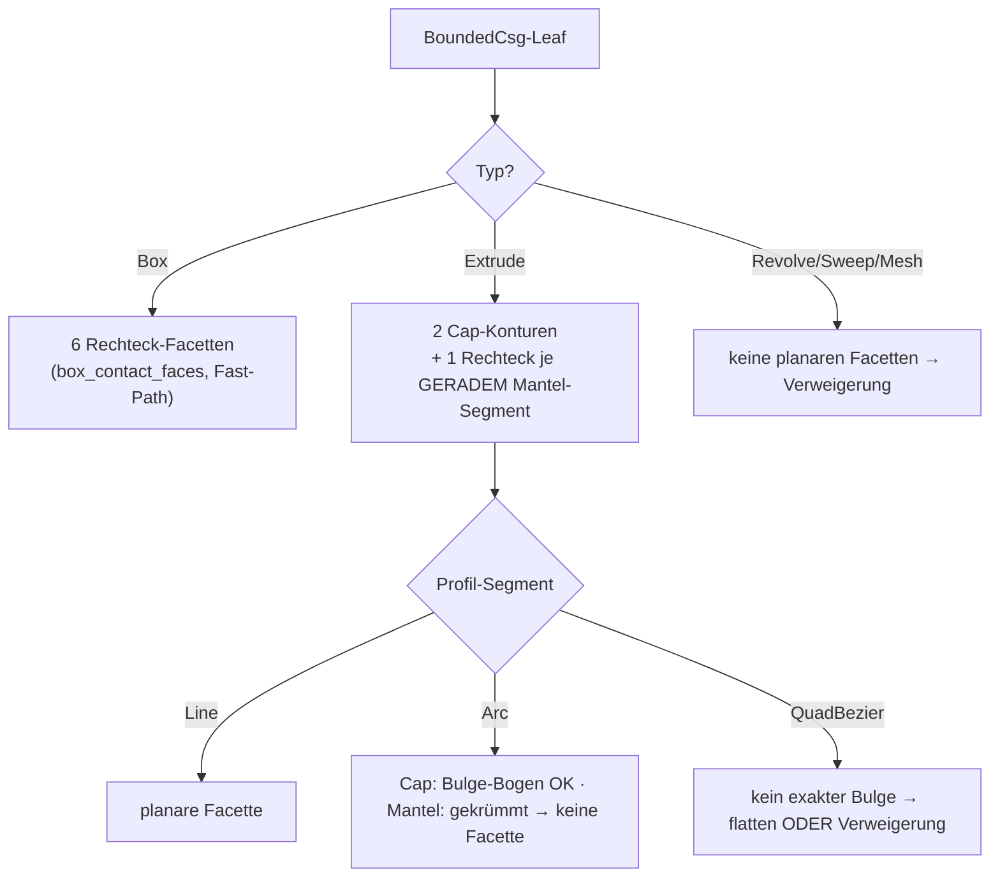

# FC — Nicht-konvexe / facettierte koplanare Kontaktflächen (Folgeprogramm c)

Design-Spike zum „Folgeprogramm (c)" des #384-Offset-Programms
(Fortsetzung von #395/#396/#398). Stand 2026-07-22. READ-ONLY-Spike:
Doku + Machbarkeits-Prototyp in
`crates/metricity-lab/tests/f_c_nonconvex_contact_spike.rs`; KEINE
Änderung am Produktionscode. Plan-SSOT des Programms bleibt
`docs/OFFSET-TREE-PLAN.md`; die tragenden Vorgänger sind
`F395-CONTACT-PATCH-DESIGN.md` (Kontakt-Prisma) und
`F396-RIM-OPCODE-DESIGN.md` (∂P-Rand-Fillet).

## 0. Verdikt vorweg

**Positiver Befund für das Prisma, sicher-beschränkter Befund für den Rim.**

Die Verallgemeinerung des **Kontakt-Prismas** auf beliebige planare Facetten
mit nicht-konvexen und mehrfach-zusammenhängenden Kontaktflächen P ist **billig
und sauber**: das Prisma ist heute schon ein `Extrude(Polygon)`-Member, und die
Polygon-Distanz (Even-Odd + Min-Kanten-Distanz) ist für einfache NICHT-konvexe
Polygone bereits exakt — es braucht **keinen neuen Opcode und keine
Zerlegung in konvexe Teile**. Die einzige neue Zutat ist der 2D-Verschnitt
selbst: statt Sutherland–Hodgman (nur konvex∩konvex) rechnet
`cavalier_contours` den booleschen Verschnitt zweier beliebiger Konturen und
liefert die **Zusammenhangskomponenten** (`pos_plines`) und **Löcher**
(`neg_plines`) direkt aus der API. Damit tilgt das Prisma den flächigen
2D-Innenfehler (bis > 9 mm, #395) für die ganze neue Kontaktklasse — mit
demselben 20–100-fachen Fehlerabfall, den #395 an Boxen gemessen hat.

Der **∂P-Rand-Fillet** (F396) verallgemeinert **sicher** (nie überfüllend) auf
nicht-konvexe P: gerade Stufen-Kanten und **konvexe** ∂P-Ecken rundet die
bestehende Nearest-Feature-Komposition ohne Zusatzterm; die additiv-only-
Halbraum-Maske plus die harte End-Cap-Klemme `t ∈ [0,1]` garantieren
Over-Fill = 0 auch an **konkaven (Reflex-)Ecken** von P. Der Preis der
Sicherheit: an einem Reflex-Vertex von P (der zwangsläufig mit einer
**intrinsischen konkaven Körperkante** des Extrude-Members zusammenfällt —
ein Trieder-Misch-Fall) rundet der Rim NICHT vollständig aus, sondern lässt
lokal den ehrlichen B0-Rest (≈0.75·δ) stehen. Das ist kein Wohlgestelltheits-
Bruch, sondern die bewusst gezogene Scope-Grenze: **eine korrekte
Reflex-Vertex-Rundung mischte Kontakt-Rim und intrinsische SSI-Naht** und liefe
in genau die submergierte-Π-Klemme, an der #395 Stufe 2 architektonisch
scheiterte. Verweigerung schlägt Falschkorrektur.

Netto ist jeder korrigierte Fall **strikt besser als heute**: heute meldet die
Capability für Nicht-Box-Kontakte den gesamten Kontakt als unkorrigiert
(`conservative`); mit dem verallgemeinerten Prisma wird er `tolerance_bounded`
(flächiger Fehler getilgt, Rest der δ-schmale ∂P-Saum), und wo der Rim greift
sogar `tolerance_bounded (channel_tol)`.

## 1. Ausgangslage — was heute BOX-only ist

Der Kontakt-Prisma-Pfad (`offset_channel.rs`) und der ∂P-Rim-Pfad
(`offset_rim.rs`) sind auf Box-Box-Kontakte beschränkt, an drei Stellen:

- `box_contact_faces` liefert die sechs Rechteck-Facetten NUR für
  `Primitive::Box` mit (nahezu) uniformer Skala; jeder Nicht-Box-Member
  gibt `None` → `contact_clips`/`synthesize_contact_prisms` verweigern
  (`refused`) und die #394-`conservative`-Degradierung bleibt.
- `clip_convex` (Sutherland–Hodgman) verschneidet die zwei projizierten
  Facetten-Loops. SH ist metrisch exakt NUR für konvex∩konvex; für
  nicht-konvexe Loops liefert es Unsinn. Das war eine bewusste Wahl (§4b von
  #395: SH ist am beweistragenden Gleich-Querschnitt-Fall S = U ohne die
  Orientierungs-/Overlapping-Degenerationen von `cavalier_contours`).
- `contact_clips` liefert je Facettenpaar GENAU EINE Kontur `p2d` (ein
  konvexes Verschnitt-Polygon), nie mehrere Komponenten oder Löcher; die
  ∂P-Kanten-Klassifikation (`edge_on_rect`) testet gegen Rechtecke.

Die Design-Aufgabe ist, diese drei Stellen auf beliebige planare Facetten zu
heben, ohne die für den Box-Fall bewiesene Exaktheit zu verlieren.

## 2. Design-Frage 1 — Facetten-Quelle

Für welche Leaf-Typen sind planare Facetten analytisch verfügbar?

| Leaf | planare Facetten | Kontur-Repräsentation |
|---|---|---|
| Box | alle 6 Seiten (bestehend) | Rechteck (4 Ecken) |
| Extrude, Deckel/Boden (`±half_height`) | 2 (die Profil-Umrisse) | Profil-Kontur: `Polygon`→Vertices, `Path`→Linien/Bögen |
| Extrude, Mantel je GERADEM Profilsegment | 1 Rechteck je Line-Segment | Segment × Höhen-Richtung |
| Extrude, Mantel je GEKRÜMMTEM Segment (Arc/Bezier) | KEINE (Zylinder-/Parabel-Fläche) | — → Verweigerung |
| Revolve / Helix / Sweep / Gyroid / Mesh | keine analytisch-planaren | — → Verweigerung |

Der Weg vom `BoundedCsg`-Leaf zur Facetten-Kontur:

- **Box:** unverändert `box_contact_faces` (Fast-Path, s. §6).
- **Extrude-Deckel/-Boden:** die zwei Cap-Ebenen liegen bei lokal
  `z = ±half_height`, Außennormale = ±lokale-Z, per `world_transform` in die
  Welt gehoben. Die Cap-Kontur IST der Sketch-Umriss: `Sketch2dPrimitive::Polygon`
  liefert die Vertices direkt; `Path` liefert die Segmentkette
  (`Line`/`Arc`/`QuadBezier`); `Rectangle`/`Circle`/`Sector` sind analytisch in
  eine Kontur konvertierbar. `Arc`-Segmente tragen als `cavalier_contours`-
  Polyline exakte **Bulge-Bögen** (bulge = tan(θ/4)); `QuadBezier` hat keinen
  exakten Bulge → flatten (PATH_FLATTEN_SAMPLES) ODER Verweigerung (empfohlen:
  Verweigerung, bis ein Bedarf besteht — Ehrlichkeit vor Näherung).
- **Extrude-Mantel:** jedes GERADE Profil-Segment (`Line`) extrudiert zu einer
  planaren Rechteck-Facette (Segment-Länge × 2·half_height). Deren Außennormale
  ist die In-Profil-Kantennormale, gedreht ins Welt-Frame. GEKRÜMMTE Segmente
  ergeben keine planare Facette → sie nehmen an keinem koplanaren Kontakt teil.
- **Revolve/Helix/Sweep:** die Mantelflächen sind gekrümmt (Rotations-/
  Sweep-Flächen), die Endkappen i. A. ebenfalls nicht als einfaches Polygon
  fassbar → generell Verweigerung (wie heute).

Die verallgemeinerte `ContactFace` trägt statt eines 4-Ecken-`loop3` eine
**Kontur mit optionalen Bögen** (Welt-3D-Punkte + Bulge je Kante, oder direkt
die projizierte 2D-`cavalier_contours::Polyline`). Normale, Ebenen-Offset und
Member-Dicke bleiben wie gehabt.

## 3. Design-Frage 2 — Kontakt-Erkennung und P im nicht-konvexen Fall

Der **Koplanaritätstest** zweier Facetten ändert sich NICHT: anti-parallele
wahre Normalen (Erosion) bzw. effektive Komplement-Normalen `eff = −sign·n̂`
(Dilation, sign-bewusst wie #397), koinzidenter Offset innerhalb `coincide_tol`.
Das ist rein normalen-/offset-basiert und unabhängig von der Kontur-Konvexität —
`coplanar_interface_present` und die Detektion in `contact_clips` gelten
unverändert.

Neu ist die **2D-Intersection**: statt `clip_convex(&la, &lb)` rechnet man
`la.boolean(&lb, BooleanOp::And)` auf den beiden in die Π-Basis projizierten
Konturen (als `cavalier_contours::Polyline` mit Bulge). Das Ergebnis ist der
Kontakt P — und im nicht-konvexen Fall ist P **kein einzelnes Polygon mehr**:

- `res.pos_plines` = die **Zusammenhangskomponenten** von P (mehrere disjunkte
  Kontaktinseln). Jede wird zu einem eigenen Kontakt-Prisma und einem eigenen
  ∂P-Rim-Loop.
- `res.neg_plines` = **Löcher** in einer Komponente (mehrfach-zusammenhängender
  Kontakt). Ein Loch entsteht nie aus konvex∩konvex, wohl aber aus einem
  Extrude-Profil mit Innenrand oder einem versenkten Abzug.

Der Prototyp (§7) belegt beides direkt an cavalier: L-Form ∩ Rechteck = die
L-Form (eine nicht-konvexe Komponente, Fläche 20, exakt); zwei „⌐"-Konturen
verschneiden zu ZWEI disjunkten 2×2-Inseln; Platte ∖ Innenkreis liefert eine
`neg_pline` mit echten Bögen.

## 4. Design-Frage 3 — Prisma-Verallgemeinerung (der tragende Positiv-Befund)

Das heutige Prisma ist bereits `BoundedCsg::from_csg_with_carry(Extrude {
sketch: Polygon { vertices } , half_height, … })` — ein Polygon-Extrudat.
Die entscheidende Beobachtung:

> Die Polygon-SDF (`Sketch2dPrimitive::Polygon`, Even-Odd-Kreuzungszahl +
> Min-Distanz zu allen Kanten) ist für **einfache nicht-konvexe Polygone
> bereits die exakte signierte Distanz**. Nicht-Konvexität kostet NICHTS am
> Feld — es braucht **keine Trapezoid-/konvexe Zerlegung**.

Damit ist die Prisma-Verallgemeinerung im Tape und in allen fünf
Evaluator-Spiegeln **praktisch gratis**:

| Aspekt | Kosten |
|---|---|
| Neuer Opcode | **keiner** — es bleibt `OP_PRIM2D_PATH`/`OP_PRIM2D_POLY` |
| CPU / eval_opcodes / sdf-vm (WGSL) / fidget / CGAL | **0** — jeder Spiegel wertet Extrude-Leaves schon aus |
| Feld-Kosten je Sample | O(N Kanten von P) — wie bei jedem Nutzer-Extrude |
| Bögen in P (Bulge-Kanten) | via `Sketch2dPrimitive::Path` mit `Arc`-Segmenten (exakte Bogen-Distanz, schon gespiegelt) statt `Polygon` |
| Löcher in P (`neg_pline`) | eine zusätzliche `Difference{ Extrude(outer), Extrude(hole) }` — ein Extra-Member, ebenfalls opcode-frei |
| Mehrere Komponenten | je Komponente ein Union-Member (Erosion) bzw. Difference-Constraint (Dilation) — wie mehrere Box-Prismen heute |

Die beweistragenden Eigenschaften bleiben unberührt: `prism_subset_of_union`
(bzw. `prism_outside_inner` für Dilation) sampelt ein Gitter über der
Prisma-AABB und prüft S ⊆ U feld-seitig — konvexitäts-unabhängig. Cap-Tiefen
kommen wie gehabt aus der echten Member-Dicke normal zu Π (Extrude:
`2·half_height`).

**Konsequenz:** Der flächige 2D-Innenfehler wird für die gesamte neue
Kontaktklasse getilgt, ohne die Evaluatoren anzufassen. Der Aufwand liegt — wie
schon bei #395/#396 — vollständig in der **Synthese** (Facetten-Extraktion +
cavalier-Verschnitt + Komponenten-/Loch-Aufspaltung), nicht im Feld.

## 5. Design-Frage 4 — ∂P-Rim-Verallgemeinerung (sicher, mit gezogener Grenze)

`RimRecord`/`RimFeature` sind heute Segment-basiert (a, b + zwei Wand-Normalen).
Ein nicht-konvexes ∂P hat konvexe UND konkave (Reflex-)Ecken sowie ggf.
Bogen-Kanten. Die Zerlegung:

- **Kanten-Klassifikation** verallgemeinert direkt: `edge_on_rect` (Lot-Distanz
  einer ∂P-Kante zu den vier Rechteck-Geraden) wird zu `edge_on_contour` (liegt
  die ∂P-Kante auf der Randlinie von Member i's Kontur, j's Kontur, oder beider?
  → `Flush` / `Step{wall}` / `Degenerate`). Das ist derselbe rein-analytische
  Kollinearitätstest, nur über beliebige Kontur-Segmente statt vier
  Rechteck-Kanten. Für Bogen-Kanten von ∂P: die Spine wird ein `ChannelArc`
  (Bogen), exakt wie die bestehende Arc-Spline-Repräsentation — der Rim trägt
  Bögen bereits konzeptionell (F396 §2.1).
- **Welche Kanten bekommen Fillets:** nur konkave Erosions-Stufen (bzw. konvexe
  Dilations-Keile) — das bestehende **Konkavitäts-Gate** bleibt: gemischte
  `wall_member` an ∂P (versetzter Kontakt) ⇒ komplette Verweigerung des Rims
  (die A-Rand-Kanten wären konvexe Stufen nach unten, kein konkaver Sliver —
  der Fillet würde sie fälschlich auffüllen). Für einen **enthaltenen**
  nicht-konvexen Kontakt (P vollständig im Über-Stander, z. B. L-Profil in
  großer Box) ist `wall_member` homogen → das Gate passiert, alle Stufen-Kanten
  sind echte konkave Reflexkanten.
- **Konvexe ∂P-Ecken:** die Nearest-Feature-Komposition rundet sie ohne
  Zusatzterm (Design F396 §2.4) — unverändert.
- **Konkave (Reflex-)Ecken von P** sind der einzige genuin neue Fall. An einem
  Reflex-Vertex des Kontur-P (Innenwinkel > 180°, z. B. (2,2) der L) fällt die
  vertikale Prisma-Kante mit einer **intrinsischen konkaven Körperkante** des
  Extrude-Members zusammen (das nicht-konvexe Profil hat dort eine reentrant
  vertikale Kante). Es treffen also DREI konkave Features zusammen: zwei
  Kontakt-Stufen-Dieder (Wand–Π) + eine intrinsische Wand–Wand-Reflexkante. Das
  ist ein (√3−1)·δ-Trieder-Misch-Fall.

**Warum der Rim hier nicht bricht, aber auch nicht voll rundet:** Die
additiv-only-Konstruktion (`min(g, δ−de)`) mit Halbraum-Maske UND harter
End-Cap-Klemme `t ∈ [0,1]` kann **niemals überfüllen** — jede Kanten-Spine
endet exakt am Reflex-Vertex, die Masken halten den Term strikt in der
Reflex-Schneise (F396 §2.3: Over-Fill empirisch 0.0000 an allen Fällen). Am
Reflex-Vertex hören die beiden adjazenten Kanten-Fillets an ihren End-Caps auf,
und die kleine Vertex-Umgebung bleibt auf dem Prisma-Wert stehen → **lokaler
Unterschuss der B0-Klasse (≈0.75·δ), kein Überschuss**. Das ist exakt die
Ehrlichkeits-Doktrin: der Fillet rundet Kanten und konvexe Ecken metrisch
exakt, lässt den Reflex-Vertex als ehrlichen Rest.

Eine **vollständige** Reflex-Vertex-Rundung müsste den Kontakt-Rim mit der
intrinsischen konkaven Körperkante (die die reguläre `OP_ARC_CHANNEL`/SSI-Naht
bedient) zu einem Trieder-Term verweben. Genau diese Naht läuft aber bis zur
submergierten Π hinunter und trifft dort die **Luftseiten-Klemme
`s₁ = ⟨dq, m̂₁⟩ = 0`**, an der #395 Stufe 2 architektonisch scheiterte
(F395 §Umsetzungs-Status). Ein solcher Term ist **außerhalb dieses Scopes** —
und der `synthesize_vertices`-Gate (gleiche `wall_member` ⇒ kein Vertex-Term)
lässt ihn ohnehin schon aus. Es bleibt bei der ehrlichen lokalen B0-Schranke.

**Verweigerungsfälle (wohlgestellt-halten):**
- versetzter/gemischter Kontakt (gemischte `wall_member`) → ganzer Rim
  verweigert (bestehend);
- Reflex-Vertex → adjazente Kanten enden am Cap, Vertex-Umgebung ehrlich
  ungerundet (kein Term, kein Over-Fill);
- Bogen-Stufen mit tangentialem Übergang (Bulge → Wandnormale dreht stetig) →
  wie die quasi-tangentiale Kanal-Degeneration behandeln (unter Toleranz ⇒ kein
  Fillet).

## 6. Design-Frage 5 — Zahlendomänen

`cavalier_contours` rechnet in f64 — dieselbe Domäne wie die bestehende
`ContactClip`-Pipeline (Verschnitt/Projektion in f64, Emission in f32). Die
A1-Bibliotheks-Evaluation (`crates/metricity-lab/src/bin/a1_offset_lib_spike.rs`)
maß die Boolean-/Bogen-Genauigkeit: Flächenfehler ~1e-6, radiale Bogen-Fehler
klein — komfortabel unter der Fuzz-P3-Schranke (0.1·δ) und der
`exact_tol`-Kalibrierung. Die bestehende f64→f32-Toleranzkalibrierung trägt
also unverändert.

Zwei Gotchas aus der A1-Empirie sind einzuplanen (beide bereits im Box-Pfad
adressiert):
- **Orientierung nicht garantiert:** `BooleanOp::Not`-Ergebnisse kommen teils CW
  zurück → per `area()`-Vorzeichen normalisieren (`if area2d < 0 { reverse }` ist
  schon da).
- **Fast-koinzidente Kanten:** boolesche Ops auf nahezu deckungsgleichen
  Eingaben können Sliver-Artefakte erzeugen → `cleanup_poly` + Flächen-Schwelle
  (`ap < overlap_min²`) fangen das (schon da).

Der **beweistragende Gleich-Querschnitt-Fall S = U** (Box-Box, exakte Deckung)
bleibt bewusst auf dem **Sutherland–Hodgman-Fast-Path** (`clip_convex`): dort ist
konvex∩konvex metrisch exakt und OHNE die Orientierungs-/Overlapping-
Degenerationen, die cavalier an exakt-koinzidenten Eingaben zeigen kann (der
Grund, warum #395 SH wählte). `cavalier_contours` wird ausschließlich für
NICHT-konvexe / Nicht-Box-Facetten gezogen — konvex-Box-Kontakte laufen
unverändert exakt. So verliert die Verallgemeinerung nichts an der bewiesenen
Box-Exaktheit.

## 7. Prototyp (Machbarkeits-Beleg)

`crates/metricity-lab/tests/f_c_nonconvex_contact_spike.rs`, grün
(`cargo test -p metricity-lab --test f_c_nonconvex_contact_spike`, 3/3):

- `l_shape_contained_in_rect_is_l_shape` — L-Form ∩ überragendes Rechteck =
  die L-Form; genau EINE Komponente, kein Loch, Fläche exakt 20 (= 6·6−4·4),
  keine Bögen. Der nicht-konvexe Analog-Fall zum Box-Stack.
- `two_ls_intersect_in_two_components` — zwei koplanare „⌐"-Konturen
  verschneiden zu ZWEI disjunkten 2×2-Inseln (`pos_plines.len() == 2`); die
  Komponenten-Zerlegung fällt direkt aus der API. **Kernbeleg.**
- `contact_with_hole_yields_neg_pline` — Platte ∖ Innenkreis liefert eine
  `neg_pline` (Loch) mit echten Bögen (Bulge ≠ 0); belegt mehrfach-
  zusammenhängende Kontakte und die Bulge-Repräsentation (gekrümmte Kontakte
  sind repräsentierbar, werden aber per Scope NICHT korrigiert).

Der Prototyp ist klar als Spike markiert und ändert kein Feld.

## 8. Design-Frage 6 — Aufwand, Risiken, Phasenplan

Analog zum RimFillet-Rollout (Synthese unverdrahtet → Opcode → Spiegel →
scharfschalten), hier ohne Opcode-Phase (das Prisma braucht keinen):

- **Phase 1 (unverdrahtet, feldneutral):** `box_contact_faces` →
  `member_contact_faces` (Box-Fast-Path + Extrude-Cap-/Mantel-Facetten mit
  Bulge-Konturen); `contact_clips` auf `cavalier_contours::boolean(And)` mit
  Komponenten-/Loch-Aufspaltung; SH-Fast-Path für Box-Box behalten. Tests wie
  der Spike. **2–3 Tage.**
- **Phase 2 (Prisma verdrahten):** je Komponente ein `Extrude(Polygon|Path)`-
  Member; Löcher als `Difference{outer, hole}`; Einhängung in
  `synthesize_stop`/`synthesize_offset_channels_reported` wie die Box-Prismen.
  KEIN neuer Opcode. Capability auf `tolerance_bounded` heben. **1–2 Tage.**
- **Phase 3 (Rim verallgemeinern):** `edge_on_rect` → `edge_on_contour`;
  Bogen-Stufen als `ChannelArc`-Spine; Reflex-Vertex-Verweigerung (End-Cap
  lässt ihn ehrlich ungerundet); Konkavitäts-Gate unverändert. **2–3 Tage.**
- **Phase 4 (scharfschalten):** Fuzz-Familie `NonConvexContact` (L-in-Box,
  zwei-Inseln, Loch-Kontakt) mit Doppel-GT; CGAL-Goldens
  (`contact_prism_lshape`, `contact_prism_two_islands`); Capability-Anhebung.
  **1–2 Tage.**

Summe grob **6–10 Tage**, überwiegend Synthese.

**Explizit NICHT im Scope (Verweigerung, ehrlich beschränkt):**
- Revolve-/Helix-/Sweep-Mantel und gekrümmte Extrude-Mantel-Segmente (keine
  planaren Facetten);
- gekrümmte Kontakte (Bogen-∂P mit tangentialem Übergang, Zylinder-auf-Ebene);
- QuadBezier-Profilkanten exakt (flatten oder verweigern);
- vollständige Reflex-Vertex-Rundung (Trieder-Misch aus Kontakt-Rim +
  intrinsischer SSI-Naht — die Stufe-2-Klemme; bleibt B0-beschränkt).

**Risiken:**
- `cavalier_contours`-Robustheit an fast-koinzidenten Nicht-Box-Facetten
  (Sliver, Fehl-Komponenten) — Fast-Path + cleanup + Flächen-Schwelle mildern;
  bei Unsicherheit verweigern.
- Facetten-Explosion bei hoch-facettierten Profilen (viele Mantel-Rechtecke) —
  die koplanare Detektion filtert per Normale/Offset früh, nur echte Kontakte
  gehen in den Verschnitt.
- ≥ 3 Member auf derselben Ebene (paarweise P, überlappende Prismen) — min-
  Komposition bleibt konservativ korrekt, ∂P-Zerlegung mehrdeutig (bestehendes
  Plan-§9-Kaskaden-Risiko).

## 8b. Phase-4-Abschluss — Umsetzungsstand (2026-07-22)

Phase 4 ist umgesetzt und feldneutral für alle Alt-Szenen (Golden byte-identisch,
CGAL-Interpreter-Cross-Check 0 Failures über alle 35 Szenen inkl. der neuen).

- **Bogen-∂P-Rand-Fillet — NEUER Opcode `OP_RIM_FILLET_ARC` (0x44).** Der gerade
  `OP_RIM_FILLET` (0x43) bleibt **byte-identisch** (rein gerade Kontakte emittieren
  weiter 0x43). Ein Stopp mit mindestens EINER konvexen Bogen-∂P-Kante emittiert
  STATTDESSEN einen einzigen gemischten `OP_RIM_FILLET_ARC`-Block, der **alle**
  Features trägt (Geraden als Segment-Records `sweep<0`, Bögen als Bogen-Records
  `sweep>0`) — in EINER Nearest-Feature-Auswahl. Grund für den gemischten Block
  statt zweier getrennter Blöcke: an einer Linie↔Bogen-Ecke (abgerundetes
  Rechteck, Stadion) überlappen die Feature-Schneisen; ein sequenzielles `min`
  über getrennte Blöcke nähme dort die fernere Kante und **überfüllte** (Design §5).
  Der Bogen-Spine trägt Zentrum `c`, Basis `(u,v)`, Radius `r`, `sweep` und die
  RADIALE Wandnormale `wall_sign·(q−c)/r`; die Distanz ist die exakte radiale
  Tube-Distanz zum Kreisbogen in der Kontaktebene. **Warum neuer Opcode statt
  Parametrisierung:** die Bogen-Geometrie (Zentrum/Basis/Radius/Sweep + radiale,
  fußpunkt-abhängige Wandnormale) ist strukturell unvereinbar mit dem
  Segment-Record; ein `is_arc`-Flag im 0x43-Record hätte die Stride verdoppelt und
  jeden der sechs Evaluator-Hot-Loops belastet. Der separate Opcode hält 0x43
  unverändert (Golden-Neutralität) und additiv.
- **Innen- vs. Außenbogen.** KONVEXE Bögen (Zentrum auf der Material-Seite; der
  Wandzylinder ist konvex) werden gerundet — der Fillet auf der Außenseite kann
  nicht selbst-schneiden, Over-Fill = 0. KONKAVE Bögen (Zentrum auf der Luftseite,
  Material-seitig hohl — der gekrümmte Reflex-Fall, z. B. Kreisloch-Wände) werden
  wie Reflex-Vertices **ehrlich verweigert** (`residual ≈ 0.75·δ`): dort
  konvergierte der δ-Tube nach innen und überfüllte für δ nahe/über dem
  Bogenradius. Reine Bogen-Loops OHNE gerade Anker-Stufe (z. B. Kreis-Cap-Kontakt)
  werden ebenfalls verweigert — der Wand-Member ist ohne gerade `edge_on_contour`-
  Stufe nicht eindeutig bestimmbar (Scope-Grenze, Ehrlichkeit vor Näherung).
- **Bogen-tragende Kontakt-Prismen.** `build_prism_component` verweigert
  Bogen-Konturen nicht mehr, sondern baut sie als `Extrude(Path)` mit exakten
  `SketchSegment::Arc`-Bögen (OP_PRIM2D_PATH — in ALLEN Evaluatoren vorhanden).
  Rein gerade Konturen bleiben `Extrude(Polygon)` (byte-identisch).

### Capability-Vertrag (final, Phase 4)

Für einen dualen Offset-Stopp mit koplanarem submergiertem Kontakt gilt:

| Fall | Status | Zugesagte Schranke |
|---|---|---|
| Gleich-Querschnitt-Kontakt S = U (Box=Box) | `exact` | 0 (nur GT-Messboden) |
| Konvexes P, Rim schließt ∂P ganz (Box-Stack, abgerundetes Rechteck) | `tolerance_bounded` | Fillet-Approximation ≤ `channel_tol` (≈0.1·δ empirisch) |
| Nicht-konvexes P, Rim schließt GERADE ∂P-Kanten, Reflex-Vertices/konkave Bögen offen | `tolerance_bounded` | B0-Rest an Reflex-Vertices/Bögen ≈0.75·δ |
| Versetzter (staggered)/gemischter Kontakt — Rim verweigert | `tolerance_bounded` | konkaver B0-Sliver ≈0.75·δ (Prisma-only) |
| Nicht-Box-Partner ohne planare Facetten / gekrümmter Kontakt / degenerierter Verschnitt | `conservative` | keine (f∓δ unbeschränkt) |

**Multi-Clip-Ehrlichkeit (Phase-4-Fix):** verweigert an EINEM Stopp ein Rim-Loop
(versetzt/Reflex/konkaver Bogen) und schließt ein anderer sauber, meldet
`synthesize_stop` NICHT mehr die enge `channel_tol`-Schranke, sondern die weitere
0.75·δ-Schranke (der `residual` des verweigerten Loops dominiert). Das war zuvor
ein Bound-Over-Claim: der ehrliche Rest des verweigerten Loops blieb ungenannt.

## 8c. Durchdringende Kontakte — signierte Kontaktlage (#384, 2026-08-01)

Der Kontakt-Vertrag oben setzte stillschweigend voraus, dass ein Kontakt BÜNDIG
ist: zwei Member-Facetten auf DERSELBEN Ebene Π. Der Detektor prüfte das mit
einem **unsignierten** Fenster `|o_a + o_b| ≤ 0.5·δ` (Box) bzw. `0.02·δ`
(Nicht-Box) und verankerte das Prisma an EINER der beiden Ebenen. Die signierte
Größe

    s := o_a + o_b        (fa.n = −fb.n; Member i auf n̂·x ≤ o_a, j auf n̂·x ≥ −o_b)

ist aber die **Durchdringungstiefe**: `s = 0` bündig, `s > 0` die Member stecken
um `s` ineinander, `s < 0` es klafft ein Luftspalt. Das alte Fenster vermengte
alle drei Lagen und erzeugte drei Falschaussagen — jede unter dem Stempel
`exact` (gemessen an zwei achsparallel gestapelten Boxen, δ = 2 mm):

| Lage | alter Befund | Fehlergröße |
|---|---|---|
| `s < 0` (Luftspalt 0.1 mm) | Prisma **überbrückt die Luft** | 8 mm Phantom-Material, wo die wahre Erosion leer ist |
| `0 < s ≤ 0.5·δ` | Prisma an EINER Ebene verankert, trägt j's volle Dicke ⇒ ragt um `s` über die Gegenseite | bis 1 mm Phantom-Material über der wahren Erosionsdecke |
| `0.5·δ < s < 2·δ` | gar kein Prisma; `min(f_i) + δ` reißt einen **Phantom-Schlitz** der Dicke `2δ − s` | Nullmengenfehler bis 1.47 mm ≈ 0.735·δ |

Der Fix ist **Synthese, kein Downgrade** — die Geometrie des durchdringenden
Falls ist wohldefiniert und braucht keinen neuen Term:

1. **Signierte Klassifikation** (`offset_channel::face_pair_penetration`):
   `s < −round_tol` → echter Luftspalt, KEIN Kontakt; `s ≥ 2·δ` → die erodierten
   Member überlappen noch, es entsteht gar kein Schlitz → keine Korrektur nötig;
   sonst Kontakt mit `pen = max(s, 0)`. `round_tol` ist die bereits kalibrierte
   f32-Rundungsklasse `0.02·δ` (#397) — jetzt für BEIDE Facettenklassen. Das
   alte `0.5·δ` als Klemme war der Fehler: es faltete 1 mm echte Durchdringung
   auf „bündig".
2. **Korrekte Prisma-Ausdehnung:** das Prisma spannt von Member i's Rückseite
   `o_a − depth_neg` bis Member j's Rückseite `(−o_b) + depth_pos`, d. h. die
   effektive +n̂-Tiefe ist `depth_pos − pen`. Für `pen = 0` ist das
   **bit-identisch** zum Bestandspfad (Golden byte-identisch verifiziert).
   `S ⊆ U` gilt exakt: über P überdecken i's und j's Slab das Intervall
   lückenlos, weil `−o_b ≤ o_a`.
3. **SSI-Nähte nur am BÜNDIGEN Kontakt unterdrücken.** Am bündigen Kontakt sind
   die Nähte des Paars koinzident/tangential degeneriert (der Grund der
   Unterdrückung seit #395). Am DURCHDRINGENDEN Kontakt ist die Naht am
   Kontaktrand eine echte transversale Dieder-Kante (Deckfläche × Seitenwand,
   Normalen 90°) — die korrigieren die regulären `OP_ARC_CHANNEL`-Kanäle sauber;
   sie zu unterdrücken nähme dem Stopp seine einzige ∂P-Korrektur.
4. **Rim-Spiegel bleibt bündig-only.** `contact_clips` (die Quelle von
   `offset_rim::RimBlock`) nimmt nur `|s| ≤ round_tol` auf: ein durchdringender
   Kontakt hat keine gemeinsame Ebene Π, der Rim legte seine Spine sonst auf die
   submergierte statt auf die exponierte Ebene. Statt dessen sagt die Capability
   für ungleiche Querschnitte ehrlich die weitere B0-Schranke ≈0.75·δ zu
   (`ContactResult::pen_unrimmed`) — kein Bound-Over-Claim durch die enge
   `channel_tol` eines bündigen Nachbar-Kontakts am selben Stopp.
5. **Fehlalarm-Widerlegung.** Das Carrier-Gate `coplanar_interface_present`
   sieht durchdringende Kontakte nicht (es verlangt überlappende Facetten-AABBs)
   → additiver Trigger `contact_face_scan().penetrating`. Umgekehrt meldete es
   für einen 0.1-mm-Luftspalt einen Verdacht, den der Facetten-Scan widerlegt:
   sind ALLE Member-Facetten analytisch bekannt und ist KEIN Paar in Kontakt,
   entfällt die #394-Verdachtsmeldung (getrennte Körper erodieren unabhängig
   und exakt).

### Ergänzung zum Capability-Vertrag

| Fall | Status | Zugesagte Schranke |
|---|---|---|
| Durchdringung `0 < s < 2·δ`, Gleich-Querschnitt (S = U) | `exact` | 0 (nur GT-Messboden) |
| Durchdringung `0 < s < 2·δ`, ungleicher Querschnitt | `tolerance_bounded` | B0-Sliver am Kontaktrand ∂P ≤ 0.75·δ (Prisma-only; die SSI-Kanäle liegen faktisch darunter, werden aber nicht zugesagt) |
| Überlappung `s ≥ 2·δ` | unverändert | kein Schlitz; die naive Erosion ist in Normalenrichtung zero-set-exakt, echte konkave Nähte gehören den Kanälen |
| Luftspalt `s < −round_tol` | `exact` | getrennte Körper erodieren unabhängig exakt |

**Nicht im Scope (offen):** der duale DILATIONS-Pfad
(`synthesize_contact_prisms_dilation`) fährt weiter das symmetrische
Koinzidenz-Fenster. Er sagt nie `exact` zu (¬box unbeschränkt), eine
Fehl-Verankerung dort wäre also ein Bound-Over-Claim, keine Exakt-Lüge — und
seine 0.5·δ-Kalibrierung ist per `thin_wall_shell_status_unchanged_397`
eingefroren. Die signierte Behandlung dort ist ein eigener Schritt.
→ nachgeholt in §8d.

## 8d. Der duale Dilations-Pfad — dasselbe Fenster, gedrehtes Vorzeichen (#384, 2026-08-01)

§8c ließ den Dilations-Pfad offen mit der Vermutung, eine Fehl-Verankerung
wäre dort „nur" ein Bound-Over-Claim. Die Messung bestätigt den Befund und
verschärft ihn: der Pfad **verletzt seine engste Zusage um den Faktor 200**,
und die eingefrorene Kalibrierung war der Grund.

### Was der Pfad wirklich bedient

Dilation distribuiert über Union exakt — der Pfad existiert also für die
Intersection/Difference-Form. In der Komplement-Dualität (§8c-Rahmen, De
Morgan) sind die Member `¬A` (unbeschränkt, `sign = +1`) und `B` (der
Subtrahend, `sign = −1`); die signierte Größe ist

    s := O_i + O_j,   O = −sign·o    ⇒   für A − B:  s = o_B − o_A

Sie misst die Durchdringung der KOMPLEMENTE, und darum bedeutet ihr Vorzeichen
etwas anderes als bei der Erosion — es DREHT sich:

| `s` | Geometrie | wahre Lage |
|---|---|---|
| `s = 0` | bündig ausgeschnittene Tasche (flush cut), Taschenmund koplanar mit A's Außenfläche | echter submergierter Kontakt — der Fall, für den die Korrektur gebaut wurde |
| `s > 0` | B ragt um `s` aus A heraus; der Taschenboden liegt um `s` höher | Kontakt mit Überstand — Prisma nötig, aber anders verankert |
| `s < 0` | B ist um `|s|` VERGRABEN: geschlossener Hohlraum hinter einem Deckel der Dicke `|s|` | **gar kein Kontakt** — es gibt keinen Taschenmund und keinen Phantom-Fin |

Bei der Erosion war `s < 0` der harmlose Luftspalt; hier ist `s < 0` der
gefährliche Fall. Die praktisch wichtigste Geometrie dieser Lage ist die
**geschlossene Shell** `Difference(box, box)` mit Wandstärke `w`: sie ist
`s = −w` auf allen sechs Achsen gleichzeitig.

### Gemessen (δ = 2 mm, Referenz = exakte Distanz zu `A \ B` über dessen ≤6-Box-Zerlegung; `|d − δ|` ist eine UNTERE Schranke des Nullmengen-Fehlers)

Sonde: A = Box he 10³, B = Box he [7,7,5], Mittelpunkt `z = 5 + s`
(`crates/kernel/src/offset_capability_tests.rs`).

| Lage | Status (vorher) | zugesagt (vorher) | REAL (vorher) | nachher |
|---|---|---|---|---|
| `s ∈ [−1.0, −0.05]` (Deckel bis 0.5·δ) | `tolerance_bounded` | ≤ 0.01 mm | **≥ 2.000 mm = 1.0·δ** | `exact`, 0.000 mm |
| `s = 0` (bündig) | `tolerance_bounded` | ≤ 0.01 mm | 0.000 mm | unverändert |
| `0 < s ≤ 0.5·δ` | `tolerance_bounded` | ≤ 0.01 mm | **genau `s`, bis 1.000 mm** | ≤ 1.500 mm zugesagt, 0.395 mm real |
| `0.5·δ < s < 2·δ` | `tolerance_bounded` | ≤ 0.01 mm | **5.159 mm** (kein Prisma → Phantom-Fin über der Tasche) | ≤ 1.500 mm zugesagt, 0.395 mm real |

Box-Shell, Wandstärke `w`, dieselbe Referenz, 61³-Gitter:

| `w/δ` | Status (vorher) | fehlklassifizierte Innenpunkte (vorher) | nachher |
|---|---|---|---|
| 0.1 | `tolerance_bounded` (≤ 0.01 mm) | 62118 / 94958 = 65 % | 0 / 94958, `exact` |
| 0.3 | `tolerance_bounded` (≤ 0.01 mm) | 60780 / 101104 = 60 %, davon 5766 im echten SOLID | 0, `exact` |
| 0.5 | `tolerance_bounded` (≤ 0.01 mm) | 63632 / 106506 = 60 %, davon 11508 im echten Solid | 0, `exact` |
| 0.8 | `exact` | 0 | unverändert |
| 1.0 | `exact` | 0 | unverändert |

Das Prisma spannte beim vergrabenen Hohlraum von der Deckel-AUSSENfläche quer
durch den Deckel bis zur Rückseite des Hohlraums und subtrahierte alles
dazwischen — der Deckel verschwand, der Hohlraum wurde zum Kamin. Die duale
Sicherheits-Stichprobe `prism_outside_inner` (7³ Punkte über der Prisma-AABB)
sieht das nicht: bei ~5 mm Abtastweite fällt ein 0.6-mm-Deckel durch das Raster.

### Fix (Spiegel von §8c, nicht blind gespiegelt)

1. **`face_pair_penetration` auch hier** — dieselbe Funktion, dieselbe
   f32-Rundungsklasse `0.02·δ` für BEIDE Facettenklassen. `s < −round_tol` →
   kein Kontakt (vergrabener Hohlraum), `s ≥ 2·δ` → keine Korrektur nötig,
   sonst Kontakt mit `pen = max(s, 0)`.
2. **Prisma-Ausdehnung `depth_pos − pen`**, wenn die `+n̂`-Seite ein ECHTER
   Member ist (`sign = −1`, endliche Dicke). Ist sie die ¬box-Seite, bleibt
   `margin` unangetastet: das ist keine Rückseite, sondern eine synthetische
   Reichweite ab der Ankerebene, die ≥ lateraler Reichweite von P bleiben muss.
3. **`contact_clips` (Rim-Quelle) wird bündig-only** — auch im
   Dilations-Zweig. Ein durchdringender Kontakt hat keine gemeinsame Ebene Π;
   der Rim legte seine Spine sonst auf die falsche und sagte dafür die enge
   Bau-Toleranz zu. Statt dessen `pen_unrimmed` → ehrliche B0-Schranke 0.75·δ
   (Phase-4-Multi-Clip-Regel, damit ein bündiger Nachbar-Kontakt am selben
   Stopp die Zusage nicht wieder verengt).
4. **SSI-Nähte bleiben hier für JEDES Kontakt-Paar unterdrückt** — anders als
   am Erosions-Stopp, und das ist gemessen statt gespiegelt. Am Dilations-Stopp
   SUBTRAHIEREN die Kanäle (konvexe Dualkante). Der Kanal über der
   Mündungs-Naht eines durchdringenden Kontakts griff im Versuch bis an die
   AUSSENkante des Trägerkörpers durch und trug dort legitimes Material ab:
   0.760 mm Fehlstelle gegen 0.395 mm ehrlichen B0-Keil mit Unterdrückung.
   Beide Varianten halten die 0.75·δ-Zusage; die kleinere gewinnt.

### Was das die eingefrorene Kalibrierung kostet

`thin_wall_shell_status_unchanged_397` fror für die BOX-Spalte bei
`w < 0.5·δ` genau diese Falschaussage ein (`tolerance_bounded` ≤ 0.01 mm bei
2.000 mm realem Fehler). Der Pin bewegt sich also — aber nicht als
Abwägung, sondern als Streichung: die WAHRE Zusage der Familie ist `exact`,
belegt mit derselben Referenz, die auch die (unveränderten) Zeilen ≥ 0.8·δ
bestätigt. Die EXTRUDE-Spalte — der eigentliche #397-Gegenstand (eff-Fallback
mit enger Koinzidenz) — steht unverändert.

### Neuer, hier NICHT behobener Befund (eigenes Paket)

Bei `s ≥ 2·δ` (kein Prisma, unverändert vor wie nach dem Fix) korrigiert der
reguläre `OP_ARC_CHANNEL`-Pfad die Mündungs-Naht und trägt dabei an der
Außenkante des Trägerkörpers **0.760 mm** ab, während er ≤ 0.01 mm zusagt
(`worst` bei `[−10.73, 6.53, 11.0]`, δ = 2). Das ist ein Bound-Over-Claim des
KANAL-Pfads, nicht des Prisma-Pfads, und existiert unabhängig von #384-8d.

## 8e. Die End-Kappe des Kanal-Terms (#384, 2026-08-01)

§8d ließ einen Befund offen: bei `s ≥ 2·δ` — wo korrekt KEIN Prisma entsteht,
vorher wie nachher — trug der reguläre `OP_ARC_CHANNEL`-Pfad an der
**Außenkante des Trägerkörpers** 0.760 mm ab (worst bei `[−10.73, 6.53, 11.0]`,
δ = 2), während die Capability ≤ 0.01 mm zusagte. Das ist ein Bound-Over-Claim
um Faktor 76, und er sitzt weit weg von der Naht, die der Kanal korrigiert.

### Diagnose: die Kappe, nicht der Kegel, nicht der Trust-Radius

Die C2-Konstruktion ist exakt, solange der nächste Punkt `q*` der Naht-Kurve
AUCH der nächste Randpunkt des Körpers ist. Am **offenen Spine-Ende** gilt das
jenseits des Endes nicht mehr:

* `arc_closest` klemmt den Fußpunkt auf den Endpunkt `E`. Für jeden Punkt
  hinter der Endebene misst `de` die Distanz zu EINEM PUNKT, nicht zur Naht.
* Die beiden Kegel-Gates `m̂₁, m̂₂` gehören zur KANTE. Sie schneiden den
  Normalkegel des Dieders aus, aber sie sagen nichts über die Richtung
  ENTLANG der Naht — hinter dem Ende stehen sie unverändert offen.
* Ergebnis: eine Ball-Kappe des Radius `K = c·δ + 0.5·δ + 8·tol ≈ 1.95·δ`
  um jedes Nahtende, in der der Term voll wirkt.

Am Messpunkt: der Fußpunkt ist die Ecke der Taschenmündung `(−7, 7, 10)`,
`de = 3.894 < K = 3.908`, beide Gates positiv (`+z`: 1.0, `−y`: 0.467),
`w = K − de = 0.014 > 0`, naives `d = −0.762` (korrekt: die Außenkante von A
liegt 1.238 entfernt, also INNERHALB der Dilatation). `max(d, w) = +0.014` ⇒
Vorzeichenkipp. 544 Gitterpunkte einer 61³-Sonde fielen so.

Zwei naheliegende Erklärungen sind **widerlegt**:

* **Trust-Radius zu groß?** Nein. Dieselbe Fehlstelle entsteht bei
  `de = 2.55` (also weit unter `c·δ = 2.83`, dem Ausmaß des legitimen Keils).
  Der Trust-Radius begrenzt die Reichweite, nicht die Ursache.
* **Spine zurückschneiden?** Verschlimmert es. Trimmt man das Ende um `K`,
  wandert die Kappe mit — und wirkt jetzt über den Nahtabschnitt, den sie
  gerade freigegeben hat, wo `de` die Distanz zur echten Naht ÜBERSCHÄTZT
  (gemessen: worst 0.632 → 1.500 mm). Eine Kappe ist nur dort harmlos, wo die
  Naht wirklich endet — und genau dort ist sie schädlich.

Der Mechanismus ist NICHT auf den Dilations-Pfad beschränkt: am Erosions-Stopp
addiert dieselbe Kappe. Am `notch_union`-Dieder (die B0-Fixture, α = 90°,
δ = 2) steht 1.34 mm vor der Deckfläche `z = −50` Phantom-Material, wo das
naive Feld korrekt Luft meldet: **0.800 mm**, gemessen gegen die exakte
3D-Referenz `δ − dist(x, ∁Körper)`.

### Fix: das End-Gate ist DATEN, nicht Semantik

Der Opcode hat je Bogen genau ZWEI Gate-Vektoren; ein drittes wäre eine
Semantik-Änderung in sechs Evaluator-Spiegeln (ausdrücklich außerhalb dieses
Pakets). Aber die Gates sind **Daten**: `close_open_end_caps` spaltet am
offenen Ende ein kurzes terminales Bogenstück (`0.25·δ`) ab und dreht dessen
zweites Gate auf die **Endebenen-Normale** `∓t̂`:

* jenseits der Endebene ist `⟨x−E, ∓t̂⟩ < 0` ⇒ `w < 0` ⇒ der Term ist
  strukturell AUS — kein Sampling, kein Schwellwert, keine Heuristik;
* davor ist der Fußpunkt innerlich, also `⟨x−q*, t̂⟩ = 0` und das Gate
  neutral; die nlerp-Interpolation blendet die Korrektur auf dem kurzen
  Endstück stetig aus (kein Feldsprung, keine neue Kante).

Geschlossene Spines (Steinmetz) haben kein Ende und bleiben **byte-identisch**.
An gesnappten Enden übernimmt die Vertex-Kugel mit ihren DREI Gates — genau die
R&R-Arbeitsteilung „Kanten-Kanäle enden IN den Vertices" (C4).

### Was danach bleibt (und jetzt ehrlich gemeldet wird)

Die Kappe ist zu, der Kegel bleibt. Läuft eine **fremde Fläche** näher an
einem Punkt vorbei als die eigene Naht, behauptet `de − δ` weiter zu viel
Distanz — das ist das im Modulkopf seit Phase B notierte Restrisiko
(„Fremdgeometrie NÄHER als K an der Kurve im Kegelgebiet"), jetzt **gemessen
statt vermutet**:

| Szene | Fremdfläche | Fehler |
|---|---|---|
| Tasche, `s ≥ 2·δ` | die NACHBAR-Naht der Mündungs-Ecke | 0.632 mm |
| `notch_union` α=90° | die Deckfläche am Dieder-Ende | 0.848 mm |
| `notch_union` α=60° | dieselbe | 2.040 mm |

Verschärft wird das durch die **sequenzielle** Anwendung: hat ein Kanal `d`
bereits (korrekt) angehoben, öffnet das `gate = G + d` des NÄCHSTEN weiter als
beim naiven `d` — die Auslenkung kaskadiert über die Ein-Term-Schranke `G`
hinaus. Beides ist mit den heutigen zwei Gates weder synthese- noch
parameterseitig zu heilen.

Deshalb sagt der Stopp dort **nicht mehr die Bau-Toleranz zu**. Ein
Randpunkt-Zeuge entscheidet das, kein Schätzwert: `end_region_violation`
tastet die Umgebung jedes offenen Nahtendes ab (Kegel der Endpunkt-Gates,
`δ < |x−E| < K`), wendet die Korrektur VOLLSTÄNDIG an (alle Kanäle, dann die
Vertex-Kugeln — wie der Evaluator) und sucht Punkte, die das naive Feld
richtig und das korrigierte falsch klassifiziert. Für jeden Kandidaten
marschiert `boundary_witness` (gedämpfter Newton, Gradient je Schritt neu —
ein Strahl in Startrichtung verfehlt an Boolean-Kanten den nächsten Rand) auf
die Körperoberfläche. Landet er näher als δ, ist die wahre Lage BEWIESEN:

* Dilation: `dist(x, Körper) ≤ u < δ` ⇒ x liegt IN der Dilatation;
* Erosion: `dist(x, ∁Körper) ≤ u < δ` ⇒ die δ-Kugel um x ragt heraus, x liegt
  also NICHT in der Erosion.

Gemeldet wird dann `(c−1)·δ + 4·tol` (das Gate — zugleich die B0-Schranke der
unkorrigierten Naht), mindestens aber der gemessene Fehler. Bewusst NICHT
gemeldet werden reine Wert-Unterschätzungen des konkaven Terms: die
Luftseiten-Klemme `min(d, −w_geo)` unterschätzt die Distanz absichtlich
(march-sicher).

### Bilanz

| Szene | vorher | nachher |
|---|---|---|
| Tasche `s ≥ 2·δ`, worst | 0.760 mm bei Zusage ≤ 0.01 | 0.632 mm bei Zusage ≤ 0.868 |
| Tasche `s ≥ 2·δ`, Fehlklassifikationen (61³) | 544 | 204 |
| Außenkante `[−10.73, 6.53, 11.0]` | +0.014 (Luft) | negativ (Material) |
| `notch_union` Ende (z ∈ [44, 56]) | 0.800 mm | 0.500 mm |
| Steinmetz (geschlossene Spine) | — | byte-identisch |

Golden: 2 der 35 Szenen bewegen sich — `arc_channel_notch` und
`vertex_sphere_corner`, also genau die beiden mit OFFENEN Kanal-Spines. Beide
tragen den Fehler nachweislich (Randpunkt-Zeugen vor dem Fix: 0.848 mm bzw.
0.970 mm); die 33 übrigen sind byte-identisch.

**Der saubere Endzustand braucht ein drittes Gate im Opcode** (End-Ebene bzw.
Voronoi-Bisektor zur Nachbar-Naht, dazu ein Kegel-Gate gegen Fremdflächen).
Das ist eine Semantik-Änderung in sechs Evaluator-Spiegeln und damit ein
eigenes Paket — hier bewusst nicht angefasst.
→ ausgeführt in §8f.

## 8f. Das dritte Gate im Kanal-Opcode (#384, 2026-08-02)

§8e schloss die Endpunkt-Ball-Kappe synthese-seitig (End-Gate als DATEN auf
einem abgespaltenen terminalen Bogenstück) und meldete den Rest per
Randpunkt-Zeugen ehrlich als Downgrade. Der Rest waren drei Fälle, alle mit
derselben Ursache: **eine fremde Fläche oder eine Nachbar-Naht liegt näher
als die eigene Naht, und die zwei Kegel-Gates sehen das nicht** — sie
schneiden den Normalkegel QUER zur Naht aus, sagen aber nichts darüber, wie
weit der Term ENTLANG der Naht über deren Ende hinaus greifen darf.

Dieses Paket macht das dritte Gate zur Opcode-Semantik.

### Reproduktion (die Messung vor dem Design)

Eigene Sonde, gegen dieselben exakten Referenzen wie §8d/§8e (Tasche: exakte
Distanz zu `A \ B` über dessen ≤6-Box-Zerlegung; notch: `dist(x, ∁Körper)`
als Strahl-Minimum über beide OBBs, je Richtung exakt):

| Szene | Fehler (Reproduktion) | Ort |
|---|---|---|
| Tasche `s ≥ 2·δ`, δ = 2 | **0.632 mm**, 204 Fehlklassifikationen (61³) | `[−6.07, −5.13, 11.0]` |
| `notch_union` α = 90° | **0.496 mm** | `[0.33, −3.67, 48.5]` |
| `notch_union` α = 60° | **0.998 mm** | `[0.33, −5.00, 49.0]` |

Die Diagnose fiel erst mit der Term-für-Term-Aufschlüsselung am worst-Punkt:

* **Tasche.** Vier Mündungs-Nähte (`x = ±7`, `y = ±7` in `z = 10`) treffen
  sich paarweise in den vier Ecken. Am worst-Punkt liegt Naht 2 mit
  `de = 1.368` richtig (`de − δ = −0.632` ist exakt), Naht 3 liegt mit
  `de = 2.118` weiter weg und behauptet `+0.118`. Weil der konvexe Term
  `f = max(d, w)` bildet, **gewinnt die FALSCHE, weiter entfernte Naht** —
  die Kaskade `gate = G + d` öffnete ihr zusätzlich den Weg.
* **notch.** Die Naht endet in der Deckfläche `z = ±50`. Am worst-Punkt ist
  `de = 3.682`, der wahre Abstand zum Komplement aber `1.504` — die
  Deckfläche. Der Fußpunkt ist dabei INNERLICH (`z = 48.5 < 50`), die
  §8e-Kappe greift also gar nicht; das ist kein Klemm-, sondern ein
  Distanz-Wettbewerbs-Fehler.

### Design-Entscheidung: End-Ebene UND Bisektor — die Messung erzwingt beide

§8e skizzierte „End-Ebene bzw. Voronoi-Bisektor, dazu ein Kegel-Gate gegen
Fremdflächen". Gemessen wurde jede Variante einzeln:

| Variante | Tasche `s ≥ 2δ` | notch 90° | notch 60° |
|---|---|---|---|
| §8e (Ausgangsstand) | 0.632 mm / 204 | 0.496 mm | 0.998 mm |
| nur **um δ verschobene End-Ebene** (`s₃ = ⟨x−E,t̂⟩ − δ`) | 0.395 mm / 20 | **0.000** | **0.000** |
| nur **reine End-Ebene** (`s₃ = ⟨x−E,t̂⟩`) | — | 0.496 mm (unverändert) | 0.998 mm (unverändert) |
| **End-Ebene an fremder Fläche, Bisektor an Nachbar-Naht** | **0.000 / 0** | **0.000** | **0.000** |

Die Zahlen sagen klar, warum keine Variante allein reicht:

* Der **δ-Versatz ist am notch zwingend.** Die Endebene ist dort die
  Deckfläche selbst; `s₃ = ⟨x−E,t̂⟩ − δ` heißt genau „nimm den Abstand zu
  dieser Fläche als weiteren Kandidaten ins Distanz-Minimum auf", und
  `w_geo` fällt auf `min(de, ⟨x−E,t̂⟩) − δ` — den exakten Wert. Ohne
  Versatz ist `s₃ = 1.5 > 0` und ändert nichts.
* Der **δ-Versatz ist an der Taschen-Ecke zu stumpf.** Er schaltet den Term
  im ganzen δ-Band vor der Ecke ab, obwohl er dort exakt wäre: der
  Restfehler 0.395 mm ist kein Über-Claim mehr, sondern ein UNTER-korrigierter
  Punkt (`[−5.13, −5.13, 11.5]`, naiv = korrigiert = −0.133, wahr = +0.395) —
  und das Randpunkt-Zeugen-Downgrade fiele dort still weg, weil ein Zeuge
  nur die Richtung „behauptet außen, ist innen" beweisen kann. Eine tighte
  Zusage über einem 0.395-mm-Fehler wäre genau die Lüge, die die Doktrin
  verbietet.
* Der **Bisektor ist an der Taschen-Ecke exakt.** Wegen
  `d(x,L)² = |x−E|² − ⟨x−E,t̂⟩²` ist die Gleichabstandsfläche zweier in `E`
  zusammenlaufender Nahtgeraden die Ebene `⟨x−E, t̂ − t̂_n⟩ = 0`. Beide
  Nachbarn bekommen dieselbe Ebene mit entgegengesetzter Normale (verankert
  im MITTELPUNKT der beiden Trace-Enden — der Prädiktor-Korrektor stoppt am
  `on_composite_boundary`-Gate typisch einen Schritt vor der Ecke, hier
  0.26 mm), die Zerlegung ist also lückenlos und überschneidungsfrei: es
  korrigiert immer genau der Kanal, dessen Naht wirklich am nächsten liegt.

**Der Diskriminator ist strukturell, nicht heuristisch:** endet die Spine
eines ANDEREN Kanals desselben Stopps im selben Punkt (Toleranz 0.5·δ), gilt
der Bisektor — bis zu zwei Nachbarn je Ende, an einer Triple-Junction sind es
genau zwei. Sonst die um δ verschobene End-Ebene. Ein **separates Kegel-Gate
gegen Fremdflächen** (die dritte Zutat der §8e-Skizze) hat sich als
**nicht nötig** erwiesen: der §8d-Befund an der Außenkante des Trägerkörpers
(`[−10.73, 6.53, 11.0]`) liegt innerhalb des δ-Bandes vor einem Nahtende und
fällt schon durch die verschobene End-Ebene.

### Semantik und Format (das Wire-Format wechselt hart)

    s₃(x)  = min_k( ⟨x, n̂_k⟩ − c_k )       k = 0..3
    w_geo  = min( ⟨x−q*,m̂₁⟩, ⟨x−q*,m̂₂⟩, s₃, |x−q*|−δ, K−|x−q*| )

Vier Slots je Kanal (zwei Enden × bis zu zwei Nachbarn), Sentinel für einen
unbelegten Slot `[0,0,0,−1e30]` ⇒ `s₃ = 1e30` ⇒ feldwert-neutral. Der
`OP_ARC_CHANNEL`-Header wächst von 9 auf 25 Floats (`+25+27N`); es gibt keine
zweite, alte Form.

Damit entfällt die §8e-Kappe ersatzlos: das Abspalten eines terminalen
Bogenstücks und das Verdrehen von dessen `m̂₂` auf `∓t̂` verbog den echten
Dualkegel und kostete je Ende einen Bogen. Das dritte Gate ist stärker (der
δ-Versatz), exakt (kein nlerp-Ausblenden) und billiger.

### Die Spiegel (sechs plus zwei Formatstellen)

| # | Spiegel | Datei |
|---|---|---|
| 1 | CPU-Referenz `channel_apply` / `end_plane_gate` | `crates/kernel/src/offset_channel.rs` |
| 2 | Opcode-Interpreter `eval_opcodes` (Autorität) | `crates/kernel/src/sdf_compiler.rs` |
| 3 | Dual-Zahlen-Eval `eval_bounded_d3_open` | `crates/kernel/src/sdf_dual.rs` |
| 4 | fidget-Baum `channel_to_tree` | `crates/kernel/src/fidget_bridge.rs` |
| 5 | WebGPU/TSL-VM | `web/src/sdfVmInterpreter.ts` |
| 6 | C++-Port des Interpreters | `cgal-mesher/src/sdf_interp.h` |
| + | Opcode-Encoder (Payload-Layout) | `crates/kernel/src/sdf_compiler.rs` |
| + | Tape-Längentabelle `op_len` (9+27N → 25+27N) | `cgal-mesher/src/tape_spec.h` |

(`web/src/sdfRenderer.ts` trägt nur die Opcode-Konstante und den
Layout-Kommentar, `crates/kernel/src/bvh.rs` ruft die CPU-Referenz direkt
auf — beide sind keine eigenständigen Auswertungen.)

### Bilanz

| Szene | §8d | §8e | §8f |
|---|---|---|---|
| Tasche `s ≥ 2·δ`, worst | 0.760 mm bei Zusage ≤ 0.01 | 0.632 mm bei Zusage ≤ 0.868 | **0.000 mm**, Zusage ≤ 0.01 wahr |
| Tasche, Fehlklassifikationen (61³) | 544 | 204 | **0** |
| Außenkante `[−10.73, 6.53, 11.0]` | +0.014 (Luft) | negativ (Material) | negativ (Material) |
| `notch_union` α = 90°, Nahtende | 0.800 mm | 0.496 mm | **0.000 mm** |
| `notch_union` α = 60°, Nahtende | — | 0.998 mm | **0.000 mm** |
| Steinmetz (geschlossene Spine) | — | byte-identisch | Feld **bit-identisch** (Tape wächst um den Header) |
| Randpunkt-Zeugen-Downgrade | — | Tasche + beide notch | **keins** |
| Kaskade (max. Terme je Punkt / Gesamt-Auslenkung, Tasche) | — | 2 / 1.737 mm = 2·G | 2 / 1.737 mm = 2·G — **unverändert offen** |

### Was OFFEN bleibt

* **Der Kaskaden-Effekt ist NICHT erledigt.** Gemessen an derselben Sonde
  vor und nach dem Fix: an der Tasche lenken weiterhin bis zu ZWEI Kanäle
  denselben Punkt aus, in Summe bis `2·G = 1.737 mm` — die Ein-Term-Schranke
  `G = (c−1)·δ + 4·tol` ist also weiterhin keine globale Schranke. Was das
  dritte Gate erledigt, ist die Kaskade AN DEN JUNCTIONS: dort trennt der
  Bisektor die Zuständigkeiten, und genau dort verursachte sie die
  §8e-Restfehler. Zwei weit auseinander liegende Nähte desselben Stopps
  können sich weiterhin addieren; an den gemessenen Fixturen führt das zu
  keiner einzigen Fehlklassifikation, strukturell ausgeschlossen ist es
  nicht.
* **Quer zur Naht** bleibt das Phase-C-Restrisiko unverändert: liegt
  Fremdgeometrie innerhalb des Normalkegels näher als `K`, gibt es keine
  Exaktheitsgarantie. Der Randpunkt-Zeugen-Audit (`end_region_violation`)
  bleibt deshalb als Wächter stehen — er meldet heute an keiner Fixture
  mehr etwas, ist aber kein Dauer-Downgrade, sondern der empirische
  Nachhalter des Beweises.
* Die Junction-Erkennung nutzt die Trace-Enden, nicht die exakte Ecke
  (Toleranz 0.5·δ, Anker im Mittelpunkt). Ein Spine-Snapping auf die
  ECHTE Kanten-Ecke (analog `snap_channel_ends_to_vertices`, das heute nur
  auf Vertex-Kugeln snappt) würde den Bisektor exakt verankern.

## 9. Geschriebene Dateien

- `docs/research/sdf-metricity/FC-NONCONVEX-CONTACT-DESIGN.md` — dieses Dokument.
- `crates/metricity-lab/tests/f_c_nonconvex_contact_spike.rs` — Machbarkeits-
  Prototyp (cavalier-Verschnitt L∩Rechteck, Zwei-Komponenten-Zerlegung,
  Loch-Kontakt), 3/3 grün.
- Produktionscode: KEINE Änderung (Scope: Forschung/Doku/Prototyp).

## 10. Verweise

- `docs/research/sdf-metricity/F395-CONTACT-PATCH-DESIGN.md` — Kontakt-Prisma,
  S ⊆ U, Stufe-2-Klemme (submergierte-Π-Luftseiten-Klemme).
- `docs/research/sdf-metricity/F396-RIM-OPCODE-DESIGN.md` — ∂P-Rand-Fillet
  (radiale Distanz + Halbraum-Maske + Nearest-Feature, Over-Fill = 0).
- `crates/kernel/src/offset_channel.rs` — `box_contact_faces`, `clip_convex`,
  `cleanup_poly`, `plane_frame`, `build_prism_member`, `prism_subset_of_union`,
  `prism_outside_inner`, `contact_clips`, `synthesize_stop`.
- `crates/kernel/src/offset_rim.rs` — `rims_from_clip`, `edge_on_rect`/
  `classify_edge`, Konkavitäts-Gate, `synthesize_vertices`, `RimBlock::from_stop`.
- `crates/protocol/src/sketch2d.rs` — `Sketch2dPrimitive::{Polygon, Path}`,
  `SketchSegment::{Line, Arc, QuadBezier}` (Facetten-/Bulge-Repräsentation).
- `crates/metricity-lab/src/bin/a1_offset_lib_spike.rs` — cavalier_contours-
  Bogen-/Boolean-Genauigkeit + Orientierungs-Gotcha (A1-Wahl der Bibliothek).
