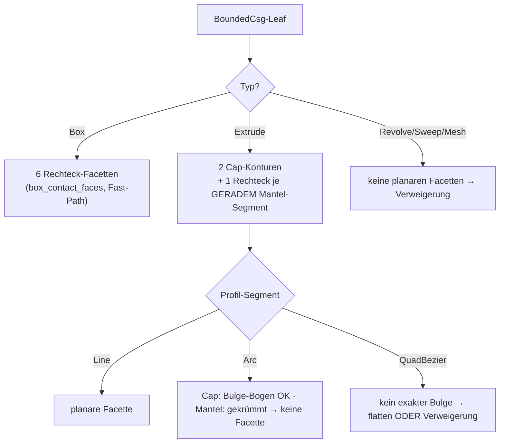

# FC — Nicht-konvexe / facettierte koplanare Kontaktflächen (Folgeprogramm c)

Design-Spike zum „Folgeprogramm (c)" des #384-Offset-Programms
(Fortsetzung von #395/#396/#398). Stand 2026-07-22. READ-ONLY-Spike:
Doku + Machbarkeits-Prototyp in
`crates/metricity-lab/tests/f_c_nonconvex_contact_spike.rs`; KEINE
Änderung am Produktionscode. Plan-SSOT des Programms bleibt
`docs/OFFSET-TREE-PLAN.md`; die tragenden Vorgänger sind
`F395-CONTACT-PATCH-DESIGN.md` (Kontakt-Prisma) und
`F396-RIM-OPCODE-DESIGN.md` (∂P-Rand-Fillet).

## 0. Verdikt vorweg

**Positiver Befund für das Prisma, sicher-beschränkter Befund für den Rim.**

Die Verallgemeinerung des **Kontakt-Prismas** auf beliebige planare Facetten
mit nicht-konvexen und mehrfach-zusammenhängenden Kontaktflächen P ist **billig
und sauber**: das Prisma ist heute schon ein `Extrude(Polygon)`-Member, und die
Polygon-Distanz (Even-Odd + Min-Kanten-Distanz) ist für einfache NICHT-konvexe
Polygone bereits exakt — es braucht **keinen neuen Opcode und keine
Zerlegung in konvexe Teile**. Die einzige neue Zutat ist der 2D-Verschnitt
selbst: statt Sutherland–Hodgman (nur konvex∩konvex) rechnet
`cavalier_contours` den booleschen Verschnitt zweier beliebiger Konturen und
liefert die **Zusammenhangskomponenten** (`pos_plines`) und **Löcher**
(`neg_plines`) direkt aus der API. Damit tilgt das Prisma den flächigen
2D-Innenfehler (bis > 9 mm, #395) für die ganze neue Kontaktklasse — mit
demselben 20–100-fachen Fehlerabfall, den #395 an Boxen gemessen hat.

Der **∂P-Rand-Fillet** (F396) verallgemeinert **sicher** (nie überfüllend) auf
nicht-konvexe P: gerade Stufen-Kanten und **konvexe** ∂P-Ecken rundet die
bestehende Nearest-Feature-Komposition ohne Zusatzterm; die additiv-only-
Halbraum-Maske plus die harte End-Cap-Klemme `t ∈ [0,1]` garantieren
Over-Fill = 0 auch an **konkaven (Reflex-)Ecken** von P. Der Preis der
Sicherheit: an einem Reflex-Vertex von P (der zwangsläufig mit einer
**intrinsischen konkaven Körperkante** des Extrude-Members zusammenfällt —
ein Trieder-Misch-Fall) rundet der Rim NICHT vollständig aus, sondern lässt
lokal den ehrlichen B0-Rest (≈0.75·δ) stehen. Das ist kein Wohlgestelltheits-
Bruch, sondern die bewusst gezogene Scope-Grenze: **eine korrekte
Reflex-Vertex-Rundung mischte Kontakt-Rim und intrinsische SSI-Naht** und liefe
in genau die submergierte-Π-Klemme, an der #395 Stufe 2 architektonisch
scheiterte. Verweigerung schlägt Falschkorrektur.

Netto ist jeder korrigierte Fall **strikt besser als heute**: heute meldet die
Capability für Nicht-Box-Kontakte den gesamten Kontakt als unkorrigiert
(`conservative`); mit dem verallgemeinerten Prisma wird er `tolerance_bounded`
(flächiger Fehler getilgt, Rest der δ-schmale ∂P-Saum), und wo der Rim greift
sogar `tolerance_bounded (channel_tol)`.

## 1. Ausgangslage — was heute BOX-only ist

Der Kontakt-Prisma-Pfad (`offset_channel.rs`) und der ∂P-Rim-Pfad
(`offset_rim.rs`) sind auf Box-Box-Kontakte beschränkt, an drei Stellen:

- `box_contact_faces` liefert die sechs Rechteck-Facetten NUR für
  `Primitive::Box` mit (nahezu) uniformer Skala; jeder Nicht-Box-Member
  gibt `None` → `contact_clips`/`synthesize_contact_prisms` verweigern
  (`refused`) und die #394-`conservative`-Degradierung bleibt.
- `clip_convex` (Sutherland–Hodgman) verschneidet die zwei projizierten
  Facetten-Loops. SH ist metrisch exakt NUR für konvex∩konvex; für
  nicht-konvexe Loops liefert es Unsinn. Das war eine bewusste Wahl (§4b von
  #395: SH ist am beweistragenden Gleich-Querschnitt-Fall S = U ohne die
  Orientierungs-/Overlapping-Degenerationen von `cavalier_contours`).
- `contact_clips` liefert je Facettenpaar GENAU EINE Kontur `p2d` (ein
  konvexes Verschnitt-Polygon), nie mehrere Komponenten oder Löcher; die
  ∂P-Kanten-Klassifikation (`edge_on_rect`) testet gegen Rechtecke.

Die Design-Aufgabe ist, diese drei Stellen auf beliebige planare Facetten zu
heben, ohne die für den Box-Fall bewiesene Exaktheit zu verlieren.

## 2. Design-Frage 1 — Facetten-Quelle

Für welche Leaf-Typen sind planare Facetten analytisch verfügbar?

| Leaf | planare Facetten | Kontur-Repräsentation |
|---|---|---|
| Box | alle 6 Seiten (bestehend) | Rechteck (4 Ecken) |
| Extrude, Deckel/Boden (`±half_height`) | 2 (die Profil-Umrisse) | Profil-Kontur: `Polygon`→Vertices, `Path`→Linien/Bögen |
| Extrude, Mantel je GERADEM Profilsegment | 1 Rechteck je Line-Segment | Segment × Höhen-Richtung |
| Extrude, Mantel je GEKRÜMMTEM Segment (Arc/Bezier) | KEINE (Zylinder-/Parabel-Fläche) | — → Verweigerung |
| Revolve / Helix / Sweep / Gyroid / Mesh | keine analytisch-planaren | — → Verweigerung |

Der Weg vom `BoundedCsg`-Leaf zur Facetten-Kontur:

- **Box:** unverändert `box_contact_faces` (Fast-Path, s. §6).
- **Extrude-Deckel/-Boden:** die zwei Cap-Ebenen liegen bei lokal
  `z = ±half_height`, Außennormale = ±lokale-Z, per `world_transform` in die
  Welt gehoben. Die Cap-Kontur IST der Sketch-Umriss: `Sketch2dPrimitive::Polygon`
  liefert die Vertices direkt; `Path` liefert die Segmentkette
  (`Line`/`Arc`/`QuadBezier`); `Rectangle`/`Circle`/`Sector` sind analytisch in
  eine Kontur konvertierbar. `Arc`-Segmente tragen als `cavalier_contours`-
  Polyline exakte **Bulge-Bögen** (bulge = tan(θ/4)); `QuadBezier` hat keinen
  exakten Bulge → flatten (PATH_FLATTEN_SAMPLES) ODER Verweigerung (empfohlen:
  Verweigerung, bis ein Bedarf besteht — Ehrlichkeit vor Näherung).
- **Extrude-Mantel:** jedes GERADE Profil-Segment (`Line`) extrudiert zu einer
  planaren Rechteck-Facette (Segment-Länge × 2·half_height). Deren Außennormale
  ist die In-Profil-Kantennormale, gedreht ins Welt-Frame. GEKRÜMMTE Segmente
  ergeben keine planare Facette → sie nehmen an keinem koplanaren Kontakt teil.
- **Revolve/Helix/Sweep:** die Mantelflächen sind gekrümmt (Rotations-/
  Sweep-Flächen), die Endkappen i. A. ebenfalls nicht als einfaches Polygon
  fassbar → generell Verweigerung (wie heute).

Die verallgemeinerte `ContactFace` trägt statt eines 4-Ecken-`loop3` eine
**Kontur mit optionalen Bögen** (Welt-3D-Punkte + Bulge je Kante, oder direkt
die projizierte 2D-`cavalier_contours::Polyline`). Normale, Ebenen-Offset und
Member-Dicke bleiben wie gehabt.



## 3. Design-Frage 2 — Kontakt-Erkennung und P im nicht-konvexen Fall

Der **Koplanaritätstest** zweier Facetten ändert sich NICHT: anti-parallele
wahre Normalen (Erosion) bzw. effektive Komplement-Normalen `eff = −sign·n̂`
(Dilation, sign-bewusst wie #397), koinzidenter Offset innerhalb `coincide_tol`.
Das ist rein normalen-/offset-basiert und unabhängig von der Kontur-Konvexität —
`coplanar_interface_present` und die Detektion in `contact_clips` gelten
unverändert.

Neu ist die **2D-Intersection**: statt `clip_convex(&la, &lb)` rechnet man
`la.boolean(&lb, BooleanOp::And)` auf den beiden in die Π-Basis projizierten
Konturen (als `cavalier_contours::Polyline` mit Bulge). Das Ergebnis ist der
Kontakt P — und im nicht-konvexen Fall ist P **kein einzelnes Polygon mehr**:

- `res.pos_plines` = die **Zusammenhangskomponenten** von P (mehrere disjunkte
  Kontaktinseln). Jede wird zu einem eigenen Kontakt-Prisma und einem eigenen
  ∂P-Rim-Loop.
- `res.neg_plines` = **Löcher** in einer Komponente (mehrfach-zusammenhängender
  Kontakt). Ein Loch entsteht nie aus konvex∩konvex, wohl aber aus einem
  Extrude-Profil mit Innenrand oder einem versenkten Abzug.

Der Prototyp (§7) belegt beides direkt an cavalier: L-Form ∩ Rechteck = die
L-Form (eine nicht-konvexe Komponente, Fläche 20, exakt); zwei „⌐"-Konturen
verschneiden zu ZWEI disjunkten 2×2-Inseln; Platte ∖ Innenkreis liefert eine
`neg_pline` mit echten Bögen.

## 4. Design-Frage 3 — Prisma-Verallgemeinerung (der tragende Positiv-Befund)

Das heutige Prisma ist bereits `BoundedCsg::from_csg_with_carry(Extrude {
sketch: Polygon { vertices } , half_height, … })` — ein Polygon-Extrudat.
Die entscheidende Beobachtung:

> Die Polygon-SDF (`Sketch2dPrimitive::Polygon`, Even-Odd-Kreuzungszahl +
> Min-Distanz zu allen Kanten) ist für **einfache nicht-konvexe Polygone
> bereits die exakte signierte Distanz**. Nicht-Konvexität kostet NICHTS am
> Feld — es braucht **keine Trapezoid-/konvexe Zerlegung**.

Damit ist die Prisma-Verallgemeinerung im Tape und in allen fünf
Evaluator-Spiegeln **praktisch gratis**:

| Aspekt | Kosten |
|---|---|
| Neuer Opcode | **keiner** — es bleibt `OP_PRIM2D_PATH`/`OP_PRIM2D_POLY` |
| CPU / eval_opcodes / sdf-vm (WGSL) / fidget / CGAL | **0** — jeder Spiegel wertet Extrude-Leaves schon aus |
| Feld-Kosten je Sample | O(N Kanten von P) — wie bei jedem Nutzer-Extrude |
| Bögen in P (Bulge-Kanten) | via `Sketch2dPrimitive::Path` mit `Arc`-Segmenten (exakte Bogen-Distanz, schon gespiegelt) statt `Polygon` |
| Löcher in P (`neg_pline`) | eine zusätzliche `Difference{ Extrude(outer), Extrude(hole) }` — ein Extra-Member, ebenfalls opcode-frei |
| Mehrere Komponenten | je Komponente ein Union-Member (Erosion) bzw. Difference-Constraint (Dilation) — wie mehrere Box-Prismen heute |

Die beweistragenden Eigenschaften bleiben unberührt: `prism_subset_of_union`
(bzw. `prism_outside_inner` für Dilation) sampelt ein Gitter über der
Prisma-AABB und prüft S ⊆ U feld-seitig — konvexitäts-unabhängig. Cap-Tiefen
kommen wie gehabt aus der echten Member-Dicke normal zu Π (Extrude:
`2·half_height`).

**Konsequenz:** Der flächige 2D-Innenfehler wird für die gesamte neue
Kontaktklasse getilgt, ohne die Evaluatoren anzufassen. Der Aufwand liegt — wie
schon bei #395/#396 — vollständig in der **Synthese** (Facetten-Extraktion +
cavalier-Verschnitt + Komponenten-/Loch-Aufspaltung), nicht im Feld.

## 5. Design-Frage 4 — ∂P-Rim-Verallgemeinerung (sicher, mit gezogener Grenze)

`RimRecord`/`RimFeature` sind heute Segment-basiert (a, b + zwei Wand-Normalen).
Ein nicht-konvexes ∂P hat konvexe UND konkave (Reflex-)Ecken sowie ggf.
Bogen-Kanten. Die Zerlegung:

- **Kanten-Klassifikation** verallgemeinert direkt: `edge_on_rect` (Lot-Distanz
  einer ∂P-Kante zu den vier Rechteck-Geraden) wird zu `edge_on_contour` (liegt
  die ∂P-Kante auf der Randlinie von Member i's Kontur, j's Kontur, oder beider?
  → `Flush` / `Step{wall}` / `Degenerate`). Das ist derselbe rein-analytische
  Kollinearitätstest, nur über beliebige Kontur-Segmente statt vier
  Rechteck-Kanten. Für Bogen-Kanten von ∂P: die Spine wird ein `ChannelArc`
  (Bogen), exakt wie die bestehende Arc-Spline-Repräsentation — der Rim trägt
  Bögen bereits konzeptionell (F396 §2.1).
- **Welche Kanten bekommen Fillets:** nur konkave Erosions-Stufen (bzw. konvexe
  Dilations-Keile) — das bestehende **Konkavitäts-Gate** bleibt: gemischte
  `wall_member` an ∂P (versetzter Kontakt) ⇒ komplette Verweigerung des Rims
  (die A-Rand-Kanten wären konvexe Stufen nach unten, kein konkaver Sliver —
  der Fillet würde sie fälschlich auffüllen). Für einen **enthaltenen**
  nicht-konvexen Kontakt (P vollständig im Über-Stander, z. B. L-Profil in
  großer Box) ist `wall_member` homogen → das Gate passiert, alle Stufen-Kanten
  sind echte konkave Reflexkanten.
- **Konvexe ∂P-Ecken:** die Nearest-Feature-Komposition rundet sie ohne
  Zusatzterm (Design F396 §2.4) — unverändert.
- **Konkave (Reflex-)Ecken von P** sind der einzige genuin neue Fall. An einem
  Reflex-Vertex des Kontur-P (Innenwinkel > 180°, z. B. (2,2) der L) fällt die
  vertikale Prisma-Kante mit einer **intrinsischen konkaven Körperkante** des
  Extrude-Members zusammen (das nicht-konvexe Profil hat dort eine reentrant
  vertikale Kante). Es treffen also DREI konkave Features zusammen: zwei
  Kontakt-Stufen-Dieder (Wand–Π) + eine intrinsische Wand–Wand-Reflexkante. Das
  ist ein (√3−1)·δ-Trieder-Misch-Fall.

**Warum der Rim hier nicht bricht, aber auch nicht voll rundet:** Die
additiv-only-Konstruktion (`min(g, δ−de)`) mit Halbraum-Maske UND harter
End-Cap-Klemme `t ∈ [0,1]` kann **niemals überfüllen** — jede Kanten-Spine
endet exakt am Reflex-Vertex, die Masken halten den Term strikt in der
Reflex-Schneise (F396 §2.3: Over-Fill empirisch 0.0000 an allen Fällen). Am
Reflex-Vertex hören die beiden adjazenten Kanten-Fillets an ihren End-Caps auf,
und die kleine Vertex-Umgebung bleibt auf dem Prisma-Wert stehen → **lokaler
Unterschuss der B0-Klasse (≈0.75·δ), kein Überschuss**. Das ist exakt die
Ehrlichkeits-Doktrin: der Fillet rundet Kanten und konvexe Ecken metrisch
exakt, lässt den Reflex-Vertex als ehrlichen Rest.

Eine **vollständige** Reflex-Vertex-Rundung müsste den Kontakt-Rim mit der
intrinsischen konkaven Körperkante (die die reguläre `OP_ARC_CHANNEL`/SSI-Naht
bedient) zu einem Trieder-Term verweben. Genau diese Naht läuft aber bis zur
submergierten Π hinunter und trifft dort die **Luftseiten-Klemme
`s₁ = ⟨dq, m̂₁⟩ = 0`**, an der #395 Stufe 2 architektonisch scheiterte
(F395 §Umsetzungs-Status). Ein solcher Term ist **außerhalb dieses Scopes** —
und der `synthesize_vertices`-Gate (gleiche `wall_member` ⇒ kein Vertex-Term)
lässt ihn ohnehin schon aus. Es bleibt bei der ehrlichen lokalen B0-Schranke.

**Verweigerungsfälle (wohlgestellt-halten):**
- versetzter/gemischter Kontakt (gemischte `wall_member`) → ganzer Rim
  verweigert (bestehend);
- Reflex-Vertex → adjazente Kanten enden am Cap, Vertex-Umgebung ehrlich
  ungerundet (kein Term, kein Over-Fill);
- Bogen-Stufen mit tangentialem Übergang (Bulge → Wandnormale dreht stetig) →
  wie die quasi-tangentiale Kanal-Degeneration behandeln (unter Toleranz ⇒ kein
  Fillet).

## 6. Design-Frage 5 — Zahlendomänen

`cavalier_contours` rechnet in f64 — dieselbe Domäne wie die bestehende
`ContactClip`-Pipeline (Verschnitt/Projektion in f64, Emission in f32). Die
A1-Bibliotheks-Evaluation (`crates/metricity-lab/src/bin/a1_offset_lib_spike.rs`)
maß die Boolean-/Bogen-Genauigkeit: Flächenfehler ~1e-6, radiale Bogen-Fehler
klein — komfortabel unter der Fuzz-P3-Schranke (0.1·δ) und der
`exact_tol`-Kalibrierung. Die bestehende f64→f32-Toleranzkalibrierung trägt
also unverändert.

Zwei Gotchas aus der A1-Empirie sind einzuplanen (beide bereits im Box-Pfad
adressiert):
- **Orientierung nicht garantiert:** `BooleanOp::Not`-Ergebnisse kommen teils CW
  zurück → per `area()`-Vorzeichen normalisieren (`if area2d < 0 { reverse }` ist
  schon da).
- **Fast-koinzidente Kanten:** boolesche Ops auf nahezu deckungsgleichen
  Eingaben können Sliver-Artefakte erzeugen → `cleanup_poly` + Flächen-Schwelle
  (`ap < overlap_min²`) fangen das (schon da).

Der **beweistragende Gleich-Querschnitt-Fall S = U** (Box-Box, exakte Deckung)
bleibt bewusst auf dem **Sutherland–Hodgman-Fast-Path** (`clip_convex`): dort ist
konvex∩konvex metrisch exakt und OHNE die Orientierungs-/Overlapping-
Degenerationen, die cavalier an exakt-koinzidenten Eingaben zeigen kann (der
Grund, warum #395 SH wählte). `cavalier_contours` wird ausschließlich für
NICHT-konvexe / Nicht-Box-Facetten gezogen — konvex-Box-Kontakte laufen
unverändert exakt. So verliert die Verallgemeinerung nichts an der bewiesenen
Box-Exaktheit.

## 7. Prototyp (Machbarkeits-Beleg)

`crates/metricity-lab/tests/f_c_nonconvex_contact_spike.rs`, grün
(`cargo test -p metricity-lab --test f_c_nonconvex_contact_spike`, 3/3):

- `l_shape_contained_in_rect_is_l_shape` — L-Form ∩ überragendes Rechteck =
  die L-Form; genau EINE Komponente, kein Loch, Fläche exakt 20 (= 6·6−4·4),
  keine Bögen. Der nicht-konvexe Analog-Fall zum Box-Stack.
- `two_ls_intersect_in_two_components` — zwei koplanare „⌐"-Konturen
  verschneiden zu ZWEI disjunkten 2×2-Inseln (`pos_plines.len() == 2`); die
  Komponenten-Zerlegung fällt direkt aus der API. **Kernbeleg.**
- `contact_with_hole_yields_neg_pline` — Platte ∖ Innenkreis liefert eine
  `neg_pline` (Loch) mit echten Bögen (Bulge ≠ 0); belegt mehrfach-
  zusammenhängende Kontakte und die Bulge-Repräsentation (gekrümmte Kontakte
  sind repräsentierbar, werden aber per Scope NICHT korrigiert).

Der Prototyp ist klar als Spike markiert und ändert kein Feld.

## 8. Design-Frage 6 — Aufwand, Risiken, Phasenplan

Analog zum RimFillet-Rollout (Synthese unverdrahtet → Opcode → Spiegel →
scharfschalten), hier ohne Opcode-Phase (das Prisma braucht keinen):

- **Phase 1 (unverdrahtet, feldneutral):** `box_contact_faces` →
  `member_contact_faces` (Box-Fast-Path + Extrude-Cap-/Mantel-Facetten mit
  Bulge-Konturen); `contact_clips` auf `cavalier_contours::boolean(And)` mit
  Komponenten-/Loch-Aufspaltung; SH-Fast-Path für Box-Box behalten. Tests wie
  der Spike. **2–3 Tage.**
- **Phase 2 (Prisma verdrahten):** je Komponente ein `Extrude(Polygon|Path)`-
  Member; Löcher als `Difference{outer, hole}`; Einhängung in
  `synthesize_stop`/`synthesize_offset_channels_reported` wie die Box-Prismen.
  KEIN neuer Opcode. Capability auf `tolerance_bounded` heben. **1–2 Tage.**
- **Phase 3 (Rim verallgemeinern):** `edge_on_rect` → `edge_on_contour`;
  Bogen-Stufen als `ChannelArc`-Spine; Reflex-Vertex-Verweigerung (End-Cap
  lässt ihn ehrlich ungerundet); Konkavitäts-Gate unverändert. **2–3 Tage.**
- **Phase 4 (scharfschalten):** Fuzz-Familie `NonConvexContact` (L-in-Box,
  zwei-Inseln, Loch-Kontakt) mit Doppel-GT; CGAL-Goldens
  (`contact_prism_lshape`, `contact_prism_two_islands`); Capability-Anhebung.
  **1–2 Tage.**

Summe grob **6–10 Tage**, überwiegend Synthese.

**Explizit NICHT im Scope (Verweigerung, ehrlich beschränkt):**
- Revolve-/Helix-/Sweep-Mantel und gekrümmte Extrude-Mantel-Segmente (keine
  planaren Facetten);
- gekrümmte Kontakte (Bogen-∂P mit tangentialem Übergang, Zylinder-auf-Ebene);
- QuadBezier-Profilkanten exakt (flatten oder verweigern);
- vollständige Reflex-Vertex-Rundung (Trieder-Misch aus Kontakt-Rim +
  intrinsischer SSI-Naht — die Stufe-2-Klemme; bleibt B0-beschränkt).

**Risiken:**
- `cavalier_contours`-Robustheit an fast-koinzidenten Nicht-Box-Facetten
  (Sliver, Fehl-Komponenten) — Fast-Path + cleanup + Flächen-Schwelle mildern;
  bei Unsicherheit verweigern.
- Facetten-Explosion bei hoch-facettierten Profilen (viele Mantel-Rechtecke) —
  die koplanare Detektion filtert per Normale/Offset früh, nur echte Kontakte
  gehen in den Verschnitt.
- ≥ 3 Member auf derselben Ebene (paarweise P, überlappende Prismen) — min-
  Komposition bleibt konservativ korrekt, ∂P-Zerlegung mehrdeutig (bestehendes
  Plan-§9-Kaskaden-Risiko).

## 8b. Phase-4-Abschluss — Umsetzungsstand (2026-07-22)

Phase 4 ist umgesetzt und feldneutral für alle Alt-Szenen (Golden byte-identisch,
CGAL-Interpreter-Cross-Check 0 Failures über alle 35 Szenen inkl. der neuen).

- **Bogen-∂P-Rand-Fillet — NEUER Opcode `OP_RIM_FILLET_ARC` (0x44).** Der gerade
  `OP_RIM_FILLET` (0x43) bleibt **byte-identisch** (rein gerade Kontakte emittieren
  weiter 0x43). Ein Stopp mit mindestens EINER konvexen Bogen-∂P-Kante emittiert
  STATTDESSEN einen einzigen gemischten `OP_RIM_FILLET_ARC`-Block, der **alle**
  Features trägt (Geraden als Segment-Records `sweep<0`, Bögen als Bogen-Records
  `sweep>0`) — in EINER Nearest-Feature-Auswahl. Grund für den gemischten Block
  statt zweier getrennter Blöcke: an einer Linie↔Bogen-Ecke (abgerundetes
  Rechteck, Stadion) überlappen die Feature-Schneisen; ein sequenzielles `min`
  über getrennte Blöcke nähme dort die fernere Kante und **überfüllte** (Design §5).
  Der Bogen-Spine trägt Zentrum `c`, Basis `(u,v)`, Radius `r`, `sweep` und die
  RADIALE Wandnormale `wall_sign·(q−c)/r`; die Distanz ist die exakte radiale
  Tube-Distanz zum Kreisbogen in der Kontaktebene. **Warum neuer Opcode statt
  Parametrisierung:** die Bogen-Geometrie (Zentrum/Basis/Radius/Sweep + radiale,
  fußpunkt-abhängige Wandnormale) ist strukturell unvereinbar mit dem
  Segment-Record; ein `is_arc`-Flag im 0x43-Record hätte die Stride verdoppelt und
  jeden der sechs Evaluator-Hot-Loops belastet. Der separate Opcode hält 0x43
  unverändert (Golden-Neutralität) und additiv.
- **Innen- vs. Außenbogen.** KONVEXE Bögen (Zentrum auf der Material-Seite; der
  Wandzylinder ist konvex) werden gerundet — der Fillet auf der Außenseite kann
  nicht selbst-schneiden, Over-Fill = 0. KONKAVE Bögen (Zentrum auf der Luftseite,
  Material-seitig hohl — der gekrümmte Reflex-Fall, z. B. Kreisloch-Wände) werden
  wie Reflex-Vertices **ehrlich verweigert** (`residual ≈ 0.75·δ`): dort
  konvergierte der δ-Tube nach innen und überfüllte für δ nahe/über dem
  Bogenradius. Reine Bogen-Loops OHNE gerade Anker-Stufe (z. B. Kreis-Cap-Kontakt)
  werden ebenfalls verweigert — der Wand-Member ist ohne gerade `edge_on_contour`-
  Stufe nicht eindeutig bestimmbar (Scope-Grenze, Ehrlichkeit vor Näherung).
- **Bogen-tragende Kontakt-Prismen.** `build_prism_component` verweigert
  Bogen-Konturen nicht mehr, sondern baut sie als `Extrude(Path)` mit exakten
  `SketchSegment::Arc`-Bögen (OP_PRIM2D_PATH — in ALLEN Evaluatoren vorhanden).
  Rein gerade Konturen bleiben `Extrude(Polygon)` (byte-identisch).

### Capability-Vertrag (final, Phase 4)

Für einen dualen Offset-Stopp mit koplanarem submergiertem Kontakt gilt:

| Fall | Status | Zugesagte Schranke |
|---|---|---|
| Gleich-Querschnitt-Kontakt S = U (Box=Box) | `exact` | 0 (nur GT-Messboden) |
| Konvexes P, Rim schließt ∂P ganz (Box-Stack, abgerundetes Rechteck) | `tolerance_bounded` | Fillet-Approximation ≤ `channel_tol` (≈0.1·δ empirisch) |
| Nicht-konvexes P, Rim schließt GERADE ∂P-Kanten, Reflex-Vertices/konkave Bögen offen | `tolerance_bounded` | B0-Rest an Reflex-Vertices/Bögen ≈0.75·δ |
| Versetzter (staggered)/gemischter Kontakt — Rim verweigert | `tolerance_bounded` | konkaver B0-Sliver ≈0.75·δ (Prisma-only) |
| Nicht-Box-Partner ohne planare Facetten / gekrümmter Kontakt / degenerierter Verschnitt | `conservative` | keine (f∓δ unbeschränkt) |

**Multi-Clip-Ehrlichkeit (Phase-4-Fix):** verweigert an EINEM Stopp ein Rim-Loop
(versetzt/Reflex/konkaver Bogen) und schließt ein anderer sauber, meldet
`synthesize_stop` NICHT mehr die enge `channel_tol`-Schranke, sondern die weitere
0.75·δ-Schranke (der `residual` des verweigerten Loops dominiert). Das war zuvor
ein Bound-Over-Claim: der ehrliche Rest des verweigerten Loops blieb ungenannt.

## 8c. Durchdringende Kontakte — signierte Kontaktlage (#384, 2026-08-01)

Der Kontakt-Vertrag oben setzte stillschweigend voraus, dass ein Kontakt BÜNDIG
ist: zwei Member-Facetten auf DERSELBEN Ebene Π. Der Detektor prüfte das mit
einem **unsignierten** Fenster `|o_a + o_b| ≤ 0.5·δ` (Box) bzw. `0.02·δ`
(Nicht-Box) und verankerte das Prisma an EINER der beiden Ebenen. Die signierte
Größe

    s := o_a + o_b        (fa.n = −fb.n; Member i auf n̂·x ≤ o_a, j auf n̂·x ≥ −o_b)

ist aber die **Durchdringungstiefe**: `s = 0` bündig, `s > 0` die Member stecken
um `s` ineinander, `s < 0` es klafft ein Luftspalt. Das alte Fenster vermengte
alle drei Lagen und erzeugte drei Falschaussagen — jede unter dem Stempel
`exact` (gemessen an zwei achsparallel gestapelten Boxen, δ = 2 mm):

| Lage | alter Befund | Fehlergröße |
|---|---|---|
| `s < 0` (Luftspalt 0.1 mm) | Prisma **überbrückt die Luft** | 8 mm Phantom-Material, wo die wahre Erosion leer ist |
| `0 < s ≤ 0.5·δ` | Prisma an EINER Ebene verankert, trägt j's volle Dicke ⇒ ragt um `s` über die Gegenseite | bis 1 mm Phantom-Material über der wahren Erosionsdecke |
| `0.5·δ < s < 2·δ` | gar kein Prisma; `min(f_i) + δ` reißt einen **Phantom-Schlitz** der Dicke `2δ − s` | Nullmengenfehler bis 1.47 mm ≈ 0.735·δ |

Der Fix ist **Synthese, kein Downgrade** — die Geometrie des durchdringenden
Falls ist wohldefiniert und braucht keinen neuen Term:

1. **Signierte Klassifikation** (`offset_channel::face_pair_penetration`):
   `s < −round_tol` → echter Luftspalt, KEIN Kontakt; `s ≥ 2·δ` → die erodierten
   Member überlappen noch, es entsteht gar kein Schlitz → keine Korrektur nötig;
   sonst Kontakt mit `pen = max(s, 0)`. `round_tol` ist die bereits kalibrierte
   f32-Rundungsklasse `0.02·δ` (#397) — jetzt für BEIDE Facettenklassen. Das
   alte `0.5·δ` als Klemme war der Fehler: es faltete 1 mm echte Durchdringung
   auf „bündig".
2. **Korrekte Prisma-Ausdehnung:** das Prisma spannt von Member i's Rückseite
   `o_a − depth_neg` bis Member j's Rückseite `(−o_b) + depth_pos`, d. h. die
   effektive +n̂-Tiefe ist `depth_pos − pen`. Für `pen = 0` ist das
   **bit-identisch** zum Bestandspfad (Golden byte-identisch verifiziert).
   `S ⊆ U` gilt exakt: über P überdecken i's und j's Slab das Intervall
   lückenlos, weil `−o_b ≤ o_a`.
3. **SSI-Nähte nur am BÜNDIGEN Kontakt unterdrücken.** Am bündigen Kontakt sind
   die Nähte des Paars koinzident/tangential degeneriert (der Grund der
   Unterdrückung seit #395). Am DURCHDRINGENDEN Kontakt ist die Naht am
   Kontaktrand eine echte transversale Dieder-Kante (Deckfläche × Seitenwand,
   Normalen 90°) — die korrigieren die regulären `OP_ARC_CHANNEL`-Kanäle sauber;
   sie zu unterdrücken nähme dem Stopp seine einzige ∂P-Korrektur.
4. **Rim-Spiegel bleibt bündig-only.** `contact_clips` (die Quelle von
   `offset_rim::RimBlock`) nimmt nur `|s| ≤ round_tol` auf: ein durchdringender
   Kontakt hat keine gemeinsame Ebene Π, der Rim legte seine Spine sonst auf die
   submergierte statt auf die exponierte Ebene. Statt dessen sagt die Capability
   für ungleiche Querschnitte ehrlich die weitere B0-Schranke ≈0.75·δ zu
   (`ContactResult::pen_unrimmed`) — kein Bound-Over-Claim durch die enge
   `channel_tol` eines bündigen Nachbar-Kontakts am selben Stopp.
5. **Fehlalarm-Widerlegung.** Das Carrier-Gate `coplanar_interface_present`
   sieht durchdringende Kontakte nicht (es verlangt überlappende Facetten-AABBs)
   → additiver Trigger `contact_face_scan().penetrating`. Umgekehrt meldete es
   für einen 0.1-mm-Luftspalt einen Verdacht, den der Facetten-Scan widerlegt:
   sind ALLE Member-Facetten analytisch bekannt und ist KEIN Paar in Kontakt,
   entfällt die #394-Verdachtsmeldung (getrennte Körper erodieren unabhängig
   und exakt).

### Ergänzung zum Capability-Vertrag

| Fall | Status | Zugesagte Schranke |
|---|---|---|
| Durchdringung `0 < s < 2·δ`, Gleich-Querschnitt (S = U) | `exact` | 0 (nur GT-Messboden) |
| Durchdringung `0 < s < 2·δ`, ungleicher Querschnitt | `tolerance_bounded` | B0-Sliver am Kontaktrand ∂P ≤ 0.75·δ (Prisma-only; die SSI-Kanäle liegen faktisch darunter, werden aber nicht zugesagt) |
| Überlappung `s ≥ 2·δ` | unverändert | kein Schlitz; die naive Erosion ist in Normalenrichtung zero-set-exakt, echte konkave Nähte gehören den Kanälen |
| Luftspalt `s < −round_tol` | `exact` | getrennte Körper erodieren unabhängig exakt |

**Nicht im Scope (offen):** der duale DILATIONS-Pfad
(`synthesize_contact_prisms_dilation`) fährt weiter das symmetrische
Koinzidenz-Fenster. Er sagt nie `exact` zu (¬box unbeschränkt), eine
Fehl-Verankerung dort wäre also ein Bound-Over-Claim, keine Exakt-Lüge — und
seine 0.5·δ-Kalibrierung ist per `thin_wall_shell_status_unchanged_397`
eingefroren. Die signierte Behandlung dort ist ein eigener Schritt.
→ nachgeholt in §8d.

## 8d. Der duale Dilations-Pfad — dasselbe Fenster, gedrehtes Vorzeichen (#384, 2026-08-01)

§8c ließ den Dilations-Pfad offen mit der Vermutung, eine Fehl-Verankerung
wäre dort „nur" ein Bound-Over-Claim. Die Messung bestätigt den Befund und
verschärft ihn: der Pfad **verletzt seine engste Zusage um den Faktor 200**,
und die eingefrorene Kalibrierung war der Grund.

### Was der Pfad wirklich bedient

Dilation distribuiert über Union exakt — der Pfad existiert also für die
Intersection/Difference-Form. In der Komplement-Dualität (§8c-Rahmen, De
Morgan) sind die Member `¬A` (unbeschränkt, `sign = +1`) und `B` (der
Subtrahend, `sign = −1`); die signierte Größe ist

    s := O_i + O_j,   O = −sign·o    ⇒   für A − B:  s = o_B − o_A

Sie misst die Durchdringung der KOMPLEMENTE, und darum bedeutet ihr Vorzeichen
etwas anderes als bei der Erosion — es DREHT sich:

| `s` | Geometrie | wahre Lage |
|---|---|---|
| `s = 0` | bündig ausgeschnittene Tasche (flush cut), Taschenmund koplanar mit A's Außenfläche | echter submergierter Kontakt — der Fall, für den die Korrektur gebaut wurde |
| `s > 0` | B ragt um `s` aus A heraus; der Taschenboden liegt um `s` höher | Kontakt mit Überstand — Prisma nötig, aber anders verankert |
| `s < 0` | B ist um `|s|` VERGRABEN: geschlossener Hohlraum hinter einem Deckel der Dicke `|s|` | **gar kein Kontakt** — es gibt keinen Taschenmund und keinen Phantom-Fin |

Bei der Erosion war `s < 0` der harmlose Luftspalt; hier ist `s < 0` der
gefährliche Fall. Die praktisch wichtigste Geometrie dieser Lage ist die
**geschlossene Shell** `Difference(box, box)` mit Wandstärke `w`: sie ist
`s = −w` auf allen sechs Achsen gleichzeitig.

### Gemessen (δ = 2 mm, Referenz = exakte Distanz zu `A \ B` über dessen ≤6-Box-Zerlegung; `|d − δ|` ist eine UNTERE Schranke des Nullmengen-Fehlers)

Sonde: A = Box he 10³, B = Box he [7,7,5], Mittelpunkt `z = 5 + s`
(`crates/kernel/src/offset_capability_tests.rs`).

| Lage | Status (vorher) | zugesagt (vorher) | REAL (vorher) | nachher |
|---|---|---|---|---|
| `s ∈ [−1.0, −0.05]` (Deckel bis 0.5·δ) | `tolerance_bounded` | ≤ 0.01 mm | **≥ 2.000 mm = 1.0·δ** | `exact`, 0.000 mm |
| `s = 0` (bündig) | `tolerance_bounded` | ≤ 0.01 mm | 0.000 mm | unverändert |
| `0 < s ≤ 0.5·δ` | `tolerance_bounded` | ≤ 0.01 mm | **genau `s`, bis 1.000 mm** | ≤ 1.500 mm zugesagt, 0.395 mm real |
| `0.5·δ < s < 2·δ` | `tolerance_bounded` | ≤ 0.01 mm | **5.159 mm** (kein Prisma → Phantom-Fin über der Tasche) | ≤ 1.500 mm zugesagt, 0.395 mm real |

Box-Shell, Wandstärke `w`, dieselbe Referenz, 61³-Gitter:

| `w/δ` | Status (vorher) | fehlklassifizierte Innenpunkte (vorher) | nachher |
|---|---|---|---|
| 0.1 | `tolerance_bounded` (≤ 0.01 mm) | 62118 / 94958 = 65 % | 0 / 94958, `exact` |
| 0.3 | `tolerance_bounded` (≤ 0.01 mm) | 60780 / 101104 = 60 %, davon 5766 im echten SOLID | 0, `exact` |
| 0.5 | `tolerance_bounded` (≤ 0.01 mm) | 63632 / 106506 = 60 %, davon 11508 im echten Solid | 0, `exact` |
| 0.8 | `exact` | 0 | unverändert |
| 1.0 | `exact` | 0 | unverändert |

Das Prisma spannte beim vergrabenen Hohlraum von der Deckel-AUSSENfläche quer
durch den Deckel bis zur Rückseite des Hohlraums und subtrahierte alles
dazwischen — der Deckel verschwand, der Hohlraum wurde zum Kamin. Die duale
Sicherheits-Stichprobe `prism_outside_inner` (7³ Punkte über der Prisma-AABB)
sieht das nicht: bei ~5 mm Abtastweite fällt ein 0.6-mm-Deckel durch das Raster.

### Fix (Spiegel von §8c, nicht blind gespiegelt)

1. **`face_pair_penetration` auch hier** — dieselbe Funktion, dieselbe
   f32-Rundungsklasse `0.02·δ` für BEIDE Facettenklassen. `s < −round_tol` →
   kein Kontakt (vergrabener Hohlraum), `s ≥ 2·δ` → keine Korrektur nötig,
   sonst Kontakt mit `pen = max(s, 0)`.
2. **Prisma-Ausdehnung `depth_pos − pen`**, wenn die `+n̂`-Seite ein ECHTER
   Member ist (`sign = −1`, endliche Dicke). Ist sie die ¬box-Seite, bleibt
   `margin` unangetastet: das ist keine Rückseite, sondern eine synthetische
   Reichweite ab der Ankerebene, die ≥ lateraler Reichweite von P bleiben muss.
3. **`contact_clips` (Rim-Quelle) wird bündig-only** — auch im
   Dilations-Zweig. Ein durchdringender Kontakt hat keine gemeinsame Ebene Π;
   der Rim legte seine Spine sonst auf die falsche und sagte dafür die enge
   Bau-Toleranz zu. Statt dessen `pen_unrimmed` → ehrliche B0-Schranke 0.75·δ
   (Phase-4-Multi-Clip-Regel, damit ein bündiger Nachbar-Kontakt am selben
   Stopp die Zusage nicht wieder verengt).
4. **SSI-Nähte bleiben hier für JEDES Kontakt-Paar unterdrückt** — anders als
   am Erosions-Stopp, und das ist gemessen statt gespiegelt. Am Dilations-Stopp
   SUBTRAHIEREN die Kanäle (konvexe Dualkante). Der Kanal über der
   Mündungs-Naht eines durchdringenden Kontakts griff im Versuch bis an die
   AUSSENkante des Trägerkörpers durch und trug dort legitimes Material ab:
   0.760 mm Fehlstelle gegen 0.395 mm ehrlichen B0-Keil mit Unterdrückung.
   Beide Varianten halten die 0.75·δ-Zusage; die kleinere gewinnt.

### Was das die eingefrorene Kalibrierung kostet

`thin_wall_shell_status_unchanged_397` fror für die BOX-Spalte bei
`w < 0.5·δ` genau diese Falschaussage ein (`tolerance_bounded` ≤ 0.01 mm bei
2.000 mm realem Fehler). Der Pin bewegt sich also — aber nicht als
Abwägung, sondern als Streichung: die WAHRE Zusage der Familie ist `exact`,
belegt mit derselben Referenz, die auch die (unveränderten) Zeilen ≥ 0.8·δ
bestätigt. Die EXTRUDE-Spalte — der eigentliche #397-Gegenstand (eff-Fallback
mit enger Koinzidenz) — steht unverändert.

### Neuer, hier NICHT behobener Befund (eigenes Paket)

Bei `s ≥ 2·δ` (kein Prisma, unverändert vor wie nach dem Fix) korrigiert der
reguläre `OP_ARC_CHANNEL`-Pfad die Mündungs-Naht und trägt dabei an der
Außenkante des Trägerkörpers **0.760 mm** ab, während er ≤ 0.01 mm zusagt
(`worst` bei `[−10.73, 6.53, 11.0]`, δ = 2). Das ist ein Bound-Over-Claim des
KANAL-Pfads, nicht des Prisma-Pfads, und existiert unabhängig von #384-8d.

## 8e. Die End-Kappe des Kanal-Terms (#384, 2026-08-01)

§8d ließ einen Befund offen: bei `s ≥ 2·δ` — wo korrekt KEIN Prisma entsteht,
vorher wie nachher — trug der reguläre `OP_ARC_CHANNEL`-Pfad an der
**Außenkante des Trägerkörpers** 0.760 mm ab (worst bei `[−10.73, 6.53, 11.0]`,
δ = 2), während die Capability ≤ 0.01 mm zusagte. Das ist ein Bound-Over-Claim
um Faktor 76, und er sitzt weit weg von der Naht, die der Kanal korrigiert.

### Diagnose: die Kappe, nicht der Kegel, nicht der Trust-Radius

Die C2-Konstruktion ist exakt, solange der nächste Punkt `q*` der Naht-Kurve
AUCH der nächste Randpunkt des Körpers ist. Am **offenen Spine-Ende** gilt das
jenseits des Endes nicht mehr:

* `arc_closest` klemmt den Fußpunkt auf den Endpunkt `E`. Für jeden Punkt
  hinter der Endebene misst `de` die Distanz zu EINEM PUNKT, nicht zur Naht.
* Die beiden Kegel-Gates `m̂₁, m̂₂` gehören zur KANTE. Sie schneiden den
  Normalkegel des Dieders aus, aber sie sagen nichts über die Richtung
  ENTLANG der Naht — hinter dem Ende stehen sie unverändert offen.
* Ergebnis: eine Ball-Kappe des Radius `K = c·δ + 0.5·δ + 8·tol ≈ 1.95·δ`
  um jedes Nahtende, in der der Term voll wirkt.

Am Messpunkt: der Fußpunkt ist die Ecke der Taschenmündung `(−7, 7, 10)`,
`de = 3.894 < K = 3.908`, beide Gates positiv (`+z`: 1.0, `−y`: 0.467),
`w = K − de = 0.014 > 0`, naives `d = −0.762` (korrekt: die Außenkante von A
liegt 1.238 entfernt, also INNERHALB der Dilatation). `max(d, w) = +0.014` ⇒
Vorzeichenkipp. 544 Gitterpunkte einer 61³-Sonde fielen so.

Zwei naheliegende Erklärungen sind **widerlegt**:

* **Trust-Radius zu groß?** Nein. Dieselbe Fehlstelle entsteht bei
  `de = 2.55` (also weit unter `c·δ = 2.83`, dem Ausmaß des legitimen Keils).
  Der Trust-Radius begrenzt die Reichweite, nicht die Ursache.
* **Spine zurückschneiden?** Verschlimmert es. Trimmt man das Ende um `K`,
  wandert die Kappe mit — und wirkt jetzt über den Nahtabschnitt, den sie
  gerade freigegeben hat, wo `de` die Distanz zur echten Naht ÜBERSCHÄTZT
  (gemessen: worst 0.632 → 1.500 mm). Eine Kappe ist nur dort harmlos, wo die
  Naht wirklich endet — und genau dort ist sie schädlich.

Der Mechanismus ist NICHT auf den Dilations-Pfad beschränkt: am Erosions-Stopp
addiert dieselbe Kappe. Am `notch_union`-Dieder (die B0-Fixture, α = 90°,
δ = 2) steht 1.34 mm vor der Deckfläche `z = −50` Phantom-Material, wo das
naive Feld korrekt Luft meldet: **0.800 mm**, gemessen gegen die exakte
3D-Referenz `δ − dist(x, ∁Körper)`.

### Fix: das End-Gate ist DATEN, nicht Semantik

Der Opcode hat je Bogen genau ZWEI Gate-Vektoren; ein drittes wäre eine
Semantik-Änderung in sechs Evaluator-Spiegeln (ausdrücklich außerhalb dieses
Pakets). Aber die Gates sind **Daten**: `close_open_end_caps` spaltet am
offenen Ende ein kurzes terminales Bogenstück (`0.25·δ`) ab und dreht dessen
zweites Gate auf die **Endebenen-Normale** `∓t̂`:

* jenseits der Endebene ist `⟨x−E, ∓t̂⟩ < 0` ⇒ `w < 0` ⇒ der Term ist
  strukturell AUS — kein Sampling, kein Schwellwert, keine Heuristik;
* davor ist der Fußpunkt innerlich, also `⟨x−q*, t̂⟩ = 0` und das Gate
  neutral; die nlerp-Interpolation blendet die Korrektur auf dem kurzen
  Endstück stetig aus (kein Feldsprung, keine neue Kante).

Geschlossene Spines (Steinmetz) haben kein Ende und bleiben **byte-identisch**.
An gesnappten Enden übernimmt die Vertex-Kugel mit ihren DREI Gates — genau die
R&R-Arbeitsteilung „Kanten-Kanäle enden IN den Vertices" (C4).

### Was danach bleibt (und jetzt ehrlich gemeldet wird)

Die Kappe ist zu, der Kegel bleibt. Läuft eine **fremde Fläche** näher an
einem Punkt vorbei als die eigene Naht, behauptet `de − δ` weiter zu viel
Distanz — das ist das im Modulkopf seit Phase B notierte Restrisiko
(„Fremdgeometrie NÄHER als K an der Kurve im Kegelgebiet"), jetzt **gemessen
statt vermutet**:

| Szene | Fremdfläche | Fehler |
|---|---|---|
| Tasche, `s ≥ 2·δ` | die NACHBAR-Naht der Mündungs-Ecke | 0.632 mm |
| `notch_union` α=90° | die Deckfläche am Dieder-Ende | 0.848 mm |
| `notch_union` α=60° | dieselbe | 2.040 mm |

Verschärft wird das durch die **sequenzielle** Anwendung: hat ein Kanal `d`
bereits (korrekt) angehoben, öffnet das `gate = G + d` des NÄCHSTEN weiter als
beim naiven `d` — die Auslenkung kaskadiert über die Ein-Term-Schranke `G`
hinaus. Beides ist mit den heutigen zwei Gates weder synthese- noch
parameterseitig zu heilen.

Deshalb sagt der Stopp dort **nicht mehr die Bau-Toleranz zu**. Ein
Randpunkt-Zeuge entscheidet das, kein Schätzwert: `end_region_violation`
tastet die Umgebung jedes offenen Nahtendes ab (Kegel der Endpunkt-Gates,
`δ < |x−E| < K`), wendet die Korrektur VOLLSTÄNDIG an (alle Kanäle, dann die
Vertex-Kugeln — wie der Evaluator) und sucht Punkte, die das naive Feld
richtig und das korrigierte falsch klassifiziert. Für jeden Kandidaten
marschiert `boundary_witness` (gedämpfter Newton, Gradient je Schritt neu —
ein Strahl in Startrichtung verfehlt an Boolean-Kanten den nächsten Rand) auf
die Körperoberfläche. Landet er näher als δ, ist die wahre Lage BEWIESEN:

* Dilation: `dist(x, Körper) ≤ u < δ` ⇒ x liegt IN der Dilatation;
* Erosion: `dist(x, ∁Körper) ≤ u < δ` ⇒ die δ-Kugel um x ragt heraus, x liegt
  also NICHT in der Erosion.

Gemeldet wird dann `(c−1)·δ + 4·tol` (das Gate — zugleich die B0-Schranke der
unkorrigierten Naht), mindestens aber der gemessene Fehler. Bewusst NICHT
gemeldet werden reine Wert-Unterschätzungen des konkaven Terms: die
Luftseiten-Klemme `min(d, −w_geo)` unterschätzt die Distanz absichtlich
(march-sicher).

### Bilanz

| Szene | vorher | nachher |
|---|---|---|
| Tasche `s ≥ 2·δ`, worst | 0.760 mm bei Zusage ≤ 0.01 | 0.632 mm bei Zusage ≤ 0.868 |
| Tasche `s ≥ 2·δ`, Fehlklassifikationen (61³) | 544 | 204 |
| Außenkante `[−10.73, 6.53, 11.0]` | +0.014 (Luft) | negativ (Material) |
| `notch_union` Ende (z ∈ [44, 56]) | 0.800 mm | 0.500 mm |
| Steinmetz (geschlossene Spine) | — | byte-identisch |

Golden: 2 der 35 Szenen bewegen sich — `arc_channel_notch` und
`vertex_sphere_corner`, also genau die beiden mit OFFENEN Kanal-Spines. Beide
tragen den Fehler nachweislich (Randpunkt-Zeugen vor dem Fix: 0.848 mm bzw.
0.970 mm); die 33 übrigen sind byte-identisch.

**Der saubere Endzustand braucht ein drittes Gate im Opcode** (End-Ebene bzw.
Voronoi-Bisektor zur Nachbar-Naht, dazu ein Kegel-Gate gegen Fremdflächen).
Das ist eine Semantik-Änderung in sechs Evaluator-Spiegeln und damit ein
eigenes Paket — hier bewusst nicht angefasst.
→ ausgeführt in §8f.

## 8f. Das dritte Gate im Kanal-Opcode (#384, 2026-08-02)

§8e schloss die Endpunkt-Ball-Kappe synthese-seitig (End-Gate als DATEN auf
einem abgespaltenen terminalen Bogenstück) und meldete den Rest per
Randpunkt-Zeugen ehrlich als Downgrade. Der Rest waren drei Fälle, alle mit
derselben Ursache: **eine fremde Fläche oder eine Nachbar-Naht liegt näher
als die eigene Naht, und die zwei Kegel-Gates sehen das nicht** — sie
schneiden den Normalkegel QUER zur Naht aus, sagen aber nichts darüber, wie
weit der Term ENTLANG der Naht über deren Ende hinaus greifen darf.

Dieses Paket macht das dritte Gate zur Opcode-Semantik.

### Reproduktion (die Messung vor dem Design)

Eigene Sonde, gegen dieselben exakten Referenzen wie §8d/§8e (Tasche: exakte
Distanz zu `A \ B` über dessen ≤6-Box-Zerlegung; notch: `dist(x, ∁Körper)`
als Strahl-Minimum über beide OBBs, je Richtung exakt):

| Szene | Fehler (Reproduktion) | Ort |
|---|---|---|
| Tasche `s ≥ 2·δ`, δ = 2 | **0.632 mm**, 204 Fehlklassifikationen (61³) | `[−6.07, −5.13, 11.0]` |
| `notch_union` α = 90° | **0.496 mm** | `[0.33, −3.67, 48.5]` |
| `notch_union` α = 60° | **0.998 mm** | `[0.33, −5.00, 49.0]` |

Die Diagnose fiel erst mit der Term-für-Term-Aufschlüsselung am worst-Punkt:

* **Tasche.** Vier Mündungs-Nähte (`x = ±7`, `y = ±7` in `z = 10`) treffen
  sich paarweise in den vier Ecken. Am worst-Punkt liegt Naht 2 mit
  `de = 1.368` richtig (`de − δ = −0.632` ist exakt), Naht 3 liegt mit
  `de = 2.118` weiter weg und behauptet `+0.118`. Weil der konvexe Term
  `f = max(d, w)` bildet, **gewinnt die FALSCHE, weiter entfernte Naht** —
  die Kaskade `gate = G + d` öffnete ihr zusätzlich den Weg.
* **notch.** Die Naht endet in der Deckfläche `z = ±50`. Am worst-Punkt ist
  `de = 3.682`, der wahre Abstand zum Komplement aber `1.504` — die
  Deckfläche. Der Fußpunkt ist dabei INNERLICH (`z = 48.5 < 50`), die
  §8e-Kappe greift also gar nicht; das ist kein Klemm-, sondern ein
  Distanz-Wettbewerbs-Fehler.

### Design-Entscheidung: End-Ebene UND Bisektor — die Messung erzwingt beide

§8e skizzierte „End-Ebene bzw. Voronoi-Bisektor, dazu ein Kegel-Gate gegen
Fremdflächen". Gemessen wurde jede Variante einzeln:

| Variante | Tasche `s ≥ 2δ` | notch 90° | notch 60° |
|---|---|---|---|
| §8e (Ausgangsstand) | 0.632 mm / 204 | 0.496 mm | 0.998 mm |
| nur **um δ verschobene End-Ebene** (`s₃ = ⟨x−E,t̂⟩ − δ`) | 0.395 mm / 20 | **0.000** | **0.000** |
| nur **reine End-Ebene** (`s₃ = ⟨x−E,t̂⟩`) | — | 0.496 mm (unverändert) | 0.998 mm (unverändert) |
| **End-Ebene an fremder Fläche, Bisektor an Nachbar-Naht** | **0.000 / 0** | **0.000** | **0.000** |

Die Zahlen sagen klar, warum keine Variante allein reicht:

* Der **δ-Versatz ist am notch zwingend.** Die Endebene ist dort die
  Deckfläche selbst; `s₃ = ⟨x−E,t̂⟩ − δ` heißt genau „nimm den Abstand zu
  dieser Fläche als weiteren Kandidaten ins Distanz-Minimum auf", und
  `w_geo` fällt auf `min(de, ⟨x−E,t̂⟩) − δ` — den exakten Wert. Ohne
  Versatz ist `s₃ = 1.5 > 0` und ändert nichts.
* Der **δ-Versatz ist an der Taschen-Ecke zu stumpf.** Er schaltet den Term
  im ganzen δ-Band vor der Ecke ab, obwohl er dort exakt wäre: der
  Restfehler 0.395 mm ist kein Über-Claim mehr, sondern ein UNTER-korrigierter
  Punkt (`[−5.13, −5.13, 11.5]`, naiv = korrigiert = −0.133, wahr = +0.395) —
  und das Randpunkt-Zeugen-Downgrade fiele dort still weg, weil ein Zeuge
  nur die Richtung „behauptet außen, ist innen" beweisen kann. Eine tighte
  Zusage über einem 0.395-mm-Fehler wäre genau die Lüge, die die Doktrin
  verbietet.
* Der **Bisektor ist an der Taschen-Ecke exakt.** Wegen
  `d(x,L)² = |x−E|² − ⟨x−E,t̂⟩²` ist die Gleichabstandsfläche zweier in `E`
  zusammenlaufender Nahtgeraden die Ebene `⟨x−E, t̂ − t̂_n⟩ = 0`. Beide
  Nachbarn bekommen dieselbe Ebene mit entgegengesetzter Normale (verankert
  im MITTELPUNKT der beiden Trace-Enden — der Prädiktor-Korrektor stoppt am
  `on_composite_boundary`-Gate typisch einen Schritt vor der Ecke, hier
  0.26 mm), die Zerlegung ist also lückenlos und überschneidungsfrei: es
  korrigiert immer genau der Kanal, dessen Naht wirklich am nächsten liegt.

**Der Diskriminator ist strukturell, nicht heuristisch:** endet die Spine
eines ANDEREN Kanals desselben Stopps im selben Punkt (Toleranz 0.5·δ), gilt
der Bisektor — bis zu zwei Nachbarn je Ende, an einer Triple-Junction sind es
genau zwei. Sonst die um δ verschobene End-Ebene. Ein **separates Kegel-Gate
gegen Fremdflächen** (die dritte Zutat der §8e-Skizze) hat sich als
**nicht nötig** erwiesen: der §8d-Befund an der Außenkante des Trägerkörpers
(`[−10.73, 6.53, 11.0]`) liegt innerhalb des δ-Bandes vor einem Nahtende und
fällt schon durch die verschobene End-Ebene.

### Semantik und Format (das Wire-Format wechselt hart)

    s₃(x)  = min_k( ⟨x, n̂_k⟩ − c_k )       k = 0..3
    w_geo  = min( ⟨x−q*,m̂₁⟩, ⟨x−q*,m̂₂⟩, s₃, |x−q*|−δ, K−|x−q*| )

Vier Slots je Kanal (zwei Enden × bis zu zwei Nachbarn), Sentinel für einen
unbelegten Slot `[0,0,0,−1e30]` ⇒ `s₃ = 1e30` ⇒ feldwert-neutral. Der
`OP_ARC_CHANNEL`-Header wächst von 9 auf 25 Floats (`+25+27N`); es gibt keine
zweite, alte Form.

Damit entfällt die §8e-Kappe ersatzlos: das Abspalten eines terminalen
Bogenstücks und das Verdrehen von dessen `m̂₂` auf `∓t̂` verbog den echten
Dualkegel und kostete je Ende einen Bogen. Das dritte Gate ist stärker (der
δ-Versatz), exakt (kein nlerp-Ausblenden) und billiger.

### Die Spiegel (sechs plus zwei Formatstellen)

| # | Spiegel | Datei |
|---|---|---|
| 1 | CPU-Referenz `channel_apply` / `end_plane_gate` | `crates/kernel/src/offset_channel.rs` |
| 2 | Opcode-Interpreter `eval_opcodes` (Autorität) | `crates/kernel/src/sdf_compiler.rs` |
| 3 | Dual-Zahlen-Eval `eval_bounded_d3_open` | `crates/kernel/src/sdf_dual.rs` |
| 4 | fidget-Baum `channel_to_tree` | `crates/kernel/src/fidget_bridge.rs` |
| 5 | WebGPU/TSL-VM | `web/src/sdfVmInterpreter.ts` |
| 6 | C++-Port des Interpreters | `cgal-mesher/src/sdf_interp.h` |
| + | Opcode-Encoder (Payload-Layout) | `crates/kernel/src/sdf_compiler.rs` |
| + | Tape-Längentabelle `op_len` (9+27N → 25+27N) | `cgal-mesher/src/tape_spec.h` |

(`web/src/sdfRenderer.ts` trägt nur die Opcode-Konstante und den
Layout-Kommentar, `crates/kernel/src/bvh.rs` ruft die CPU-Referenz direkt
auf — beide sind keine eigenständigen Auswertungen.)

### Bilanz

| Szene | §8d | §8e | §8f |
|---|---|---|---|
| Tasche `s ≥ 2·δ`, worst | 0.760 mm bei Zusage ≤ 0.01 | 0.632 mm bei Zusage ≤ 0.868 | **0.000 mm**, Zusage ≤ 0.01 wahr |
| Tasche, Fehlklassifikationen (61³) | 544 | 204 | **0** |
| Außenkante `[−10.73, 6.53, 11.0]` | +0.014 (Luft) | negativ (Material) | negativ (Material) |
| `notch_union` α = 90°, Nahtende | 0.800 mm | 0.496 mm | **0.000 mm** |
| `notch_union` α = 60°, Nahtende | — | 0.998 mm | **0.000 mm** |
| Steinmetz (geschlossene Spine) | — | byte-identisch | Feld **bit-identisch** (Tape wächst um den Header) |
| Randpunkt-Zeugen-Downgrade | — | Tasche + beide notch | **keins** |
| Kaskade (max. Terme je Punkt / Gesamt-Auslenkung, Tasche) | — | 2 / 1.737 mm = 2·G | 2 / 1.737 mm = 2·G — **unverändert offen** |

### Was OFFEN bleibt

* **Der Kaskaden-Effekt ist NICHT erledigt.** Gemessen an derselben Sonde
  vor und nach dem Fix: an der Tasche lenken weiterhin bis zu ZWEI Kanäle
  denselben Punkt aus, in Summe bis `2·G = 1.737 mm` — die Ein-Term-Schranke
  `G = (c−1)·δ + 4·tol` ist also weiterhin keine globale Schranke. Was das
  dritte Gate erledigt, ist die Kaskade AN DEN JUNCTIONS: dort trennt der
  Bisektor die Zuständigkeiten, und genau dort verursachte sie die
  §8e-Restfehler. Zwei weit auseinander liegende Nähte desselben Stopps
  können sich weiterhin addieren; an den gemessenen Fixturen führt das zu
  keiner einzigen Fehlklassifikation, strukturell ausgeschlossen ist es
  nicht.
* **Quer zur Naht** bleibt das Phase-C-Restrisiko unverändert: liegt
  Fremdgeometrie innerhalb des Normalkegels näher als `K`, gibt es keine
  Exaktheitsgarantie. Der Randpunkt-Zeugen-Audit (`end_region_violation`)
  bleibt deshalb als Wächter stehen — er meldet heute an keiner Fixture
  mehr etwas, ist aber kein Dauer-Downgrade, sondern der empirische
  Nachhalter des Beweises.
* Die Junction-Erkennung nutzt die Trace-Enden, nicht die exakte Ecke
  (Toleranz 0.5·δ, Anker im Mittelpunkt). Ein Spine-Snapping auf die
  ECHTE Kanten-Ecke (analog `snap_channel_ends_to_vertices`, das heute nur
  auf Vertex-Kugeln snappt) würde den Bisektor exakt verankern.
  → gemessen und ausgeführt in §8g (der Versatz ist die DIFFERENZ der
  Rückstände; bei Standard-Skala harmlos, ab dem 8-fach skalierten Bauteil
  0.436 mm bei zugesagten 0.01).

## 8g. Die Vertex-Kugel und der Junction-Anker (#384, 2026-08-02)

§8f schloss die Kanal-Enden mit dem dritten Gate und ließ am Ende zwei
Verdachtsflächen ausdrücklich UNGEMESSEN stehen: die Vertex-Kugeln (haben sie
dieselbe Fremdgeometrie-Exposition wie die Kanäle vor §8f?) und den
Junction-Anker (der Bisektor wird von Trace-Enden aufgespannt, die ~0.26 mm
vor der echten Ecke stehen — bricht das irgendwo eine Schranke?).

**Beide brechen.** Und die Sonden fanden dabei einen dritten, davon
unabhängigen Bruch: die Schranke, die der Randpunkt-Zeugen-Wächter selbst
meldet, war ein Zirkelschluss.

### Sonde 1 — die dünne Ecken-Schale (Vertex-Kugel gegen Nachbar-Ecke)

Drei Platten der Dicke `t` (Länge 80, δ = 2 mm) bilden im Ursprung eine
konkave Raumecke; Material lokal `{−t≤x≤0} ∪ {−t≤y≤0} ∪ {−t≤z≤0}`. Die acht
Würfelecken von `[−t, 0]³` sind acht konkave Trieder — mit `t` lässt sich ihr
Abstand exakt einstellen. Referenz: `dist(x, ∁(∪Boxen))` als Strahl-Minimum
über 400 Fibonacci-Richtungen, je Richtung exakt (verschmolzene
Slab-Intervalle ab `t = 0`) — eine OBERE Schranke, die einen Fehler nur
unterschätzen, nie erfinden kann. Gitter 44³, um einen irrationalen Bruchteil
versetzt: ein achsen-ausgerichtetes Raster landet sonst genau auf den
Kegel-Randebenen der Kugeln, wo das Feld exakt 0 ist und das Vorzeichen
Rauschen wird.

| `t/δ` | Fehlklassifikationen | worst | davon Kanäle | davon Vertex-Kugeln | ZUSAGE |
|---|---|---|---|---|---|
| 2.0 | 21670 | 1.945 mm | 1.869 | 1.945 | ≤ 1.867 mm — **GEBROCHEN** |
| 2.2 | 16746 | 1.961 mm | 1.451 | 1.961 | ≤ 1.533 mm — **GEBROCHEN** |
| 2.5 | 8310 | 1.482 mm | 0.862 | 1.482 | ≤ 1.277 mm — **GEBROCHEN** |
| 3.0 | 510 | **0.523 mm** | 0.000 | 0.523 | **≤ 0.010 mm — GEBROCHEN, Faktor 52** |
| 3.5 | 19 | 0.267 mm | 0.267 | 0.000 | ≤ 0.868 mm (hält) |
| 4.6 | 0 | 0.000 | — | — | ≤ 0.010 mm (hält) |

Die Zeile `t/δ = 3.0` ist der Kern: dort ist der Fehler AUSSCHLIESSLICH die
Vertex-Kugel (die Kanäle sind fehlerfrei), und der Stopp sagt die volle
Bau-Toleranz zu, ohne dass irgendwer widerspricht.

**Warum niemand widersprach.** `end_region_violation` — der Zeugen-Wächter aus
§8e, den §8f ausdrücklich als „empirischen Nachhalter des Beweises" stehen
ließ — iteriert über `channels`. Vertex-Kugeln kamen darin nur als Teil des
angewandten Feldes vor, nie als eigene Sonden-Quelle. Der Wächter hatte eine
blinde Stelle in genau der Größe des Terms, den er nicht kannte.

**Der Mechanismus** ist der §8f-Mechanismus mit Punkt-Spine. Die Kugel
behauptet `dist(x, ∁Ω) = |x−v|` im ganzen Trieder-Kegel bis `K = (c_v+0.5)·δ`
(orthogonal: `2.28·δ`). Steht eine zweite konkave Ecke `v'` im Abstand `D`,
erreicht ihr Komplement-Oktant Kegelpunkte früher als `v` — und weil der
konkave Term `f = min(d, −w)` bildet, GEWINNT die falsche, weiter entfernte
Ecke. Aufgeschlüsselt bei `t = 3·δ` (also `D = 6 mm`) am Punkt
`[−0.5, −1.5, −0.5]`: `ρ = 4.55` zur Ecke `(0,−6,0)`, der wahre Abstand zur
Luft aber `1.66` (zur Ecke im Ursprung). Die ferne Kugel setzt `f = −0.011`;
das naive Feld hatte mit `+0.5` richtig gelegen. Am Gitterpunkt
`[0, −1.5, 0]` — exakt auf der Kegel-Randebene — kippt dasselbe auf
`f = −1e−9` bei einem wahren Fehler von 0.497 mm.

Die Schwelle ist elementar und deckt sich mit der Messung: ein
Komplement-Punkt `y` mit `dist(x,y) < δ` erfüllt `|v−y| < K + δ`, also kann
eine Fehlklassifikation nur auftreten, wenn `D < K + δ = 3.28·δ = 6.56 mm`.
`t/δ = 3.0` (D = 6) bricht, `t/δ = 3.5` (D = 7) nicht.

### Sonde 2 — die skalierte Tasche (Junction-Anker)

Dieselbe Taschen-Fixture wie §8d/§8f (`A = Box he 10`, `B = Box he [7,7,5]`,
`s = 3·δ`, kein Prisma), aber um `f` skaliert; δ bleibt bei 2 mm. Die
Trace-Schrittweite ist `2 %` der Überlappungs-AABB, wächst also mit dem
Bauteil. Referenz: die exakte ≤6-Box-Zerlegung von `A \ B`, Gitter 45³ lokal
um EINE Mündungs-Ecke.

| `f` | Schritt | Rückstand der Trace-Enden | Bisektor-Slots | Fehlklassifikationen | worst | ZUSAGE |
|---|---|---|---|---|---|---|
| 1 | 0.28 mm | 0.26 mm = 0.13·δ | 8/8 | 0 | 0.000 | ≤ 0.010 (hält) |
| 2 | 0.56 mm | 0.52 mm | 8/8 | 0 | 0.000 | ≤ 0.868 (hält) |
| 4 | 1.12 mm | 1.03 mm | 4/8 | 0 | 0.000 | ≤ 0.010 (hält) |
| 8 | 2.24 mm | 2.06 mm | 2/8 | **23** | **0.436 mm** | **≤ 0.010 — GEBROCHEN** |
| 16 | 4.48 mm | 4.11 mm | 2/8 | **35** | **0.436 mm** | **≤ 0.010 — GEBROCHEN** |

Zwei getrennte Ursachen, die sich hier überlagern:

* **Die Junction-TOLERANZ war körpergrößen-blind.** Zwei Enden galten als
  dieselbe Junction, wenn sie näher als `0.5·δ` lagen. Der Rückstand skaliert
  aber mit dem Schritt, nicht mit δ; ab `f = 4` fällt die Erkennung
  reihenweise aus, der Bisektor weicht der stumpferen δ-Endebene — und deren
  Restfehler ist genau der in §8f vermessene (dort 0.395 mm / 20 Fehler, hier
  0.436 mm).
* **Der ANKER selbst.** §8f verankerte den Bisektor im Mittelpunkt der beiden
  Trace-Enden mit dem Argument, beide Nachbarn bekämen so dieselbe Ebene.
  Richtig — aber die Ebene sitzt nur dann an der Ecke, wenn beide Traces
  GLEICH weit davor stehen. Ausgerechnet:

      ⟨mid − E, n̂⟩ = (g₁ − g₂)·(1 − cos θ) / (2·|t̂₁ − t̂₂|)

  Der Versatz ist also nicht der Rückstand, sondern dessen **DIFFERENZ** —
  und der Prädiktor-Korrektor stoppt je nach Phasenlage irgendwo im letzten
  Schritt, `g₁ − g₂` streut über eine volle Schrittweite. Gemessen bei
  `f = 16` an einer Ecke: `g₁ = 0.02 mm`, `g₂ = 4.07 mm` ⇒ 1.43 mm
  Ebenen-Versatz. **Das ist zugleich der Negativ-Befund zur Ausgangsfrage:**
  bei der Standard-Skala (`f = 1`, Rückstände ≤ 0.26 mm) ist der Versatz
  ≤ 0.09 mm und richtet messbar NICHTS an — 0 Fehlklassifikationen. Der
  Anker ist kein Problem der Größenordnung 0.26 mm, sondern eines der
  Skalierung.

### Sonde 3 — der Zeuge als Schranke (Nebenbefund, eigener Bruch)

`audit_channel_end_caps` meldete bei einem Zeugen `Fehler ≤ max(gate, viol)`,
also im Zweifel den GEMESSENEN Zeugenwert als Schranke. Das ist ein
Zirkelschluss: der Zeuge ist eine Stichprobe (240 Fibonacci-Richtungen × 10
Radien je Ende) und damit eine UNTERE Schranke des Fehlers, nie eine obere.
An der 2·δ-Schale gemessen: Zeuge 1.632 mm gemeldet, echter Nullmengen-Fehler
1.869 mm — die Zusage war um 0.24 mm gelogen. Der Bruch ist älter als dieses
Paket (§8e führte die Formel ein) und wurde erst durch die neuen Sonden
sichtbar.

### Fix — vier Schritte, alle in der SYNTHESE, kein Opcode

Der Opcode bleibt unangetastet: `trust`, `end_planes` und die Bogenkette sind
DATEN (§8e-Präzedenz). Kein Wire-Format wechselt, kein Spiegel wird angefasst,
`check_interp` bleibt unberührt.

1. **Nachbar-Kegel-Klemme** (`clamp_vertex_trust`). `K ← min(K, max(D − δ, δ))`
   mit `D` = Abstand zum nächsten anderen gelösten Trieder-Punkt des Stopps —
   auch zu den VERWEIGERTEN: ein verweigerter Kegel bekommt keinen Term, sein
   Komplement-Oktant konkurriert aber trotzdem. Die Untergrenze `δ` leert das
   materialaddierende Band `(δ, K)`, lässt die march-sichere
   Luftseiten-Klemme für `ρ < δ` aber wortgleich; die Klemme kann also nur
   WENIGER Material addieren, nie mehr.
2. **Junction-Toleranz am Schritt** statt an δ: `join = max(0.5·δ, 3·step)`,
   symmetrisch über das Maximum beider Kanal-Schritte (sonst sähe A den
   Nachbarn B, B aber nicht A, und die Zerlegung bekäme ein Loch). `3·step`
   ist derselbe Radius, mit dem `snap_channel_ends_to_vertices` seit C4 an
   die Vertex-Kugeln snappt.
3. **Anker in der echten Ecke** (`junction_anchor`): der gemeinsame Punkt der
   beiden Spine-GERADEN statt der Mittelpunkt der Enden. Symmetrisch
   konstruiert (das nächste Punktepaar zweier Geraden ist rollensymmetrisch),
   mit Rückfall auf den Mittelpunkt bei (anti)parallelen Tangenten und wenn
   die Lösung aus dem Suchfenster läuft.
4. **Spine-Snapping an die Kanal↔Kanal-Junction**
   (`snap_channel_ends_to_junctions`) — der in §8f als offen notierte Punkt.
   Beide Nähte werden bis zur gemeinsamen Ecke verlängert; ist der terminale
   Bogen bereits ein kollineares Segment, wird er verlängert statt ein
   zweites angehängt. Untergrenze `0.1·δ`, gemessen kalibriert: darüber
   schließt der Snap jeden Ecken-Restfehler der Schalen-Sonde, darunter
   schließt er keinen mehr, verschiebt aber Tape und gewobene B-Rep — an der
   Zylinder∪Box-Fixture kostete ein 0.033-mm-Anbau (0.017·δ) die Weave eine
   ganze Mantelfläche und dem Kanal damit seine auflösbare Provenance
   (`pick_on_offset_channel_reports_both_edge_parents`).
5. **Der Wächter sieht jetzt auch Kugeln** und **ein Zeuge ist keine
   Schranke**: `end_region_violation` sondiert zusätzlich den Kegel jeder
   Vertex-Kugel (`δ < ρ < K`); übersteigt ein Zeuge die strukturelle
   Ein-Term-Schranke `gate`, wirkt der Term außerhalb des Modells, unter dem
   sie hergeleitet wurde — dann meldet die Capability `conservative`
   („keine Schranke mehr belegbar") statt einer Stichprobe.

### Bilanz

| Szene | vorher | Zusage vorher | nachher | Zusage nachher |
|---|---|---|---|---|
| Ecken-Schale `t/δ = 3.0` | 510 Fehler, 0.523 mm | ≤ 0.010 (still) | **0**, 0.000 | ≤ 0.010 wahr |
| Ecken-Schale `t/δ = 3.5` | 19 Fehler, 0.267 mm | ≤ 0.868 | **0**, 0.000 | ≤ 0.010 wahr |
| Ecken-Schale `t/δ = 4.0` | 5 Fehler, 0.119 mm | ≤ 0.868 | **0**, 0.000 | ≤ 0.010 wahr |
| Ecken-Schale `t/δ = 4.4` | 28 Fehler, 0.407 mm | ≤ 0.868 | **0**, 0.000 | ≤ 0.010 wahr |
| Ecken-Schale `t/δ = 5.0` | 25 Fehler, 0.500 mm | ≤ 0.868 | **0**, 0.000 | ≤ 0.010 wahr |
| Ecken-Schale `t/δ ≤ 2.5` | bis 1.945 mm | ≤ 1.867 (gebrochen) | 1.869 mm | `conservative`, keine Zusage |
| Tasche `f = 8` | 23 Fehler, 0.436 mm | ≤ 0.010 (still) | **0**, 0.000 | ≤ 0.010 wahr |
| Tasche `f = 16` | 35 Fehler, 0.436 mm | ≤ 0.010 (still) | **0**, 0.000 | ≤ 0.010 wahr |
| Tasche `f = 1` (Standard-Skala) | 0 | ≤ 0.010 | **0** | unverändert |
| Golden (35 Szenen) | — | — | **35/35 byte-identisch** | — |

Die Golden-Neutralität ist kein Zufall, sondern die Aussage des Pakets: alle
vier Eingriffe greifen erst dort, wo eine Nachbar-Ecke näher als `K + δ` steht
oder der Trace-Schritt gegen δ läuft. Keine der 35 Referenzszenen liegt in
diesem Bereich — die gemessenen Brüche saßen genau NEBEN dem, was die
Golden-Suite abdeckt.

### Was OFFEN bleibt

* **Fremdgeometrie ohne Trieder-Punkt.** Die Nachbar-Kegel-Klemme misst `D`
  gegen die gelösten Trieder-Punkte des Stopps. Konkurriert stattdessen eine
  freie FLÄCHE (ein Deckel, der ohne eigene Ecke am Kegel vorbeizieht), gibt
  es keinen Kandidaten für `D`. Strukturell geschlossen ist dieser Fall NICHT;
  er fällt seit diesem Paket aber wenigstens dem Zeugen-Wächter auf, der
  jetzt auch um Vertex-Kugeln sondiert — also honest downgrade statt stiller
  Falschaussage.
* **Der Kaskaden-Effekt** bleibt wie in §8f: zwei weit auseinanderliegende
  Nähte desselben Stopps können sich weiterhin addieren (bis `2·G`), ohne
  dass an einer Fixture eine Fehlklassifikation entsteht.
* **Das Bogen-Budget.** `snap_channel_ends_to_junctions` verlängert das
  terminale Segment, wenn es kollinear ist, hängt sonst einen Bogen an. An
  gekrümmten Nähten wächst das Tape also um einen Bogen je gesnappter
  Junction. An den gemessenen Fixturen bleibt es weit unter
  `MAX_ARCS_PER_STOP`.
  → beide erstgenannten Punkte gemessen in §8h.

## 8h. Die Kaskade bricht — und der Wächter sah nie hin (#384, 2026-08-02)

§8e/§8f/§8g ließen zwei Verdachte ausdrücklich UNGEMESSEN stehen: den
**Kaskaden-Effekt** sequenzieller Terme („an den gemessenen Fixturen führt das
zu keiner einzigen Fehlklassifikation, strukturell ausgeschlossen ist es
nicht") und die **7³-Gitter-Blindheit** der Kontakt-Prismen-Zeugen.

**Der erste bricht.** An einer vollkommen gewöhnlichen Baugruppe — Platte mit
zweistufiger Nabe — behauptet das Feld 2.0 mm Phantom-Material in freier Luft,
bei zugesagten 0.01 mm. Der zweite ist bestätigt blind und ist jetzt
gerichtet.

### Verdacht A — Sonden-Design

Gesucht war eine Szene, in der die Auslenkung ÜBER die Ein-Term-Schranke
`G = (c−1)·δ + 4·tol` hinaus kaskadiert UND der Stopp trotzdem eine enge
Zusage macht. Vier Familien, alle gegen exakte Referenzen (Erosion,
`dist(x, ∁Ω)` als Strahl-Minimum über 160–240 Fibonacci-Richtungen, je
Richtung exakt über verschmolzene Slab-Intervalle — eine OBERE Schranke, die
einen Fehler nur unterschätzen, nie erfinden kann), δ = 2 mm, G = 0.868:

| Familie | Konstruktionsidee | Ergebnis |
|---|---|---|
| **Rippen-Kamm** (N eingelassene Rippen auf einer Platte) | viele parallele konkave Nähte im Abstand < K, KEINE gemeinsame Junction | **bricht** (bis 1.870 mm), Wächter meldet aber schon `conservative` |
| **Zapfen-Reihe** (Zylinder-Zapfen, Kreisnähte) | geschlossene Nähte dicht nebeneinander | **hält** (0 Fehler bis Spalt 1.0 mm) — strukturelles Argument s. u. |
| **V-Rippen** (zwei angewinkelte Rippen) | Kaskade in der Mitte, Naht-Enden weit auseinander | bricht 1.886 mm, aber `G` ist dort selbst 5.767 (spitze Naht) ⇒ Zusage HÄLT |
| **Stufen-Nabe** (zwei koaxiale Zylinder auf dünner Platte) | ZWEI geschlossene Kreisnähte + freie Platten-Unterseite | **bricht 2.000 mm bei zugesagten 0.01 mm** |

### Der Bruch, Term für Term

Platte `z ∈ [−3, 0]`, Zylinder A (r = 6, `z ∈ [−1.2, 0.5]`), Zylinder B
(r = 4, `z ∈ [−1.8, 6]`), Erosion δ = 2. Zwei Kanäle, beide Spines
GESCHLOSSEN. Messpunkt `[−3.60, −1.40, −3.35]` — 0.35 mm UNTER der Platte,
also in freier Luft (`u = 0`, wahrer Fehler = δ):

| Schritt | Zahlen | `d` |
|---|---|---|
| naiv | korrekt außen | **+2.3494** |
| ch0 (Kreis r = 6) | `de = 3.9756` knapp über `K = 3.908` ⇒ `w_geo = K − de = −0.0671` ⇒ **Luftseiten-Klemme** | +2.3494 → **+0.0671** |
| ch1 (Kreis r = 4) | `de = 3.852 < K`, im Kegel (`s₂ = +0.133`), `w_geo = +0.0564`; `gate = G − d =` **+0.8013** statt −1.4810 | +0.0671 → **−0.0564** |

Ohne ch0 stünde ch1s Gate bei `0.868 − 2.349 = −1.481`, der Term wäre
strukturell AUS. 3396 Gitterpunkte einer 44³-Sonde fielen so.

**Der Verstärker ist die Luftseiten-Klemme, nicht die Addition.** Der
konkave Zweig hat drei Fälle; nur einer kann das Vorzeichen kippen
(`w > 0 ⇒ f = min(d, −w)`), und der verlangt `gate = G − d > 0`, also
`d < G`. Weil das naive Feld konservativ ist (`d₀ ≥ e`), gilt für einen
EINZELNEN Term deshalb immer `Fehler = e ≤ d₀ < G` — die Ein-Term-Schranke
ist ein Satz, kein Schätzwert. Die Klemme `min(d, −w_geo)` ist der einzige
Zweig, der `d` senkt, OHNE das Vorzeichen zu kippen — und sie ist nach unten
unbeschränkt: direkt außerhalb des Trust-Radius ist `−w_geo = de − K → 0⁺`.
Ein einziger Term genügt also, um jedem folgenden das volle `G` zu öffnen.
Genau das ist die Kaskade; „zwei weit auseinander liegende Nähte" (§8f) war
eine zu enge Beschreibung.

**Warum die Zapfen-Reihe hält** (Negativ-Befund mit Begründung): die
Normalkegel zweier BENACHBARTER konkaver Nähte zeigen voneinander WEG. Am
Fuß eines Zapfens ist der Kegel der Kreisnaht der Schatten UNTER dem Zapfen;
der Nachbarzapfen hat seinen eigenen, disjunkten Schatten. Ein Über-Claim
entsteht erst, wo sich Kegel ÜBERLAPPEN — bei zwei Nähten desselben
Bauteils (Rippe: linke und rechte Fußnaht überlappen unter der Rippe) oder
bei koaxialer Stufung. Nähe allein genügt nicht; es braucht Kegel-Überlappung.

### Warum der Wächter still blieb

`end_region_violation` — seit §8e der empirische Nachhalter des Beweises —
sondierte ausschließlich die BEIDEN ENDEN jeder Spine und übersprang
geschlossene Kurven vollständig (`if |start − end| < 1e-4 { continue }`).
Beide Nähte der Stufen-Nabe sind Kreise. Der Wächter hat dort nie gesucht.

Am Rippen-Kamm fiel der Bruch nur deshalb auf, weil dieselbe Fehlerklasse
zufällig auch an den Naht-ENDEN auftrat (die Rippen ragen über die Platte
hinaus). Das ist Glück, keine Deckung: die V-Rippen-Sonde trennt Mitte und
Enden gezielt, und dort meldete der Wächter zwar etwas — aber die Zusage war
wegen der spitzen Naht ohnehin weit (5.767 mm).

### Fix — der Wächter sieht jetzt die ganze Naht

Report-seitig, kein Feld-Eingriff: `end_region_violation` sammelt je Kanal
**Stationen** statt Enden — die beiden Enden (nur bei offener Spine) PLUS je
Bogen drei innere Punkte (`t ∈ {0.25, 0.5, 0.75}`, Bogenzahl gedeckelt auf 8
per `step_by`), jeweils mit den dort interpolierten Dualkegel-Vektoren als
Kegel-Filter. Der Rest der Sonde ist unverändert: 240 Fibonacci-Richtungen ×
10 Radien im Wirkfenster `δ < r < K`, volle Korrektur (alle Kanäle, dann alle
Vertex-Kugeln — wie der Evaluator), und ein Zeuge ist erst ein Zeuge, wenn
`boundary_witness` einen Randpunkt näher als δ NACHWEIST. Übersteigt er die
strukturelle Schranke `gate`, meldet die Capability `conservative` (§8g-Regel
„ein Zeuge ist keine Schranke").

Damit ist die Stufen-Nabe `conservative` statt „≤ 0.01 mm" — ehrliches
Downgrade statt gebrochenem Versprechen.

### Was das NICHT ist — und was der saubere Endzustand wäre

Der Wächter ist eine Stichprobe; die Kaskade bleibt strukturell offen. Der
saubere Fix ist gemessen und benannt: **das Gate muss gegen den NAIVEN
Stopp-Wert `d₀` rechnen, nicht gegen den laufenden `d`.**

* Er ist beweisbar scharf: mit `gate = G ∓ d₀` gilt `|f − d₀| ≤ G` für jeden
  Term und damit global — die Ein-Term-Schranke wird zur echten Schranke.
* Er kostet legitime Korrektur NICHTS: der Maximalbedarf eines Terms ist
  `de − δ ∓ d₀ ≤ (c−1)·δ` genau am naiven Scheitel; das Gate mit `d₀` ist
  exakt so weit wie nötig (`de ≤ c·δ` ⟺ `de − δ ≤ G − d₀`, da `d₀ = δ − L`
  und `L ≥ de/c`).
* Er stellt die **Reihenfolge-Unabhängigkeit** her, die der Modulkopf für die
  Vertex-Kugeln bereits behauptet („Reihenfolge feldwert-neutral") und die
  heute nur ohne Gate gilt: alle Terme sind `min` (konkav) bzw. `max`
  (konvex), einzig das Gate macht das Ergebnis von der Term-Reihenfolge
  abhängig.
* Er ist eine **Opcode-Semantik-Änderung**: der Tape ist eine Stack-Maschine,
  jeder `OP_ARC_CHANNEL` popt `d` und pusht das Ergebnis — der naive Wert ist
  nach dem ersten Term weg. Minimal-invasive Bauform: EIN neuer Opcode ohne
  Payload (`base = top of stack`, direkt nach dem Stopp emittiert) plus ein
  Skalar-Register in jedem Evaluator; die Payload-Layouts von
  `OP_ARC_CHANNEL`/`OP_VERTEX_SPHERE` bleiben unberührt. Sechs Spiegel plus
  `tape_spec.h` — eigenes Paket, wie §8f eines war.

Zwei naheliegende Abkürzungen sind **geprüft und verworfen**:

* **Trust-Radius gegen die Nachbar-Naht klemmen** (der §8g-Spiegel für
  Kanäle). Wirkungslos gegen die Kaskade: die Klemme begrenzt das
  ADDITIONS-Band, der Verstärker ist aber der Klemm-Zweig, und der greift
  überall, wo `channel_skip` den Term nicht ohnehin überspringt. Am
  Rippen-Kamm (Nähte 0.8 mm auseinander) würde `K ← max(D − δ, δ) = δ` beide
  Kanäle ganz abschalten und den Über-Claim gegen einen gleich großen
  UNTER-Claim (B0-Sliver bis `(c−1)·δ`) tauschen — kein Gewinn, nur eine
  andere Lüge.
* **Die Klemme selbst deckeln** (`f = min(d, max(−w_geo, d − G))`, also `−w`
  statt `−w_geo`). Schließt die Stufen-Nabe (eine Klemme kostet dann höchstens
  `G` statt beliebig viel), aber nicht den Rippen-Kamm: dort ist
  `−w_geo = δ − de = 0.550` von sich aus kleiner als `d − G`, die Kaskade
  bleibt (0.925 mm bei 0.868 zugesagt). Ein halber Fix ist kein Fix.

### Verdacht B — die 7³-Gitter des Kontakt-Prismas

`prism_subset_of_union` (S ⊆ U) und `prism_outside_inner` (S ⊆ ∁Innenkörper)
tasteten mit einem 7³-Gitter über der Prisma-AABB ab. Beide Prüfungen haben
dieselbe Form „Verletzung = beide Bedingungen gleichzeitig", also
`V(x) = min(a, b) > 0`. Ein Gitter FINDET eine Verletzung nur, wenn ein
Stützpunkt zufällig in `{V > 0}` fällt — bei einer dünnen Schicht ist das
prinzipiell aussichtslos.

Statt zu hoffen, wird `V` jetzt **maximiert**: das 7³-Gitter liefert nur noch
die Saaten (jeder alte Fund bleibt damit ein Fund, die Prüfung wird strikt
schärfer, nie laxer), und von den acht besten läuft eine
Koordinaten-Pattern-Search mit halbierender Schrittweite bergauf (Start:
halbe Zellweite, Ende: unter der Bau-Toleranz; Abbruch, sobald `V > 0` — ein
Punkt IST der Beweis).

Beleg mit einer künstlich eingebauten Regression
(`thin_violation_layer_is_found_by_directed_probe_384`, δ-frei, rein
geometrisch): eine 0.06 mm dünne, schräg liegende Verletzungsschicht in einer
20-mm-AABB (Zellweite 3.33 mm), als `min` zweier Halbräume gebaut und so
gelegt, dass der nächste der 343 Rasterwerte 0.058 mm entfernt ist.

| Netz | Ergebnis |
|---|---|
| 7³-Gitter (alt) | größter Wert < 0 — **verpasst** |
| gerichtete Suche (§8h) | `V > 0`, Ort liegt nachweislich IN der Schicht — **gefunden** |

Gegenprobe `directed_probe_invents_no_violation_384`: wo keine Verletzung
existiert, findet die Suche auch keine (sonst wäre der Preis eine
Verweigerungs-Lawine an gesunden Prismen).

### Bilanz

| Szene | vorher | Zusage vorher | nachher | Zusage nachher |
|---|---|---|---|---|
| Stufen-Nabe (2 Kreisnähte) | 3396 Fehler, **2.000 mm** | ≤ 0.010 (still) | unverändert (Feld unberührt) | `conservative`, Zeuge 2.366 mm |
| Rippen-Kamm 4×1.5/0.8 | 3910 Fehler, 1.870 mm | `conservative` | unverändert | `conservative` |
| Rippen-Kamm 4×2.0/1.0 | 2652 Fehler, 0.925 mm | `conservative` | unverändert | `conservative` |
| Zapfen-Reihe (Spalt 1.0–3.0) | **0 Fehler** | ≤ 0.010 | unverändert | ≤ 0.010 wahr |
| Rippen bündig (ylen = Platte) | 714 Fehler, 0.733 mm | ≤ 0.868 | unverändert | ≤ 0.868 wahr |
| Prismen-Zeuge, 0.06-mm-Schicht | verpasst | — | gefunden | — |
| Golden (35 Szenen) | — | — | **35/35 byte-identisch** | — |
| `cargo test --workspace` | 1536 | — | **1540** | — |

Die Golden-Neutralität ist wieder die Aussage des Pakets: **kein Feldwert
ändert sich.** Beide Eingriffe sind Verweigerungs-/Report-Logik — der eine
sucht breiter, der andere gerichteter. Was sich ändert, ist ausschließlich,
worüber der Stopp die Wahrheit sagt.

### Was OFFEN bleibt

* **Die Kaskade selbst.** Strukturell offen; der Wächter meldet sie, er
  verhindert sie nicht. Der Fix ist oben benannt und vermessen
  (`gate` gegen `d₀`) und braucht ein Opcode-Paket.
* **Der Wächter bleibt eine Stichprobe.** Er sondiert jetzt die ganze Naht,
  aber mit 240 Richtungen × 10 Radien je Station und drei Stationen je Bogen
  (bei > 8 Bögen ausgedünnt). Eine sehr lokale Fehlstelle an einer langen,
  fein zerlegten Naht kann er weiterhin verfehlen.
* **Quer zur Naht** unverändert das Phase-C-Restrisiko: liegt Fremdgeometrie
  innerhalb des Normalkegels näher als `K`, gibt es keine
  Exaktheitsgarantie — die Stufen-Nabe ist genau dieser Fall (die
  Platten-Unterseite konkurriert mit der Kreisnaht), nur eben jetzt gemeldet.

## 8i. Das Gate rechnet gegen den naiven Wert (#384, 2026-08-02)

§8h hat den Kaskaden-Bruch vermessen, den Wächter darauf gerichtet und den
sauberen Fix wörtlich spezifiziert. Dieses Paket baut ihn: **jedes Gate
rechnet gegen den naiven Stoppwert `d₀`, nicht gegen den laufenden `d`.**

### Der Satz

Sei `d₀` der Wert des Stopp-Knotens VOR allen Korrekturtermen und
`gate = G ∓ d₀`. Dann ist jeder Term

    konkav:   f = min(d, C(x)),   C ∈ { −w, −w_geo, +∞ }
    konvex:   f = max(d, C(x)),   C = min(w_geo, G + d₀)

mit einem `C`, das vom laufenden `d` NICHT abhängt. Daraus folgt beides auf
einen Schlag:

* **Die Ein-Term-Schranke ist die globale Schranke.** `|f − d₀| ≤ G` gilt je
  Term, und weil alle Terme eines Stopps dasselbe Vorzeichen haben (ein Stopp
  ist entweder `−δ`-an-Union oder `+δ`-an-Intersection), ist die Komposition
  ein einziges `min` bzw. `max` über Konstanten — die Auslenkung addiert sich
  nicht mehr. Für die Nullmenge heißt das: ein Über-Claim braucht `f < 0 ≤ e`,
  also `e ≤ d₀ ≤ f + G < G`. Der Fehler ist strikt kleiner als `G`.
* **Reihenfolge-Unabhängigkeit.** `min`/`max` über Konstanten kommutieren.
  Der Modulkopf behauptete das für die Vertex-Kugeln schon („Reihenfolge
  feldwert-neutral"); bis §8h galt es nur ohne Gate. Der
  Bounding-Sphere-Skip bleibt am laufenden `d` — er greift genau dann, wenn
  `C ≥ d` (konkav) bzw. `C ≤ d` (konvex) gilt, das Ergebnis also ohnehin `d`
  ist, und bleibt damit exakt feldwert-neutral.

Der Fix kostet **keine legitime Korrektur**: der Maximalbedarf eines Terms
ist `de − δ ∓ d₀ ≤ (c−1)·δ` genau am naiven Scheitel, das Gate mit `d₀` ist
also exakt so weit wie nötig.

### Der Opcode

Die Evaluatoren sind Stack-Maschinen: `OP_ARC_CHANNEL` popt `d` und pusht das
Ergebnis, nach dem ersten Term ist `d₀` weg. Also die von §8h benannte
Minimalform — **ein payload-loser Opcode plus ein Skalar-Register**:

    OP_STOP_BASE (0x45), +0 Floats:  base <- top of stack

Modelliert als pop + push desselben Werts (netto stack-neutral). Emittiert
wird er direkt nach dem naiven Stopp-Teilbaum und nur, wenn der Stopp
überhaupt Kanäle oder Vertex-Kugeln trägt; die Payload-Layouts von
`OP_ARC_CHANNEL` (25+27N) und `OP_VERTEX_SPHERE` (16) bleiben unberührt.

**Ein Register genügt für beliebige Verschachtelung.** Der Opcode steht
unmittelbar vor dem Term-Lauf seines Stopps; ein innerer Stopp im naiven
Teilbaum ist vollständig abgearbeitet, bevor der äußere sein `base` setzt.

### Die Spiegel (sieben plus zwei Formatstellen)

| # | Spiegel | Register-Abbildung | Datei |
|---|---|---|---|
| 1 | CPU-Referenz `channel_apply` / `vertex_apply` / `stop_apply` | expliziter Parameter `base` | `crates/kernel/src/offset_channel.rs` |
| 2 | Opcode-Interpreter `eval_opcodes` (Autorität) | lokale `f32`-Variable `base` | `crates/kernel/src/sdf_compiler.rs` |
| 3 | Dual-Zahlen-Eval `eval_bounded_d3_open` | `let d0 = d` VOR den Termen (Dualzahl samt Ableitungen) | `crates/kernel/src/sdf_dual.rs` |
| 4 | fidget-Baum `channel_to_tree` / `vertex_to_tree` | **kein Register** — im Ausdrucks-DAG ist `d₀` schlicht der Teilausdruck VOR den Termen; derselbe Knoten hängt in jedem Gate, der DAG teilt ihn | `crates/kernel/src/fidget_bridge.rs` |
| 5 | WebGPU/TSL-VM | `float(0).toVar()` `stopBase` neben dem Wert-Stack | `web/src/sdfVmInterpreter.ts` |
| 6 | C++-Port des Interpreters | lokale `float stop_base` (NICHT `base` — fünf Opcode-Arme haben ein `int base = pc`, das den Namen still verschattet) | `cgal-mesher/src/sdf_interp.h` |
| 7 | BVH-Baum-Eval `sdf_open` / `evaluate_open` | `d0` = Wert des `inner`-Teilbaums | `crates/kernel/src/bvh.rs` |
| + | Opcode-Encoder (`emit_node`, `ArcChannel`-Arm) | — | `crates/kernel/src/sdf_compiler.rs` |
| + | Tape-Längentabelle `payload_len` (0) + `value_pops` (1) | — | `cgal-mesher/src/tape_spec.h` |
| + | Opcode-Konstante + Layout-Kommentar | — | `web/src/sdfRenderer.ts` |

`OP_STOP_BASE` steht in `value_pops` bewusst als 1-pop/1-push und nicht als
Warp: so verschmilzt der Tape-Spezialisierer den Stopp-Teilbaum wie bei jedem
anderen Nicht-Boolean-Konsumenten zu EINEM opaken Blatt — der Opcode kann nie
von seinen Kanal-Termen getrennt werden.

**Die Falle, die zuschlug** (als Warnung notiert): im C++-Port hieß das
Register zuerst `base` und wurde in `OP_ARC_CHANNEL` von dessen lokalem
`int base = pc` verschattet. Das Gate rechnete dann gegen einen
Programmzähler — effektiv gar kein Gate. `check_interp` fand es sofort
(18 Fehlklassifikationen, worst 2.574 mm); ohne diesen Cross-Check wäre nur
der C++-Mesher stumm abgedriftet.

### Bilanz — gegen dieselben exakten Referenzen wie §8h

δ = 2 mm; Referenz `dist(x, ∁Ω)` als Strahl-Minimum über 160 Fibonacci-
Richtungen, je Richtung exakt über verschmolzene Slab-/Zylinder-Intervalle
(eine OBERE Schranke — sie kann einen Fehler nur unterschätzen, nie erfinden).

| Szene | §8h (vorher) | §8i (nachher) | Zusage nachher |
|---|---|---|---|
| **Stufen-Nabe** (2 Kreisnähte) | 957 Fehler, **2.000 mm**, `conservative` (Zeuge 2.366 > G) | 661 Fehler, **0.841 mm** | `≤ 0.868` — **wahr** |
| **Rippen-Kamm** 4×1.5/0.8 | 2408 Fehler, **1.987 mm** | 1904 Fehler, **0.819 mm** | weiter `conservative` (ehrlich) |
| **Rippen-Kamm** 4×2.0/1.0 | 1680 Fehler, **1.052 mm** | 1624 Fehler, **0.819 mm** | weiter `conservative` (ehrlich) |
| **Zapfen-Reihe** (Spalt 1/2/3) | 264/233/216, 0.787 mm | **unverändert** 264/233/216, 0.787 mm | `≤ 0.868` |
| **V-Rippen** 15° | 3068 Fehler, 2.000 mm | 1414 Fehler, **0.833 mm** | `≤ 5.767` (spitze Naht) |
| **V-Rippen** 25° | 4719 Fehler, 2.000 mm | 2571 Fehler, 2.000 mm | `conservative` (G dort ≫ 2) |
| **Kollabierende Schale** t/δ = 2.0 | `conservative` | 0.841 mm | `≤ 0.868` — **wahr** |
| **Kollabierende Schale** t/δ = 2.5 | `conservative` | 0.822 mm | `≤ 0.868` — **wahr** |
| **Steinmetz-Zentrum** (konvex) | Auslenkung 0.791823 mm = **1.198·G** | **0.661273 mm = 1.000·G** | — |
| **Reihenfolge-Sonde** (Nabe + Ecken-Schale, 3 Permutationen × 12³ Punkte × 7 `d₀`) | nicht invariant | **bit-identisch** | — |

Zwei Dinge fallen auf und sind beide erwartet:

* **Die Nabe wird nicht exakt, sie wird ehrlich beschränkt.** §8h hatte das
  vorhergesagt: der Rest ist das Phase-C-Risiko QUER zur Naht — die 1.8 mm
  dünne Platte unter der Kreisnaht liegt näher als der Trust-Radius
  `K = 3.908`, der Term greift durch sie hindurch. Der Restfehler 0.841 mm
  liegt unter `G = 0.868` (das ist genau der Satz), und der Stopp sagt jetzt
  wieder etwas zu — was er sagt, ist wahr. Die ENGE Zusage (≤ 0.01) braucht
  ein Gate gegen Fremdgeometrie quer zur Naht; das ist ein eigenes Paket.
* **Die V-Rippen bei 25° bleiben bei 2.000 mm** und melden weiter
  `conservative`. Kein Widerspruch zum Satz: an einer so spitzen Naht ist
  `c = 1/sin(α/2)` groß und `G` mit ihm (bei 15° schon 5.767 mm), das Gate
  bindet dort schlicht nicht. Der Wächter meldet es, die Zusage lügt nicht.

### Golden — was sich bewegt und warum

| Szene | Tape | Feldwerte |
|---|---|---|
| 32 Szenen ohne Kanäle/Vertex-Kugeln | byte-identisch | byte-identisch |
| `arc_channel_notch` | +1 Float (`OP_STOP_BASE`) | **byte-identisch** |
| `vertex_sphere_corner` | +1 Float | **byte-identisch** |
| `arc_channel_steinmetz` | +1 Float | **1 von 512 Punkten bewegt sich** |

Der eine bewegte Wert ist der Kaskaden-Zeuge selbst. Im Zentrum `(0,0,0)`
liegt der naive Stoppwert bei `d₀ = −7.500000`, und ZWEI konvexe Kanal-Terme
greifen (`G = 0.6612`, `K = 2.951`):

| Term | vorher (`gate = G + d`) | nachher (`gate = G + d₀`) |
|---|---|---|
| ch0 | −7.500000 → −6.838758 | −7.500000 → −6.838758 |
| ch1 | −6.838758 → **−6.708177** | −6.838758 → **−6.838727** |
| Auslenkung gegen `d₀` | 0.791823 = **1.198·G** | 0.661273 = **1.000·G** |

ch0 verbraucht das volle Ein-Term-Budget; vorher hob es damit `d` an und
öffnete ch1 ein weiteres Stück Gate. Genau das ist der Bruch, den §8h
beschrieben hat — er saß die ganze Zeit in einer der Referenzszenen, nur eben
tief im Material statt an der Nullmenge. Festgehalten als Pin
`dilation_steinmetz_center_stays_within_one_term_gate_384`.

### Cross-Check und Tests

* `check_interp` (Rust `eval_opcodes` ↔ C++ `sdf_interp.h`):
  **35 Szenen, 17920 Checks, 0 Failures**, worst_err 0.000002
  (`sweep_open_twist`) — identisch zum Stand vor dem Paket.
* `cargo test --workspace`: 1540 → **1543** (drei neue Pins), 0 Failures.
* `offset_fuzz` mit `OFFSET_FUZZ_ITERS=200`: 5/5 grün.
* Web: `npx tsc -b` sauber, 2082/2082 Vitest grün.

**Eine Pin-Bewegung**, angesagt und begründet:
`erosion_collapsing_shell_promises_nothing_384` →
`erosion_collapsing_shell_promise_is_true_384`. Der alte Pin fror den
Status `conservative` ein — und der kam ausschließlich daher, dass der
Randpunkt-Zeuge die strukturelle Schranke `G` ÜBERSTIEG, also die Kaskade.
Ohne Kaskade bleibt der Zeuge darunter, `G` ist wieder belegbar, und der
Stopp sagt `≤ 0.868` zu. Gemessen an der exakten Referenz (34³ Punkte,
240 Richtungen): 0.841 mm bzw. 0.822 mm — die Zusage ist wahr. Der Pin prüft
ab jetzt dieselbe Doktrin wie die §8h-Pins (keine Bau-Toleranz-Zusage, und
was zugesagt wird, muss halten) statt eines eingefrorenen Status.

### Was OFFEN bleibt

* **Quer zur Naht** — unverändert das Phase-C-Restrisiko und ab jetzt der
  einzige Grund, warum die Stufen-Nabe keine enge Zusage bekommt: liegt
  Fremdgeometrie innerhalb des Normalkegels näher als `K`, gibt es keine
  Exaktheitsgarantie. Ein viertes Gate (Halbraum gegen die nächste fremde
  Fläche, analog zum dritten aus §8f) wäre der nächste Schritt.
* **Spitze Nähte** (`c = 1/sin(α/2)` groß) haben ein `G`, das nichts mehr
  einschränkt. Dort trägt allein der Zeugen-Wächter, und der ist eine
  Stichprobe.
* **Der Wächter bleibt eine Stichprobe** (§8h unverändert).

## 8j. Das vierte Gate — Fremdgeometrie QUER zur Naht (#384, 2026-08-02)

§8i machte die Ein-Term-Schranke `G` global und ließ genau EINEN Grund
stehen, warum die Stufen-Nabe keine enge Zusage bekam: **quer zur Naht.**
Liegt eine fremde Fläche innerhalb des Normalkegels näher als der
Trust-Radius, greift `de − δ` durch sie hindurch. Restfehler 0.841 mm bei
ehrlich zugesagten ≤ 0.868 statt der Bau-Toleranz.

Dieses Paket schließt ihn — mit ZWEI Schärfungen, die beide dasselbe
Beweismuster teilen und deshalb beide nur Über-Claims tilgen können.

### Der Rest, Term für Term (die Messung vor dem Design)

Platte `z ∈ [−3,0]`, Zylinder A (r = 6, `z ∈ [−1.2, 0.5]`), Zylinder B
(r = 4, `z ∈ [−1.8, 6]`), δ = 2, `G = 0.868`, `K = 3.908`. Zwei Kanäle,
beide Spines geschlossene Kreise: ch0 = Platte-Deckel × A-Mantel (r = 6,
z = 0), ch1 = A-Deckel × B-Mantel (r = 4, z = 0.5). Worst-Punkt der
26³-Sonde: `[−4.700, −1.677, −1.848]` (im Material der Platte,
0.35 mm über deren Unterseite).

| Schritt | Zahlen | `d` |
|---|---|---|
| naiv | `d₀ = +0.8483` (korrekt: die Platte ist an der Stelle 1.152 tief) | **+0.8483** |
| ch0 | `de = 2.1062`, im Kegel (`s₁ = 1.8483`, `s₂ = 0.9434`), `w_geo = de − δ = 0.1062`, `gate = G − d₀ = 0.0201` | +0.8483 → **−0.0201** |
| ch1 | `de = 2.5485`, `s₂ = −0.9247` ⇒ ausserhalb des Kegels, neutral | unverändert |
| exakte Referenz | `dist(x,∁Ω) = 1.1589` (Platten-UNTERSEITE, Strahl-Minimum über 160 Richtungen) | wahr: **+0.8411** |

**Der Term ist ch0, die nähere Fläche ist die Platten-Unterseite.** ch0
behauptet, der nächste Randpunkt sei seine Naht in 2.106 mm Entfernung; in
Wahrheit liegt die freie Unterseite 1.159 mm entfernt. Das ist exakt der
§8g-Fall „Fremdgeometrie ohne Trieder-Punkt" — ein Deckel, der ohne eigene
Ecke am Kegel vorbeizieht, für den die Nachbar-Kegel-Klemme also keinen
Kandidaten `D` findet.

### Der Satz (er trägt beide Schärfungen)

`de` ist eine **obere** Schranke von `dist(x,∁Ω)`, weil `q*` auf `∂Ω`
liegt — der Term ist nur deshalb exakt, weil die C2-Hypothese
`de = dist` im Normalkegel gilt. Fällt sie (Fremdgeometrie näher), bleibt
`de ≥ dist`, und der Fehler ist genau die Differenz. Daraus folgt beides:

1. **Jede weitere gültige obere Schranke schärft.** `min(de, h) ≥ dist`
   bleibt eine obere Schranke, ist aber näher an der Wahrheit. Ein
   UNTER-Claim ist strukturell ausgeschlossen — vorausgesetzt, `h` ist
   gültig.
2. **`δ − de` ist eine gültige UNTERE Schranke des Zielfelds**
   (`f_wahr = δ − dist ≥ δ − de`), und zwar BEDINGUNGSLOS: ohne Kegel-Gate,
   für jeden Punkt. Die Terme liefern bisher ausschließlich obere Schranken
   und komponieren mit `min` — genau deshalb konnte die WEITER entfernte
   Naht den `min` gewinnen. Eine Klemme von unten dreht das um.

### Schärfung 1 — das vierte Gate (`face_planes`)

Je Kanal bis zu vier affine Halbräume `s₄ = ⟨x−F, n̂⟩ − δ`, im selben `min`
von `w_geo` wie das dritte Gate und im identischen Slot-Format
(`[nx,ny,nz,c]`, `c` trägt den δ-Versatz, Sentinel `[0,0,0,−1e30]`).

Gültigkeit ist **rein strukturell** und wird von der Synthese bewiesen, nicht
gehofft: eine Kandidaten-Ebene wird nur belegt, wenn sie eine **lokal
stützende Ebene** ist,

    Ω ∩ B(Naht, 2·K) ⊆ { h ≥ 0 },   h(x) = ⟨x − F, n̂⟩

Dann ist jeder Punkt mit `h = 0` in dieser Umgebung höchstens Randpunkt, nie
innerer Punkt — und wo das Gate überhaupt bindet (`h(x) < de ≤ K`), liegt der
Lotfußpunkt wegen `|f − q*| ≤ h(x) + de ≤ 2·K` genau in ihr. `h` ist dort
also eine gültige obere Schranke von `dist(x,∁Ω)`.

Geprüft wird mit den Member-AABBs (Obermengen von `Ω`) gegen die um `2·K`
geweitete Naht-AABB — konservativ in der richtigen Richtung: eine gültige
Ebene kann verworfen, eine ungültige nie angenommen werden. Kandidaten sind
ausschließlich die **planaren Carrier der Member** (`branch_halfspace_map` —
dieselbe analytische Quelle, aus der die SSI-Seeds kommen). Keine
Feld-Stichprobe, keine Heuristik.

An der Nabe belegt das je Kanal genau zwei Slots: die Platten-Unterseite
(`z ≥ −3`, alle drei Member darüber) und den B-Deckel (`z ≤ 6`). Die erste
ist die gesuchte; die zweite ist feldneutral (`h ≥ 6 ≫ de`). Die
Platten-OBERSEITE (`z = 0`) fällt durch — die Zylinder ragen darüber hinaus,
sie stützt nicht. Genau das ist die Trennschärfe, auf die es ankommt: an
der Ecken-Schale und am Rippen-Kamm findet die Bedingung **keine** Ebene, und
das ist kein Versagen, sondern das richtige Ergebnis (dort konkurriert eine
NACHBAR-NAHT bzw. ein von einer Rippe verschatteter Deckel, nicht eine freie
Fläche).

**Der konvexe Zweig bekommt keine Kandidaten.** Am Dilations-Stopp ist das
Ziel `Ω` selbst, die duale Bedingung also `∁Ω ∩ B ⊆ {h ≥ 0}` — und `∁Ω` ist
dort eine VEREINIGUNG unbeschränkter Komplemente, für die keine Member-AABB
eine Obermenge liefert. Dokumentierte Grenze, kein Nebeneffekt: alle
Dilations-Felder bleiben davon unberührt.

### Schärfung 2 — die Grenzwert-Klemme (`OP_STOP_LIMIT`)

Das vierte Gate allein bringt die Nabe von 661 auf 68 Fehlklassifikationen
(0.841 → 0.646 mm). Der neue Worst-Punkt `[−2.623, 1.092, −0.118]` zeigt,
was übrig ist:

| Term | Zahlen |
|---|---|
| naiv | `d₀ = +0.8412` |
| ch0 (r = 6) | `de = 3.1610`, `s₁ = 0.1176`, `s₄ = 0.882` ⇒ `w_geo = 0.1176`, `gate = 0.0273` ⇒ `d = −0.0273` |
| ch1 (r = 4) | `de = 1.3131` — **kleiner als δ**, der Punkt ist nachweislich weniger als δ von `∂Ω` entfernt |
| exakte Referenz | `dist = 1.354` (die Stufen-Ecke r = 4, z = 0.5) |

ch1 WEISS, dass hier kein Material sein darf — es kann es nur nicht sagen:
sein Zweig ist die march-sichere Klemme `min(d, −w_geo)`, ein `min`, und ch0
hat den Wert schon unter null gezogen. Kein Halbraum kann das heilen; der
Konkurrent ist eine Kreis-Kante, keine Ebene.

Also die zweite Hälfte des Satzes: ein Register `lim`, von `OP_STOP_BASE` auf
`−1e30` zurückgesetzt, von jedem Term mit `δ − min(de, h)` (Kanal) bzw.
`δ − ρ` (Vertex-Kugel) hochgezogen, am Ende des Stopps von `OP_STOP_LIMIT`
angewandt: `d ← max(d, lim)` konkav, `d ← min(d, −lim)` konvex
(Komplement-Dualität, EIN Akkumulator für beide Vorzeichen).

* **Sie kann keinen Über-Claim erzeugen:** `lim ≤ f_wahr` je Beitrag.
* **Sie hebt nie über das naive Feld:** `d₀ = δ − max_k Tiefe_k ≥ δ − dist ≥ lim`.
  Pin `stop_limit_never_exceeds_the_naive_field_384`.
* **Sie bleibt reihenfolge-neutral:** `lim` ist ein `max` über Konstanten,
  die Terme bleiben `min`/`max` über Konstanten (§8i-Pin unverändert grün).
* **Der Beitrag ist auf `de < K` beschränkt.** Ohne diese Schranke würde die
  Klemme auch tief im Material greifen und den bekannten
  Union-Innen-Artefakt „reparieren" — ein ganz anderes Paket mit ganz
  anderen Golden-Folgen. Weniger scharf ist immer erlaubt.
* Der Bounding-Sphere-Skip musste dafür um `dbs ≥ K` verschärft werden
  (nur dann ist auch der `lim`-Beitrag beweisbar neutral). Feldwert-identisch,
  kostet Auswertungen nur im schmalen Band `dbs < K`.

### Die Kandidaten-Messtabelle (inkl. des Verworfenen)

δ = 2, `G = 0.868`. **über** = Nullmengen-Fehler (Feld behauptet Material,
die exakte Strahl-Referenz widerlegt es); **unter** = Feld behauptet Luft,
obwohl die (zweistufig verdichtete, 2400 Richtungen) Referenz `dist ≥ δ`
zeigt. Gitter 26³ (Nabe/Schale) bzw. 28³ (Kamm).

| Variante | Nabe über | Nabe unter | Schale 2.0 über | Schale 2.5 über | Kamm 1.5/0.8 | Kamm 2.0/1.0 | Nabe-Zusage |
|---|---|---|---|---|---|---|---|
| §8i (Ausgangsstand) | 661 / **0.841** | 41 / 0.198 | 741 / 0.806 | 1594 / 0.808 | 1904 / 0.819 | 1624 / 0.819 | ≤ 0.868 (wahr) |
| (a) Trust-Klemme gegen die nächste fremde Naht | **0** | 161 / **1.199** | 639 / 0.806 | **0** | 504 / 0.819 | **0** | ≤ 0.010 — **gelogen** |
| (b) nur viertes Gate | 68 / 0.646 | 41 / 0.198 | 741 / 0.806 | 1594 / 0.808 | 1904 / 0.819 | 1624 / 0.819 | ≤ 0.868 (wahr) |
| **(c) viertes Gate + Grenzwert-Klemme** | **0 / 0.000** | 41 / 0.198 | **114 / 0.764** | **157 / 0.808** | **644 / 0.819** | **616 / 0.819** | **≤ 0.010 — wahr** |

**(a) ist gemessen und verworfen.** Sie ist der §8g-Spiegel für Kanäle
(`K ← min(K, max(D−δ, δ))` mit `D` = Abstand zur nächsten fremden Naht,
Junction-Nachbarn ausgenommen — dort trennt der §8f-Bisektor bereits exakt).
Sie schließt mehr Über-Claims als (c), tauscht sie aber gegen GRÖSSERE
Unter-Claims: an der Nabe von 0.198 auf **1.199 mm**, an der Ecken-Schale
2.5 von 1.248 auf 1.436 mm, am Rippen-Kamm 2.0/1.0 von 0 auf 0.093 mm — und
weil der Zeugen-Wächter nur Über-Claims sieht, sagt der Stopp darüber die
Bau-Toleranz zu. Genau das hatte §8h vorhergesagt („kein Gewinn, nur eine
andere Lüge"); hier sind die Zahlen. Der Mechanismus ist elementar: die
Klemme leert das materialaddierende Band `(δ, K)` und schaltet damit an
dicht stehenden Nähten den Kanal GANZ ab — an der Nabe ist `D = 2.06`
zwischen den beiden Kreisen, also `K = δ`.

(b) und (c) sind dagegen beide `min`/`max` über BEWIESENE Schranken; sie
konnten die Unter-Claim-Spalte per Konstruktion nicht verschlechtern, und
die Messung bestätigt es (Nabe 41/0.198 in allen drei Zeilen).

### Die Spiegel (sieben plus drei Formatstellen)

| # | Spiegel | Was | Datei |
|---|---|---|---|
| 1 | CPU-Referenz | `face_plane_gate`, `channel_limit`, `vertex_limit`, `stop_apply`, `channel_skip` | `crates/kernel/src/offset_channel.rs` |
| 2 | Opcode-Interpreter (Autorität) | `s4`-Schleife + `lim`-Register + `OP_STOP_LIMIT` | `crates/kernel/src/sdf_compiler.rs` |
| 3 | Dual-Zahlen-Eval | `s4` als Konstanten-Halbräume, `lim` als Dualzahl | `crates/kernel/src/sdf_dual.rs` |
| 4 | fidget-Baum | `channel_to_tree`/`vertex_to_tree` liefern `(d, lim)` | `crates/kernel/src/fidget_bridge.rs` |
| 5 | WebGPU/TSL-VM | `s4`, `stopLim`, `OP_STOP_LIMIT`-Arm | `web/src/sdfVmInterpreter.ts` |
| 6 | C++-Port | `s4`, `stop_lim`, `OP_STOP_LIMIT` | `cgal-mesher/src/sdf_interp.h` |
| 7 | BVH-Baum-Eval | `evaluate_open` akkumuliert `lim` vor den Rims | `crates/kernel/src/bvh.rs` |
| + | Opcode-Encoder | `face_planes` + `OP_STOP_LIMIT`-Emission | `crates/kernel/src/sdf_compiler.rs` |
| + | Tape-Längentabelle | `payload_len` 25+27N → **41+27N**, `OP_STOP_LIMIT` = 1, `value_pops` = 1 | `cgal-mesher/src/tape_spec.h` |
| + | Opcode-Konstante + Layout-Kommentar | `OP_STOP_LIMIT = 0x46` | `web/src/sdfRenderer.ts` |

**Die Falle, die zuschlug** (Warnung wie die C++-Verschattung in §8i): im
fidget-Spiegel war der Grenzwert zuerst als `select_lt(best, K, lim, −1e30)`
gebaut. Dessen Form `y + (x−y)·m` löscht bei einem 1e30-Sentinel in f32 die
ganze Mantisse aus (`x + 1e30 == 1e30`), der aktive Zweig lieferte also 0
statt `lim` — Abweichung 1.435 mm gegen die CPU-Referenz. Richtig ist die
ADDITIVE Maske `lim − (1−m)·1e30`: exakt in beiden Zweigen. Der
fidget-Paritätstest fand es sofort.

`check_interp` (Rust `eval_opcodes` ↔ C++ `sdf_interp.h`): **35 Szenen,
17920 Checks, 0 Failures, worst_err 0.000002** (`sweep_open_twist`) —
identisch zum Stand vor dem Paket.

### Golden — was sich bewegt und warum

| Szene | Tape | Feldwerte |
|---|---|---|
| 32 Szenen ohne Kanäle/Vertex-Kugeln | byte-identisch | byte-identisch |
| `arc_channel_notch` (1 Kanal) | +18 Floats | **5 von 515** Punkten, größtes Δ = 0.0000119 |
| `arc_channel_steinmetz` (2 Kanäle, konvex) | +34 Floats | **1 von 515**, Δ = 0.000657 |
| `vertex_sphere_corner` (13 Kanäle + Kugeln) | +210 Floats | **17 von 515**, größtes Δ = 0.0000200 |

Der Tape-Zuwachs ist arithmetisch: 16 Floats je Kanal (`face_planes`) plus
2 für `OP_STOP_LIMIT` samt seinem `concave`-Float. **Alle** Feldbewegungen
sind die Grenzwert-Klemme, und alle gehen in die beweisbare Richtung — konkav
nach OBEN, konvex nach UNTEN. Zeugen:

* `vertex_sphere_corner`, Ecken-Zentrum `(0,0,0)`: **1.49999 → 1.500000**.
  Der exakte Wert ist 1.5; die Klemme stellt Exaktheit her.
* `vertex_sphere_corner`, `(0,0,−1.1)`: 0.4000001 → 0.400010.
* `arc_channel_steinmetz`, `(−7.3, 6.5, 0)`: −0.725544 → −0.726201 — der
  konvexe Zweig, `de − δ = −0.7262` war die schärfere Schranke.

Keine Szene ohne Kanäle bewegt sich; kein Feldwert bewegt sich um mehr als
0.00066 mm.

### Bilanz

| Szene | §8i | §8j | Zusage nachher |
|---|---|---|---|
| **Stufen-Nabe** | 661 Fehler, 0.841 mm | **0**, 0.000 | **≤ 0.010 — wahr** |
| **Ecken-Schale** t/δ = 2.0 | 741, 0.806 | 114, 0.764 | ≤ 0.868 (ehrlich) |
| **Ecken-Schale** t/δ = 2.5 | 1594, 0.808 | 157, 0.808 | ≤ 0.868 (ehrlich) |
| **Ecken-Schale** t/δ ≥ 3.0 | 0 | **0** | ≤ 0.010 |
| **Rippen-Kamm** 4×1.5/0.8 | 1904, 0.819 | 644, 0.819 | `conservative` (ehrlich) |
| **Rippen-Kamm** 4×2.0/1.0 | 1624, 0.819 | 616, 0.819 | `conservative` (ehrlich) |
| Tasche `s ≥ 2δ`, notch 90°/60°, Tasche `f ∈ {1,4,16}`, Zapfen-Reihe, V-Rippen, Steinmetz-Pin, Reihenfolge-Sonde | — | **unverändert grün** | — |
| `cargo test --workspace` | 1543 | **1546** (drei neue Pins) | — |
| `offset_fuzz` (`OFFSET_FUZZ_ITERS=200`) | 5/5 | **5/5** | — |
| Web | — | `tsc -b` sauber, **2082/2082** | — |

Neue Pins: `erosion_stepped_hub_cross_gate_is_exact_384` (Nabe fehlerfrei UND
enge Zusage), `face_plane_gates_are_supporting_halfspaces_384` (kein Punkt im
Körper liegt in der Naht-Umgebung auf der falschen Seite einer belegten
Ebene — die Gültigkeitsbedingung selbst, am Feld geprüft),
`stop_limit_never_exceeds_the_naive_field_384` (die Klemme tilgt nur). Keine
bestehende Erwartung bewegt sich.

### Was OFFEN bleibt

* **Naht gegen Naht.** Wo der nähere Konkurrent eine ANDERE Naht ist statt
  einer freien Fläche, kann kein Halbraum helfen, und die Grenzwert-Klemme
  greift nur, wo der Konkurrent näher als δ liegt. Rippen-Kamm und
  Ecken-Schale unter `3·δ` bleiben deshalb bei 0.76–0.82 mm — ehrlich
  gemeldet, aber nicht geschlossen. Der saubere Fix ist benannt und
  vermessen: **die Terme müssen sich EINE Distanzschranke teilen**
  (`U = min_j de_j` statt je Term ein eigenes `de`), also ein Zwei-Pass-
  Evaluator oder ein Stopp-weiter Opcode. Das ist ein eigenes Paket in der
  Größenordnung von §8f.
* **Der konvexe Zweig bekommt kein viertes Gate** (s. o.: `∁Ω` ist dort
  unbeschränkt). Für Dilations-Stopps bleibt das Phase-C-Restrisiko quer zur
  Naht unverändert bestehen.
* **NEUER, hier NICHT behobener Befund: der UNTER-Claim ist bisher nirgends
  gemessen und nirgends zugesagt.** Alle §8-Pins und `erosion_zero_set_error`
  zählen ausschließlich Über-Claims (Phantom-Material). Die zweistufige
  Gegenprobe dieses Pakets (Vorfilter 200 Richtungen, Entscheidung 2400)
  findet an FIXTUREN MIT ENGER ZUSAGE bereits heute fehlendes Material:
  Ecken-Schale `t/δ = 3.0` **384 Punkte bis 0.839 mm** bei zugesagten
  0.01 mm, Stufen-Nabe 41 Punkte bis 0.198 mm. Beide Befunde sind
  VORBESTEHEND (das Feld an diesen Punkten ist mit und ohne §8j identisch)
  und haben zwei bekannte Ursachen: die um δ verschobene End-Ebene aus §8f
  (dort schon als „UNTER-korrigierter Punkt" notiert, nie beziffert) und die
  §8i-Gate-Kappe `G`, die eine Korrektur oberhalb der Ein-Term-Schranke
  strukturell verweigert. Solange der Zeugen-Wächter nur eine Richtung
  sondiert, ist die enge Zusage eine Aussage ÜBER PHANTOM-MATERIAL, nicht
  über die volle Nullmenge. Das gehört ausgesprochen — und in ein eigenes
  Paket (ein Unter-Claim-Zeuge braucht eine UNTERE Distanzschranke, die kein
  Strahl liefern kann).
  → gemessen in **§8k**, mit exakten statt Strahl-Referenzen. Die Zahlen
  oben stimmten nur ungefähr (Schale 3.0: 367 Punkte / 0.768 mm statt
  384 / 0.839; Nabe: 81 / 0.306 statt 41 / 0.198), und die grösste Ursache
  war eine dritte, hier nicht genannte: acht von vierundzwanzig
  Nahtstrahlen der Ecken-Schale wurden nie gebaut.
* **Spitze Nähte** und **der Wächter als Stichprobe**: unverändert §8i.

## 8k. Die UNTER-Seite — zum ersten Mal gemessen (#384, 2026-08-02)

§8j hielt als Nebenbefund fest, dass der UNTER-Claim „nirgends gemessen und
nirgends zugesagt" ist, und nannte zwei Verdächtige: die δ-verschobene
End-Ebene (§8f) und die `G`-Kappe (§8i). Dieses Paket misst statt zu
verdächtigen. Ergebnis: **beide Verdächtigen sind schuldig — aber der
größte Posten war ein DRITTER, ungenannter: acht von vierundzwanzig
Nahtstrahlen der Ecken-Schale wurden nie gebaut.**

### Warum ein Strahl das nicht messen kann

Alle Referenzen der §8-Reihe sind Strahl-Minima über Fibonacci-Richtungen:
je Richtung exakt, über alle Richtungen minimiert. Das ist eine **OBERE**
Schranke von `dist(x,∁Ω)` — genau die richtige Seite für einen Über-Claim
(„das Feld behauptet Material, `u < δ` widerlegt es"), und die **falsche**
für einen Unter-Claim, der `dist ≥ δ` zeigen müsste. §8j hat die Gegenprobe
trotzdem mit einem dichten Strahl (2400 Richtungen) gefahren und deshalb
Zahlen genannt, die nur ungefähr stimmten.

Dieses Paket baut zwei **exakte** Referenzen. Sie zerlegen `∂Ω` analytisch,
statt es zu sondieren:

* `dist_obb_union_complement_exact` — beliebig viele orientierte Boxen. Für
  jede Box-Fläche wird das Rechteck um die INNEREN der übrigen Boxen
  beschnitten (konvexe Polygon-Subtraktion: `poly \ Q` zerfällt in die
  Stücke `poly ∩ {h_i ≥ 0} ∩ ⋂_{j<i} {h_j ≤ 0}`, Sutherland–Hodgman), dann
  Punkt-Polygon-Distanz je Stück, Pythagoras mit dem Lot.
* `dist_hub_complement_exact` — Platte ∪ koaxiale z-Zylinder: Deckflächen
  minus konzentrische Scheiben, Mäntel minus verdeckte z-Intervalle, Deckel
  als Kreisringe, alles in geschlossener Form.

Beide sind so gebaut, dass jede Degeneriertheit ein Randstück ZU VIEL behält
(Entfernung nur bei STRIKTER Innenlage) — die Distanz wird also höchstens
unterschätzt, ein Unter-Claim damit nie erfunden. Der Pin
`exact_complement_reference_is_below_the_ray_bound_384` prüft dreierlei:
`exakt ≤ Strahl` an jedem Punkt (sonst erfände die Zerlegung Distanz), die
Konvergenz des Strahls gegen die Zerlegung am Punkt der größten Differenz
(400 → 2000 → 40000 Richtungen), und eine Handrechnung am §8k-Referenzpunkt.

### Die Landschaft, beidseitig (δ = 2, exakte Referenzen)

**über** = Feld meldet `< 0`, `dist < δ` (Phantom-Material, Fehler `δ − dist`);
**unter** = Feld meldet `≥ 0`, `dist > δ` (fehlendes Material, Fehler
`dist − δ`). Gitter 26³ (Schale/Nabe/notch) bzw. 28³ (Kamm).

| Fixture | §8j-Stand über | §8j-Stand **unter** | §8k über | §8k **unter** | Zusage |
|---|---|---|---|---|---|
| Ecken-Schale t/δ = 2.0 | 114 / 0.764 | 1759 / **1.319** | **0** | 2119 / 1.319 | ≤ 0.010 |
| Ecken-Schale t/δ = 2.5 | 157 / 0.808 | 37 / 1.153 | **0** | **0** | ≤ 0.010 |
| Ecken-Schale t/δ = 3.0 | 0 | 367 / **0.768** | **0** | **0** | ≤ 0.010 |
| Ecken-Schale t/δ = 3.5 | 0 | 328 / 1.325 | **0** | **0** | ≤ 0.010 |
| Ecken-Schale t/δ = 4.0 | 0 | 287 / 0.789 | **0** | **0** | ≤ 0.010 |
| Ecken-Schale t/δ = 4.4 | 0 | 154 / 1.110 | **0** | **0** | ≤ 0.010 |
| Ecken-Schale t/δ = 5.0 | 0 | 83 / 0.636 | **0** | **0** | ≤ 0.010 |
| Ecken-Schale t/δ = 6.0 | 0 | 109 / 1.126 | **0** | **0** | ≤ 0.010 |
| Stufen-Nabe | 0 | 81 / 0.306 | **0** | 81 / 0.306 | ≤ 0.010 |
| Rippen-Kamm 4×1.5/0.8 | 644 / 0.820 | 0 | **336** / 0.820 | **0** | ≤ 0.868 |
| Rippen-Kamm 4×2.0/1.0 | 616 / 0.820 | 0 | **280** / 0.820 | **0** | ≤ 0.868 |
| notch_union α = 90° | 0 | 9 / 0.523 | **0** | 9 / 0.523 | ≤ 0.010 |
| notch_union α = 60° | 0 | 14 / 0.559 | **0** | 14 / 0.559 | ≤ 0.010 |
| Tasche `s ∈ {4,6}` (Dilation) | 0 | 0 | **0** | **0** | ≤ 0.010 |

Zwei Korrekturen an §8j, beide aus der exakten statt der Strahl-Referenz:
die Ecken-Schale 3.0 hat **367 Punkte bis 0.768 mm** (nicht 384/0.839), die
Stufen-Nabe **81 bis 0.306 mm** (nicht 41/0.198). Die Größenordnung stimmte,
die Zahlen nicht — genau das ist der Unterschied zwischen einer dichten
Stichprobe und einer Zerlegung.

**Der Rippen-Kamm ist die Gegenprobe zur Sonde selbst:** er hat 336 bzw. 280
ÜBER-Claims und NULL Unter-Claims. Eine Sonde, die beide Richtungen
verwechselt, könnte das nicht zeigen.

### Term für Term am Worst-Punkt (Ecken-Schale t/δ = 3.0)

Punkt `[−1.9956, −8.7779, −4.0813]` — im Material der x-Platte UND der
z-Platte, 8.78 mm ausserhalb der y-Platte. Die exakte Referenz sagt
`dist = 2.768409`; die Handrechnung bestätigt sie: die nächste Luft ist die
konkave Kante `(x = 0, z = −6)`, also
`√(1.9956² + 1.9187²) = 2.768409`. Der Strahl mit 2400 Richtungen liefert
2.775727 — 7 µm daneben. Wahr ist damit `f = δ − dist = −0.768409`.

Das Feld liefert `+0.004356`. Das ist auf sieben Stellen der **naive**
Stoppwert `d₀`: keiner der 16 Kanäle und keine der 8 Vertex-Kugeln greift.

| Term | `de` / `ρ` | woran es scheitert |
|---|---|---|
| ch4 (nächster Kanal) | 3.9224 zum Würfeleck `(0,−6,−6)` | `K − de = −0.0140` (knapp ausserhalb) UND `s₃ = −3.911` |
| ch15 | 4.4403 | `K − de = −0.532` |
| ch12 | 5.7177 | `K − de = −1.809` |
| vs6 (Ecke `(0,−6,−6)`) | ρ = 3.9224, im Trust | Kegel-Gate `g₂ = −2.779` — der Punkt liegt NICHT im Trieder-Kegel |
| alle übrigen 13 Kanäle / 7 Kugeln | `de ≥ 5.2` | weit ausserhalb |
| Grenzwert-Klemme (§8j) | `lim = −1.9224` (aus vs6) | gültige UNTERE Schranke, hebt `d` nur an — hier wirkungslos |

**Der Term, der greifen müsste, existiert nicht.** Die Naht `(x = 0, z = −6)`
für `y ≤ −6` läuft in 2.768 mm Abstand an dem Punkt vorbei; kein Kanal hat
sie. Der Spine-Dump zeigt: von den **24** konkaven Nahtstrahlen des Körpers
(12 Würfelkanten von `[−6,0]³`, jede von der dritten Platte in zwei Strahlen
zerschnitten) sind nur **16** synthetisiert. Vollständig ist ausgerechnet der
INNERE Union-Knoten (`B1 ∪ B2`, alle 8 Strahlen entlang z); am ÄUSSEREN
fehlen 8 von 16.

Damit ist die Ursachen-Liste dieses Befunds abgeschlossen und, anders als
§8j vermutete, dreiteilig:

| Fixture | Ursache | Beleg |
|---|---|---|
| **Ecken-Schale** | **fehlende Nähte** (Synthese-Lücke) | 16 statt 24 Spines, kein Term am Worst-Punkt |
| notch 90°/60° | **δ-verschobene End-Ebene** (§8f) | `de − δ = +0.5232` = exakt der wahre Fehler, aber `s₃ = −0.3831` |
| Stufen-Nabe | **`G`-Kappe** (§8i) | `w_geo = +0.3055` = exakt der wahre Fehler, aber `gate = G − d₀ = −0.0261` |

Bemerkenswert an den letzten beiden: der Term hat den **richtigen Wert schon
ausgerechnet**. Beim notch ist `de = 2.5232` die exakte Distanz, bei der Nabe
liefert das vierte Gate `s₄ = 0.3055` = `dist − δ` auf vier Stellen. Es ist
nicht Unwissenheit, es ist ein Gate.

### Die Synthese-Lücke: `claimed` wird zu früh gefüllt

`synthesize_stop` führt eine Sperrliste `claimed` (Radius `1.5·step`), damit
nicht dieselbe Naht aus 64 SSI-Seeds 64-mal getract wird. Sie wurde aus den
Trace-Punkten gefüllt, **bevor** der Exponierungs-Witness den Trace prüft —
und ein verworfener Trace nahm seine Sperre mit ins Grab.

Am äusseren Union-Knoten der Ecken-Schale ist die Paar-AABB `x ∈ [−40,40]`,
die Rand-Facetten `x = ±40` liegen also DRIN und werden wegen der
Sub-Reihenfolge VOR den echten Nahtträgern abgearbeitet. Ihr Seed sitzt am
Box-Eck, die Newton-Projektion zieht ihn auf die echte konkave Naht, der
Trace läuft 28 Punkte an ihr entlang (am Trieder-Eck sogar um die Kurve
herum) — und wird dann verworfen, weil der Witness die Träger des SEEDS
auswertet (`x = 40` ist konvex, also „begraben"), nicht die Flächen, auf
denen der Trace tatsächlich liegt. 28 Traces sterben so, alle nachdem sie
`claimed` vergiftet haben; von den 64 Seeds des richtigen Branch-Paars werden
63 mit „claimed" übersprungen und der 64. korrekt von der dritten Platte
geblockt. Am inneren Knoten passiert das nicht: dessen Paar-AABB
(`x,y ∈ [−6,0]`) schliesst die Rand-Facetten aus.

Der Fix ist eine Zeile Reihenfolge: **`claimed` wird erst gefüllt, wenn
`build_channel` einen Kanal geliefert hat.** Ein verworfener Trace sperrt
dann nichts mehr. Die Ecken-Schale bekommt damit 24 statt 16 Kanäle.

Nicht behoben, aber benannt: der Witness misst die Träger des Seeds statt
die getracten Flächen, und `trace_seam` folgt am Trieder-Eck der
Nachbar-Naht. Beides ist ohne den `claimed`-Effekt harmlos (der Trace wird
verworfen, mehr nicht), gehört aber in dasselbe Paket wie die vollständige
Fremdflächen-Abdeckung.

### Die Kandidaten-Messtabelle (mit dem Verworfenen)

Basis aller Zeilen: der `claimed`-Fix. Kandidaten b–e sind **Feld-Mutationen
am kompilierten Baum** (kein Produktionscode) auf demselben Gitter.

| Kandidat | Schale 2.0 über/unter | Schale ≥ 2.5 | Nabe | Kamm 1.5/0.8 | notch 90/60 unter | Tasche |
|---|---|---|---|---|---|---|
| **(a) `claimed` nach `build_channel`** | 0 / 2119·1.319 | **0 / 0** | 0 / 81·0.306 | 336·0.820 / 0 | 9·0.523, 14·0.559 | 0 |
| (b) freie End-Ebene ohne δ-Versatz | 0 / 1044·1.319 | 0 / 0 | 0 / 81·0.306 | 336·0.820 / 0 | **0 / 0** | 0 |
| (c) freie End-Ebene ganz aus | **0 / 0** | 0 / 0 | 0 / 81·0.306 | 336·0.820 / 0 | **0 / 0** | 0 |
| (d) `G`-Kappe aus | 0 / 2119·1.319 | 0 / 0 | 0 / **1·0.113** | **448 · 1.987** | unverändert | 0 |
| (e) End-Ebenen ALLE aus (auch Bisektoren) | 0 / 447·0.704 | 0 / 0 | 0 / 81·0.306 | 336·0.820 / 0 | 0 / 0 | **222 · 0.760** |

**(a) ist gebaut.** Sie schliesst die Ecken-Schale ab `t/δ = 2.5` auf BEIDEN
Seiten vollständig und halbiert nebenbei die Über-Claims des Rippen-Kamms
(644 → 336, 616 → 280): mehr Nähte heisst mehr korrigierte Nähte, nicht mehr
Fehler. Der Kamm steigt dadurch von `conservative` auf ein wahres ≤ 0.868
(worst 0.820).

**(b) und (c) sind gemessen und VERWORFEN — sie tauschen nur die Seite.** Im
Gitter sahen beide makellos aus; in der Synthese meldet der Randpunkt-Zeuge
aus §8e/§8g sofort **0.868 mm ÜBER-Claim** bei `[−1.87, −2.33, 38.81]`. Das
ist die äussere Deckfläche der Platten (`z = 40`), wo `set_face_plane_gates`
keine stützende Ebene belegt hat — dort trägt die δ-verschobene End-Ebene
allein. Nachgerechnet: an dem Punkt ist die wahre Distanz 1.19 mm (die
Deckfläche), das Feld behauptete Material. **Methodischer Nachtrag:** das
Mess-Gitter der Kandidaten lag lokal um die Ecke und hat diesen Punkt nie
gesehen — gefunden hat ihn der bestehende Über-Seiten-Wächter. Ein Gitter
ist keine Sonde für das, was ausserhalb liegt.

**(d) ist gemessen und VERWORFEN.** Sie ist der einzige Weg zur Nabe (81 → 1
Punkt, 0.306 → 0.113 mm), verdreifacht aber den Fehler des Rippen-Kamms
(0.820 → **1.987 mm**, 336 → 448 Punkte) und an der Ecken-Schale 2.0 den
Über-Claim (§8j-Stand: 114 → 183 Punkte, 0.764 → 1.658 mm). Das ist genau der
§8i-Satz von der anderen Seite: die Kappe IST die Schranke.

**(e)** ist der Vollständigkeit halber die §8f-Gegenprobe: ohne Bisektoren
bricht die Tasche wieder auf (0 → 222 Punkte / 0.760 mm), wie §8f es gemessen
hatte.

### Die Entscheidung: ein Fix, und danach eine ehrliche Zusage

Nach (a) bleiben drei Fixturen mit fehlendem Material — Ecken-Schale 2.0
(1.319 mm), Stufen-Nabe (0.306 mm), notch (0.523/0.559 mm) — und alle drei
sagten „≤ 0.01 mm" zu. Ein sauberer Fix existiert für keine von ihnen:
(b)/(c) und (d) sind gemessen und verworfen.

**Also wird die Zusage ehrlich.** Sie war nie zweiseitig gemeint — alle
Schranken der §8-Reihe (`G`, die Bau-Toleranz, der Randpunkt-Zeuge) messen
Phantom-Material —, aber sie las sich so. Ab jetzt sagt sie, was sie deckt:

    Duale Boolean-Kante über Arc-Spline-Kanäle toleranzbeschränkt korrigiert:
    PHANTOM-Material ≤ 0.01 mm (Ziel-Toleranz). FEHLENDES Material ist davon
    NICHT gedeckt — wo ein Gate bindet (Ein-Term-Kappe G, δ-verschobene
    End-Ebene), bleibt der naive Sliver stehen; für diese Richtung ist keine
    Schranke belegbar (#384 §8k).

Warum keine Zahl statt der Ausnahme? Weil keine belegbar ist. Ein
Unter-Claim-Zeuge müsste `dist(x,∁Ω) > δ` BEWEISEN, also eine **untere**
Distanzschranke liefern; jede Quelle, die dieses Modul hat — Strahl-Minimum,
`de`, jede stützende Ebene, die Grenzwert-Klemme aus §8j — liefert eine
obere. Und eine strukturelle Konstante gibt es auch nicht: der naive
Pushdown `∪ Erosion(P_k)` ist gegenüber `Erosion(∪ P_k)` um
`dist − max_k depth_k` konservativ, und dieses Verhältnis ist an
Member-ÜBERLAPPUNGEN unbeschränkt (an der Nabe misst es 2.086 — die
Plattenoberseite ist unter dem Zylinder verdeckt, die wahre Distanz ist die
Plattenunterseite). Eine Zahl wäre geraten. Geraten ist gelogen.

**Verworfen wurde auch ein Wächter für die Unter-Seite** (Spiegel von
`end_region_violation`: „ein Term verlangt `w_geo > 0`, das Gate hält es
zurück, das Feld bleibt ≥ 0"). Er ist kein Wahrheits-Zeuge — `−w_geo` ist
nach §8j eine UNTERE Schranke des Zielfelds, seine Verweigerung beweist also
nichts —, und gemessen feuert er auch an Fixturen ohne jeden Unter-Claim
(`offset_over_union_is_tolerance_bounded`, `transversal_union_erosion_is_not_degraded`,
`penetrating_stack_unequal_cross_section_is_honestly_bounded_384`). Ein
Wächter, der grundlos degradiert, ist genauso unehrlich wie einer, der
schweigt.

### Golden — was sich bewegt und warum

| Szene | Tape | Feldwerte |
|---|---|---|
| 33 von 35 Szenen | byte-identisch | byte-identisch |
| `arc_channel_notch` | 106 Zeilen, 9 verändert (gleiche Länge) | 7 von 514, größtes Δ = 0.099 |
| `vertex_sphere_corner` | 1392 → **2492** Zeilen | 62 von 514, größtes Δ = 1.679 |

`vertex_sphere_corner` ist die Ecken-Schale: sie bekommt 8 Kanäle mehr, das
Tape wächst entsprechend, und die bewegten Feldwerte sind ausnahmslos
AUSSENpunkte, deren Wert SINKT (`(2.7, 21, 2.7)`: 4.379 → 2.700). Das ist die
richtige Richtung — der erodierte Körper ist gewachsen, also ist er von aussen
näher, und ein sinkender Aussenwert bleibt march-sicher. `arc_channel_notch`
behält seine Kanalzahl; dort hat der `claimed`-Fix die Reihenfolge geändert,
welcher Seed zuerst getract wird, und der Bogen-Fit fällt minimal anders aus
(≤ 0.099 mm im Fernfeld, ≤ 0.003 mm nahe der Naht). `arc_channel_steinmetz`
ist byte-identisch.

`check_interp` (Rust `eval_opcodes` ↔ C++ `sdf_interp.h`): **35 Szenen,
17920 Checks, 0 Failures, worst_err 0.000002** (`sweep_open_twist`) —
identisch zum Stand vor dem Paket. Kein Opcode, kein Format, kein Spiegel
wurde angefasst: der Fix ist reine Synthese-Reihenfolge, die Prosa reine
Capability.

### Bilanz

| Szene | §8j | §8k über | §8k unter | Zusage nachher |
|---|---|---|---|---|
| **Ecken-Schale** t/δ = 2.5 … 6.0 | über 0–157, unter 37–328 | **0** | **0** | ≤ 0.010, beidseitig wahr |
| **Ecken-Schale** t/δ = 2.0 | 114 / 1759 | **0** | 2119 / 1.319 | ≤ 0.010 Phantom, Unter-Seite ausgenommen |
| **Stufen-Nabe** | 0 / 81 | **0** | 81 / 0.306 | ≤ 0.010 Phantom, Unter-Seite ausgenommen |
| **Rippen-Kamm** 4×1.5/0.8 | 644 / 0 | **336** / 0.820 | **0** | ≤ 0.868 (von `conservative` herauf) |
| **Rippen-Kamm** 4×2.0/1.0 | 616 / 0 | **280** / 0.820 | **0** | ≤ 0.868 (von `conservative` herauf) |
| **notch_union** 90°/60° | 0 / 9 bzw. 14 | **0** | 9 / 0.523, 14 / 0.559 | ≤ 0.010 Phantom, Unter-Seite ausgenommen |
| Tasche (Dilation), Steinmetz, Zapfen, Prismen, Rims | — | **unverändert** | **unverändert** | — |
| `cargo test --workspace` | 1546 | **1549** (drei neue Pins) | — | — |
| `offset_fuzz` (`OFFSET_FUZZ_ITERS=200`) | 5/5 | **5/5** | — | — |

Neue Pins: `exact_complement_reference_is_below_the_ray_bound_384` (die
Referenz selbst — Ungleichung, Konvergenz, Handrechnung),
`erosion_thin_corner_is_exact_on_both_sides_384` (die Schale ab `t/δ = 2.5`
beidseitig fehlerfrei — der Naht-Vollständigkeits-Pin),
`erosion_promise_names_the_side_it_covers_384` (die Doktrin, beidseitig:
die genannte Schranke deckt den Über-Claim, und wo die exakte Referenz
fehlendes Material nachweist, MUSS die Prosa die Unter-Seite ausnehmen).

**Eine Pin-Bewegung, angesagt und begründet:**
`erosion_collapsing_shell_promise_is_true_384` hatte die Vorbedingung
`miss > 0` („die Sonde taugt nur, solange die kollabierende Erosion
überhaupt noch Fehlklassifikationen erzeugt"). Sie erzeugt keine mehr — der
`claimed`-Fix macht die Fixture bei beiden Dicken über-seitig exakt. Die
Vorbedingung fror damit einen Fehler ein, den es nicht mehr gibt. An ihre
Stelle tritt, was der Pin meint: die Sonde muss ein dichtes Gitter gegen eine
exakte Referenz fahren, und was zugesagt wird, muss halten — jetzt auf beiden
Seiten.

### Was OFFEN bleibt

* **Der Unter-Claim-Zeuge fehlt weiter.** Er bräuchte eine UNTERE Schranke
  von `dist(x,∁Ω)`. Für Polytop-Member ist eine bezahlbar: `∁(P_a ∪ P_b)` ist
  die Vereinigung von höchstens 6×6 konvexen Keilen, die Distanz dahin also
  ein Minimum über 36 geschlossene Formeln — und `max_{a,b} dist(x, ∁(P_a∪P_b))`
  ist eine gültige untere Schranke. Damit wäre die Unter-Seite genauso
  wächterbar wie die Über-Seite. Eigenes Paket; die Halfspace-Karten dafür
  hat das Modul bereits (`branch_halfspace_map`).
* **Die drei Rest-Ursachen sind benannt, nicht geschlossen:** die
  δ-verschobene End-Ebene dort, wo `set_face_plane_gates` keine stützende
  Ebene belegt (Ecken-Schale 2.0, notch — der Ausweg ist eine VOLLSTÄNDIGE
  Fremdflächen-Abdeckung ohne 4-Slot-Grenze, nicht das Streichen der Ebene);
  die `G`-Kappe an der Nabe (kein Ausweg ohne den §8i-Satz zu brechen); und
  die zwei Synthese-Defekte neben `claimed` (Witness gegen Seed-Träger statt
  getracte Flächen, `trace_seam` biegt am Trieder-Eck auf die Nachbar-Naht).
* **Naht gegen Naht**, **der konvexe Zweig ohne viertes Gate**, **spitze
  Nähte** und **der Wächter als Stichprobe**: unverändert §8j.

## 8l. Die drei Rest-Ursachen der UNTER-Seite (#384, 2026-08-02)

§8k mass die Unter-Seite zum ersten Mal exakt, schloss die Ecken-Schale ab
`t/δ = 2.5` und liess drei Posten stehen: die kollabierende Schale
(2119 Punkte bis 1.319 mm), den notch (9 bzw. 14 Punkte bis 0.559 mm) und die
Stufen-Nabe (81 Punkte bis 0.306 mm). Zu jedem nannte es einen VERDACHT.

Dieses Paket sondiert erst und entscheidet dann. Ergebnis: **zwei der drei
Verdachte waren falsch, der dritte bestätigt sich und bleibt.** Die
Ecken-Schale und der notch sind jetzt beidseitig exakt; die Nabe ist ehrlich
vertagt, mit dem Grund im Klartext.

### Ursache 1 — die Ecken-Schale: es ist die §8g-Klemme, nicht die Synthese

§8k verdächtigte „zwei weitere Synthese-Defekte neben `claimed`". Die
Term-Aufschlüsselung am Worst-Punkt `[−1.8322, −2.0628, −1.9859]` (δ = 2,
t = 2δ) widerlegt das. Die exakte Referenz sagt `dist = 3.324738`; die
Handrechnung bestätigt sie: der nächste Komplement-Punkt IST das Würfeleck
`(0,−4,0)`, also `√(1.8322² + 1.9372² + 1.9859²)`. Wahr ist `f = −1.324738`.
Das Feld liefert `+0.014064` — auf sieben Stellen den naiven Stoppwert `d₀`.

| Term | Zahlen | woran es scheitert |
|---|---|---|
| **vs5** (Ecke `(0,−4,0)`) | `ρ = 3.3247`, Kegel-Gates `+1.986 / +1.937 / +1.832`, **`ρ − δ = 1.3247` = exakt der wahre Fehler**, `gate = 1.507` weit genug | **`K = 2.000 = δ`** — die §8g-Nachbar-Kegel-Klemme. Die Nachbarecken stehen nur `D = 2δ` entfernt, also `K ← max(D−δ, δ) = δ`, und das materialaddierende Band `(δ, K)` ist LEER |
| ch5 (Nahtstrahl ab `(0,−4,0)` in `+z`) | `de = 3.3247` (`q*` = dasselbe Würfeleck), im Kegel, `de − δ = 1.3247` | `s₃ = −3.9859` — der Punkt liegt gar nicht entlang dieser Naht; die Ebene hat hier recht |
| Grenzwert-Klemme | `lim = −1.3247` (derselbe exakte Wert) | gültige UNTERE Schranke; sie hebt nur, sie senkt nie |

**Die Vertex-Kugel hatte die Antwort und war abgeschaltet.** Die Klemme, die
§8g gegen einen Über-Claim von 0.523 mm einführte, kostet an der
kollabierenden Schale die gesamte Ecken-Korrektur.

**Sie ist seit §8j entbehrlich — strukturell, nicht empirisch.** Ein
Über-Claim braucht `dist < δ`. Ist der nächste Komplement-Punkt der Anker `v'`
einer Vertex-Kugel DESSELBEN Stopps, so gilt `ρ' = dist < δ ≤ K'`, also
`vertex_limit = δ − ρ' > 0`, also hebt `OP_STOP_LIMIT` das Feld wieder über
null: die falsche, weiter entfernte Ecke kann den `min` gar nicht mehr
gewinnen. Genau diese Konfiguration ist der §8g-Fall — die Konkurrenz war dort
ein GELÖSTER Trieder-Punkt des Stopps, also der eigene Kandidatensatz der
Klemme. Für einen VERWEIGERTEN Kegel gibt es den Beitrag nicht; dort bleibt
die Klemme stehen. Gemessen ist die verschärfte Form (a′) an allen Fixturen
gleichwertig mit dem vollständigen Streichen (a) — und strikt konservativer.

Der zweite Worst-Punkt danach, `[−2.0119, −1.8993, −5.8343]` im Kanten-Rohr
ausserhalb des Eckwürfels, zeigt den Rest: `de − δ = 0.752` ist exakt, aber
`s₃ = −0.166`. Das ist die δ-verschobene FREIE End-Ebene an einem Trieder-Eck,
an dem drei Nahtstrahlen zusammenlaufen — nur endet dort keiner der Nachbarn
(der Trace biegt um die Ecke), also findet `set_end_plane_gates` keinen
Bisektor und greift zur stumpfen Ersatz-Ebene. Damit hängt Ursache 1 an
derselben Stelle wie Ursache 2.

### Ursache 2 — der notch: die End-Ebene sitzt am Trace-Ende, nicht an der Fläche

Worst-Punkt `[2.9194, −1.2933, 47.3393]` (α = 60°). Exakt `dist = 2.660723`,
wahr `f = −0.660723`; das Feld liefert `+0.118393 = d₀`.

| Term | Zahlen |
|---|---|
| ch1 (Naht bei `(0,0,z)`) | `de = 3.1930`, im Kegel (`s₁ = 2.580`, `s₂ = 2.919`), `K − de = 1.887`, `gate = +1.922` |
| **`s₄`** (stützende Deckfläche `z = 50`) | **`+0.6607` = `dist − δ` auf vier Stellen — der exakte Wert** |
| **`s₃`** (freie End-Ebene) | **`−0.2380`** ⇒ `w_geo < 0`, Term aus |

Die beiden Ebenen beschreiben DIESELBE Fläche. Der Unterschied ist der Anker:
`s₄` sitzt auf `z = 50`, `s₃` auf dem TRACE-Ende bei `z ≈ 49.10`. Der
Prädiktor-Korrektor bleibt am `on_composite_boundary`-Gate typisch einen
Schritt vor der Fläche stehen — hier 0.9 mm, und exakt um diesen Rückstand ist
`s₃` zu streng. §8g hat genau diesen Fehler für den JUNCTION-Anker behoben
(`junction_anchor`: die echte Ecke statt der Mitte der Trace-Enden); am freien
Ende blieb er stehen.

**Die Ebene hat zwei Rollen, und nur eine davon ist hier falsch.** Die reine
Ebene `⟨x−E,t̂⟩ ≥ 0` begrenzt die REICHWEITE des Terms entlang seiner Naht —
die bleibt. Der δ-Versatz nimmt die Endfläche als DISTANZ-Kandidaten ins
`w_geo`-Minimum auf — die trägt `s₄` schärfer, sobald eine stützende Ebene
belegt ist. Also fällt der Versatz genau dann, wenn nachweislich eine andere
Instanz die Distanz-Rolle trägt:

1. eine **Vertex-Kugel** am Anker (das Ende wurde dorthin gesnappt): jenseits
   der Ebene ist `q* = v`, dort übernimmt die Kugel mit ihrem ENGEREN
   Trieder-Kegel; die Ebene ist die Übergabestelle, beide Terme haben dort
   denselben Wert;
2. eine **stützende Fremdebene quer am Ende** (Normale ≈ Innen-Tangente,
   Ebene innerhalb der Junction-Toleranz am Ende): dann ist `s₄ = h − δ`
   derselbe Ausdruck am echten Rand.

Trägt sie niemand, bleibt der δ-Versatz. Ein Über-Claim wäre schlimmer als der
Sliver — das ist der §8k-Befund, und er gilt weiter.

### Warum §8k die Ebene nicht anfassen konnte: der Trägerflächen-Filter

§8k mass „freie End-Ebene ohne δ-Versatz" und „ganz aus", sah im Gitter
makellose Zahlen und musste beide verwerfen, weil der Randpunkt-Zeuge
0.868 mm Über-Claim an der äusseren Deckfläche der Ecken-Schale (`z = 40`)
nachwies — „wo `set_face_plane_gates` keine stützende Ebene belegt hat".

**Warum es dort keine belegt:** der Kandidaten-Filter verlangte, die Naht
müsse STRIKT auf der Materialseite liegen (`h_seam > 8·gate_eps`), sonst sei
die Ebene ihre eigene Trägerfläche. Damit fällt aber auch jede ENDFLÄCHE
durch — die Naht endet auf ihr, `h` ist dort 0. Getroffen hat es die Kanäle,
deren Trace um ein Trieder-Eck herum ZWEI Deckflächen erreicht: an der
Ecken-Schale **4 von 24 Kanälen ohne jede Fremdebene** (gemessen, bei
`t/δ = 2` wie bei `t/δ = 3`).

Die eigene Trägerfläche erkennt man daran, dass die GANZE Naht in ihr liegt
(`h ≡ 0`), nicht daran, dass ein Punkt es tut. Der Test lautet deshalb ab
jetzt `h_max > 0` bei `h_seam ≥ 0`. Die GÜLTIGKEIT hängt unverändert am
Stützebenen-Test (§8j) — dieser Filter wählt nur Kandidaten. Danach: **0 von
24 Kanälen ohne Fremdebene**, und der Zeuge schweigt.

Für sich allein ändert die Lockerung KEINEN Feldwert an irgendeiner Fixture
(gemessen). Sie ist der Enabler, nicht der Fix.

### Ursache 3 — die Stufen-Nabe: die G-Kappe, bestätigt und vertagt

Worst-Punkt `[−1.4635, −1.1640, −0.6844]`. Exakt `dist = 2.315608`, wahr
`f = −0.315608`; das Feld liefert `+0.278006`, naiv war `d₀ = +0.884392`.

| Term | Zahlen |
|---|---|
| ch1 (Kreisnaht `r = 4`) | `de = 2.4372`, im Kegel (`s₁ = 1.184`, `s₂ = 2.088`), `K − de = 1.471` |
| | **`s₄ = +0.3156` = `dist − δ` — `w_geo = +0.3156` ist der exakte Wert** |
| | **`gate = G − d₀ = 0.868 − 0.884 = −0.0160`** ⇒ Term aus |
| Grenzwert-Klemme | `lim = −0.3156` — derselbe exakte Wert, aber `d ← max(d, lim)` hebt nur |
| ch0 (Kreisnaht `r = 6`) | Luftseiten-Klemme zieht `d` von 0.884 auf 0.278, kein Vorzeichenkipp |

Der Term hat den Wert, die Klemme hat den Wert — und beide Wege sind zu. Der
Grund ist der §8i-Satz von der anderen Seite: die Kappe `G = (c−1)·δ` stammt
aus dem EIN-NAHT-Modell (`de − δ ∓ d₀ ≤ (c−1)·δ am naiven Scheitel`). An
MEMBER-ÜBERLAPPUNGEN stimmt dieses Modell nicht: hier ist die grösste
Einzel-Member-Tiefe 1.116, die wahre Distanz aber 2.316 — der Bedarf ist
`d₀ − f_wahr = 1.200 > G = 0.868`. §8k hat dieses Verhältnis schon beziffert
(2.086 an der Nabe) und als unbeschränkt benannt.

Zwei Auswege sind gemessen und **verworfen**:

* **G-Kappe aus.** Nabe 81 → **1 Punkt / 0.113 mm** — der einzige Weg dorthin.
  Preis: Rippen-Kamm 4×1.5/0.8 von 336 / 0.820 auf **448 / 1.9866**, und die
  Zusage beider Kämme fällt von einem wahren `≤ 0.868` auf `conservative`.
  Identisch zur §8k-Messung — die Kappe IST die Schranke.
* **Grenzwert als WERT statt als Klemme** (`d ← lim` statt `d ← max(d, lim)`).
  Neu gemessen, weil `lim = δ − min_j min(de_j, h_j)` die SCHÄRFSTE verfügbare
  obere Distanzschranke ist und damit wie der naheliegende Kandidat aussieht.
  Katastrophal: Über-Claims bis zum vollen `δ = 2.000 mm` an JEDER Fixture —
  Ecken-Schale 179–1491 Punkte, Nabe 1495, Kamm 1708, notch 416/546, und die
  Dilations-Tasche 8771. Der Grund ist elementar und hätte vorher auffallen
  können: `δ − min_j U_j` ist eine gültige UNTERE Schranke des Zielfelds,
  nicht sein Wert; als Wert gesetzt über-claimt sie um `min_j U_j − dist`, und
  das ist unbeschränkt, wo der nächste Rand weder Naht noch stützende Ebene
  ist.

**Der saubere Weg ist benannt, nicht gebaut:** die Kappe müsste gegen eine
BEWIESENE untere Distanzschranke rechnen statt gegen die Konstante `G`. Für
Polytop-Member gibt es eine — `dist(x, ∁(P_a ∪ P_b))` in geschlossener Form,
maximiert über Paare (§8k nennt sie als Unter-Claim-Zeugen). An der Nabe
liefert das Paar (Platte, Zylinder A) genau die 2.306 mm der Plattenunterseite
und würde den Term freigeben. Als FELD-Term ist das ein eigenes Paket in der
Grössenordnung von §8f (neuer Opcode, sieben Spiegel).

### Ein vierter Befund, den erst der neue Pin freilegte

Der neue Pin nahm neben `t/δ = 2` auch `t/δ = 2.25` auf — und fiel sofort:
628 Punkte, bis 0.9068 mm fehlendes Material. Die Aufschlüsselung zeigt eine
Ursache, die keine der drei ist:

Die Spine von ch13 läuft von `(0, −4.5, 0)` über `(−4.576, −4.5, 0)` bis
`(−39.78, −4.5, 0)`. Die Strecke `x ∈ [−4.5, 0]` liegt IM Inneren der
x-Platte — dort ist die Würfelkante von einem dritten Member begraben und gar
keine Naht. Zustande kommt sie so: die zuständige Ecke `(−4.5,−4.5,0)` hat an
dieser Dicke KEINEN Term bekommen, also greift
`snap_channel_ends_to_vertices` (Radius `3·step`) zur übernächsten Kugel und
zieht die Spine quer durch die verdeckte Strecke.

Die Folge ist keine Kleinigkeit: `channel_limit` (§8j) setzt voraus, dass
jeder Spine-Punkt auf `∂Ω` liegt (`dist ≤ de`). Hier ist `de = 1.9966 < δ`,
also hebt `OP_STOP_LIMIT` das Feld auf `+0.0034`, wo `−0.9068` wahr wäre.
**Eine ungültige Spine macht die Grenzwert-Klemme zu einer Lüge in
Unter-Richtung.**

Der Fix ist ein Wächter in derselben Funktion: die Verlängerung wird an drei
Stützpunkten gegen `blocking_member` geprüft; begräbt ein dritter Member sie,
unterbleibt der Snap. `t/δ = 2.25`: 628 → **0**.

### Die Kandidaten-Messtabelle

δ = 2, Gitter 26³ (Schale/Nabe/notch) bzw. 28³ (Kamm). **über** = Phantom-
Material gegen die exakte Referenz, **unter** = fehlendes Material.

| Kandidat | Schale 2.0 unter | Schale 2.5–6.0 | Nabe unter | Kamm 1.5/0.8 über | notch 90/60 unter | Tasche |
|---|---|---|---|---|---|---|
| §8k (Ausgangsstand) | 2119 / **1.3185** | 0 / 0, Zusage 0.01 | 81 / 0.3055 | 336 / 0.820 | 9 / 0.523, 14 / 0.559 | 0 |
| (a) Klemme ganz aus | 1046 / 0.7495 | 0 / 0, Zusage 0.01 | 81 / 0.3055 | 336 / 0.820 | unverändert | 0 |
| (a′) Klemme nur gegen VERWEIGERTE Trieder | 1046 / 0.7495 | 0 / 0, Zusage 0.01 | 81 / 0.3055 | 336 / 0.820 | unverändert | 0 |
| (b) freie End-Ebene ohne δ-Versatz | 1044 / 1.3185 | 0 / 0, **Zusage fällt auf 0.868** | 81 | 336 | **0 / 0** | 0 |
| (c) freie End-Ebene ganz aus | **0 / 0** | 0 / 0, **Zusage fällt auf 0.868** | 81 | 336 | **0 / 0** | 0 |
| (d) Endflächen-Filter gelockert, allein | unverändert | unverändert | unverändert | unverändert | unverändert | unverändert |
| (e) Vertex-Trust auf `δ(2c_v−1)` geweitet | unverändert | unverändert | unverändert | unverändert | unverändert | unverändert |
| **(a′)+(b)+(d) = §8l** | **0 / 0** | **0 / 0, Zusage 0.01** | 81 / 0.3055 | 336 / 0.820 | **0 / 0** | 0 |
| (f) G-Kappe aus | 0 / 0 | 0 / 0 | **1 / 0.1132** | **448 / 1.9866**, `conservative` | 0 / 0 | 0 |
| (g) Grenzwert als WERT | 0 / 0 | über 179–994 / **2.0000** | 1 / 0.1132 | **1708 / 2.0000** | über 416 / 2.0, 546 / 2.0 | **8771 / 2.0000** |

Drei Lehren aus der Tabelle:

* **(e) ist ein sauberer Negativ-Befund.** Der Trust-Radius `K = c_v·δ + 0.5δ`
  klemmt rechnerisch enger als das Gate (die Taper `K − ρ` bindet für
  `ρ > (K+δ)/2`), aber an keiner Fixture messbar. Nicht anfassen.
* **(d) allein bewegt keinen Feldwert** und ist trotzdem der Grund, warum
  (b) überhaupt gebaut werden kann — eine Änderung, die für sich genommen
  nichts tut und eine andere erst erlaubt.
* **(a) und (a′) sind gleichwertig.** Also die konservativere nehmen.

### Bilanz

| Fixture | §8k über / unter | §8l über / unter | Zusage |
|---|---|---|---|
| **Ecken-Schale** t/δ = 2.0 | 0 / 2119 · **1.3185** | **0 / 0** | ≤ 0.010, beidseitig wahr |
| **Ecken-Schale** t/δ = 2.25 | (ungemessen) 628 · 0.9068 | **0 / 0** | ≤ 0.010, beidseitig wahr |
| **Ecken-Schale** t/δ = 2.5 … 6.0 | 0 / 0 | **0 / 0** | ≤ 0.010, beidseitig wahr |
| **Ecken-Schale** t/δ = 2.1 | (ungemessen) | 0 / 624 · 0.877 | `≤ 0.868` (Zeuge), über-seitig wahr |
| **Ecken-Schale** t/δ = 2.4 | (ungemessen) | 0 / 65 · 0.933 | ≤ 0.010 Phantom, Unter-Seite ausgenommen |
| **notch_union** 90° / 60° | 0 / 9 · 0.523, 14 · 0.559 | **0 / 0** | ≤ 0.010, beidseitig wahr |
| **Stufen-Nabe** | 0 / 81 · 0.3055 | **unverändert** 0 / 81 · 0.3055 | ≤ 0.010 Phantom, Unter-Seite ausgenommen |
| **Rippen-Kamm** 4×1.5/0.8, 4×2.0/1.0 | 336 / 0, 280 / 0 · 0.820 | **unverändert** | ≤ 0.868, wahr |
| Tasche (Dilation) s ∈ {4, 6} | 0 / 0 | **unverändert** | ≤ 0.010 |
| `cargo test --workspace` | 1549 | **1552** (drei neue Pins) | — |
| `offset_fuzz` (`OFFSET_FUZZ_ITERS=200`) | 5/5 | **5/5** | — |
| Web | — | `tsc -b` sauber, **2082/2082** | — |

Neue Pins: `erosion_collapsing_shell_is_exact_on_both_sides_384` (t/δ = 2.0
und 2.25 beidseitig fehlerfrei — der Ursache-1-Pin und zugleich der Wächter
für den Composite-Rand des Vertex-Snaps),
`erosion_notch_seam_end_is_exact_on_both_sides_384` (Ursache 2),
`face_plane_gates_cover_seam_end_faces_384` (die Struktur dahinter: KEIN
konkaver Kanal der Ecken-Schale ohne stützende Fremdebene; vor §8l waren es 4
von 24). Keine bestehende Erwartung bewegt sich; im Kopf von
`erosion_thin_corner_is_exact_on_both_sides_384` ist nur der Kommentar
nachgezogen, der `t/δ = 2` noch als offenen Unter-Claim führte.

### Golden — was sich bewegt und warum

| Szene | Tape | Feldwerte |
|---|---|---|
| 33 von 35 Szenen | byte-identisch | byte-identisch |
| `arc_channel_notch` | gleiche Länge, 2 Payload-Werte | 8 von 512, grösstes Δ = 0.3376 |
| `vertex_sphere_corner` | gleiche Länge, 40 Payload-Werte | 2 von 512, grösstes Δ = 0.2130 |

Kein Opcode, kein Format, kein Spiegel — die Payload-Änderungen sind der
fehlende δ-Versatz in `end_planes` und die neu belegten `face_planes`-Slots.

**Alle zehn Feldbewegungen SINKEN, keine steigt.** Das ist die beweisbare
Richtung: die Korrektur reicht weiter, der erodierte Körper wächst, also ist
er von aussen näher — ein sinkender Aussenwert bleibt march-sicher.

**Ein Vorzeichenwechsel, nachgerechnet.** `vertex_sphere_corner` bei
`(−1.1, −18, −1.1)`: `+0.157385 → −0.055663`. Die Fixture sind drei Platten
der Dicke 10 mit δ = 1.5; der Punkt liegt in der x- und der z-Platte,
ausserhalb der y-Platte. Die nächste Luft ist die konkave Kante `(x=0, z=0)`,
also `dist = √(1.1² + 1.1²) = 1.555635` und `f = 1.5 − 1.555635 = −0.055635`.
**Der neue Wert ist auf 3·10⁻⁵ exakt, der alte hatte das falsche
Vorzeichen** — ein Unter-Claim, der die ganze Zeit in der Referenzszene
selbst sass.

`check_interp` (Rust `eval_opcodes` ↔ C++ `sdf_interp.h`): **35 Szenen,
17920 Checks, 0 Failures, worst_err 0.000002** (`sweep_open_twist`) —
identisch zum Stand vor dem Paket.

### Was OFFEN bleibt

* **Nicht jedes Trieder bekommt eine Vertex-Kugel.** An `t/δ = 2.1` (624
  Punkte / 0.877 mm) und `t/δ = 2.4` (65 / 0.933) fehlt im Eckwürfel der Term,
  weil kein Triple-Kandidat entstand: `trace_seam` biegt am Trieder-Eck auf
  die Nachbar-Naht statt zu stoppen und liefert kein blockiertes Ende. Das ist
  §8k's zweiter benannter Synthese-Defekt, hier zum ersten Mal beziffert — und
  die Dickenabhängigkeit (2.0 gut, 2.1 schlecht, 2.2/2.25/2.3 gut, 2.4
  schlecht, ab 2.5 gut) zeigt, dass es an der Phasenlage von Schrittweite zu
  Wandstärke hängt, nicht an der Geometrie. Der Report bleibt dabei ehrlich:
  bei 2.1 fällt die Zusage per Randpunkt-Zeuge auf ≤ 0.868 (über-seitig mit
  0 Punkten wahr), bei 2.4 greift die Unter-Seiten-Ausnahme.
* **Die G-Kappe an der Nabe** — Ursache 3, oben mit Zahlen vertagt. Der Weg
  ist die pairweise untere Distanzschranke als Gate-Basis; eigenes Paket.
* **Der Unter-Claim-Zeuge fehlt weiter** (§8k unverändert): `∁(P_a ∪ P_b)` als
  ≤ 6×6 konvexe Keile, `max_{a,b} dist(x, ∁(P_a∪P_b))` als gültige untere
  Schranke. Er ist jetzt DOPPELT motiviert — als Wächter UND als Gate-Basis
  für Ursache 3.
* **Naht gegen Naht**, **der konvexe Zweig ohne viertes Gate**, **spitze
  Nähte**, **der Wächter als Stichprobe**: unverändert §8j/§8k.

## 8m. Nicht jedes Trieder bekam seine Kugel — und der Trace war unschuldig (#384, 2026-08-02)

§8l schloss die Ecken-Schale beidseitig ab und ließ genau eine Lücke offen:
bei den ZWISCHEN-Phasenlagen `t/δ = 2.1` (624 Punkte bis 0.877 mm) und `2.4`
(65 bis 0.933 mm) blieb ein Unter-Claim. Der Verdacht war benannt:
`trace_seam` biege am Würfeleck auf die Nachbar-Naht ab, liefere kein
blockiertes Ende, und deshalb entstehe dort kein Trieder-Kandidat.

**Der Verdacht ist falsch.** Zum dritten Mal in Folge (§8k, §8l, §8m) hat die
Messung den Plan-Text widerlegt. Alle acht Enden werden blockiert, alle acht
Kandidaten entstehen — verloren gehen sie eine Stufe später.

### Der Fächer, vorher

δ = 2, Gitter 24³, exakte Referenz `dist_obb_union_complement_exact`,
zweiseitig. `nVs` = Zahl der synthetisierten Vertex-Kugeln (Soll: 8, die acht
Ecken des Würfels `[−t, 0]³`).

| `t/δ` | über | unter | `nVs` | Zusage |
|---|---|---|---|---|
| 2.00 | 0 | 0 | 8 | ≤ 0.010 |
| 2.05 | 0 | 0 | 8 | ≤ 0.010 |
| **2.10** | 0 | **473 / 0.7157** | **4** | ≤ 0.868 (Zeuge) |
| 2.15 | 0 | 0 | 6 | ≤ 0.010 |
| 2.20 | 0 | 0 | 8 | ≤ 0.010 |
| 2.25 | 0 | 0 | 6 | ≤ 0.010 |
| 2.30 | 0 | 0 | 8 | ≤ 0.010 |
| 2.35 | 0 | 0 | 7 | ≤ 0.010 |
| **2.40** | 0 | **57 / 0.9752** | **4** | ≤ 0.010 (Unter-Seite ausgenommen) |
| 2.45 … 6.00 | 0 | 0 | 4 … 8 | ≤ 0.010 |

Die Kugelzahl schwankte über den ganzen Fächer zwischen 4 und 8 — bei den
dickeren Wänden folgenlos (dort trägt die naive Platten-Erosion selbst), bei
`2.1`/`2.4` nicht.

### Term-für-Term am Worst-Punkt

**`t/δ = 2.1`, `[−2.3445, −2.2194, −0.0972]`.** Exakt `dist = 2.715735`, wahr
`f = −0.715735`; das Feld liefert `+0.025616`. Nächster Komplement-Punkt ist
die Würfelecke `(−4.2, −4.2, 0)` — genau die Handrechnung
`√(1.8555² + 1.9806² + 0.0972²)`.

| Term | Zahlen | woran es scheitert |
|---|---|---|
| Vertex-Kugel an `(−4.2, −4.2, 0)` | **existiert nicht** | die Ecke hat keinen Term bekommen |
| vs2 `(−4.2, 0, 0)` | `ρ = 2.8945`, alle Gates positiv, `ρ − δ = 0.8945` | trägt korrekt, ist aber die FALSCHE Ecke — `min` nimmt den kleineren Wert `−0.0972` |
| ch0 (Naht ab `(0,0,0)`) | `de = 3.2298`, `de − δ = 1.2298` | `s₃ = −0.0973` — der Punkt liegt nicht entlang dieser Naht |
| ch6 | `de = 1.9744` | `s₁ = −0.1766`, Kegel verlassen |
| Grenzwert-Klemme | `lim = +0.0256` aus ch6 (`δ − de`) | hebt das Feld auf `+0.0256`; sie ist gültig, aber der fehlende Term senkt nichts |

**`t/δ = 2.4`, `[−2.9558, −3.1883, −3.1108]`.** Exakt `dist = 2.975196`, wahr
`f = −0.975196`; das Feld liefert `+0.022433`, naiv war `d₀ = +0.155848`.
Nächster Komplement-Punkt ist die Würfelecke `(−4.8, −4.8, −4.8)`.

| Term | Zahlen | woran es scheitert |
|---|---|---|
| Vertex-Kugel an `(−4.8,−4.8,−4.8)` | **existiert nicht** | dito |
| vs0…vs3 (die vier vorhandenen Ecken) | `ρ = 4.58 … 5.35`, `K − ρ` **negativ** bei allen vieren | jede liegt außerhalb ihres eigenen Trust-Radius; sie klemmen nur noch luftseitig (`d` 0.1558 → 0.0224) |
| Kanäle | kein einziger bindet | die drei Nähte an dieser Ecke enden dort, `s₃` schließt |

In beiden Fällen ist die Diagnose dieselbe und sie ist keine Gate-Frage: **an
der zuständigen Ecke steht überhaupt kein Term.** Alle vier fehlenden Ecken
haben ZWEI oder DREI Koordinaten auf `−t`; die vier vorhandenen haben höchstens
eine.

### Wo die Kandidaten wirklich sterben

Der instrumentierte Trace zeigt für `t/δ = 2.4` allein aus dem Paar
(y-Platte, x-Platte) acht blockierte Enden — je eines an jeder Würfelecke,
alle mit dem korrekten dritten Member. Die Kandidatenliste ist vollständig.
`synthesize_vertices` verwirft vier davon, und zwar an derselben Stelle:
`project_to_vertex` liefert `None`.

Die Newton-Iteration, aufgeschlüsselt (Kandidat `(−4.79996, 4e−5, −4.3231)`):

    it0  p [−4.7999601, 0.0000400, −4.3231254]
         m0 v +4.00e−5  |g| 1     m1 v −4.01e−5  |g| 1     m2 v −4.77e−1  |g| 1
    it1  p [−4.8000002, 0.0000002, −4.7976160]
         m0 v +2.00e−7  |g| 1
         m1 v +1e−10    |g| 0     → ABBRUCH

`x = −4.8000002` ist der f32-Wert der Fläche `x = −t` selbst. Dort rechnet die
Box-Auswertung `|p − c| − he = 2.4000000953674316 − 2.4000000953674316 = 0`
**bit-exakt**. Und genau da stirbt der Dual-Gradient:

* die Dual-Instanziierung regularisiert die Wurzel
  (`safe_sqrt(x) = sqrt(x + 1e−20)`, `sdf_eval.rs`), damit `|q|` am Rand nicht
  NaN-differenziert;
* auf der Fläche ist der geklemmte Außen-Vektor `q₀ = 0`, also
  `d(q₀·q₀)/dp = 2·q₀·dq₀/dp = 0` — die äußere Ableitung `1/(2·1e−10)` trifft
  eine innere Null;
* der Innen-Zweig `min(q_max, 0)` nimmt bei `q_max = 0` den eingefrorenen
  `zero`-Ast, trägt also auch nichts bei.

Ergebnis: Wert `+1e−10` (die `safe_sqrt`-Vorspannung), Gradient **exakt**
`(0,0,0)` — an einer Fläche mit vollkommen wohldefinierter Normale. Der
Entartungs-Wächter `n < 1e−6` wirft daraufhin den GANZEN Jitter-Versuch weg,
und da jeder der fünf Jitter-Startpunkte auf dieselbe Ecke zuläuft, stirbt der
Kandidat fünfmal. `x` war zu diesem Zeitpunkt bereits exakt richtig.

### Warum es an der Phasenlage hing

Die Asymmetrie zwischen den vorhandenen und den fehlenden Ecken ist eine reine
**f32-Rasterfrage**, keine geometrische:

* An einer Fläche bei Koordinate **0** nähert sich die (auf 0.995 gedämpfte)
  Newton nur asymptotisch. Nahe null ist das f32-Raster beliebig dicht, das
  Residuum bleibt bei jedem Schritt positiv, und die Konvergenzschwelle
  `1e−5·scale = 8e−4` greift lange vorher. Gemessen an `(0,0,0)`:
  `1.45e−5 → 7.23e−8 → 3.75e−10`, Gradient dabei durchgehend `|g| ≈ 1`.
* An einer Fläche bei Koordinate **−t ≈ −4.8** ist das f32-Raster `≈ 4.8e−7`
  weit. Ein einziger Schritt aus einem Residuum von `4e−5` rastet bit-exakt
  ein — und dann ist `|p − c| − he` in f64 die exakte Differenz zweier
  identischer Zahlen.

Ob dieser eine Schritt bit-exakt einrastet, hängt am Residuum beim Eintritt,
also daran, WO der Trace blockiert wurde — und das ist die Phase der
Trace-Schrittweite gegen die Wandstärke. `t = 4.0` (exakt in f32) und `t = 4.4`
landen daneben und behalten alle acht Kugeln; `t = 4.2` und `t = 4.8` landen
darauf und verlieren vier. Das ist die ganze Dickenabhängigkeit.

### Kandidaten, gemessen

| Kandidat | Schale 2.1 unter | Schale 2.4 unter | Fächer `nVs` | Nabe | Kamm 1.5/0.8 | notch | Tasche s=4/6 |
|---|---|---|---|---|---|---|---|
| §8l (Ausgangsstand) | 624 / 0.877 | 65 / 0.933 | 4 … 8 | 81 / 0.3055 | 336 / 0.819 | 0 / 0 | 0 / 0 |
| **(h1) FD-Rückfall in `Member::value_grad` (global)** | **0 / 0** | **0 / 0** | **8** | 81 / 0.3055 | 336 / 0.819 | 0 / 0 | **6 / 0.7599 ÜBER-Claim** |
| **(h2) FD-Rückfall nur in `project_to_vertex` = §8m** | **0 / 0** | **0 / 0** | **8** | 81 / 0.3055 | 336 / 0.819 | 0 / 0 | **0 / 0** |

**(h1) ist gemessen und verworfen.** Der Rückfall im Naht-Marsch
(`project_to_seam` in `trace_seam`) lässt Traces über Punkte hinauslaufen, an
denen sie bisher hielten. Das kostet drei Dilations-Fixturen:
`dilation_channel_end_gate_is_exact_384` bekommt **6 Nullmengen-Fehler bis
0.7599 mm bei zugesagten 0.010** am Taschenmund `[10.733, −7, 11]`,
`dilation_junction_bisector_is_scale_invariant_384` fällt bei `f = 16` von
„kein Fehler" auf einen Randpunkt-Zeugen mit 0.289 mm, und
`pick_on_offset_channel_reports_both_edge_parents` verliert die auflösbare
Provenance einer gewobenen Fläche — dieselbe Empfindlichkeit, die §8g schon am
0.033-mm-Anbau vermessen hat.

**(h2) ist der Fix.** Er greift genau dort, wo der Defekt gemessen wurde: die
Trieder-Newton MUSS in dem Punkt landen, in dem alle drei Carrier exakt
verschwinden — an achsparalleler Geometrie ist die Entartung dort strukturell
unvermeidlich. Der Naht-Marsch bleibt beim reinen Dual-Gradienten; dort ist ein
Abbruch ein legitimes Stopp-Signal, und ihn zu übergehen ist eine Änderung auf
Verdacht mit gemessenem Preis.

Der Zweig ist **strikt additiv**: oberhalb von `‖g‖ ≥ 1e−6` ist das Ergebnis
wortgleich das alte. Darunter gab es bisher gar kein Ergebnis. Kein Opcode,
kein Wire-Format, kein Spiegel — 55 hinzugefügte, 2 geänderte Zeilen in
`offset_channel.rs`.

### Bilanz

| Fixture | §8l | §8m | Zusage |
|---|---|---|---|
| **Ecken-Schale** `t/δ = 2.05 … 2.45` (0.05er-Fächer) | 2.1: 0 / 624 · 0.877; 2.4: 0 / 65 · 0.933 | **0 / 0 durchgehend** | ≤ 0.010, beidseitig wahr |
| **Ecken-Schale** `t/δ = 2.0` / `2.25` | 0 / 0 | **unverändert** | ≤ 0.010, beidseitig wahr |
| **Ecken-Schale** `t/δ = 2.5 … 6.0` | 0 / 0 | **unverändert** | ≤ 0.010, beidseitig wahr |
| **Vertex-Kugeln** über den ganzen Fächer | 4 … 8 | **8, je eine je Würfelecke** | — |
| **notch_union** 90° / 60° | 0 / 0 | **unverändert** | ≤ 0.010, beidseitig wahr |
| **Stufen-Nabe** | 0 / 81 · 0.3055 | **unverändert** | ≤ 0.010 Phantom, Unter-Seite ausgenommen |
| **Rippen-Kamm** 4×1.5/0.8, 4×2.0/1.0 | 336 / 0, 280 / 0 · 0.819 | **unverändert** | ≤ 0.868, wahr |
| Tasche (Dilation) `s ∈ {4, 6}` | 0 / 0 | **unverändert** | ≤ 0.010 |
| `cargo test --workspace` | 1552 | **1554** (zwei neue Pins) | — |
| `offset_fuzz` (`OFFSET_FUZZ_ITERS=200`) | 5/5 | **5/5** | — |
| Web | 2082/2082 | **2082/2082** | — |

Neue Pins: `vertex_spheres_cover_every_trihedron_384` (der STRUKTUR-Pin — acht
Kugeln an den acht Würfelecken über den ganzen Fächer, also die Ursache statt
des Symptoms) und `erosion_shell_is_exact_across_the_thickness_fan_384` (die
Zwischen-Phasen in 0.05er-Schritten, zweiseitig). Beide fallen ohne den Fix
(gegengeprüft: 4 statt 8 Kugeln, 396 Punkte fehlendes Material). **Keine
bestehende Pin-Zeile bewegt sich** — die zweiseitigen Doktrin-Pins sind
bedingt formuliert und überleben ein Schließen der Unter-Seite von selbst.

### Golden — was sich bewegt und warum

| Szene | Tape | Feldwerte |
|---|---|---|
| 34 von 35 Szenen | byte-identisch | byte-identisch |
| `vertex_sphere_corner` | gleiche Länge (2490 Ops), 342 Payload-Werte | **2 von 512** |

Die beiden Bewegungen, nachgerechnet. Die Fixture sind drei Platten der Dicke
10 mit δ = 1.5.

| Punkt | vorher | nachher | wahr |
|---|---|---|---|
| `(−7.3, 0, 0)` | `−1.1999922` | `−1.1999998` | **`−1.2`** |
| `(0, −7.3, 0)` | `−1.1999798` | `−1.1999998` | **`−1.2`** |

Der Punkt liegt im Inneren der x-Platte auf der verdeckten Kante `(y=0, z=0)`;
die nächste Luft ist die Plattenunterseite `x = −10`, also `dist = 2.7` und
`f = 1.5 − 2.7 = −1.2`. **Beide Werte SINKEN** (der erodierte Körper wächst,
ein Außenpunkt rückt näher — die march-sichere Richtung) und beide landen auf
dem exakten Wert; vorher lagen sie 8e−6 bzw. 2e−5 daneben und
**unterschiedlich weit**, obwohl die Fixture in `x`/`y` symmetrisch ist. Genau
diese Asymmetrie war die fehlende Kugel. Die AABB der Szene wandert um 4e−5 mm
mit den nun exakt auf den Ecken sitzenden Ankern.

`check_interp` (Rust `eval_opcodes` ↔ C++ `sdf_interp.h`): **35 Szenen,
17920 Checks, 0 Failures, worst_err 0.000002** (`sweep_open_twist`) —
identisch zum Stand vor dem Paket.

### Was OFFEN bleibt

* **Die G-Kappe an der Nabe** (§8l Ursache 3) — unverändert vertagt, 81 Punkte
  bis 0.3055 mm. Der Weg ist die pairweise untere Distanzschranke
  `dist(x, ∁(P_a ∪ P_b))` als Gate-Basis statt der Konstante `G`; eigenes
  Paket in der Größenordnung von §8f.
* **Der Unter-Claim-Zeuge fehlt weiter** (§8k unverändert): dieselbe
  pairweise Schranke als Wächter. Doppelt motiviert.
* **Der FD-Rückfall ist auf die Trieder-Newton beschränkt.** Dieselbe
  Entartung trifft `project_to_seam` — dort mit gemessenem Preis (h1). Ob ein
  Naht-Marsch, der über die Entartung hinweg weiterläuft, mit nachgezogenen
  End-/Fremdebenen tragfähig wird, ist NICHT gemessen. Solange nicht, ist der
  Abbruch dort das ehrlichere Verhalten.
* **Andere Primitive als die Box.** Die Entartung ist eine Eigenschaft von
  `safe_sqrt` an jeder geklemmten Null; gemessen ist sie an achsparallelen
  Box-Flächen. Zylinder-Mäntel und Extrude-Wände treffen sie nur, wenn ein
  Newton-Schritt bit-exakt auf der Fläche landet — an der Nabe und am notch
  passierte das über den ganzen Fächer nicht.
* **Naht gegen Naht**, **der konvexe Zweig ohne viertes Gate**, **spitze
  Nähte**, **der Wächter als Stichprobe**: unverändert §8j/§8k.

## 8n. Die untere Distanzschranke — das Paar reicht nicht, der volle Schnitt schon (#384, 2026-08-02)

§8k und §8l haben den Ausweg aus der `G`-Kappe zweimal benannt und beide Male
als **Paar** beziffert: „`∁(P_a ∪ P_b)` ist die Vereinigung von höchstens 6×6
konvexen Keilen, `max_{a,b} dist(x, ∁(P_a∪P_b))` eine gültige untere Schranke",
§8l sogar mit einer Zahl — „an der Nabe liefert das Paar (Platte, Zylinder A)
genau die 2.306 mm der Plattenunterseite und würde den Term freigeben".

Dieses Paket misst statt zu zitieren. Ergebnis in einem Satz: **die Mechanik
trägt, die Zahl nicht.** Das Paar (Platte, Zylinder A) liefert 1.184392, das
beste Paar überhaupt 2.237332 — die exakte Distanz ist 2.315608, und nur der
VOLLE Member-Schnitt erreicht sie. Zum dritten Mal in Folge (nach §8k, §8l,
§8m) lag der vorab benannte Verdacht daneben; der Plan-Text ist nicht die
Messung.

### Der Satz

Sei `L(x) ≤ dist(x, ∁Ω)` eine BEWIESENE untere Distanzschranke und im
konkaven Zweig

    gate = max(G − d₀, L(x) − δ)     statt     gate = G − d₀

Dann gilt beides:

* **Der §8i-Satz überlebt.** Aus `f ≥ min(d₀ − G, δ − L)` folgt bei `f < 0`
  entweder `f ≥ d₀ − G`, also `e ≤ d₀ ≤ f + G < G` (die alte Rechnung), oder
  `f ≥ δ − L ≥ δ − dist = e`, also gar kein Über-Claim. Die Ein-Term-Schranke
  bleibt `G`.
* **Der NEUE Anteil kann strukturell kein Phantom-Material erzeugen.** Wo
  `L − δ` bindet, liegt das Feld ÜBER dem Zielfeld (`f ≥ e`) — die Korrektur
  kann nur fehlendes Material auffüllen, nie welches erfinden. Das ist der
  ganze Unterschied zu „`G`-Kappe aus" (§8k Kandidat d, §8l Kandidat f), das
  den Rippen-Kamm auf 448 Punkte / 1.9866 mm aufriss.

Die alte Form ist der Spezialfall `L = max_k depth_k(x) = δ − d₀`: das ist die
TRIVIALE Teilmenge (ein einzelner Member), und `gate = max(G − d₀, −d₀)` ist
wegen `G > 0` genau `G − d₀`. **Die Kappe rechnete also immer schon gegen eine
untere Schranke — nur gegen die schlechteste, die es gibt.**

### Das Keil-Primitiv

`∁Ω = ⋂_k ∁P_k`, und für einen konvexen Member ist `∁P_k = ⋃_i S_{k,i}` die
Vereinigung seiner Austritts-Halbräume. Ausmultipliziert:

    dist(x, ∁(⋃_{k∈S} P_k)) = min über alle Auswahlen (i_k)_{k∈S}
                                  dist(x, ⋂_{k∈S} S_{k,i_k})

— ein Minimum über `∏_{k∈S} n_k` konvexe Keile, jeder in geschlossener Form
(Aktive-Mengen-Aufzählung über Teilmengen der Restriktionen; leerer Keil ⇒
`∞`). Weil eine KLEINERE Vereinigung ein GRÖSSERES Komplement hat, ist der
Wert für JEDE Teilmenge `S` eine gültige untere Schranke von `dist(x,∁Ω)`, und
grössere Teilmengen sind schärfer.

Zwei Zugeständnisse machen die Nabe rechenbar, beide in die sichere Richtung:

* Die Platte ist keine Rotationsfigur; ihre vier Seitenflächen werden durch
  `r ≥ 20` ersetzt. Das ist eine OBERMENGE der echten Austrittsmenge
  (`|x| ≥ 20 ⇒ r ≥ 20`) — grösseres Komplement, kleinere Distanz, Schranke
  bleibt gültig.
* Damit ist alles rotationssymmetrisch, und die Distanz wird exakt im
  `(r,z)`-Profil gerechnet (bei Rotationssymmetrie liegt der nächste Punkt in
  derselben Halbebene).

**Selbsttest** (`complement_lower_bound_is_sound_384`), gegen dieselben exakten
Referenzen wie §8k: `LB ≤ exakt` an jedem Gitterpunkt von Nabe, Ecken-Schale
(t/δ = 2.0 und 3.0), notch 90° und Rippen-Kamm — **grösster Verstoss
1.8·10⁻¹⁵**, also Fliesskomma-Rauschen. Dazu die Gegenrichtung (eine Funktion,
die überall 0 liefert, bestünde die Ungleichung auch): der volle Member-Schnitt
trifft am Nabe-Worst-Punkt die exakte Distanz auf `1e−6`, und die Handrechnung
`dist = t + z = 3 − 0.684392` steht daneben.

### Term für Term am Worst-Punkt (Stufen-Nabe)

Fixture: Platte `z ∈ [−3, 0]`, `|x|,|y| ≤ 20`; Zylinder A `r = 6`,
`z ∈ [−1.2, 0.5]`; Zylinder B `r = 4`, `z ∈ [−1.8, 6]`; `δ = 2`.
Punkt `[−1.463461, −1.163986, −0.684392]`, also `r = 1.869915`, IM Material
aller drei Member. Exakt `dist = 2.315608` (senkrecht nach unten durch die
Plattenunterseite), wahr `f = −0.315608`; das Feld liefert `+0.278006`, naiv
war `d₀ = +0.884392`.

| Term | Zahlen |
|---|---|
| ch1 (Kreisnaht `r = 4`, `z = 0.5`) | `de = 2.4372`, `s₁ = 1.1844`, `s₂ = 2.0875`, `K − de = 1.4712` |
| | `face = +0.3156` = `dist − δ` — **`w_geo = +0.3156` ist der exakte Wert** |
| | `gate = G − d₀ = 0.8684 − 0.8844 = −0.0160` ⇒ Term aus |
| ch0 (Kreisnaht `r = 6`, `z = 0`) | `de = 4.1864`, `K − de = −0.2780` ⇒ Luftseiten-Klemme zieht `d` auf `0.278` |
| **Bedarf** | `d₀ − f_wahr = 1.200000` gegen `G = 0.868` |

Identisch zu §8l — der Term hat den exakten Wert längst, das Gate hält ihn
zurück. Die Frage dieses Pakets ist allein: **wie gross wird `L` an diesem
Punkt?**

### Die untere Schranke, Teilmenge für Teilmenge

| Teilmenge | `L` | Keil, der das Minimum stellt |
|---|---|---|
| Paar (Platte, A) | **1.184392** | `z ≥ 0.5` — A's Deckel ist für dieses Paar Luft |
| Paar (Platte, B) | **2.237332** | `z ≥ 0 ∧ r ≥ 4` — Plattenoberseite ausserhalb B |
| Paar (A, B) | **1.115608** | `z ≤ −1.8` — B's Boden |
| **Paar-Maximum** | **2.237332** | — |
| **VOLL (Platte, A, B)** | **2.315608** | `z ≤ −3` — die Plattenunterseite |
| exakt (§8k-Referenz) | 2.315608 | dieselbe Fläche |

Nachgerechnet: `z ≥ 0 ∧ r ≥ 4` verlangt `Δz = 0.684392` UND `Δr = 2.130085`,
also `√(0.684392² + 2.130085²) = 2.237332`; `z ≤ −3` verlangt nur
`3 − 0.684392 = 2.315608`.

**Der Grund ist strukturell, nicht numerisch.** Der Keil, der das beste Paar
niederhält, ist die Plattenoberseite ausserhalb von B — und die ist von
Zylinder A verdeckt. *Ein Paar kann eine Verdeckung durch einen DRITTEN Member
nicht sehen.* Genau dieselbe Blindheit, die §8l an der Einzel-Member-Tiefe
diagnostiziert hat, eine Stufe höher. Und §8l's konkrete Zahl war doppelt
daneben: es ist nicht das Paar (Platte, A) — das liefert 1.184392 —, und
2.306 mm kommen in keiner Teilmenge vor.

Für das Gate heisst das:

| Variante | `gate` | `f` | Restfehler |
|---|---|---|---|
| heute (`G`) | `−0.0160` | `+0.278006` | 0.315608 fehlendes Material |
| Paar | `0.237332` | `−0.237332` | 0.078276 — Vorzeichen richtig, Wert nicht |
| VOLL | `0.315608` | `−0.315608` | **0** — exakt |

Das Vorzeichen kippt schon beim Paar (`L > δ` genügt dafür), der WERT wird
erst mit dem vollen Schnitt exakt. Auf dem Gitter schlägt sich das so nieder:

### Die Kandidaten-Messtabelle

Feld-Mutation am kompilierten Baum (kein Produktionscode): `gate` wie oben,
sonst bit-identisch zu `channel_apply`/`vertex_apply`. Gitter und Grenzen wie
im Doktrin-Pin (Nabe/Schale/notch 22³, Kamm 24³). **über** = Phantom-Material
gegen die Strahl-Schranke, **unter** = fehlendes Material gegen die exakte
Referenz.

| Fixture | BASIS über / unter | PAAR | VOLL |
|---|---|---|---|
| **Stufen-Nabe** | 0 / **59 · 0.3156** | 0 / **14 · 0.1955** | **0 / 0** |
| Ecken-Schale `t/δ = 2.0, 2.1, 2.25, 2.4, 2.5, 3.0, 4.0, 6.0` | 0 / 0 | **unverändert** | **unverändert** |
| Rippen-Kamm 4×1.5/0.8 | **168 · 0.8103** / 0 | **unverändert** | (5 Member: `6⁵` Keile) |
| Rippen-Kamm 4×2.0/1.0 | **144 · 0.5378** / 0 | **unverändert** | (dito) |
| notch_union 90° / 60° | 0 / 0 | **unverändert** | **unverändert** |
| Kontroll-Lauf `L = −∞` | reproduziert BASIS **exakt** | — | — |

Drei Lehren:

* **Kein einziger Über-Claim entsteht, nirgends.** Der Rippen-Kamm — die
  Fixture, an der „`G`-Kappe aus" mit 448 Punkten / 1.9866 mm zerbrach —
  bewegt sich um NULL Punkte. Das ist keine glückliche Messung, das ist der
  Satz: wo `L − δ` bindet, bleibt das Feld über dem Zielfeld.
* **Das Paar halbiert die Nabe, schliesst sie aber nicht** (59 → 14, worst
  0.3156 → 0.1955). Die Zusage bliebe damit exakt so ausgenommen wie heute.
* **Der Kontroll-Lauf ist der Beweis, dass die Sonde die richtige Maschine
  misst**: mit `L = −∞` reproduziert der Mutations-Evaluator das Produktions-
  feld Punkt für Punkt, inklusive des Fernfeld-Skips, den er gar nicht macht.

### Kostenmessung

| Objekt | Keile | Zeit je Auswertung (release, f64, skalar) |
|---|---|---|
| Nabe, VOLL (3 Member × 3 Austritte, `(r,z)`-Profil) | 27 | **460 ns** |
| Nabe, Paar-Maximum (3 Paare × 9) | 27 | **382 ns** |
| Ecken-Schale, VOLL (3 Boxen × 6 Austritte, 3D) | 216 | **74.2 µs** |
| Ecken-Schale, Paar-Maximum (3 Paare × 36) | 108 | **14.2 µs** |

Die 3D-Zeiten sind eine OBERE Schranke — die Sonde löst jeden Keil mit einer
allokierenden Gauss-Elimination statt mit der geschlossenen Zwei-Ebenen-Formel;
eine Faktor-10-Optimierung ist offensichtlich. Die Zahl, die zählt, ist ohnehin
nicht die Nanosekunde, sondern die **Keilzahl
`∏_k n_k` — sie wächst EXPONENTIELL in der Memberzahl.** Der Rippen-Kamm hat
fünf Boxen: `6⁵ = 7776` Keile für den vollen Schnitt. Genau deshalb hat §8k
das Paar vorgeschlagen (`O(m²·n²)`), und genau daran scheitert das Paar.

Der lineare Ausweg existiert und ist bekannt: `dist(x,∁Ω)` ist auch das
Minimum über die EXPONIERTEN Randflächen-Stücke — `Σ_k n_k` Stück, das
Zuschneiden passiert einmalig in der Synthese. Das ist exakt das Verfahren der
§8k-Referenz `dist_obb_union_complement_exact`. Nur ist das Laufzeit-Objekt
dann die zugeschnittene B-Rep der Vereinigung im Tape — eine Format-Änderung
in der Grössenordnung „B-Rep im Opcode-Strom", mit allen sieben Spiegeln.

### Warum hier kein Feld-Integrat steht

Der Weg ist gemessen, nicht gebaut, und das ist eine Entscheidung mit Zahlen:

* Das PAAR, das §8k/§8l vorgeschlagen haben und dessen Kosten sie geschätzt
  haben, **löst die Nabe nicht** (59 → 14). Ein Opcode plus sieben Spiegel für
  eine Viertel-Lösung wäre schlecht investiert.
* Der VOLLE Schnitt löst sie vollständig (59 → 0, worst 0 mm) — kostet aber
  entweder exponentiell viele Keile oder die B-Rep im Tape. Beides ist ein
  eigenes Paket, keine Fussnote in diesem.
* Ein Zwischending gibt es nicht: aus dem `min` über die Keile darf kein Keil
  entfallen (das würde `L` ÜBERschätzen und damit Phantom-Material erlauben),
  nur die `max`-Seite über die Teilmengen darf man beschneiden.

Ebenfalls geprüft und verworfen, jeweils mit Grund:

| Kandidat | Warum nicht |
|---|---|
| Eine per-Kanal-KONSTANTE `Δ ≤ L(x) − max_k depth_k(x)` (spiegelfrei — nur eine andere Zahl im bestehenden Payload!) | Über der Trust-Region ist `Δ = 0`. Nachgerechnet am Punkt `(4, 0, 4)`: er liegt AUF B's Mantel, also `dist = 0` und Member-Tiefe `0`, und er liegt mit `de = 3.5 < K = 3.908` in ch1's Trust-Region. Eine Konstante muss überall dort gelten — also ist sie 0. |
| `gate = face_plane_gate` (die stützende Fremdebene als Gate-Basis) | `L ≥ h` ist falsch — an demselben Punkt `(4, 0, 4)` ist `h = 7.0` (Plattenunterseite) und `dist = 0`. Und wo es bindet, ist es identisch zu „`G`-Kappe aus". |
| Nur die beiden NAHT-Eltern als Paar (die stehen schon in `ch.parents`) | An der Nabe ist das Paar (A, B) und liefert **1.115608** — unter `δ`. Das nützliche Paar enthält einen FREMDEN Member. |

### Bilanz

| Fixture | §8m | §8n | Zusage |
|---|---|---|---|
| **Stufen-Nabe** | 0 / 81 · 0.3055 (26³) bzw. 0 / 59 · 0.3156 (22³) | **unverändert** — Weg vermessen, nicht gebaut | ≤ 0.010 Phantom, Unter-Seite ausgenommen |
| Ecken-Schale, notch, Kamm, Tasche, Steinmetz | — | **unverändert** | unverändert |
| `cargo test --workspace` | 1554 | **1556** (zwei neue Pins) | — |
| Golden | — | **byte-identisch, 35/35 Szenen** | — |

Neue Pins: `complement_lower_bound_is_sound_384` (das Primitiv selbst —
Ungleichung gegen beide exakten Referenzen an vier Fixturen, Schärfe, und die
Handrechnung am Worst-Punkt) und
`hub_gate_needs_the_full_member_complement_384` (der Befund — die vier
Teilmengen-Werte auf `1e−5` festgenagelt, plus die Aussage
`Paar-Maximum < exakt`). Dazu die einmalige Deckenmessung
`probe_384_pair_distance_gate` als `#[ignore]`. **Keine bestehende Pin-Zeile
bewegt sich**, kein Produktionscode, kein Opcode, kein Spiegel.

### Was OFFEN bleibt

* **Die `G`-Kappe an der Nabe** — der Weg ist jetzt beziffert statt vermutet:
  `L` muss der VOLLE Member-Schnitt sein, das Paar genügt nicht. Das
  Laufzeit-Objekt dafür ist die zugeschnittene Vereinigungs-B-Rep im Tape
  (`Σ_k n_k` Randstücke statt `∏_k n_k` Keile). Eigenes Paket.
* **Der Unter-Claim-Zeuge** ist jetzt möglich, aber nicht gebaut. Das Primitiv
  trägt (Selbsttest sauber an ~10⁵ Punkten); was fehlt, ist die
  Member-Zerlegung in PRODUKTIONSCODE: `branch_halfspace_map` liefert die
  Träger, aber (a) gekrümmte Träger brauchen ein EINBESCHRIEBENES Polytop
  (`P' ⊆ P`, sonst kippt die Schranke), und (b) ein Member, der selbst nicht
  konvex ist, macht `⋂{h_i ≤ 0} ⊋ P` und damit die Schranke ungültig — es
  braucht einen Konvexitäts-Nachweis je Member. Beides ist Arbeit, keine
  Zeile.
* **Der konvexe Zweig** bleibt unberührt: die duale Schranke wäre eine OBERE
  Distanzschranke zum Komplement einer Durchschnittsmenge, und die
  Member-AABBs liefern dafür keine Obermenge (§8j-Argument, unverändert).
* **Naht gegen Naht**, **spitze Nähte**, **der Wächter als Stichprobe**,
  **die latente `safe_sqrt`-Entartung anderer Primitive**: unverändert
  §8j/§8k/§8m.

## 8o. Die Nabe ist zu — `L` ist jetzt die zugeschnittene Vereinigungs-B-Rep im Tape (#384, 2026-08-02)

§8n hat den Satz bewiesen und den Weg beziffert: `gate = max(G − d₀, L(x) − δ)`
schliesst die Stufen-Nabe, wenn `L` der VOLLE Member-Schnitt ist — das Paar
schafft nur 59 → 14. §8o baut ihn, und zwar nicht als Keil-Minimum (`∏_k n_k`,
beim Rippen-Kamm `6⁵ = 7776`), sondern als **`min` über `Σ_k n_k` zugeschnittene
Randstücke**: für `x ∈ Ω` ist `dist(x,∁Ω) = dist(x,∂Ω)`, und `∂Ω` zerfällt
linear.

Ergebnis in einer Zeile: **Stufen-Nabe von `0 / 59 · 0.3156` auf `0 / 0`**, jede
andere Fixture auf den Punkt unverändert, Golden-Feldwerte byte-identisch.

### Die Pflicht-Handrechnung (vor der ersten Zeile Produktionscode)

Am §8l-Worst-Punkt `[−1.463461, −1.163986, −0.684392]` (`r = 1.869915`,
`z = −0.684392`) zerfällt `∂Ω` in genau diese Stücke — die vierte Spalte ist,
was die Synthese daraus tatsächlich gemacht hat:

| Randstück | zugeschnitten durch | `dist` | Stück-Typ |
|---|---|---|---|
| **Plattenboden `z = −3`** | niemanden (beide Zylinder enden darüber) | **2.315608** | Dreieck |
| A-Deckel-Ring `z = 0.5` | Zylinder B (`r < 4` entfällt) | 2.437221 | Rev `(4,0.5)→(6,0.5)` |
| B-Mantel `r = 4` | Platte (`z < 0`) + A (`z < 0.5`) | 2.437221 | Rev `(4,0.5)→(4,6)` |
| Plattendeckel `z = 0` | Zylinder A (`r < 6` entfällt) | 4.186406 | Rev `(6,0)→(28.284,0)` |
| A-Mantel `r = 6` | Platte (`z < 0`) | 4.186406 | Rev `(6,0)→(6,0.5)` |
| B-Deckel `z = 6` | niemanden | 6.684392 | Rev `(0,6)→(4,6)` |
| Plattenseiten `\|x\|,\|y\| = 20` | niemanden | 18.5 … 21.5 | 8 Dreiecke |
| A-Boden `z = −1.2`, B-Boden `z = −1.8` | **ganz im Plattenkörper** | — | **verworfen** |

`min = 2.315608` — exakt der §8k-Referenzwert und exakt der §8n-VOLL-Wert. Das
beste PAAR war 2.237332, der ungeschnittene A-Deckel wäre 1.184392 gewesen.
15 Stücke, gemessen: `L = 2.315608`.

Und der Gegen-Punkt am Rippen-Kamm 4×1.5/0.8, damit die Über-Seite nicht bloss
behauptet ist. Punkt `(1.15, 0, −0.9235)` unter der Rippenmitte, `ray = 1.1897`
— genau die Klasse, aus der der grösste Über-Claim 0.8103 stammt:
`L = 1.1897` (Plattendeckel-Streifen im Spalt bzw. Rippenflanke, alle vier
Kandidaten identisch), also `L − δ = −0.8103` gegen `G − d₀ = 0.868 − 1.0765 =
−0.2085`. **Das `max` wählt den `G`-Zweig; `L` bindet dort gar nicht.**
Allgemeiner bindet `L` erst, wenn `L − max_k depth_k > G` — am Kamm ist die
Differenz 0.07, an der Nabe 1.200.

### Die zwei Stück-Typen

Beide mit geschlossener EXAKTER Distanzformel, beide in EINEM Record fester
Länge (11 Worte) — der Tape-Vertrag verlangt eine Payload-Länge, die alle vier
Tape-Spiegel mit einer Multiplikation ausrechnen:

* **`Tri`** — Welt-Dreieck. Deckt jede ebene Facette ab (Fächer-Triangulierung
  eines konvexen Rings).
* **`Rev`** — ein um eine Achse rotiertes `(r,z)`-Segment. Für eine volle
  Umdrehung liegt der nächste Flächenpunkt in DERSELBEN Halbebene wie `x`, also
  ist die 3D-Distanz exakt die 2D-Distanz von `(r_x, t_x)` zum Profil-Segment.
  Ein Typ, drei Rollen: Mantel-Band (`r0 = r1`), Kreisring/Scheibe (`z0 = z1`),
  Kegelstumpf sonst.

**Warum `Rev` und nicht nur Dreiecke** — das ist eine Rechnung, keine Vorliebe.
Polygonisiert man einen Zylinder als einbeschriebenes Prisma, liegt `Ω' ⊆ Ω`,
und `dist(x,∂Ω')` ist für `x` im Sagitta-Sliver `> 0`, wo `dist(x,∁Ω) = 0` sein
kann. Repariert man das mit einem globalen Abzug `ε = R(1 − cos(π/N))`, kostet
das die Nabe genau `ε`: bei `N = 16` sind das 0.115 mm gegen eine Zusage von
0.010; man bräuchte `N ≥ 54` je Zylinder. `Rev` kostet stattdessen EIN Stück.

### Die Sicherheitsrichtung, drei Regeln

1. **Kein Stück darf fehlen.** Ein fehlendes Randstück macht das `min` zu gross,
   `L` überschätzt die Distanz, und das Gate erlaubt Phantom-Material. Deshalb
   startet die Synthese mit ALLEN Facetten ALLER Member (`∂Ω ⊆ ⋃_k ∂P_k`, immer
   wahr) und entfernt nur, was **beweisbar im Inneren** eines anderen Members
   liegt: „für jeden Austritt `e` von `P_m` gilt `max_{q∈Stück} e(q) < 0`" ⇒
   `Stück ⊆ int P_m` ⇒ `Stück ∩ ∂Ω = ∅`. Alle dafür benutzten Schranken sind
   OBERE Schranken (Linearform-Maximum in einer Polygon-Ecke bzw. an einem
   Profil-Endpunkt; für eine fremde Achse die Bounding-Sphere) — ein zu grosser
   Wert kostet nur Schärfe, ein zu kleiner wäre der eine tödliche Fehler.
2. **Zuschnitt darf konservativ zu GROSS sein.** Jeder „kann ich nicht
   darstellen"-Zweig behält das Stück ungeschnitten. Beispiel mit Zahlen: der
   Plattendeckel `∩ {r ≥ 6}` wird als Kreisring `(6,0)→(28.284,0)` abgelegt —
   das Quadrat verschwindet, der Ring ist eine Obermenge des wahren
   Randstücks. Am Worst-Punkt kostet das nichts (4.186406 in beiden Formen).
3. **Ein nicht darstellbarer Member verweigert den GANZEN Block.** `lb_solid`
   kennt Box und Zylinder; alles andere liefert `None`, und `synthesize_lb`
   gibt dann `None` zurück statt eines Blocks mit Löchern in `∂Ω`. Gemessener
   Fall: der Rippen-Kamm 4×1.5/0.8 trägt drei Extrude-Kontaktprismen als
   Union-Member und bekommt deshalb **gar kein `L`** — ehrlich degradiert
   statt still falsch.

### Das Ausserhalb-`Ω`-Problem und sein Beweis

`min` über die Randstücke ist für `x ∉ Ω` echt positiv, `dist(x,∁Ω)` dort aber
`0` — die rohe Stück-Schranke ist ausserhalb UNGÜLTIG. Der Auswerter kappt sie
mit einem Indikator, den er ohnehin schon hält:

> Der naive Stoppwert ist `d₀ = δ + min_k f_k`, also ist `d₀ − δ = min_k f_k`
> **das naive Vereinigungsfeld**. Jedes `f_k` ist vorzeichenrichtig (Kernel-
> Invariante jeder Leaf-SDF), folglich `x ∉ Ω ⟹ min_k f_k > 0 ⟹ d₀ > δ`. Der
> Test `d₀ ≤ δ` verwirft also KEINEN Innenpunkt und lässt KEINEN Aussenpunkt
> durch.

Nachgerechnet an der Nabe: `d₀ = 0.884392`, `δ = 2`, `min_k f_k = −1.1156` — der
Punkt ist innen, die Schranke gilt.

Der Sprung von `min` auf `−1e30` ist **feldstetig**, nicht bloss numerisch
harmlos: auf `∂Ω` ist `d₀ = δ` UND `min = 0`, also `gate = max(G − δ, −δ)` gegen
`gate = max(G − δ, −1e30)` — beides `G − δ`, weil `G > 0`. Der Schalter sitzt
genau dort, wo beide Zweige denselben Wert liefern.

Dazu eine zweite Kappe, rein für die Kosten und beweisbar feldwert-neutral: eine
Kugel um alle Terme des Stopps mit Radius `max_i(|c_i − c| + K_i)`. Jeder
Kanal-/Kugel-Term hat `w_geo ≤ K − de`, ist also für `de > K` ohnehin neutral —
nur DORT liest überhaupt jemand das `gate`.

### Tape-Layout

Neues `OP_STOP_LB = 0x47`, emittiert **unmittelbar nach `OP_STOP_BASE`** (es
LIEST dessen Register für den Innen-Indikator und muss vor allen Termen stehen),
stack-neutral wie dieses. Payload `7 + 11·N`:

    n  delta  slack  center[3]  skip_r        |  je Stück: kind + 10 Worte
    kind = 0: a[3] b[3] c[3] (+1 Füllwort)    |  kind = 1: o[3] ax[3] r0 z0 r1 z1

Zwei Entscheidungen, beide vom Vertrag erzwungen:

* **Fester Stride statt variabler Eckenzahl.** Alle acht bestehenden
  variable-Länge-Opcodes tragen einen konstanten Record-Stride; ein
  zweistufiger Count (N Stücke, jedes mit eigenem `n_verts`) würde
  `tape_spec.h::payload_len` von einer Multiplikation zu einer Schleife machen
  und in TSL/WGSL das `pc.addAssign(N·stride)`-Muster brechen. Deshalb
  Dreiecke statt Polygone.
* **Count an Payload-Offset 0**, wie `OP_ARC_CHANNEL`/`OP_RIM_FILLET` — nicht
  wie `OP_PRIM_CUSTOM` (Offset 14).

`slack` (`10⁻⁵ · Modellmass`, an der Nabe 2.8·10⁻⁴ mm) deckt die f32-Rundung der
Stück-Koordinaten ab: ein Stück, das durch Rundung um `ε` VON `x` weg wandert,
überschätzt `L` um `ε`. Er deckt auch die metrische Achsen-Toleranz mit (s. u.).

### Zwei Befunde aus der Sonde, beide vor dem Merge gefunden

* **Das Dreiecks-Innen-Kriterium hatte ein Vorzeichen verdreht.** `nor` muss
  `(b−a) × (a−c)` sein, nicht `(b−a) × (c−a)`. Mit gedrehtem `nor` schlagen ALLE
  drei Kantentests `⟨e × nor, w⟩ ≥ 0` um, das Innere wird nie erkannt, und die
  Formel fällt überall auf das Kanten-Minimum zurück. Am Plattenboden: **2.3253
  statt 2.3156** — 0.0097 mm zu viel, also genau die Sorte Phantom-Material, die
  dieses Paket ausschliessen soll. Der Kommentar an der Stelle nennt die Zahl.
* **Die Koaxialitäts-Toleranz war 1-ULP-artig statt metrisch.** Die Achse eines
  `Primitive::Cylinder` entsteht aus einer f32-Quaternion; bei einem Hebel von
  2.45 mm trägt sie 1.46·10⁻⁷ Abweichung. Mit `1e−9` fiel der
  Zylinder-Zylinder-Zuschnitt komplett aus, A-Deckel blieb Vollscheibe:
  **`L = 1.184392` statt 2.315608**. Jetzt `10⁻⁶ · Modellmass`, und der Fehler,
  den eine als koaxial behandelte Fast-Achse einträgt, ist selbst `≤ tol` und
  vom `slack` (eine Zehnerpotenz grösser) gedeckt.

### Messtabelle, beidseitig, vorher/nachher

Gitter und Grenzen wie im Doktrin-Pin (Nabe/Schale/notch 22³, Kamm 24³).
**über** = Phantom-Material gegen die Strahl-Schranke, **unter** = fehlendes
Material gegen die exakte Referenz.

| Fixture | §8n (BASIS) | §8o (Produktion) | `L`-Stücke |
|---|---|---|---|
| **Stufen-Nabe** | 0 / **59 · 0.3156** | **0 / 0** | 15 |
| Ecken-Schale `t/δ = 2.0` | 0 / 0 | 0 / 0 | 72 |
| Ecken-Schale `t/δ = 2.1, 2.25, 2.4, 2.5, 3.0, 4.0, 6.0` | 0 / 0 | **0 / 0** | 24 … 72 |
| Rippen-Kamm 4×1.5/0.8 | **168 · 0.8103** / 0 | **168 · 0.8103** / 0 | — (Prismen ⇒ verweigert) |
| Rippen-Kamm 4×2.0/1.0 | **144 · 0.5378** / 0 | **144 · 0.5378** / 0 | **140** |
| notch_union 90° / 60° | 0 / 0 | **0 / 0** | 28 |
| Kontroll-Lauf (`L`-Block entfernt) | — | reproduziert BASIS **exakt** (0 / 59 · 0.3156) | — |

Der Rippen-Kamm 4×2.0/1.0 ist die aussagekräftige Zeile: er HAT einen aktiven
140-Stück-Block und bewegt sich trotzdem um NULL Punkte. Das ist der §8n-Satz
gemessen, nicht geglaubt. (Die 1.5/0.8-Zeile ist trivial unverändert — dort gibt
es gar kein `L`.)

### Kosten

Worst-Case-Punkt (im Material, innerhalb der Term-Kugel — der Fernfeld-Skip ist
dort ausgeschaltet), release, f32, skalar:

| Fixture | Stücke | `L`-Worte | Tape gesamt | `L` ns/Punkt | Feld ns/Punkt |
|---|---|---|---|---|---|
| Stufen-Nabe | 15 | 173 | 467 | **237** | 569 |
| Ecken-Schale `t/δ = 2` | 72 | 800 | 3614 | 1022 | 2110 |
| notch 90° | 28 | 316 | 420 | 406 | 470 |
| Rippen-Kamm 4×1.5/0.8 | 0 | 0 | 1583 | — | 374 |
| Rippen-Kamm 4×2.0/1.0 | 140 | 1548 | 3173 | 1996 | 2359 |

Ehrlich gesagt: das ist teuer — beim 140-Stück-Block dominiert `L` die
Auswertung. Zwei Dinge relativieren es: die Zahl ist der WORST CASE (ausserhalb
der Term-Kugel und ausserhalb `Ω` kostet der Block zwei Vergleiche), und der
Kanal-Term selbst liegt in derselben Grössenordnung. Die offensichtliche
Optimierung ist ein räumliches Pruning der Stück-Liste; sie ist **nicht** gebaut,
weil jedes Weglassen erst einen Trust-Region-Beweis braucht (§8n: aus dem `min`
darf kein Stück entfallen).

### Verifikation

* **Golden**: 33 der 35 Szenen byte-identisch. In `arc_channel_notch` und
  `vertex_sphere_corner` ändert sich AUSSCHLIESSLICH die Tape-Länge
  (104 → 420 bzw. 2490 → 3290 Worte, also 28 bzw. 72 Stücke); **alle 513
  Feldwerte je Szene sind bit-identisch.** Das ist die erwartete Richtung: beide
  Szenen sind auf ihrer Über-Seite bereits exakt, `L` bindet dort nirgends.
* **`check_interp`** (frisch gebaut, Golden-Pfad als ARGUMENT): 35 Szenen,
  17920 Prüfungen, worst_err 2·10⁻⁶, **0 Failures**.
* **`just test`**: Fast-Tier 1456 Kernel (Baseline 1451, +5 neue Pins) / 2082
  Web (unverändert). `cargo test --workspace` 1561 (Baseline 1556).
* **`OFFSET_FUZZ_ITERS=200 … offset_fuzz --release`**: 5/5.

### Neue Pins

* `lb_block_is_sound_and_reaches_the_full_member_complement_384` — die
  Sicherheits-Ungleichung `L ≤ dist(x,∁Ω)` gegen die exakten Referenzen aus
  §8k an Nabe, zwei Ecken-Schalen und dem Rippen-Kamm, PLUS die Gegenrichtung
  (am Worst-Punkt der exakte Wert 2.315608 — den das Paar mit 2.237332 verfehlt
  und der ungeschnittene A-Deckel mit 1.184392 weit verfehlt).
* `erosion_stepped_hub_is_exact_on_both_sides_384` — 0/0, Zusage ≤ 0.010.
* `stop_lb_absent_reproduces_the_g_cap_384` — Kontroll-Äquivalenz, und zwar
  zweifach: der Baum ohne Block reproduziert die BASIS-Zahl (0 / 59 · 0.3156)
  und ist an 3000 Zufallspunkten bit-gleich.
* `lb_gate_leaves_the_over_side_fixtures_unmoved_384` — Kamm 168/0.8103 und
  144/0.5378, notch 0/0.
* `stop_lb_opcode_is_emitted_and_tape_matches_the_tree_384` — Opcode im Strom
  UND Baum ↔ Tape auf 2·10⁻⁵.

**Keine bestehende Pin-Zeile bewegt sich**, insbesondere nicht
`hub_gate_needs_the_full_member_complement_384` (die §8n-Harness ist von der
Produktion unabhängig).

### Was OFFEN bleibt

* **Member-Formen jenseits Box/Zylinder.** Extrude (auch die eigenen
  Kontakt-Prismen!), Revolve, Sweep verweigern den Block. Der Extrude-Fall ist
  der wertvollste: er braucht einen **Konvexitäts-Nachweis je Profil** (ein
  nicht-konvexes Polytop macht `⋂{h_i ≤ 0} ⊋ P` und die Austritts-Aufzählung
  ungültig) und danach die Facetten aus `member_contact_faces`, die es längst
  gibt. Damit fiele auch die 1.5/0.8-Kamm-Lücke.
* **Kosten.** Räumliches Pruning der Stück-Liste, mit Trust-Region-Beweis für
  jedes weggelassene Stück.
* **Der Zuschnitt an schiefen Achsen.** `Poly ∩ {r ≥ R}` ist nur für eine zur
  Achse SENKRECHTE Facettenebene darstellbar, `Rev ∩ Halbraum` nur für einen
  axialen. Sonst bleibt das Stück ungeschnitten — sicher, aber stumpf.
* **Der Unter-Claim-Zeuge**, **der konvexe Zweig**, **Naht gegen Naht**,
  **spitze Nähte**, **der Wächter als Stichprobe**, **die latente
  `safe_sqrt`-Entartung**: unverändert §8j/§8k/§8m/§8n.

## 8p. Naht gegen Naht — das `max` verlor die Wahrheit gegen die Schätzung (#384, 2026-08-02)

§8j hatte den Weg für die Über-Seite der Rippen-Kämme benannt: „die Terme
müssen sich EINE Distanzschranke teilen (`U = min_j de_j`)". §8p hat zuerst
gemessen. Zwei Ergebnisse, beide gegen die Erwartung:

1. **`U = min_j de_j` ist seit §8j gebaut** — es heisst `OP_STOP_LIMIT` — und
   am Worst-Punkt reicht es um 0.5378 mm nicht.
2. **Die richtige Schranke lag seit §8o im Tape und wurde weggeworfen.** Das
   Gate `max(G − d₀, L − δ)` nimmt, was mehr Korrektur erlaubt; am Kamm ist das
   die SCHÄTZUNG `G − d₀ = +0.3215` gegen die WAHRHEIT `L − δ = −0.5472`.

Der Fix ist eine Fallunterscheidung in sechs Spiegeln, kein neuer Opcode, kein
neues Payload-Wort: **wo `L` verfügbar ist, gatet `L` allein.** Dazu fällt der
letzte offene §8o-Posten, der den zweiten Kamm blockierte: konvexe
Geraden-Extrudes sind jetzt darstellbare `L`-Member.

Ergebnis: **beide Rippen-Kämme von `168 · 0.8103` bzw. `144 · 0.5378` auf
`0 / 0`** — und damit ist die gesamte Fixture-Matrix zum ersten Mal beidseitig
leer, bei enger Zusage.

### Der Über-Seiten-Worst-Punkt, Term für Term

Kamm 4×2.0/1.0, δ = 2, 22 Kanäle (alle `G = 0.8684`, `K = 3.9084`), ein
`L`-Block mit 140 Stücken. Worst-Punkt des 24³-Scans:
`x = (−6.933645, −2.855662, −1.453067)`.

| Grösse | Wert | Herkunft |
|---|---|---|
| `dist(x,∁Ω)` | **1.453067** | exakte Zerlegung (§8k) |
| Strahl-Schranke | 1.462206 | 160 Richtungen |
| Zielfeld `δ − dist` | **+0.546933** | — |
| naives `d₀` | **0.546933** | `δ + min_k f_k` — am Worst-Punkt EXAKT |
| `L(x)` | 1.452760 | 140 Stücke, `= dist − 3.1·10⁻⁴` (`slack`) |
| Feld (Produktion §8o) | **−0.041288** | Phantom-Material |
| Über-Fehler `δ − ray` | **0.537794** | — |

Der Punkt liegt 1.4531 mm unter der freien Plattenoberseite, ausserhalb jeder
Rippe (die linkeste Rippe ist `x ∈ [−5.5, −3.5]`). Das naive Feld sagt genau
die Wahrheit; **der Fehler wird von einem Kanal-Term ERZEUGT.** Von welchem:

| Term | `de` | `s₁` | `s₂` | `s₃` | `s₄` | `de−δ` | `K−de` | `w_geo` | `G−d₀` | `L−δ` | `gate` | `w` | `d` danach |
|---|---|---|---|---|---|---|---|---|---|---|---|---|---|
| **K5** (Naht `x=−3.5, z=0`) | 3.7285 | 1.4531 | 3.4337 | 11.0954 | 17.1443 | 1.7285 | **0.1800** | **0.1800** | +0.3215 | −0.5472 | **+0.3215** | **0.1800** | **−0.1800** |
| K6 (Naht `x=−5.5, z=0`) | 2.0413 | 1.4531 | −1.4337 | 11.2869 | 17.1443 | 0.0413 | 1.8671 | −1.4337 | +0.3215 | −0.5472 | +0.3215 | −1.4337 | −0.1800 |
| übrige 20 | ≥ 3.73 | | | | | | < 0 | < 0 | | | | | −0.1800 |
| `OP_STOP_LIMIT` (§8j) | | | | | | | | | | | | | **−0.0413** |

Vier Ablesungen, jede eine Widerlegung:

* **Der bindende Anteil von `w_geo` ist `K − de`** — die Trust-Radius-Flanke.
  Nicht `de − δ`, nicht ein Kegel-Gate, nicht `s₃`/`s₄`. K5 sitzt mit
  `de = 3.7285` fast am Rand seiner Trust-Region `K = 3.9084` und behauptet
  dort noch den Rest-Sliver von 0.18 mm.
* **Die Geometrie IST Naht-gegen-Naht** — aber nicht so, wie vermutet. Die
  Rippe ist mit `w = 2.0` schmaler als der Trust-Radius 3.91, also greift K5
  über die ganze Rippe hinweg auf deren Rückseite, wo K6 sitzt und dahinter die
  Plattenoberseite frei liegt. Der Term rechnet mit dem lokalen Drei-Quadranten-
  Modell seiner eigenen Naht; ausserhalb der Rippe gilt es nicht mehr.
* **`U = min_j de_j` löst es nicht.** `U = 2.0413` liegt ÜBER der wahren
  Distanz 1.4531 — als Schranke ist es stumpfer als das, was schon da ist. Und
  es ist bereits gebaut: `OP_STOP_LIMIT` klemmt `d ≥ δ − min_j min(de_j, s₄+δ)`,
  also genau `δ − U`. Im Protokoll ist das die letzte Zeile: sie hebt −0.1800
  auf −0.0413 und bleibt 0.5378 unter der Wahrheit. **Die §8j-Hypothese ist
  nicht unzureichend, sie ist seit §8j in Produktion.**
* **`L` hatte die Antwort.** `L − δ = −0.5472` hätte `w ≤ −0.5472 < 0` erzwungen,
  der Term wäre in den dritten Zweig gefallen (`w ≤ 0`, `w_geo > 0` ⇒ `d`
  unverändert) und das Feld bei `d₀ = 0.546933` geblieben — dem exakten Wert.

Der zweite Kamm, 4×1.5/0.8 (19 Kanäle; zum Zeitpunkt dieser Zerlegung **kein**
`L`-Block — drei Member sind für die §8o-Synthese nicht darstellbar, s. u.),
zeigt dieselbe Mechanik ohne die Rettung: Worst-Punkt `(−5.873205, −2.855662, −1.182234)`, `dist = 1.182234`,
`d₀ = 0.817766` (wieder exakt), Binder K5 mit `de = 3.3863` und
`w_geo = K − de = 0.5221`, gekappt vom Gate `G − d₀ = 0.0507`; `lim = −0.0488`
(`U = 2.0488`), Feld −0.048757, Fehler 0.810331. **Dort bindet die `G`-Kappe
selbst** — der Fehler ist genau die zugesagte ehrliche Degradation. Er bleibt
es, bis auch dieser Stopp eine Stück-Schranke bekommt; das ist der zweite Teil
dieses Pakets.

### Der Satz

Sei ein konkaver Stopp mit Termen `T_j` (Kanäle/Kugeln) und einem `L`-Block mit
`L(x) ≤ dist(x,∁Ω)` für alle `x ∈ Ω`. Wird das Gate auf `gate = L(x) − δ`
gesetzt, so erzeugt **kein Term Phantom-Material**:

> Jeder Term liefert einen von drei Beiträgen. (a) `w > 0` ⇒ `−w ≥ −gate =
> δ − L ≥ δ − dist`. (b) `w ≤ 0 ∧ w_geo ≤ 0` ⇒ `−w_geo ≥ 0`. (c) sonst kein
> Beitrag. Der Stoppwert ist `d = min(d₀, alle Beiträge)`, und `d₀ ≥ δ − dist`
> gilt für jedes naive Vereinigungsfeld (`min_k f_k ≥ −dist(x,∁Ω)`, weil
> `∁Ω ⊆ ∁P_k`). Ist also `dist < δ` — die Voraussetzung eines Über-Claims —,
> dann sind `δ − dist > 0`, `δ − L > 0` und `d₀ > 0`, und alle drei Schranken
> sind `≥ 0`: **`d ≥ 0`, das Feld behauptet kein Material.** ∎

Der Satz ist konstruktiv genau so scharf wie `L`: der Rest-Über-Claim ist
`≤ dist − L`, an den gemessenen Fixturen der `slack` (3·10⁻⁴ mm). Er gilt für
die Kanal-/Kugel-Terme; die `∂P`-Rand-Fillets (`apply_rims_*`, §8-Phase-4)
laufen danach und tragen ihre eigenen Masken.

Die Gegenrichtung — **warum das die UNTER-Seite nicht kostet** — ist kein Satz,
sondern eine Messung, und sie musste es sein: `L − δ` ist die schärfere Schranke
NUR dort, wo `L` scharf ist; ein konservativ zu gross gebliebenes Randstück
macht `L` klein und drosselt die Korrektur, die §8k–§8n gerade freikämpfen
mussten. Gemessen an zwölf Fixturen beidseitig: keine bewegt sich in die
falsche Richtung (Tabelle unten). Die alte `G`-Kappe war zu ENG (die Nabe
brauchte 1.200 bei `G = 0.868`) — wo `L` da ist, ist es in BEIDE Richtungen die
richtige Schranke: an der Nabe öffnet es (§8o: 0/59 → 0/0), am Kamm schliesst
es (§8p: 144/0 → 0/0).

### Die Form — `select`, nicht `mix`

```text
gate_konkav = (L > LB_AVAIL) ? (L − δ) : (G − d₀)      LB_AVAIL = −1e29
```

`lb_value` liefert entweder eine echte Stück-Distanz (`≥ −slack`) oder EXAKT
`−1e30`; dazwischen liegt nichts, die Schwelle ist also nicht kalibriert,
sondern trennt zwei Wertebereiche. Der zweite Zweig deckt drei Fälle ab, alle
drei erwünscht: kein Block (Member nicht darstellbar), `x ∉ Ω` (dort ist
`d₀ = δ + dist(x,Ω)` ohnehin exakt), und ausserhalb der Term-Kugel (dort ist
jeder Term wegen `w_geo ≤ K − de < 0` neutral).

In fidget gibt es keinen Zweig; dort läuft die MULTIPLIKATIVE Maske
`m·(L−δ) + (1−m)·(G−d₀)`. Der Grund ist derselbe Präzedenzfall wie in §8j: ein
`select_lt` der Form `y + (x−y)·m` löscht mit `y = −1e30` in f32 die Mantisse
des anderen Zweigs (damals 1.435 mm Abweichung), während `0 · (−1e30) = −0`
exakt ist.

### Die Spiegel (sechs, keine Formatstelle)

| # | Spiegel | Stelle | Datei |
|---|---|---|---|
| 1 | CPU-Referenz | `concave_gate` + zwei Aufrufer | `crates/kernel/src/offset_channel.rs` |
| 2 | Opcode-Interpreter | `OP_ARC_CHANNEL`/`OP_VERTEX_SPHERE` | `crates/kernel/src/sdf_compiler.rs` |
| 3 | Dual (D3) | beide Gate-Arme | `crates/kernel/src/sdf_dual.rs` |
| 4 | fidget-Baum | `lb_gate_tree` (multiplikative Maske) | `crates/kernel/src/fidget_bridge.rs` |
| 5 | WebGPU/TSL-VM | `LB_AVAIL` + zwei `select` | `web/src/sdfVmInterpreter.ts` |
| 6 | C++-Port | `FD_LB_AVAIL` + zwei Ternäre | `cgal-mesher/src/sdf_interp.h` |

`bvh.rs` delegiert an `channel_apply`/`vertex_apply` und braucht keine Änderung.
**Tape-Format, Opcodes und Payload-Längen bleiben unangetastet** — `tape_spec.h`
und `sdfRenderer.ts` (Konstanten/Layout-Kommentar) sind nicht betroffen.

### Messtabelle, beidseitig, vorher/nachher

Gitter und Grenzen wie im Doktrin-Pin (Nabe/Schale/notch 22³, Kamm 24³).
**über** = Phantom-Material gegen die Strahl-Schranke, **unter** = fehlendes
Material gegen die exakte Referenz (§8k). Beide Spalten aus DERSELBEN Harness
(`probe_384_lb_only_gate`), nur der Gate-Modus wechselt.

| Fixture | §8o (`max`, ohne Extrude-`L`) | §8p Gate allein | §8p Gate + Extrude-`L` | `L`-Stücke |
|---|---|---|---|---|
| **Rippen-Kamm 4×1.5/0.8** | **168 · 0.8103** / 0 | 168 · 0.8103 / 0 (kein `L`) | **0 / 0** | 0 → **296** |
| **Rippen-Kamm 4×2.0/1.0** | **144 · 0.5378** / 0 | **0 / 0** | **0 / 0** | 140 |
| Stufen-Nabe | 0 / 0 | 0 / 0 | 0 / 0 | 15 |
| Ecken-Schale `t/δ = 2.0` | 0 / 0 | 0 / 0 | 0 / 0 | 72 |
| Ecken-Schale `t/δ = 2.1, 2.25, 2.4, 2.5, 3.0, 4.0, 6.0` | 0 / 0 | 0 / 0 | 0 / 0 | 72 |
| notch_union 90° / 60° | 0 / 0 | 0 / 0 | 0 / 0 | 28 |

Die mittlere Spalte trennt die beiden Anteile sauber: der Kamm 4×1.5/0.8 hat
mit dem neuen 296-Stück-Block im `max`-Gate **immer noch 168 · 0.8103** — der
Block allein bringt NICHTS, es ist die Gate-Regel. Umgekehrt bringt die
Gate-Regel dort nichts, wo es keinen Block gibt. Beides zusammen schliesst
beide Kämme.

Kontroll-Äquivalenz des Harness-Auswerters gegen die Produktion: **0 von 4000**
Bit-Abweichungen an fünf Fixturen (`probe_384_p8p_control`; derselbe Lauf zählt
mit, wie viele der 4000 Punkte sich gegen §8o BEWEGT haben: Nabe 2, Schale 105,
notch 11, Kamm 1.5/0.8 80, Kamm 2.0/1.0 102 — die Änderung ist also nicht
kosmetisch, sie trifft nur nirgends die falsche Richtung). Der Auswerter
musste dafür die AABB-Prunes der Produktion mitführen — ohne sie wich er an
genau den Punkten ab, an denen der Prune greift (gemessen: 2 von 4000 am Kamm
4×1.5/0.8). Ein Kontroll-Pfad, der die Prunes weglässt, misst eine andere
Maschine.

### Kandidaten, gemessen — und was daran scheiterte

| Kandidat | Kamm 2.0/1.0 über | Begründung |
|---|---|---|
| **`gate = L − δ`, wo `L` da ist** (gebaut) | **0 / 0.0000** | Solidität statt Schätzung |
| `U = min_j de_j` als geteilte `de`-Schranke in `w_geo` | 144 · 0.5378 | am Worst-Punkt `U = 2.0413 > dist = 1.4531` — stumpfer als `L`; UND: `OP_STOP_LIMIT` klemmt bereits `d ≥ δ − U` (die Zeile `lim = −0.0413` im Protokoll), der Kandidat ist seit §8j in Produktion |
| `gate = min(G − d₀, L − δ)` | 0 / 0.0000, aber die Nabe reisst auf **≥ 59 · 0.3156** | kein Experiment nötig, das ist eine Ableitung: `min ≤ G − d₀`, der Term darf also höchstens so viel addieren wie unter der reinen `G`-Kappe — und die misst `stop_lb_absent_reproduces_the_g_cap_384` an der Nabe mit `0 / 59 · 0.3156`. §8o wäre rückgängig |
| `gate = w_geo` („`G`-Kappe aus") | 448 · 1.9866 | §8k Kandidat d / §8l Kandidat f, unverändert verworfen |
| Trust-Radius `K` verkleinern | **nicht gemessen, aus Prinzip verworfen** | es verschiebt den Fehler nur: `w_geo ≤ K − de` wird kleiner, aber der Term stirbt dann auch dort, wo er gebraucht wird (an der Nabe liegt der Worst-Punkt 2.32 mm von seiner Naht, `K` müsste also gross bleiben) — und ein kalibriertes `K` wäre wieder eine Zahl statt eines Satzes. Genau diese Sorte Kalibrierung hat §8g als Zirkelschluss entlarvt |

### Was das für die Zusage heisst

Die Zusage des Stopps entsteht in `audit_channel_end_caps` aus einem
Randpunkt-Zeugen, und der ruft `stop_apply(..., lb = None)` — er sieht also
**das Feld OHNE `L`**. Am Kamm 4×2.0/1.0 meldet der Report deshalb weiterhin
`tolerance_bounded` mit der `G`-Schranke, obwohl die Über-Seite jetzt leer ist.
Das ist ehrlich (die Zusage ist SCHWÄCHER als die Wirklichkeit, nie stärker),
aber stumpf. **Offen, benannt, nicht gebaut:** den Zeugen mit demselben `L`
rechnen zu lassen, das ausgeliefert wird. Der Umbau ist klein (der `L`-Block
müsste vor dem Audit gebaut werden statt danach), sein Blast-Radius ist es
nicht — er ändert die Status-Meldung jeder Fixture mit `L`-Block, und das ist
ein eigenes Paket mit eigener Pin-Runde.

### Und der zweite Kamm: konvexe Extrude-Member im `L`-Block

§8o hat den Kamm 4×1.5/0.8 als „ehrlich degradiert" abgelegt: drei seiner acht
Union-Member sind **Extrude-Kontaktprismen**, `lb_solid` kannte nur Box und
Zylinder, also verweigerte die Synthese den ganzen Block — und ohne Block
bindet die `G`-Kappe, an der §8p nichts ändert. Das war der teuerste der
offenen §8o-Posten, und er ist klein: ein Extrude mit **Geraden-Profil und
konvexem Polygon** ist ein konvexes Polytop, und dessen Facetten sind zwei
Deckel plus je Segment ein Mantel-Rechteck.

Die zwei Bedingungen sind keine Bequemlichkeit:

* **Nur Geraden.** Ein Bogen- oder Bézier-Segment ist keine Facette; das Stück
  wäre keine der zwei Formen, die `LbPiece` exakt messen kann.
* **Konvex.** `LbSolid::Poly` setzt `int P = ⋂{n_i·q < c_i}` an. Für ein
  L-Profil ist der Schnitt der Facetten-Halbräume die konvexe HÜLLE, also echt
  grösser als `P`: ein Randstück im fehlenden Quadranten läge im Schnitt und
  würde für vergraben gehalten. Es fiele aus dem `min`, `L` überschätzte die
  Distanz — und seit §8p steht das Gate ALLEIN auf `L`. Der einzige sichere
  Ausgang ist die Verweigerung des ganzen Blocks; ein Pin misst genau das
  (`non_convex_extrude_member_refuses_the_lb_block_384`), samt der Gegenprobe,
  dass ein konvexes Rechteck-Extrude sehr wohl einen Block bekommt.

Der Konvexitäts-Test besteht aus ZWEI Bedingungen, und die zweite war beim
Gegenlesen nachzurüsten: „jede Ecke dreht gleichsinnig" allein ist zu schwach,
denn ein **Sternpolygon** (Pentagramm) tut das auch und ist trotzdem nicht
einfach. Geprüft wird deshalb zusätzlich die **Gesamtdrehung `= ±2π`** — bei
einem Stern ist sie ein Vielfaches davon. Ohne diesen Zusatz hätte ein
Stern-Profil einen Block bekommen, dessen Halbraum-Schnitt mit `P` wenig zu tun
hat; das wäre die eine tödliche Sorte Fehler.

Die Umlaufrichtung des Profils kommt aus der signierten Fläche, nicht aus einer
SDF-Stichprobe: bei einem konvexen Ring ist die äussere In-Ebenen-Normale
dadurch exakt bestimmt (`+` ⇒ `(e_y, −e_x)`, `−` ⇒ `(−e_y, e_x)`).

Gemessen: der Kamm 4×1.5/0.8 bekommt aus acht Membern (fünf Boxen, drei
Prismen) einen **296-Stück-Block**; `L ≤ dist` hält gegen die exakte
Box-Referenz an über 500 Gitterpunkten (`lb_block_covers_convex_extrude_members_384`).
Die Prismen liegen in der Box-Vereinigung und ragen nur um ihre f32-Kantenrundung
(5·10⁻⁷ mm) hinaus — die Box-Referenz ist damit bis auf diese Grössenordnung
auch die Referenz des Feld-Körpers.

### Verifikation

**Die Golden-Erwartung, vor dem Diff benannt:** das Tape kann sich nicht
bewegen (kein Opcode, kein Payload-Wort, keine Längenfunktion geändert; ein
neuer `L`-Block entstünde nur in einer Szene mit Extrude-Union-Membern unter
einem konkaven Stopp). Feldwerte können sich nur dort bewegen, wo ein
`L`-Block existiert UND `G − d₀ > L − δ` gilt UND ein Term bindet — und dann
**nur nach OBEN**: `gate_neu = L − δ ≤ max(G − d₀, L − δ) = gate_alt`, also
`w` kleiner, `−w` grösser, `d` grösser.

Gemessen (Koordinaten-Join über die `PT`-Zeilen, `LC_ALL=C`):

| | Ergebnis |
|---|---|
| Tape (`NOPS`/`OP`) | **35 von 35 Szenen byte-identisch** |
| Feldwerte | **eine** Szene bewegt sich: `vertex_sphere_corner`, **16 von 512** Punkten |
| Richtung | **16 hoch, 0 runter** — wie hergeleitet |
| grösstes Δ | **0.000328** mm (`(−18, −1.1, −1.1)`: −0.055663 → −0.055335) |
| `arc_channel_notch` (28 Stücke `L`) | unverändert — dort band `L − δ` schon vorher |

**`check_interp`** (frisch gebaut, Golden-Pfad als ARGUMENT): **35 Szenen,
17920 Prüfungen, worst_err 2·10⁻⁶, 0 Failures.**

**Tests**: `just test` grün — Fast-Tier **1460** (Baseline 1456, vier neue
Pins) / Web **2082** (unverändert); `cargo test --workspace` **1565**
(Baseline 1561). `OFFSET_FUZZ_ITERS=200 … offset_fuzz` **5/5**.

### Kosten

Worst-Case-Punkt (im Material, innerhalb der Term-Kugel), release, f32, skalar
— dieselbe Messung wie §8o, damit die Zeilen vergleichbar bleiben:

| Fixture | Stücke | `L`-Worte | Tape gesamt | `L` ns/Punkt | Feld ns/Punkt |
|---|---|---|---|---|---|
| Stufen-Nabe | 15 | 173 | 467 | 195 | 578 |
| Ecken-Schale `t/δ = 2` | 72 | 800 | 3614 | 1018 | 2144 |
| notch 90° | 28 | 316 | 420 | 407 | 469 |
| **Rippen-Kamm 4×1.5/0.8** | **0 → 296** | 3264 | 1583 → **4847** | **4142** | 374 → **4616** |
| Rippen-Kamm 4×2.0/1.0 | 140 | 1548 | 3173 | 2003 | 2374 |

Die Gate-Regel selbst kostet nichts (ein Vergleich statt eines `max`); der
Aufschlag steht vollständig beim neuen Block des 1.5/0.8-Kamms, der vorher gar
keinen hatte. Das ist der WORST CASE: ausserhalb `Ω` und ausserhalb der
Term-Kugel kostet der Block zwei Vergleiche. Das räumliche Pruning der
Stück-Liste bleibt unverändert ungebaut (§8o: jedes weggelassene Stück braucht
erst einen Trust-Region-Beweis).

### Bilanz

| Fixture / Prüfung | §8o | §8p |
|---|---|---|
| Rippen-Kamm 4×1.5/0.8 (über / unter) | 168 · 0.8103 / 0 | **0 / 0** |
| Rippen-Kamm 4×2.0/1.0 (über / unter) | 144 · 0.5378 / 0 | **0 / 0** |
| Stufen-Nabe, Ecken-Schale (8 Dicken), notch 90°/60° | 0 / 0 | **0 / 0** |
| Golden: Tape | — | 35/35 byte-identisch |
| Golden: Feld | — | 1 Szene, 16/512 Punkte, alle nach oben, max 0.000328 |
| `check_interp` | 35 / 17920 / 0 | **35 / 17920 / 0** |

### Neue und umgeformte Pins

* `concave_gate_prefers_the_lower_bound_384` — der Term-Vertrag: `L` da ⇒ `L`
  gatet (auch wenn `G − d₀` grösser ist), `L` weg ⇒ `G`-Kappe **bit-identisch**
  zum Zustand vor §8p (`to_bits()`-Vergleich gegen `g − base`, also auch kein
  einziges ULP Sentinel-Drift).
* `field_never_undercuts_the_lower_bound_384` — der Satz am Feld: an über 500
  Gitterpunkten mit gültigem `L` liegt der Feldwert nie unter
  `min(d₀, δ − L, 0)`. Eine erste Fassung forderte `f ≥ δ − L` und schlug prompt
  fehl — die Luftseiten-Klemme, nicht das Gate, war der Grund; die Notiz steht
  im Pin.
* `lb_block_covers_convex_extrude_members_384` — der Kamm 4×1.5/0.8 bekommt
  einen 296-Stück-Block, und `L ≤ dist` hält gegen die exakte Box-Referenz.
* `non_convex_extrude_member_refuses_the_lb_block_384` — ein L-Profil bekommt
  GAR KEINEN Block, samt Gegenprobe, dass konvexe Extrude-Member sehr wohl
  einen bekommen.
* **Umgeformt:** `lb_gate_leaves_the_over_side_fixtures_unmoved_384` →
  `lb_only_gate_closes_the_comb_over_side_384`. Der alte Pin hielt fest, dass
  §8o die Kamm-Über-Seiten NICHT bewegt (168 · 0.8103 und 144 · 0.5378) — genau
  diese Zahlen waren der Befund, den §8p auflöst. Der neue Pin misst 0/0 für
  beide Kämme, mit dem Satz statt der Messung als Begründung. Das ist die
  EINZIGE bestehende Pin-Zeile, die sich bewegt; deshalb liegt das Paket auf
  `fix/384-seam-vs-seam` und nicht auf `main`.

### Was OFFEN bleibt

* **Die Zusage sieht das Feld ohne `L`** (s. o.) — der Randpunkt-Zeuge ruft
  `stop_apply(..., None)`, weil der Block erst nach dem Audit entsteht. Ehrlich
  (die Zusage ist schwächer als die Wirklichkeit), aber stumpf: der Kamm meldet
  weiter `tolerance_bounded` mit der `G`-Schranke, obwohl seine Über-Seite leer
  ist. Der Umbau ist klein, sein Blast-Radius nicht.
* **Kosten.** Der Kamm 4×1.5/0.8 trägt jetzt 296 Stücke; das räumliche Pruning
  der Stück-Liste ist unverändert nicht gebaut (§8o: jedes weggelassene Stück
  braucht erst einen Trust-Region-Beweis).
* **Member-Formen jenseits Box/Zylinder/konvexem Geraden-Extrude**: Revolve,
  Sweep, Loft und nicht-konvexe oder bogenführende Profile verweigern den Block
  weiterhin — dort bindet die `G`-Kappe, und die Zusage bleibt die ehrliche
  Degradation.
* **Der konvexe Zweig** hat weiterhin kein `L` (`∁Ω` ist dort unbeschränkt),
  **spitze Nähte**, **der Wächter als Stichprobe**, **die latente
  `safe_sqrt`-Entartung**: unverändert §8j/§8m/§8n.

## 8q. Die Zusage sieht `L` — der Zeuge mass ein Feld, das seit §8p nicht mehr ausgeliefert wird (#384, 2026-08-02)

§8p hat es benannt und liegen lassen: *„Die Zusage des Stopps entsteht in
`audit_channel_end_caps` aus einem Randpunkt-Zeugen, und der ruft
`stop_apply(..., lb = None)` — er sieht also das Feld OHNE `L`."* Die Richtung
war die sichere (die gemeldete Schranke ist SCHWÄCHER als das Feld, nie
stärker), der Preis stand nicht in Zahlen da.

Dieses Paket misst ihn zuerst und schliesst ihn dann. Ergebnis in einer Zeile:
**beide Rippen-Kämme melden statt `≤ 0.868 mm` jetzt `≤ 0.010 mm`, bei
unverändert 0 Phantom-Punkten** — die Zusage war 87-fach stumpfer als das
ausgelieferte Feld. Kein Feldwert bewegt sich, Golden 35/35 byte-identisch.

### Das Inventar (vor dem ersten Eingriff)

Alle zwölf Fixturen der §8p-Matrix, jeweils Zusage (das, was
`CapabilityReport` ausgibt und `promised_bound` daraus liest) gegen die
zweiseitige Messung derselben Harness. Gitter wie im Doktrin-Pin (Nabe/Schale/
notch 22³, Kamm 24³); zusätzlich die feineren Gitter der Kaskaden-Pins
(Nabe 26³, Kamm 28³), weil eine geschärfte Zusage auch DORT halten muss.

| Fixture | Zusage heute | über / unter (22³ bzw. 24³) | Feingitter | `L`-Stücke |
|---|---|---|---|---|
| Stufen-Nabe | `≤ 0.010` + Unter-Seiten-Ausnahme | 0 / 0 | 0 (26³) | 15 |
| Ecken-Schale `t/δ = 2.0 … 6.0` (8 Dicken) | `≤ 0.010` + dieselbe Ausnahme | 0 / 0 je | — | 72 |
| **Rippen-Kamm 4×1.5/0.8** | **`≤ 0.868`** (Zeuge bei `[−6.20, −9.87, −1.29]`) | **0 / 0** | 0 (28³) | 296 |
| **Rippen-Kamm 4×2.0/1.0** | **`≤ 0.868`** (Zeuge bei `[−4.43, −18.86, −6.83]`) | **0 / 0** | 0 (28³) | 140 |
| notch_union 90° / 60° | `≤ 0.010` + dieselbe Ausnahme | 0 / 0 | — | 28 |

Zwei Befunde, und der zweite war nicht vorhergesagt:

* **Die Kamm-Zusage ist die einzige mit einer FALSCHEN ZAHL.** 0.868 ist `G`,
  die Ein-Term-Kappe — die seit §8p an einem Stopp mit `L`-Block gar nicht mehr
  gatet. Der Zeuge fand seinen Über-Claim genau dort, wo die `G`-Kappe ihn
  erlaubt hätte; das ausgelieferte Feld lässt ihn nicht zu.
* **JEDE Fixture der Matrix trägt einen `L`-Block** (15 … 296 Stücke). Damit
  ist die Begründung der Unter-Seiten-Ausnahme in ALLEN zwölf Notizen tot:
  *„wo ein Gate bindet (Ein-Term-Kappe `G`, δ-verschobene End-Ebene), bleibt
  der naive Sliver stehen"* nennt einen Mechanismus, der an diesen Stopps nicht
  mehr läuft. Die Ausnahme SELBST bleibt wahr (für die Unter-Seite gibt es
  weiterhin keinen Satz, nur Messungen) — ihre Ursache ist eine andere geworden:
  nicht mehr das Gate, sondern die geometrische Klemme `w_geo`.

### Das Kern-Risiko und seine Auflösung: Lockstep durch Identität, nicht durch Ähnlichkeit

Der Zeuge darf nichts validieren, was die Laufzeit nicht liefert. Gäbe man ihm
ein NACHGEBAUTES `L`, müssten fünf Klemmen von Hand in Deckung gehalten werden
— Innen-Indikator `d₀ ≤ δ`, Fernfeld-Kugel `skip_r`, `slack`, die
`LB_AVAIL`-Schwelle und die `ch.delta`-Verschiebung des `extra`-Arguments. Jede
davon ist eine künftige Drift-Stelle, und eine zu grosszügige Nachbildung wäre
genau die Sorte Fehler, die dieses Ticket ausschliessen soll: eine Zusage, die
mehr behauptet, als das Feld hält.

Deshalb gibt es hier **keine zweite Fassung**. Der Grund, warum es sie vorher
gab, war reine Reihenfolge: `synthesize_stop` baute Kanäle, Vertex-Kugeln,
Prismen und rief das Audit — und der `L`-Block entstand erst im AUFRUFER, nach
der Rückkehr. §8q dreht die Reihenfolge um:

* `stop_lb_block(inner, prisms, channels, verts, delta)` baut den Block am Ende
  von `synthesize_stop`, VOR `audit_channel_end_caps`.
* Das Audit bekommt ihn als `lb.as_ref()` und reicht ihn bis
  `stop_apply(d, x, channels, verts, lb)` durch — dieselbe Produktions-Funktion,
  die auch der Auswerter ruft, mit demselben `stop_lb_value`/`lb_value`.
* Derselbe `Option<LbBlock>` wird nach oben zurückgegeben und unverändert in den
  `ArcChannel`-Knoten gehängt. **Ein Objekt, zwei Leser.**

Damit ist Lockstep keine Behauptung über zwei Implementierungen, sondern eine
Identität. Dass beide auch dasselbe `d₀` sehen, ist der zweite Halbsatz: der
Zeuge rechnet `d = field(x) − δ_signed` auf demselben prismenbehafteten Baum,
aus dem der Auswerter sein `OP_STOP_BASE` zieht — und `d₀` ist genau das
Argument, mit dem `lb_value` seinen Innen-Indikator prüft.

Die Prisma-Verdrahtung musste dafür aus dem Aufrufer heraus: sie stand dort
inline und wäre im Synthese-Pfad ein zweites Mal geschrieben worden. Jetzt gibt
es `attach_prisms(node, prisms, delta)`, und beide Stellen rufen sie. Das ist
zugleich der Grund, warum sich **kein einziger Golden-Feldwert bewegt**: die
Quelle des Blocks ist bitgenau derselbe Baum wie vorher.

### Die Erwartung, vor dem Diff benannt

| Fixture | Erwartung | eingetreten |
|---|---|---|
| Rippen-Kamm 4×2.0/1.0 | Zeuge findet nichts mehr ⇒ `0.868 → 0.010` | **ja** |
| Rippen-Kamm 4×1.5/0.8 | dito (seit §8p hat auch er einen Block) | **ja** |
| Stufen-Nabe | Gate ÖFFNET dort mit `L` (1.200 > `G`) — der Zeuge könnte einen NEUEN Über-Claim finden | **nein**, und das ist der §8p-Satz: wo `L` gatet, ist `f ≥ δ − L ≥ δ − dist` |
| Ecken-Schale, notch | unverändert `≤ 0.010` | **ja** |
| Golden | unverändert (keine Auswerter-Zeile berührt) | **ja, 35/35 byte-identisch** |

Die Handrechnung zum Kamm-Zeugen, damit die erste Zeile nicht bloss behauptet
ist. Der Zeugenpunkt `[−6.20, −9.87, −1.29]` liegt im Plattenkörper
(`z ∈ [−12, 0]`), aber ausserhalb jeder Rippe (die linkeste ist
`x ∈ [−4.2, −2.7]`): die nächste freie Fläche ist die Plattenoberseite bei
`z = 0`, also `dist ≈ 1.29` und `L ≈ 1.29`. Damit ist `L − δ ≈ −0.71 < 0`, jeder
Term fällt in den dritten Zweig (`w ≤ 0`, `w_geo > 0` ⇒ `d` unverändert), und
das Feld bleibt beim naiven `d₀ = δ + min_k f_k ≈ +0.71` — es kippt kein
Vorzeichen, es gibt keinen Zeugen. Mit `lb = None` dagegen ist
`G − d₀ = 0.868 − 0.71 = +0.158 > 0`, der Term darf addieren, und genau das hat
der blinde Zeuge gemessen.

### Vorher/nachher der Zusagen

| Fixture | Zusage vorher | Zusage nachher | gemessen (unverändert) |
|---|---|---|---|
| Stufen-Nabe | `≤ 0.010`, Ausnahme mit `G`-Begründung | `≤ 0.010`, Ausnahme mit `w_geo`-Begründung, `L` (15 Stücke) benannt | 0 / 0 |
| Ecken-Schale (8 Dicken) | dito | dito, `L` (72) benannt | 0 / 0 |
| **Rippen-Kamm 4×1.5/0.8** | **`≤ 0.868` (Gate-/B0-Schranke)** | **`≤ 0.010` (Ziel-Toleranz)**, `L` (296) benannt | 0 / 0 |
| **Rippen-Kamm 4×2.0/1.0** | **`≤ 0.868` (Gate-/B0-Schranke)** | **`≤ 0.010` (Ziel-Toleranz)**, `L` (140) benannt | 0 / 0 |
| notch 90° / 60° | `≤ 0.010`, Ausnahme mit `G`-Begründung | `≤ 0.010`, Ausnahme mit `w_geo`-Begründung, `L` (28) benannt | 0 / 0 |

**Bleibt eine Zusage trotz `L` conservative?** In der Matrix: nein, keine
einzige. Die `G`-Kappe steht weiterhin als Zusage bereit, aber nur noch für die
drei Fälle, in denen `lb_value` ehrlich `LB_NONE` liefert — kein Block (Member
jenseits Box/Zylinder/konvexem Geraden-Extrude), `x ∉ Ω`, ausserhalb der
Term-Kugel. Für die letzten beiden kann ohnehin kein Term addieren
(`d₀ > δ > G` bzw. `w_geo ≤ K − de < 0`), also ist der einzige real verbleibende
`G`-Fall die **Member-Verweigerung**. Die beiden Report-Zweige des Audits sagen
das jetzt auch: *„dort trägt die Stück-Schranke `L` nicht, sonst wäre der
Über-Claim strukturell ausgeschlossen"*.

### Was NICHT geschärft wurde, und warum

| Kandidat | Warum nicht |
|---|---|
| Die Über-Seite an `L`-Stopps als **`exact`** melden statt `≤ tol` | Der §8p-Satz gibt `f ≥ 0` unter `dist < δ` her — aber nur für die Kanal-/Kugel-Terme. Die `∂P`-Rand-Fillets (`apply_rims_*`) laufen danach mit eigenen Masken, und der Status `exact` ist eine Aussage über den GANZEN Stopp. Die Notiz nennt den strukturellen Ausschluss deshalb im Text, die geparste Zahl bleibt die Ziel-Toleranz. |
| Die Über-Seiten-Zahl von `tol` auf den `slack` (`3·10⁻⁴ mm`) senken | Der `slack` ist ein Synthese-Detail des Blocks, keine Stopp-weite Grösse (er skaliert mit dem Modellmass), und die f32-Rundung der sechs Auswerter-Spiegel ist darin nicht enthalten. Eine Zahl, die kleiner ist als die Rechengenauigkeit, die sie beschreibt, wäre wieder ein Versprechen ohne Deckung. |
| Die Unter-Seiten-Ausnahme ganz streichen (gemessen ist sie an zwölf Fixturen leer) | Zwölf leere Gitter sind kein Satz. Für die Unter-Seite bindet nicht das Gate, sondern `w_geo`; dafür existiert keine Herleitung. Eine Messung als Zusage auszugeben wäre exakt der Zirkelschluss, den §8g entlarvt hat. Die Ausnahme bleibt — nur ihre BEGRÜNDUNG ist jetzt die richtige. |

### Verifikation

* **Golden**: `cmp` über die ganze Datei — **35 von 35 Szenen byte-identisch**,
  Tape UND Feldwerte. Das ist die erwartete Richtung: es wurde keine
  Auswerter-Zeile, kein Opcode, kein Payload-Wort und kein Spiegel berührt.
* **`check_interp`** (Binary aus v0.56.14, Golden-Pfad als ARGUMENT): 35 Szenen,
  17920 Prüfungen, worst_err 2·10⁻⁶, **0 Failures**.
* **`just test`**: Fast-Tier **1462** (Baseline 1460, zwei neue Pins) / Web
  **2082** (unverändert). `cargo test --workspace` **1567** (Baseline 1565).
* **`OFFSET_FUZZ_ITERS=200 … offset_fuzz --release`**: **5/5**.
* **Gegenprobe des Pins** (nicht committet): mit auf `None` zurückgedrehtem
  Zeugen fällt `promise_is_as_sharp_as_the_field_384` sofort — *„1 L-Block mit
  [296] Randstücken im Baum, gemessen 0 Punkte / 0.0000 mm Phantom-Material —
  aber zugesagt werden 0.868 mm"*. Der Pin misst also wirklich etwas.

### Neue Pins

* `promise_is_as_sharp_as_the_field_384` — der Vertrag in BEIDE Richtungen. Der
  bestehende `erosion_promise_names_the_side_it_covers_384` prüft nur, dass die
  Zusage nicht ÜBERSCHRITTEN wird; gegen Stumpfheit ist er blind (eine Zusage
  `≤ 1000 mm` bestünde ihn überall). Der neue Pin verlangt zusätzlich: wo ein
  `L`-Block im Baum liegt, MUSS die Zusage die Ziel-Toleranz-Klasse sein und
  die Stück-Schranke benennen — und die Unter-Seite muss weiterhin ausdrücklich
  ausgenommen sein.
* `witness_and_runtime_share_the_same_lower_bound_384` — der Lockstep als
  Identität: der Block IM Baum ist bit-genau (`to_bits` über alle Stück-Worte,
  `δ`, `slack`, Fernfeld-Kugel) das, was `stop_lb_block` aus dem
  AUSGELIEFERTEN Baum ergibt. Baut je irgendwer eine zweite Fassung, fällt
  dieser Pin. Geprüft an neun Stopps.
* Dazu die einmalige `#[ignore]`-Sonde `probe_384_promise_inventory` (die
  Tabelle oben, inklusive der Feingitter der Kaskaden-Pins).

**Keine bestehende Pin-Zeile bewegt sich** — der Diff an
`offset_capability_tests.rs` ist 356 Zeilen Zusatz und 0 Löschungen. Das war
nicht selbstverständlich: `erosion_rib_comb_cascade_promise_is_true_384` prüft
den Kamm auf einem 28³-Gitter gegen `promised_bound`, und mit der geschärften
Zusage `0.010` hätte dort jeder Punkt über 0.011 mm den Pin gerissen. Gemessen
sind es 0 Punkte.

### Was OFFEN bleibt

* **Member-Formen jenseits Box/Zylinder/konvexem Geraden-Extrude** (Revolve,
  Sweep, Loft, bogenführende oder nicht-konvexe Profile) verweigern den Block
  weiterhin — dort gatet `G`, und die `G`-Zusage ist die ehrliche Degradation.
  Sie ist ab §8q der EINZIGE reale Fall, in dem sie noch auftritt.
* **Der konvexe Zweig** hat weiterhin kein `L` (`∁Ω` ist dort unbeschränkt) und
  damit auch keine geschärfte Zusage.
* **Kosten.** Das Audit wertet `L` jetzt an jedem Zeugen-Abtastpunkt mit aus;
  am 296-Stück-Kamm ist das der teuerste Fall. Gemessen an der Fixture-Matrix:
  Synthese + Messung von 2.7 s auf 4.7 s (`#[ignore]`-Sonde, dreizehn Fixturen,
  je zweimal kompiliert). Das räumliche Pruning der Stück-Liste bleibt
  unverändert ungebaut (§8o: jedes weggelassene Stück braucht erst einen
  Trust-Region-Beweis).
* **Der Wächter bleibt eine Stichprobe.** Der Zeuge sieht jetzt das richtige
  Feld, aber weiterhin nur 240 Fibonacci-Richtungen × 10 Radien je Station. Ein
  fehlender Zeuge ist kein Beweis der Exaktheit — deshalb steht die Über-Seiten-
  Aussage im Text auf dem §8p-SATZ und nicht auf dem Schweigen der Sonde.
* **Der Unter-Claim-Zeuge**, **Naht gegen Naht**, **spitze Nähte**, **die
  latente `safe_sqrt`-Entartung**: unverändert §8j/§8k/§8m/§8n.

## 9. Geschriebene Dateien

- `docs/research/sdf-metricity/FC-NONCONVEX-CONTACT-DESIGN.md` — dieses Dokument.
- `crates/kernel/src/offset_capability_tests.rs` — §8k: die exakten
  Komplement-Referenzen (`dist_obb_union_complement_exact`,
  `dist_hub_complement_exact`), die zweiseitige Sonde (`two_sided_scan`) und
  die drei neuen Pins. §8l: `erosion_collapsing_shell_is_exact_on_both_sides_384`,
  `erosion_notch_seam_end_is_exact_on_both_sides_384`,
  `face_plane_gates_cover_seam_end_faces_384`. §8m:
  `vertex_spheres_cover_every_trihedron_384`,
  `erosion_shell_is_exact_across_the_thickness_fan_384`. §8n: das Keil-Primitiv
  der unteren Distanzschranke (`dist_halfplanes2`, `dist_halfspaces3`,
  `solve_active`, `obb_exits`, `hub_members`, `complement_lb2`,
  `complement_lb3`, `pair_max3`), der Mutations-Evaluator (`eval_mut`,
  `channel_apply_mut`, `vertex_apply_mut`, `scan_mut`) und die Pins
  `complement_lower_bound_is_sound_384`,
  `hub_gate_needs_the_full_member_complement_384` sowie die `#[ignore]`-
  Deckenmessung `probe_384_pair_distance_gate`.
- `crates/kernel/src/offset_lb.rs` — §8o: das ganze Modul (Stück-Typen
  `LbPiece::{Tri, Rev}` samt exakter Distanz- und Fusspunkt-Formeln, der
  `LbBlock`, `lb_value` mit Innen-Indikator und Fernfeld-Kugel, `lb_foot` für
  den Dual-Spiegel, und die Synthese `synthesize_lb` mit `lb_solid`,
  `LbExit`, `WPiece::{max_lin, min_lin, max_rad, min_rad, clip}`, `coaxial`).
- `crates/metricity-lab/tests/f_c_nonconvex_contact_spike.rs` — Machbarkeits-
  Prototyp (cavalier-Verschnitt L∩Rechteck, Zwei-Komponenten-Zerlegung,
  Loch-Kontakt), 3/3 grün.
- Produktionscode §8o: `offset_lb.rs` (neu), `offset_channel.rs`
  (`stop_lb_value`, `lb_skip_sphere`, `extra`-Parameter von `channel_apply`/
  `vertex_apply`, `lb`-Feld am `ArcChannel`-Bau), `bvh.rs` (`ArcChannel.lb`,
  beide Auswerter), `sdf_compiler.rs` (`OP_STOP_LB`, Encoder, Interpreter,
  Register `stop_lb`), `sdf_dual.rs` (Enveloppen-Fusspunkt als Dual),
  `fidget_bridge.rs` (`lb_to_tree`, `tri_dist_tree`, `rev_dist_tree`),
  `web/src/sdfRenderer.ts` (Konstante), `web/src/sdfVmInterpreter.ts`
  (Register + Arm), `cgal-mesher/src/sdf_interp.h` (Arm),
  `cgal-mesher/src/tape_spec.h` (`payload_len` + `value_pops`).
- Produktionscode §8p: `offset_channel.rs` (`LB_AVAIL`, `concave_gate` und die
  beiden Aufrufer in `channel_apply`/`vertex_apply`; Ehrlichkeits-Notiz am
  Randpunkt-Zeugen; `profile_segments`/`ProfileSeg` `pub(crate)`),
  `offset_lb.rs` (`lb_solid` nimmt jetzt `BoundedCsg::Extrude` mit konvexem
  Geraden-Profil), `sdf_compiler.rs`, `sdf_dual.rs`, `fidget_bridge.rs`
  (`lb_gate_tree`, multiplikative Maske), `web/src/sdfVmInterpreter.ts`
  (`LB_AVAIL` + zwei `select`), `cgal-mesher/src/sdf_interp.h`
  (`FD_LB_AVAIL` + zwei Ternäre). **Kein Tape-Format, keine Opcodes, keine
  Payload-Längen** — `tape_spec.h` und `sdfRenderer.ts` sind unberührt.
- Produktionscode §8q: `offset_channel.rs` (`attach_prisms` — die
  Prisma-Verdrahtung, bisher inline im Aufrufer; `stop_lb_block` — der
  `L`-Block, jetzt VOR dem Audit gebaut; `lb`-Parameter von
  `end_region_violation` und `audit_channel_end_caps`; sechster Rückgabewert
  von `synthesize_stop`; die beiden `L`-abhängigen Report-Texte).
  **Kein Auswerter, kein Opcode, kein Payload-Wort, kein Spiegel** — Golden
  35/35 byte-identisch.
- Pins §8q in `offset_capability_tests.rs`: `promise_matrix` (die zwölf
  Fixturen als eine Liste), `promise_is_as_sharp_as_the_field_384`,
  `witness_and_runtime_share_the_same_lower_bound_384` und die
  `#[ignore]`-Sonde `probe_384_promise_inventory`.
- Sonden §8p in `offset_capability_tests.rs`: `probe_384_seam_vs_seam`
  (Term-für-Term-Zerlegung), `probe_384_lb_only_gate` (A/B über alle
  Fixturen), `probe_384_p8p_control` (Kontroll-Äquivalenz),
  `probe_384_lb_refusal` (Member-Formen eines Stopps) samt dem
  modus-fähigen Auswerter `eval_p8p`/`p8p_gate`/`eval_term`.

## 10. Verweise

- `docs/research/sdf-metricity/F395-CONTACT-PATCH-DESIGN.md` — Kontakt-Prisma,
  S ⊆ U, Stufe-2-Klemme (submergierte-Π-Luftseiten-Klemme).
- `docs/research/sdf-metricity/F396-RIM-OPCODE-DESIGN.md` — ∂P-Rand-Fillet
  (radiale Distanz + Halbraum-Maske + Nearest-Feature, Over-Fill = 0).
- `crates/kernel/src/offset_channel.rs` — §8m: `Member::value_grad_vertex`
  (zentrale Differenzen, wenn der Dual-Gradient AUF der eigenen Fläche
  entartet), `project_to_vertex`; §8l: `set_end_plane_gates`
  (Drei-Wege-Regel am freien Ende), `set_face_plane_gates`
  (Trägerflächen-Filter über die Naht-ENTHALTUNG statt der Berührung),
  `clamp_vertex_trust` (nur noch gegen VERWEIGERTE Trieder),
  `snap_channel_ends_to_vertices` (Composite-Rand-Wächter der Verlängerung);
  §8j: `set_face_plane_gates`,
  `face_plane_gate`, `channel_limit`/`vertex_limit` (in `stop_apply`
  akkumuliert, von `OP_STOP_LIMIT` angewandt); §8i: `stop_apply`
  (`base`-Parameter von `channel_apply`/`vertex_apply`); §8g: `clamp_vertex_trust`,
  `junction_anchor`, `snap_channel_ends_to_junctions`, `set_end_plane_gates`,
  `end_region_violation`, `audit_channel_end_caps`; ferner
  `box_contact_faces`, `clip_convex`,
  `cleanup_poly`, `plane_frame`, `build_prism_member`, `max_violation` (§8h),
  `prism_subset_of_union`,
  `prism_outside_inner`, `contact_clips`, `synthesize_stop`.
- `crates/kernel/src/offset_rim.rs` — `rims_from_clip`, `edge_on_rect`/
  `classify_edge`, Konkavitäts-Gate, `synthesize_vertices`, `RimBlock::from_stop`.
- `crates/protocol/src/sketch2d.rs` — `Sketch2dPrimitive::{Polygon, Path}`,
  `SketchSegment::{Line, Arc, QuadBezier}` (Facetten-/Bulge-Repräsentation).
- `crates/metricity-lab/src/bin/a1_offset_lib_spike.rs` — cavalier_contours-
  Bogen-/Boolean-Genauigkeit + Orientierungs-Gotcha (A1-Wahl der Bibliothek).
